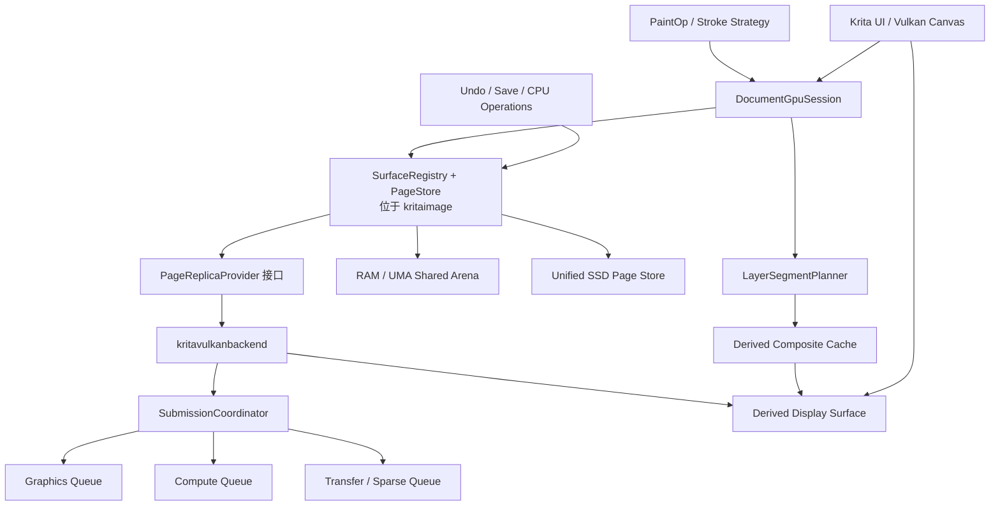

# P0 校正总纲：重建方向无误的 Vulkan 基线

> 本文是 Vulkan 全局 P0 校正的权威总纲，覆盖模块依赖、canonical data、replica、文档会话、提交线程、
> 图层图、格式能力、自动化边界和基线重置。GPU stroke 是其中一个 consumer，继续服从
> [10_gpu_stroke_foundation.md](10_gpu_stroke_foundation.md) 及其专题文档。

## 0. 结论与权威层级

这次不应修补现有 `TileManager + sparse canvas + global PaintRouter` 路径，而应做一次受控架构重置。

当前原型保留在 Git 历史或归档分支中；新的校正基线删除错误运行路径，只迁移能够证明独立正确的纯算法代码。
校正期间 Vulkan 功能宁可不可用，也不能保留“能跑但数据模型错误”的兼容路径。

核心原则：

> Krita 逻辑 tile、COW、undo、swap 语义成为唯一 canonical page 身份；UMA、独显 VRAM、RAM、SSD、
> 显示纹理都只是同一 generation 的不同 replica。

文档权威顺序：

1. 项目状态/MVP 边界：[00_status_and_mvp_contract.md](00_status_and_mvp_contract.md)
2. Vulkan 全局 P0 架构：本文
3. Canonical PageStore 与 Krita tile/COW/swap：
   [25_p0_canonical_pagestore_krita_tile_cow_swap.md](25_p0_canonical_pagestore_krita_tile_cow_swap.md)
4. GPU stroke： [10_gpu_stroke_foundation.md](10_gpu_stroke_foundation.md)
5. 各具体问题的实现细节：本文专题索引
6. 当前完成情况：始终以源码、构建和测试证据为准

## 1. P0 专题索引

| 问题域 | 权威专题 |
|---|---|
| CMake、库边界、单向依赖 | [23_p0_module_boundaries_and_build_graph.md](23_p0_module_boundaries_and_build_graph.md) |
| 新基线 foundation target、private/public、运行时 owner | [41_vulkan_foundation_build_architecture.md](41_vulkan_foundation_build_architecture.md) |
| 旧 device/shader/compositor/canvas 能力提取判定 | [42_legacy_vulkan_capability_extraction_matrix.md](42_legacy_vulkan_capability_extraction_matrix.md) |
| Foundation 施工、构建配置与 BR0 门禁 | [43_foundation_construction_sequence_and_gates.md](43_foundation_construction_sequence_and_gates.md) |
| Shader/pass ABI、compositor、display、WSI/canvas 重建 | [44_shader_compositor_canvas_reconstruction.md](44_shader_compositor_canvas_reconstruction.md) |
| BackendReadyToken、DocumentGpuSession、入口与多 canvas | [24_p0_backend_lifecycle_and_document_sessions.md](24_p0_backend_lifecycle_and_document_sessions.md) |
| Canonical PageStore、Krita tile/COW/undo/swap 吸收 | [25_p0_canonical_pagestore_krita_tile_cow_swap.md](25_p0_canonical_pagestore_krita_tile_cow_swap.md) |
| UMA、dGPU、RAM、SSD replica | [26_p0_replica_uma_dgpu_ssd.md](26_p0_replica_uma_dgpu_ssd.md) |
| 虚拟纹理算法总纲、评分与冻结边界 | [32_virtual_texture_architecture_decisions.md](32_virtual_texture_architecture_decisions.md) |
| PageStore 状态机、并发与 transaction | [33_virtual_texture_pagestore_state_machine.md](33_virtual_texture_pagestore_state_machine.md) |
| GPU 页绑定、slab、atlas 与 sparse | [34_virtual_texture_gpu_binding_and_arenas.md](34_virtual_texture_gpu_binding_and_arenas.md) |
| UMA/dGPU/SSD/温度细化 | [35_virtual_texture_uma_pointer_bypass.md](35_virtual_texture_uma_pointer_bypass.md)–[38_virtual_texture_residency_temperature.md](38_virtual_texture_residency_temperature.md) |
| 虚拟纹理性能决策与基准门禁 | [39_virtual_texture_performance_gates.md](39_virtual_texture_performance_gates.md) |
| Queue 独占、command arena、零阻塞与关闭 | [27_p0_submission_threading_zero_blocking.md](27_p0_submission_threading_zero_blocking.md) |
| GraphEpoch、ActiveTargetSet、projection、compositor、display | [28_p0_graph_epoch_projection_display.md](28_p0_graph_epoch_projection_display.md) |
| SurfaceFormat、颜色、LoD 与能力声明 | [29_p0_surface_format_lod_capabilities.md](29_p0_surface_format_lod_capabilities.md) |
| CI 架构守卫与测试矩阵 | [30_p0_ci_architecture_guards.md](30_p0_ci_architecture_guards.md) |
| 归档、删除、BR0–BR6 和基线切换 | [31_p0_reset_and_execution_sequence.md](31_p0_reset_and_execution_sequence.md) |
| GPU stroke 命令/执行 | [10_gpu_stroke_foundation.md](10_gpu_stroke_foundation.md)–[13_page_work_compiler_and_gpu_kernel.md](13_page_work_compiler_and_gpu_kernel.md) |
| Undo/save/cancel/recovery | [18_undo_save_cancel_and_recovery.md](18_undo_save_cancel_and_recovery.md) |

## 2. 最终模块边界



语义依赖必须单向；具体 CMake 通过下游 adapter 组装：

```text
application -> kritavulkanuiadapter -> { kritaui, kritavulkanbackend }
kritavulkanbackend -> kritaimage
paintop plugins -> kritaimage backend-neutral session contracts
```

绝不允许再次出现：

```text
kritaui ↔ kritaimagevulkan
```

具体边界：

- `kritaimage`：Surface/Page、lease、generation、COW、undo、SSD、backend-neutral ticket。
- `kritavulkanbackend`：Vulkan device、replica、direct/local binding、可选稀疏目录、shader、提交协调器。
- `kritaui/vulkan` adapter：窗口/native surface descriptor、view/display intent、装饰层和产品门禁；backend WSI
  service 管理 swapchain generation 与 present packet；两者都不管理画布权威像素。
- paintop：通过 `KisPaintExecutionContext` 获取当前 `DocumentGpuSession`，不访问 UI canvas。
- 全局只允许不可变的设备服务注册表；禁止“当前活动 canvas/router”全局变量。

由于 `kritaimage` 不能依赖 concrete Vulkan backend，`KisImage` 持有的是定义在 `kritaimage` 的
backend-neutral document acceleration session 接口/slot；`kritavulkanbackend` 提供 concrete
`VulkanDocumentGpuSession`。本文统一用 `DocumentGpuSession` 表示文档归属的会话语义。

## 3. P0 问题与永久方案

| 当前问题 | 最终设计 | 必须删除的旧方向 |
|---|---|---|
| CMake 双向依赖 | 拆分 `kritaimage` 页面核心、`kritavulkanbackend`、UI adapter；后端禁止链接 `kritaui` | 当前混合 PaintOp、RenderThread、Compositor、UI 类型的 `image_vulkan` 边界 |
| Vulkan 入口不可达、假成功 | 后端初始化返回不可伪造的 `BackendReadyToken`；canvas 只有拿到 token、swapchain 和 document session 后才能替换原 canvas | 构造函数写 `VULKAN_STARTED`、隐藏配置键、静态 `isAvailable` 判定 |
| `flushAndPause` 不 flush | 删除 pause/flush 协议。所有工作提交返回 `GpuTicket`，stroke commit 依赖最后一个 publish ticket | `pauseRendering()`、`flushAndPause()`、依靠线程暂停实现一致性 |
| UI/线程阻塞 | UI/input 只提交 immutable snapshot；resize 使用 swapchain generation 退休；save/CPU access 使用可续执行 job 等待 ticket | 热路径上的 `vkDeviceWaitIdle`、`vkQueueWaitIdle`、无限 fence wait |
| 单 command buffer 异步复用 | 每 queue family 使用 timeline 管理的 command arena；command buffer 只有在完成值到达后才能回收 | `KisVulkanTransferQueue` 单 buffer 模型 |
| 多队列没有依赖 | 一个 `SubmissionCoordinator` 独占所有 `VkQueue`；transfer、sparse bind、compute、graphics、present 组成显式 DAG | 任何模块自行调用 `vkQueueSubmit`/`vkQueueBindSparse`/`vkQueuePresentKHR` |
| 重叠 dab 无内存顺序 | 使用按页面分桶的有序 stroke worklist；每个页面内严格按 stroke sequence 处理 dab | CPU 循环“一 dab 一 dispatch”且无 barrier |
| 脏页直接淘汰 | authority handoff 只能在目标 replica 完成并校验后原子提交；失败保留旧 authority | `evictColdestTile()` 先解绑后假定 staging 有效 |
| 64×64 等同 sparse block | 逻辑页固定服从 Krita tile；GPU 使用 fixed-slot slab 和 operation-scoped binding；sparse image 只是可选 provider | 逻辑 tile 直接生成 `VkSparseImageMemoryBind` |
| UMA 只是 staging | UMA canonical arena 使用持久映射 buffer；CPU pointer 与 GPU opaque handle/address访问同一物理页 | “host-visible staging 即 UMA 零拷贝” |
| SSD 只有枚举 | 吸收并升级 Krita 现有 `KisTileDataStore` 和 `KisSwappedDataStore`，形成唯一 SSD store | Vulkan 再造独立 L3/cache/swap |
| projection、活动层、显示共用一张 image | 每个 PaintDevice 对应 canonical surface；合成和显示都是带 dependency generation 的 derived surface | CPU flattened projection 上传覆盖活动层；active layer alias canvas image |
| 全局 Router、多画布串扰 | `DocumentGpuSession` 归属 `KisImage`；多个 canvas 共享同一文档 session，不同文档完全隔离 | `activeInstance()`、全局 factory wrap、跨线程裸 backend 指针 |
| 固定 RGBA8 | `SurfaceFormat` 保存 KoColorSpace、通道、位深、alpha 语义；GPU codec 明确声明支持矩阵 | 固定 `pixelSize=4`、原始 `readBytes()` 直接当 RGBA8 |
| undo/save 依赖 stroke-end 回读 | 首次写页时做 generation COW；undo 保存旧 generation 引用；save 获取 immutable image epoch | `KisVulkanSyncStrokeStrategy` 回写 CPU 后再提交 transaction |
| LoD/能力虚报 | 能力由后端 descriptor 查询；没有 mip/page pyramid 就返回不支持 | Vulkan canvas 无条件报告 LoD 支持 |
| compositor 输出错误 | Layer planner 产生精确 derived surface，display descriptor 绑定该 surface generation | 局部变量选择 composite image、descriptor 仍绑定 sparse canvas |

## 4. PageStore 的绝对不变量

每个页面至少包含：

```text
SurfaceId
LogicalPageId
SurfaceFormat
PublishedGeneration
PreparedGenerationsByTransaction
WriteGeneration
AuthorityReplica
ValidReplicas[domain, generation]
ReadLeases
WriteLease
InFlightTickets
PinReasons
ResidencyPolicyHandle / SemanticClassSnapshot (non-authoritative)
SsdRecord
DependencyGenerations
```

永久不变量：

1. 同一 page generation 最多一个 writer。
2. producer publish 只产生 Prepared generation；所属 ImageEpoch transaction commit 前，旧 PublishedGeneration
   始终有效，普通 reader 不观察半提交 page set。
3. writer 失败或取消，只丢弃新 generation，不污染旧 generation。
4. 淘汰 authority 前，必须已经有另一个同 generation 有效副本。
5. SSD record 未完成写入和校验前，RAM/UMA authority 不得释放。
6. derived page 永远不能成为 canonical authority。
7. 所有 CPU/GPU 访问必须持有 lease。
8. 所有状态变更只能由 PageStore 在 ticket 完成后提交，调用者不得直接改 dirty/tier/layout。

建议 API 固定为：

```cpp
ReadRequest  acquireRead(PageRange, AccessDomain, Priority);
WriteRequest acquireWrite(PageRange, AccessDomain, WriteMode, Priority);

ReadLease  resolve(ReadRequest, CompletionTicket);
WriteLease resolve(WriteRequest, CompletionTicket);

GpuTicket publish(WriteLease, GpuTicket producerCompletion);
void cancel(WriteLease);

PageTransaction beginTransaction(ImageEpochId base);
ImageEpochCommitTicket commit(PageTransaction, PreparedPageSet);
void abort(PageTransaction);
ImageEpochSnapshot captureCommittedEpoch();
```

返回的 lease 可以包含 CPU pointer 或 opaque GPU binding handle，但消费者不得知道页面当前位于 RAM、UMA、VRAM
还是 SSD。

这里的 PageStore 不是与 Krita tiles3 平行的新 tile store。它是对现有逻辑 tile、tile data、COW/memento、
swap identity 的显式 generation/lease/replica 化。现有 `KisTileDataStore`、`KisMementoManager`、
`KisSwappedDataStore` 是需要被吸收和演进的 canonical 基础。

## 5. UMA、独显和 SSD 的统一模型

### 5.1 UMA

- canonical page 来自持久映射、host-visible、device-addressable buffer arena。
- CPU iterator 直接获得页指针。
- GPU shader 通过 direct PageHandle 或 operation-scoped binding table 访问同一页；BDA 与 descriptor+offset 均可。
- CPU→GPU、GPU→CPU 只有 ownership、timeline 和 cache maintenance，不复制画布像素。
- sampled image/atlas 只作为可丢弃的显示缓存。

### 5.2 独显

- logical generation 不变。
- RAM、VRAM 是两个 replica domain。
- GPU write 完成后 VRAM 可以暂时成为 authority。
- CPU、save、SSD 请求触发按页 materialization。
- 上传、下载、bind、shader、present 都由同一个提交 DAG 排序。

### 5.3 SSD

只保留一套 SSD 后端，直接演进 Krita 当前 swap：

```text
SurfaceId
PageId
Generation
FormatId
Codec
CompressedSize
UncompressedSize
Checksum
CommitSequence
```

使用 append-only segment、原子 index commit 和后台 GC。SessionSpill 与 RecoveryCheckpoint 耐久等级分离；禁止
每页 fsync。写失败、校验失败、取消时不得改变 authority。

## 6. GPU Stroke

GPU stroke 的最终形态已经在以下文档完整建立，本总纲不删减也不另建第二套执行模型：

- [10_gpu_stroke_foundation.md](10_gpu_stroke_foundation.md)
- [12_stroke_protocol_and_journal.md](12_stroke_protocol_and_journal.md)
- [13_page_work_compiler_and_gpu_kernel.md](13_page_work_compiler_and_gpu_kernel.md)
- [19_brush_resources_and_capability_gate.md](19_brush_resources_and_capability_gate.md)

它必须作为 canonical PageStore 的 lease/ticket consumer 实现，不能重新拥有 tile、swap、undo 或 display authority。

## 7. ActiveTargetSet 与非目标图层剪枝

每个 stroke 创建不可变 `GraphEpoch`：

```text
GraphEpoch
├── ActiveTargetSet
├── LayerGraphVersion
├── PropertyGenerations
├── LowerSegments
├── TargetSegments
└── UpperSegments
```

单目标时：

```text
LowerCheckpoint -> WritableTarget -> UpperReplay/UpperOperator -> Display
```

规则：

- 当前目标页和预测笔迹范围硬 pin。
- LowerCheckpoint 是目标输入前的精确结果。
- 普通 source-over 上层可缓存为 operator/overlay。
- backdrop-dependent blend、filter、mask 必须保存 replay bundle，不能在透明背景上错误拍平。
- derived cache 带完整 dependency generation vector。
- 图层属性、节点图、动画帧或目标集变化时创建新 epoch，不原地修改旧缓存。
- 被有效 lower/upper cache 覆盖的非目标 canonical 页标记 `CoveredCold`，优先下沉 RAM/SSD。

## 8. 线程与“零阻塞”硬定义

允许宣称零阻塞前必须满足：

- UI/input thread 不调用 Vulkan wait、page materialization 或 SSD I/O。
- render/submission thread 不等待 CPU fence；只根据 timeline 完成值回收资源。
- `vkAcquireNextImageKHR` 使用非阻塞或有界策略；没有 frame slot 就跳帧。
- swapchain resize 创建新 generation，旧资源按 timeline 延迟销毁。
- save/export 在后台等待 immutable image epoch；绘画可以继续写下一 generation。
- CPU 算法需要缺页时，stroke scheduler 挂起 job 并在 lease ready 后续跑，不占住工作线程。
- shutdown 顺序固定为：拒绝新请求 → 取消或完成 session → 等待已知 timeline → 释放资源。
- 禁止对仍在提交工作的 device 调用 `vkDeviceWaitIdle()`。

“零阻塞”不是没有依赖，而是交互线程不等待外部完成；依赖由可续执行 job、ticket 和 timeline 表达。

## 9. 新基线必须删除或重写的代码

直接删除，不保留编译开关：

- `KisVulkanPaintRouter::activeInstance`；
- `KisVulkanPaintOpFactory` 全局 wrap；
- `KisVulkanSyncStrokeStrategy` 的 stroke-end 下载模型；
- `KisVulkanUpdateInfo` 原始 projection 像素副本；
- `KisVulkanTileData::Tier`；
- 当前 `TileCache/Prefetcher/TransferQueue`；
- fixed 8192×8192 fallback image；
- canvas projection 与 active layer 共用 sparse image；
- `flushAndPause`、同步 resize；
- “每 dab 一 dispatch”路径。

可迁移但必须接入新接口后才能进入新树：

- blend shader 数学函数；
- preset analyzer 的纯解析部分；
- brush resource decoder/cache key；
- dynamics 求值；
- device capability 查询；
- outline/decorations graphics 代码；
- shader 构建基础设施。

Git 历史已经保存原型，不需要在源码树中再保留一套 legacy runtime。

## 10. 自动化硬边界

CI 增加结构检查：

- `kritavulkanbackend` 链接项中出现 `kritaui`，构建失败。
- 除 `SubmissionCoordinator` 外出现 `vkQueueSubmit`、`vkQueueBindSparse`、`vkQueuePresentKHR`，构建失败。
- runtime 出现 `vkQueueWaitIdle`、`vkDeviceWaitIdle`、无限 fence wait，构建失败。
- 出现 `activeInstance`、跨线程裸 backend 指针，静态检查失败。
- 新增独立 Vulkan swap/SSD/cache，架构测试失败。
- capability 宣称没有对应 GPU golden test，测试失败。
- Vulkan validation layer 报错，测试失败。
- page 状态机不变量在 debug/CI 中始终开启。

必须具备的测试：

- 小预算下 VRAM→RAM→SSD→RAM→VRAM 随机迁移和 checksum。
- SSD 写失败、取消、损坏恢复。
- UMA 路径画布像素 copy 计数严格为零。
- overlapping dab 顺序 golden image。
- selection、alpha lock、wash、撤销、立即保存/重开。
- 多文档、多 canvas、关闭其中一个 canvas。
- 同 queue family 与独立 queue family 两套同步矩阵。
- layer graph 随机变更与 derived cache generation 校验。
- 4/8/16 字节像素格式及不支持格式的前置 CPU 路由。

## 11. 执行顺序

### BR0：建立干净校正基线

- 将当前分支完整归档。
- 从更新后的目标 Krita upstream 建新基线分支。
- 携带统一设计文档和可复用测试数据。
- 删除旧 Vulkan runtime、入口和双向 CMake 依赖。
- 冻结 foundation target/private-public/运行时 owner，并完成旧能力逐项提取判定；第一版 skeleton 不是稳定 ABI。
- 建立不接入产品的 device/shader/offscreen foundation 构建与 smoke 边界。
- Vulkan 开关保持不可用，Krita CPU/OpenGL 行为完全回归。

### BR1：Canonical PageStore

- 把现有 tile/COW/swap 吸收到 Surface/Page/generation/lease 模型。
- 先证明纯 CPU 行为、undo、save 与原 Krita 像素一致。
- 不创建第二套 tile 存储。

### BR2：SubmissionCoordinator

- 完成 queue 独占、timeline DAG、command arena、resource retirement。
- validation 和 fault injection 全通过。

### BR3：UMA、dGPU、SSD replica

- 三个 domain 共用同一状态机。
- 完成 pointer bypass、VRAM replica、SSD durability。
- 强制迁移测试通过。

### BR4：ActiveTargetSet、温度与图层剪枝

- 完成 GraphEpoch、lower/upper cache、dependency invalidation。
- 温度只消费语义事件，不再维护独立 age/LRU 真相。
- 最终策略按 safety eligibility、semantic class、cost/CLOCK history 分层；`CoveredCold` 必须有
  `CoverageCertificate`。

### BR5：GPU stroke、undo、save

- 接入 page write lease。
- 完成有序 page worklist、COW undo、immutable save epoch。
- 所有像素一致性测试通过。

### BR6：Vulkan UI/display

- canvas 只消费 derived display surface。
- 完成多 canvas、resize、color/display filter 和安全回退。
- 只有到这一阶段全部通过，才重新开放 Vulkan 用户选项。

## 12. 基线完成定义

校正基线不是“又能显示 Vulkan 画布”，而是：

- 旧错误运行路径已经从源码树消失；
- 依赖方向永久单向；
- canonical page、generation、lease 和 ticket 接口被冻结；
- 所有未来能力只能作为 replica、policy 或 consumer 扩展；
- 不再允许改变权威数据模型来增加功能；
- Vulkan 功能在整个 MVP 验收完成前不可对用户启用。

这保证后续增加笔刷、图层、滤镜、色彩格式和平台支持时，只扩展能力，不再推翻存储、线程和一致性基础。
