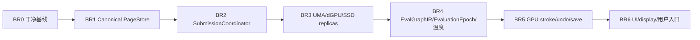

# P0 受控重置、BR0–BR6 执行顺序与基线切换

> 本文是 Vulkan 全局重建的唯一阶段计划。GPU stroke 自身的细化施工见
> [21_implementation_and_baseline_cutover.md](21_implementation_and_baseline_cutover.md)，但其阶段不得改变本文的
> BR0–BR6 顺序、进入条件或全局出口。

## 1. 重置结论

本次不在现有 `TileManager + sparse canvas + global PaintRouter` runtime 上修补。执行一次受控重置：

1. 保存现有原型的完整 Git 可追溯性；
2. 从更新后的目标 Krita upstream 建立新校正分支；
3. 只迁移经独立测试证明正确、且不携带错误所有权的纯算法或测试资产；
4. 删除旧 runtime、入口、双向依赖和兼容桥；
5. Vulkan 用户功能维持不可用，直到 BR6 和 MVP 总验收全部通过。

“受控重置”不是删除研究成果。它把可复用知识留在历史、文档、golden 数据和纯算法中，同时阻止错误的
tile identity、queue ownership、session ownership 或 display alias 进入新基础。

## 2. 分支与归档规则

### 2.1 归档当前原型

在执行代码重置前：

- 确认当前所有有意修改都有明确 commit；
- 创建不可歧义的 archive tag/branch，记录 upstream base SHA、submodule SHA、构建选项和已知测试状态；
- 保存关键演示输入、golden、trace 和设备 capability dump；
- 在归档说明中列出“可研究，不可回迁”的旧 runtime 模块；
- 不把大段旧实现复制到新源码树的 `legacy/` 或 compile flag 中。

Git 历史就是 legacy 存储。新树不再维护第二个可编译 runtime。

### 2.2 建立校正分支

新分支基于项目确定的目标 Krita upstream 最新基线，而不是继续堆叠旧实验分支。先完成 upstream 构建和
CPU/OpenGL 测试，再引入文档、架构守卫和新模块骨架。

如果 upstream 更新改变 tiles3、memento、projection 或 canvas 边界，应先重新做源码事实审计；不能按旧行号或
旧类形状机械套补丁。

### 2.3 可迁移清单

满足以下全部条件的内容才允许迁移：

- 无 UI/backend 全局状态；
- 不持有 canonical pixel storage；
- 不直接调用 Vulkan queue API；
- 输入输出可用纯数据表达；
- 有单元测试或 CPU/GPU golden；
- 接入新接口前不能进入 production runtime。

候选包括：

- blend shader 数学函数；
- preset analyzer 的纯解析部分；
- brush resource decoder 和稳定 cache key；
- dynamics 求值；
- device capability 查询；
- outline/decorations 图形算法；
- shader 构建基础设施；
- 可复用的测试图像、trace schema 和 fault cases。

## 3. 必须删除而非兼容的旧方向

BR0 直接移除：

- `KisVulkanPaintRouter::activeInstance`；
- `KisVulkanPaintOpFactory` 全局 wrap；
- `KisVulkanSyncStrokeStrategy` 的 stroke-end 回读提交；
- `KisVulkanUpdateInfo` 的 raw projection pixel payload；
- `KisVulkanTileData::Tier`；
- 当前 `TileCache`、`Prefetcher`、`TransferQueue`；
- fixed 8192×8192 fallback image；
- projection、active layer、display 共用 sparse image；
- `flushAndPause`、同步 resize；
- CPU 驱动的每 dab 一 dispatch；
- 使 `kritaimagevulkan` 反向链接 `kritaui` 的模块布局；
- 构造函数写成功标记、隐藏配置键绕过 readiness 的入口。

不得保留以下形式的替代品：

- `USE_LEGACY_VULKAN`；
- new path 失败后自动落回旧 Vulkan runtime；
- 新旧 PageStore 双写；
- 新 unified SSD 与旧 Vulkan swap 镜像；
- global router 改名为 service locator；
- 在 Presenter 内绕开 coordinator 直接 present。

CPU/OpenGL 是校正期间唯一产品 fallback，不是旧 Vulkan runtime。

## 4. 全局依赖与阶段关系

设计和 reference test 可以提前并行准备，但 production 集成不能跨越前置出口。例如：可以在 BR1 编写
SubmissionCoordinator fake，但不能在 canonical PageStore 未冻结时让 Vulkan replica 变成另一套 tile owner。

## 5. BR0：建立干净校正基线

### 5.1 工作

1. 完成归档和 upstream 新分支。
2. 将 [22_p0_vulkan_baseline_reconstruction.md](22_p0_vulkan_baseline_reconstruction.md) 及专题文档带入新分支。
3. 安装 [30_p0_ci_architecture_guards.md](30_p0_ci_architecture_guards.md) 中可静态执行的第一批守卫。
4. 删除旧 Vulkan runtime、入口和双向 CMake 依赖。
5. 建立空的目标 target：`kritavulkanbackend` 与 `kritaui/vulkan` adapter，但不伪造 ready。
6. 完成 [41_vulkan_foundation_build_architecture.md](41_vulkan_foundation_build_architecture.md) 定义的 foundation
   target/private-public/运行时 owner 设计，不把第一版 skeleton 当作冻结 ABI。
7. 按 [42_legacy_vulkan_capability_extraction_matrix.md](42_legacy_vulkan_capability_extraction_matrix.md) 为旧 device、
   shader、brush、compositor、display、WSI 能力建立提取/重写/废弃清单。
8. 建立 device/shader/offscreen foundation 的构建边界和 isolated smoke；不接入 document 或产品 canvas。
9. 保持 Vulkan 用户配置和入口关闭。
10. 跑通目标平台的 Krita CPU/OpenGL 构建与核心回归，并记录 Vulkan-foundation 构建证据。

### 5.2 明确不做

- 不追求显示 Vulkan 窗口；
- 不迁移 TileManager/sparse canvas 以维持截图；
- 不写临时 UI→backend→UI callback；
- 不用旧代码包住新接口；
- 不创建第二套 tile/swap。

### 5.3 出口

- 旧负向符号和 runtime 文件从 production tree 消失；
- target graph 单向、无环；
- foundation target 图、public/private header、device/submission/resource/shader/composite/display/WSI owner 已冻结；
- 旧原型每项基础能力有明确提取、重写或废弃判定；
- Vulkan 关闭时 CPU/OpenGL 行为与 upstream 基线一致；
- CPU-only 与 Vulkan-foundation 配置均有可复现构建证据，foundation offscreen smoke 不链接 UI；
- BackendReadyToken 尚未产生时 UI 不可能替换 canvas；
- archive 可复现但不参与新构建。

### 5.4 当前执行快照（2026-09-18）

已落地：

- 内层 Krita 仓库建立 `archive/vulkan-prototype-pre-br0-20260918`，提交 `7207640968` 保存删除前原型及其
  工作区修改；当前开发分支未切换到归档分支。
- 当前树物理删除完整旧 `libs/image_vulkan`、旧 `libs/ui/vulkan` 实现及旧 Vulkan 专项测试；随后在
  `libs/ui/vulkan` 原路径放入的是未接产品的新 adapter skeleton，未保留 legacy compile flag。
- 删除 `kritaimagevulkan` 构建目标、UI 双向链接、隐藏 canvas 配置入口、全局 PaintRouter 预上传和 raw
  projection update payload。
- 建立 `kritaimage` 的 backend-neutral disabled skeleton，以及只向下依赖 `kritaimage` 的
  `kritavulkanbackend` disabled skeleton；建立未被 `KisCanvas2` 或应用链接的 `kritavulkanuiadapter` disabled
  skeleton。
- Foundation skeleton 已升级为可验证契约：核心 registry、device/shader/memory/pipeline/submission/resource、
  pass preparation 与 WSI intent 具备实际状态和失败检查；独立 smoke 已实现真实 Vulkan device、VMA allocator、
  build-generated SPIR-V、compute queue submit 和 5 秒有界 timeline wait，但 production queue/swapchain 仍未实现。
- 安装 `build-tools/ci-scripts/check-vulkan-architecture.sh` 并接入 GitLab CI，当前静态运行通过。
- 完成删除后的结构复审，确认旧 runtime 不应恢复，同时确认 device/allocator/shader/pipeline/composite/display/WSI
  owner 与 legacy extraction 判定已经落位；内部实现保持非安装 ABI，产品入口仍关闭。
- CMake 3.29.3、Ninja、Qt 6.8 和 Vulkan SDK 1.4.341 环境已补齐。最新未修改 `origin/master`
  `9a24ae0d8c` 的 CPU/OpenGL baseline 构建和稳定核心测试 5/5 通过；当前树 CPU-only、foundation、shader、
  offscreen、UI adapter 构建及稳定核心测试 6/6 通过。完整证据见
  [45_br0_build_and_regression_evidence_20260918.md](45_br0_build_and_regression_evidence_20260918.md)。

BR0 已关闭：

- 当前分支已重放到已确认的 `origin/master` `9a24ae0d8c`，内层 BR0 提交为 `f5fbbde618`；重放前状态保存在
  `archive/br0-pre-upstream-replay-20260918`。
- 新 HEAD 已复跑 CPU-only、foundation、shader/offscreen、architecture guard 和 CPU/OpenGL 对照套件；完整证据见
  [45_br0_build_and_regression_evidence_20260918.md](45_br0_build_and_regression_evidence_20260918.md)。
- 产品 Vulkan 能力仍按阶段要求关闭：document session 只能停在 Initializing，isolated foundation smoke 不构成
  BR2–BR6 production ready 证据。

类与文件占位清单见
[40_br0_code_cutover_and_skeleton_inventory.md](40_br0_code_cutover_and_skeleton_inventory.md)。

## 6. BR1：Canonical PageStore

权威设计见 [25_p0_canonical_pagestore_krita_tile_cow_swap.md](25_p0_canonical_pagestore_krita_tile_cow_swap.md)；写侧 first-write、
backing handoff、硬预算与剩余 M6–M8 收口见 [92](92_br1_m6_m8_execution_baseline.md)。

### 6.1 工作

1. 在 `kritaimage` 内为现有逻辑 tile identity 增加 `SurfaceId + LogicalPageId + Generation`。
2. 将现有 tile data、default pixel、extent、clone 和 purge 语义映射为 page 生命周期。
3. 将 `KisMementoManager` 的 COW/oldData 语义演进为 generation reference，不复制一套 undo。
4. 将 `KisTileDataStore` 和 `KisSwappedDataStore` 演进为 RAM/SSD replica provider 的基础。
5. 冻结 backend-neutral request/lease/publish/cancel/ticket API。
6. 提供 CPU access facade，使 iterator、random/sequential accessor 继续保持 Krita 行为。
7. 建立 reference state machine、property test 和 fault injection。
8. 实现 virtual default、resident CPU native guard、显式 mutation session、PageStore 私有 write-plan、条件 backing handoff 与必要 first-write COW。
9. 将 production epoch root 与 reference 容器分离，使用 persistent structure 和 changed-page 增量 metadata。
10. 建立 current/history/pending/in-flight/retiring/optional backing ledger、硬字节预算、压力状态机、背压与 tiny-budget 门禁。

### 6.2 禁止捷径

- 不能先实现一个 Vulkan PageStore，再适配 `KisPaintDevice`；
- 不能让旧 tiled provider 与新 PageStore 双写同一像素；
- 不能把 page generation 简化为 dirty bit；
- 不能让 iterator 绕过 lease 直接抓可被迁移的裸地址；
- 不能把现有 swap 留作“CPU 路径”，另建 GPU SSD store。
- 不能让每次 resident tile lock 都走 heap request/global map/provider reverse scan；
- 不能把 reference `QHash/QVector` manifest rebuild/sort 当作 production commit 布局；
- 不能把 tile unlock 当成 transaction/epoch commit 边界。

### 6.3 出口

- 纯 CPU 的绘画、clone/COW、undo/redo、save/reopen 与 upstream 像素一致；
- 每个 canonical page 只有一套 identity 和 generation history；
- lease 与 authority 不变量通过随机状态空间测试；
- SSD 失败不能污染 published generation；
- blank/default read 保持 O(1) backing、零 page materialization；resident CPU 与 upstream 的性能差分达到 52 门禁；
- 同一 mutation 的同一未发布段每页至多一次 reserve、一次必要 COW、一次 seal；发布后新段重新取得 writer/permit，production commit 随 changed pages 扩展；
- Vulkan 尚未拥有任何 canonical 像素。

### 6.4 当前实施入口

BR1 的唯一当前执行入口是 [92](92_br1_m6_m8_execution_baseline.md)。M5 资源失败和发布安装修复提交 `5173c807c8` 已通过本轮完整验证，可进入 M6，证据与资格边界由 92 绑定；后续顺序为 **M6 recoverable → M7 bounded commit-only → M8 业务/生命周期与清理 → 正式 BR1-PERF**。

47–91 已全部退出当前执行口径，原状态与证据完整保留在 [历史索引](archive/br1_pre_m6_20260925/README.md)。本节原历史实施补记保存在该目录的 `previous-entry-snapshots.json`。BR1 尚未完成，全局 BR0–BR6 顺序、§6.3 出口和 BR2 production 禁止提前接线的约束保持不变。

## 7. BR2：SubmissionCoordinator

权威设计见 [27_p0_submission_threading_zero_blocking.md](27_p0_submission_threading_zero_blocking.md)。

### 7.1 工作

1. 选择 queue topology 并由 coordinator 独占全部 `VkQueue`。
2. 完成 timeline-backed DAG，并通过 typed backend-neutral `CompletionTicket` bridge 对接 GPU timeline。
3. 为每个 queue family 实现按完成值回收的 command arena。
4. 建立 descriptor、transient allocation、binding-table slot 和资源 retirement。
5. 定义 transfer/sparse/compute/graphics/present request，不让业务模块调用 queue API。
6. 实现 bounded acquire、present request 和 swapchain generation retirement 的底层能力。
7. 注入乱序完成、超时、OOM、device lost 和 shutdown。

### 7.2 出口

- queue API 二进制/源码扫描只发现 coordinator allowlist；
- 同/异 queue family 测试均无 validation 错误；
- command buffer 只在 timeline 完成后复用；
- UI/input 无 host wait；
- shutdown 按已知 timeline 收敛，不对活动 device wait-idle。

BR2 不要求画笔或 canvas 可见；用 fake workload 和测试 surface 证明调度性质。
其 production 接入前置条件是 BR1-PERF 全部门禁通过；隔离的协议/reference 工作不能被记为跨过阶段门槛。

## 8. BR3：UMA、dGPU 与 SSD replica

权威设计见 [26_p0_replica_uma_dgpu_ssd.md](26_p0_replica_uma_dgpu_ssd.md)。
算法实现服从 [34_virtual_texture_gpu_binding_and_arenas.md](34_virtual_texture_gpu_binding_and_arenas.md)–
[37_virtual_texture_ssd_segment_store.md](37_virtual_texture_ssd_segment_store.md)。

### 8.1 UMA

- 建立持久映射、host-visible、device-addressable shared arena；
- 使用按 StorageClass 分类的 fixed-slot slab；
- CPU iterator 指针和 GPU opaque handle/address访问同一 canonical page generation；
- BDA 和 descriptor+offset 共享同一 binding ABI；
- 明确 coherent/non-coherent cache maintenance；
- sampled atlas/image 只作可丢弃 derived cache；
- 同一兼容驻留 shared backing 的真实 CPU↔GPU 交接中 payload migration count/bytes 严格为零，COW/undo/derived copy
  单列；适用条件与计数覆盖见 39 的 5.7，不把必要同步或总耗时记零。

### 8.2 dGPU

- RAM 与 VRAM 是同一 generation 的 replica；
- stroke 使用 direct PageHandle，composite/filter 使用 operation-scoped immutable local binding table；
- 非局部访问才允许两级稀疏后备目录；
- sparse image 仅在能力和几何适合时作为可选优化；
- upload/download 按 byte/deadline合批，禁止 per-fault submit；
- 建立 staging timeline retirement 和 authority handoff emergency reserve；
- GPU write 完成后 VRAM 可成为 authority；
- CPU/save/SSD 请求按页 materialize，不全画布回读。

### 8.3 SSD

- 只扩展 `kritaimage` 的 unified SSD store；
- record 包含 surface/page/generation/format/codec/size/checksum/commit sequence；
- append-only segment、原子 index commit、后台 GC；
- 区分 SessionSpill 与 RecoveryCheckpoint；禁止每页 fsync和正常写入立即整页读回；
- write/cancel/corruption/device-loss 不能提前释放旧 authority。

### 8.4 出口

- UMA pointer bypass 测试通过，同一兼容驻留 shared backing 的真实交接符合 39 的 5.7 零 payload migration 要求；
  COW/undo/derived copy 单列，CPU-only 未交接不构成 UMA Pass；
- UMA shared mapped storage 的 CPU hot access 必须通过同机 native CpuRam/upstream 差分；超过 39 的门限时，只能作为
  GPU replica，CPU authority/产品 route 回到 CpuRam，不能以 copy=0 宣称性能通过；
- 小预算下 dGPU 强制 VRAM→RAM→SSD→RAM→VRAM 循环通过；
- checksum、authority、valid replica 集始终一致；
- stale ProviderEpoch/slot generation/operation completion 全部被拒绝；
- binding snapshot、staging和physical slot只在last-use ticket后退休；
- 三个 domain 共用一个状态机，不存在 backend 私有 page truth。

## 9. BR4：EvalGraphIR、MutationRootSet、温度和图层剪枝

权威设计见 [28_p0_graph_epoch_projection_display.md](28_p0_graph_epoch_projection_display.md)。
驻留策略和预测算法服从
[38_virtual_texture_residency_temperature.md](38_virtual_texture_residency_temperature.md)。

### 9.1 工作

1. 冻结 Authoring Graph → EvalGraphIR → Execution Task DAG 三层边界；通用层不得出现 Layer/Vulkan 类型。
2. 实现 versioned authoring snapshot、Layer Tree reference lowerer、CPU evaluator 和 `KisEvaluationPlanner`。
3. EvalGraphIR 明确 typed ports/edges、requested outputs、operation semantic version、ROI/purity/determinism contract。
4. `EvaluationEpoch::MutationRootSet` 允许为空；stroke 开始时冻结非空 writable targets 并映射为 mutation roots。
5. Layer lowering optimization 实现 lower/target/upper 精确切分；分类不得进入通用 IR/executor ABI。
6. lower checkpoint、upper operator/overlay/replay 带完整 dependency vector；backdrop-dependent 语义不错误 flatten。
7. canonical projection、derived evaluation output 和 DisplaySurface 身份彻底分离。
8. 温度控制器先执行 safety eligibility，再按 semantic class 和 cost/CLOCK history 选候选。
9. 为被有效 derived cache 覆盖的非目标页生成 `CoverageCertificate`，只有证书有效时标为 `CoveredCold`。
10. 使用 materialization P95 推导有界 trajectory corridor、deadline和soft-pin TTL；prefetch 不创建 generation。
11. 完成多文档公平性、高低水位、minimum residence、cooldown和backpressure。

### 9.2 出口

- authoring graph/property/frame/context/operation version 变化创建新 epoch，不原地篡改旧 cache；
- source/diamond/fan-out/multi-output/random DAG 和空 MutationRootSet 测试不会接受 stale derived output；
- Layer Tree 与等价 Flow graph 的 CPU reference 输出和 dependency identity 一致；
- display descriptor 精确绑定声明的 DisplaySurface generation；
- 非目标页剪枝不改变像素；
- stale CoverageCertificate 接受数为零；
- temperature 没有独立于 PageStore 的 age/LRU 真相，任何分数不能覆盖 lease/pin/authority safety；
- budget sweep 不出现持续反向迁移或文档 starvation。

## 10. BR5：GPU stroke、undo 与保存

GPU stroke 权威设计见 [10_gpu_stroke_foundation.md](10_gpu_stroke_foundation.md)–
[21_implementation_and_baseline_cutover.md](21_implementation_and_baseline_cutover.md)。

### 10.1 工作

1. PaintOp 通过 `KisPaintExecutionContext` 获取文档 session 和非空、唯一的 writable target identities。
2. stroke frontend 产生 immutable resolved commands/journal；不访问 UI canvas。
3. `PageWorkCompiler` 稳定地按 page 分桶，页内按 stroke sequence 执行 overlapping dabs。
4. 通过 PageStore write lease 进行 first-write generation COW。
5. page Prepared 依赖最后 producer ticket；完整 batch 通过 ImageEpoch manifest 原子 commit；失败/cancel 丢弃
   write generation。
6. undo 保存旧 generation reference；save 获取 immutable image epoch。
7. brush resource、correctness capability 与 performance profile 在 stroke 首次写入前共同决定 GPU 或 CPU route；实际 CPU
   产品路径和完整 accelerator ETA 没有足够收益余量时选择 CPU，route 在整笔期间冻结。
8. 运行 SurfaceFormat、selection、alpha lock、wash、undo/save/reopen golden。

### 10.2 出口

- 热路径没有 per-dab dispatch/submit/wait；
- overlapping dab 与 CPU reference 一致；
- stroke end 只完成 journal/commit handoff，不同步下载像素；
- 立即 undo、cancel、save、继续下一 stroke 都保持 generation isolation；
- 不支持能力在写入前完整路由 CPU；
- CPU-only、forced GPU/UMA 与 Auto 在 GPU 劣势、低功耗/温控、queue contention、UMA 带宽竞争 profile 中完成同质量
  对照；Auto median/P95 不超过真实 CPU 1.10×，P99/最长停顿不超过 1.25×，未达标 bucket 取消 `AutoPreferred` 并在写入前
  路由 CPU；
- device loss 能按 recoverability 规则保住最近 durable generation。

BR5 完成仍不意味着开放 Vulkan canvas；产品显示闭环在 BR6。

## 11. BR6：Vulkan UI、显示与用户入口

入口和 session 见 [24_p0_backend_lifecycle_and_document_sessions.md](24_p0_backend_lifecycle_and_document_sessions.md)，
显示见 [28_p0_graph_epoch_projection_display.md](28_p0_graph_epoch_projection_display.md)，格式见
[29_p0_surface_format_lod_capabilities.md](29_p0_surface_format_lod_capabilities.md)。

### 11.1 工作

1. BackendReadyToken 只由完成设备、queue、coordinator、provider 和 capability 初始化的 backend 产生。
2. `KisImage` 拥有 backend-neutral document session；同文档 canvas 共享 session，不同文档隔离。
3. canvas 在 token、swapchain 和 session 同时有效后才替换普通 canvas。
4. UI adapter 只处理 native surface/view intent、DisplaySurface 选择、transform、decorations 和输入转发；backend
   WSI service 管理实际 surface/swapchain generation。
5. Presenter 只构造请求/处理结果；SubmissionCoordinator 调用 `vkQueuePresentKHR`。
6. resize/out-of-date/minimize 使用 swapchain generation 和 timeline retirement。
7. color conversion、proofing、display filter、LoD capability 按 descriptor 和 golden 声明。
8. 运行多文档、多 canvas、关闭、device loss 和完整产品性能测试。

### 11.2 开放用户选项的原子门槛

只有同时满足以下条件才允许启用 Vulkan 用户选项：

- BR0–BR6 所有出口均已通过主分支 CI；
- [30_p0_ci_architecture_guards.md](30_p0_ci_architecture_guards.md) 的 Tier 0–4 通过；
- 当前支持矩阵没有未验证的 `true`；
- CPU/OpenGL fallback 仍完整；
- 没有编译中的 legacy runtime；
- 已完成至少一次 supported UMA 和 dGPU 长时稳定性运行。

不能用 hidden setting、environment variable 或 debug menu 提前形成产品入口。开发测试使用明确的 test harness。

## 12. 建议提交序列

提交应小到能证明单一性质，但不能留下可被误用的半语义 runtime。推荐：

1. `docs: freeze P0 architecture and authority`
2. `ci: add dependency and forbidden-runtime guards`
3. `build: remove legacy vulkan runtime and break ui cycle`
4. `image: introduce canonical surface page generation identities`
5. `image: absorb cow memento into generation references`
6. `image: add sharded pagestore transactions and materialization dedup`
7. `image: evolve unified segmented ssd page store`
8. `backend: add coordinator ticket dag and command arenas`
9. `backend: add fixed-slot gpu arenas and immutable bindings`
10. `backend: add uma shared replica and ownership protocol`
11. `backend: add deadline-aware dgpu migrations and reserves`
12. `image: add evaluation epoch coverage certificates and residency policy`
13. `stroke: add journal page compiler and ordered kernels`
14. `image: bind undo save cancel to immutable generations`
15. `ui: add display-surface-only vulkan adapter`
16. `product: enable vulkan option after full gate`

每个提交都应保持：CPU/OpenGL 可用、Vulkan 产品入口关闭、已引入的不变量测试全绿。

## 13. 与既有细化阶段的映射

旧文档中的 `VT*`、`GS*`、`SQ*`、`SR*`、`CP*`、`KI*`、`UR*`、`OT*` 是专题内部工作包，
不是并列的全局路线。它们只能落在下列 BR 容器内：

| 全局阶段 | 可执行的专题工作包 |
|---|---|
| BR0 | 事实审计、文档、静态守卫、旧入口删除、foundation target/owner、legacy extraction、构建回归 |
| BR1 | PageStore/Krita integration、分片状态机、transaction、CPU reference、COW/swap |
| BR2 | SubmissionCoordinator、ticket、command/resource retirement |
| BR3 | fixed-slot binding、UMA/dGPU/SSD residency、deadline迁移和durability/GC |
| BR4 | EvalGraphIR/lowerer/task DAG、EvaluationEpoch、MutationRootSet、CoverageCertificate、语义温度、evaluation/display 数据流 |
| BR5 | stroke protocol/compiler/kernel、resource、undo/save/recovery |
| BR6 | WSI/presenter/UI adapter、能力开放和产品门禁 |

若专题编号与本文进入条件冲突，以本文为准并修订专题文档，而不是调整 BR 顺序来兼容旧计划。

## 14. 风险与回退

### 14.1 Upstream 漂移

风险是 tiles3 或 UI 边界变化。回退方式是重新审计和调整 adapter，不是恢复旧 global router 或另建存储。

### 14.2 某硬件缺能力

保持对应 capability 关闭或选择 direct/local software binding/CPU route。不能削弱 canonical PageStore、queue ownership 或
generation 语义来换取支持。

### 14.3 阶段性能未达标

先用 trace/counter 判定常数项、policy 问题或接入粒度/布局问题。可以调整 policy/consumer；当抽象迫使 resident 热路径
承担通用异步 control-plane 成本时，必须重构为等价 native guard/persistent layout，不能仅叠加缓存掩盖。实现始终
不能绕过 generation/lease/ticket/authority；若短期无法达标，按 52 恢复 upstream CPU 产品路径并隔离 PageStore 演进。

### 14.4 新路径未完成

Vulkan 保持不可用，CPU/OpenGL 继续工作。不可恢复旧 Vulkan runtime 来填补产品空窗。

## 15. 全局基线完成定义

校正基线完成必须同时满足：

- 旧错误运行路径从源码树和构建图消失；
- 依赖方向永久单向；
- canonical page、generation、lease、ticket 接口被冻结并有机器守卫；
- Krita tile/COW/undo/swap 已成为唯一 canonical PageStore 基础；
- UMA、VRAM、RAM、SSD、display 都只能作为 replica、policy 或 consumer 扩展；
- GPU stroke、合成、显示不拥有第二份数据真相；
- UI/input 零阻塞定义通过运行时计数证明；
- 所有 capability 与格式声明有对应 golden；
- GPU/UMA 的 correctness support 与 performance qualification 分离，Auto 在劣势 profile 下满足 39 的真实 CPU 相对门禁，
  未满足的 bucket 可观察地前置路由 CPU；
- Vulkan 功能直到整个 MVP 通过才对用户启用。

这不是“恢复一张 Vulkan 画布”的里程碑，而是以后增加笔刷、图层、滤镜、颜色格式和平台时无需再次推翻
存储、同步、线程和一致性基础的长期基线。
