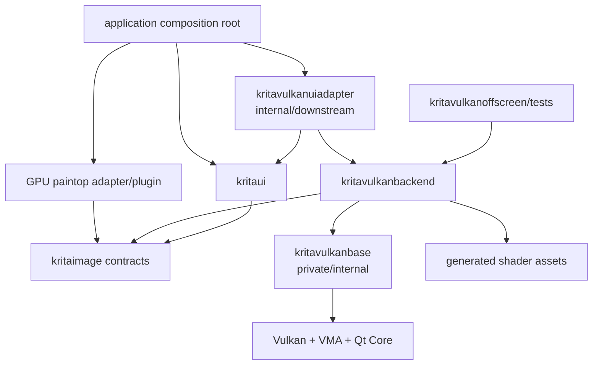
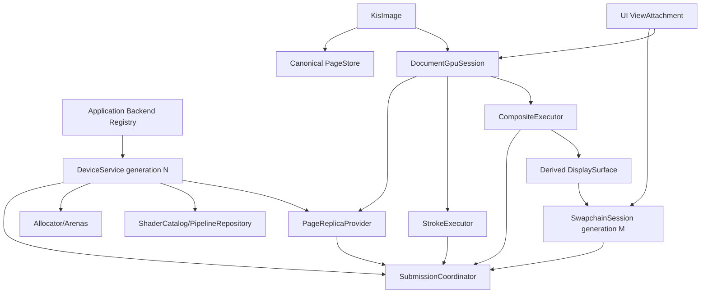

# Vulkan 新基线基础结构与构建架构

> 本文冻结“先构建什么、target 如何依赖、运行时对象由谁拥有”的基础结构。它位于 BR0 的结构设计出口，
> 不改变 [31_p0_reset_and_execution_sequence.md](31_p0_reset_and_execution_sequence.md) 的 BR0–BR6 顺序。
> PageStore、虚拟纹理、GPU stroke 与产品 canvas 的语义仍分别由既有专题文档定义。

## 1. 结论

旧 Vulkan 原型的运行时对象图不能恢复：它把 device、sparse canvas、PaintOp、RenderThread、compositor、
swapchain 和 UI 放入相互反向依赖的模块，并让 canvas 生命周期支配权威像素和 queue。

但 BR0 也不能只留下 `PageStore + SubmissionCoordinator + CanvasAdapter` 三组空壳就进入实现。旧树中以下基础能力
确实需要在新边界内重建或提纯：

- instance、physical device、queue family 与 capability probing；
- allocator、持久资源、descriptor/pipeline 与延迟回收；
- shader 编译、manifest、反射、ABI 和 semantic version；
- compute/graphics pass 的公共编码设施；
- incremental composite、DisplaySurface 和显示采样；
- native surface、swapchain generation、bounded acquire 与 present；
- offscreen validation、CPU/GPU golden、fault injection 和 trace。

因此 BR0 的正确关闭条件不是“旧代码已删除且有几个类名占位”，而是：

1. 新 target 图和源码归属已经冻结；
2. 旧能力已有逐项迁移判定；
3. foundation build 可以独立配置、编译和测试；
4. backend 内部对象不被误做成长期 public ABI；
5. Vulkan 产品入口仍然关闭。

## 2. 两张依赖图必须分开

### 2.1 数据与语义依赖

```text
Krita UI / PaintOp / save / undo
                 ↓
backend-neutral document/session/page contracts
                 ↓
canonical PageStore in kritaimage
```

Vulkan 只是这些契约的一个 replica、executor 和 display consumer。它不拥有 canonical tile、COW、undo 或 SSD
真相。

### 2.2 CMake 链接依赖



硬规则：

- `kritaimage` 不链接 Vulkan、backend 或 UI；
- `kritavulkanbackend` 不链接 `kritaui`；
- `kritaui` 不必直接链接 concrete backend；
- `kritavulkanuiadapter` 是同时消费 UI 和 backend 的下游组合层，不被两者反向链接；
- 普通 PaintOp 只消费 `KisPaintExecutionContext`/document session 契约，不包含 Vulkan header；
- application composition root 负责注册 backend service 和产品门禁，不用全局 active canvas 完成发现。

这比“`kritaui -> kritavulkanbackend -> kritaimage`”更精确：运行时调用方向可以从 UI 指向 backend，但库级
链接通过下游 adapter 组装，避免把 concrete backend 变成 `kritaui` 的基础依赖。

## 3. CMake target 设计

### 3.1 `kritaimage`

保留现有 shared target，不创建第二个 image/page core。它承载：

- `SurfaceId`、`PageKey`、generation、image/evaluation epoch；
- canonical PageStore、lease、publication、authority handoff；
- tile/COW/memento/undo/swap 的演进实现；
- backend-neutral completion、replica provider 和 document session interface；
- CPU reference codec、state machine、stroke work compiler 和 composite planner。

构建边界：

- 只有跨 target 真正需要稳定使用的值类型和 interface 才是 public/exported header；
- state machine implementation、registry implementation、policy 与测试 hook 默认 private；
- 不能因为骨架阶段方便，就把整个 `pagestore/` 和 `gpustroke/` 目录永久加入 public include ABI；
- `opaqueGpuBinding` 一类具体访问载荷在 BR1 冻结前改成 operation-scoped access view/interface，避免一个
  `quint64` 同时冒充 buffer address、descriptor index 和 atlas slot。

### 3.2 `kritavulkanbase`

内部 STATIC/OBJECT target，不安装为公共 Krita ABI。它只提供设备级、文档无关能力：

- `KisVulkanInstanceService`；
- `KisVulkanPhysicalDeviceSelector`；
- `KisVulkanCapabilitySnapshot`；
- `KisVulkanQueueTopology`；
- `KisVulkanDeviceService` 与 device generation；
- `KisVulkanAllocator`；
- debug messenger、validation/fault report；
- timestamp/query 基础设施。

它不知道 `KisImage`、PaintOp、PageStore、canvas 或 QWidget。queue handle 只能交给同一 backend 内部的
`SubmissionCoordinator` 构造路径，不能出现在 public getter 中。

### 3.3 shader asset build

`krita_vulkan_shader_assets` 是生成 target，不是运行时服务。它负责：

```text
source GLSL
 -> include dependency graph
 -> deterministic compiler flags
 -> SPIR-V
 -> reflection data
 -> generated manifest/C++ resource
 -> content hash + semantic ABI version
```

规则：

- shader 列表显式维护，禁止 `GLOB_RECURSE` 悄悄改变产品资产；
- `.comp/.vert/.frag` 同名时仍有唯一 asset id；
- 每个 entry 记录 stage、entry point、descriptor sets、push constants、specialization、required features、
  format/alpha semantic 和 source/content hash；
- backend 从生成 manifest/embedded resource 读取，不依赖 `KRITA_VULKAN_SHADER_DIR` 或 build-tree 绝对路径；
- required asset 缺失、反射与 C++ layout 不一致、semantic ABI 不匹配时，backend 不能产生 ready token；
- source include 中的 blend/brush 纯数学可单独 golden，但 descriptor/layout ABI 必须重写；
- release 构建不得因为本机没有 shader compiler 而静默生成一个“可编译但运行时找不到 shader”的 backend。

### 3.4 `kritavulkanbackend`

唯一 concrete backend shared target。它的 public 面只保留：

- device service factory/状态与不可变 capability descriptor；
- document session factory；
- backend-neutral view service interface 所需的窄入口；
- 结构化 failure report；
- 明确标记为 test-only 的 offscreen hooks。

其余实现按目录私有组织：

```text
libs/vulkanbackend/
  public/                 # 少量稳定 factory/interface
  base/                   # device service adapter
  submission/             # queue DAG, command/descriptor arena, reclaimer
  memory/                 # UMA/VRAM/staging/resource allocation
  pages/                  # replica provider, fixed-slot binding, codecs
  shaders/                # catalog, module/pipeline layout/cache
  stroke/                 # PageWork GPU packer and executor
  composite/              # segment/checkpoint/display executors
  display/                # DisplaySurface sampling and output pass
  wsi/                    # surface/swapchain session, acquire/present packets
  diagnostics/            # counters, timestamps, trace and fault injection
```

内部建议类：

| 子系统 | 根对象 | 所有权/限制 |
|---|---|---|
| device | `KisVulkanDeviceService` | 进程可共享、按 device generation 不可变；不含文档状态 |
| submission | `KisVulkanSubmissionCoordinator` | 每 device generation 一个；独占 submit/bind/present |
| commands | `KisVulkanCommandArenaSet` | 按 queue family/thread shard；timeline 后回收 |
| resources | `KisVulkanResourceRetirementQueue` | 持有 last-use ticket；禁止立即销毁 in-flight 资源 |
| shaders | `KisVulkanShaderCatalog` | 校验 manifest/ABI/feature；不接收任意文件路径 |
| pipelines | `KisVulkanPipelineRepository` | key 含 shader、format、alpha、feature、device generation |
| pages | `KisVulkanPageReplicaProvider` | 只拥有物理 replica；不改 canonical publication |
| bindings | `KisVulkanPageBindingTable` | operation-scoped 或 generation-qualified；默认私有 |
| evaluation/composite | `KisVulkanCompositeExecutor` | 消费已解析的 exact composite operation/access plan；不解释 authoring graph 或全局 task DAG |
| display | `KisVulkanDisplayExecutor` | 消费 DisplaySurface snapshot；不采样 active layer alias |
| WSI | `KisVulkanSwapchainSession` | 每 view 一份 generation；不拥有 document/session |

### 3.5 `kritavulkanuiadapter`

下游、internal target。它承载：

- Qt/Krita window、screen、DPI、visibility、input-facing canvas glue；
- 原生平台 surface descriptor 的采集；
- view attach/detach、resize/minimize/out-of-date 事件；
- canvas transform、display filter request、outline/decoration scene；
- 产品替换和 CPU/OpenGL 回退门禁。

它不承载：

- `VkQueue`、command pool、canonical pixels、PageStore、stroke journal；
- swapchain image 的同步真相；
- queue present；
- document session 的所有权。

UI adapter 把 `KisNativeSurfaceDescriptor` 交给 backend WSI service。backend 创建/持有 `VkSurfaceKHR` 和
swapchain generation，`SubmissionCoordinator` 执行 present。UI 只能得到 opaque view/swapchain generation 和
结构化结果。

### 3.6 offscreen/test targets

- `kritavulkanoffscreen`: 不链接 `kritaui`，初始化 device service、submission、resource 和 shader；
- `kritavulkanbase_tests`: capability/queue/allocator/manifest；
- `kritavulkansubmission_tests`: fake queue model、timeline、retirement、device loss；
- `kritavulkanshader_tests`: compile/reflection/CPU-GPU golden；
- `kritavulkanpage_tests`: binding、migration、codec、fault injection；
- `kritavulkancomposite_tests`: layer semantics、dependency invalidation、DisplaySurface golden；
- `kritavulkanwsi_tests`: 有窗口平台集成测试，和无窗口状态机测试分开。

测试 target 不得借链接 `kritaui` 绕开 backend 边界。

## 4. 运行时对象图



所有权规则：

1. device service 可以被多个文档共享，device loss 创建新 generation，不原地换 handle；
2. document session 归 `KisImage`，canvas detach 不销毁 session；
3. view/swapchain 归一个 view attachment，resize 创建新 generation 并退休旧资源；
4. PageStore 是 authority/generation 状态唯一写入者；
5. coordinator 是所有 queue API 唯一调用者；
6. executor 只编码 immutable work packet，不直接 publish、不直接提交、不直接等待；
7. completion callback 先核验 device/session/page/write generation，再让 PageStore 原子 publish；
8. shutdown 通过已知 ticket drain/continuation 完成，不把 `vkDeviceWaitIdle` 当生命周期协议。

## 5. 初始化顺序与 readiness 证据

```text
Compiled
 -> Probe instance/extensions/layers
 -> Select physical device
 -> Freeze capability + queue topology
 -> Create device/queues
 -> Create allocator
 -> Create SubmissionCoordinator/arenas/reclaimer
 -> Load and validate shader manifest/ABI
 -> Create required baseline pipeline/layouts
 -> Register PageReplicaProvider completion source
 -> Run mandatory smoke probes
 -> Submit complete validation report
 -> BackendServiceRegistry issues BackendReadyToken
```

ready token 必须绑定：

- service id/device generation；
- capability digest/queue topology digest；
- shader semantic ABI + manifest hash；
- completion source identity；
- provider generation；
- required foundation smoke-test result。

swapchain、document id 或 active canvas 不属于 device ready token。它们分别通过 document session 和 view
attachment 建立。

## 6. 提交数据模型

当前骨架 `KisVulkanSubmissionRequest` 只有 queue role、dependencies 和 label，不能作为最终协议。最终私有
request 至少需要：

```text
DeviceGeneration
QueueClass / required capabilities
CommandPacket(s)
WaitTickets + stage/access intent
Signal/Completion source
ResourceUseSet + last-use updates
OwnershipTransferSet
SparseBindPacket (optional)
PresentPacket (optional)
Failure/Cancel continuation
Debug/trace identity
```

公开 API 不暴露 command buffer lease、raw queue 或 `quint64` 假句柄。`CommandArena`、descriptor arena、binding
table、pipeline repository 和 resource retirement 都是 backend private implementation。

## 7. shader/pass 架构

### 7.1 纯数学层

- blend 函数、brush SDF、tip sampling、bicubic filter、checker/grid、outline geometry；
- 不声明 descriptor，不读取 global mutable page table，不含固定 canvas image；
- 提供 CPU reference 或可比较的离线 reference；
- 每个函数族有 semantic version、alpha/working-space 前提和误差预算。

### 7.2 pass ABI 层

- page-batched stroke；
- layer/segment composite；
- canonical codec decode/encode；
- DisplaySurface materialization；
- display sampling/output/overlay。

每个 pass 用 manifest 描述资源、格式、读写范围和 feature。C++ 结构由反射断言或生成 header 校验，避免旧版
push constant/descriptor 漂移。

### 7.3 pipeline 层

pipeline key 不能只有“round/stamp/blend mode”。至少包含：

```text
ShaderSemanticVersion
PassAbiVersion
SurfaceFormat/codec
AlphaSemantic
WorkingColorSpace class
Blend/brush program
Device feature class
Specialization values
```

pipeline 创建不允许发生在首个 dab 的 UI/input 热路径；准备失败必须在 begin-stroke capability gate 前路由 CPU。

## 8. 合成与显示根基

旧 `layer_composite.comp` 只能作为 blend 研究输入，不能迁移为新 compositor。新结构必须先分离：

```text
Layer/Flow Authoring Snapshot
 -> schema-specific Lowerer
 -> EvalGraphIR (typed semantic DAG)
 -> KisEvaluationPlanner (execution task DAG)
 -> CompositeAccessPlan (one surface operation; pages/generations/dependencies)
 -> KisVulkanCompositeExecutor (backend, compute encoding)
 -> derived Composite/DisplaySurface generation
 -> KisVulkanDisplayExecutor (sampling/color/display pass)
 -> SwapchainSession
```

必要边界：

- composite 不持有整张固定 RGBA8 canvas；
- lower/target/upper 仅是 `KisLayerStackLowerer` 的优化，不进入 Vulkan 或通用 EvalGraphIR ABI；
- input/output 都是 exact surface/page generation lease；
- blend、mask、filter、group、backdrop dependency 由 plan 明确表达；
- display descriptor 必须绑定已完成的 DisplaySurface snapshot，而不是 writable target；
- color conversion、proofing/display filter 与 checker/overlay 分 pass 或有明确 working/output space；
- derived surface 可丢弃，不能反向成为 canonical authority。

## 9. WSI/canvas 根基

旧 canvas 证明了平台 surface、swapchain、显示、outline 可以连通，但其所有权必须整体重写。新路径：

```text
Qt/Krita window event
 -> UI ViewAttachment updates immutable ViewState
 -> backend SwapchainSession creates next generation
 -> presenter selects latest completed DisplaySnapshot
 -> coordinator bounded acquire / graphics / present
 -> PresentResult returned to UI
```

规则：

- acquire 没有 frame slot 或超出预算时跳帧，不阻塞 input；
- resize/minimize/out-of-date 不调用 device idle；
- swapchain generation 与 DisplaySurface generation 分离；
- stroke/commit/save 不依赖 acquire 或 present；
- outline/decorations 是 view-derived pass，不写 canonical page；
- 产品替换必须等待完整 BR6 门禁，offscreen 成功不等于 canvas 可用。

## 10. 构建模式

### CPU-only

- 不要求 Vulkan SDK、VMA 或 shader compiler；
- `kritaimage` PageStore/reference tests 可构建；
- Vulkan target 不生成，Krita CPU/OpenGL 行为不变。

### Vulkan foundation developer/CI

- 显式构建 base、shader assets、backend 和 offscreen tests；
- shader compiler/预生成资产策略必须确定且 hash 可验证；
- validation/fault injection 可启用；
- 不编译或不注册产品 canvas 入口。

### Vulkan product

- 只有 BR0–BR6 与 MVP gate 全通过后才存在可启用产品选项；
- product mode 不改变 canonical 数据模型或启用另一套代码路径；
- 失败恢复 CPU/OpenGL view，不恢复旧 Vulkan runtime。

不能使用一个含义混杂的 `HAVE_VULKAN` 同时表示“系统找到 Vulkan”“foundation 可构建”“backend ready”和
“产品 canvas 可启用”。这些状态必须分开记录。

## 11. 当前骨架的处理结论

当前 Foundation skeleton 已按本节完成第一轮升级，但尚未冻结 public ABI：

| 当前项 | 结论 |
|---|---|
| `KisPageStoreTypes` | 已加入 typed operation-scoped GPU access view 与独立 SurfaceVersion；BR1 继续冻结错误/取消语义 |
| `KisBackendServiceRegistry`/token | 已实现完整 report、精确 generation 与 revoke；真实 report producer 仍待 device foundation |
| `KisCompletionRegistry` | 已实现多 source、单调 ticket 和唯一终态；native timeline/job/I/O bridge 待后续阶段 |
| `KisVulkanSubmissionCoordinator` | 已改为完整 work/resource/ownership/present/failure packet 与配置校验；native submit 未安装 |
| `KisVulkanCommandArena` | 已取消 export，具备 config/capacity/retirement contract；native pool 未安装 |
| `KisVulkanPageBindingTable` | 已取消 export，改为 operation-scoped completed snapshot 与 exact generation lookup |
| `KisVulkanStrokeExecutor` | 已取消 export，验证 page order/write binding/pipeline，只返回 ReadyForEncoding，不伪造 ticket |
| `KisDisplaySurfaceSnapshot` | 已使用整 surface generation、format、extent、dependency/transform/ticket |
| `KisVulkanPresenter` | 已只构造 immutable view/display intent；WSI service 成为 backend swapchain owner |
| `kritavulkanuiadapter` | 保留下游 target，已取消 install；产品 registration 仍不存在 |

因此不应继续批量补空方法体。先完成本文的 F0–F4 foundation 骨架和测试边界，再冻结 BR1/BR2 所需接口。

## 12. 基础结构完成定义

只有同时满足以下条件，才可称“新版本基础结构已完成设计并可施工”：

- target 图无环，CPU-only 与 Vulkan-foundation 配置边界明确；
- public/private header 清单明确，当前 provisional skeleton 未被误当 ABI；
- device、submission、resource、shader、page、composite、display、WSI 均有唯一 owner；
- 旧原型每项基础能力已有提取/重写/废弃判定；
- shader manifest、pass ABI、pipeline key 和 golden 方法已定义；
- offscreen test 不链接 UI，WSI test 不拥有 canonical page；
- BR1 PageStore 和 BR2 SubmissionCoordinator 的接口冻结前置证据明确；
- 产品入口继续关闭，文档没有把“基础 target 可构建”写成“Vulkan 功能可用”。

旧能力判定见
[42_legacy_vulkan_capability_extraction_matrix.md](42_legacy_vulkan_capability_extraction_matrix.md)，施工顺序见
[43_foundation_construction_sequence_and_gates.md](43_foundation_construction_sequence_and_gates.md)，shader、合成与 canvas
重建细节见 [44_shader_compositor_canvas_reconstruction.md](44_shader_compositor_canvas_reconstruction.md)。
