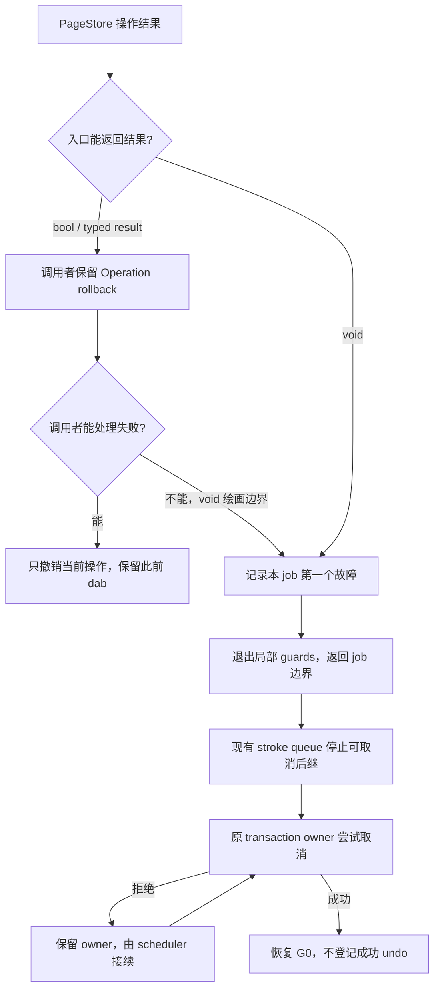

# 01b：像素失败到 stroke 的代码边界

返回[指南目录](/Users/apple/krita_gpu/docs/vulkan_gpu_design/br1_modification_guide/README.md)。本篇细化 S01 / 92 §9.3 的修改关系，供后续入口迁移逐项核对。阶段状态与证据只在 [92 §15](/Users/apple/krita_gpu/docs/vulkan_gpu_design/92_br1_m6_m8_execution_baseline.md:477)维护；这里列出代码责任，不授予完整 S01 或 M8 资格。

## 结果由谁消费

`Failed` 不能 replay。只有开始工作前确定的 `Unavailable/Borrowed` 允许走兼容路径。调用者明确处理的 `applyPixelOperation(false)` 不应被底层自动升级为整笔取消；反之，不能返回结果的绘画调用不得只丢掉失败 dab。

## 从设计条款定位代码

| 设计责任 | 代码段 | 修改与审查要点 |
|---|---|---|
| job 选择失败保证 | [SimpleStrokeJobStrategy::run](/Users/apple/krita_gpu/krita/libs/image/kis_simple_stroke_strategy.cpp:25)；[策略开关](/Users/apple/krita_gpu/krita/libs/image/kis_simple_stroke_strategy.h:57) | 仅显式启用的 cancellable DOSTROKE 安装故障上下文；未迁移策略、init/finish/cancel 和不可取消 jobs 保留自身结果协议。复制策略时复制选择，不增加另一份 stroke owner |
| 实际绘画策略接线 | [PainterBased 初始化](/Users/apple/krita_gpu/krita/libs/ui/tool/strokes/kis_painter_based_stroke_strategy.cpp:77) | 普通绘画 job 使用上述结果桥；其直接/间接临时事务仍由原 finish/cancel 回调拥有。indirect merge 的不可取消 jobs 不能借此跳过多设备终结迁移 |
| legacy void 的临时桥 | [KisStrokeJobFailureContext](/Users/apple/krita_gpu/krita/libs/image/KisStrokeJobFailureContext.h:11)；[实现](/Users/apple/krita_gpu/krita/libs/image/KisStrokeJobFailureContext.cpp:6) | 栈对象 + TLS，只记录第一个错误；嵌套退出恢复原上下文，禁用的嵌套 job 不继承外层保证。它不拥有 transaction、像素、取消回调，也不是未来 S02 的 session token |
| typed 像素结果 | [PaintDevice strategy](/Users/apple/krita_gpu/krita/libs/image/kis_paint_device_strategies.h:280)；[applyPixelOperation](/Users/apple/krita_gpu/krita/libs/image/kis_paint_device.cc:1884) | 保留 bool 供调用者决定 Operation rollback；已失败 job 不再执行后续 callback；fallback 条件显式列举，新增 result 不能意外进入 fallback |
| composite 与 fast copy 的 void 边界 | [KisPainter::bitBltImpl](/Users/apple/krita_gpu/krita/libs/image/kis_painter.cc:682) | 普通 composite 的 false 在此上报；fast copy 的失败由 DataManager 上报。失败不记成功 dirty，不重放另一条合成路径 |
| fixed / selection 消费者 | [bitBltWithFixedSelection](/Users/apple/krita_gpu/krita/libs/image/kis_painter.cc:526)；[bltFixed](/Users/apple/krita_gpu/krita/libs/image/kis_painter.cc:998)；[bltFixedWithFixedSelection](/Users/apple/krita_gpu/krita/libs/image/kis_painter.cc:1056) | 标量 fixed 已按 [FC1–FC8：固定源与 sharpness](/Users/apple/krita_gpu/docs/vulkan_gpu_design/br1_modification_guide/01k_fixed_source_and_sharpness.md#fixed-cursor-map) 改为 cursor，失败上报且不记成功 dirty；其余 fixed-selection 路径仍报告局部缓冲分配失败，读失败后停止合成，写失败后停止成功通知；新增早退保持各自资源清理 |
| default / clear / copy / trim | [setDefaultPixel](/Users/apple/krita_gpu/krita/libs/image/tiles3/kis_tiled_data_manager.cc:509)、[clear](/Users/apple/krita_gpu/krita/libs/image/tiles3/kis_tiled_data_manager.cc:787)、[clearAll 包装](/Users/apple/krita_gpu/krita/libs/image/tiles3/kis_tiled_data_manager.cc:985)、[copy](/Users/apple/krita_gpu/krita/libs/image/tiles3/kis_tiled_data_manager.cc:1178)、[rough copy](/Users/apple/krita_gpu/krita/libs/image/tiles3/kis_tiled_data_manager.cc:1311)、[trim](/Users/apple/krita_gpu/krita/libs/image/tiles3/kis_tiled_data_manager.cc:1440) | 消费 backend 结果；成功才刷新索引，失败向当前 job 报告。空区域、相同 default 等已知 no-op 仍是成功语义 |
| packed / planar / pixel | [writeBytes](/Users/apple/krita_gpu/krita/libs/image/tiles3/kis_tiled_data_manager.cc:1555)、[writePlanarBytes](/Users/apple/krita_gpu/krita/libs/image/tiles3/kis_tiled_data_manager.cc:1802)、[setPixel](/Users/apple/krita_gpu/krita/libs/image/tiles3/kis_tiled_data_manager.cc:1545) | native 失败不得再进 legacy；失败 batch 保持失败结果并恢复兼容索引；同一已失败 job 的后续写不再发布 |
| 写意图不等于写指针 | [KisTileDataWrapper::data](/Users/apple/krita_gpu/krita/libs/image/tiles3/kis_tile_data_wrapper.h:94)；[tryWriteData](/Users/apple/krita_gpu/krita/libs/image/tiles3/kis_tile.cc:461) | WRITE 必须调用可失败的 tryWriteData；拒绝后返回 nullptr，不能暴露 cached before-image，也不能对 nullptr 加 offset。兼容 partial copy 必须检查取得的目标指针并释放已取得的 source pin |
| iterator 缓存的可写暴露 | [KisBaseIterator::fetchTileDataForCache](/Users/apple/krita_gpu/krita/libs/image/tiles3/kis_base_iterator.h:74) | WRITE 也必须经 tryWriteData；拒绝后释放已取 intent、清空 data/oldData。nullptr 交给消费者处理；完整 raw iterator 的错误到 job 迁移仍需核对其 caller，不在此绕过权限或全局改变失败保证 |
| 局部 batch 失败收口 | [ScopedPageStoreWriteBatch](/Users/apple/krita_gpu/krita/libs/image/tiles3/kis_tiled_data_manager.cc:136) | 未完成早退也上报；finish(false) 的写结果明确为 false，不取决于 cancel 返回值。此包装不承担长期重试 owner；既有 batch/事务各自负责原生命周期 |
| void 读失败 | [readBytes](/Users/apple/krita_gpu/krita/libs/image/tiles3/kis_tiled_data_manager.cc:1648) | 报告无法解析/读取的源；fixed 合成检查故障后才使用缓冲。不能将未填完整的缓冲当有效输入 |

## 验证映射与下一批边界

| 场景 | 验证代码 | 必须保持的结论 |
|---|---|---|
| result sink 的启用范围、嵌套与线程隔离 | [testJobFailureReporting / testFailureContextIsolation](/Users/apple/krita_gpu/krita/libs/image/tests/kis_simple_stroke_strategy_test.cpp:155) | 失败后可取消后继不执行；未迁移与不可取消 job 不被强行改变策略；cancel 回调不会继承失败 TLS |
| 第二页拒绝与旧值保护 | [testVoidDrawingFailure](/Users/apple/krita_gpu/krita/libs/image/tiles3/tests/kis_tiled_data_manager_test.cpp:3088) | native/legacy source、packed/planar/fill/copy/trim/pixel 等入口拒绝后不暴露先写页；保留 foreign writer；history 可以恢复 G0；下一 job 能继续写 |
| H/V/random iterator 写准入拒绝 | [testIteratorRejectedWriteAdmission](/Users/apple/krita_gpu/krita/libs/image/tiles3/tests/kis_tiled_data_manager_test.cpp) | 1/4/8/16 BPP，非零页内 offset；不返回旧页可写指针、不破坏 foreign writer 或 retained before，取消后仍可读原值 |
| 实际 painter → queue → transaction 取消 | [testPixelFailure](/Users/apple/krita_gpu/krita/libs/ui/tests/KisPainterStrokeCompletionTest.cpp:289) | direct/indirect × composite/fast copy/fixed selection × swap mapping/allocation/decompression 故障；取消包含此前成功 dab，不误登记 undo、不留下 temporary target、不 replay 源读取 |
| 主动处理的单操作失败 | 同一 UI 测试中的 handled 行 | callback 返回 false 后保留此前 dab，后续 job 可以正常完成与 undo；不能把 bool false 本身等同于 stroke failure |

后续迁移仍需逐入口覆盖 raw iterator 消费者、wrapped/LoD/异步 brush、mask/interstroke 辅助设备和已交付的不可取消 merge。还要补充 `RetryablePressure`、异常终点、legacy void transaction/parent-attached command 的所有权与资源进度。不得因为公共错误桥存在，就启用全部跨 dab pending 或宣布完整 brush/OOM 恢复。

## Clear 与存活 iterator 的联动边界（S03/S04 前置）

入口关系为 [PaintDevice::clear](/Users/apple/krita_gpu/krita/libs/image/kis_paint_device.cc:1533) → [DataManager::clear](/Users/apple/krita_gpu/krita/libs/image/tiles3/kis_tiled_data_manager.cc:985) → [backend::clearAll](/Users/apple/krita_gpu/krita/libs/image/pagestore/KisTiledDataManagerPageStoreBackend.cpp:2353)。不能只清空兼容 hash，也不能把拒绝的 void clear 当成功。此处处理已经排序的 legacy clear；它不授予从其他正在执行的 worker 撤销权限，也不替代 S04 的完整 checkpoint。

| 责任 | 修改代码段 | 必须保持的边界 |
|---|---|---|
| 预检存活 owner | [cancelAnonymousLeasesForBarrier](/Users/apple/krita_gpu/krita/libs/image/pagestore/KisTiledDataManagerPageStoreBackend.cpp:1098) | 使用现有 batch 注册表；先拒绝其他线程、非 iterator batch 和正在终结的槽，再撤销本线程 iterator。不要边扫描边撤销，以免先破坏本地 writer 才发现 foreign 冲突 |
| 释放逻辑权限 | [WriteBatch::Private::cancelForBarrier](/Users/apple/krita_gpu/krita/libs/image/pagestore/KisTiledDataManagerPageStoreBackend.cpp:426) | 现有 owner 先保活旧存储，再归还 native guards，取消 mutation；history 保留原 transaction/G0，匿名 batch 归还自身 client。只删除身份匹配的线程槽，晚 client finish 不得清掉新 batch |
| 保留旧裸指针 | [retainBarrierPin / releaseBarrierPin](/Users/apple/krita_gpu/krita/libs/image/pagestore/KisTiledDataManagerPageStoreBackend.cpp:244) | clear 的冷路径只尝试取得额外 resident pin，成功后保留 TileData 引用和 pin，两者缺一不可；单独引用不能防 swap，单独 pin 不能防最后引用销毁。原 lease 归还时同时释放，不再发布旧像素 |
| 追踪仍存活的 capabilities | [batch lease 构造与 finishBatchLease](/Users/apple/krita_gpu/krita/libs/image/pagestore/KisTiledDataManagerPageStoreBackend.cpp:396) | 在原 batch 内用 intrusive links 和局部 gate 协调晚解锁；不是另一份 page write set，没有逐 span 的全局 map 注册。此局部同步仍须纳入 stroke 性能验证，不能宣称免费 |
| 拒绝旧 scope 再取当前页 | [IteratorWriteScope::isActive](/Users/apple/krita_gpu/krita/libs/image/pagestore/KisTiledDataManagerPageStoreBackend.cpp:479)；[base iterator 缓存取页](/Users/apple/krita_gpu/krita/libs/image/tiles3/kis_base_iterator.h:74) | 清空后的旧 cache/raw pointer 仅指向脱离发布的存储；旧 iterator 跨到新页返回空指针，不借当前线程的新 batch 写入当前内容。已有 raw iterator 的空指针消费仍按 S01 迁移 |
| 开始下一次 iterator | [beginIteratorMutationScope](/Users/apple/krita_gpu/krita/libs/image/pagestore/KisTiledDataManagerPageStoreBackend.cpp:872) | 新 scope 可以先于旧对象析构建立；不能接回已撤销 batch。保留同一有效 batch 内多个 iterator 共享 client 的行为 |

验证入口为原样 [kis_iterators_ng_test](/Users/apple/krita_gpu/krita/libs/image/tests/kis_iterators_ng_test.cpp:248) 的 H/V/random clear→offset 用例，以及 [testIteratorClearBarrier](/Users/apple/krita_gpu/krita/libs/image/tiles3/tests/kis_tiled_data_manager_test.cpp:4770)、[foreign batch 拒绝](/Users/apple/krita_gpu/krita/libs/image/tiles3/tests/kis_tiled_data_manager_test.cpp:4868)、[native batch 拒绝](/Users/apple/krita_gpu/krita/libs/image/tiles3/tests/kis_tiled_data_manager_test.cpp:4915)、[bare lease 保活](/Users/apple/krita_gpu/krita/libs/image/tiles3/tests/kis_tiled_data_manager_test.cpp:4938)。覆盖 1/4/8/16 BPP、两个存活 iterator、history/undo/redo、旧 exact View、旧指针晚写、新旧 scope 交错、pin 释放后允许 swap，以及没有 Tile wrapper 持有 backing 的情况。不得提前销毁原测试的 iterator。

后续 S02/S04 迁移须保留以上语义并替换线程查找桥。当前测试并未覆盖所有 raw Tile/history 混用的 clear 入口、并发 clear 或资源永久拒绝；特别是独立 history lease 与匿名 lease 的 barrier 登记范围仍需审查；旧 raw backing 在 provider 逻辑退休后的局部分类/债务上限由 S10 接续，不能用存储仍可访问冒充完整预算资格。阶段结论、失败样本与实际验证范围只在 92 §15 记录。

性能验证继续按 V01：成功路径不创建 heap failure 对象、不采时钟；新增 TLS 查询的实际成本必须在产品 stroke replay 与控制桶中验证。上述固定像素 fixture 不构成绘画性能资格。
