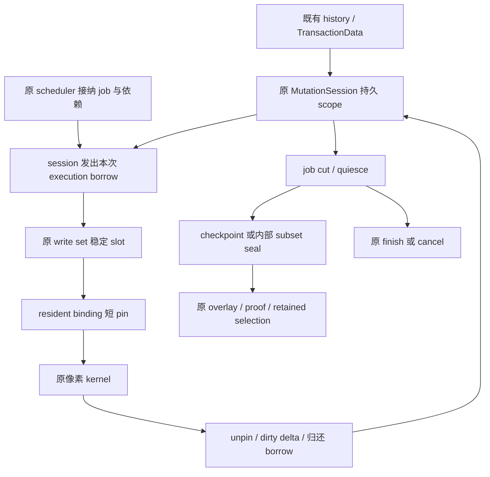

# 01c：S02 持久 session、稳定存储与 job 借用修改指南

返回[指南目录](/Users/apple/krita_gpu/docs/vulkan_gpu_design/br1_modification_guide/README.md)。设计依据是 [92 §8.2–8.3、§9.1–9.5](/Users/apple/krita_gpu/docs/vulkan_gpu_design/92_br1_m6_m8_execution_baseline.md:144)；S01/S03 的业务链见 [01](/Users/apple/krita_gpu/docs/vulkan_gpu_design/br1_modification_guide/01_stroke_scope_and_failure.md)，读意图与 publication 见 [02](/Users/apple/krita_gpu/docs/vulkan_gpu_design/br1_modification_guide/02_visibility_and_publication.md)。本篇将 S02 拆为 SS1–SS10，明确设计要求与待改代码段的关系；不增加修改 ID，不另立阶段基线。

核对日期：2026-09-28；HEAD 为 `5173c807c87bb1619325249a07a8b4f4f8f09f09`，各批含未跟踪生产文件的源码差异由相应证据目录冻结；当前阶段和最新资格以 92 §1、§15 为准。§8、§10 分别保留第一、二批冻结范围；§9、§11 是完整修改关系，§12 保留第三批实际准入；§13 保留第四批执行范围借用记录，§14 对应第五批局部 resident 路径，§15 对应完整 checkpoint；scheduler 切点见 [01e](/Users/apple/krita_gpu/docs/vulkan_gpu_design/br1_modification_guide/01e_scheduler_cut_and_job_admission.md)；阶段资格仍由 92 §15 管理。

<a id="current-code"></a>
SS8 的写后刷新前置改动和剩余 pending/current 职责见 [S03 / MR1–MR7](/Users/apple/krita_gpu/docs/vulkan_gpu_design/br1_modification_guide/01d_metadata_refresh_and_pending_visibility.md)：成功刷新已不 capture/payload-read，失败回滚仍恢复 raw 缓存；显式 history scope/cursor/checkpoint 接线见 [HS1–HS8](/Users/apple/krita_gpu/docs/vulkan_gpu_design/br1_modification_guide/01f_history_owned_mutation_scope.md#history-scope-map)；完整业务 job/current/producer 尚待联合启用。

## 1. 当前代码已经做什么，尚缺什么

| 已核对的源码 | 当前事实 | 待修改的边界 |
|---|---|---|
| [Session::Private](/Users/apple/krita_gpu/krita/libs/image/pagestore/KisPageStore.cpp:741)、[Session::beginWriteImpl](/Users/apple/krita_gpu/krita/libs/image/pagestore/KisPageStore.cpp:1806) | 直接 session 接口保存创建线程；显式 execution 由各 worker 取得原范围权限，见 §13。已绑定冷页的 beginWrite/version/归还按 §14 使用 execution 局部 gate；首写冷准备仍经 session mutex，同段访问复用 pending | 现有能力不等于跨 job/跨 worker 的持久 scope；删除线程判断或延长 shared pointer 寿命都不足以启用 |
| [MutationWriteSet 声明](/Users/apple/krita_gpu/krita/libs/image/pagestore/KisPageWriteCoordinator_p.h:348)、[WriteSet::getOrCreate](/Users/apple/krita_gpu/krita/libs/image/pagestore/KisPageWriteCoordinator.cpp:940) | 单页 inline，overflow 已改为 8-slot 稳定块；第 9 个 entry 先完整准备原稀疏索引，再安装新 entry | 原索引保存 slot handle，查找/枚举已支持空洞，inline 与 overflow 都校验 incarnation；具体实现见 §10；§13–§14 已接范围借用和稳定引用，借出期间不回收原 slot |
| [ColdPageSet](/Users/apple/krita_gpu/krita/libs/image/pagestore/KisPageStore.cpp:754) | 冷 Page 单页 inline，overflow 为 2-slot 稳定块；包装器消费实际 prepared slot index，erase 不以 live count 判定 index 上界 | 冷槽复用与 guard/原取消已同步接线，具体证据见 §10；借出期间不得回收冷资源，跨 job 借用与 subset seal 继续 |
| [CpuWriteGuard::reset](/Users/apple/krita_gpu/krita/libs/image/pagestore/KisPageStore.cpp:1513) | 直接 guard 验原 slot/incarnation；execution guard 通过原借用中的稳定引用找回 Page，局部 unpin 并撤 exposure；Page 不保存像素指针 | 保留已接的短 pin/slot 身份；已接 execution 保活与归还顺序，继续业务 job/cut 迁移，仍禁止 exposed entry 回收 |
| [PageStore::reserveManagedRange](/Users/apple/krita_gpu/krita/libs/image/pagestore/KisPageStore.cpp:1628)、[Session::adoptReservation](/Users/apple/krita_gpu/krita/libs/image/pagestore/KisPageStore.cpp:1698) | range 先拥有原 write set 和 ClaimSet；移交到空 session 后 rebind 同一 ClaimSet | 持久 scope 不能每个 job 再建整套 range/write set 再尝试覆盖；移动 inline 仅能发生在未对外借用的准备阶段 |
| [WriteBatch::Private::finishClient](/Users/apple/krita_gpu/krita/libs/image/pagestore/KisTiledDataManagerPageStoreBackend.cpp:532)、[WriteBatch::Private::finish](/Users/apple/krita_gpu/krita/libs/image/pagestore/KisTiledDataManagerPageStoreBackend.cpp:558) | 最后一个 batch client seal/cancel，并清理线程槽 | stroke 的 job/iterator 结束应归还借用；standalone batch 继续由显式 finish 终结 |
| [Backend::runCpuMutationOperation](/Users/apple/krita_gpu/krita/libs/image/pagestore/KisTiledDataManagerPageStoreBackend.cpp:1897)、[DataManager::refreshPageStorePages](/Users/apple/krita_gpu/krita/libs/image/tiles3/kis_tiled_data_manager.cc:1016) | 默认 pixel operation 仍建 batch/finish；显式原 memento 路径借用持久 session、直接传播 pending touched，checkpoint/commit 后失效缓存，见 [HS1–HS8](/Users/apple/krita_gpu/docs/vulkan_gpu_design/br1_modification_guide/01f_history_owned_mutation_scope.md#history-scope-map)；兼容失败回滚仍读 exact payload | 必须同时接 S03/S04。只去掉 finish 会使后续刷新看不到 pending，或被迫每 dab checkpoint 抵消收益 |
| [ShardSlotArena 同步契约](/Users/apple/krita_gpu/krita/libs/image/pagestore/KisPageMetadataArena_p.h:76)、[ShardSlotArena 构造与目录 reserve](/Users/apple/krita_gpu/krita/libs/image/pagestore/KisPageMetadataArena_p.h:246) | 现有 arena 要求 owner 串行，get 后解引用仍须持锁；有限最大预算会预 reserve 整个目录 | 可复用 generational slot、准备块、锁外释放的机制；不能直接套用后宣称允许锁外借用，也不能每个 session 按全部预算预建目录 |

**直接的性能目标：** 无真实 freeze、独立 operation rollback 或压力分段时，payload 首次准备随不同写页数 K 增长；同页 D 次 dab 只反复借用与短 pin。稳定存储只是这条路径的前置，单独合入不代表已减少真实 brush 的每 dab seal/COW。

<a id="target-flow"></a>
## 2. 目标职责与唯一 owner

下图是目标接线关系；完整实现仍受 SS1–SS10 和相邻修改项约束。



| 事实 | 延用的 owner | 必须明确的身份或寿命 |
|---|---|---|
| 事务起点、G0、undo 登记 | TransactionData → backend activeHistory → MementoManager | scope 创建成功不再开一个事务；成功才交付 undo |
| 可变 entry、pending generation、初始化源与终结责任 | 原 MutationSession / MutationWriteSet；原 metadata/admission 继续管 writer | 一份 PageKey → slot 索引；不再建 allTouched/pending authority |
| job 是否被接纳、输入顺序与读写依赖 | 现有 scheduler / strategy | job 序号与 cut；不能用线程号代替业务身份 |
| 一次执行与范围借用 | session 签发的短寿命 borrow | store/surface、transaction、scope incarnation、job/range、失败保证；线程号只检查本次使用 |
| 热 entry 与对应冷资源的存储寿命 | session 原稳定 slot 存储 | slot index + incarnation；entry 被借出时不搬移、不销毁、不回收其冷资源 |
| 像素地址可访问性 | 原 resident binding / guard | 每次 pin 的有效期；稳定地址和逻辑 reservation 都不能替代物理 pin |
| 已冻结内容与读选择 | 原 overlay/proof、epoch retention | 只有完整 checkpoint 推进外部 exact view；内部 subset seal 不单独推进 |
| 容量与释放 | 原 budget controller / ledger / retirement queue | 原始分配归属与 charge 随真实存储寿命走；无第二份额度计数权威 |

原 memento 现承担显式 history owner 身份，接线和边界见 [HS1–HS8](/Users/apple/krita_gpu/docs/vulkan_gpu_design/br1_modification_guide/01f_history_owned_mutation_scope.md#history-scope-map)；`ScopeToken` 不要求再创建一个 token 类型。范围执行能力现为 `KisPageMutationExecution`（§13），未连接完整 scheduler job/cut/read footprint。slot 身份已有 `KisMutationSlotHandle` / `EntryHandle`，继续沿用。实现时优先扩展原类；不把这些身份、互斥量或预算 reservation 全塞进每页热记录。失败保证由已迁移的业务入口与 owner 验证，不能让任意 callback 用一个参数自行升级为 Stroke rollback 或 Commit-only。跨 worker 接续发生在 job 边界：旧 guard 与像素指针先结束，再由新 worker 取得新的 borrow/pin。

<a id="implementation-map"></a>
## 3. SS1–SS10：待改内容到函数及联动终点

| 单元 / 92 条款 | 主改代码段 | 具体改法与必须联动的消费者 | 本段交付判据 |
|---|---|---|---|
| **SS1：scope 归属**；§8.2、§9.1 | [TransactionData::init](/Users/apple/krita_gpu/krita/libs/image/kis_transaction_data.cpp:97) → [Backend::beginHistory](/Users/apple/krita_gpu/krita/libs/image/pagestore/KisTiledDataManagerPageStoreBackend.cpp:1558) → [PageStore::beginMutation](/Users/apple/krita_gpu/krita/libs/image/pagestore/KisPageStore.cpp:1570)；[Backend::beginMutationBatch](/Users/apple/krita_gpu/krita/libs/image/pagestore/KisTiledDataManagerPageStoreBackend.cpp:846) | history/memento 成功后，只有已迁移 stroke 取得原 session 的 scope token。由业务 owner 持有至 finish/cancel；scope 创建失败在对应绘画前返回。backend 接受明确 token，保留未迁移 standalone 的原保证 | 新 job 不创建新 transaction；错误 token/目标/frame/LoD 被拒绝；scope 准入失败不误登记 undo 或取消其他 history |
| **SS2：热 entry 稳定存储**；§9.2 | [MutationWriteSet 声明](/Users/apple/krita_gpu/krita/libs/image/pagestore/KisPageWriteCoordinator_p.h:348)、[WriteSet::getOrCreate](/Users/apple/krita_gpu/krita/libs/image/pagestore/KisPageWriteCoordinator.cpp:940)、[WriteSet::reserveKnownTargetCount](/Users/apple/krita_gpu/krita/libs/image/pagestore/KisPageWriteCoordinator.cpp:1037) | 单页 inline + 按需稳定分块 slots，扩展原索引到 slot 身份；增长先准备真实容量再安装。所有按 `0..size` 遍历的消费者改用活跃 slot 枚举；不能把有洞存储的 size 当最高 index | 扩块不使借出 entry 地址失效；空位复用拒绝旧 incarnation；单页无 overflow/index 分配；104 B 热记录上限保留 |
| **SS3：冷资源与 guard 寿命**；§9.2、§9.5 | [ColdPageSet](/Users/apple/krita_gpu/krita/libs/image/pagestore/KisPageStore.cpp:754)、`ensurePage/pageAtEntry/erasePageAtEntry`、[CpuWriteGuard::reset](/Users/apple/krita_gpu/krita/libs/image/pagestore/KisPageStore.cpp:1513) | 冷 Page 同样稳定；其 slot 归属于同一 entry incarnation。借用期间禁止替换或回收关联冷资源；guard 持 scope/slot 身份，释放只 unpin 和归还 exposure。借用归还前必须结束其 guards | 冷块增长、alias/remove/rewrite、late guard、取消交错无错误 unpin 或析构；688 B Page / 128 B guard 上限保留 |
| **SS4：原索引与逻辑准入**；§8.2、§9.2 | [Private::claimEntryLocked](/Users/apple/krita_gpu/krita/libs/image/pagestore/KisPageStore.cpp:1021)、[WriteAdmission::claimAll](/Users/apple/krita_gpu/krita/libs/image/pagestore/KisPageWriteCoordinator.cpp:1251)、[WriteAdmission::release](/Users/apple/krita_gpu/krita/libs/image/pagestore/KisPageWriteCoordinator.cpp:1340)、[WriteAdmission::rebindClaimSetLocked](/Users/apple/krita_gpu/krita/libs/image/pagestore/KisPageWriteCoordinator.cpp:1329)、[WriteAdmission::conflictLocked](/Users/apple/krita_gpu/krita/libs/image/pagestore/KisPageWriteCoordinator.cpp:1156) | 区分跨 job 保留的 page writer 与本次 job 的执行互斥。按固定 shard/key 顺序准备并接纳范围；索引仍仅指向原 entries。添加单 entry/subset claim 释放能力供 SS7 使用；先释放对应 claim 再删 slot | 任何拒绝不泄漏部分 claim；其他 session/generic/legacy 冲突仍由同一 admission 判断；跨 worker 的同一 scope 不被误判为不同 writer |
| **SS5：job borrow 与 cut**；§9.1–9.3 | [Session::Private](/Users/apple/krita_gpu/krita/libs/image/pagestore/KisPageStore.cpp:741) 的线程/状态检查；[FreehandStrokeStrategy::doStrokeCallback](/Users/apple/krita_gpu/krita/libs/ui/tool/strokes/freehand_stroke.cpp:143)；[PainterBasedStrokeStrategy::finishStrokeCallback](/Users/apple/krita_gpu/krita/libs/ui/tool/strokes/kis_painter_based_stroke_strategy.cpp:395) | job 入口取得 borrow，明确读/写 footprint 与失败策略；线程只约束本次执行。Quiescing 按 scheduler cut 接纳之前已排队 job 及必需子 jobs，之后排队；由 continuation/barrier 等待归还 | 两个 worker 可接续；不相交工作实际并行；重叠与读写依赖保持像素顺序；请求 checkpoint 的 job 不等待自己的 borrow |
| **SS6：resident pending 热路径**；§8.1、§9.2 | [Session::beginWriteImpl](/Users/apple/krita_gpu/krita/libs/image/pagestore/KisPageStore.cpp:1806)、`pinWritable`、[CpuWriteGuard::reset](/Users/apple/krita_gpu/krita/libs/image/pagestore/KisPageStore.cpp:1513) | job 已绑定 slot 后，局部复验 incarnation/exposure/binding；resident pending 命中跳过首写 prepare/reserve/selector 与 provider 全表查找。新 entry/首写/冻结/终结才进 store owner。像素 kernel 不持 session、目录或 admission 锁 | 同段重复访问零新增 payload/generation/seal，physical pin 成对；NonResident 仍走真实 materialize，Busy/失效不能伪装成 resident 命中 |
| **SS7：checkpoint、subset 与再开放**；§9.4–9.5 | [Session::sealImpl](/Users/apple/krita_gpu/krita/libs/image/pagestore/KisPageStore.cpp:2105)、[Private::detachLocked](/Users/apple/krita_gpu/krita/libs/image/pagestore/KisPageStore.cpp:848)、[PageStore::captureReadView](/Users/apple/krita_gpu/krita/libs/image/pagestore/KisPageStore.cpp:2684) | 拆开“将所选 entries seal 到原 overlay”与“销毁整个 session”。完整 checkpoint 在 cut 后纳入全部变更并取得 retained selection；内部 subset 只释放冷 entry/writer/slot。后续首次重写再选择 plan | 多页 job 无半新半旧外部 exact view；oldData 始终 G0；未再写页无 COW；seal 失败仍保留原终结责任 |
| **SS8：backend、iterator 与缓存接线**；§9.1、§9.4 | [WriteBatch::Private::finishClient](/Users/apple/krita_gpu/krita/libs/image/pagestore/KisTiledDataManagerPageStoreBackend.cpp:532)、[Backend::beginIteratorMutationScope](/Users/apple/krita_gpu/krita/libs/image/pagestore/KisTiledDataManagerPageStoreBackend.cpp:872)、[BaseIterator 析构](/Users/apple/krita_gpu/krita/libs/image/tiles3/kis_base_iterator.h:36)、[Backend::runCpuMutationOperation](/Users/apple/krita_gpu/krita/libs/image/pagestore/KisTiledDataManagerPageStoreBackend.cpp:1897)、[Backend::captureIteratorReadScope](/Users/apple/krita_gpu/krita/libs/image/pagestore/KisTiledDataManagerPageStoreBackend.cpp:1148)、[DataManager::writePageStoreOperation](/Users/apple/krita_gpu/krita/libs/image/tiles3/kis_tiled_data_manager.cc:1734)、[DataManager::refreshPageStorePages](/Users/apple/krita_gpu/krita/libs/image/tiles3/kis_tiled_data_manager.cc:1016) | 已迁移入口 finish client 仅归还 borrow；iterator 销毁先结束 guard，再归还借用。显式区分 job current、operation-start、G0、external exact；写后存在性/dirty/cache invalidation 与 payload capture 分离。联动 [S06.3 L5–L9](/Users/apple/krita_gpu/docs/vulkan_gpu_design/br1_modification_guide/03b_legacy_cache_migration.md)，保留 standalone final seal | 真实调用链复用同一 scope；refresh 不暗中冻结每 dab；legacy current 缓存不冒充外部 immutable read；未迁移调用保持 Operation rollback |
| **SS9：失败、取消与最后 owner**；§9.3 | [Private::cancelLocked](/Users/apple/krita_gpu/krita/libs/image/pagestore/KisPageStore.cpp:926)、[Private::releaseOrRetain / retryOrphans](/Users/apple/krita_gpu/krita/libs/image/pagestore/KisPageStore.cpp:805)、[PageStore::abort](/Users/apple/krita_gpu/krita/libs/image/pagestore/KisPageStore.cpp:4289)、[WriteBatch::Private::finish](/Users/apple/krita_gpu/krita/libs/image/pagestore/KisTiledDataManagerPageStoreBackend.cpp:558)、[Backend::commitHistory](/Users/apple/krita_gpu/krita/libs/image/pagestore/KisTiledDataManagerPageStoreBackend.cpp:1642) | stop admission → 已接纳工作安全归还 → 原 cancel/abort；拒绝保留原 session 的债务和既定取消意图。late guard 只推进该终结，不重新选 commit。原 orphan/retry 与 S01/S09/S10 接续，取消过程中不依赖分配一个新“恢复 owner” | 无新输入也可继续清理；close/析构/晚 guard 只终结一次；旧 frozen reader 仍可读；不可取消 indirect merge 遵守原业务规则 |
| **SS10：真实容量、窗口与观测**；§8.3、§9.5、§10.6 | [BackingBudgetController::reserveImpl](/Users/apple/krita_gpu/krita/libs/image/pagestore/KisPageWriteCoordinator.cpp:587)；[MetadataBudgetAuthority](/Users/apple/krita_gpu/krita/libs/image/pagestore/KisPageMetadataCoordinator.cpp:28)；SS2–SS9 所有实际 allocator 与释放出口 | 块、目录、索引、borrow/range、shared control block 与必要终结存储统一纳入原预算；按实际容量收费，释放后返还。W 超额先走内部 subset/压力 continuation；计数区分首写、重复命中、freeze、压力 seal、终结与拒绝原因 | 硬预算覆盖实际内存，不只限制页数；准备失败无半接纳；慢 reader/长 stroke/多 store 守界；证据独立于既有微基准 |

SS2/SS3 不可只修改两个容器：`claimAll/ownsClaimSetLocked/rebindClaimSetLocked/release`、`cancelLocked/clearSources/sealImpl` 已随 §10 改为 live 枚举，后续修改必须保持这些消费者与统计一致，不能重新引入密集索引假设。SS8 也不可只改 `finishClient`，否则读取和 failure semantics 尚未闭合。

<a id="storage-contract"></a>
## 4. 稳定存储的具体实施约束

### 4.1 保留小笔触成本，按实际增长准备

1. 保留一个热 entry inline 槽和对应的按需冷资源；无并发、单页 stroke 不预建 shard 数组、块目录和散列表。现有 8 项以内线性查找、第 9 项建索引作为初始控制点，修改阈值需给出实测理由。
2. overflow 换为固定容量、地址不变的块；块目录也按实际容量增长。热 entry 与冷 Page 分开存储，semantic-only entry 不强制分配 688 B 冷记录。块尺寸是待测参数，选型同时报告单页、2 页、跨块、1,000 页的实际 bytes/峰值与延迟；不能按 `sizeof(T) × live count` 掩盖空槽和目录容量。
3. 复用现有 arena 的 generational slot、prepare/attach 与 released-block 思路，但先改清楚借出期间的存储寿命契约。当前 arena 的“持 owner 锁解引用”和整目录 reserve 不能直接成为新 session 的实现。不能简单替换为 deque 就宣称已计账或已具备并发。
4. slot 复用递增 incarnation；耗尽时隔离该槽或结束对应 scope，禁止回绕后再次接受旧句柄。原 write set 使用 index 0 作为 inline、max 作为 invalid；arena ID 使用非零有效 index，接入时显式转换，不能共用隐含 sentinel。
5. 空位必须能复用；遍历只包含 live entries。writer claim 与索引删除、冷资源析构、slot 回收有固定顺序。空块可以锁内 detach、锁外析构/free；预算在实际释放后归还。固定目录中仍保留的容量继续收费。
6. `adoptReservation` 只允许未借出的准备容器转移。安装后 session/write set 的地址固定；inline entry 不允许因移动 scope 所有者而搬移。ClaimSet 必须继续指向原 write set，并在原 owner 锁内完成 rebind。

[架构检查的 entry/index/layout 合同](/Users/apple/krita_gpu/krita/build-tools/ci-scripts/check-pagestore-architecture.py:1457)还检查 optional inline/index 的具体结构及冷热布局。实现改变容器表达时，同步把检查更新为等价或更强的真实不变量，并运行其 self-tests；不删除唯一 owner、单页 inline、热/冷尺寸或 Fresh 路径要求，不靠放宽 layout ceiling 通过。

### 4.2 先准备，再接纳，不在取得权限后赌扩容成功

新增 entry 的准备单元至少包含：热槽、需要的冷槽、原索引新增/扩容容量、admission 节点、borrow/range 记录及必需失败终结存储。返回结构化结果，区分成功、未执行的可重试压力、无权限/冲突与不可恢复失败；不能从一个空指针推断可以 replay。

```text
原 owner 给出范围/容量需求与版本
  → 锁外取得原 budget reservation，准备真实存储
  → 短 owner/目录 gate 复验 scope、revision、目标与冲突
  → 一次接纳已准备的 slots/index/claims/borrow
  → 释放结构锁，才允许返回 guard 或执行像素
复验/分配失败：释放本次候选与 reservation，原 live entries 不变
```

`reserveKnownTargetCount()` 目前准备 overflow 块/目录和原散列表容量，不等于已完成全部实际节点和失败存储准入。原 admission/activity 现已按 §12 改为实际预构造桶；这只闭合原表存储接纳，不等于整个 job 的冷资源和必要终结容量均已准备。仅有 QHash 容量不能证明插入/隐式 detach 不分配；索引修改若仍可能分配，就在准备单元中完成候选存储，复验后只安装。若更换容器，实际 node/bucket/capacity 计量与查找性能须同时验证；禁止多保留一张未计账的影子 PageKey→pending 表。

candidate 准备允许短期新旧存储并存，其峰值占同一预算。准备对象只装将被消费的存储和绑定条件，不形成第二套可查询可变内容权威。已有 writer 取消/释放的基本动作不能因新分配失败而丢掉其 owner。

### 4.3 稳定地址与并发分别证明

- 目录/索引结构变化仍受短 gate 保护。容器元素地址稳定并不意味着可以一边 vector/QHash 扩容、一边无锁查目录。job 在受保护的绑定阶段取得 slot 身份和存储保活；已绑定后的 span 才使用局部 entry/binding gate。
- 执行 borrow 保证对应 entry 与冷 Page 不能被 checkpoint、cancel 或压力窗口回收。每个 guard 的 live pin 另由 binding 管理；借用保活不永久 pin RAM。异常析构或 legacy late guard 尚存时，原 borrow 记录保持未归还，直到最后 guard 释放；不能只递减 job 计数让 quiesce 提前完成。
- 原 logical writer 可跨 job 留在 admission；同一 scope 内的 job 顺序/范围权限由 scheduler 和 borrow 管理。它们是对同一 entry 的不同约束，不得复制 generation、writer 或准备状态。
- 范围内按固定 shard/key 顺序取得权限；读依赖包含 source/mask/halo 和目标重叠。job 不得带着一部分新增 claim 阻塞等待另一部分；拒绝后释放本次准备，保持已存在的 scope writer。未知 footprint 继续原 Operation rollback 路径。
- 不把现有“session mutex → store owner”的所有慢路径原样保留后宣称并行。为新路径记录完整锁序：job 接纳/slot 绑定与终结复验使用结构 gate；provider 调用和像素 body 不持这些 gate；slot 局部访问不反向获取结构锁。owner 不持结构 gate 等 job 归还。

<a id="lifecycle"></a>
## 5. 生命周期和失败终点必须一起实现

| 触发 | 允许的状态推进 | 责任与明确禁止 |
|---|---|---|
| job 正常退出 | 结束 guards → 合并 dirty → 归还 borrow；scope 保持 Open | 不因最后 iterator/client 退出 seal。归还失败进入原 job failure sink，不丢失终结责任 |
| checkpoint 请求 | 原 scheduler 形成 cut → Quiescing → cut 前 jobs/必需子 jobs 结束 → seal/capture → Open | 发起 job 先归还自己的 borrow；不得拒绝 cut 前已排队工作后又等待它完成 |
| 内部窗口压力 | 选择未借用冷 entries → sealSubset 到原 overlay → 释放该 subset 的 writer/slot | 不更新外部完整 exact view；不强制 seal 仍在执行的页；overlay/history 的 K 页元数据仍计账 |
| 首字节前暂时压力 | 未执行的工作形成 continuation，归还本次借用/准备；资源进展后复验 | 不占 UI/image 锁等待，不拿自己的 borrow 等 checkpoint；不得以等待重复执行已经产生字节的 callback |
| callback 已写字节后失败 | 按已选择的 Stroke rollback 或 Operation rollback 终结 | 整笔失败恢复 G0，单操作失败恢复 G1；任何模式都不能静默换路线或把失败 dab 当成功 |
| finish | 完成 async producer 的最终输出和必需子 jobs → Quiescing/Finishing → 原事务成功结束 | success 后才交付 undo；indirect merge 的结果链须满足 S01，不可仅靠持久 session 宣称完成 |
| cancel/close/晚 guard | 停新 admission → 等已借出工作安全归还 → 原 cancel/abort → 实际资源释放 | pending debt 留在同一 session/ledger；late guard 只推进已选取消，不从析构尝试 commit；close 后旧 token 永远失效 |

现有 `sealForLegacyUnlock` 的跨线程能力只用于无活跃 guard 的最终终结；保留这条兼容语义不等于允许 legacy 读线程取得新的写借用。

状态细分只表达 session 生命周期，不另写一套 page publication 状态机。S04 的四类读取必须贯穿 SS8：job current 不形成外部 snapshot；operation-start 的源保护不能被省掉；oldData 是 G0；projection/save 使用完整 exact checkpoint。跨 store 的 mask/target 仍由现有 scheduler 协调，不凭多个 token 声称具备原子 ImageEpoch。

<a id="batches-and-validation"></a>
## 6. 修改顺序、验证落点与启用条件

| 实施批次 | 一起交付的单元 | 验证及仍不能宣称的内容 |
|---|---|---|
| **A：稳定存储与原准入** | SS2、SS3 的存储部分 + SS4 + SS10 的实际分配/释放；同批改密集遍历、move/rebind 与故障出口 | 先保护现有 thread-confined 行为；稳定存储通过不代表跨 job 复用已启用 |
| **B：受测借用能力** | SS1、SS3 guard 寿命、SS5、SS6、SS9 | 原 session 签发 token，不相交并行与重叠顺序实测；只删除 thread check 或套一把整笔 mutex 不交付 |
| **C：checkpoint 与资源窗口** | SS7 + S04/S05 + SS9/SS10 必要终结/进度 | 完整 cut、subset、慢 reader、cancel/close 与 tiny budget 闭合；不能把“等待资源”当作已具备无新输入进度 |
| **D：真实 stroke 接线** | SS8 + S01/S03；A–C 和必要 S08/S09/S10 已具备 | 按 direct → indirect/mask/source-dependent → wrapped/LoD/async 接线；每条入口单独验收后启用，未迁移入口保留原语义 |

顺序与 [STAGE_MAP](/Users/apple/krita_gpu/docs/vulkan_gpu_design/br1_modification_guide/STAGE_MAP.md)一致：能力可以先实现受测，默认业务启用必须联动 S01/S03/S04/S05 和必要资源进度保证。M6/M7 有各自出口，S02 普通 brush 不获得 commit-only handoff 资格。

下表中的函数是**已有测试的扩展入口**；右列是待新增/补足场景，本次文档未运行或宣称这些用例通过。

| 修改单元 | 已有测试入口 | 必补场景 / 判定 |
|---|---|---|
| SS2–SS4 | [ReferenceTest::mutationWriteSetUsesInlineAndSparseIndexStorage](/Users/apple/krita_gpu/krita/libs/image/tests/KisPageStoreReferenceTest.cpp:5300)、[ReferenceTest::writeAdmissionClaimsWholeSetsAtomically](/Users/apple/krita_gpu/krita/libs/image/tests/KisPageStoreReferenceTest.cpp:5636)、[ReferenceTest::metadataSlotArenaGenerationAndRelease](/Users/apple/krita_gpu/krita/libs/image/tests/KisPageStoreReferenceTest.cpp:3676) | 单页、2 页、8→9、跨块、扩目录/索引时保持借出 slot；inline move/rebind；洞复用与 generation 耗尽；每个准备分配点失败，零残留新 claim、原内容可继续 |
| SS3、SS6 | [CpuMutationTest::repeatedGuardAndSegment](/Users/apple/krita_gpu/krita/libs/image/tests/KisPageStoreCpuMutationTest.cpp:4453)、[CpuMutationTest::guardReleaseParksPendingBacking](/Users/apple/krita_gpu/krita/libs/image/tests/KisPageStoreCpuMutationTest.cpp:2710)、[PhysicalClaimTest::parkedWriterReservation](/Users/apple/krita_gpu/krita/libs/image/tests/KisPageStorePhysicalClaimTest.cpp:659) | resident 同页 1/10/1000 dab 的 generation/payload/prepare/seal 不随 D 增长；pin 成对；NonResident 与 Busy 正确分流；冷热容器增长、late guard 不释放复用后的页 |
| SS5 | [CpuMutationTest](/Users/apple/krita_gpu/krita/libs/image/tests/KisPageStoreCpuMutationTest.cpp)、[scheduler tests](/Users/apple/krita_gpu/krita/libs/image/tests/kis_update_scheduler_test.cpp) | 两 worker 接续；用 barrier 证明不相交工作同时进入 body；重叠写、source-target、mask/halo 保序；cut 前排队 job/必需子 job 不饥饿；checkpoint 无自等 |
| SS7、SS9 | [CpuMutationTest::capturedOverlayFreezesSealedDelta](/Users/apple/krita_gpu/krita/libs/image/tests/KisPageStoreCpuMutationTest.cpp:942)、[CpuMutationTest::partialCancellationRetiresBeforeRetry](/Users/apple/krita_gpu/krita/libs/image/tests/KisPageStoreCpuMutationTest.cpp:6138) | 多页操作与屏幕外页完整 cut；subset 后外部视图不前移；取消/首写/索引准备故障；退休拒绝后无新编辑继续；guard 和 frozen view 可晚于 façade 释放 |
| SS8、S01/S03 | [iterator tests](/Users/apple/krita_gpu/krita/libs/image/tests/kis_iterators_ng_test.cpp)、[PainterStrokeCompletionTest](/Users/apple/krita_gpu/krita/libs/ui/tests/KisPainterStrokeCompletionTest.cpp) | iterator/client 退出只归还；oldData/G0、Operation rollback/G1、job current 各自成立；每 dab refresh 无隐式 freeze；失败不交付 undo；direct/indirect/LoD 各自生命周期 |
| SS10、V01 | [Diagnostics](/Users/apple/krita_gpu/krita/libs/image/pagestore/KisPageStoreDiagnostics_p.h)、[FreehandStrokeBenchmark](/Users/apple/krita_gpu/krita/libs/ui/tests/FreehandStrokeBenchmark.cpp) | 实际 allocator 的准备、热命中、pin 后、安装、释放区间；块/目录/索引/控制块计账；长 stroke、慢 reader、多文档压力；同输入真实绘画首 dab、steady state、P95/P99、pen-up、显示及 drain |

必须核对 [UI 测试的 broken-test 注册](/Users/apple/krita_gpu/krita/libs/ui/tests/CMakeLists.txt:142)；常规 ctest 数量不能代替真实 brush replay。新源码的功能/并发/故障证据与正式性能门分别建立，保留 Fresh 等控制桶。不要把原单 session repeatedGuard 用例改名后当作跨 dab 业务性能证据。

<a id="handoff-checklist"></a>
## 7. 每段修改交接时必须留下的关系

交付记录按 [NEXT_EDITS 的模板](/Users/apple/krita_gpu/docs/vulkan_gpu_design/br1_modification_guide/NEXT_EDITS.md)填写，至少能回答：本批 SS 编号及 92 条款、实际函数与 caller、slot/claim/budget 的唯一 owner、成功/拒绝/取消/析构的消费终点、实际新增 case 和运行身份、仍保留的旧入口及原因。修改源码时同时更新本篇与 [CODE_INDEX](/Users/apple/krita_gpu/docs/vulkan_gpu_design/br1_modification_guide/CODE_INDEX.md)；阶段结论只写回 92。

最小审查单位是“入口到终结的一条责任链”。稳定容器、borrow API、checkpoint 或业务接线任何一项单独存在，都不足以关闭 S02，更不足以关闭 M8。

<a id="stable-storage-implementation"></a>
## 8. 第一批实现与下一段责任

本节记录第一批冻结源码的 SS2/SS3 地址稳定前置和 SS10 容器实际计账子集；尚未完成 A 批的可回收 slots/完整准入，更未启用持久 stroke。该批 hot entry 为密集索引，冷 overflow 擦除不复用，未改变 dense-index 消费者语义。后续原语及消费者改动另见 §9–§10；下列通过结果只绑定第一批证据身份。

| 已改代码 | 当前实现与终点 | 后续责任 |
|---|---|---|
| [稳定存储与 allocator](/Users/apple/krita_gpu/krita/libs/image/pagestore/KisMutationStorage_p.h:273)、[原预算的分配/释放入口](/Users/apple/krita_gpu/krita/libs/image/pagestore/KisPageWriteCoordinator.cpp:861) | 块不随目录增长搬移；块、vector 目录、原 unordered index 的 node/bucket 全部按 allocator 请求 bytes 向原 MetadataArena 准入，free 后返还。目录按实际需要几何增长；单页 inline 不分配 overflow/index | 仍保留的空槽/目录容量继续收费；活跃窗口与空块释放、slot incarnation/复用、完整控制块和共享父额度继续 SS2/SS3/SS7/SS10 |
| [WriteSet::getOrCreate / prepareIndex](/Users/apple/krita_gpu/krita/libs/image/pagestore/KisPageWriteCoordinator.cpp:940) | 原唯一索引从 QHash 改为带原预算 allocator 的 std::unordered_map。新块先准备；第 9 项索引用候选一次建全；索引准备/插入成功后才安装 noexcept entry。拒绝后旧 size/keys/address 保持，移动后原集合置空 | candidate 只装原索引存储，不是第二份 pending authority；job 范围的整体准备、结构 gate 外准备和 subset claim 消费仍待接线 |
| [ColdPageSet](/Users/apple/krita_gpu/krita/libs/image/pagestore/KisPageStore.cpp:754)、[claimEntryLocked](/Users/apple/krita_gpu/krita/libs/image/pagestore/KisPageStore.cpp:1021)、[reserveManagedRange](/Users/apple/krita_gpu/krita/libs/image/pagestore/KisPageStore.cpp:1628)、[beginWriteImpl](/Users/apple/krita_gpu/krita/libs/image/pagestore/KisPageStore.cpp:1806) | 冷记录同步改稳定块；ensurePage 拒绝在 provider 写准备/暴露前返回。entry/range 准备 bad_alloc 转回现有失败结果；原 session/ClaimSet 承担取消，晚 guard 继续保活原 owner；storage 错误不再伪报其他 writer 冲突 | admission/activity 的 QHash 内部分配、scope/range/control-block、metadata/provider 内部全部故障和必要终结容量尚未闭合；不能把本批 catch 当作这些层次完整 OOM 保证 |
| [稳定增长与预算拒绝用例](/Users/apple/krita_gpu/krita/libs/image/tests/KisPageStoreReferenceTest.cpp:5322)、[原 session 的预算拒绝与晚 guard 用例](/Users/apple/krita_gpu/krita/libs/image/tests/KisPageStoreCpuMutationTest.cpp:4606) | 扩块 1,000 页、原索引 8→9、既有索引增长拒绝、move/rebind、硬额度耗尽、live guards 跨 65 页增长与晚于 façade 释放均已验证 | 未获得跨 worker、重叠 job 顺序、ABA、subset、checkpoint 或真实 stroke 资格；按 SS4–SS9 继续 |

17 目标 × 两架构 6,292 passed，零失败/跳过；结构门和六项自测通过。每架构 write-set 故障 24 区间/20 次真实分配拒绝，native/semantic 故障 50 区间/42 次拒绝；后续取消、重试、close 均通过。扩到 1,000 页后原地址保持；单页存储无动态分配；1/2/8/9/1,000 页各反复命中 1,000 次的 allocator/bytes/free 均为零。命令、同 image 关系与内存成本见[本批证据](/Users/apple/krita_gpu/docs/vulkan_gpu_design/evidence/br1_s02_stable_storage_20260928/README.md)。这些是存储子集证据，不能代替 Fresh 2%、真实 brush 或 BR1-PERF。

第一批之后的可回收 slots、incarnation、原 claim 单项取消与终结枚举现见 §10；job borrow 与真正 subset seal 继续，不能由这些存储前置宣称持久 stroke 已完成。SS1/SS5/SS6/SS7/SS8/SS9 的业务生命周期、checkpoint 和取消、S01/S03/S04/S05 及必要 S08–S10 仍按本篇完整关系推进。

<a id="reusable-slot-integration"></a>
## 9. slot 复用到原终结链的逐段实施关系

本节保留 A 批及 SS9 的完整实施关系。本批已把 slot 原语接到原索引、guard、claim 和取消/seal 消费者，具体证据及范围见 §10；整体 job 准入与完整存储故障保证仍不能由局部接线推出。`size()` 是 live count，后续修改继续禁止密集 index 假设。

| 待改单元 / 所属设计 | 当前代码段 | 必须实施的改法与联动 | 验证要求（已验证子范围见 §10） |
|---|---|---|---|
| A1：存储原语；SS2/SS3/SS10 | [KisMutationStorage](/Users/apple/krita_gpu/krita/libs/image/pagestore/KisMutationStorage_p.h:273)，`reserve/prepareSlot/emplacePrepared/at/erase/takeReleasedBlocks` | 审查候选失效、删除再建、目录洞、move 和 generation 耗尽；每次 birth 用不同 incarnation，耗尽拒绝且不回绕。明确候选句柄只在同一串行准备区间有效，不能被当作跨解锁 reservation。空块转移保留原 budget，实际 free 后返还；保留一个暖块与目录容量继续计账 | 同 index 复用拒绝旧 handle；窄 generation 穷尽；失效候选不改变集合；冷热扩块地址稳定；detach/free 前后实际 charge 正确 |
| A2：唯一热集合与索引；SS2/SS4 | [WriteSet 声明](/Users/apple/krita_gpu/krita/libs/image/pagestore/KisPageWriteCoordinator_p.h:348)、[findIndex](/Users/apple/krita_gpu/krita/libs/image/pagestore/KisPageWriteCoordinator.cpp:927)、[getOrCreate](/Users/apple/krita_gpu/krita/libs/image/pagestore/KisPageWriteCoordinator.cpp:940)、`at/size/prepareIndex/reserveKnownTargetCount` | 原 PageKey 索引值改为 slot handle；inline 0 也有 incarnation。overflow handle 的 index 与外层 index 显式 ±1 转换。删除 inline 后仍能查 overflow；size 为 live 总数，新增槽号消费 prepare 返回值。新增 live 枚举/精确 erase，暴露中、有冷资源或未释放初始化源的 entry 不可回收。先准备索引节点，再安装 noexcept entry | inline 空洞、跨块空洞、8→9 索引、删除后再增、move/rebind；拒绝保持原 keys/handles；旧 handle 不指向新页；单页路径不新增 overflow/index 分配 |
| A3：冷槽及 guard；SS3/SS6 | [ColdPageSet](/Users/apple/krita_gpu/krita/libs/image/pagestore/KisPageStore.cpp:754)、[CpuWriteGuard 字段](/Users/apple/krita_gpu/krita/libs/image/pagestore/KisPageStore.h:234)、[reset/version/providerBacking](/Users/apple/krita_gpu/krita/libs/image/pagestore/KisPageStore.cpp:1513)、[beginWriteImpl](/Users/apple/krita_gpu/krita/libs/image/pagestore/KisPageStore.cpp:1806) | 冷 create 返回实际 prepared slot index，erase 不再用 live count 作为 index 上界。guard 记录并逐次校验热 entry incarnation；move/reset 清掉旧身份。冷索引仅由同一热 entry 管理，entry exposed 时禁止回收或替换冷资源；句柄校验不代替这条寿命保证 | 高位冷槽前出现洞仍可找到/删除；晚 guard、move、增长不错误 unpin；旧身份无权访问新槽。保持 104 B entry、688 B Page、128 B guard 上限 |
| A4：原 logical claim；SS4/SS9 | [claimOne](/Users/apple/krita_gpu/krita/libs/image/pagestore/KisPageWriteCoordinator.cpp:1211)、[claimAll](/Users/apple/krita_gpu/krita/libs/image/pagestore/KisPageWriteCoordinator.cpp:1251)、[ownsClaimSetLocked](/Users/apple/krita_gpu/krita/libs/image/pagestore/KisPageWriteCoordinator.cpp:1319)、[rebind/release](/Users/apple/krita_gpu/krita/libs/image/pagestore/KisPageWriteCoordinator.cpp:1329) | claimOne 接精确 handle；全部枚举改为 live entries。沿原 ClaimSet 增加单项释放：在 owner gate 内验证 set、slot、token、origin，只移除该 set 的 claim，再删除 entry。失败准备可能留下无 claim 的 intent，清除该 intent 不能误删其他 writer 的 claim；rebind 仍只更新原 write set 指针 | 陈旧 handle、错误 set、其他 session/generic claim 不被释放；有洞集合全取/全放；部分释放后剩余项继续排斥冲突。admission 原表的真实准备与拒绝现见 §12；整体 job 准入仍继续 |
| A5：成功取消一项就终结一项；SS9 | [cancelLocked](/Users/apple/krita_gpu/krita/libs/image/pagestore/KisPageStore.cpp:926)、[cancelPageLocked](/Users/apple/krita_gpu/krita/libs/image/pagestore/KisPageStore.cpp:894)、`erasePageAtEntry/clearSources` | live 枚举先保存 next；只有原 cancel 成功才撤冷资源/初始化源、释放该项 claim 并 erase entry。后项拒绝时，剩余债务留在同一 session，已成功项不重复取消/计数。源的最后引用与空块 free 移到 owner gate 外，清理期间保持原 activity/owner 寿命；失败出口同样处理已经摘出的块 | 扩展 [partialCancellationRetiresBeforeRetry](/Users/apple/krita_gpu/krita/libs/image/tests/KisPageStoreCpuMutationTest.cpp:6138)：前项成功、后项预算/退休拒绝、无新写重试；已释放 key 可重新准入，剩余 key 仍排斥；G0 像素、removal 计数与最终 close 正确 |
| A6：所有终结枚举与最后释放；SS3/SS7/SS9/SS10 | [sealImpl](/Users/apple/krita_gpu/krita/libs/image/pagestore/KisPageStore.cpp:2105)、[detachLocked](/Users/apple/krita_gpu/krita/libs/image/pagestore/KisPageStore.cpp:848)、[clearSources](/Users/apple/krita_gpu/krita/libs/image/pagestore/KisPageStore.cpp:1016) | seal 的 exposed 检查、准备、失败回滚、overlay 生成与清理全部遍历 live handles；size 仅用于数量/容量。普通终结的最后 detach 先处理原 claims，锁外销毁剩余热集合/索引/目录，之后才结束 session activity 和发布 Detached。adapter 专用 seal 则结束 activity、保留原 entries/claims 至交付后析构，见 [AD1](/Users/apple/krita_gpu/docs/vulkan_gpu_design/br1_modification_guide/01m_operation_storage_preparation.md#adapter-delivery-implementation)。不能先释放 owner 再由成员析构归还 budget | 在首/中/尾洞和删除 inline 后 seal/cancel；真实 block free 时另线程可取得 owner gate，charge 尚在；free 完成后预算归还；late facade/guard 和重复 close 无悬空 owner |
| A7：证据与结构约束；V01 | [ReferenceTest 现有存储用例](/Users/apple/krita_gpu/krita/libs/image/tests/KisPageStoreReferenceTest.cpp:5322)、[whole-set claims 用例](/Users/apple/krita_gpu/krita/libs/image/tests/KisPageStoreReferenceTest.cpp:5636)、[布局/索引结构门](/Users/apple/krita_gpu/krita/build-tools/ci-scripts/check-pagestore-architecture.py:1457) | 扩展原用例和真实 PageStore 路径，结构门改为等价的 handle 索引/唯一 owner 检查；冻结含新增源码的身份后重建两架构并绑定探针。报告保留容量与峰值，不把节点 erase/reinsert 宣称零分配 | ABA/耗尽/洞/预算拒绝/取消重试 + 同段重复命中分配探针 + 锁外 free 证据。原 6,292 passed 和第一批内存数据不能转贴为本批结果 |

实施顺序为 **A1 原语审查 → A2/A3/A4 接口与消费者同步迁移 → A5/A6 全部终结出口 → A7 同源码验收**。中间步骤只作为开发状态保存，不单独宣称生产资格。之后才进入本篇 B 批 job borrow、C 批 subset/checkpoint 和 D 批真实 stroke 接线。

这批的“子集释放”指成功取消的条目释放原 claim/存储；它没有实现 `sealSubset`，也没有产生外部 exact checkpoint。跨 worker 借用、范围整体准入和真实 stroke 的 D 次 dab 复用仍是后续修改，不能通过删除线程校验或取消 per-operation finish 提前启用。

<a id="reusable-slot-implementation"></a>
## 10. 第二批实现：复用槽、原 claim 单项终结与锁外归还

本节保留第二批冻结记录；其中当时尚未完成的原 claim/activity、scope/range 及 orphan 链接线现见 §12。该批落实 §9 的串行存储/身份及原取消消费者，保留现有 session 线程限制。源码差异 SHA-256 为 `796219267176e019bb27b18c811250c8057fff56d79c82c329551dfcedfaf7b5`；完整身份、命令与探针见[本批证据](/Users/apple/krita_gpu/docs/vulkan_gpu_design/evidence/br1_s02_reusable_slots_20260928/README.md)。不据此启用跨 worker borrow、subset seal 或完整 checkpoint。

| 实际代码 | 已实现的行为 | 消费者与验证 |
|---|---|---|
| [KisMutationStorage](/Users/apple/krita_gpu/krita/libs/image/pagestore/KisMutationStorage_p.h:273)、[WriteSet::getOrCreate](/Users/apple/krita_gpu/krita/libs/image/pagestore/KisPageWriteCoordinator.cpp:940) | 原稳定块支持 live 链、空洞复用及 incarnation；索引仍是唯一 PageKey → entry 关系，inline 同样防旧身份重用。构造/索引拒绝保持原集合；耗尽拒绝回绕 | [slot/ABA/预算与 claim 用例](/Users/apple/krita_gpu/krita/libs/image/tests/KisPageStoreReferenceTest.cpp:5379)；1/2/8/9/1,000 规模、窄 generation 耗尽、块 detach/move/free、旧 handle 和原预算 |
| [CpuWriteGuard::reset](/Users/apple/krita_gpu/krita/libs/image/pagestore/KisPageStore.cpp:1513)、[WriteAdmission::releaseOneLocked](/Users/apple/krita_gpu/krita/libs/image/pagestore/KisPageWriteCoordinator.cpp:1239) | guard 保存并核对 incarnation；原 ClaimSet 按准确 slot/token/origin 释放单项，全部集合遍历 live entries | 暴露/冷资源/初始化源未终结时拒绝 erase；旧 handle、外国 claim、generic claim、有洞 move/rebind 与晚 guard |
| [Private::cancelLocked](/Users/apple/krita_gpu/krita/libs/image/pagestore/KisPageStore.cpp:926)、[Private::releaseStorageLocked](/Users/apple/krita_gpu/krita/libs/image/pagestore/KisPageStore.cpp:911) | 每个 cancel 成功项撤冷资源、清源、放原 claim 后 erase；后项拒绝仅留下未完成项。初始化源最后引用和摘出的冷热块在 owner gate 外释放，activity 保持原 owner/预算寿命 | [部分取消与新 writer 用例](/Users/apple/krita_gpu/krita/libs/image/tests/KisPageStoreCpuMutationTest.cpp:6138)；四种 BPP、2/17/65 页、单页退休债务预算、重复拒绝/重试以及已释放 key 被新 writer 取得 |
| [Session::sealImpl](/Users/apple/krita_gpu/krita/libs/image/pagestore/KisPageStore.cpp:2105)、[Private::detachLocked](/Users/apple/krita_gpu/krita/libs/image/pagestore/KisPageStore.cpp:848) | seal 全部路径只遍历 live entries；丢弃目标后先锁外归还空块，再准备 alias。普通终结在最后集合/索引/目录释放后才结束 session activity；adapter 专用 seal 的延后析构见 [AD1](/Users/apple/krita_gpu/docs/vulkan_gpu_design/br1_modification_guide/01m_operation_storage_preparation.md#adapter-delivery-implementation) | [seal 中的空洞复用与预算归还用例](/Users/apple/krita_gpu/krita/libs/image/tests/KisPageStoreCpuMutationTest.cpp:4878)；真实 allocator free 暂停时，其他线程能获取 owner，activeProviderCalls=1，原实际 charge 尚在；cancel/seal 两条路径均覆盖 |

最终 17 目标 × 两架构 **6,352 passed，零失败/跳过**，每架构比第一批增加 30 项；结构门、六项工具自测和 20 次最终探针与同一 image 绑定。先前 checks-01 也通过，但补齐 seal 的释放时点后重新生成调用图、构建并执行 checks-02；最终资格只绑定后者。

实际成本：1/2/8 页各循环 erase/recreate 1,000 次，allocator/bytes/free 为零；9/1,000 页有索引时各产生 1,000 次节点分配和释放、累计 48,000 B，live charge 不增长。同一 live key 的重复命中在五种规模均零分配。当前 1/2/8/9/1,000 页容器实际 live charge 为 0/1,064/1,064/1,584/193,848 B；slot 身份和链增加的存储已收费，不沿用第一批内存数字或声称绘画加速。

本批单项 claim 释放的真实生产消费者是**部分取消**，并未实现 `sealSubset`。接下来仍需 SS1/SS5/SS6/SS8 的持久 scope、job/range borrow 和真实入口，SS7 完整 checkpoint/压力窗口，以及 admission/activity 内部全部存储故障、scope/range/control-block 计账、必要终结容量和共享父额度。A 批完整准入、S02–S05、S08–S10、M6/M7/M8 与正式性能出口保持开放。

<a id="admission-implementation-map"></a>
## 11. 整组准入、activity 与终结存储的代码关系

本节把 A 批剩余的 SS4/SS10 前置拆成 **J1–J8**，并连接 SS1/SS9、S09/T6、S10 与 [通用写 GW4/GW6](/Users/apple/krita_gpu/docs/vulkan_gpu_design/br1_modification_guide/04c_generic_write_admission.md)。本节保留完整要求；第三批已实施子范围和未完成项见 §12，不能以 §10 的旧测试代替当前资格。闭合本节剩余要求后，仍按 B/C/D 批实现 job borrow、checkpoint 和真实 stroke 接线。

### 11.1 从现有生产入口开始

当前 managed 路径为 `runCpuMutationOperation → reserveManagedRange → beginMutationBatch → adoptReservation → 像素 body`；native 首写经 `claimEntryLocked → claimOne`，generic 经 `acquireWrite → claimDirectLocked`。三条路径共享原 `KisPageWriteAdmission`，现已一并接入 §12 的实际存储准备。原 claims/activity 表的动态桶在 gate 外分配和重建，gate 内复验后安装；首次 activity 也有显式结果。整个 job 的 cold metadata、borrow 与必要终结容量仍须继续。**只通过冲突检查、预留计数或增加 bad_alloc catch，不能替代实际存储准备和失败原子性。**

目标安装顺序固定如下；“候选”只持本次准备的存储、绑定身份和原预算，不接受像素读写查询：

```text
原 owner 短 gate 读取需求和身份；保活准备期 owner
  → gate 外准备实际 slots / index / claim / activity / control block / 必要终结容量
  → 原 gate 复验 store、transaction、scope/slot incarnation、容量版本与全范围冲突
  → 无分配地接纳本次新增 claims / activity / borrow；保留同 scope 已有 claims
  → 解除结构 gate，才可返回执行权并开始像素 body
复验或准备拒绝 → 本次未接纳；gate 外释放候选，原 owner 保留既有工作及终结责任
```

对空 session 的现有 managed range，可以在私有 write set 上准备后整体移交；持久 session 的后续 job 只能向原集合提交新增项并借用已有项，不能每个 job 再用一套 write set 替换它。请求的读/write footprint、job 顺序与 cut 由 SS5 处理，本节的 logical page claim 不代替执行依赖。

### 11.2 J1–J8：主改段、联动段与交付

| 单元 / 所属要求 | 当前代码段与事实 | 必须修改的行为及联动终点 | 本段验收 |
|---|---|---|---|
| **J1：真实 claim 存储**；SS4/SS10 | [admission 声明](/Users/apple/krita_gpu/krita/libs/image/pagestore/KisPageWriteCoordinator_p.h:396)、[claimAll](/Users/apple/krita_gpu/krita/libs/image/pagestore/KisPageWriteCoordinator.cpp:1251)；原 `m_claims` 是唯一逻辑排斥表；现为实际预构造平坦桶，安装逐项写入已备槽 | 将原表的实际节点及索引增长存储纳入可失败的准备阶段，安装只消费已备存储；不能只 `reserve(count)`。候选绑定原 write set 和精确 live handles，复验失败整体丢弃本次候选；既有同 token claim 不重复登记。保留唯一生产查询表，不能为每次 job 复制全部 active claims | 首/中/末个真实分配点拒绝、索引增长拒绝：没有本次新增 claim，旧 claims/entries/像素不变；接纳区间 allocator/rehash 为零；报告单页与大活跃集合成本 |
| **J2：三类 caller 同步迁移**；SS4、GW4 | [reserveManagedRange](/Users/apple/krita_gpu/krita/libs/image/pagestore/KisPageStore.cpp:1628)、[claimEntryLocked](/Users/apple/krita_gpu/krita/libs/image/pagestore/KisPageStore.cpp:1021)、[claimDirectLocked](/Users/apple/krita_gpu/krita/libs/image/pagestore/KisPageWriteCoordinator.cpp:1168) | managed 全范围、native 单项、generic 单项都进入 J1 的准备/复验协议。等待时不得保存待解引用的裸 entry 指针；重入/legacy 交叠维持原语义。范围拒绝发生在 body 前。持久 job 的压力等待改由 scheduler continuation 接续，不能把当前同步 wait 直接搬到 UI 或持锁 job | 使用实际 backend body 计数验证拒绝时执行次数为零；第二页冲突、等待期间 close/取消、不同 origin 与同线程重入；generic/native 不能成为未准备的旁路 |
| **J3：activity 首次登记**；SS1/SS10 | [activity 声明](/Users/apple/krita_gpu/krita/libs/image/pagestore/KisPageWriteCoordinator_p.h:566)、[beginSessionActivity / beginPreparationActivity / beginGenericActivity](/Users/apple/krita_gpu/krita/libs/image/pagestore/KisPageWriteCoordinator.cpp:1836)、[endActivity](/Users/apple/krita_gpu/krita/libs/image/pagestore/KisPageWriteCoordinator.cpp:1892) | 原 `transactionActivities` 增加实际记录准备与有结果的首次接纳；已有记录的加减计数不得再分配。按 transaction 身份复验，计数溢出拒绝。空记录销毁/容量归还仍由原 owner 消费；不增加另一份“正在写入”注册表。联动 J4/J5 全部 begin/end caller | 第一次登记被拒绝时无 live activity / 错误计数；已有 session/preparation/generic 三类交叠和最后一次释放正确；无新记录时热命中不新增分配 |
| **J4：session 构造与移交**；SS1/SS9/SS10 | [beginMutation](/Users/apple/krita_gpu/krita/libs/image/pagestore/KisPageStore.cpp:1570)、[adoptReservation](/Users/apple/krita_gpu/krita/libs/image/pagestore/KisPageStore.cpp:1698)、[detachLocked](/Users/apple/krita_gpu/krita/libs/image/pagestore/KisPageStore.cpp:848)；现先准备 Detached 候选与 activity，成功后才发布 Active | scope 对象、shared control block、J3 activity 和必要取消容量在激活前备齐。未接纳候选的析构不进入 active session 的取消协议；Active、owner lifetime 和 activity 的发布作为同一次不可失败接纳。range 移交消费原 ClaimSet 并 rebind，拒绝不得丢掉原 claims。最后 free/预算归还完成后才结束活动与 owner 寿命 | 对象、control block、activity 每个准备失败；已有 range 随 session 准入拒绝安全释放；move/rebind、晚 guard、取消失败/重试和 close 无半激活 session、双释放或泄漏 |
| **J5：generic 与 publication 隐式 caller**；GW4、S05 | [acquireWrite](/Users/apple/krita_gpu/krita/libs/image/pagestore/KisPageStore.cpp:3479)、[finishWrite](/Users/apple/krita_gpu/krita/libs/image/pagestore/KisPageStore.cpp:4095)、[publication preparation bridge](/Users/apple/krita_gpu/krita/libs/image/pagestore/KisPageStore.cpp:337)、[BeginMutationPreparation 回调类型](/Users/apple/krita_gpu/krita/libs/image/pagestore/KisPagePublicationCoordinator_p.h:92)、[stagePageRemovalLocked](/Users/apple/krita_gpu/krita/libs/image/pagestore/KisPagePublicationCoordinator.cpp:694) | generic 在 base/plan/provider 副作用前取得必要 activity/claim 容量；从 preparation 交接 generic activity 不留无保护窗口。publication 的 void begin 回调改为可报告准入拒绝的内部协议，删除页之前检查结果，成功才安排 end。`finishWrite` 消费已有 generic 记录的准备额度，不在取得 lease 后再等待首次 activity 分配 | claim/activity/request 拒绝仍走唯一终结；page removal 在 activity 拒绝时不改变 proof/overlay；late lease、abort/close 与 activity 交接有覆盖；回调签名、构造接线及结构清单同步 |
| **J6：token、释放与债务保留**；SS4/SS9、S09/T6 | [beginClaimSet](/Users/apple/krita_gpu/krita/libs/image/pagestore/KisPageWriteCoordinator.cpp:1200)、[releaseOneLocked](/Users/apple/krita_gpu/krita/libs/image/pagestore/KisPageWriteCoordinator.cpp:1239)、[release](/Users/apple/krita_gpu/krita/libs/image/pagestore/KisPageWriteCoordinator.cpp:1340)、[releaseOrRetain / retryOrphans](/Users/apple/krita_gpu/krita/libs/image/pagestore/KisPageStore.cpp:805)、[releaseGenericWrite](/Users/apple/krita_gpu/krita/libs/image/pagestore/KisPageStore.cpp:699) | token 耗尽拒绝新 ClaimSet，禁止跳零后重用旧身份。释放继续校验原 set/token/origin/slot incarnation；新准入拒绝不得撤销早先拥有的 claim。审查原 orphan/retry 容器扩容：必要终结节点在 J4 接纳前备齐，失败责任始终留在原 session/原队列；锁外清理保持原 owner 与 budget 存活 | 窄 token 耗尽、陈旧候选/slot、部分取消后新 writer、全局分配拒绝期间析构与原重试；只唤醒实际释放的权限，重复取消不误删其他 owner |
| **J7：实际收费与热点成本**；SS10、S10/GW6 | [原分配/释放入口](/Users/apple/krita_gpu/krita/libs/image/pagestore/KisPageWriteCoordinator.cpp:861)、[MutationStorage allocator](/Users/apple/krita_gpu/krita/libs/image/pagestore/KisMutationStorage_p.h:31)、[budget reserveImpl](/Users/apple/krita_gpu/krita/libs/image/pagestore/KisPageWriteCoordinator.cpp:587) | claim/activity 节点、桶/目录、scope/range/control block 与必要终结容量向原 controller 收费；prepare 与旧存储并存计入峰值，真实 free 后还额度，保留容量继续收费。接续共享父额度，不把 TileDataStore payload 再计一遍。热 job 只借用已有记录，不按 D 次 dab 重建范围；不以改用慢查找容器掩盖准备问题 | tiny budget 下每个新增类别可被单独拒绝；live/reserved/peak 与实际 allocator 对账；同段重复命中零新节点，首 dab、steady state、pen-up、锁持有和真实 stroke 控制桶分别测量 |
| **J8：生产消费者与证据**；V01 | [backend::runCpuMutationOperation](/Users/apple/krita_gpu/krita/libs/image/pagestore/KisTiledDataManagerPageStoreBackend.cpp:1897)、[whole-set claim 测试](/Users/apple/krita_gpu/krita/libs/image/tests/KisPageStoreReferenceTest.cpp:5636)、[mutationStorageBudgetRejection](/Users/apple/krita_gpu/krita/libs/image/tests/KisPageStoreCpuMutationTest.cpp:4606)、[部分取消测试](/Users/apple/krita_gpu/krita/libs/image/tests/KisPageStoreCpuMutationTest.cpp:6138) | 扩展既有 fixture，并从真实 managed/native/generic/removal 入口注入准备拒绝；每个 J 单元记录已迁 caller 和未覆盖分支。同步唯一 ownership、回调调用图和容器结构检查；新源码冻结后再构建和运行，不复用 §10 的结果 | 整组原子性、原责任保留、真实分配正控制和 source/binary 身份成立；两架构回归及适用并发矩阵。新增 helper 只有测试调用不算生产交付；J1–J8 不单独授予持久 stroke 或 M6–M8 资格 |

### 11.3 拒绝时必须保留什么

| 拒绝点 | claims / activity / 终结责任 | 像素与预算结果 |
|---|---|---|
| 候选节点、control block 或实际额度准备失败 | 本次不发布；同 scope 已有 claims/activity 不变 | body 未开始；候选释放后返还额度，已有存储继续收费 |
| scope 取消、真实冲突、实际容量不足或复制后的 revision/桶几何变化 | 复验失败，不安装任何本次新增项；分配期间未发生复制的无关变更按 §16 重新捕获当前记录，不能把旧 planning revision 当作快照 | 无像素 replay；可重试只表示尚未执行的准入，重试前重新验证 |
| `beginMutation` 被拒绝但 range 已取得 claims | range 保留释放责任直到显式移交成功；未激活 scope 不冒充活动 session | 无新增像素；释放 candidate/control block/range，不终结别人的 transaction |
| 本次准备失败前，持久 scope 已有成功 dab | 原 session 保留先前内容和取消责任；结果按 S01 的失败保证上送 | Stroke rollback 走整笔取消，Operation rollback 保留已成功 operation；不能用“本次未开始”吞掉故障 |
| 取消/析构遇到退休压力 | 已成功终结的项释放；剩余债务仍由原 session/queue 保留并按 S09/S10 接续 | 不新建恢复 owner、不丢 before、不因新分配拒绝丢债；实际 free 前仍收费 |

实施顺序：**先联合修改 J1/J3 的原存储与结果契约，接 J2/J4/J5 的全部生产 caller，同时落实 J6/J7，最后以 J8 冻结并验收。** 各步可以作为开发中间状态，只有 caller、终结与计账一起闭合才交付准入能力。§12 已接生产 caller 的部分无需重建；后续围绕剩余 job/冷资源/压力终结边界继续，不重新实现 §10 已完成的 slot/live 枚举；跨 worker 和实际绘画启用继续受 SS5–SS8 与 S01/S03/S04/S05 约束。


<a id="admission-implementation"></a>
## 12. 第三批实际实现：claim/activity 准备、scope/range 寿命

本批对应 J1–J8 的原表与生产 caller 子范围，证据见 [实际准入验证](/Users/apple/krita_gpu/docs/vulkan_gpu_design/evidence/br1_s02_admission_20260928/README.md)。§11 是完整要求，下表精确限定交付；未启用持久 stroke、跨 worker borrow 或 M7。

| 要求 | 实际修改代码段 | 已接生产行为 | 下一段责任 |
|---|---|---|---|
| J1/J3/J7 原表容量 | [KisMutationAdmissionTable](/Users/apple/krita_gpu/krita/libs/image/pagestore/KisMutationStorage_p.h:66)、[admitMutationRecords](/Users/apple/krita_gpu/krita/libs/image/pagestore/KisPageWriteCoordinator.cpp:31) | 原 claims/activity 各自一张表；8 个 inline 桶容纳 4 条记录，动态容量按最多 1/2 负载增长。gate 外分配 snapshot/replacement，gate 内复制当前记录并在该时刻捕获 revision，gate 外重建，gate 内再复验和安装（当前并发修正见 §16）。候选不能用于查询；旧桶/未用候选在 gate 外释放，实际 free 后返还原 MetadataArena 额度 | 只在增长时复制全表，gate 内 snapshot 仍 O(capacity)，保留动态容量到 owner 析构且持续收费；尚需 shrink/压力策略、真实 hold 与 stroke 成本测量 |
| J2/J6 三类 claim | [claimDirectLocked](/Users/apple/krita_gpu/krita/libs/image/pagestore/KisPageWriteCoordinator.cpp:1168)、[claimOne](/Users/apple/krita_gpu/krita/libs/image/pagestore/KisPageWriteCoordinator.cpp:1211)、[claimAll](/Users/apple/krita_gpu/krita/libs/image/pagestore/KisPageWriteCoordinator.cpp:1251) | 全范围复验后才写入新增项；原 set/token/origin/slot 身份和已有 claim 保持。复制之后的 revision 竞争最多准备 3 次；分配期间的无关变更先复验容量再捕获当前内容，已由其他线程扩好的容量直接复用（§16）。最终拒绝仍在执行前返回；token 达最大值后永久拒绝新 set，已有 set 可释放 | bool/error 是现有 caller 结果；尚无 job 的结构化压力 continuation。调用者必须在 unlock 全程持有原 owner，且由 session mutex 或私有 range 串行保护 write set |
| J3/J5 activity 交接 | [beginActivity](/Users/apple/krita_gpu/krita/libs/image/pagestore/KisPageWriteCoordinator.cpp:1810)、[beginGenericActivity](/Users/apple/krita_gpu/krita/libs/image/pagestore/KisPageWriteCoordinator.cpp:1858)、[publication begin bridge](/Users/apple/krita_gpu/krita/libs/image/pagestore/KisPageStore.cpp:337)、[stagePageRemovalLocked](/Users/apple/krita_gpu/krita/libs/image/pagestore/KisPagePublicationCoordinator.cpp:694) | 首次记录先准备再加计数；已有记录更新零分配并推进 revision。generic 只能从已有 preparation 交接，不能临时造记录。计数溢出拒绝；removal 先检查 begin 结果，解锁后复验原事务与 claim，成功才 end | metadata/descriptor/ledger/provider 内部存储和所有 finish/cancel 分支仍需各自完整故障资格 |
| J4/J7 session 与范围 | [beginMutation](/Users/apple/krita_gpu/krita/libs/image/pagestore/KisPageStore.cpp:1570)、[claimEntryLocked](/Users/apple/krita_gpu/krita/libs/image/pagestore/KisPageStore.cpp:1021)、[range operator new/delete](/Users/apple/krita_gpu/krita/libs/image/pagestore/KisPageWriteCoordinator.cpp:1112)、[reserveManagedRange](/Users/apple/krita_gpu/krita/libs/image/pagestore/KisPageStore.cpp:1628) | scope、std shared control block、range 对象/前缀接原 allocator；先构造 Detached 候选，activity 成功并复验事务后才 Active。owner 在对象和 control block 实际 free/还账完成前保持。native 仅在新 entry 时锁外准备原 write set；managed 仍移交原 set/ClaimSet | 不等于通用 request/lease 控制块已计账；整个 Store/controller 内部 bookkeeping、共享父额度、job borrow 及其冷资源仍继续 |
| J6 原取消债务 | [destroy / retainOrphanLocked / releaseOrRetain](/Users/apple/krita_gpu/krita/libs/image/pagestore/KisPageStore.cpp:791)、[retryOrphans](/Users/apple/krita_gpu/krita/libs/image/pagestore/KisPageStore.cpp:814) | 原 scope 内嵌 nextOrphan，原 vector 改原 scope 单链；末 owner 取消被拒绝时挂回原 scope，不分配恢复节点。按事务摘链重试，成功才销毁，失败回原链 | 仅闭合保留链节点分配；其他取消 effects、通知/派发/重试存储与 facade 消失后的自动进度仍属 S09，不宣称任意 OOM 下完整终结 |
| J8 测试与结构 | [growth 复验](/Users/apple/krita_gpu/krita/libs/image/tests/KisPageStoreReferenceTest.cpp:5734)、[整组预算拒绝](/Users/apple/krita_gpu/krita/libs/image/tests/KisPageStoreReferenceTest.cpp:5822)、[token 耗尽](/Users/apple/krita_gpu/krita/libs/image/tests/KisPageStoreReferenceTest.cpp:5854)、[activity](/Users/apple/krita_gpu/krita/libs/image/tests/KisPageStoreReferenceTest.cpp:5876)、[scope 预算](/Users/apple/krita_gpu/krita/libs/image/tests/KisPageStoreCpuMutationTest.cpp:4798)、[原 orphan 链](/Users/apple/krita_gpu/krita/libs/image/tests/KisPageStoreCpuMutationTest.cpp:4844) | 复验、真实容量收费、计数交接、旧 claim 保留及两 scope 取消重试有实际测试；原架构清单、ownership 与调用图同步 | 以本批冻结源码和二进制为准，后续修改需重新取得适用资格 |

本批最终 17 目标 × 两架构 6,380 passed、零失败/跳过，结构门、六项工具自测和 26 次最终探针通过；每架构新增故障探针 132 区间/122 次真实拒绝。结果和每个探针身份统一见证据 README。原热记录/冷 Page/guard 尺寸上限保留。零分配只描述已测区间，不直接授予真实 stroke 性能或全局硬预算资格。

下一批依赖顺序：SS1/SS5 业务 scope 身份、job footprint/cut 与借用 → SS6/SS8 局部 resident 热路径和真实 painter/iterator/refresh → SS7 完整 checkpoint 与压力 subset。实现期间同步关闭所触及 S01、S09、S10 的冷资源和终结容量；不能先删除线程检查或 finish，再补读选择和失败语义。


<a id="execution-borrow-implementation"></a>
## 13. 第四批实际实现：原 session 的执行范围借用

本节保留第四批冻结范围；局部热 gate 与统计边界的后续修改见 §14。本批是 B 的部分前置，实际接入 managed pixel-operation 与 packed write；不关闭完整 B 或启用业务层持久 stroke。生产 batch 仍在每次 operation 结束时 seal，完整 scheduler cut、读依赖和局部热 gate 继续按 SS1/SS5–SS8 实施。证据见 [本批验证](/Users/apple/krita_gpu/docs/vulkan_gpu_design/evidence/br1_s02_execution_borrow_20260928/README.md)。

| 要求 | 实际代码段 | 本批行为 | 仍待修改 |
|---|---|---|---|
| SS3/SS5 范围身份 | [KisPageMutationExecution](/Users/apple/krita_gpu/krita/libs/image/pagestore/KisPageStore.h:115)、[Execution::Private](/Users/apple/krita_gpu/krita/libs/image/pagestore/KisPageStore.cpp:1269)、[borrowExecution](/Users/apple/krita_gpu/krita/libs/image/pagestore/KisPageStore.cpp:1337) | 原 session 签发显式写范围；对象保活原 scope，绑定原 slot/incarnation，不保存第二份 PageKey→pending。另一个 worker 取得新 borrow；同一个 borrow 仅签发给取得它的 worker。活跃范围按原 slot 相交排斥 | 还没有 history/TransactionData 持有的业务 token、scheduler job ID/cut、读 footprint 或按原输入顺序的 continuation；能力不自授 Stroke rollback 或 M7 |
| SS4/SS10 真正准备 | [claimRange](/Users/apple/krita_gpu/krita/libs/image/pagestore/KisPageWriteCoordinator.cpp:1282)、[borrowExecution](/Users/apple/krita_gpu/krita/libs/image/pagestore/KisPageStore.cpp:1337) | 记录/control block/slot 数组向原 allocator 收费；单页 handle 内嵌，其余每页 16 B。新增 entry 以临时位图记录；原 claim 表对本次范围全复验后安装，拒绝删除仅本次未接纳的新 entries，保留旧 claims/pending。不扫描整笔以前全部写页做 claimAll | 第一次像素准备的冷 Page/metadata/provider 仍可能失败；全 job 冷资源与压力 continuation 未闭合。每次 reborrow 仍有记录/范围分配 |
| SS3/SS9 guard 与终结 | [Guard::reset](/Users/apple/krita_gpu/krita/libs/image/pagestore/KisPageStore.cpp:1513)、[Execution::finish](/Users/apple/krita_gpu/krita/libs/image/pagestore/KisPageStore.cpp:1453)、[Execution::abandon](/Users/apple/krita_gpu/krita/libs/image/pagestore/KisPageStore.cpp:1423) | guard 的 aliasing shared ownership 持原 borrow 与 scope；晚 guard 归还前范围不摘链。finish 要求原 worker、零 guards，仅归还 execution，不 seal。abandon 或有 borrow 时的 cancel 将原 scope 设为 Failed，停新借用；既有 guard 安全归还后才原取消 | 未提供无 facade 时所有债务自动进度；外部 provider 在 facade 消失后仍可持有 committed 数据，不能把 pending 清理误称为 whole-owner close |
| SS6 热路径 | [beginWriteImpl](/Users/apple/krita_gpu/krita/libs/image/pagestore/KisPageStore.cpp:1806) | 复验原 slot/incarnation 和本次借用线程；同段已有 pending 不创建新 generation。kernel 不持结构 gate；不同范围可同时持真实 writable guards。临时 session 使用 aliasing owner，避免额外改写共享 scope control block 的引用计数 | 每次 guard 获取/归还仍经 session mutex，首次准备也串行；SS6 的 entry/binding 局部 gate、按 job 合并统计及冷准备与热访问分离仍是下一段，不能据并行 body 宣称整个热路径已并行 |
| SS8 实际消费者 | [runCpuMutationOperation](/Users/apple/krita_gpu/krita/libs/image/pagestore/KisTiledDataManagerPageStoreBackend.cpp:1897) | managed range 移交原 session 后签发 execution，bounded cursor 与 packed overwrite 消费它；成功先 finish execution，再按原 batch 协议 seal。拒绝/false callback 沿原 operation 取消，旧 standalone 保证保持 | 仍需 TransactionData/history、painter/iterator、refresh/current 读、checkpoint 和显示 cut 联合迁移；本批没有删除 per-operation seal |
| V01 测试落点 | [双 worker/增长/复用](/Users/apple/krita_gpu/krita/libs/image/tests/KisPageStoreCpuMutationTest.cpp:4631)、[范围与失败](/Users/apple/krita_gpu/krita/libs/image/tests/KisPageStoreCpuMutationTest.cpp:4700)、[实际预算](/Users/apple/krita_gpu/krita/libs/image/tests/KisPageStoreCpuMutationTest.cpp:4735)、[晚 guard](/Users/apple/krita_gpu/krita/libs/image/tests/KisPageStoreCpuMutationTest.cpp:4770) | 1/4/8/16 BPP；65 页增长期间旧 guard 保持，两个 worker 同时持 pin，另一 worker 复用同一 generation 1,000 次；错误 worker/目标 surface、重叠范围、外部 claim、abandon、cancel 和晚 facade 覆盖 | 实际 brush replay、重叠读写调度、TSAN、完整性能与 M6–M8 资格继续开放 |

初版借用每页重复保留 40 B 的 key/slot/回滚标记，使原 8 MiB、384 页的 process resident-limit 用例失败。现只保留原 16 B slot handle，回滚位图在 body 前释放；原负载、8 MiB 限额和第二 backend 拒绝断言均保持，定向回归恢复通过。两个失败矩阵条目及修正前后的分配测量保留，不通过改预算、缩负载或忽略失败授予资格。

后续代码顺序：先将 SS6 的借用内 resident 命中和 guard 归还移到局部 gate，避免本次 capability 每 span 争用 session mutex；同时明确 SS1/SS5 的业务 token、job/read footprint 与 cut。随后 SS7 与 S04/S05 建完整 checkpoint/压力窗口，SS8/S03 再迁移实际 painter/iterator/refresh。保留 Operation rollback 入口，未具备全部前置时不启用整笔 Stroke rollback 或跨 dab 持久 pending。

本批最终同源码两架构 6,412 passed、零失败/跳过，30 次最终探针、结构门和六项工具自测通过。范围故障每架构 121 区间/117 次实际拒绝；完整身份与未授予的资格统一见本批证据。


<a id="local-execution-implementation"></a>
## 14. 第五批实际实现：借用内 resident 访问与局部归还

本批沿第四批真实 managed/packed 消费者推进 SS6；持久业务 stroke、job cut/read footprint、完整 checkpoint 和压力 subset 仍未启用。全部证据与失败记录见 [局部 execution 验证](/Users/apple/krita_gpu/docs/vulkan_gpu_design/evidence/br1_s02_local_execution_20260928/README.md)。

| 要求 | 实际代码段 | 本批行为 | 仍待修改 / 边界 |
|---|---|---|---|
| SS2/SS3 稳定引用 | [Execution::Private](/Users/apple/krita_gpu/krita/libs/image/pagestore/KisPageStore.cpp:1269), [borrowExecution](/Users/apple/krita_gpu/krita/libs/image/pagestore/KisPageStore.cpp:1337) | 每页仍为 16 B，绑定原稳定 entry 与冷 Page。绑定时在结构 gate 下校验原 slot；原 scope、活跃范围与 guard 寿命保证借出期间不能 erase/reuse，因此热访问不再读可增长的目录或原索引。只有原 entry 保存 key/pending；借用没有第二份可写页状态 | incarnation 仍由原 slot owner 管理。任何将来允许 subset/cancel 摘 entry 的改动都必须排除活跃借用，不能仅凭地址稳定放开回收 |
| SS4 原范围准入 | [claimRange](/Users/apple/krita_gpu/krita/libs/image/pagestore/KisPageWriteCoordinator.cpp:1282) | 按本次声明 keys 在原 write set 复验，原 admission 全范围检查后安装新增 claims；拒绝仅撤销本次新 entries，原 pending/claims 保持 | 冷 Page/provider/metadata 的全 job 预备与 continuation 仍未闭合 |
| SS6 resident 访问 | [beginWriteImpl](/Users/apple/krita_gpu/krita/libs/image/pagestore/KisPageStore.cpp:1806) | 已绑定冷页按借用局部 mutex 查原 entry、exposure、binding 并真实 pin；首写缺页才进 session 结构锁。NonResident 仍实际 materialize；Busy/失效仍拒绝并进入原失败终结。kernel 不持上述锁 | 首次冷准备仍串行；未实现整 job 冷资源准入、长期业务复用或普通 brush 启用 |
| SS3 guard 访问与归还 | [reset](/Users/apple/krita_gpu/krita/libs/image/pagestore/KisPageStore.cpp:1513), [version](/Users/apple/krita_gpu/krita/libs/image/pagestore/KisPageStore.cpp:1543), [providerBacking](/Users/apple/krita_gpu/krita/libs/image/pagestore/KisPageStore.cpp:1553) | execution guard 的 range position 指向借用存储，局部获取 version/backing 并 unpin/exposure；同一借用内互斥，其他范围和目录增长不干扰。直接 session guard 保留原 slot/incarnation 校验 | 借用最终归还仍需结构 gate 摘链；这是冷终结，不声称无等待。guard 保留的是 owner，不是持续物理 pin 许可 |
| SS9 取消与 finish | [原 state](/Users/apple/krita_gpu/krita/libs/image/pagestore/KisPageStore.cpp:1230), [finish](/Users/apple/krita_gpu/krita/libs/image/pagestore/KisPageStore.cpp:1453) | 原 scope 的唯一生命周期改为 atomic，热入口只读取；失败/取消写入 Failed，后续访问拒绝。此前已接纳调用可安全完成，最后 guard 归还后仍由原 scope 取消。finish 先检查局部零 guard，再结束原借用 | 不新增可回滚标志或另一终结 owner；原 facade 消失后的全部自主清理资格仍开放 |
| V01 统计边界 | [Counters](/Users/apple/krita_gpu/krita/libs/image/pagestore/KisPageStore.cpp:1231), [明确峰值单位](/Users/apple/krita_gpu/krita/libs/image/pagestore/KisPageStore.h:49) | 累计 pin/释放/materialize/字节数在 execution 局部写，归还时一次归并。峰值精确表示单 execution；直接串行 session 按一次执行统计。运行时 census 与实际字段同步 | 明确移除旧并发 segment 峰值含义，不用峰值相加冒充瞬时并发峰值。真实并发由 guard 重叠和阻塞进度验证；禁用诊断不增加共享热计数原子 |
| V01 行为与反例 | [冷准备期间热访问](/Users/apple/krita_gpu/krita/libs/image/tests/KisPageStoreCpuMutationTest.cpp:4536), [取消与累计计数](/Users/apple/krita_gpu/krita/libs/image/tests/KisPageStoreCpuMutationTest.cpp:4601), [实际 pending swap](/Users/apple/krita_gpu/krita/libs/image/tests/KisPageStoreCpuMutationTest.cpp:2710) | 1/4/8/16 BPP；阻塞另一 worker 冷准备时，两个已有页交替访问 1,000 次及跨线程 guard 归还完成；取消保留晚 guard，计数成对；direct/borrow 的真实 swap-in 保持 generation、像素和旧 exact view | 完整矩阵、allocator、故障和代码身份以证据记录为准，局部零分配与进度不等于真实 stroke 延迟、Fresh 2% 或 BR1-PERF |

本批锁序为 execution → session（仅冷缺页）→ owner；已绑定 resident 分支只取 execution 与原 binding 的局部 gate。原 cancel/seal 在活跃范围存在时拒绝回收，不持结构 gate 等待 execution 锁；最后借用的摘链与计数归并在所有 guard 归还后进行。冷准备仍持 session 结构锁，是明确保留的后续工作，不能把本批局部访问隔离解释成全部冷路径已并行。

后续顺序：SS1/SS5 的 history-owned scope、scheduler job/cut、读写依赖及失败策略 → SS7/S04/S05 完整 checkpoint/压力窗口 → SS8/S03 的 painter/iterator/refresh 联合启用。下一批继续复用原执行能力与稳定存储，不重建 per-dab session 或共享当前 writer 指针。undo/context 仍排在 stroke 之后。

本批最终两架构 6,444 passed、零失败/跳过，32 次最终探针及结构门/六项工具自测通过。源码、image、日志与上述局部验证范围由本批 evidence-scope 绑定；没有据此关闭 S02、M6–M8 或正式性能出口。


<a id="checkpoint-implementation"></a>
## 15. 第六批：完整 session checkpoint 与原 owner 再开放

本批实现 SS7 的“完整 seal/capture 后继续使用同一 session”能力。原 overlay/proof、epoch/read retention 和 activity/claim 继续各自拥有原事实；未新增一套 snapshot 或事务终结器。原业务仍每 operation seal；本能力尚未接 scheduler job cut、业务持久 token、pending current read 或 pressure subset，不单独授予 SS7、S02 或 M8 完成资格。

| 单元 | 实际代码段 | 已落实的行为及终点 | 下一段必须联动的责任 |
|---|---|---|---|
| **CP1：完整 checkpoint 入口** | [checkpointForRead](/Users/apple/krita_gpu/krita/libs/image/pagestore/KisPageStore.cpp:2096)、[sealImpl](/Users/apple/krita_gpu/krita/libs/image/pagestore/KisPageStore.cpp:2105) | 结构 gate 忙、任何 execution/guard 尚未归还时立即拒绝，保持原 Active 状态，既不等待自身借用也不 capture。quiescent 时不要求创建 session 的 worker；完整枚举原 live entries 并调用原 seal 路径 | 调用前必须由 scheduler 建立真实 cut；锁空闲不能证明 cut 前排队 jobs 已完成。失败需由业务 owner 选择 continuation 或取消，不靠字符串推断任意 callback 可 replay |
| **CP2：段结束与业务寿命分离** | [finishSegmentLocked](/Users/apple/krita_gpu/krita/libs/image/pagestore/KisPageStore.cpp:852)、[detachLocked](/Users/apple/krita_gpu/krita/libs/image/pagestore/KisPageStore.cpp:848) | 成功 checkpoint 释放原 page claims、冷热存储与初始化源，实际 free 在 owner gate 外，保留原 session activity/owner。重新建立空的、仍接原 allocator 的 write set/cold storage；局部累计计数只归并一次。final seal/cancel 才 end activity/Detached | 保留 inline 成本；跨段只重新写到的页进入新的首次准备。activity 使仍打开的 session 阻止事务 commit/abort；整笔结束/取消仍由原 history owner 统一收口 |
| **CP3：原完整精确选择** | [captureReadViewImpl](/Users/apple/krita_gpu/krita/libs/image/pagestore/KisPageStore.cpp:2689)、[borrowExecution](/Users/apple/krita_gpu/krita/libs/image/pagestore/KisPageStore.cpp:1337) | seal 后沿原 owner 调用与公开 capture 共用的 helper，取得完整 sealed overlay，包括当前 scope 改动及原已 sealed 历史。scope gate 一直保持到取得选择，随后同一个 scope 才能重新 borrow；旧视图继续保留旧版本 | capture 仍有既有 retention/map/metadata 准备成本，部分准备还在 owner gate 内；不宣称 S05 完整短 gate 或全部存储拒绝资格。业务 scope 必须排除未经 cut 协调的其他写入口，跨 store 原子 cut 仍未具备 |
| **CP4：重复写、跨 worker 与失败** | [checkpointKeepsOriginalScope](/Users/apple/krita_gpu/krita/libs/image/tests/KisPageStoreCpuMutationTest.cpp:5137)、[checkpointRejectsLiveBorrow](/Users/apple/krita_gpu/krita/libs/image/tests/KisPageStoreCpuMutationTest.cpp:5213)、[checkpointFailurePreservesFrozenViews](/Users/apple/krita_gpu/krita/libs/image/tests/KisPageStoreCpuMutationTest.cpp:5236)、[checkpointDoesNotWaitForColdPreparation](/Users/apple/krita_gpu/krita/libs/image/tests/KisPageStoreCpuMutationTest.cpp:5261) | 四种 BPP；1/10/1000 次重写；worker 间写入/checkpoint/后续借用；未重写远页版本不变；原 operationSessionsCreated 只增加一次；计数跨 cut/终结不重复。首个冻结视图在下一段 proof 拒绝及事务 abort 后仍正确；阻塞冷准备时 checkpoint 无需等待恢复即可拒绝 | 当前拒绝测试覆盖 provider proof 拒绝及活跃状态；完整 capture/retention/overlay/终结存储的 allocator 故障矩阵仍须补齐。不能将“同一 scope 多次受测”写成真实 freehand pipeline 已迁移 |
| **CP5：存储与语义页** | [checkpointRecyclesStorageAndSemanticPages](/Users/apple/krita_gpu/krita/libs/image/tests/KisPageStoreCpuMutationTest.cpp:5084)；[实际 allocator 探针](/Users/apple/krita_gpu/docs/vulkan_gpu_design/evidence/br1_s02_checkpoint_20260928/checkpoint-allocation-probe.cpp) | 65 页声明未写范围在 cut 后归还实际范围存储；三个写入段持续原预算记账；remove→checkpoint→rewrite 使用正确 default，旧/缺省/新视图在 abort 后仍稳定。每段 1000 次已准备 guard 访问仍零分配 | total MetadataArena 同时包含 frozen-view 保护，不能用总量必须下降代替 mutation 存储释放证明。checkpoint 本身非零分配；共享父预算、完整 bookkeeping、全 job 冷准备、无新输入压力进度继续 S09/S10 |

本批 [证据与成本](/Users/apple/krita_gpu/docs/vulkan_gpu_design/evidence/br1_s02_checkpoint_20260928/README.md)记录双架构矩阵、继承探针及新增 checkpoint 探针。最初资源断言把新增 frozen metadata 与归还的 mutation 存储合并后要求净下降，四种 BPP 均给出反例；现保留失败记录，分别验证无 sealed-page 的声明范围释放、像素视图新增保护和最终 close。没有降低像素、旧 view、取消、pin 或原预算断言。

**失败语义不能混用。** checkpoint 之前存在 live borrow/结构忙时没有 seal；seal/proof 拒绝沿原 segment 取消，不动更早已 sealed overlay。若 seal 已成功而之后精确 retention 返回拒绝，该次新段已在原 overlay，接口停止继续写入并终结空 scope，业务 owner 必须沿原事务取消保证处理；本 API 不提供跨 checkpoint 的 Operation rollback。完整内部分配异常/拒绝与必要终结容量尚未全部取证，默认业务启用前须按 SS9/SS10、S01/S04/S05 闭合，不能将普通返回值测试当作完整 OOM 保证。

后续按 **SS1/SS5 原业务 owner、job 身份/footprint/cut → SS8 current/G0/source 与真实 painter/iterator → SS7 pressure subset / S04 完整外部发布 → S05/S09/S10 资源及终结出口** 接续。上述能力用于实现这条闭环；当前不通过延长 TLS batch 或修改 standalone 默认失败语义启用持久 pending。

原 scheduler 切点的后续实现见 [S02 / SC1–SC6](/Users/apple/krita_gpu/docs/vulkan_gpu_design/br1_modification_guide/01e_scheduler_cut_and_job_admission.md#scheduler-cut-map)：请求前排队 jobs 及递归必要子任务先完成，后接纳输入在后，pen-up 已排队时 cut 放在 finish 前。此调度能力未自动完成本节业务 scope/producer/current/read 与存储故障责任。


<a id="admission-capture-revalidation"></a>
## 16. J1/J2/J3 并发修正：在实际复制时绑定 snapshot revision

OP3 完整回归暴露真实 brush 分区 job 的准入失败：扩容只分配了空存储，尚未复制记录，却因分配期间无关 claim 的插入/移除使 planning revision 过期而消耗准备次数。当前修正仍复用 J1/J3 的唯一原表，并保持最多三次候选准备；不增加重试次数或第二份可查询权威。

| 修改关系 | 实际代码段 | 当前行为 / 必须保留的边界 | 验收落点 |
|---|---|---|---|
| J1/J3 空存储准备 → 当前记录快照 | [capture](/Users/apple/krita_gpu/krita/libs/image/pagestore/KisMutationStorage_p.h:180)、[install](/Users/apple/krita_gpu/krita/libs/image/pagestore/KisMutationStorage_p.h:194) | capture 检查原 owner、阶段、实际旧桶大小、新容量与最新新增需求，再复制当前记录并捕获 revision；分配期间的无关值/键变化包含在本次复制中。复制之后的任意记录变化仍严格拒绝旧候选，防止覆盖/复活其他 writer 的记录 | [捕获前变更测试](/Users/apple/krita_gpu/krita/libs/image/tests/KisPageStoreReferenceTest.cpp:5780)覆盖值更新、插入、删除替换、foreign owner、容量不足和旧几何；[捕获后竞争测试](/Users/apple/krita_gpu/krita/libs/image/tests/KisPageStoreReferenceTest.cpp:5734)保留复制后严格拒绝 |
| J2 三类 caller 的有限准备 | [admitMutationRecords](/Users/apple/krita_gpu/krita/libs/image/pagestore/KisPageWriteCoordinator.cpp:31)；生产 caller 仍见 §12 J2/J3 | allocate 后重新运行原 required 复验完整请求；若原表已被其他线程扩容则直接消费，否则捕获当前表。build 后再次复验；第三次候选释放后只检查原表能否直接接纳，不再分配或延长准备循环 | 实际 allocation interposer 在原 gate 外同步无关 claim 插入/移除；旧实现确定性拒绝、当前实现接纳。真实冲突及 operational=false 继续拒绝 |
| J8 真实 producer 与身份 | [并发反例、回归和证据](/Users/apple/krita_gpu/docs/vulkan_gpu_design/evidence/br1_s03_presence_storage_20260928/README.md#admission-revalidation) | 真实 brush 普通/镜像、wrap 与 BPP 分区回归；检查不同页保持并行且同页有序。原预算、旧 claims、像素和终结责任不因扩容复验变化而转移 | 完整双架构矩阵、确定性交错、重复生产入口回归与同源 probe 一起验收；不能用一次通过替代完整记录 |

这项修正消除的是“尚无快照时也因旧 revision 拒绝”的错误依赖。复制后的竞争仍可能耗尽有限准备；持续热点的公平性、有结果的压力 continuation、共享父额度和完整冷 job 准备继续按 SS4/SS10、S05/S10 实施。没有把 admission 修正当作默认持久 stroke 或 M6–M8 完成。


**S02 准入/终结的新增消费边界：** [AD1–AD5](/Users/apple/krita_gpu/docs/vulkan_gpu_design/br1_modification_guide/01m_operation_storage_preparation.md#adapter-delivery-implementation)说明原 ClaimSet/write set 在 standalone seal 后如何保留至 manager 交付、history execution 如何延后 finish。`reserveLegacyMutationPage` 的 caller 可能持 tile/manager gate，因此冲突即时拒绝；managed 锁外等待不变。完整 job continuation 与资源准备仍待后续。
