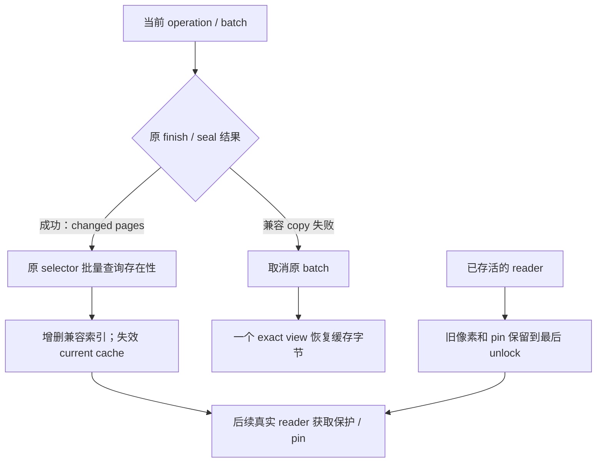

# 01d：写后索引、缓存失效与 pending 可见性的修改关系

返回[指南目录](/Users/apple/krita_gpu/docs/vulkan_gpu_design/br1_modification_guide/README.md)。设计依据：[92 §9.1、§9.4–9.5、§10.3](/Users/apple/krita_gpu/docs/vulkan_gpu_design/92_br1_m6_m8_execution_baseline.md)。本篇细分 S03 / SS8，并联动 S01、S04、S05、S06.3、S10；不增加新的阶段或状态权威。代码链接核对于 2026-09-28。

## 1. 本批已落实的边界

普通成功写入返回 changed pages 后，只更新兼容索引的坐标存在性并使旧 current cache 失效。是否有页面来自原 publication/epoch selector；实际像素读取仍由真实 reader 取得原精确保护和短 pin。查询不签发访问权限，也不将未 sealed pending 当成已发布内容。

失败回滚是另一条责任链：legacy copy 已可能把未提交字节装入 wrapper，旧 raw consumer 会直接读取该存储，因此 `refreshPageStoreIndex(rect)` 仍使用一个 exact view 恢复缓存字节。不能在 raw consumer 迁走前用仅清 ready 标志替代它。

上图是默认 operation 路径；显式原 history/cursor 的跨 operation pending 与 checkpoint/终结缓存失效现见 [HS1–HS8](/Users/apple/krita_gpu/docs/vulkan_gpu_design/br1_modification_guide/01f_history_owned_mutation_scope.md#history-scope-map)，通用业务尚未默认启用。只移除成功刷新内的隐式 capture，不能推导“整笔 stroke 已无重复 seal/COW”。

## 2. 设计条款 → 代码段 → 联动终点

| 单元 / 设计依据 | 实际代码段 | 当前落实与明确待改内容 | 成功、失败与验证入口 |
|---|---|---|---|
| **MR1：坐标存在性**；92 §9.4 / SS8 | [Store::resolvePagePresence](/Users/apple/krita_gpu/krita/libs/image/pagestore/KisPageStore.cpp:3295) | 在一个 store owner gate 内用原 `resolveSurfaceLocked/resolveVersionLocked` 分类整组页面；只返回临时 0/1。输出存储及 Qt detach 在 gate 前，旧输出销毁在 gate 后；不增 root/cache/generation owner。未 sealed 写入不参与查询 | 原 selector 无效时整组拒绝且旧输出不变；空 batch 也验证 selector。[metadataPresenceUsesCanonicalSelector](/Users/apple/krita_gpu/krita/libs/image/tests/KisPageStoreCpuMutationTest.cpp:5128) 覆盖 current/base/overlay、remove/default、新页 seal 前后与结束后的 selector；保存结果不阻止 close |
| **MR2：backend 选择**；92 §9.1 / §9.4 | [Backend::resolveCurrentPagePresenceInto](/Users/apple/krita_gpu/krita/libs/image/pagestore/KisTiledDataManagerPageStoreBackend.cpp:1271) | 原 publication read gate 保持事务选择存活；backend mutex 下选择 active history，其次健康 anonymous overlay，最后 committed current；随后释放 backend mutex，直接向 manager 的预备 scratch 查询。不保留/freeze overlay，也不新增 selector 状态；无消费者的公开分配输出包装已删除 | 不可用 backend 返回原错误通道。已接调用只有写后适配；不能把该元数据查询用作 oldData/G0、operation-start 或 external exact 的像素权限 |
| **MR3：成功 delta 适配**；92 §9.5 / S03 | [DataManager::refreshPageStorePages](/Users/apple/krita_gpu/krita/libs/image/tiles3/kis_tiled_data_manager.cc:1016)、[存在性 refreshPageStorePage](/Users/apple/krita_gpu/krita/libs/image/tiles3/kis_tiled_data_manager.cc:1044)、[Tile::invalidatePageStoreReadCache](/Users/apple/krita_gpu/krita/libs/image/tiles3/kis_tile.cc:73) | packed、planar、copy、native clear / managed pixel 成功后沿原 changed delta 分类，增删 hash/extent，只清原 read-ready 标志。原 wrapper/lease/存活 pin 不替换；下一次实际 read 再解析 | [testPageStoreMetadataRefresh](/Users/apple/krita_gpu/krita/libs/image/tiles3/tests/kis_tiled_data_manager_test.cpp:1740) 覆盖 1/4/8/16 BPP、history 与持有 reader 的 16 组，检查无额外 capture/request、新增页与 extent、旧指针、后续新值、1000 暖读和 undo/redo |
| **MR4：失败回滚与 raw consumer**；92 §9.3 / S06.3 L4、L10 | [DataManager::refreshPageStoreIndex](/Users/apple/krita_gpu/krita/libs/image/tiles3/kis_tiled_data_manager.cc:1081)、[exact-view refreshPageStorePage](/Users/apple/krita_gpu/krita/libs/image/tiles3/kis_tiled_data_manager.cc:1058)、[Tile::lockForRead](/Users/apple/krita_gpu/krita/libs/image/tiles3/kis_tile.cc:349) | 失败回滚保留 exact-view 读取和 `installPageStoreReadCache/takeIdleReadCache`。后续逐个迁移 `tileData()->data()` 等 raw consumer 到明确的 lifetime/pin；全部迁走且失败语义不变后，再删除这条立即恢复缓存字节的要求 | [testPageStoreCompatibilityCopyFailure](/Users/apple/krita_gpu/krita/libs/image/tiles3/tests/kis_tiled_data_manager_test.cpp:3500) 的 Mapping/Allocation/Decompression × rough/precise 六组检查第一页面缓存立即恢复及 canonical 全像素不变。初版仅失效曾使六组失败，现保留该反例；不能修改测试为“下一次 getTile 后才正确” |
| **MR5：发布前准备适配存储**；92 §9.3 / §10.3 / S10 | [DataManager::writePageStoreOperation](/Users/apple/krita_gpu/krita/libs/image/tiles3/kis_tiled_data_manager.cc:1734)、[DataManager::refreshPageStorePages](/Users/apple/krita_gpu/krita/libs/image/tiles3/kis_tiled_data_manager.cc:1016) | **部分已实施，整体继续。** 五个 native 入口的 presence scratch 与 extent 双轴容量已先于像素准备；publication 后仍可能分配缺失 wrapper/hash，刷新接口仍是 void/assert，history 终结的 presence 也仍待前置。将必要适配 capacity 纳入原 operation/job 准入，首字节前准备并由原 owner 保留；短安装消费已准备记录，失败不丢唯一取消责任。不能用一次查询原子性冒充写入+索引整体原子性；函数级准备、安装与失败关系已细分为 [OP1–OP10：operation 资源准备](/Users/apple/krita_gpu/docs/vulkan_gpu_design/br1_modification_guide/01m_operation_storage_preparation.md#operation-storage-map)，含 touched/changed、presence、hash 删除回收及 extent；触页/输出子范围已见 [OP2 实施与剩余边界](/Users/apple/krita_gpu/docs/vulkan_gpu_design/br1_modification_guide/01m_operation_storage_preparation.md#operation-storage-implementation)，其余发布前适配责任继续 | 在每个真实分配点注入拒绝，检查无半成功像素/索引、无预算外分配及重试/取消唯一终点；与 S01/S05/S10 同批启用。当前 query 临时 buffer 尚未接完整 MetadataArena/父额度 |
| **MR6：跨 dab pending/current 接线**；92 §9.1–§9.5 / SS1、SS5、SS7、SS8 | [Backend::runCpuMutationOperation](/Users/apple/krita_gpu/krita/libs/image/pagestore/KisTiledDataManagerPageStoreBackend.cpp:1897)；[01c SS1–SS10](/Users/apple/krita_gpu/docs/vulkan_gpu_design/br1_modification_guide/01c_mutation_session_storage_and_borrow.md) | 原 history 持有 session、cursor 借用及 cut/end 缓存失效已按 [HS1–HS8](/Users/apple/krita_gpu/docs/vulkan_gpu_design/br1_modification_guide/01f_history_owned_mutation_scope.md#history-scope-map) 接线；真实 scheduler job/read-write footprint、producer、通用 current 读与多 target 接线仍待完成。未 sealed 期间适配变更应由原 scope/write set 派生；本批 published-presence 查询不能拿来覆盖 pending 新页/删除。exact reader 仍须完整 cut/seal，G0/operation-start 保留各自语义 | 同页 1/10/1000 dab、屏幕外页、必需子 jobs、source/self-copy、display/save、中途取消；已排队 job 不被 cut 拒绝后又被等待。未闭合前保留当前 per-operation finish/rollback |
| **MR7：因果成本与资格**；92 §6、§8.1、§14 / V01 | [testPageStorePackedWriteNative](/Users/apple/krita_gpu/krita/libs/image/tiles3/tests/kis_tiled_data_manager_test.cpp:3881)；[真实刷新 allocator 探针](/Users/apple/krita_gpu/docs/vulkan_gpu_design/evidence/br1_s03_metadata_refresh_20260928/metadata-refresh-probe.cpp) | packed 写保留一次 operation-start capture 和测试注入 capture，仅去掉成功 index refresh 的一次。探针在真实 `refreshPageStorePages` 区间测 K=1/9/65/257；缓存页保持 swapped，证明查询不顺手 materialize。该冻结批次含 O(K) 查询、wrapper gate 和一次输出分配；当前 native presence 已按 OP3 提前准备，旧无预备输出的终结 helper 则为 ≤64 页 inline、更多页一次临时分配 | [本批证据](/Users/apple/krita_gpu/docs/vulkan_gpu_design/evidence/br1_s03_metadata_refresh_20260928/README.md)绑定源码、图、双架构矩阵、32 个继承探针和 2 个新增探针。正式 brush replay、Fresh 2%、全 job 冷资源与 M6/M7/M8/BR1-PERF 仍单独验收 |

## 3. 下一批修改顺序

1. MR5 与原 job 资源准备联动：声明 changed footprint 的上界，准备必要索引/extent/通知存储；资源拒绝回到 S01 的结构化结果和原 continuation，不能在已提交之后仅打印 assert。
2. MR6 与 S02/S04/S05 联合接线：history scope、真实 job 身份及 cut、current/G0/source 读语义、完整 checkpoint 一起实现。单纯删除 `finish()` 或延长 TLS batch 会改变取消和可见性，不满足设计。
3. MR4 按 [S06.3 L10](/Users/apple/krita_gpu/docs/vulkan_gpu_design/br1_modification_guide/03b_legacy_cache_migration.md)迁移剩余 raw consumer；保留 active reader/source 排斥，idle cache 的强引用与完整预算独立收口。
4. 用真实 stroke replay 验证输入到显示和 pen-up merge；再推进 U01/U02 和 C01/C02。索引刷新局部成本减少不能抵消 stroke 主桶回退。

## 4. 审查本篇时的判据

修改成功刷新时，必须同时检查失败恢复 caller、活跃/闲置/已 detached wrapper、同事务 current 与 G0、默认稀疏页、extent、资源拒绝。`resolvePagePresence` 是瞬时分类，不是 snapshot：不得跨解锁时间当作像素仍有效的证明；不得保存成第二份 canonical presence table。

当前五个 native 入口写前准备 inline/overflow buffer，查询区不再创建输出；终结 helper 的 >64 页输出仍有临时分配。存在性查询持 gate 的时间随本次 K 增长；没有宣称常数 hold、零分配安装、完整 OOM 恢复或真实 stroke 加速。最新测试和数值以 92 §15 与绑定证据为准。

MR6 所需的原 session 完整 seal/capture 与再开放能力现见 [CP1–CP5](/Users/apple/krita_gpu/docs/vulkan_gpu_design/br1_modification_guide/01c_mutation_session_storage_and_borrow.md#checkpoint-implementation)；显式 cursor pending 与事务 cut 接口已见 [HS1–HS8](/Users/apple/krita_gpu/docs/vulkan_gpu_design/br1_modification_guide/01f_history_owned_mutation_scope.md#history-scope-map)；真实 current read、scheduler/producer 联合启用及发布前适配准备继续。元数据存在性查询继续只反映 sealed/current 选择。

完整 checkpoint 的原调度切点、已接纳输入/必要子任务/后续输入/finish 的次序见 [S02 / SC1–SC6](/Users/apple/krita_gpu/docs/vulkan_gpu_design/br1_modification_guide/01e_scheduler_cut_and_job_admission.md#scheduler-cut-map)；业务持久 scope、producer 与 current/G0/source 仍需联合接线。

默认 cursor/packed/clear/两种 copy 的存储前置与剩余代码见 [OP3 实施与剩余边界](/Users/apple/krita_gpu/docs/vulkan_gpu_design/br1_modification_guide/01m_operation_storage_preparation.md#presence-storage-implementation)；[presence 准备验证记录](/Users/apple/krita_gpu/docs/vulkan_gpu_design/evidence/br1_s03_presence_storage_20260928/README.md)分别绑定准备、metadata 查询与旧终结 helper 的测量边界，未关闭 MR5/BC9。

extent 容量前置和仍待有界化的边缘删除扫描见 [OP5 实施表](/Users/apple/krita_gpu/docs/vulkan_gpu_design/br1_modification_guide/01m_operation_storage_preparation.md#extent-storage-implementation)，不替代 MR5 整体交付边界。

MR3/MR5 的原能力交付寿命现见 [AD1–AD6](/Users/apple/krita_gpu/docs/vulkan_gpu_design/br1_modification_guide/01m_operation_storage_preparation.md#adapter-delivery-implementation)：standalone 保留原 ClaimSet/write set，history 保留原 execution，均至 manager 刷新之后归还。持锁 legacy 冲突即时失败；这不替代 wrapper/通知写前准备或 canonical/index 的联合发布。
