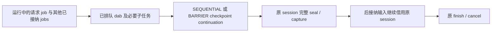

# 01e：S02 调度切点与 job 接纳

返回[修改指南目录](/Users/apple/krita_gpu/docs/vulkan_gpu_design/br1_modification_guide/README.md)。本篇将 92 §9.1–§9.5 的 scheduler cut 要求映射到当前函数和后续业务接线。唯一阶段入口仍为 [92](/Users/apple/krita_gpu/docs/vulkan_gpu_design/92_br1_m6_m8_execution_baseline.md)；PageStore 同一 session 的完整 checkpoint 能力见 [CP1–CP5](/Users/apple/krita_gpu/docs/vulkan_gpu_design/br1_modification_guide/01c_mutation_session_storage_and_borrow.md#checkpoint-implementation)。本批没有默认启用跨 dab 持久 stroke。

## 1. 问题与实际接线

`addMutatedJobs` 会把子任务放到第一个 own job 前。如果直接用它提交 checkpoint，checkpoint 会越过请求前已经排队的普通 dab。仅等待当前 worker/guard 归还，无法补回这些尚未执行的输入。新的 `addCheckpointJob` 使用原队列位置表达切点：请求在原 queue mutex 内线性化，已有排队 jobs 和它们递归产生的必要子 jobs 在前，之后接纳的普通输入在后。请求方立即返回并归还自身 borrow，等原 scheduler 调度 continuation。

图中 session/capture 与 scheduler 已在真实 worker 测试中联合验证；原 TransactionData 显式持久 owner 与 cursor 已按 [HS1–HS8](/Users/apple/krita_gpu/docs/vulkan_gpu_design/br1_modification_guide/01f_history_owned_mutation_scope.md#history-scope-map) 接线；painter/iterator、current/G0/source 和异步 producer 的联合启用继续下一段。

| 单元 | 实际代码段 | 已落实行为 | 仍待修改 / 不能外推的边界 |
|---|---|---|---|
| **SC1：明确请求 owner** | [Strategy::addCheckpointJob](/Users/apple/krita_gpu/krita/libs/image/kis_stroke_strategy.cpp:177)、[Queue::addCheckpointJob](/Users/apple/krita_gpu/krita/libs/image/kis_strokes_queue.cpp:372) | strategy 使用原 `KisStrokeId` 请求原队列；在 queue mutex 内与普通输入接纳排序。已离队但被 LoD buddy 保留的 stroke 仍拒绝；data 成功和拒绝均唯一归还，不自动克隆到 buddy | 仅允许该 strategy 正在执行的 worker 请求；没有新增运行 job ID、读写 footprint 或 PageStore 权限。需要按 SS1/SS5 将实际 job borrow 与事务、surface、frame/LoD 明确绑定，不能用 TLS/thread ID 授权 |
| **SC2：切点与 pen-up** | [Stroke::addCheckpointJob](/Users/apple/krita_gpu/krita/libs/image/kis_stroke.cpp:110)、[queued finish marker](/Users/apple/krita_gpu/krita/libs/image/kis_stroke.h:116)、[Stroke::endStroke](/Users/apple/krita_gpu/krita/libs/image/kis_stroke.cpp:174) | 普通输入仍打开时追加到现有队列尾；pen-up 已排队时放在原 finish 前。finish 只被一个非 owning 指针索引，不另建 job 集合；原 finish 保持队尾，定位不扫描 job backlog | 只接纳 cancellable 的 SEQUENTIAL/BARRIER，拒绝 CONCURRENT/UNIQUELY_CONCURRENT、错误 LoD 和已派发 finish。队列扩容仍可能分配，不授予全 job 准入或 checkpoint 请求零分配资格 |
| **SC3：必要子任务** | [Stroke::addMutatedJobs](/Users/apple/krita_gpu/krita/libs/image/kis_stroke.cpp:82) | 原 prepend 规则不改；已接纳 job 在请求后产生的 child/grandchild 仍插在切点前，最后 parent/child 归还后才轮到 continuation。后接纳普通 job 在 cut 后才开始，故其子任务不能穿越已完成切点 | 只覆盖遵守现有 contract 的 job 内同步派生。异步 producer 在 job 返回后仍可产出的工作必须先 flush/停接纳或显式接入 continuation；freehand `tryDoUpdate(forceEnd)`、mask/indirect、多 store 不能靠此 API 自动获得全局切点 |
| **SC4：原调度 quiescence** | [Queue::checkSequentialProperty](/Users/apple/krita_gpu/krita/libs/image/kis_strokes_queue.cpp:942)、[Queue::processOneJob](/Users/apple/krita_gpu/krita/libs/image/kis_strokes_queue.cpp:807) | SEQUENTIAL 等待所有此前 stroke jobs 完成；其运行期间不派发后续 stroke job。BARRIER 额外沿既有规则等待 merge/external updates；callback 沿原 dab strategy 执行，支持既有错误传播。worker 请求本身不等待，也不持自身 borrow 执行 checkpoint | 普通 cut 不需要排空与它无写依赖的 immutable projection reader；不要为“更保险”全部使用 BARRIER。外部异步写、其他 store 和 job 读写顺序必须由业务联动证明，不能仅由 scheduler 空闲宣称全图原子 |
| **SC5：取消与寿命** | [Stroke::clearQueueOnCancel](/Users/apple/krita_gpu/krita/libs/image/kis_stroke.cpp:297)、[Stroke::dequeue](/Users/apple/krita_gpu/krita/libs/image/kis_stroke.cpp:403) | 原取消/失败删除未开始的 cancellable cut，必要 non-cancellable child 保留并在 cancel 前执行。queued finish 指针在删除或派发时清除，finish 开始后新 cut 拒绝 | 正在运行的 checkpoint 不能通过删除队列撤回；其已冻结视图/失败终结由原 scope/transaction owner 负责。完整 OOM、必要通知/派发容量与无新输入进度仍按 S09/S10；不自动改变任意 callback 的 rollback 保证 |
| **SC6：行为与真实像素证据** | [testCheckpointOrdering](/Users/apple/krita_gpu/krita/libs/image/tests/kis_stroke_test.cpp:22)、[testCheckpointRejection](/Users/apple/krita_gpu/krita/libs/image/tests/kis_stroke_test.cpp:62)、[testCheckpointCapturesAdmittedJobs](/Users/apple/krita_gpu/krita/libs/image/tests/kis_strokes_queue_test.cpp:52)、[testCheckpointCancellation](/Users/apple/krita_gpu/krita/libs/image/tests/kis_strokes_queue_test.cpp:149)、[testCheckpointRejectsRetainedFinishedStroke](/Users/apple/krita_gpu/krita/libs/image/tests/kis_strokes_queue_test.cpp:180) | 单队列检查多次 cut、pen-up、拒绝与 data 寿命；真实 2-worker + 原 Tiles3 provider/Store/session，四种 BPP、两种 cut、end 两种次序；检查前 5 页完整可见、递归子任务、新段写入不改旧 view、只创建一个 session。取消/失败及 retained finished stroke 拒绝另测 | 用例通过测试 strategy 直接持有原 session；没有走 TransactionData/freehand 的真实持久 token，也未证明端到端绘画速度、Fresh 2%、TSAN 或完整 M6–M8。最终范围与源码/image 身份见 [本批证据](/Users/apple/krita_gpu/docs/vulkan_gpu_design/evidence/br1_s02_scheduler_cut_20260928/README.md) |

## 2. 下一段业务联动顺序

1. SS1：以 [HS1–HS8](/Users/apple/krita_gpu/docs/vulkan_gpu_design/br1_modification_guide/01f_history_owned_mutation_scope.md#history-scope-map) 的原 history/session 入口继续接真实 strategy；静止初始化在 worker 派发前完成，scope 准入失败在绘画前返回，finish/cancel 只由原业务 owner 收口。
2. SS5/SS8：job 得到明确执行身份和读写 footprint，backend/iterator/managed write 借用同一 scope；current 读取能看本段 pending，G0 与 operation-start/source/external exact 分别保持原语义。不能先移除 per-operation seal 再补读正确性。
3. 外部读边界：真正需要完整冻结时才从 job 请求本切点，先完成必要 producer/child，再由 continuation 调用原 `checkpointForRead`；失败沿已授权的整笔取消保证处理。多 store/LoD/mask 逐项协调，不共享可变权限。
4. SS7/S04/S05/S09/S10：压力 subset、发布前适配存储、capture 内部分配故障、必要终结容量及共享预算闭合后，才默认启用真实业务持久 stroke。普通 standalone 的 Operation rollback 保持。

本批为上述第二、三步提供真实调度切点，未完成这些步骤的其余责任。切点只在真实 freeze/finish/压力边界使用；每个 dab 都请求切点会重新制造每 dab seal/COW，违反 stroke 优先目标。
