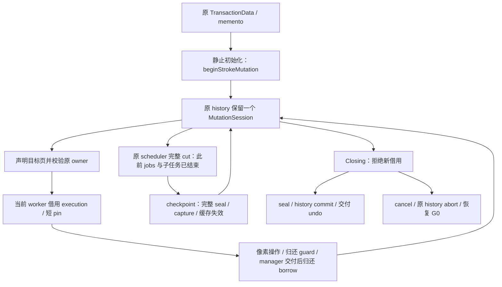

# 01f：history 持有的 mutation scope 与事务终结

返回[修改指南目录](/Users/apple/krita_gpu/docs/vulkan_gpu_design/br1_modification_guide/README.md)。本篇对应 92 §8.2、§9.1–§9.5，细分 S02/SS1、SS5、SS8，联动 S01/S03/S04/S05/S10。当前设计及阶段资格仍只在 [92](/Users/apple/krita_gpu/docs/vulkan_gpu_design/92_br1_m6_m8_execution_baseline.md) 维护；[证据](/Users/apple/krita_gpu/docs/vulkan_gpu_design/evidence/br1_s02_history_scope_20260928/README.md)绑定本批源码、构建、测试与明确限制。

## 1. 范围与接入前提

现有 `KisTransactionData` 可显式调用 `beginStrokeMutation`，以原 memento 选择同一个 backend history session；后续同步 cursor 操作只借用 execution、归还 guard，不再每 operation seal。原 session 持有 pending、claims、稳定 entries 和失败状态，原 history 仍持有 G0 与 undo 起点。未启用该入口的普通事务继续沿原 per-operation 路径。

启用必须发生在**没有 writer 的初始化边界、派发 worker 之前**。这不是运行中的 legacy writer 向持久 scope 的并发转换。backend 拒绝已注册 batch/匿名 lease 与后续无 owner 写入，但不据此声称穷举并阻断了所有启用前已进入的 legacy admission；直接 tile/iterator、跨 store 与异步 producer 的迁移必须由调用方先完成静止边界和接纳关系。

事务层不依赖 PageStore 类型；manager 消费原 typed operation 结果并返回 bool，checkpoint 的 exact view 也留在存储适配边界。需要保留当前 cut 的 reader 必须在同一调度切点内、后续冻结前走现有 immutable read scope；bool 结果本身不是像素访问权限。

本批 cursor 坐标为 manager-local，source 必须不可变；同一 cursor 可读写其已借用 pending 字节。普通 immutable reader 只看最后一次完整 checkpoint，**没有新增通用 job-current pending 读能力**。不得直接在现有 freehand 初始化处打开开关，随后继续调用未迁移 painter/iterator/clear/copy；这些调用不会自动获得 owner 权限，也不能用每 dab checkpoint 掩盖读语义缺口。

图中的原 scheduler 能力见 [SC1–SC6](/Users/apple/krita_gpu/docs/vulkan_gpu_design/br1_modification_guide/01e_scheduler_cut_and_job_admission.md#scheduler-cut-map)，当前事务测试直接调用 checkpoint，尚未证明 freehand producer 与事务入口已联合接线。

## 2. 设计要求 → 实际代码段 → 后续修改

| 单元 / 关联 ID | 实际代码段 | 已接线行为 | 后续责任与验收边界 |
|---|---|---|---|
| **HS1：原 owner 准入**；S02/SS1 | [TransactionData::beginStrokeMutation](/Users/apple/krita_gpu/krita/libs/image/kis_transaction_data.cpp:187) → [Manager::beginStrokeMutation](/Users/apple/krita_gpu/krita/libs/image/tiles3/kis_tiled_data_manager.cc:1689) → [Backend::beginHistoryMutation](/Users/apple/krita_gpu/krita/libs/image/pagestore/KisTiledDataManagerPageStoreBackend.cpp:1581) | 原 memento/activeHistory 验证成功才创建一个原 session；同一健康 owner 再启用不再创建。backend 仅增原 history 的持有成员和 Open/Closing/Sealed 终结阶段；不是第二份 transaction、page set 或失败权威 | 业务 init 必须先建立静止边界；将 scope 取得失败传回原 strategy，绘画前拒绝。泛化并发转换要复用原 admission/activity 协议，不能另建 token/TLS writer 表或只查询 activity 后假称已排除竞争 |
| **HS2：明确执行借用**；S02/SS5、S03 | [TransactionData::applyStrokePixelOperation](/Users/apple/krita_gpu/krita/libs/image/kis_transaction_data.cpp:199) → [Manager::applyStrokePixelOperation](/Users/apple/krita_gpu/krita/libs/image/tiles3/kis_tiled_data_manager.cc:1699) → [Backend::runCpuMutationOperation](/Users/apple/krita_gpu/krita/libs/image/pagestore/KisTiledDataManagerPageStoreBackend.cpp:1897) | owner 参数选择原 session；每次声明 targets 并调用原 borrowExecution；共享原 bounded cursor 和像素 kernel，manager pending 索引交付后 finish 只还 execution；具体寿命见 [AD3–AD4](/Users/apple/krita_gpu/docs/vulkan_gpu_design/br1_modification_guide/01m_operation_storage_preparation.md#adapter-delivery-implementation)。错误/旧 memento、closing/failed、legacy intent 拒绝，空范围也验证 owner | 当前仅写范围，没有 scheduler job 身份、read footprint 或泛化 current 读取。继续沿真实 strategy → painter/iterator 显式传递身份与依赖；不可把线程号或错误传播 TLS 当业务权限 |
| **HS3：完整冻结与缓存**；S04、S03 | [Backend::checkpointHistoryMutation](/Users/apple/krita_gpu/krita/libs/image/pagestore/KisTiledDataManagerPageStoreBackend.cpp:1623) → [Manager::checkpointStrokeMutation](/Users/apple/krita_gpu/krita/libs/image/tiles3/kis_tiled_data_manager.cc:1711) → [TransactionData::checkpointStrokeMutation](/Users/apple/krita_gpu/krita/libs/image/kis_transaction_data.cpp:213) | 原 session 完整 checkpoint 后保持同一 owner 可再借；冻结 view 解析原 delta 的最终存在性，失效旧兼容缓存与 device 缓存。活跃借用或结构忙立即拒绝；业务层只消费成功/失败，原 exact view 留在数据管理层；已有 reader 保持独立保护 | 调用前由原 SC 切点完成已接纳 jobs/必要子任务；异步 producer、多 store、LoD/mask 另行协调。内部 seal/capture 分配异常、失败输出、必要终结容量须结合 MR5/S05/S10 完整证明；不能将忙拒绝一律解释为可继续成功 |
| **HS4：提交与关闭接纳**；S01、S05 | [Backend::commitHistory](/Users/apple/krita_gpu/krita/libs/image/pagestore/KisTiledDataManagerPageStoreBackend.cpp:1642) → [Manager::tryCommit](/Users/apple/krita_gpu/krita/libs/image/tiles3/kis_tiled_data_manager.cc:366) → [TransactionData::tryEndTransaction](/Users/apple/krita_gpu/krita/libs/image/kis_transaction_data.cpp:225) | Open 转 Closing 后不接新 borrow；已接纳工作可归还。原 session seal 后转 Sealed，再走原 prune/extent/history commit；成功才清 owner 与交付 undo。活跃写导致拒绝时保留 Closing，之后可重试；后续根准备拒绝仍刷新已 sealed delta | Closing 是原业务终结阶段，像素失败仍由原 session 决定。外层 transaction/publication/manager gate 仍覆盖准备；短 gate、实际存储预备、post-seal 失败和预算资格继续 S05/MR5，不能由本批 bool 结果推导完整 OOM 原子性 |
| **HS5：取消、失败与析构**；S01、S09 | [Backend::abortHistory(owner)](/Users/apple/krita_gpu/krita/libs/image/pagestore/KisTiledDataManagerPageStoreBackend.cpp:1727)、[TransactionData::tryAbortTransaction](/Users/apple/krita_gpu/krita/libs/image/kis_transaction_data.cpp:264)、[TransactionData::~KisTransactionData](/Users/apple/krita_gpu/krita/libs/image/kis_transaction_data.cpp:128) | 先关闭接纳并 cancel 原 session，再 abort 原 history。live execution 时取消可记录失败并拒绝本次终结，归还后原 owner 重试；callback 失败使同一 scope 不可继续提交。未完成的显式事务析构尝试取消，不能 purge 成隐式 commit；已冻结 view 独立保活 | owner 的正常销毁须晚于全部 worker/guard；本批析构测试只有无活跃借用情况。任意 facade 提前销毁、拒绝取消的最终 owner 保活/自动进度及完整分配故障，仍需 S09/S10 证明，不能让警告承担终结责任 |
| **HS6：目标与上下文**；S02、C02 | [TransactionData::strokeMutationTargetIsCurrent](/Users/apple/krita_gpu/krita/libs/image/kis_transaction_data.cpp:173) | 每次 entry 检查原 device、saved manager、time、frame、LoD、活动事务与 memento。上下文失配时 callback 不执行；恢复原上下文后仍可继续；原 state 改 atomic 只解决状态观察 | 初始化必须先于 worker 发布；调用者保持 transaction/device/context 寿命和调度顺序。atomic state 不使整个 facade 或任意并发 context 修改安全；上下文切换性能不是本批验收目标 |
| **HS7：pending 适配及成本**；S03/MR5–MR6、S10 | [Manager::writePageStoreOperation](/Users/apple/krita_gpu/krita/libs/image/tiles3/kis_tiled_data_manager.cc:1734)、[Backend::historyChangedPages](/Users/apple/krita_gpu/krita/libs/image/pagestore/KisTiledDataManagerPageStoreBackend.cpp:1607) | 成功 cursor touched 页已含实际 pending 像素，更新原 wrapper/extent 并失效 read cache；不从 immutable presence 查询反推 pending 新页。checkpoint/end 的临时 keys 来自原 prepared proof/removal delta，不常驻第二份 touched 表 | 每次 cut/end 仍 O(K_history) 枚举，K 为该 history 的已变更页数；callback 路径仍准备 targets/range/touched 输出，兼容索引可在写后分配。必须把完整实际存储/预算/失败终点接进原 job 准入；不授予 per-operation 零分配或 gate hold 上限。删除/default/alias 仍未迁移到此显式 cursor 入口 |
| **HS8：语义与因果验证**；V01 | [testPageStoreHistoryMutation](/Users/apple/krita_gpu/krita/libs/image/tiles3/tests/kis_tiled_data_manager_test.cpp:1580)、[testPageStoreHistoryMutationFailure](/Users/apple/krita_gpu/krita/libs/image/tiles3/tests/kis_tiled_data_manager_test.cpp:1652)、[testPageStoreHistoryMutationClosing](/Users/apple/krita_gpu/krita/libs/image/tiles3/tests/kis_tiled_data_manager_test.cpp:1683)、[testPageStoreHistoryMutationOwner](/Users/apple/krita_gpu/krita/libs/image/tiles3/tests/kis_tiled_data_manager_test.cpp:1715)；[testStrokeMutationOwner](/Users/apple/krita_gpu/krita/libs/image/tests/kis_transaction_test.cpp:145)、[testStrokeMutationDestruction](/Users/apple/krita_gpu/krita/libs/image/tests/kis_transaction_test.cpp:189)、[testStrokeMutationFailure](/Users/apple/krita_gpu/krita/libs/image/tests/kis_transaction_test.cpp:204)、[testStrokeMutationContext](/Users/apple/krita_gpu/krita/libs/image/tests/kis_transaction_test.cpp:224) | manager 四种 BPP、D=1/10/1000、commit/abort、cut 前后 failure、live writer 终结重试、错误/旧 owner；实际 PaintDevice + TransactionData 跨 worker、undo/redo、旧 view、析构取消及 time/frame/LoD 拒绝 | 同一 session 的创建/生成/COW 因果断言不是完整 brush 性能。真正 direct/indirect/mask/wrapped/LoD/async replay、Fresh 2%、S02/S03 全部出口、M6/M7/M8 与 BR1-PERF 继续按 92 验收 |

## 3. 按此入口继续实施

1. 当前工作树的 multi-dab cursor、单一 painter owner 绑定与两个真实 producer caller 已定位到 [S03 / MD1–MD7：真实 multi-dab 与 painter scope](/Users/apple/krita_gpu/docs/vulkan_gpu_design/br1_modification_guide/01g_multi_dab_and_painter_scope.md#multi-dab-map)；painter 入口的像素、重复准备、并行和失败验证已闭合，public 显式 owner overload 已收缩为 private impl。显式 direct 开发入口已将原 owner 接到真实 producer，正式工具默认仍未启用。继续使用原 strategy 保活 transaction，job 只同步借用；保留独立 Operation rollback，只有原 stroke owner 接受整笔取消保证才启用 persistent。
2. 一起补 current/G0/operation-start/source 的读选择和 read/write footprint。目标 pending 命中经原 execution 访问，exact input 独立保活；self-copy/source-dependent 不可误读最后 checkpoint。H/V/random/wrapped/repeat 和既有 void 错误边界逐个迁移。
3. 把 TransactionData checkpoint 接入 SC continuation；`tryDoUpdate(forceEnd)` 的异步 producer 先停接纳或 flush 必要结果，release borrow 后让原调度执行 cut。finish/cancel 等待必需子任务，跨 manager/mask/LoD 分别保持真实 owner。
4. 联动 MR5/S05/S09/S10：首字节前准备 wrapper/hash/extent/dirty/输出和必要终结容量；失败输出不含半刷新，任何 post-seal 拒绝都保留唯一 abort/retry 责任。完整 capture 分配故障与长 stroke pressure subset 一并闭合后，才默认启用。
5. 固定输入量与最终 merge 端点做真实 stroke 对照，再进入 undo delta 和上下文性能。无真实 freeze 时，generation 与 COW 按页/段增长，不能随着 dab 次数增长；申请 execution 本身的成本仍需测量和优化。

本篇只建立具体代码与待改责任的关系；最新已验证范围、失败记录及源码身份由 92 §15 和本批证据决定。

原事务与真实 producer 的 target/mapping 复验已由 [WC1–WC8：目标映射复验](/Users/apple/krita_gpu/docs/vulkan_gpu_design/br1_modification_guide/01l_write_context.md#write-context-map) 接线；它是值快照，既不授予页权限，也不支持在已借用执行期间并发修改 device 元数据。恢复相同映射后的继续与直接取消分别验证；剩余 BC 原 owner/读/cut/资源继续。
