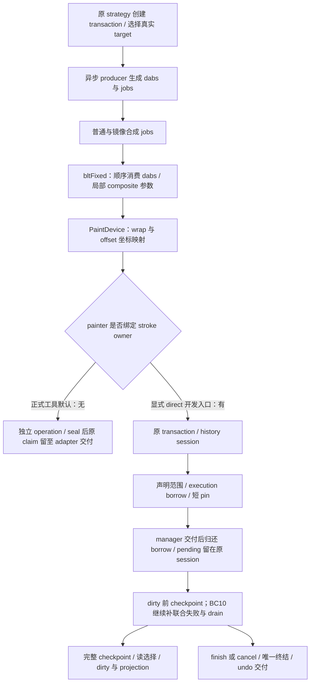

# 01g：真实 multi-dab 调用链与 painter scope 修改指南

返回[修改指南目录](/Users/apple/krita_gpu/docs/vulkan_gpu_design/br1_modification_guide/README.md)。本篇细分 **S03**，联动 S01/S02/S04/S05/S10/V01；设计依据为 [92 §9.1–§9.5](/Users/apple/krita_gpu/docs/vulkan_gpu_design/92_br1_m6_m8_execution_baseline.md)。MD1–MD7 是代码定位单元，不新增阶段或状态 owner。

## 1. 当前代码与交付边界

定位对象为 HEAD `5173c807c87bb1619325249a07a8b4f4f8f09f09` 上的未提交工作树。`bltFixed(rect, dabs)` 使用声明范围的 cursor，production 与测试都通过单一 painter 绑定解析原 transaction；显式 `KisTransaction *strokeOwner` 只保留在 private implementation helper。当前首条显式 direct 开发模式会跨异步 jobs 保持 session；正式工具没有 opt-in，绑定为空，仍走原独立 operation。

本入口首批完整双架构 CPU/业务矩阵为 **6,866 passed、0 failed、0 skipped**，36 次继承探针通过；源码、库、二进制与明确边界见 [multi-dab 验证记录](/Users/apple/krita_gpu/docs/vulkan_gpu_design/evidence/br1_s03_multi_dab_20260928/README.md)。该记录保留当时的 owner overload 形态；当前代码已在 [API §20](API_CONVERGENCE_MAP.md#painter-owner-api-convergence)删除 public 显式变体，独立 operation 保证不变。

后续稀疏范围批次改为逐 dab 声明真实交集，经原 wrap/offset 映射后按页取并集；完整矩阵 **7,006 passed、0 failed、0 skipped**，具体代码和下一段边界见 [S03 / SR1–SR7：稀疏写范围](/Users/apple/krita_gpu/docs/vulkan_gpu_design/br1_modification_guide/01h_sparse_write_footprints.md#sparse-range-map)、[稀疏范围验证记录](/Users/apple/krita_gpu/docs/vulkan_gpu_design/evidence/br1_s03_sparse_ranges_20260928/README.md)。首批 6,866 的记录保留自己的源码身份。

默认普通/镜像 producer 后续已接 [S03 / PG1–PG8：页归属与真实 brush jobs](/Users/apple/krita_gpu/docs/vulkan_gpu_design/br1_modification_guide/01i_page_owned_brush_jobs.md#page-partition-map)：同一页归入一个多 clip job，原镜像屏障保持；增加 16 组实际 producer 线程并行与不同 offset 的逐字节对照，完整矩阵及 SIMD 修正见 [页分区验证记录](/Users/apple/krita_gpu/docs/vulkan_gpu_design/evidence/br1_s03_page_partition_20260928/README.md)。首条 direct 开发入口的 owner/display/finish/cancel 交付另见 [01j §6](01j_real_stroke_integration.md#direct-stroke-pilot-delivery)；正式工具默认仍未启用。

初轮 [focused-01 日志](/Users/apple/krita_gpu/docs/vulkan_gpu_design/evidence/br1_s03_multi_dab_20260928/kis_painter_test-focused-01.log)为 **52 passed、4 failed、0 skipped**；三个重复写 case 的准备计数断言失败，一个取消 case 的同步点超时。这四处失败已修订并进入最终完整矩阵；原失败日志保留，具体改法见 §3。已冻结的 history scope 验证只适用于 [01f 所列能力和源码](/Users/apple/krita_gpu/docs/vulkan_gpu_design/br1_modification_guide/01f_history_owned_mutation_scope.md)，本批新增 painter 入口另按上述源码身份取证。默认持久 freehand、完整 M6–M8 和性能资格继续以 92 为准。

这里首先完成笔刷路径的责任闭环，再测同输入的 stroke 吞吐、首 dab、尾延迟和 pen-up。undo delta 和 preset/context 优化分别进入 [05](/Users/apple/krita_gpu/docs/vulkan_gpu_design/br1_modification_guide/05_undo_delta.md)、[06](/Users/apple/krita_gpu/docs/vulkan_gpu_design/br1_modification_guide/06_context_switching.md)，不能拿这些收益抵消绘画回退。

## 2. 待改内容 → 代码段 → 必须联动的终点

| 单元 / 设计关系 | 精确入口与当前事实 | 具体改法 / 联动终点 | 验收条件 |
|---|---|---|---|
| **MD1：原 owner 到真实 job**；S02/SS1、S03，92 §9.1 | [initStrokeCallback](/Users/apple/krita_gpu/krita/libs/ui/tool/strokes/kis_painter_based_stroke_strategy.cpp:251)持有 transaction；[initPainters](/Users/apple/krita_gpu/krita/libs/ui/tool/strokes/kis_painter_based_stroke_strategy.cpp:187)配置 painter；[doAsynchronousUpdate](/Users/apple/krita_gpu/krita/plugins/paintops/defaultpaintops/brush/kis_brushop.cpp:230)及 [addMirroringJobs](/Users/apple/krita_gpu/krita/plugins/paintops/defaultpaintops/brush/kis_brushop.cpp:189)仍生成无 owner 合成调用 | 先覆盖 target 与原 transaction 一致、source 不可变的 direct 路径。静止 init 中调用原 `beginStrokeMutation`；沿既有 job/state 显式传递受约束的 owner 与 target 身份，普通和镜像 jobs 同时迁移。由原 strategy 保活到全部必要子任务结束，不在共享 PaintDevice 放可改写的 current-writer 指针，不把错误 TLS 当权限。masking 的 strokeDevice/maskDevice 不能复用不匹配的 target transaction | 错 target/旧 frame/LoD/结束 owner 不执行 kernel；两个生产调用点和 finish/cancel 都消费同一 owner；跨 worker 无悬空指针。只有 overload 存在不算完成 |
| **MD2：坐标与页范围依赖**；S02/SS5、S03，92 §9.2 | [splitDabsIntoRects](/Users/apple/krita_gpu/krita/libs/image/brushengine/kis_paintop_utils.cpp:75)产生像素区域；[applyPixelOperationImpl](/Users/apple/krita_gpu/krita/libs/image/kis_paint_device_strategies.h:280)在原适配器内做 offset/wrap 映射 | 原 compositor 准入已按 [S03 / SR1–SR7：稀疏写范围](/Users/apple/krita_gpu/docs/vulkan_gpu_design/br1_modification_guide/01h_sparse_write_footprints.md#sparse-range-map) 声明实际 dab 交集的映射后页并集，消除空白页占用；后续默认不可变 dab compositor 已按 [S03 / PG1–PG8：页归属与真实 brush jobs](/Users/apple/krita_gpu/docs/vulkan_gpu_design/br1_modification_guide/01i_page_owned_brush_jobs.md#page-partition-map) 把共页归入同一个 job，镜像阶段继续原屏障；其他 source-dependent 入口的读范围和完整 job 依赖继续。像素 rect 不相交不必然意味着 manager 页不相交；offset、wrap、镜像都要参与。共享页及读写依赖保持原绘画次序，不能靠冲突后重放 kernel，也不能只扩大写区域改变图像。复用原 admission，不建第二份 pending 表 | 非零 offset、负坐标、wrap 两侧、镜像、相邻但同页 rect 的对照；独立页确实并行，共享页确定排序；source/self-copy 另行验证 |
| **MD3：一个 batch 的有序像素操作**；S03，92 §9.1、§9.3 | [public bltFixed 与 private owner impl](/Users/apple/krita_gpu/krita/libs/image/kis_painter_blt_multi_fixed.cpp:169)、[applyDevice](/Users/apple/krita_gpu/krita/libs/image/kis_painter_blt_multi_fixed.cpp:18)、[applyDeviceWithSelection](/Users/apple/krita_gpu/krita/libs/image/kis_painter_blt_multi_fixed.cpp:88)已改 cursor；composite 查找落在调用局部，不再写共享 painter cache | 保留 dab 顺序、源 bounds、opacity/averageOpacity/flow、通道和 selection 语义。cursor 返回无效 span/空指针时在 kernel 前停下并报告原 failure sink；已绑定 owner 的拒绝不能 fallback。保留 [原 public 入口](/Users/apple/krita_gpu/krita/libs/image/kis_painter_blt_multi_fixed.cpp:164)的独立操作保证；painter 配置与 source 在 jobs 存活期间保持不可变。同步 private impl 只借用 owner，不储存裸指针供未来任务使用 | 四种 BPP、不同 composite/通道/遮罩、重叠 dabs、跨页与 wrap 的独立像素 oracle；同 painter 并行区域；standalone 和绑定 owner 两条保证分别测 |
| **MD4：读取意图与完整 cut**；S04、S03/MR6，92 §9.4 | [PaintDevice owner overload](/Users/apple/krita_gpu/krita/libs/image/kis_paint_device.cc:1890) → [Transaction::applyStrokePixelOperation](/Users/apple/krita_gpu/krita/libs/image/kis_transaction.h:73)；当前 cursor 能读自己的 pending，未提供通用 job-current reader；[tryDoUpdate](/Users/apple/krita_gpu/krita/libs/ui/tool/strokes/freehand_stroke.cpp:228)还会生成后继 jobs | 将 source/mask 的 immutable 选择、G0 oldData、operation-start 和 current 分开。使用 [SC1–SC6](/Users/apple/krita_gpu/docs/vulkan_gpu_design/br1_modification_guide/01e_scheduler_cut_and_job_admission.md#scheduler-cut-map)安排 producer flush、必要子任务、归还 borrow，再调用原 checkpoint 并更新 dirty/projection；不能每 dab freeze 来掩盖 current 读缺口。多 store、mask、LoD 各自保持真实 owner 与一致业务 cut | 冻结前后 current/G0/旧 reader 像素正确；cut 后新输入不混入旧 snapshot；异步尾部、屏幕外页及 save 不漏写。遮罩快照时机须有独立用例 |
| **MD5：失败、抬笔与取消的唯一终结**；S01、S02/SS8，92 §9.3 | [finishStrokeCallback](/Users/apple/krita_gpu/krita/libs/ui/tool/strokes/kis_painter_based_stroke_strategy.cpp:395)、[cancelStrokeCallback](/Users/apple/krita_gpu/krita/libs/ui/tool/strokes/kis_painter_based_stroke_strategy.cpp:488)已有结果路径；[multi-dab 失败上送](/Users/apple/krita_gpu/krita/libs/image/kis_painter_blt_multi_fixed.cpp:226)接现有 sink | 补 producer 最终输出与镜像/merge 的必要后继顺序，完成后关闭新借用；活跃 borrow 时保留原 owner 并由调度在归还后续做终结。普通失败进入整笔 abort，成功才交付 undo；不可取消的 indirect merge 沿自己的原契约。禁止析构 warning 后丢弃未终结事务 | 第一页已写、后续页失败；finish/cancel 拒绝与重试；晚 guard、重复取消、必要 merge、旧 snapshot 均正确。只测 callback 尚未开始时取消不能覆盖中途失败 |
| **MD6：整 job 必要准备与热路径成本**；S03/MR5、S05、S10，92 §9.5、§10 | [bltFixed 的局部列表/参数](/Users/apple/krita_gpu/krita/libs/image/kis_painter_blt_multi_fixed.cpp:169)、[backend::runCpuMutationOperation](/Users/apple/krita_gpu/krita/libs/image/pagestore/KisTiledDataManagerPageStoreBackend.cpp:1897)、[Manager::writePageStoreOperation](/Users/apple/krita_gpu/krita/libs/image/tiles3/kis_tiled_data_manager.cc:1734)仍有 range/touched/兼容索引等成本 | 沿原 job admission 准备实际 entries/index/wrapper/extent/dirty 输出及必要终结存储，接原预算与首字节前压力 continuation。把每次调用、每段首写、真实 freeze、退休分别计量；不要先增加持久缓存或一个新 facade。有限工作窗口和共享预算按 S10 闭合 | 无真实 freeze 时 D=1/10/1000 同页重写的 payload 准备随不同页数增长；freeze 后只为再次写的页重新准备。实际 allocator 正控制、tiny-budget、最终 drain 与真实 stroke 耗时单独验收；计数通过不等于零分配或提速 |
| **MD7：修正验证定位并绑定完整证据**；V01，92 §6、§14 | [testMultiDabOperation](/Users/apple/krita_gpu/krita/libs/image/tests/kis_painter_test.cpp:718)、[testMultiDabReuse](/Users/apple/krita_gpu/krita/libs/image/tests/kis_painter_test.cpp:819)、[testMultiDabConcurrent](/Users/apple/krita_gpu/krita/libs/image/tests/kis_painter_test.cpp:845)、[testMultiDabCancellation](/Users/apple/krita_gpu/krita/libs/image/tests/kis_painter_test.cpp:927)、[testMultiDabOwnerRejection](/Users/apple/krita_gpu/krita/libs/image/tests/kis_painter_test.cpp:1063)及 `testMultiDabSelectionSnapshot` 共 55 项/架构已进入本批完整矩阵 | 计数已绑定真实 Fresh 准备，取消使用写后暂停的真实 kernel，保留正控制和失败记录；继续补 MD1–MD6 的真实业务 replay/完整故障/资源证据。更新源码绑定调用图、ownership、双架构矩阵和 required probes，保留全部失败日志 | 同源码/库/binary 身份齐全、全部必要场景通过后才向 92 登记本批资格；microbenchmark 与 painter fixture 不替代完整 brush replay、Fresh 控制及正式 BR1-PERF |

MD1 的普通/镜像两条业务路径现共用 [addDabJobs 内的 painter 调用](/Users/apple/krita_gpu/krita/plugins/paintops/defaultpaintops/brush/kis_brushop.cpp:184)。owner、同步旁路、display cut 和终结的下一段改法见 [BC1–BC10：真实 stroke 联合接线](/Users/apple/krita_gpu/docs/vulkan_gpu_design/br1_modification_guide/01j_real_stroke_integration.md#stroke-integration-map)。接口审查同时覆盖 [painter 公共 overload](/Users/apple/krita_gpu/krita/libs/image/kis_painter.h:318)、[painter 私有 kernel 声明](/Users/apple/krita_gpu/krita/libs/image/kis_painter_p.h:83)和 [PaintDevice 公共 overload](/Users/apple/krita_gpu/krita/libs/image/kis_paint_device.h:860)；保留旧接口时要注明独立操作保证，避免只改 `.cpp` 而遗漏调用契约。

## 3. 初轮失败定位与本批修订

初版 `testMultiDabReuse` 使用 `MutationSourceInitialize` 作为准备计数，但 [Fresh replica 准备区间](/Users/apple/krita_gpu/krita/libs/image/pagestore/KisPageStore.cpp:1944)使用 `WriteProviderPrepare`。本批改为统计这一实际区间，要求首次恰好两页准备，同段 1/10/1000 次调用不再增加且 seal 为零；checkpoint 后再次写两页累计恰好四次。没有删除正控制，也不把原先的零计数当成零 COW 证明。

初版 `testMultiDabCancellation` 等待 `MutationSourceInitialize` observer；[observer 契约](/Users/apple/krita_gpu/krita/libs/image/pagestore/KisPageStoreDiagnostics_p.h:175)和 [Timer::next](/Users/apple/krita_gpu/krita/libs/image/pagestore/KisPageStoreDiagnostics.cpp:143)表明 observer 只在显式 `next()` 调用时触发，构造 timer 不触发。本批用测试独占的 Alpha color space 和 Copy composite 包装器，在原 Copy kernel 改完第一页后暂停。主线程确认字节已变为 71，再请求取消；live borrow 使本次终结拒绝，恢复 worker 后第二页不得进入 kernel，失败上送后由原 owner 重试 abort 并恢复全部原值。没有新增生产 test hook，也没有通过拉长超时或改成首字节前取消降低覆盖。

新增 [testMultiDabSelectionSnapshot](/Users/apple/krita_gpu/krita/libs/image/tests/kis_painter_test.cpp:1029) 在 `PixelOperationBody` 修改独立 selection，证明已捕获遮罩仍用于整个跨页操作。该 phase 不持 PageStore owner gate；嵌套 observer 被抑制。四种 BPP 的像素 oracle、并行借用、错误 owner 与 commit/abort/undo/redo 的范围分别见 [multi-dab 验证记录](/Users/apple/krita_gpu/docs/vulkan_gpu_design/evidence/br1_s03_multi_dab_20260928/README.md)；取消中途写用例本批为 Alpha8，不外推为所有插件故障覆盖。

## 4. 实施顺序与审查交付

1. **当前入口的已验证范围：MD3 + MD7 子集。** 像素 oracle、重复准备、并行借用、写后取消、遮罩快照与错误 owner 已在完整矩阵通过；MD7 的真实 brush replay、资源/性能出口仍待完成。
2. **再接完整 direct 业务链：MD1 + MD2 + MD4 + MD5。** 先证明 owner/页冲突/读选择/producer cut/终结，提供显式受测接线；默认启用还须满足 MD6 的资源前置，不能直接在 init 开关后留下未迁移的调用者。
3. **闭合必要资源并测 stroke：MD6 + V01。** 完整 job 的存储、压力、退让和 drain 是启用前置；以相同输入与最终 merge 端点比较。与 S05/S08/S09/S10 联合复核，不以延迟所有显示降低工作量。
4. **扩展其余入口。** scalar fixed、mask、general bitBlt、H/V/random/wrapped/repeat、source-dependent、indirect/LoD 不因 multi-dab 改动自动完成；按 [01](/Users/apple/krita_gpu/docs/vulkan_gpu_design/br1_modification_guide/01_stroke_scope_and_failure.md)、[01b](/Users/apple/krita_gpu/docs/vulkan_gpu_design/br1_modification_guide/01b_pixel_failure_boundaries.md)逐条迁移。M6 → M7 → M8 → BR1-PERF 出口保持 [STAGE_MAP](/Users/apple/krita_gpu/docs/vulkan_gpu_design/br1_modification_guide/STAGE_MAP.md)的依赖。

每批提交说明列出：关联 MD/S ID、已修改符号与两个生产 caller、唯一 owner 和失败保证、真实 target/读写 footprint、freeze/finish/cancel 终点、源码与测试证据、尚未迁移的入口。接口移位时同步更新本表、[NEXT_EDITS](/Users/apple/krita_gpu/docs/vulkan_gpu_design/br1_modification_guide/NEXT_EDITS.md)和 [CODE_INDEX](/Users/apple/krita_gpu/docs/vulkan_gpu_design/br1_modification_guide/CODE_INDEX.md)。

同步 fixed-source 消费者现复用这里的 span kernel，source view 与 caller 参数的边界见 [FC1–FC8：固定源与 sharpness](/Users/apple/krita_gpu/docs/vulkan_gpu_design/br1_modification_guide/01k_fixed_source_and_sharpness.md#fixed-cursor-map)。默认 `useDabParameters=true` 保留 multi-dab 参数语义；scalar 调用为 false，不能把后一分支的 wrap 首周期规则套到 multi-dab 的整 job clip 次序。
