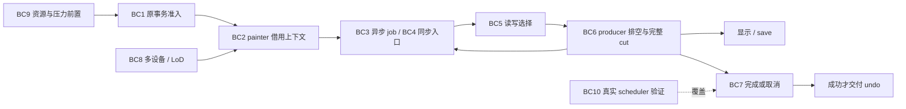

# 01j：真实 stroke 联合接线的修改指南

返回[指南目录](/Users/apple/krita_gpu/docs/vulkan_gpu_design/br1_modification_guide/README.md)。本篇将 **S01–S05、S10、C02、V01** 在真实绘画链上的交叉责任拆成 BC1–BC10；BC 是定位编号，不增加全局修改项或阶段。设计依据为 [92 §8–§10、§12.3、§13–§14](/Users/apple/krita_gpu/docs/vulkan_gpu_design/92_br1_m6_m8_execution_baseline.md)，优先级保持 **stroke → undo → 上下文切换**。 当前批次选择与停止条件统一以 [92 §16](../92_br1_m6_m8_execution_baseline.md#br1-convergence)和 [CONVERGENCE](CONVERGENCE.md)为准；下文各实施批次保留其冻结范围。当前 API 替代与删除计划见 [函数映射](API_CONVERGENCE_MAP.md)，owner/结果的等价分支随 BC 接线合并；仅有未迁移消费者的外部包装删除后置。

## 1. 核对范围与当前缺口

2026-09-28 核对已检出工作树，HEAD 为 `5173c807c87bb1619325249a07a8b4f4f8f09f09`，包含未提交实现；HEAD 不能单独代表该实现。源码定位与文档检查见[本次记录](/Users/apple/krita_gpu/docs/vulkan_gpu_design/evidence/br1_guide_stroke_chain_20260928/README.md)。以下“待改”是实施要求，不是已经完成的功能。同步 fixed/1px 消费者在该次文档核对后已实施，更新见 [FC1–FC8：固定源与 sharpness](/Users/apple/krita_gpu/docs/vulkan_gpu_design/br1_modification_guide/01k_fixed_source_and_sharpness.md#fixed-cursor-map) 与 [固定源验证记录](/Users/apple/krita_gpu/docs/vulkan_gpu_design/evidence/br1_s03_fixed_cursor_20260928/README.md)；原 BC 文档核对不代替新源码的行为验证。

- 原 history/memento 已可显式持有 mutation session，cursor 可借用它，见 [HS1–HS8](/Users/apple/krita_gpu/docs/vulkan_gpu_design/br1_modification_guide/01f_history_owned_mutation_scope.md#history-scope-map)。首条 direct 开发入口现可显式启用；正式工具默认 scope 仍未启用。
- multi-dab 已有单一 painter owner 绑定、稀疏页范围和按映射后页归属的并行 job，见 [MD](/Users/apple/krita_gpu/docs/vulkan_gpu_design/br1_modification_guide/01g_multi_dab_and_painter_scope.md#multi-dab-map)、[SR](/Users/apple/krita_gpu/docs/vulkan_gpu_design/br1_modification_guide/01h_sparse_write_footprints.md#sparse-range-map)、[PG](/Users/apple/krita_gpu/docs/vulkan_gpu_design/br1_modification_guide/01i_page_owned_brush_jobs.md#page-partition-map)。普通/镜像两条业务路径共用一个 `addDabJobs` 调用点；它已删除显式 `nullptr`，在开发入口中消费 painter 的原 transaction 绑定，旧模式绑定为空。public 显式 owner overload 已收缩为 private impl，不再构成第二条业务入口。
- scalar fixed 已用 cursor，独立源 bitBlt/mirror 已有显式同步 owner；真实 1px 调用现同样消费 painter 绑定。source/current/self-copy 的扩展资格继续按 FC8/BC5 登记。
- 原 scheduler 已有 checkpoint 插入能力，见 [SC1–SC6](/Users/apple/krita_gpu/docs/vulkan_gpu_design/br1_modification_guide/01e_scheduler_cut_and_job_admission.md#scheduler-cut-map)。首条 direct 入口在取走 dirty 前 checkpoint；同一 fixture 已证明三步递归 producer 在 finish 前排空，并覆盖 admission、像素失败信号、checkpoint、finish 四类失败的唯一 cancel 终点。save 与完整资源压力仍待联合验证。

图中箭头表示必须核对的责任传递。BC8 扩展入口覆盖；BC9 是默认启用的前置，不能拖到绘画结束后补。各 store 保持自己的原 owner，不增加跨 store 的第二套事务系统。

## 2. 待改内容与代码段的明确关系

“主改”指定需要改变的行为；“联动”指定必须核对的调用者和终点，不要求重写整个文件。每行的验收都是待补范围，已有 fixture 仅作落点。

| 单元 / 条款 | 当前代码段与事实 | 具体改法与必须联动的终点 | 完成判据 |
|---|---|---|---|
| **BC1：原事务与迁移资格**；S01/S02/S03，92 §9.1、§9.3 | [strategy::initStrokeCallback](/Users/apple/krita_gpu/krita/libs/ui/tool/strokes/kis_painter_based_stroke_strategy.cpp:251)创建主事务；[TransactionData::beginStrokeMutation](/Users/apple/krita_gpu/krita/libs/image/kis_transaction_data.cpp:187)提供显式准入；[initPainters](/Users/apple/krita_gpu/krita/libs/ui/tool/strokes/kis_painter_based_stroke_strategy.cpp:187)设置实际 paintop | 沿原 strategy 确定**整条将执行的入口**是否迁移；在 quiescent 初始化边界、对应 job 写入前开启原 session。准入失败走原失败/取消链；只有确认未执行且仍满足旧保证的入口才能留在 standalone。资格必须覆盖 BC4 的同步分支和 BC8 的真实目标，不能仅比较笔刷 ID | 初始化拒绝无像素写入、无成功 undo；未迁移 paintop 保留原失败保证；迁移后的连续 jobs 借用同一原 session |
| **BC2：painter 保存借用上下文**；S02/S03，92 §8.2、§9.1 | [KisPainter::Private::transaction](/Users/apple/krita_gpu/krita/libs/image/kis_painter_p.h:30)是原有自持事务；[beginTransaction](/Users/apple/krita_gpu/krita/libs/image/kis_painter.cc:322)创建它；[begin(device, selection)](/Users/apple/krita_gpu/krita/libs/image/kis_painter.cc:300)重置 painter | 为已迁移入口显式传递由原事务签发的非拥有执行上下文；初始化后在 async jobs 存续期间保持稳定。它不得占用或改写 `d->transaction` 的自持所有权，不在共享 PaintDevice 安装可变“当前 writer”。联动 painter begin/end、job 捕获与 BC7 的释放次序；异步 job 不靠悬空裸指针维持寿命 | standalone painter begin/end 保持原行为；晚 job 与重复结束不会释放两次 owner；异步执行期间不重绑上下文 |
| **BC3：真实 job 的身份、范围和映射**；S02/S03/C02，92 §9.1–§9.2、§12.3 | [KisBrushOp::addDabJobs](/Users/apple/krita_gpu/krita/plugins/paintops/defaultpaintops/brush/kis_brushop.cpp:169)分区后调用无显式 owner 的入口，该入口在首条显式 direct 模式中消费 painter 的原 transaction 绑定；[addMirroringJobs](/Users/apple/krita_gpu/krita/plugins/paintops/defaultpaintops/brush/kis_brushop.cpp:189)保留镜像屏障；[partitionWriteRects](/Users/apple/krita_gpu/krita/libs/image/kis_paint_device.cc:1951)只产生几何；[strokeMutationTargetIsCurrent](/Users/apple/krita_gpu/krita/libs/image/kis_transaction_data.cpp:173)检查目标、manager、时间、LoD、frame | 在原 job/必要后继上传递稳定 scope 身份和执行范围，执行时取得原 borrow。维持同页 dab 顺序和独立页并行；source-dependent job 声明读取依赖。**分区到执行之间** offset、wrap mode/axis/border 已有值复验，不能把几何当权限。原事务及真实 update 的 target/offset/effective wrap 复验已按 [WC1–WC8：目标映射复验](/Users/apple/krita_gpu/docs/vulkan_gpu_design/br1_modification_guide/01l_write_context.md#write-context-map) 实施；普通位移事务不受此持久约束。当前开发入口已接 owner/job 生命周期及四类联合失败；正式工具绑定为空，复杂 source/current 依赖与 BC9 资源门仍开放 | 负 offset、跨 wrap seam、镜像与错序 worker 保持像素结果；排队后映射/目标变化在写前拒绝或经原 scheduler 安全重建；旧 job 不写入新上下文 |
| **BC4：同步和通用 painter 旁路**；S01/S03/S04，92 §9.1、§9.3–§9.4 | [KisBrushOp::paintLine](/Users/apple/krita_gpu/krita/plugins/paintops/defaultpaintops/brush/kis_brushop.cpp:411)的 1px sharpness 分支使用缓存设备、`bitBlt`、`renderMirrorMask`；[FreehandStrokeStrategy::doStrokeCallback](/Users/apple/krita_gpu/krita/libs/ui/tool/strokes/freehand_stroke.cpp:143)还接收多边形、路径、填充等输入；[drawAndFillPainterPath](/Users/apple/krita_gpu/krita/libs/ui/tool/strokes/KisMaskedFreehandStrokePainter.cpp:101)调用通用 painter | 1px 的 scalar fixed、bitBlt/mirror 已按 [FC1–FC8：固定源与 sharpness](/Users/apple/krita_gpu/docs/vulkan_gpu_design/br1_modification_guide/01k_fixed_source_and_sharpness.md#fixed-cursor-map) 迁移，并在首条显式 direct 模式中消费 BC2 的 painter 绑定，保留临时 source、镜像、composite 与原次序。该开发入口排除 selection、路径/填充、indirect/mask、wrap/LoD；这些入口继续逐一明确安全旧模式或迁移，不能写到一半临时 fallback 或直接拿混合状态继续 | 1px 开/关、镜像、选区与 async dab 交错的结果一致；中途写失败取消整笔且不重放；路径/填充类入口有明确覆盖或明确保留条件 |
| **BC5：四种读取意图**；S03/S04，92 §9.4 | [multi-dab bltFixed](/Users/apple/krita_gpu/krita/libs/image/kis_painter_blt_multi_fixed.cpp:175)以 immutable dab/selection 输入合成；[PaintDevice::applyPixelOperation](/Users/apple/krita_gpu/krita/libs/image/kis_paint_device.cc:1898)传 owner；[TransactionData::applyStrokePixelOperation](/Users/apple/krita_gpu/krita/libs/image/kis_transaction_data.cpp:199)交原 manager | 本 job current 读在有效 borrow 下读取 pending；oldData 固定 G0；自拷贝/重叠 source 使用算法要求的 operation-start 选择；projection/save 使用 BC6 的 immutable checkpoint。FC4/FC5 已将独立 source/selection 的 accessor 移到操作前捕获，并拒绝显式 owner 的同 manager source；通用 sampler/current/self-copy 仍需补齐，不以每 dab freeze 补语义缺口。联动 iterator/read scope、selection 捕获、源与目标重叠范围和失败恢复 | 同一输入分别验证 current、G0、operation-start、旧 retained reader；跨 job 依赖有序；未借用的 reader 不接触正在改写的 backing |
| **BC6：producer 排空、显示与 exact cut**；S02/S03/S04/S05，92 §9.1、§9.4 | [tryDoUpdate](/Users/apple/krita_gpu/krita/libs/ui/tool/strokes/freehand_stroke.cpp:228)会追加 jobs 和 forceEnd 后继；[issueSetDirtySignals](/Users/apple/krita_gpu/krita/libs/ui/tool/strokes/freehand_stroke.cpp:281)消费 dirty 并启动 mask merge/projection；[KisStrokesQueue::addCheckpointJob](/Users/apple/krita_gpu/krita/libs/image/kis_strokes_queue.cpp:372)提供原调度 cut；[checkpointStrokeMutation](/Users/apple/krita_gpu/krita/libs/image/kis_transaction_data.cpp:213)提供原事务 checkpoint | 在原调度中明确 cut 前输入、递归必要后继和 cut 后输入；producer 输出完成、当前 borrow 归还后，由 continuation 执行完整 checkpoint，再交付 dirty/projection/save。需先收回全部相关写入，不能在 worker 内同步等待自身。保留正常更新节奏；dirty 取得后若 checkpoint 拒绝，原调度责任必须保留 dirty 与请求直到继续/取消，不能丢更新 | 屏幕外页也属于完整 cut；递归 producer、慢 reader、save、cut 后新输入及 finish 的顺序均确定；失败无半提交 exact view，无丢 dirty，无减少显示频率换性能 |
| **BC7：finish / cancel / 析构**；S01/S02/S03，92 §9.1、§9.3 | [finishStrokeCallback](/Users/apple/krita_gpu/krita/libs/ui/tool/strokes/kis_painter_based_stroke_strategy.cpp:395)在成功后交付命令并释放事务/painter；[cancelStrokeCallback](/Users/apple/krita_gpu/krita/libs/ui/tool/strokes/kis_painter_based_stroke_strategy.cpp:488)在拒绝时保留 owner 并重试；[deletePainters](/Users/apple/krita_gpu/krita/libs/ui/tool/strokes/kis_painter_based_stroke_strategy.cpp:230)统一释放 painter | 先排空最终 producer/必要后继，再关闭新借用；保留原 owner 直到已借 guards 返回并真正完成 commit/abort。审查 BC2 新引用与当前 `m_transaction.reset()`、`deletePainters()` 的次序，确保析构不访问已释放 owner。失败继续沿原 scheduler 终结，成功才登记 undo。indirect 已转交的不可取消 merge 保留原责任链 | 第一页写后失败、finish 拒绝、取消重试、晚 guard、重复取消及析构全部到唯一终点；既不误交付 undo，也不遗留未终结的持久 session |
| **BC8：indirect / mask / 多 painter / LoD**；S03/S04/C02，92 §9.1、§9.4、§13 | [mask renderer 与 initPainters](/Users/apple/krita_gpu/krita/libs/ui/tool/strokes/kis_painter_based_stroke_strategy.cpp:332)给 painter 的 stroke/mask devices 不等于主事务 target；[MaskedPainter::doAsynchronousUpdate](/Users/apple/krita_gpu/krita/libs/ui/tool/strokes/KisMaskedFreehandStrokePainter.cpp:110)合并两个 producer 的 jobs；[suspend](/Users/apple/krita_gpu/krita/libs/ui/tool/strokes/kis_painter_based_stroke_strategy.cpp:523)、[resume](/Users/apple/krita_gpu/krita/libs/ui/tool/strokes/kis_painter_based_stroke_strategy.cpp:535)改变 temporary target 展示 | 列清实际写目标和源依赖，在现有 strategy/renderer 生命周期中管理各目标对应的原 scope；不同 manager 不共享主事务 token。mask merge 读取前先完成其源 cut，merge 目标写完再完成对外 cut；原 scheduler 保证同一业务观察点。suspend/resume、LoD clone 和最终 merge 分别复验上下文及保活，不额外制造用户 undo 项 | 多 painter、mask/indirect、LoD、暂停恢复、最终 merge 与取消组合覆盖；显示不混合不同 cut，所有临时 store 能关闭并归还预算 |
| **BC9：整 job 资源与压力窗口**；S03/MR5、S05、S08–S10，92 §9.5、§10 | [runCpuMutationOperation](/Users/apple/krita_gpu/krita/libs/image/pagestore/KisTiledDataManagerPageStoreBackend.cpp:1897)、[writePageStoreOperation](/Users/apple/krita_gpu/krita/libs/image/tiles3/kis_tiled_data_manager.cc:1734)及 BC3 分区/列表构造仍是整 job 准备链的一部分；单个 borrow 可用不等于必要资源已准入 | 按 [MR5](/Users/apple/krita_gpu/docs/vulkan_gpu_design/br1_modification_guide/01d_metadata_refresh_and_pending_visibility.md)、[SS/J](/Users/apple/krita_gpu/docs/vulkan_gpu_design/br1_modification_guide/01c_mutation_session_storage_and_borrow.md#admission-implementation-map)、[W](/Users/apple/krita_gpu/docs/vulkan_gpu_design/br1_modification_guide/04b_budget_waiter_implementation_map.md)准备实际 entry/index/wrapper/extent/dirty/终结存储并接原预算。当前先完成 PageStore 内完整收费、多 store/多文档公平和释放进度，压力仍返回 `Failed`。首字节前 continuation 只有在原未执行 job 的输入、队列位置、取消权和析构权能同批转交时才接入；首字节后失败走已选 rollback 保证。有限 pending 窗口、subset 与后台进度共同闭合，subset 不冒充完整 exact checkpoint；具体待改函数、两种 hash 的增删准备与 A–D 批次见 [OP1–OP10：operation 资源准备](/Users/apple/krita_gpu/docs/vulkan_gpu_design/br1_modification_guide/01m_operation_storage_preparation.md#operation-storage-map)；触页/changed 准备已接 [OP2 实施与剩余边界](/Users/apple/krita_gpu/docs/vulkan_gpu_design/br1_modification_guide/01m_operation_storage_preparation.md#operation-storage-implementation)，所有权门见 [API §19](API_CONVERGENCE_MAP.md#stroke-continuation-ownership-audit) | tiny budget、长笔、慢 reader、多文档、通知/准备失败有明确进度与终点；真实分配和释放都计账；同页重复 dab 的准备成本按页与真实 freeze 计量 |
| **BC10：真实 scheduler 与性能证据**；V01，92 §6、§8.1、§14 | [testBrushPagePartition](/Users/apple/krita_gpu/krita/plugins/paintops/defaultpaintops/brush/tests/KisDabRenderingQueueTest.cpp:629)覆盖真实 producer 分区；[CompletionStrategy](/Users/apple/krita_gpu/krita/libs/ui/tests/KisPainterStrokeCompletionTest.cpp:51)覆盖原调度/终结；[FreehandStrokeTester](/Users/apple/krita_gpu/krita/libs/ui/tests/freehand_stroke_test.cpp:25)提供业务 replay 落点 | 联合原 FreehandStrokeStrategy、实际笔刷 producer、真实 jobs、display cut、undo/cancel；不要把各自独立 fixture 的通过拼成整链通过。核对测试注册与实际执行，冻结未跟踪源码、插件/库/测试身份；分别报告首 dab、steady、P95/P99、pen-up、显示与 drain。正式 BR1-PERF 仍按 39 独立裁决 | BC1–BC9 的正例/拒绝/中途失败均有可复现 case；同 seed 像素一致，性能比较输入与显示工作相同；保留失败记录和 Fresh 控制 |

BC10 的注册边界也要核对：[FreehandStrokeTest 注册](/Users/apple/krita_gpu/krita/libs/ui/tests/CMakeLists.txt:137)与 [FreehandStrokeBenchmark 注册](/Users/apple/krita_gpu/krita/libs/ui/tests/CMakeLists.txt:142)目前都使用 `krita_add_broken_unit_test`。新增 case 后必须记录实际目标是否构建、是否运行及结果，不能由默认测试矩阵推定二者已经覆盖。

## 3. 接口与所有权边界

| 对象或事实 | 改动后仍归谁负责 | 审查限制 |
|---|---|---|
| 整笔接受/取消与必要子任务顺序 | 原 strategy / scheduler | job 序号、cut 和 continuation 不能交给 TLS 线程 ID 推断 |
| history 起点、持久 session、终结 | 原 TransactionData → activeHistory/memento | 不增加第二套 page ledger，不用 painter 借用对象提交事务 |
| painter/job 执行上下文 | 从原 owner 借用；owner 的寿命由既有调度保证 | 拟新增内部接口应明确 non-owning 语义和失效点，禁止复用自持 `d->transaction` |
| 分区 rects 与坐标映射 | 原 PaintDevice strategy 产生临时几何 | 几何只描述范围；job 执行仍复验 scope/manager/上下文与权限 |
| current/G0/operation-start/exact | 各自原 borrow 或 retained read selection | 不将 live pending 包装成 immutable view，不靠 cache 失效自动完成 checkpoint |
| 预算拒绝和终结存储 | 原 budget/ledger/admission，原 job continuation 消费 | 不能增加一条无法计账的等待队列；已写入失败不当作可重试压力重放 |

## 4. 按什么顺序修改

1. **先明确可迁移入口与失败保证。** BC1/BC4/BC8 列出实际分支；BC10 固定同输入对照。首批可聚焦 direct/common composite，但必须写明未迁移入口为何仍走旧保证；整条 BR1 目标仍包含后续覆盖。
2. **把原 owner 接到真实消费者。** BC2/BC3/BC5 与已有 HS/MD/PG 一起修改；保留原页分区并行与源读取语义。
3. **把对外观察与终结一起接好。** BC6/BC7 构成 D/E 联合修改，包含强制 producer flush、dirty 拒绝接续和晚 guard；不能只把空 owner 改成原事务指针。
4. **默认启用之前闭合资源和进度。** BC9 及 S05/S08–S10 的必要出口保持要求；已有能力层测试不替代它们。随后按 BC8 扩大实际入口覆盖。
5. **交付与阶段判断分开。** 每批回写 [NEXT_EDITS](/Users/apple/krita_gpu/docs/vulkan_gpu_design/br1_modification_guide/NEXT_EDITS.md)、[CODE_INDEX](/Users/apple/krita_gpu/docs/vulkan_gpu_design/br1_modification_guide/CODE_INDEX.md)和 92 的证据/剩余项；M6 → M7 → M8 出口及 stroke → undo → context 的性能优先级保持不变。

本篇初次文档核对没有修改生产代码、运行行为测试或新增阶段资格；后续 FC 子批的实际改动与同源码验证由其独立证据界定，BC 联合出口继续开放。落地时逐行记录“BC 编号 → 实际修改符号 → caller/owner → 测试 case → 完整成本”，不能以接口存在、测试总数或文档链接有效代替完成判据。

OP3 的五个 native 入口现先于像素准备 presence scratch，原 selector 写后只填已有存储；持久 pending 不新增该查询。具体代码与责任见 [OP3 实施与剩余边界](/Users/apple/krita_gpu/docs/vulkan_gpu_design/br1_modification_guide/01m_operation_storage_preparation.md#presence-storage-implementation)。下一段继续 OP4/OP5 的 wrapper、hash 增删/回收与 extent，再接 OP6/OP7 的原 publication/cut 和完整终结准备。

OP5 的原双轴容量现先于 native 像素准备，代码/拒绝/实际分配边界见 [extent 实施表](/Users/apple/krita_gpu/docs/vulkan_gpu_design/br1_modification_guide/01m_operation_storage_preparation.md#extent-storage-implementation)。继续 OP4 wrapper/hash/GC、OP5 删除扫描与 OP6/OP7 整体发布；不把保留容量当作已完成完整预算准入。

## 5. 收敛后的首条入口与验证安排

本篇 BC 表保留全量责任；实际下一批按 [92 §16](../92_br1_m6_m8_execution_baseline.md#br1-convergence)和 [CONVERGENCE 的首条入口](CONVERGENCE.md#first-entry)领取。首先在原 strategy 的开发/测试入口闭合 direct/common、单设备、无 wrap/LoD/indirect/mask 的真实链，联合 BC1–BC7；BC9 的完整资源/进度仍是默认启用门。普通 brush 不取得 M7 commit-only 资格。

资格必须从实际 strategy/painter/target 和输入分支判断，并在写入前选择模式；不能仅凭 preset 名称，也不能半笔切换 fallback。断言同一 owner 到达真实 dab jobs、显示 cut、finish/cancel 和 drain；未迁移的 1px/通用 painter/source-dependent 等入口保留旧模式并有控制组。第一条链通过之后再压缩接口和扩大 BC8 覆盖。

本次 [freehand smoke](../evidence/br1_convergence_review_20260928/freehand-smoke.json)实际构建并运行了两架构的既有 `testAutoBrushStroke`。它覆盖原 freehand 路径，默认 owner 仍为空；下一批新增断言必须证明执行了持久模式，不能复用该 smoke 作为 BC1–BC9 已完成证据。测试/主干对照协议见 [V01](07_validation_and_migration.md#freehand-convergence-validation)。

## 6. 首条 direct 开发入口的实际交付与剩余出口

本批不修改 `FreehandStrokeStrategy::Flags`。测试派生 strategy 调用 `KisPainterBasedStrokeStrategy` 的 protected opt-in setter，正式 `KisToolFreehandHelper` 没有该调用。资格在主事务创建后、painter/job 写入前一次确定：单 painter、Pixel Brush、RGBA8、OVER、无 selection/indirect/mask/wrap/LoD；不满足时整笔保持原 standalone 模式，不允许半笔切换。准入调用原 `KisTransaction::beginStrokeMutation`，失败进入原 stroke failure/cancel 链。base 的 failure reporting 是 PageStore 可恢复拒绝后避免部分 stroke 被提交的 S01 正确性要求，独立于 pilot opt-in。

`KisPainter::setStrokeMutationOwner` 是本批唯一新增的 image 层业务桥：它只保存由 strategy 保活的非拥有 transaction，不复用 painter 自持的 `d->transaction`。multi-dab、fixed、bitBlt 与 mirror 的 public 入口统一消费该绑定，owner 参数只在 private helper 内传递；`KisBrushOp::addDabJobs` 删除硬编码空 owner。更新顺序为 producer jobs → 归还借用 → `checkpointStrokeMutation` → 取 dirty → projection/display。成功和取消继续由原 strategy transaction 终结；painters 先清空绑定并销毁，transaction 后释放，消除 owner 悬空窗口。

本批只记 **BC1/BC2/BC3/BC4/BC6/BC7 的首条入口子范围**。双架构 `KisDabRenderingQueueTest` 各 50/0/0，覆盖实际 brush 持久 owner、并行页分区、1px、checkpoint 和 transaction undo/redo；双架构 `FreehandStrokeTest` 各 4/0/0，覆盖真实 strategy/autobrush、强制更新后可见像素、finish 与 cancel。架构门为 21 manifest / 25 ownership / 16 census / 1,814 APIs / 19,634 edges / 17 callbacks，通过且未增加 intrusion file；证据见[本批记录](../evidence/br1_direct_stroke_pilot_20260929/README.md)。

这批入口证据当时还没有把 owner 连续性、策略 undo/redo、准入/中途/checkpoint/finish 失败、无新输入 drain 和资源压力放进同一个 fixture；其中多 update、策略 undo/redo、递归 drain 与四类失败随后已由 §7 关闭。BC9 资源仍开放，因此不能标记完整 BC10 或 BC9。BC5 的通用 current/self-source、BC8 的 path/selection/indirect/mask/LoD/wrap 也保持开放；完成 BC9 前不把 flag 加到正式工具，不重开 selector、copy 或 packed/cursor 窗口。

## 7. BC10 联合 fixture：direct 资格、undo/drain 与失败终点

本批只修改 `FreehandStrokeTest`。fixture 在资源快照创建前把专用 autobrush 的 `PaintOpAction` 明确设为 Buildup，并断言 `paintIncremental()`；原 `autobrush_300px.kpp` 是 Wash，会进入当前资格排除的 indirect painting，所以 §6 的 Freehand 4/0/0 只能证明 strategy 显示、finish 和 cancel，不能单独证明 direct persistent 分支。修正后的同一 persistent `FreehandStrokeStrategy` case 先执行两段实际 autobrush 写入，并分别强制 update、检查不同像素可见；随后用原 `KisRunnableStrokeJobsInterface` 递归追加三步 sequential 必要后继，不再输入新的外部 stroke 数据。finish probe 只在三步全部执行后成立，证明原 scheduler 会在终结前排空该 producer 链。

成功结束后，case 在原 image strategy 上执行一次 undo。scheduler drain 后，两段写入同时消失且 surrogate undo store 回到空位置；一次 redo 再次 drain 后，完整图像与结束快照逐像素一致。这个业务结果与 strategy 保持原 transaction 的代码路径共同证明两个 update/cut 没有拆成多个 owner 或 undo 单元。测试不读取 raw transaction/session/incarnation，不增加 owner getter，也不 include PageStore 内部类型。

同一 fixture 又覆盖四个结构化失败终点：实际 target 上的竞争 transaction 触发 admission 拒绝；首段真实 brush update 后向既有 job failure context 注入像素失败信号；pending brush jobs 排空后改变 write context，使真实 dirty-publication checkpoint 拒绝；成功 checkpoint 后改变 context，使 finish 拒绝。四行均只有一次 cancel callback、没有成功 undo、最终像素为空、memento 已释放，失败后的 sentinel 不执行。低层 painter/PageStore swap-in 像素故障仍由 `KisPainterStrokeCompletionTest` 证明；本 fixture 验证该失败信号在真实 persistent Freehand 生命周期中的联合终点。

双架构 `testPersistentAutoBrushStroke`、取消控制与参数化失败共 **8 passed / 0 failed / 0 skipped**。生产文件和 API 均为 +0/-0，完整身份与 MI 账本见[证据](../evidence/br1_direct_stroke_joint_20260929/README.md)。首条 direct 入口的 BC10 联合正确性已经关闭；完整 BC10 性能/覆盖仍开放。下一批直接进入 BC9：tiny budget、慢 reader、长 stroke、多文档、无新输入后台 drain，以及 cancel/close 的计账与进度。除非这些结果暴露生产缺口，不再改 `tool/strokes`，也不得为测试观察增加 getter、第二 failure 状态或模式开关。
