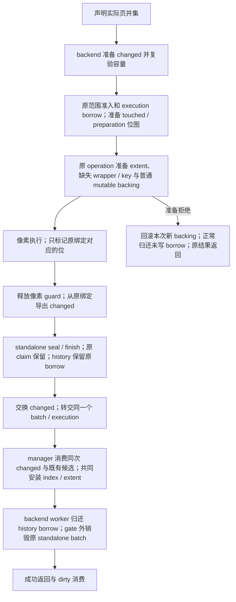
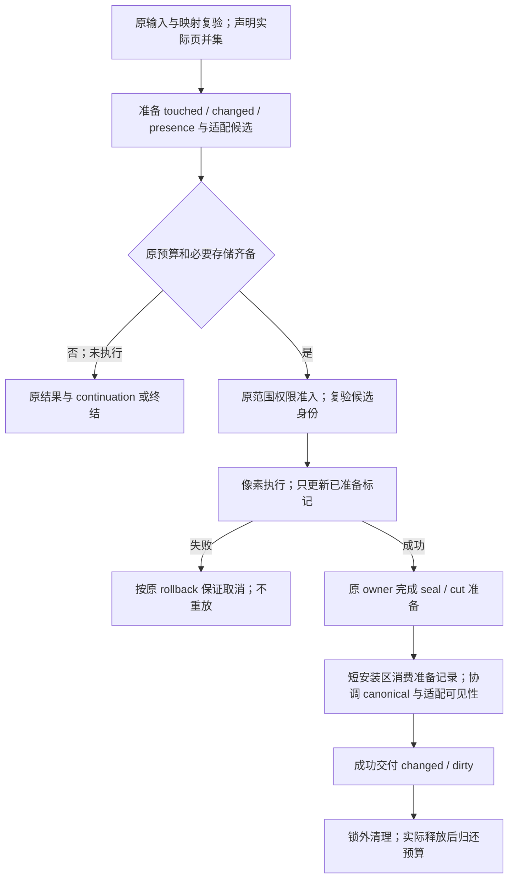

# 01m：operation 资源准备与适配安装的逐段改法

返回[指南目录](/Users/apple/krita_gpu/docs/vulkan_gpu_design/br1_modification_guide/README.md)。本篇细分 **S03/MR5、BC9**，联动 S01、S02、S05、S09、S10；设计依据为 [92 §9.3–9.5、§10.3、§10.5–10.6](/Users/apple/krita_gpu/docs/vulkan_gpu_design/92_br1_m6_m8_execution_baseline.md)。**OP2 的 touched/changed 准备已经实施；OP9 又完成普通 direct cursor 的 operation-wide mutable backing 准备与失败回滚子范围，见 §7 与 §12。** OP3 当前在 clear/precise/rough copy 保留写前 presence scratch，§8 原五入口中的 cursor/packed 冗余查询已按 [API 收敛 §11](API_CONVERGENCE_MAP.md#adapter-delivery)删除；OP5 双轴容量也已先于 native 像素准备，见 §9；OP6/HX7 的原能力交付寿命现按 §10 接线。OP1 集合转换、OP4–OP8 的其他适配/发布、OP9 的完整收费/公平/释放进度、OP10 的完整资源/性能资格继续；结构化压力结果与 continuation 受 [API §19](API_CONVERGENCE_MAP.md#stroke-continuation-ownership-audit) 的同批所有权门约束，不能先加接口。不能从已交付子范围关闭 MR5/BC9。当前资格统一由 92 管理；各冻结证据只约束对应源码时点。

## 1. 为什么需要这批修改

绘画 operation 的声明范围已经提前计算。cursor/packed 的触页记录使用原 execution 的预建位图，changed 输出存储位于范围借用及像素执行前；成功后只交换已有 buffer。普通 direct cursor 现在还在 callback 前准备整个目标集的 mutable backing，失败时回滚仅由本 execution 新准备的页，保留既有 pending 和同一 history owner 的重试资格。clear、precise/rough copy 先准备 presence scratch，写后查询只填入已有存储；cursor/packed 直接消费本 operation 的成功 touched 集。native 的 extent 双轴容量、缺失 tile wrapper 与原 hash key 也已位于原准入内和像素前。semantic removal、staged alias、packed full-payload 及其他终结入口仍按各自语义保留；结构化压力分类、scheduler continuation、完整 GC/通知收费和删除边缘限额继续开放。因此“普通 direct callback 尚未开始”现在可判定，“所有写入口都能自动等待并接续”仍不成立。

目标是把这些可预测的必要存储按本次 **K 个实际目标页**准备，像素热路径只消费既有记录。已有 pending 的同页重复 dab 不重复创建 wrapper 或扩展索引；准备不能变成每 dab 扫描/复制全层 N 个页面。首字节后的普通 callback 仍可能失败，按原先选定的 operation/stroke rollback 处理；本批不授予普通笔刷 M7 commit-only 资格。

## 2. 当前流程与目标流程

这是 `runCpuMutationOperation` 的当前主链。普通 cursor 使用 mutable backing preflight；packed full-payload 保留原逐页直接初始化，semantic removal/alias 也不套用该准备。显式 history 分支保留原 borrow 至 H 后，未在本 operation 发布完整 exact view；普通 batch在 F 结束事务 activity，但原 claim 和 write set 延续到 J。copy、fill、planar 还有各自入口，不能由这张图推定都已统一。持锁 legacy 冲突即时失败，managed 等待仍在锁外；见 §10 与 §12。

目标图只规定资源及权限的先后关系：资源准备不授予写权限。完整安装协议须与 S05 一起实现；当前存在性查询的原子性不足以证明 canonical 像素与兼容索引整体交付原子性。

## 3. 待改内容 → 当前代码段 → 联动终点

| 单元 / 关联条款 | 当前代码入口与事实 | 具体改法及联动边界 | 完成判据 |
|---|---|---|---|
| **OP1：声明范围和容量上界**；S02/S03 | [DataManager::writePageStoreOperation](/Users/apple/krita_gpu/krita/libs/image/tiles3/kis_tiled_data_manager.cc:1734) 已将实际矩形归并为 pageCoverage，再得到 targets；[Backend::writeOperation](/Users/apple/krita_gpu/krita/libs/image/pagestore/KisTiledDataManagerPageStoreBackend.cpp:2034) 再构造目标集合 | 保留实际页并集和原 offset/wrap 映射，以去重后的 K 准备记录；在 mapper/adapter 边界检查数量、字节乘法及坐标范围。优先消除无用途的目标集合转换；不得为省一次集合转换扩大到总包围框，也不得把 scratch 当 writer registry | 重叠 dab、空范围、巨大稀疏间隔、wrapped/负坐标仍与 SR/PG/WC 一致；准备成本随实际 K 增长，未执行时即可拒绝超限 |
| **OP2：触页标记、准备归属和 changed 输出**；MR5/S10 | [原 execution 绑定/两组位](/Users/apple/krita_gpu/krita/libs/image/pagestore/KisPageStore.cpp)、[成功写入能力取得后的标记](/Users/apple/krita_gpu/krita/libs/image/pagestore/KisPageStore.cpp)；`finishPreparedWrites` 导出到预建输出并先清理 untouched preparation，[成功后交换](/Users/apple/krita_gpu/krita/libs/image/pagestore/KisTiledDataManagerPageStoreBackend.cpp) | **touched/changed 与普通 backing 准备子范围已实施。** changed 容量在借用前准备并复验；两组位随原 execution 构造，按原 BoundEntry 位置记账。≤64 页各用一个 inline word，更多页一次准备 `2 * ceil(K/64)` 个原预算 word，不复制页键、不新增键索引、不扩张 16-byte BoundEntry。preflight 新建页先记 preparation；callback 成功取得 guard 后转为 touched；导出前取消仍未触碰的准备页。失败不重放。Qt 输出完整收费和结构化结果仍待后续 | [原 touched/changed 记录](/Users/apple/krita_gpu/docs/vulkan_gpu_design/evidence/br1_s03_operation_storage_20260928/README.md)与[当前 backing 边界记录](/Users/apple/krita_gpu/docs/vulkan_gpu_design/evidence/br1_operation_pressure_boundary_20260929/README.md)分别绑定源码。当前目标用例证明 callback 零进入、同 owner 重试及 no-op page 不 seal；完整 operation 资源、其他语义写入口及正式性能未据此通过 |
| **OP3：存在性查询输出**；MR1/MR5/S05 | [Backend::preparePagePresence](/Users/apple/krita_gpu/krita/libs/image/pagestore/KisTiledDataManagerPageStoreBackend.cpp:1223)、[Store::resolvePagePresenceInto](/Users/apple/krita_gpu/krita/libs/image/pagestore/KisPageStore.cpp:3332)；[manager 预备 scratch 消费](/Users/apple/krita_gpu/krita/libs/image/tiles3/kis_tiled_data_manager.cc:1033) | **当前三个语义写入口保留，原五入口冻结点见 §8。** 原 manager operation 持有 QVarLengthArray，≤64 页栈内、更多页写前分配；沿原 selector 填充临时结果，整组成功才刷新。公共查询仍先准备私有输出，失败不修改旧输出。显式 pending cursor 继续用实际 touched，不用 immutable presence 分类 | [presence 准备验证记录](/Users/apple/krita_gpu/docs/vulkan_gpu_design/evidence/br1_s03_presence_storage_20260928/README.md)覆盖新增/删除、负坐标、稀疏触页、像素/索引/extent/旧视图/undo 与实际分配拒绝。history commit/checkpoint 的整组终结准备、selector 与 adapter 的联合安装、完整计账仍归 OP6/OP7/OP9，不由本子范围关闭 |
| **OP4：wrapper、hash 插入与删除回收**；MR3/MR5/S09 | [refreshPageStorePage(bool)](/Users/apple/krita_gpu/krita/libs/image/tiles3/kis_tiled_data_manager.cc:1044) 调用 getTileLazy/deleteTile；当前 lock-free 路径 [getTileLazy](/Users/apple/krita_gpu/krita/libs/image/tiles3/kis_tile_hash_table2.h:401)创建 wrapper 并进入 map；[insert](/Users/apple/krita_gpu/krita/libs/image/tiles3/kis_tile_hash_table2.h:212)与[erase](/Users/apple/krita_gpu/krita/libs/image/tiles3/kis_tile_hash_table2.h:255)现先准备原 GC 实际节点，不再额外分配 MemoryReclaimer；链表实现 [getTileLazy](/Users/apple/krita_gpu/krita/libs/image/tiles3/kis_tile_hash_table_p.h:219)也创建 wrapper | 逐函数改法见 [HX1–HX10：hash 存储与回收](/Users/apple/krita_gpu/docs/vulkan_gpu_design/br1_modification_guide/01n_hash_storage_and_reclamation.md#hash-storage-map)。在原 adapter owner 下预建缺失 wrapper、实际插入所需存储及删除/竞争淘汰的必要回收节点；增加 prepare/install/cleanup 的内部契约。预建 wrapper 不提前插入可见索引或通知 extent。安装复验原坐标/身份；冲突候选交锁外清理，不在 gate 内 new/delete 或触发无界 GC。两种 hash 实现分别证明；不以关闭当前 lock-free 配置规避其责任 | 新增、已有、删除、竞争输家、存活 reader 和 detached wrapper 均到唯一终点；安装探针包括 map 内部分配、GC enqueue 和析构。仅预建 wrapper 或调用通用 reserve 不算完成 |
| **OP5：extent 扩容与删除扫描**；MR5/S05，联动 U02 | [双轴 prepareTileRange](/Users/apple/krita_gpu/krita/libs/image/tiles3/KisTiledExtentManager.cpp:312)、[Data::planGrowth](/Users/apple/krita_gpu/krita/libs/image/tiles3/KisTiledExtentManager.cpp:204)、[Data::install](/Users/apple/krita_gpu/krita/libs/image/tiles3/KisTiledExtentManager.cpp:231)已消费原轴计数；[updateMin](/Users/apple/krita_gpu/krita/libs/image/tiles3/KisTiledExtentManager.cpp:270)/[updateMax](/Users/apple/krita_gpu/krita/libs/image/tiles3/KisTiledExtentManager.cpp:288)仍做边缘扫描 | **native 写前容量准备已实施，见 §9。** 两轴实际分配都成功才安装几何；安装时在原 migration gate 下复制当前计数，更新 capacity/offset 与 buffer，不复制过期快照。暖范围不分配、不复制整层；旧 buffer 在原 extent gates 外释放。删除扫描限额、最外层 publication 协调和完整收费仍继续 | 极端坐标拒绝、两轴实际 allocator 拒绝、候选失效及新增/最后 tile 删除保持语义；冷增长仍有 O(axis capacity) 复制。探针区分存储准备和写后安装；不把零分配当作扫描量有界或完整 OP5 完成 |
| **OP6：把成功边界贯穿 manager/backend**；S01/S03/S05 | [runCpuMutationOperation](/Users/apple/krita_gpu/krita/libs/image/pagestore/KisTiledDataManagerPageStoreBackend.cpp:1897) 现经一个 `OperationDelivery` 互斥交回原 completed batch / history execution，原 claim/borrow 保留到 manager 交付；[writePageStoreOperation](/Users/apple/krita_gpu/krita/libs/image/tiles3/kis_tiled_data_manager.cc:1734)随后适配；这两个 native 消费者已按 §11 使用缺失候选；其他刷新仍是 void/assert | 从原 manager 发起准备，由原 operation/job 持有一次性的适配候选；backend 完成的 publication 准备与候选一起进入协调安装边界。显式 history operation 只更新其合法 pending 派生索引，完整 exact 仍等待 cut。把准备/安装拒绝送回现有 typed 结果与原 failure sink；不得 root 已交付后仅返回 Failed，假装仍可普通回退 | 给出 reader/capture 各入口的线性化边界；每个拒绝点都证明无“像素新、索引旧”的对外成功结果。原 manager/history 的锁序、寿命及默认值更新全部列清 |
| **OP7：checkpoint 与终结消费同一准备协议**；S02/S04/S05 | [manager::checkpointStrokeMutation](/Users/apple/krita_gpu/krita/libs/image/tiles3/kis_tiled_data_manager.cc:1711) 在 cut 后逐页刷新；[backend::checkpointHistoryMutation](/Users/apple/krita_gpu/krita/libs/image/pagestore/KisTiledDataManagerPageStoreBackend.cpp:1623)、[commitHistory](/Users/apple/krita_gpu/krita/libs/image/pagestore/KisTiledDataManagerPageStoreBackend.cpp:1642)与[finishOwnedTransaction](/Users/apple/krita_gpu/krita/libs/image/pagestore/KisTiledDataManagerPageStoreBackend.cpp:947)是终结接点 | scope 原 write set 给出完整 delta 上界，cut 接纳已执行 jobs/必要子 jobs 后准备最终索引与终结存储；不能只准备 viewport。收窄外层 gate，复验 head/revision，沿原 owner 安装并切换选择；采用 92 §10.3 的有限立即重准备和 continuation。压力 subset 不生成完整 exact view | 屏幕外页、慢 reader、cut 竞争、finish/cancel 拒绝、晚 guard 与空 delta 均有唯一终点；无持有自身 borrow 等自身完成；最外层 wait/hold 也计量 |
| **OP8：补齐旁路及失败恢复**；S01/S03/MR4 | [fillRect](/Users/apple/krita_gpu/krita/libs/image/pagestore/KisTiledDataManagerPageStoreBackend.cpp:1828)和[copyFrom](/Users/apple/krita_gpu/krita/libs/image/pagestore/KisTiledDataManagerPageStoreBackend.cpp:2222)有独立 changedPages append；[manager::writeBytes](/Users/apple/krita_gpu/krita/libs/image/tiles3/kis_tiled_data_manager.cc:1555)、[writePlanarBytes](/Users/apple/krita_gpu/krita/libs/image/tiles3/kis_tiled_data_manager.cc:1802)及[clear](/Users/apple/krita_gpu/krita/libs/image/tiles3/kis_tiled_data_manager.cc:787)有各自 batch/compatibility 分支；[refreshPageStoreIndex](/Users/apple/krita_gpu/krita/libs/image/tiles3/kis_tiled_data_manager.cc:1081)负责失败后的 exact 字节恢复 | 先盘点每条真实 caller 的容量上界和失败保证，再消费同一准备机制；不能由 cursor 迁移推定旁路完成。copy 保留 operation-start source，planar 保留缺失通道语义，clear 保留 default/删除语义。raw consumer 未迁完之前，失败恢复仍实际还原字节；回滚必要存储也纳入准入 | native/compatibility 两路、partial/full、all/missing channels、copy rough/precise、source/self-copy、删除/default 和早/晚失败均验证；失败后立即 raw read 仍正确，不靠下次读取补救 |
| **OP9：实际收费和压力接续**；S01/S09/S10 | [KisMutationStorageAllocator](/Users/apple/krita_gpu/krita/libs/image/pagestore/KisMutationStorage_p.h:31)已提供实际容量收费；[BudgetController::reserveImpl](/Users/apple/krita_gpu/krita/libs/image/pagestore/KisPageWriteCoordinator.cpp:587)是原额度入口；普通 cursor 的 `prepareWrites` 已使 backing 压力在 callback 前原子拒绝，[当前 operation 结果类型](/Users/apple/krita_gpu/krita/libs/image/pagestore/KisPageStoreWriteOperation_p.h:10)仍只有四种结果 | execution 的 touched/preparation overflow 按 `2 * ceil(K/64)` 实际收费；准备失败撤销本次新 page 并保留既有 pending/retry。下一生产批继续把 scratch、changed/presence、wrapper/hash/extent、必要通知/回收存储及扩容共存峰值计入原 owner，并完成多 store/多文档公平与释放进度。当前保持 `Failed`；`RetryablePressure` 只有与原未执行 job 的 ownership transfer、可靠分类和实际 consumer 同批才可加入。首字节后不转 fallback 或重放 body | 当前 8.5 MiB 目标用例证明 callback 零进入、释放后同 owner 重试；下一步先证明 tiny budget、多文档公平、完整收费和释放收敛。自动无输入恢复与 permanent/waitable/cancel 分类另须通过 [API §19](API_CONVERGENCE_MAP.md#stroke-continuation-ownership-audit)。QVector 提前 reserve 仍不等于完整 S10 或共享父额度 |
| **OP10：分配、故障和真实 stroke 证据**；V01 | [pixel operation tests](/Users/apple/krita_gpu/krita/libs/image/tiles3/tests/kis_tiled_data_manager_test.cpp:2050)、[packed tests](/Users/apple/krita_gpu/krita/libs/image/tiles3/tests/kis_tiled_data_manager_test.cpp:3881)、[late-writer preclaim](/Users/apple/krita_gpu/krita/libs/image/tiles3/tests/kis_tiled_data_manager_test.cpp:3958)、[metadata refresh](/Users/apple/krita_gpu/krita/libs/image/tiles3/tests/kis_tiled_data_manager_test.cpp:1740)、[compatibility copy failure](/Users/apple/krita_gpu/krita/libs/image/tiles3/tests/kis_tiled_data_manager_test.cpp:3500)与[storage rejection](/Users/apple/krita_gpu/krita/libs/image/tests/KisPageStoreCpuMutationTest.cpp:4606)是已有扩展落点 | 对各真实分配点注入拒绝；分别测冷准备、热标记、publication/适配安装、锁外清理。探针必须包含会真实分配的正对照、首次访问及两种 hash 配置。保留整组像素/current/G0/exact/undo 断言，再接真实 brush replay 和 Fresh 控制桶 | 每个 OP 单元对应 case/探针及冻结源码、binary、构建配置；局部零分配不外推为整个 body 零分配。正式首 dab/steady/P95/P99/pen-up/display/drain 合格后才判断绘画收益 |

## 4. 准备对象与原 owner 的关系

下表说明已实施和待实施的内部数据职责，状态在各行注明。优先扩展原 operation/execution/adapter owner，避免增加第二份页权限或逻辑版本表。

| 数据 | 由谁准备与持有 | 执行 / 安装可做的事 | 归还责任 |
|---|---|---|---|
| 原 execution touched / preflight-owned 位图（已实施） | 原 execution 及其 controller；≤64 页各一个 inline word，overflow 的两组 word 由原 allocator 一次实际收费 | preflight-owned 表示“本 execution 新准备且 callback 尚未触碰”；真正取得 guard 后转为 touched；无第二份页键表或权限表 | changed 导出前取消仍为 preflight-owned 的页；touched 随原 finish/取消终结，controller 保活到实际释放 |
| changed 输出（准备已实施，完整收费待 OP9） | 同步 operation 的唯一 Qt buffer；交付后由接收方持有 | 向预建容量写入，成功后交换；无隐式共享 detach | 准备拒绝不进 body；失败候选和交换后的旧输出在 cleanup 释放。尚未接入完整 S10 收费，不能将提前 reserve 算作预算准入 |
| presence 输出（五个 native 入口已实施） | 原 manager 同步 operation 持有 inline/overflow scratch，由 backend 准备；保留到本次适配完成 | 原 selector 填充，整组成功后才消费；公共输出拒绝仍保持旧值 | 失败/返回销毁私有 scratch；不保存成长期 presence，不持 view/pin。overflow 的完整 S10 收费和终结准备仍待继续 |
| 预建 wrapper、hash 结构候选、必要回收节点 | 原 manager adapter 下的一次性候选，与目标 manager/mapping 和结构 revision 绑定 | 复验并安装 prepared 记录；不得再次调用会自行分配的 getTileLazy/GC enqueue | 竞争输家、取消和旧 wrapper 的最后引用走原清理链；不能提前归还仍存活的 charge |
| extent 扩容候选（native 容量准备已实施） | 原 extent owner 的两轴 Growth，只持实际 buffer 和几何；prepare 调用内完成，随后原轴保留容量 | 分配期间无计数快照；在原 migration gate 下复验几何并复制当前计数。容量可在像素前安装，count/min/max/可见 extent 等实际 delta 才变 | 原 extent gates 外释放旧 buffer/失败候选。成功保留的容量在操作拒绝后也保留；完整 S10 收费与最外层 gate 仍需 OP6/OP9 |
| 发布、checkpoint 和必要终结记录 | 原 transaction/history/session，沿现有 CP/SC 和 S05 协议 | 完整 cut 后一次交付 canonical 与适配结果；只在真正成功后发成功 dirty/undo | 原 owner 保留至 commit/abort 真实完成，晚 guard 不访问已析构 owner |

**结构竞争必须在权限和资源仍可安全拒绝时解决。** 只在首字节前看过一次 map capacity 不够；其他 job 可能消耗容量。实现需让原 adapter 的准备凭据覆盖安装所需容量及身份，或在写入前重新准备/让出。若尚不能保证安装无需失败分配，就仍按该入口现有 rollback 保证运行，并继续标记 OP4–OP7 未完成。

原 QSBR prepared/embedded Action 已接入实际 map caller，局部回收、竞争、clear/析构与下一段见 [OP4 局部回收实施表](/Users/apple/krita_gpu/docs/vulkan_gpu_design/br1_modification_guide/01n_hash_storage_and_reclamation.md#hash-reclamation-implementation)；该子范围不替代原 operation 的完整资源准入和发布协调。

## 5. 可审查的实施顺序

| 批次 | 修改单元与具体交付 | 本批不能据此关闭的责任 |
|---|---|---|
| A：移除已知热路径记账分配（OP2 子范围已实施） | runCpuMutationOperation 的两个 callback、cursor 与 packed 已消费原 execution 位图和预建 changed 输出；保留 legacy Borrowed 的未执行判断、范围 preclaim 和失败 poison。OP1 的集合转换精简仍待改 | presence、wrapper/hash/extent、完整 job 准入与业务默认持久 scope 仍未闭合；changed 输出的完整收费继续归 OP9 |
| B：原 adapter 的必要存储与生命周期 | OP3 native presence 与 OP5 双轴容量已前移；继续 OP4、OP5 删除扫描及其与发布的联合边界，联动 S09；同时覆盖新增和删除，提供可拒绝 prepare 与无需分配的 install，验证失败候选/存活 reader/实际预算归还 | 不把一个 prepare API 当作跨 publication 的原子交付；未接消费者仍只算能力 |
| C：协调成功、cut 与旁路 | OP6–OP8 + S01/S04/S05；实际 caller 消费 B 的候选，协调 root 与适配可见性；保留 MR4 失败字节恢复 | 普通 callback 仍有原 rollback 语义；完整父额度、通知准备、长笔窗口及 M6/M7 各自资格不能省略 |
| D：完整压力与产品证据（backing 原子准备子范围已实施） | 普通 direct cursor 已建立 callback 前全目标 backing 准备、失败回滚和同 owner 重试；下一段先补 OP9 的完整收费、多 store/多文档公平与释放进度。可靠分类与 scheduler continuation 等待原 job ownership transfer 的同批设计 | 不把当前 `Failed` 冒充可等待结果；不向 UI 暴露 page/budget/waiter；不用局部矩阵或测试数量替代 BR1-PERF |

每批先通过必要的语义/故障检查，再冻结源码运行对应矩阵和探针。源码变化后更新 [CODE_INDEX](/Users/apple/krita_gpu/docs/vulkan_gpu_design/br1_modification_guide/CODE_INDEX.md)、本表行号和 [92 §15](/Users/apple/krita_gpu/docs/vulkan_gpu_design/92_br1_m6_m8_execution_baseline.md:477)，保留失败样本；文档校验不触发生产资格变化。

## 6. 本次文档交付范围

OP1–OP10 只细分既有 15 项修改中的资源链，没有改变 stroke → undo → context 的顺序。源代码事实来自当前工作树：当前构建的 `USE_LOCK_FREE_HASH_TABLE=ON`，但双实现的未来资格必须各自实际构建验证。OP2/OP3、OP5 容量准备和普通 direct cursor backing 原子准备之外的完整 adapter 语义入口、shared parent budget、多文档公平与释放进度仍未完成；`RetryablePressure` 分类/消费者还缺少原 job ownership transfer，当前不作为可单独领取的 API 项。

OP2 冻结源码、双架构矩阵、分配/故障证据见 [触页/输出准备验证记录](/Users/apple/krita_gpu/docs/vulkan_gpu_design/evidence/br1_s03_operation_storage_20260928/README.md)。前序[文档映射记录](/Users/apple/krita_gpu/docs/vulkan_gpu_design/evidence/br1_modification_guide_operation_storage_20260928/README.md)保留其冻结时点，不再代表修改后的源码。

## 7. OP2 本批实现与下一段代码

| 已实施行为 | 当前函数 / 配套声明 | 保留的剩余责任 |
|---|---|---|
| 复用原页绑定；≤64 页两组 inline，更多页一次准备两组 word | [Execution::Private](/Users/apple/krita_gpu/krita/libs/image/pagestore/KisPageStore.cpp)、[构造与原预算 allocator](/Users/apple/krita_gpu/krita/libs/image/pagestore/KisPageStore.cpp)、`markPrepared/markTouched` | touched 与 preflight-owned 都只是本次借用的结果/回滚归属，不是权限；复用原 scope/claim/BoundEntry。overflow 为 `2 * ceil(K/64)` 个 word，由同一 controller 实际收费；无第二份键索引或热路径 hash 查找 |
| 从成功的原 guard 取得路径置位，再清理 untouched preparation 并导出 changed | [beginWriteImpl 标记](/Users/apple/krita_gpu/krita/libs/image/pagestore/KisPageStore.cpp)、[`finishPreparedWrites`](/Users/apple/krita_gpu/krita/libs/image/pagestore/KisPageStore.cpp)；[adapter-only 声明](/Users/apple/krita_gpu/krita/libs/image/pagestore/KisPageStore.h) | 收尾只在原执行线程、无活跃 guard、有效 scope 时进行；先沿原 cancel/retirement 终结未触碰准备页，再复验唯一空 buffer 和容量并消费原 entry 页键。失败不把 changed 当成功结果交付 |
| Qt reserve 后检查实际容量；交付不触发 detach/扩容 | [输出准备](/Users/apple/krita_gpu/krita/libs/image/pagestore/KisTiledDataManagerPageStoreBackend.cpp:1935)、[Qt 拒绝复验](/Users/apple/krita_gpu/krita/libs/image/pagestore/KisTiledDataManagerPageStoreBackend.cpp:1938)、[export](/Users/apple/krita_gpu/krita/libs/image/pagestore/KisTiledDataManagerPageStoreBackend.cpp:2000)、[deliver](/Users/apple/krita_gpu/krita/libs/image/pagestore/KisTiledDataManagerPageStoreBackend.cpp:2017)、[cleanup](/Users/apple/krita_gpu/krita/libs/image/pagestore/KisTiledDataManagerPageStoreBackend.cpp:2020) | Qt 输出的完整收费仍待 S10；prepare 拒绝在 body 之前，现有 Failed/原 owner 处理终结。旧 caller buffer 在 Cleanup 释放；未增加无人消费的 RetryablePressure |
| preflight、输出准备、范围借用、export 与交付分别观测 | [诊断阶段](/Users/apple/krita_gpu/krita/libs/image/pagestore/KisPageStoreDiagnostics_p.h:116)、[阶段名称](/Users/apple/krita_gpu/krita/libs/image/pagestore/KisPageStoreDiagnostics.cpp:88) | RangePrepare 保持一次 operation 一个区间及一次实际 K；不在每个 span 加 timer。export 不含 execution finish/释放，delivery 不含旧输出析构，冷 body 不冒充暖 body |
| 新增 161 项行为/预算用例，联动原共享预算与稀疏范围验收 | [触页/输出](/Users/apple/krita_gpu/krita/libs/image/tiles3/tests/kis_tiled_data_manager_test.cpp:2122)、[真实限额](/Users/apple/krita_gpu/krita/libs/image/tiles3/tests/kis_tiled_data_manager_test.cpp:2200)、[packed/no-op](/Users/apple/krita_gpu/krita/libs/image/tiles3/tests/kis_tiled_data_manager_test.cpp:2252)；[测试注册](/Users/apple/krita_gpu/krita/libs/image/tiles3/tests/kis_tiled_data_manager_test.h:96) | 整条准入分配拒绝逐点扫描到无故障对照；warm body/export/deliver 另用实际 allocator 测量。原像素、pending、拒绝后重试、reserved 与真实 owner 寿命同时核对 |

首版独立平坦触页表因重复存储页键，占用元数据额度，使原 8 MiB 共享 resident 场景失败；现已移除。范围 phase 重复计数也已修复。失败矩阵、Qt reserve 拒绝反例和故障探针自身的修正均保留在证据中，没有调高预算或放宽原断言。

后续 OP3 native presence 已按 §8 前移；下一段继续 OP4–OP5 的 wrapper/map 插入与删除回收、extent 真实存储，再与 OP6/OP7 的原 owner publication/cut 联合启用；OP8 旁路与 MR4 exact 字节恢复保留。完整源码、双架构矩阵和探针见 [本批验证记录](/Users/apple/krita_gpu/docs/vulkan_gpu_design/evidence/br1_s03_operation_storage_20260928/README.md)。

## 8. OP3 实现与保留的查询范围

本节原五入口证据是冻结检查点。最新 cursor/packed 已删除 presence scratch/二次查询，只消费成功 touched；clear/precise/rough copy 继续使用下述准备与解析。原测试同步断言这两条纯写路径的 presence 次数为零，详见 [API 收敛 §11](API_CONVERGENCE_MAP.md#adapter-delivery)。

| 实施内容 | 实际代码段 | 责任与剩余边界 |
|---|---|---|
| 按声明页数准备临时输出 | [Backend::preparePagePresence](/Users/apple/krita_gpu/krita/libs/image/pagestore/KisTiledDataManagerPageStoreBackend.cpp:1223)；[矩形页数上界](/Users/apple/krita_gpu/krita/libs/image/tiles3/kis_tiled_data_manager.cc:1024) | buffer 随原 manager operation 存活，≤64 页无 heap 分配；更多页写前分配一次。拒绝沿原 typed 结果或 void failure context 返回，不进入 native 像素操作。backend 保留具体准备与诊断，DataManager 不新增 PageStore 状态或类型侵入 |
| 原选择器消费既有存储 | [backend 查询](/Users/apple/krita_gpu/krita/libs/image/pagestore/KisTiledDataManagerPageStoreBackend.cpp:1262)、[store 查询](/Users/apple/krita_gpu/krita/libs/image/pagestore/KisPageStore.cpp:3332) | 先检查实际容量，再沿原 publication/metadata gate 分类；不创建 exact view、保护或 pin。内部 scratch 拒绝时可含部分结果，但不交给刷新循环；公共 wrapper 成功才交换输出，拒绝保持共享旧输出 |
| 原五入口检查点；现保留三个语义入口 | [cursor](/Users/apple/krita_gpu/krita/libs/image/tiles3/kis_tiled_data_manager.cc:1734)、[packed](/Users/apple/krita_gpu/krita/libs/image/tiles3/kis_tiled_data_manager.cc:1555)、[clear](/Users/apple/krita_gpu/krita/libs/image/tiles3/kis_tiled_data_manager.cc:787)、[precise copy](/Users/apple/krita_gpu/krita/libs/image/tiles3/kis_tiled_data_manager.cc:1178)、[rough copy](/Users/apple/krita_gpu/krita/libs/image/tiles3/kis_tiled_data_manager.cc:1311) | cursor 用已有实际页并集；矩形入口用其实际遍历页数，不扩大覆盖。已知 legacy Borrowed 与显式持久 pending 不额外准备存在性输出。OP1 的 target 集合转换仍待精简 |
| 保留终结和旁路责任 | [tryCommit](/Users/apple/krita_gpu/krita/libs/image/tiles3/kis_tiled_data_manager.cc:366)、[checkpoint](/Users/apple/krita_gpu/krita/libs/image/tiles3/kis_tiled_data_manager.cc:1711)、[planar](/Users/apple/krita_gpu/krita/libs/image/tiles3/kis_tiled_data_manager.cc:1802) | tryCommit 的原 delta 刷新尚有写后准备，checkpoint 仍逐页适配；planar/raw compatibility 仍有独立 batch。它们与 wrapper/hash/extent、完整 publication/cut、回滚存储按 OP4–OP8 联合收口；不能把 query 零分配当作整条安装零分配 |
| 新增行为和分配拒绝证据 | [96 个生产入口场景](/Users/apple/krita_gpu/krita/libs/image/tiles3/tests/kis_tiled_data_manager_test.cpp:1948)、[公共查询与共享旧输出](/Users/apple/krita_gpu/krita/libs/image/tests/KisPageStoreCpuMutationTest.cpp:5128)；[presence 准备验证记录](/Users/apple/krita_gpu/docs/vulkan_gpu_design/evidence/br1_s03_presence_storage_20260928/README.md) | 保留旧快照、索引/extent、pending、undo/redo 和分配拒绝后的重试；新增探针分别观测准备和查询。冷 wrapper/hash/extent 分配、终结清理及真实 stroke/Fresh 2% 不在这两个区间内 |

临时 buffer 的 overflow 尚未接完整 MetadataArena/共享父额度；提前分配只证明失败点前移。默认真实 brush 的持久 owner/current/producer cut 和 M6/M7/M8、BR1-PERF 继续开放。完整验证状态与源码身份见 [presence 准备验证记录](/Users/apple/krita_gpu/docs/vulkan_gpu_design/evidence/br1_s03_presence_storage_20260928/README.md)。

OP3 完整回归中发现的原 admission 扩容竞争已沿 [J1/J2/J3 捕获时复验](/Users/apple/krita_gpu/docs/vulkan_gpu_design/br1_modification_guide/01c_mutation_session_storage_and_borrow.md#admission-capture-revalidation) 修正；该项与 presence scratch 生命周期分别验收，保留复制后的严格 revision 检查和原三次准备上限。

## 9. OP5 当前实现：双轴容量先于像素

[声明与寿命约束](/Users/apple/krita_gpu/krita/libs/image/tiles3/KisTiledExtentManager.h:76)只新增原 extent owner 的容量准备；调用者继续负责结构替换期间的排他和像素权限。

| 修改内容 | 实际代码段 | 已实施 / 剩余责任 |
|---|---|---|
| 先准备实际存储，再安装当前计数 | [Data::planGrowth](/Users/apple/krita_gpu/krita/libs/image/tiles3/KisTiledExtentManager.cpp:204)、[Growth::allocate](/Users/apple/krita_gpu/krita/libs/image/tiles3/KisTiledExtentManager.cpp:194)、[双轴 prepareTileRange](/Users/apple/krita_gpu/krita/libs/image/tiles3/KisTiledExtentManager.cpp:312)、[Data::install](/Users/apple/krita_gpu/krita/libs/image/tiles3/KisTiledExtentManager.cpp:231) | 64 位临时量检查 span、capacity、offset 与字节乘法；两个分配都成功再取原 migration gates。候选几何必须容纳当前 buffer 和目标；当前轴已经覆盖目标时直接复用。两轴复验一起通过后才安装，旧 buffer/不用候选在解锁后析构。最多三次候选准备，最后仅检查当前容量；拒绝不改变可见 extent |
| 五条 native 入口及显式持久 cursor | [cursor](/Users/apple/krita_gpu/krita/libs/image/tiles3/kis_tiled_data_manager.cc:1734)、[packed](/Users/apple/krita_gpu/krita/libs/image/tiles3/kis_tiled_data_manager.cc:1555)、[clear](/Users/apple/krita_gpu/krita/libs/image/tiles3/kis_tiled_data_manager.cc:787)、[precise copy](/Users/apple/krita_gpu/krita/libs/image/tiles3/kis_tiled_data_manager.cc:1178)、[rough copy](/Users/apple/krita_gpu/krita/libs/image/tiles3/kis_tiled_data_manager.cc:1311) | 输入使用原页坐标范围；cursor 的 bbox 只确定原稠密轴容量，不扩大实际 write footprint 或遍历空白页面。packed 在释放 manager gate 后准备。显式持久 cursor 同样准备；已知 legacy Borrowed 沿原路径处理。准备拒绝返回 Failed/原 void failure context，像素 body 不执行 |
| 单 tile 和全量重算的必要边界 | [notifyTileAdded](/Users/apple/krita_gpu/krita/libs/image/tiles3/KisTiledExtentManager.cpp:344)、[replaceTileStats](/Users/apple/krita_gpu/krita/libs/image/tiles3/KisTiledExtentManager.cpp:371) | notify 先确认两轴容量，再改变任一计数；普通 native 已预备范围，因此该检查不再分配。replace 在清除旧计数前准备完整边界，拒绝不留下半个新轴。原 takePrepared 的调用者仍须排除并发结构替换，准备容量不授予写权限 |
| 行为、并发和真实分配 | [几何/计数/无效坐标](/Users/apple/krita_gpu/krita/libs/image/tiles3/tests/kis_tiled_data_manager_test.cpp:1797)、[八 worker 扩容/增删](/Users/apple/krita_gpu/krita/libs/image/tiles3/tests/kis_tiled_data_manager_test.cpp:1847)、[48 个真实入口场景](/Users/apple/krita_gpu/krita/libs/image/tiles3/tests/kis_tiled_data_manager_test.cpp:1875)；[最终证据](/Users/apple/krita_gpu/docs/vulkan_gpu_design/evidence/br1_s03_extent_storage_20260928/README.md) | 四 BPP × 正负远坐标 × 六条实际路径，检查写前容量/旧 extent、整页字节/旧 view/undo/redo/删除。allocator 探针拒绝每轴实际分配并验证正常重试；另一线程在分配/释放时取得原 gates，并插入当前计数或使旧候选几何失效 |

本批没有创建第二套 extent 或每 dab clone 全层。原稠密轴只在扩容时复制，冷复制仍为 O(axis capacity)，并非 O(K)；暖准备为两个原 migration read gate 下的范围检查；这增加了固定 gate 成本，真实 stroke 延迟仍须单独测量。[updateMin](/Users/apple/krita_gpu/krita/libs/image/tiles3/KisTiledExtentManager.cpp:270)/[updateMax](/Users/apple/krita_gpu/krita/libs/image/tiles3/KisTiledExtentManager.cpp:288) 的删除扫描、原 Data 析构/clear 的全量工作与 U02/S08/S09 的预算仍开放。OP4 wrapper/map/GC、OP6/OP7 publication/cut、OP8 raw/planar/失败恢复和 OP9 实际 retained/peak/shared-parent 计账继续，不能从本批 native 存储前置推出完整适配原子性或完整 M6–M8/BR1-PERF。

迁移分配拒绝、半迁移读／删／析构、同 job 重试唤醒和 TileDataStore 注册／换入现按 [HX6 迁移与共用 caller 实施表](/Users/apple/krita_gpu/docs/vulkan_gpu_design/br1_modification_guide/01n_hash_storage_and_reclamation.md#hash-migration-storage-implementation) 接线。跨 job 的原 map key 记录现按 [HX6 预留 key 实施表](/Users/apple/krita_gpu/docs/vulkan_gpu_design/br1_modification_guide/01n_hash_storage_and_reclamation.md#prepared-key-implementation) 支持迁移、部分迁移拒绝、取消与关闭；普通 cell 大小保持。HX7 的 native cursor/packed 候选已经接线；当前继续 **JP2–JP8 / OP6/OP7 联合发布**，并接 HX8 双 hash 与 HX9/S10 实际收费。容器凭据不授予逻辑写权限，默认 brush 尚未消费。

## 10. OP6 / HX7 前置：原能力覆盖 adapter 交付

本节把**已经落实的寿命修正**与**尚未落实的资源及发布改法**分开定位。原 manager 刷新仍可能分配 wrapper/hash/通知；不能因为同页写已被排斥，就宣称 canonical 与 adapter 的整体发布已经无失败。正式状态与同源证据仍由 92 裁决。

### 10.1 已落实内容与代码关系

| 子项 / 原修改 ID | 代码段 | 当前保证、责任与限制 |
|---|---|---|
| AD1：standalone 原权限延寿；S02/OP6 | [sealForAdapterDelivery](/Users/apple/krita_gpu/krita/libs/image/pagestore/KisPageStore.cpp:2091)、[finishSegmentLocked](/Users/apple/krita_gpu/krita/libs/image/pagestore/KisPageStore.cpp:852) | seal 不再提前丢弃同一 ClaimSet/唯一 write set；scope 变为不可写的 Detached，原事务 activity 正常结束。原 session 析构先释放 admission 再销毁 entries；原 allocation 的 owner 寿命及 budget 继续有效。没有第二张权限表或新持久字段。 |
| AD2：仅转交可终结的原 batch；OP6 | [WriteBatch::finishClient](/Users/apple/krita_gpu/krita/libs/image/pagestore/KisTiledDataManagerPageStoreBackend.cpp:532) | 只允许最后一个非 iterator client、没有 escaped legacy lease 的 managed batch 保留 admission。普通 finish/cancel/checkpoint 保持原终结链；不将活跃 legacy lease 包装成 completed。 |
| AD3：backend 输出现有能力；OP2/OP6 | [runCpuMutationOperation](/Users/apple/krita_gpu/krita/libs/image/pagestore/KisTiledDataManagerPageStoreBackend.cpp:1897) | body 成功并导出 changed 后，将原 publish closure 交给 caller completion。standalone 成功后 `OperationDelivery` 仅保留原 batch admission；history execution 留在 worker 内，completion 成功后由 worker 归还。已有非空 standalone 输出立即拒绝，changed 用原准备 buffer 交换。 |
| AD4：manager 短完成边界；S03/OP6 | [manager::writeBytes](/Users/apple/krita_gpu/krita/libs/image/tiles3/kis_tiled_data_manager.cc:1557)、[manager::writePageStoreOperation](/Users/apple/krita_gpu/krita/libs/image/tiles3/kis_tiled_data_manager.cc:1742) | 两条 caller 用原 `m_lock` 只包围 publish/pending 与已准备 adapter 安装；pixel body、等待和清理在外。standalone delivery 延长 admission 到局部准备对象销毁；history 不再搬移 execution。`extent/region` 读同一 gate，add 窗口已通过整体探针。 |
| AD5：持锁旁路禁止等待；S01/OP8 | [reserveLegacyMutationPage](/Users/apple/krita_gpu/krita/libs/image/pagestore/KisPageStore.cpp:1723) | 同一 session 已持有的 claim 可复用；任何其他页 writer 冲突立即拒绝，不在 tile swap barrier / manager gate 内睡眠。已迁移的 setPixel/tryWriteData 不返回缓存可写指针，planar/borrowed packed 的 batch 按原失败取消与 exact 恢复链处理。借用 packed 的 [旧值比较入口](/Users/apple/krita_gpu/krita/libs/image/tiles3/kis_tiled_data_manager_p.h:73)先用可失败的获取方式，拒绝时不比较旧缓存、不触发 raw assertion。此处没有自动重试，不得在像素已写后临时 replay。managed 范围仍在取得这些 gate 前等待。 |
| AD6：与 HX7 的连接位置；OP4/OP6/OP7 | [refreshPageStorePage(bool)](/Users/apple/krita_gpu/krita/libs/image/tiles3/kis_tiled_data_manager.cc:1044)、[checkpointStrokeMutation](/Users/apple/krita_gpu/krita/libs/image/tiles3/kis_tiled_data_manager.cc:1720) | cursor/packed add 已消费预备候选并与 canonical/pending 共用短 gate。clear/remove/default/copy/restore/purge 仍有不同增删语义，按首条 direct 依赖与实际反例继续；保留的原能力是这些路径准备/复验/交付的寿命基础。 |

两处 manager 局部 `unique_ptr<原 WriteBatch>` 使现有 PageStore 标识计数 **21 → 23**；92 已记录其所有权、内存、并发及删除条件。direct include=3，未增加 manager 字段、容器或 TLS，未扩张原 session 布局。不得通过改名隐藏实际侵入，也不得把本次核准当成其他文件的上限放宽。

### 10.2 下一批具体改法及领取顺序

| 顺序 | 待改内容与主改段 | 必须联动的终点 | 完成判据 |
|---|---|---|---|
| 1：HX7 / OP4 | 在 AD3 准入完成、进入 pixel body 之前，沿原 operation 准备 AD6 所需的**缺失** wrapper、原 HX6 key token、必要 retirement/通知。暖已有页复用真实 wrapper，不为每个 dab 无条件创建 key record。 | manager 原 target/mapping/table 寿命；已计算的 changed/presence/extent 存储；两个 hash 配置。准备不增加 tile 数、不发附着通知。 | 首字节前逐点 allocator 拒绝；同页 D 次重写资源随不同页 K 增长。后台迁移、同 key winner、table 替换与取消均复验有效身份。 |
| 2：OP6 | packed/cursor add 已把原 publish 与 prepared install 放入 AD4 短 gate；不再领取。剩余只对实际触及的 delete/default/copy/restore/purge 拆可失败准备并消费原 delta。 | 各路径原 seal/commit 与 manager gate；对应 reader/capture；cache/extent/default/删除及通知。 | 已领取路径在 root 安装后不因 wrapper/hash/通知不足返回普通 Failed；并发读只看到契约允许的完整状态。 |
| 3：OP7 | 把同一准备协议接 AD6 的 checkpoint、commit/abort、history restore；依完整 write set/delta 准备，不能只覆盖 viewport。 | 原 scheduler cut、必要子 job、晚 guard、table 替换与 history owner。 | 活跃 borrow 时拒绝，不自等待；旧 token 不能装入替换后的表；cut 失败能沿原义务继续或取消。 |
| 4：OP8 / BC4 | 按 AD5 的真实 caller 迁移 raw/planar/borrowed packed 及独立 fill/copy/trim；等待移到未持 tile/manager gate、未执行像素的原 job 准入处。 | 缺失 planar 通道、copy 的 operation-start source、default/删除、失败 exact 字节恢复、唯一 stroke failure sink。 | 同页有确定先后或未执行拒绝；没有锁等待环、写后换路、旧 cache 可写暴露或静默丢笔。 |
| 5：HX9 / S10 / V01 | 候选/原保留 write set 按实际 retained/peak 与原共享预算收费；维护和销毁另计。 | 最后资源释放、budget waiter、无新输入时的 drain；真实 brush owner/current/source/producer 联合启用。 | tiny budget、多文档、长 stroke、慢 reader 有界；正式 stroke 首 dab、steady、P95/P99、pen-up 与控制桶重测，再按顺序做 undo/context。 |

不能用通用整表锁跨 kernel 来补 table 寿命，也不能用新 page authority 或常驻 key cache 来代替原 owner 的能力。manager/table 替换必须有明确的原生命周期排斥与复验；当前调用方的静止约定不足以自动证明未来异步候选安全。

### 10.3 验证入口与测量边界

| 场景 | 真实验证入口 |
|---|---|
| cursor/packed/history，四 BPP，写/空/拒绝；同页排斥、独立页、checkpoint、像素/索引/extent/旧 view/undo | [testPageStoreAdapterDelivery](/Users/apple/krita_gpu/krita/libs/image/tiles3/tests/kis_tiled_data_manager_test.cpp:2539) |
| foreign worker 等待，close 拒绝，输出重复使用拒绝，释放后恢复与异线程析构 | [testPageStoreAdapterDeliveryLifetime](/Users/apple/krita_gpu/krita/libs/image/tiles3/tests/kis_tiled_data_manager_test.cpp:2611) |
| 原 claim 尚在时 setPixel/planar/borrowed packed 必须返回；已写的兼容第一页取消；旧 view 和后续重试 | [testPageStoreAdapterDeliveryLegacyConflict](/Users/apple/krita_gpu/krita/libs/image/tiles3/tests/kis_tiled_data_manager_test.cpp:2750) |
| 四 BPP × K=1/9/65/257 × 三种模式 × 四次转交；实际 allocator 正控制 | [adapter-delivery-probe.cpp](/Users/apple/krita_gpu/docs/vulkan_gpu_design/evidence/br1_s03_adapter_delivery_20260928/adapter-delivery-probe.cpp) |

分配探针只包住 `ChangedDeliver → Cleanup` 的输出交换和原能力转交；不把准备、seal、manager 索引安装或销毁算作零分配。开发回归记录、失败样本和最终源码/运行库身份统一见 [本批证据](/Users/apple/krita_gpu/docs/vulkan_gpu_design/evidence/br1_s03_adapter_delivery_20260928/README.md)。HX7 完整候选、OP6/OP7 原子发布、默认长 stroke、M6–M8 与 BR1-PERF 继续开放。

## 11. OP4 / OP6：已接候选与下一段联合安装

[HC1–HC7：缺失候选与实际消费者](/Users/apple/krita_gpu/docs/vulkan_gpu_design/br1_modification_guide/01n_hash_storage_and_reclamation.md#adapter-candidate-implementation)将原待改段落实到准备 hook、operation 局部缺失集合、两种 hash 的 prepare/install、真实 cursor/packed 消费者及 cold barrier。暖页不建 key，冷拒绝正常归还未写 borrow；PageStore bridge 下的 legacy memento 通知沿原快速返回。

§10 的 AD1–AD4 是这些候选的原权限基础；当前两个 native 成功路径已不再调用普通 getTileLazy。后续沿它们的 seal/finish 与短 manager 安装接 OP6 可见性，再接 OP7 的 checkpoint/commit/restore 和删除；原 refreshPageStorePage 仍服务这些未迁移 caller。完整实际预算、GC/缓存析构工作量与正式 stroke 指标继续，具体领取顺序见 01n §10。

**S05 / OP6 当前跨项入口：** [JP1–JP8：联合发布的观察边界与逐段改法](/Users/apple/krita_gpu/docs/vulkan_gpu_design/br1_modification_guide/02a_joint_publication_boundaries.md#joint-publication-map)。JP1 对应原 overlay 的真实节点/并发桶容量、native/generic/条件删除与 cleanup；JP2–JP8 指向尚需拆分的 session、root prepare、surface extent、raw/current 读取、manager gate、history 终结及完整预算。reader-window 已实际复现，候选准备或局部零分配都不能将外层窗口判为已关闭。

## 12. OP9 当前实现：普通 direct callback 的 backing 原子准备边界

本节把 §16.18 的“可能写过前页才失败”收敛为可供结构化结果使用的底层事实。它没有引入自动等待或新业务状态。

| 修改位置 | 当前职责 | 收敛与排除项 |
|---|---|---|
| `KisPageMutationExecution::prepareWrites` | 对已借用且排序的 BoundEntry 只为缺失Page取得 preserve-content guard，在 callback 前完成全部普通 mutable backing；已有 pending backing直接复用原reservation，内部结果为 `Ready / Failed / Unsupported` | 私有方法，只服务 backend；真实callback guard仍重新pin/按需swap-in，不保留像素指针。removal 和 staged alias 返回 `Unsupported` 并沿原路径，不把语义写强行改成物理 prepare |
| `KisPageMutationSession::beginWriteImpl(..., preparationOnly)` | 复用原 provider、budget、claim、descriptor、write coordinator 和 pin 路径；普通准备失败不 poison 持久 session，也不把页记为 touched | 没有第二套 allocator、writer registry 或 page authority；真实 callback 仍通过原 `beginWrite` 暴露像素 |
| execution 两组位与 `finishPreparedWrites` | touched 位表示实际 callback 写入；preflight-owned 位只标记本 execution 新准备但尚未写的页。收尾先取消后者，再导出 touched keys | untouched 页不 seal generation；既有 pending 页不属于本次回滚。`writeBytes` 不启用 preflight，以保留完整 payload 的逐页直接初始化 |
| `KisPageWriteCoordinator::recordCancelled` | CPU由metadata `cancelPrivateResult`撤原reservation、把已付费target交原retirement后，清空entry的base/target/operation/writer并恢复`IntentOnly`；真实lease使用`cancelLeaseWrite` | ed0f229821删除CPU取消的通用writer及存储拒绝fallback；实际guard和物理退出拒绝仍由原owner接续，无新取消owner |
| backend `runCpuMutationOperation(..., prepareWrites, ...)` | `writeOperation` 选择该政策，`writeBytes` 明确不选；adapter 准备后、pixel body 前执行。`Failed` 时归还未写 borrow，callback 不进入 | 私有模板参数只表达两个现有 ABI 的差异。未增加 public/protected 产品接口，DataManager/UI/scheduler 不接触 PageStore 内部结果 |

目标用例 `testPageStorePixelOperationPreflightBudgetPressure` 在一个持久 history mutation 中先保留已有 pending 页，再用 8.5 MiB 产品预算制造第二页 backing 拒绝。第一次 operation 必须返回失败且 callback 调用数为零；解除压力后，同一 history owner 重试、commit，并验证两页最终字节与 active write pages 归零。参数化 `testPageStoreChangedStorage` 又要求 `pagesSealed` 增量严格等于 changed 页数，覆盖 BPP 1/4/8/16、K 1/9/65/257、standalone/history 和四种 outcome，防止预先准备但未写的页形成版本。

arm64 两个目标合计 131/0/0；x86_64 压力目标 3/0/0。架构门为 21 manifest / 25 ownership / 16 census / 1,824 indexed APIs / 19,890 edges / 17 callbacks / 19 intrusion files。证据见 [BC9 operation backing 记录](/Users/apple/krita_gpu/docs/vulkan_gpu_design/evidence/br1_operation_pressure_boundary_20260929/README.md)。

**结果 API 只在 ownership 条件闭合后重新领取：** 当前下一生产批留在 PageStore 内完成完整收费、多 store/多文档公平和释放进度，继续使用现有 `Failed`。只有原未执行 job 的输入、队列位置、取消权和析构权能一次性转交时，才在同一批于 PageStore/DataManager operation 结果边界区分永久容量、可等待压力和取消，并由原 scheduler owner 消费；同时合并旧模糊失败分支。该步不得修改 `tool/strokes` 预算控制，不得传出 reservation/waiter/page 身份，也不得重放已经进入 callback 的 operation。
