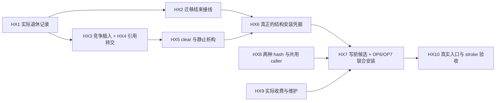

# 01n：OP4 hash 存储与回收的代码修改指南

返回[修改目录](/Users/apple/krita_gpu/docs/vulkan_gpu_design/br1_modification_guide/README.md)；上位要求为 [OP4 / operation 资源准备](/Users/apple/krita_gpu/docs/vulkan_gpu_design/br1_modification_guide/01m_operation_storage_preparation.md#operation-storage-map)，关联 **S03、S05、S09、S10、V01**。设计和阶段资格仍以 [92](/Users/apple/krita_gpu/docs/vulkan_gpu_design/92_br1_m6_m8_execution_baseline.md)为准。本篇只把原有要求展开到实际函数，不增加状态 owner 或阶段。 当前批次选择与停止条件统一以 [92 §16](../92_br1_m6_m8_execution_baseline.md#br1-convergence)和 [CONVERGENCE](CONVERGENCE.md)为准；下文各实施批次保留其冻结范围。

## 1. 核对时点与修改目标

2026-09-28 核对 HEAD `5173c807c87bb1619325249a07a8b4f4f8f09f09` 及未提交工作树。HX1–HX5 的局部回收链现已接入真实 tile hash 与 map migration，具体实现及证据见 §6；HX6 的迁移分配拒绝和 HX8 共用 caller 已按 §7 继续实施，跨 job key 记录已按 §9 实现并验证，HX7 的 native 缺失候选现按 §10 接入；OP6/OP7/HX9 及其他入口继续，完整 OP4 未闭合。前序[文档映射记录](/Users/apple/krita_gpu/docs/vulkan_gpu_design/evidence/br1_guide_hash_gc_20260928/README.md)保留当时 QSBR 草稿未接 caller 的事实，不能代表本批源码。

首要目标是降低 stroke 写后适配中的分配和尾延迟，同时让分配拒绝发生在原状态尚可保持的边界。需要分别交付两个层次：

- **map 修改前的局部准备：** 在 assign/erase 之前有可靠的旧引用回收落点；迁移结束不再临时申请 GC 节点。
- **首个像素修改前的 operation 准备：** wrapper、map 实际安装能力、通知/回收记录及预算随原 operation 准入；写后适配只消费已准备内容。这还依赖 OP6/OP7 的发布协调。

第一层通过不能替代第二层。undo 共用适配和回收能力，但不能为 undo 增加每次暖 dab 的全表工作；上下文切换没有本篇新增职责。

## 2. 待改内容 → 原代码段 → 联动终点

下表的“段”以符号及入口行定位，修改范围由描述限定。HX1–HX10 都是原 OP4 的细分；本表保留各段完整要求，已实施的局部子范围及剩余责任由 §6–§10 逐行区分。

| 单元 | 当前代码段与事实 | 具体修改内容 | 必须联动到的终点 / 验收 |
|---|---|---|---|
| **HX1：回收记录就是队列节点** | [QSBR::Action](/Users/apple/krita_gpu/krita/libs/image/3rdparty/lock_free_map/qsbr.h:27)、[prepare](/Users/apple/krita_gpu/krita/libs/image/3rdparty/lock_free_map/qsbr.h:87)、[enqueuePrepared](/Users/apple/krita_gpu/krita/libs/image/3rdparty/lock_free_map/qsbr.h:102)、[releasePoolSafely](/Users/apple/krita_gpu/krita/libs/image/3rdparty/lock_free_map/qsbr.h:165)已有实际节点准备与入队；[旧 enqueue 包装](/Users/apple/krita_gpu/krita/libs/image/3rdparty/lock_free_map/qsbr.h:117)仍调用 prepare | 审核并完成原 QSBR 的一次性所有权转交：prepare 分配实际队列节点，cancel 只销毁未发布节点，enqueue 只链接已有节点；调用 callback 前取出全部必要字段。用 [RawPointerAccess](/Users/apple/krita_gpu/krita/libs/image/3rdparty/lock_free_map/qsbr.h:122)替换异常可能穿出的手动计数窗口 | 覆盖两个队列、并发生产/清理、raw reader 延迟和自销毁 callback；检查内存序、闭包存储寿命及恰好一次销毁。保留或重新证明原 grace period；4096 阈值后的自旋仍存在，不能声称整个 GC 已有界 |
| **HX2：迁移完成无需申请回收存储** | [TableMigration 构造](/Users/apple/krita_gpu/krita/libs/image/3rdparty/lock_free_map/leapfrog.h:134)、[create](/Users/apple/krita_gpu/krita/libs/image/3rdparty/lock_free_map/leapfrog.h:139)、[destroy](/Users/apple/krita_gpu/krita/libs/image/3rdparty/lock_free_map/leapfrog.h:166)、[run](/Users/apple/krita_gpu/krita/libs/image/3rdparty/lock_free_map/leapfrog.h:501)、[完成后 enqueue](/Users/apple/krita_gpu/krita/libs/image/3rdparty/lock_free_map/leapfrog.h:614) | 在原 TableMigration 对象内嵌 Action，构造时绑定 destroy；正常完成及 overflow 转交完成后，消费同一个嵌入节点。destroy 清理源表及 owner，callback 后不得访问内嵌节点 | 必须跑真实迁移和 overflow 接续；不得在已部分 redirect 后新增可能抛出的 heap 节点准备。Table/create 的 malloc 拒绝及半迁移恢复已按 §7 实施；跨 operation 的安装容量仍是 HX6 的未闭合项 |
| **HX3：竞争插入必须保持仅缺失时插入** | [Mutator::exchangeValue](/Users/apple/krita_gpu/krita/libs/image/3rdparty/lock_free_map/concurrent_map.h:489)遇 Redirect 后重新寻找 cell；[getTileLazy](/Users/apple/krita_gpu/krita/libs/image/tiles3/kis_tile_hash_table2.h:401)现消费 insertIfAbsentValue；原先仅在 exchange 前判断一次空值的方式已移除 | 为原 Mutator 增加内部 insert-if-absent 语义，首次 CAS 和每次 redirect 后都检查非空 winner；明确区分已安装、已有值、未执行拒绝。保留 assign/exchange 的既有替换语义。getTileLazy 在 raw 保护内取得 winner 强引用，私有候选在锁外释放 | 同 key 双写、插入/删除交错、至少一次迁移后的竞争均不替换已存在 winner；只有证明从未发布的候选才可跳过 QSBR，已发布旧值必须退休。暖 get 命中不得新增退休节点分配 |
| **HX4：替换/删除先备好旧引用归宿** | [releaseMapReference](/Users/apple/krita_gpu/krita/libs/image/tiles3/kis_tile_hash_table2.h:140)、[insert](/Users/apple/krita_gpu/krita/libs/image/tiles3/kis_tile_hash_table2.h:212)、[erase](/Users/apple/krita_gpu/krita/libs/image/tiles3/kis_tile_hash_table2.h:255)现先准备实际退休节点，map 修改后仅绑定原引用并入队 | 用 HX1 的实际节点替代额外 MemoryReclaimer；map 修改前准备，在拿到被移除引用后绑定并无分配交队列。以 RAII 保管候选多出的 map 引用及 raw 计数；返回协议必须识别 assign 的竞争输家，不能一律当旧 map 值 | 在通知抛出或提前返回之前已经有可靠回收责任；通知期间仍有 raw/强引用保护。[删除通知](/Users/apple/krita_gpu/krita/libs/image/tiles3/kis_tile.cc:213)、[替换通知](/Users/apple/krita_gpu/krita/libs/image/tiles3/kis_tile.cc:234)、[附着通知](/Users/apple/krita_gpu/krita/libs/image/tiles3/kis_tile.cc:252)分别保持原语义，不能混用以省分配 |
| **HX5：clear 与析构分别处理** | [deleteTile](/Users/apple/krita_gpu/krita/libs/image/tiles3/kis_tile_hash_table2.h:552)、[clear](/Users/apple/krita_gpu/krita/libs/image/tiles3/kis_tile_hash_table2.h:571)、[析构](/Users/apple/krita_gpu/krita/libs/image/tiles3/kis_tile_hash_table2.h:354)；变更与计数现共同受 iterator 排他协议保护，clear 先准备节点；写锁内复验得到完整计数 | 明确所有变更入口与 iterator 排他协议，计数随结构变更处于同一保护区；iterator 自持写锁的删除使用不重锁的内部入口。clear 在 gate 外准备实际退休节点，进入写 gate 复验数量/身份后才修改；不足则在未修改时有限重准备。析构走 owner 已静止的专用 drain，不调用可能申请新节点的 clear | 测 clear 与 insert/erase、iterator 删除/转移、外部 TileSP 存活、构造失败与直接析构。只有证明 owner 已阻止新读者并收回旧 raw users，才可直接释放 map 引用；notify 的异常、预算和重入责任不能被“析构”二字免除 |
| **HX6：真实 map 安装能力** | [insertOrFind](/Users/apple/krita_gpu/krita/libs/image/3rdparty/lock_free_map/concurrent_map.h:604)、[beginTableMigrationToSize](/Users/apple/krita_gpu/krita/libs/image/3rdparty/lock_free_map/leapfrog.h:357)、[migrateRange](/Users/apple/krita_gpu/krita/libs/image/3rdparty/lock_free_map/leapfrog.h:399)会增长/转移表；null-value cell 在迁移时不会保留为普通值 | 在原 map 内设计并实现 key/结构准备凭据：生命周期覆盖准备到安装/放弃，迁移显式转交有效预留，容量和全部后继记录按实际需要准入。安装不得回到可能分配的 insertOrFind/participate 冷路径。先交付并发、迁移和 malloc 拒绝状态表，再接写入口 | 一次 reserve 或空 cell 占位不算凭据；其他 job 消耗容量、连续迁移、半迁移拒绝、table 替换及 ABA 后仍能安装或在原失败保证内终结。不得为解决它而持整表互斥穿过像素 kernel；原 map 凭据现按 §9 实现；native cursor/packed 的原 adapter 消费已见 §10，其他语义入口、完整峰值收费及 OFF 产品配置继续 |
| **HX7：原 adapter 持有 operation 候选** | [refreshPageStorePage(bool)](/Users/apple/krita_gpu/krita/libs/image/tiles3/kis_tiled_data_manager.cc:1044)、[writePageStoreOperation](/Users/apple/krita_gpu/krita/libs/image/tiles3/kis_tiled_data_manager.cc:1734)、[恢复时替换 hashTable](/Users/apple/krita_gpu/krita/libs/image/tiles3/kis_tiled_data_manager.cc:429) | cursor/packed 已按 §10 在原准入内准备缺失 wrapper 与 HX6 安装凭据；其他语义入口继续按真实 delta 准备可能删除的回收记录；与 manager/mapping/table incarnation 绑定。候选没有逻辑 writer 权限。成功时消费记录并更新实际 delta，失败候选锁外清理；沿 OP6/OP7 协调 canonical publication 与兼容索引 | 候选不能仅保存会被 restore 删除的裸 hashTable 指针；必须接入原 owner 寿命/静止协议。插入准备不提前改变 tile 数、extent 或发附着通知。root 已发布后的 adapter 失败不能冒充普通未执行拒绝 |
| **HX8：覆盖两种 hash 与共用容器 caller** | [链表 getTileLazy](/Users/apple/krita_gpu/krita/libs/image/tiles3/kis_tile_hash_table_p.h:219)、[链表 clear](/Users/apple/krita_gpu/krita/libs/image/tiles3/kis_tile_hash_table_p.h:331)；[TileDataStore 的 ConcurrentMap](/Users/apple/krita_gpu/krita/libs/image/tiles3/kis_tile_data_store.h:265)、[实际注册安装](/Users/apple/krita_gpu/krita/libs/image/tiles3/kis_tile_data_store.cc:146) | 两种 tile hash 消费等价 prepare/install/cleanup 契约，按各自结构实现；QSBR/Mutator 改动同时审查 TileDataStore 的插入、删除、clock/iterator 与退出。原回收 grace domain 各自保持，不混同 PageStore RetirementQueue 的物理资源终结 | 分别实际构建 ON/OFF 配置并跑对应入口；共用 map 的 payload caller 行为保持。不能靠切换编译选项或仅测 wrapper fixture 绕过当前生产配置 |
| **HX9：原预算与维护边界** | [OP9 原 allocator/预算要求](/Users/apple/krita_gpu/docs/vulkan_gpu_design/br1_modification_guide/01m_operation_storage_preparation.md#operation-storage-map)、[S08/S09/S10](/Users/apple/krita_gpu/docs/vulkan_gpu_design/br1_modification_guide/04_reclamation_and_budgets.md) | 对 wrapper、结构预留、GC 节点和迁移时新旧共存容量收费；charge 随实际资源归属移交。GC update/drain 的工作量和锁外销毁单独计量并接原维护调度；不能在安装 gate 中因超阈值等待 reader | 首次冷准备和 tiny budget 的拒绝不丢原引用；取消、晚 reader、无后续编辑均最终归还。仅 enqueue 零分配不等于 callback 零分配、GC 有界或共享预算完整 |
| **HX10：可复现交付** | [tiles3 测试注册](/Users/apple/krita_gpu/krita/libs/image/tiles3/tests/CMakeLists.txt:1)、[现有 stack 测试声明](/Users/apple/krita_gpu/krita/libs/image/tiles3/tests/kis_lockless_stack_test.h:13)、[真实 manager 像素测试](/Users/apple/krita_gpu/krita/libs/image/tiles3/tests/kis_tiled_data_manager_test.cpp:2050) | 原容器测试扩充 QSBR 与迁移竞争；manager 测试验证像素/索引/extent/G0/undo。实际 allocator 探针分别包住准备、安装、enqueue、清理，保留正控制和冷路径。每批绑定源码差异及构建/binary 身份 | 后文矩阵逐项映射 case/命令；未执行的场景标未验证。真实 stroke 首 dab、steady、P95/P99、pen-up 与 drain 按 V01/92 另行取得性能资格 |

## 3. 资源归属与失败边界

| 对象 / 状态 | 唯一持有者与转交点 | 失败、取消或竞争后的终点 |
|---|---|---|
| 尚未发布的 wrapper 候选 | 原 operation 候选；成功安装才把额外引用交 map | 从未发布者锁外释放；不调用已附着对象的删除语义，不为私有输家新建 GC 节点 |
| 被替换/删除的 map 引用 | map 返回移除值 → 已备好的退休节点；转交在 raw 保护内完成 | 节点不得因通知异常丢失；最后 raw reader 退出后恰好释放一次，外部 TileSP 仍可保活对象 |
| heap Action | PreparedAction → QSBR 队列 | 未 enqueue 时由候选析构；enqueue 后只能由 QSBR 消费，不允许原候选再取消或重复入队 |
| embedded Action | 原 TableMigration 的对象存储 → QSBR 队列 | callback 销毁所属 migration；queue 消费者必须先保存 next/callback 等字段，不得 delete 内嵌地址 |
| map 安装凭据 | 原 map 的有效结构预留，由原 operation 暂持 | table 替换/迁移/放弃都要显式转交或撤销；预算和结构占用在实际释放后归还，不能由一个裸 cell 指针代表有效权限 |
| attached/dead/detached 通知 | 原 KisTile 与 MementoManager | 必须保留各自的 history 与 bridge 清理语义；准备通知必需资源和处理拒绝仍属于整体 OP4/OP6 |

原接口的“在 map 修改前失败”不保证“在像素前失败”。领取 HX4 时必须写明本批只闭合哪一层；领取 HX7 时才可检查真实 operation 的整条原子交付。保留 MR4 已有的失败字节恢复，直到 raw consumer 和 publication 的整体保证都已迁移。

## 4. 可审查批次与依赖

1. **回收链子批：HX1–HX5。** 本批已修改 QSBR 与真实调用者，见 §6。输出 map 修改前准备、竞争引用和迁移回收的证据；清楚保留容量、通知、全 job 准入和维护时延的未闭合项。
2. **安装能力子批：HX6 + HX8/HX9 的必要部分。** 把容量承诺落实到真实表结构、迁移状态、owner 寿命和实际收费。该设计未证明前不接首字节后无失败安装，也不默认启用长 stroke。
3. **业务交付子批：HX7 + OP6/OP7/OP8。** manager/backend、history checkpoint/finish、copy/fill/planar 等实际入口消费同一准备协议，说明每个 exact/current reader 看到的线性化边界。
4. **资格子批：HX10，贯穿前三批。** 各批先跑必要的容器/行为/故障检查；完整业务和性能在最后闭合。M6/M7/M8 的阶段出口顺序不变。

## 5. 验收矩阵与不允许省略的对照

| 场景 | 最低证明内容 | 主要修改单元 |
|---|---|---|
| 已有页上的重复 dab | 无新 wrapper/退休节点/结构准备；不引入全表 scan；像素相同 | HX3、HX7、HX10 |
| 首次插入、替换、删除 | 在每个实际分配点一次性拒绝；像素尚未执行或由原 rollback 恢复；引用、索引和 tile 数一致 | HX4、HX7 |
| 两个候选竞争及 redirect | 强制 winner 在旧 cell 检查之后、迁移前后出现；保持 winner，不误把已发布值作为私有输家销毁 | HX2、HX3 |
| reader 存活、callback 自销毁 | raw reader 前后两种顺序；heap/embedded 各恰好一次回收；无悬空 next/owner | HX1、HX2、HX4 |
| clear 与并发增删 / iterator 转移 | 原锁序无重入死锁；数量与真实 map 一致；准备不足时在修改前拒绝 | HX5 |
| migration overflow / malloc 失败 | 不能 stranded job、丢 source table 或无限等待；重试前后保留完整 owner 和 charge | HX2、HX6、HX9 |
| restore/close/cancel 与晚候选 | 旧 table/manager incarnation 不能安装到新 owner；销毁不申请新的必要回收存储 | HX5–HX7 |
| 两种 hash 和 TileDataStore | 对应构建选项与实际 binary 可追溯；payload map 的原 assign/erase/迭代行为未变 | HX8、HX10 |
| 小预算、长 stroke、无新编辑 | 新旧共存峰值收费；退役最终完成；GC 超阈值路径和原最外层 gate 的等待可见 | HX9、HX10 |

每行落实为 case、探针或调度场景后，按 [NEXT_EDITS 交付格式](/Users/apple/krita_gpu/docs/vulkan_gpu_design/br1_modification_guide/NEXT_EDITS.md)登记。上述完成判据本身不授予通过结论；本批实际实施与验证范围见 §6。文档校验只核实定位关系和证据身份。

## 6. 本批已实施子范围与下一段

| 已实施行为 | 实际代码入口 | 验证与未关闭的责任 |
|---|---|---|
| 真实退休节点、typed 闭包及 raw-access RAII | [QSBR::prepare](/Users/apple/krita_gpu/krita/libs/image/3rdparty/lock_free_map/qsbr.h:87)、[enqueuePrepared](/Users/apple/krita_gpu/krita/libs/image/3rdparty/lock_free_map/qsbr.h:102)、[typed closure](/Users/apple/krita_gpu/krita/libs/image/3rdparty/lock_free_map/qsbr.h:59)、[RawPointerAccess](/Users/apple/krita_gpu/krita/libs/image/3rdparty/lock_free_map/qsbr.h:122) | 同一节点从候选转入 intrusive queue，无第二次队列节点分配；callback 前重建真正的 typed 局部对象，避免把 bytes 当作未构造的 Closure。两队列、取消、并发生产/清理、自销毁 owner 与异常退出计数有测试。4096 阈值自旋仍保留，不能声称整体 GC 有界。 |
| 迁移对象内嵌最终回收记录 | [内嵌记录](/Users/apple/krita_gpu/krita/libs/image/3rdparty/lock_free_map/leapfrog.h:130)、[完成转交](/Users/apple/krita_gpu/krita/libs/image/3rdparty/lock_free_map/leapfrog.h:614) | 实际小表增长到 4096 keys 不申请 heap Action；Action 准备有真实分配正控制。本回收子批不覆盖 Table/Migration 的 malloc 拒绝；这些故障前置已由后续 §7 继续验证，完整 operation 安装容量仍归 HX6。 |
| 跨 redirect 保持仅缺失时插入 | [Mutator::insertIfAbsentValue](/Users/apple/krita_gpu/krita/libs/image/3rdparty/lock_free_map/concurrent_map.h:497)、[getTileLazy](/Users/apple/krita_gpu/krita/libs/image/tiles3/kis_tile_hash_table2.h:401) | 真实迁移后 winner 的对照、8 worker 同 key 竞争及实际 wrapper 寿命均验证；私有输家锁外释放额外引用，无需 GC。assign/exchange 保持原替换行为；源/目标逻辑写权限仍归 PageStore。 |
| 先准备退休节点，再修改 map | [insert](/Users/apple/krita_gpu/krita/libs/image/tiles3/kis_tile_hash_table2.h:212)、[erasePrepared](/Users/apple/krita_gpu/krita/libs/image/tiles3/kis_tile_hash_table2.h:242)、[retire](/Users/apple/krita_gpu/krita/libs/image/tiles3/kis_tile_hash_table2.h:177) | 删除/替换取出的原 map 引用先交准备节点，再通知；异常不泄漏 raw-user 计数。计数在通知前更新。通知本身的历史资源与 attach/erase 竞争仍需完整 OP4/OP6；本批未把通知改成 noexcept。 |
| clear 准备与静止析构分开 | [clear](/Users/apple/krita_gpu/krita/libs/image/tiles3/kis_tile_hash_table2.h:571)、[析构](/Users/apple/krita_gpu/krita/libs/image/tiles3/kis_tile_hash_table2.h:354) | clear 在原 gate 外准备全部节点，再取得 iterator 写锁复验；三次候选后仍不足按原分配失败抛出，未改 map。析构要求 owner 已静止，flush 旧记录后直接归还 map 引用，不申请新退休节点。外部 TileSP 可保活；原 notification/provider 全链仍单独验收。 |
| iterator 排他与原共用容器回归 | [iterator 退出](/Users/apple/krita_gpu/krita/libs/image/tiles3/kis_tile_hash_table2.h:289)、[公开删除](/Users/apple/krita_gpu/krita/libs/image/tiles3/kis_tile_hash_table2.h:552) | 公开删除取得 iterator 读锁，迭代器内部沿已持写锁删除，GC update 推迟到 iterator 解锁后。iterator 删除仍可能在其已有写锁内准备节点；最外层 manager gate、批量预备与销毁预算尚未完全前移。 |
| 新增八个 Qt 场景与实际分配拒绝 | [prepared/embedded/concurrency](/Users/apple/krita_gpu/krita/libs/image/tiles3/tests/kis_lockless_stack_test.cpp:96)、[迁移竞争](/Users/apple/krita_gpu/krita/libs/image/tiles3/tests/kis_lockless_stack_test.cpp:163)、[真实 hash 引用](/Users/apple/krita_gpu/krita/libs/image/tiles3/tests/kis_lockless_stack_test.cpp:212)、[通知异常](/Users/apple/krita_gpu/krita/libs/image/tiles3/tests/kis_lockless_stack_test.cpp:252)、[clear 并发](/Users/apple/krita_gpu/krita/libs/image/tiles3/tests/kis_lockless_stack_test.cpp:276) | 8 个新增场景进入完整双架构矩阵。真实 KisTile 适配的 35 个实际分配拒绝/架构覆盖替换、删除、clear，保留全部旧 map 值并成功重试；每架构 3 个不拒绝对照。暖 1000 次 get 为零分配/释放；析构探针保留外部 TileSP，只证明 map 层不分配，不能外推 provider 终结。 |

[回收子批验证记录](/Users/apple/krita_gpu/docs/vulkan_gpu_design/evidence/br1_s03_gc_preparation_20260928/README.md)绑定回收子批当时源码、构建、双架构矩阵及其最终探针；后续源码身份见 §7 证据。当前配置仍为 lock-free ON；未凭本批授予 OFF 配置、TSAN、真实 stroke 性能或 M6–M8 资格。

下一段继续 **HX6 原 map 的安装能力 → HX7 与 OP6/OP7 联合交付**，同时补通知、两种 hash、完整预算与清理边界。只把回收节点移到 map 修改前，尚不足以承诺整个 operation 在首字节后无需资源准备。

## 7. HX6 迁移失败协议与 HX8 共用 caller 的已实施子范围

本节覆盖实际表／迁移分配失败及共用 TileDataStore 的接线；后续跨 job 安装凭据现见 §9。

**迁移故障子批的验证：** 原 HX6/HX8 矩阵的 extent 锁等待已定位为 QtCore 弱内存序计数损坏，并通过保留 Krita 扩展的依赖重建关闭。相同产品源码／二进制在最终 QtCore 下完成 20 目标 × 双架构 **8,896 passed、0 failed、0 skipped**，54 个故障／分配探针通过；原失败记录保留。[因果证据、构建与回归](/Users/apple/krita_gpu/docs/vulkan_gpu_design/evidence/br1_extent_lock_audit_20260928/README.md)。跨 job 结构记录的后续实现见 §9；OP6/OP7 联合发布、相关预算和 M6–M8、BR1-PERF 继续开放。

它补齐 §6 留下的迁移故障前置；上文完整 HX6/HX7 的验收要求不变。

| 修改内容 | 实际代码段 | 拒绝、转交与验证终点 |
|---|---|---|
| 实际表和迁移对象先准备，再发布 | [Table::create](/Users/apple/krita_gpu/krita/libs/image/3rdparty/lock_free_map/leapfrog.h:64)、[TableMigration::create](/Users/apple/krita_gpu/krita/libs/image/3rdparty/lock_free_map/leapfrog.h:139)、[prepare](/Users/apple/krita_gpu/krita/libs/image/3rdparty/lock_free_map/leapfrog.h:190)、[beginTableMigrationToSize](/Users/apple/krita_gpu/krita/libs/image/3rdparty/lock_free_map/leapfrog.h:357) | 校验合法容量、乘加溢出和 malloc 返回；Table 内 QWaitCondition 构造失败也释放原块。候选包含真实迁移对象和目标表，在源表 mutex 外准备；锁内复验后才附着源表并发布。未发布输家只释放自己的存储。原上层 gate 仍可能被 caller 持有，本项没有宣布所有分配都已移到最外层 gate 外。 |
| overflow 后继准备可失败、可重试 | [finishMigration](/Users/apple/krita_gpu/krita/libs/image/3rdparty/lock_free_map/leapfrog.h:584)、[source 所有权](/Users/apple/krita_gpu/krita/libs/image/3rdparty/lock_free_map/leapfrog.h:132)、[notifyRetry](/Users/apple/krita_gpu/krita/libs/image/3rdparty/lock_free_map/simple_job_coordinator.h:94) | worker 计数的 load 与 CAS 失败观察均使用 Acquire，保证后来接手收尾者看到已完成复制；工作者退出后只有一个 finisher；全部后继存储成功后才转交 source／旧 destination 的所有权。失败保留当前 job、全部源表和部分目标表，重置结束阶段状态，并增加原 coordinator 的 retry revision 唤醒同指针等待者。成功才进入原 embedded 回收链。 |
| 读取和删除解析现有迁移值 | [locateExistingCell](/Users/apple/krita_gpu/krita/libs/image/3rdparty/lock_free_map/concurrent_map.h:172)、[erase redirect](/Users/apple/krita_gpu/krita/libs/image/3rdparty/lock_free_map/concurrent_map.h:596)、[值复制发布](/Users/apple/krita_gpu/krita/libs/image/3rdparty/lock_free_map/leapfrog.h:474) | 先读原 root，遇 redirect 后按原 source 顺序查找，再查 destination；有效值复制后以 Release 标记 source，读者用 Acquire 观察。旧 job 的 source 指针保持不变并由原 QSBR 保护，只转移销毁责任。读／删不帮助迁移、不申请后继存储；搜索仍可能遍历迁移链，不授予固定时间上界。 |
| 空 hash 也可能已有 redirect | [新 cell 返回前检查](/Users/apple/krita_gpu/krita/libs/image/3rdparty/lock_free_map/concurrent_map.h:449) | 迁移可先标记未使用 cell 的 value，再由插入者占用 hash。此时 insertOrFind 必须处理原 redirect 才能返回；不能把成功占 hash 误判为可立即安装。定向测试覆盖全部空 cell 已迁移、job 尚未结束的状态。返回后若允许其他 writer 迁移，cell 仍可能过期，本项不构成跨 job 凭据。 |
| 静止迭代／析构覆盖部分迁移 | [Iterator](/Users/apple/krita_gpu/krita/libs/image/3rdparty/lock_free_map/concurrent_map.h:641)、[析构](/Users/apple/krita_gpu/krita/libs/image/3rdparty/lock_free_map/concurrent_map.h:197)、[未完成存储释放](/Users/apple/krita_gpu/krita/libs/image/3rdparty/lock_free_map/leapfrog.h:179) | 在原 owner 已排除插入和迁移 worker 的前提下，迭代原 sources 与 destination，跳过 null/redirect；析构直接归还当前 job 持有的表和此前退休记录，不分配来强行完成迁移。Tile hash 的直接 drain 因此覆盖半迁移，外部 TileSP 继续保活。 |
| 注册拒绝释放未发布 TileData | [注册安装](/Users/apple/krita_gpu/krita/libs/image/tiles3/kis_tile_data_store.cc:138)、[默认像素分配](/Users/apple/krita_gpu/krita/libs/image/tiles3/kis_tile_data_store.cc:240)、[完整行创建](/Users/apple/krita_gpu/krita/libs/image/tiles3/kis_tile_data_store.cc:252)、[普通复制](/Users/apple/krita_gpu/krita/libs/image/tiles3/kis_tile_data_store.cc:278)、[已有 pin 复制](/Users/apple/krita_gpu/krita/libs/image/tiles3/kis_tile_data_store.cc:307) | 原实际对象由局部 unique_ptr 保管到 map 安装成功；拒绝重置 tileNumber、释放候选，最后归还 resident reservation。普通复制的 source swap pin 由 RAII 保管。map 数量和 memoryMetric 仅在安装后改变；公开注册／删除以及 free/swap-out 的 GC update 移到原 iterator/swap gate 释放后。 |
| swap-in 先准备实际 cell，再消耗 SSD 记录 | [ensureTileDataLoaded](/Users/apple/krita_gpu/krita/libs/image/tiles3/kis_tile_data_store.cc:520) | 沿原 iterator→swap 锁序取得写保护，在原 residency 复验后先 insertOrFind。此排他区间内无其他注册／迁移 worker，且原 redirect 已处理，因此实际 load 成功后安装不再申请 map 存储。map 准备 bad_alloc 返回 false，锁／reservation 由 RAII 释放，SSD chunk 和原计数不变；成功仍返回原 swap read pin。 |

六个新增 Qt 场景对应 [半迁移读删](/Users/apple/krita_gpu/krita/libs/image/tiles3/tests/kis_lockless_stack_test.cpp:307)、[连续溢出](/Users/apple/krita_gpu/krita/libs/image/tiles3/tests/kis_lockless_stack_test.cpp:350)、[部分迁移析构](/Users/apple/krita_gpu/krita/libs/image/tiles3/tests/kis_lockless_stack_test.cpp:369)、[已 redirect 空 cell](/Users/apple/krita_gpu/krita/libs/image/tiles3/tests/kis_lockless_stack_test.cpp:401)、[非法容量](/Users/apple/krita_gpu/krita/libs/image/tiles3/tests/kis_lockless_stack_test.cpp:420)、[同 job 重试唤醒](/Users/apple/krita_gpu/krita/libs/image/tiles3/tests/kis_lockless_stack_test.cpp:433)。真实 malloc 故障由证据目录的 map/storage 和 store/storage 探针覆盖，测试 friend 只检查实际容器状态，不替换生产执行路径。

迁移状态与所有权必须按下表继续保持；`m_completionState` 是原 migration 的结束阶段互斥，不是 PageStore publication 状态的新 owner。

| 时点 | 可见内容与所有者 | 本次失败／完成的下一步 |
|---|---|---|
| 候选尚未发布 | 原 map 保持；候选只拥有自己的 job 和目标表 | 分配或构造拒绝只清候选，源表不变 |
| worker 正在复制 | source 非 redirect 值优先；复制完成后 destination 接手该 key | raw reader/erase 解析现有内容；不得把部分目标当完整表 |
| worker 已退出、后继准备失败 | 当前 migration 仍拥有 sources + 部分 destination | 唤醒 waiter 重试，或后续 writer 重试；允许静止析构直接 drain |
| 后继完整准备成功 | successor 接管全部 sources + 旧 destination；旧 job 指针字段保持不变 | 发布 successor 后，旧 job 只回收自身；原 QSBR 保护旧读者 |
| 完成正常迁移 | 新 root 拥有最终 destination；旧 migration 拥有旧 sources | 原 coordinator end；embedded Action 进入原 GC |

局部验证见[迁移与 TileDataStore 证据](/Users/apple/krita_gpu/docs/vulkan_gpu_design/evidence/br1_s03_map_migration_storage_20260928/README.md)。普通 lookup/erase、半迁移迭代和析构的分配审计，与整条 stroke 的尾延迟是不同证据；不能据本节声称整条 stroke、swap-in 或清理已无分配。

**明确的下一段：** HX6 的原 map 结构记录现按 §9 跨其他 job／连续迁移保留，表关闭使旧凭据失效；HX7 仍要让原 manager/operation 持有候选寿命；OP6/OP7 仍要协调 canonical publication 与 adapter 安装。源／目标／失败候选共存的实际峰值、全部 GC/通知与销毁工作量继续接 HX9/S10。失败的部分迁移可能保留到下一次 writer 重试或静止析构，尚未交付无新编辑时的独立维护收敛。两种 hash 配置、预克隆/池内 allocator 全故障、完整业务和正式 stroke 性能继续。

## 8. 本批回归暴露的 QtCore 锁依赖

当前 extent 超时已由 [独立 QtCore 复现与同源码 acquire 修复对照](/Users/apple/krita_gpu/docs/vulkan_gpu_design/evidence/br1_extent_lock_audit_20260928/README.md)定位到依赖锁计数损坏。最终运行库下的完整矩阵与 54 个探针已经通过，该冻结源码的开发回归资格恢复；后续源码资格见 §9。本节不新增 BR1 阶段。

| 具体位置 | 修改责任与代码关系 | 验收终点 |
|---|---|---|
| Qt `src/corelib/thread/qreadwritelock.cpp` 的 contended read/write | private 对象访问前 acquire 重载；取得内部 mutex 后 acquire 复验，覆盖 freelist 地址复用。具体 [上游回植补丁](/Users/apple/krita_gpu/docs/vulkan_gpu_design/evidence/br1_extent_lock_audit_20260928/qt-6.8-qreadwritelock-acquire.patch)归 QtCore 依赖，不向 PageStore 添加锁状态权威。 | 原安装库、原版源码与修复源码的实际库身份和计数现场；保留失败样本。 |
| [Data::add](/Users/apple/krita_gpu/krita/libs/image/tiles3/KisTiledExtentManager.cpp:35) / [Data::remove](/Users/apple/krita_gpu/krita/libs/image/tiles3/KisTiledExtentManager.cpp:80) | 这是触发该依赖缺陷的并发消费者。本次不以扩大 extent/whole-stroke 锁范围替代 Qt 的发布同步修复。容量准备仍按 OP5，删除扫描预算继续独立完成。 | [真实 stressTestExtentsColumn](/Users/apple/krita_gpu/krita/libs/image/tiles3/tests/kis_tiled_data_manager_test.cpp:5859)重复验证，随后完整目标与原故障探针。 |
| Krita 专用 QtCore 构建与运行环境 | 保留既有 compressor、头文件/ABI、MIME 与 SIMD 配置；回植修复，固定源、配置、架构和库哈希。普通 QtCore 缺少专用符号，不能直接替代。 | 两架构产品矩阵在最终库下完成；原工作树失败不能被另一库的局部通过覆盖。 |

## 9. HX6：跨 job key 记录的实现、消费边界与下一批

空 value 会在迁移中消失，提前触碰一个 cell 不能保证写后安装。当前选择在**原 map cell** 中暂存带标签的 `PreparedEntry` 地址；逻辑 payload 仍只保存一份。迁移按现有非空值规则复制该地址，所有预留 token 指向同一记录。最后一个 token 释放时把逻辑值放回普通 cell，原 QSBR 回收记录。这里没有第二张 key 索引，没有长期保活旧表，也没有覆盖像素 kernel 的整表锁或 raw guard。

本节完成的是原容器能力及真实 hash 的兼容读取/关闭接线。**默认 brush/manager 尚未调用 `prepareKey`；不能据此声称 operation 写后适配已无失败、长 stroke 已启用或 stroke 性能已达标。** 当前证据与源码身份见 [预留 key 验证](/Users/apple/krita_gpu/docs/vulkan_gpu_design/evidence/br1_s03_prepared_keys_20260928/README.md)。

| 修改内容 | 实际代码段 | 已落实的保证 / 后续消费要求 |
|---|---|---|
| opt-in 表示及逻辑读取 | [PreparedEntry](/Users/apple/krita_gpu/krita/libs/image/3rdparty/lock_free_map/concurrent_map.h:63)、[logicalValue](/Users/apple/krita_gpu/krita/libs/image/3rdparty/lock_free_map/concurrent_map.h:114) | 仅启用的对齐指针 map 使用低位标签；普通 cell 大小保持。无 token 的值仍是原 payload。get/iterator 解码并隐藏逻辑空记录；预留本身不增加 tile 数或发送通知。 |
| 首次准备与同 key 共享 | [prepareKey](/Users/apple/krita_gpu/krita/libs/image/3rdparty/lock_free_map/concurrent_map.h:304) | 先取得真实 allocator 记录，再在原 cell CAS 发布；同 key token 增加同一记录的引用。分配、rehash、参与迁移只允许留在准备区间。prepare 可抛出且须发生在首字节前。 |
| 无分配安装 | [PreparedKey](/Users/apple/krita_gpu/krita/libs/image/3rdparty/lock_free_map/concurrent_map.h:244)、[replace](/Users/apple/krita_gpu/krita/libs/image/3rdparty/lock_free_map/concurrent_map.h:287) | 只进入短 key gate 修改记录中的逻辑值，不访问旧 table、insertOrFind 或迁移 worker。返回 accepted 和 previous；insertIfAbsent 保留已有 winner。**该凭据只保留结构，不授予逻辑 writer、tile 强引用或物理 pin。** |
| 与原 Mutator 共用逻辑值 | [compareValue](/Users/apple/krita_gpu/krita/libs/image/3rdparty/lock_free_map/concurrent_map.h:390) | promotion/demotion 是表示变化，不当成竞争业务写；旧 Mutator 继续按原逻辑 expected value 竞争。真正竞争保持 exchange 的原输家语义；不能把 token 的无条件 exchange 当成相同返回协议。 |
| 迁移发布记录初始化 | [migrateRange](/Users/apple/krita_gpu/krita/libs/image/3rdparty/lock_free_map/leapfrog.h:399) | acquire 读取源 value，redirect CAS 及失败值也取得 acquire 语义，确保新表读者可观察已初始化记录。复制标签地址不转移或减少记录引用；原 QSBR 保护迁移中的旧地址。 |
| 最后 token 释放 | [detachPreparedEntry](/Users/apple/krita_gpu/krita/libs/image/3rdparty/lock_free_map/concurrent_map.h:142) | 在 key gate 内找到现有权威 cell，CAS 恢复普通 payload/null，清 owner、从关闭链摘除并交原 embedded Action；不参与迁移、不分配、不主动 drain。此处可能重试，未声称固定时长或 wait-free。 |
| 表关闭与晚 token | [closePreparedKeys](/Users/apple/krita_gpu/krita/libs/image/3rdparty/lock_free_map/concurrent_map.h:216)、[hash 析构](/Users/apple/krita_gpu/krita/libs/image/tiles3/kis_tile_hash_table2.h:354) | 原 owner 必须先停止正常 map 调用和迁移 worker；允许 token 留存或释放。关闭先撤销记录，再 drain tile 引用；等待正在收尾的 raw handoff。旧 token 此后拒绝安装，表地址复用也不会恢复其资格。不能用 belongsTo 检查代替 operation 的 owner/gate 协议。 |
| allocator 与实际存储寿命 | [AllocatedPreparedEntry](/Users/apple/krita_gpu/krita/libs/image/3rdparty/lock_free_map/concurrent_map.h:90) | rebound allocator 保存在真实记录中，直到 QSBR 和所有 token 均释放才 deallocate；有状态 allocator 必须保活收费 owner。此机制已验证，但生产共享预算、map 表与 migration 峰值尚未接线。 |

### 9.1 并发及终结状态表

| 状态 / 交错 | 原 map 的内容 | token / 记录的终点 |
|---|---|---|
| 候选分配失败、尚未 CAS | 原逻辑值保持 | 清理未发布候选；不生成 tile 或 history 通知 |
| 两个 prepare 同 key | 一个权威记录、一份逻辑值 | 胜者记录被共享；未发布的输家存储锁外析构 |
| 空逻辑值跨多轮迁移 | 标签作为非空结构项保留；get/iterator 仍视作空 | token 不保活旧表，GC 可回收已经结束的 migration |
| overflow 后继分配失败 | 原迁移继续拥有源与部分目标；记录仍有效 | token 安装和释放不必帮助失败 job；正常 writer 可后续重试，静止析构可直接终结 |
| ordinary Mutator 与 token 写同 key | key gate 串行化逻辑更新，CAS 保留原竞争判断 | token 不为 caller 补 payload lifetime；调用者仍负责 raw/强引用保护 |
| 最后 token 释放遇迁移 | CAS 失败则重新解析现有源/目标 | tag 恢复为原逻辑值；记录到 grace queue，旧 reader 退出前不提前释放 |
| close 与 token release 并发 | close 摘出记录时临时 retain，再取得 key gate；普通调用已静止 | detach 恰好一次；在 map 销毁前等待其 raw 收尾，晚 token 只持已关闭记录 |
| restore 销毁旧表、相同地址构造新表 | 新表与旧记录无连接 | 旧记录 owner 已清空，不能通过地址相等向新表安装；manager 层仍须检查 mapping/operation 身份 |

预留存在期间，同 key 写使用短自旋 gate，因此没有锁自由进度保证；线程被抢占可能影响同 key 延迟。关闭的等待属于已静止 owner 的终结边界。HX7 接入前必须保持“不跨 kernel 持 gate”，并在真实 stroke 中测首 dab、steady、P95/P99、pen-up 和维护干扰。局部零分配不能替代这些性能证据。

### 9.2 测试与下一批修改入口

| 场景 | 实际验证入口 |
|---|---|
| 逻辑空预留、多轮迁移、旧表 GC、随后安装 | [testPreparedKeySurvivesMigration](/Users/apple/krita_gpu/krita/libs/image/tiles3/tests/kis_lockless_stack_test.cpp:465) |
| 原 Mutator 跨 promotion/demotion、同 key 共享、延迟收费归还 | [testPreparedKeyLogicalOperations](/Users/apple/krita_gpu/krita/libs/image/tiles3/tests/kis_lockless_stack_test.cpp:500) |
| 部分迁移停留时安装/释放、不推进 job | [testPreparedKeyDuringPartialMigration](/Users/apple/krita_gpu/krita/libs/image/tiles3/tests/kis_lockless_stack_test.cpp:544) |
| 晚 token、allocator owner 寿命、同地址新 map | [testPreparedKeyCloseAndLifetime](/Users/apple/krita_gpu/krita/libs/image/tiles3/tests/kis_lockless_stack_test.cpp:573)、[testPreparedKeyMapAddressReuse](/Users/apple/krita_gpu/krita/libs/image/tiles3/tests/kis_lockless_stack_test.cpp:692) |
| 多线程准备/释放/迁移及同 key winner | [testPreparedKeyConcurrentRelease](/Users/apple/krita_gpu/krita/libs/image/tiles3/tests/kis_lockless_stack_test.cpp:603)、[testPreparedKeySameKeyCompetition](/Users/apple/krita_gpu/krita/libs/image/tiles3/tests/kis_lockless_stack_test.cpp:650) |
| 真实 hash 的 tile 数、附着/删除/析构和外部引用 | [testTileHashPreparedKeyLifecycle](/Users/apple/krita_gpu/krita/libs/image/tiles3/tests/kis_lockless_stack_test.cpp:717) |
| 每个实际 malloc 拒绝、继续/直接析构、安装/释放分配跟踪 | [独立实际 allocator 探针](/Users/apple/krita_gpu/docs/vulkan_gpu_design/evidence/br1_s03_prepared_keys_20260928/prepared-keys-probe.cpp)；运行身份与所有日志归本批证据 |

原容器批对 HX7/OP6/OP7 的接入要求如下；本批 native 候选落实范围与当前下一步见 §10，不能只给现有 `refreshPageStorePage` 添加 token 参数：

1. **HX7 候选 owner：** 在原 manager/operation 的写前准备位置汇集 wrapper、key token、可能删除的 retirement、extent/presence 及通知存储，绑定原 target/mapping/table 身份；不另建 page writer 或 generation ledger。
2. **OP6/OP7 联合安装：** 重排 backend 的可失败准备和 adapter 安装，保证 canonical 发布后不再因 wrapper/通知资源缺失而普通失败。history/restore 与 standalone/persistent 两种终结都审查。
3. **HX8 双配置：** 链表 hash 提供等价准备、安装、取消契约；实际构建 ON/OFF 后分别验证，当前 ON 结果不覆盖 OFF。
4. **HX9/S10 真实收费与维护：** 将保存在记录中的 allocator 接原预算 owner，覆盖记录、wrapper、通知、source/destination/successor 峰值；只在实际 free 后归还。独立维护与 bounded GC 工作量仍待实现。
5. **HX10/V01 业务验收：** 按 92 验证像素、索引、extent、G0/undo、失败与取消，再取得真实 stroke 性能；通过后才能讨论默认长 scope 的联合启用。

HX7 的候选依赖原 admission/borrow 延续至 adapter 交付，这一基础已按 [AD1–AD6](/Users/apple/krita_gpu/docs/vulkan_gpu_design/br1_modification_guide/01m_operation_storage_preparation.md#adapter-delivery-implementation)落实；持锁 legacy 冲突即时拒绝，不能等待交付依赖的 tile/manager gate。下一段仍是缺失 wrapper/key/retirement/通知的写前准备与 OP6/OP7 联合发布。暖已有页不应每 dab 无条件创建结构 token。

## 10. HX7：原 operation 的缺失 wrapper/key 候选与实际消费者

本批继续原 AD1–AD6 权限寿命，覆盖真实 native cursor、packed 和显式 history cursor。资源集合只记录本次缺失的 compatibility wrapper；PageStore 原 claim/execution 仍是唯一写权限。这里不关闭其他操作入口、OP6/OP7 联合发布或完整预算。

| 修改内容 / 关联项 | 实际代码段 | 已落实的责任与仍待修改的边界 |
|---|---|---|
| **HC1：原准入内准备；OP2/OP4/AD3** | [runCpuMutationOperation](/Users/apple/krita_gpu/krita/libs/image/pagestore/KisTiledDataManagerPageStoreBackend.cpp:1897) | 原 range/session/execution 与 surface 检查完成后执行 prepareAdapter，准备原 extent 实际容量和缺失 wrapper/key；准备 false/bad_alloc 时正常 finish 尚未写入的 execution，保留原 history 先前 pending。成功才进入 body。这里只闭合 wrapper/key，尚未给整个 operation 发出无失败承诺。 |
| **HC2：只保存缺失页；HX7/OP4** | [PreparedTileUpdates](/Users/apple/krita_gpu/krita/libs/image/tiles3/kis_tiled_data_manager.cc:57) | PreparedTileUpdates 遍历已声明页；已有页不创建候选、key 或 GC 删除节点。冷候选使用 8 项 inline 存储，按倍数增长；排序一次，安装查既有页或二分缺失集合。没有每 dab 复制全层索引。K 页遍历、冷排序和短 manager gate 的 CPU 成本仍须真实 stroke 测量。 |
| **HC3：原 map 结构能力；HX6/HX7** | [lock-free prepareMissingTile](/Users/apple/krita_gpu/krita/libs/image/tiles3/kis_tile_hash_table2.h:465) / [lock-free installPreparedTile](/Users/apple/krita_gpu/krita/libs/image/tiles3/kis_tile_hash_table2.h:484) | 缺失 wrapper 以 unattached 状态创建，额外 map ref 与原 PreparedKey 同时准备；不增加逻辑 tile 数或通知附着。install 消费原 key，转交预备 map ref，接受同 key winner；候选只消费一次。取消、竞争输家与旧表关闭后的清理在安装 gate 外。warm lookup/install 不调用 GC update 或帮助迁移。 |
| **HC4：链表配置；HX8** | [chained prepareMissingTile](/Users/apple/krita_gpu/krita/libs/image/tiles3/kis_tile_hash_table_p.h:247) / [chained installPreparedTile](/Users/apple/krita_gpu/krita/libs/image/tiles3/kis_tile_hash_table_p.h:269) | 候选持有惰性 shared storage identity，旧 table 地址复用不能匹配；原 table write lock 内复验并挂接既有节点。identity 只在首个冷候选时分配，不保持旧表或页面权限。两个模板均有生命周期测试；完整 OFF 产品配置仍待构建验收。 |
| **HC5：真实 manager 消费；OP6/AD4** | [manager::writeBytes](/Users/apple/krita_gpu/krita/libs/image/tiles3/kis_tiled_data_manager.cc:1555) / [manager::writePageStoreOperation](/Users/apple/krita_gpu/krita/libs/image/tiles3/kis_tiled_data_manager.cc:1734) | 原能力交付结束之前消费 preparedTiles；实际 changed 页均为写版本或 pending，不产生删除。沿原 bridge、cache 失效和 extent 通知安装，这两条成功路径不再调用普通 getTileLazy。两者现在共用 `PreparedTileUpdates::install`，直接使用原操作成功 touched；standalone 的冗余 presence scratch/查询已删除，见 [API 收敛 §11](API_CONVERGENCE_MAP.md#adapter-delivery)。callback 失败/未触页丢弃候选；fill/copy/clear、raw/planar、checkpoint/commit/restore 仍有各自准备责任。 |
| **HC6：表变更尊重原占用；OP7/AD1** | [manager::clear](/Users/apple/krita_gpu/krita/libs/image/tiles3/kis_tiled_data_manager.cc:985) / [manager::setExtent](/Users/apple/krita_gpu/krita/libs/image/tiles3/kis_tiled_data_manager.cc:1440) / [cancelAnonymousLeasesForBarrier](/Users/apple/krita_gpu/krita/libs/image/pagestore/KisTiledDataManagerPageStoreBackend.cpp:1098) / [commitHistory](/Users/apple/krita_gpu/krita/libs/image/pagestore/KisTiledDataManagerPageStoreBackend.cpp:1642) / [prepareHistoryAbort / abortHistory](/Users/apple/krita_gpu/krita/libs/image/pagestore/KisTiledDataManagerPageStoreBackend.cpp:1697) / [publicationRestoreIsIdle](/Users/apple/krita_gpu/krita/libs/image/pagestore/KisPageStore.cpp:358) / [restore final revalidation](/Users/apple/krita_gpu/krita/libs/image/pagestore/KisPagePublicationCoordinator.cpp:1278) | clear/trim 的表变更使用原 manager gate，拒绝剩余原 native claims；clear 仍可取消允许的同线程 legacy lease。history seal/cancel 后检查残留交付占用，abort 预备阶段可提前拒绝。restore 初查及锁外准备后的最终复验都检查原 activeCpuWritePages。原交付完成后可重试，无新增权限表。文件加载和 manager 销毁仍遵守原外部静止契约。 |
| **HC7：通知与剩余成本；HX9/OP6/OP7** | [registerTileChange / registerTileDeleted](/Users/apple/krita_gpu/krita/libs/image/tiles3/kis_memento_manager.cc:114) | 当前 manager 已接 PageStore bridge，原 registerTileChange/Delete 立即返回，本批 native 安装无需另建 memento 通知节点。不外推任意 hash/memento caller、leak tracker 配置或首次 Qt 锁竞争。wrapper/key/数组/identity 的 retained/peak/shared-parent 收费、cache 释放和 GC 独立维护继续接原 budget owner。 |

### 状态与失败边界

- **准备：** 原占用已取得，compatibility 索引和 extent 不变。候选不授予 current 读，不通知 memento。拒绝不进入 body，同一 history 此前笔迹可继续或正常终结。
- **写入：** 不跨 kernel 持 hash key gate、RawPointerAccess 或 manager gate；candidate 与原 admission/execution 由同步 operation 保活。
- **成功交付：** 原 key/table identity 复验，既有节点安装、引用转交。候选缺失属于不变量破坏，不能解释为 canonical 发布后可普通回退。
- **取消/无变化/竞争输家：** 候选在安装 gate 外释放，PreparedKey 沿原 map/QSBR 终结；原 capability 独立归还写权限。无后续编辑时的 GC 收敛和完整费用仍归 HX9/S10。

### 下一批代码领取顺序

1. **OP6 联合发布：** 继续 [runCpuMutationOperation](/Users/apple/krita_gpu/krita/libs/image/pagestore/KisTiledDataManagerPageStoreBackend.cpp:1897) 的 seal/finish 与 [manager::writeBytes](/Users/apple/krita_gpu/krita/libs/image/tiles3/kis_tiled_data_manager.cc:1555)/[manager::writePageStoreOperation](/Users/apple/krita_gpu/krita/libs/image/tiles3/kis_tiled_data_manager.cc:1734) 的安装边界，明确最外层 publication/manager gate 和每个 reader 的观察点，使 root/index/extent/default/cache 符合统一可见性契约。资源前移不证明完整原子发布。
2. **OP7 与删除：** 沿原 checkpoint、commit/abort、restore、fill/copy/trim 的 delta 准备 wrapper、删除 retirement、extent 和通知；删除按真实 delta 准备，不给每个普通暖 dab 预建删除节点。
3. **HX9/S10 计账：** 冷候选、PreparedKey、数组、两种 map/identity 及旧/新结构共存峰值接原额度，实际 free 后归还。压力 continuation 接原 producer/job owner，不在首字节后 replay。
4. **HX8/BC9/BC10 验证：** 完整双 hash 产品构建，首次线程/争用锁/缓存持有的分配与销毁边界，真实长 stroke 首 dab、steady、P95/P99、pen-up、取消/显示 cut 一起验证；再联合 owner/current/source/producer 默认启用。

证据须绑定本批最终源码；局部零分配不是正式性能改善，M6–M8 与 BR1-PERF 继续开放。

具体行为验收入口：[准备拒绝与之前笔迹](/Users/apple/krita_gpu/krita/libs/image/tiles3/tests/kis_tiled_data_manager_test.cpp:2378)、[restore 锁外准备期间的新占用](/Users/apple/krita_gpu/krita/libs/image/tiles3/tests/kis_tiled_data_manager_test.cpp:2452)、[clear/trim/history/restore 交付冲突](/Users/apple/krita_gpu/krita/libs/image/tiles3/tests/kis_tiled_data_manager_test.cpp:2496)、[两种 hash 候选及地址复用](/Users/apple/krita_gpu/krita/libs/image/tiles3/tests/kis_lockless_stack_test.cpp:791)。真实 manager 的分配与逐点拒绝探针、完整身份见[候选验证记录](/Users/apple/krita_gpu/docs/vulkan_gpu_design/evidence/br1_s03_adapter_candidates_20260928/README.md)。

**extent 准备同样受原准入保护：** cursor/packed 不再在 reserveManagedRange 前准备 extent。abort 若在准入前替换 table/extent，新 operation 在获得原 claims 后准备新 extent；准入后，HC6 拒绝破坏这份存储寿命的表变更。extent 准备不持 manager gate；wrapper 准备短暂持原 read gate，不跨 kernel。此改动消除旧 extent 容量被替换后写后再分配的窗口，不改变 OP6 整体可见性尚未闭合的结论。
实际复现与回归：[准入前 abort 替换 extent 的 cursor/packed 对照](/Users/apple/krita_gpu/krita/libs/image/tiles3/tests/kis_tiled_data_manager_test.cpp:2418)。

## 11. 收敛时的并发与维护审查边界

2026-09-28 的[定点审查](../evidence/br1_convergence_review_20260928/README.md)核对了 prepared-key entry/list gate 顺序、close/晚 token 与 embedded QSBR action 寿命；未确认新 race，也没有进行 TSAN 或完整证明。`closePreparedKeys` 的普通 caller/migration worker 静止前提必须由真实关闭路径满足，不能扩张为任意并发 close 保证。

新增 `PreparationGuard` 自旋和 redirect/detach 重试没有整体延迟上界；QSBR 的强制等待与整批回收在固定 upstream 已存在，当前链式记录另有遍历成本。局部无分配入队不授予整 pass 有界或前台尾延迟资格，仍归 HX8/HX9、JP8 和 S08–S10 联合验证。

下一批范围由 [92 §16](../92_br1_m6_m8_execution_baseline.md#br1-convergence)和 [CONVERGENCE](CONVERGENCE.md#next-batch)裁决；本篇旧实施批次中的“下一步”保留当时范围，不重新授权无限容器细化。无新反例不另起第三方 map 重写，先交付已登记的发布/读取边界及真实业务验证。
