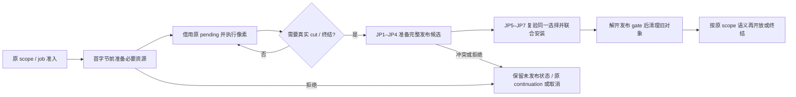

# 02a：联合发布的观察边界与逐段改法

返回[指南目录](/Users/apple/krita_gpu/docs/vulkan_gpu_design/br1_modification_guide/README.md)。本篇细分 S04/S05、OP6/OP7，联动 S01/S02/S03/S09/S10、U01；目标和阶段资格由 [92 §9.4–9.5、§10.3](/Users/apple/krita_gpu/docs/vulkan_gpu_design/92_br1_m6_m8_execution_baseline.md)裁决。优先级为 **stroke → undo → 上下文**。本篇按实际工作树定位，不能将已有底层安装能力视为外层联合可见性已完成。 当前批次选择与停止条件统一以 [92 §16](../92_br1_m6_m8_execution_baseline.md#br1-convergence)和 [CONVERGENCE](CONVERGENCE.md)为准；下文各实施批次保留其冻结范围。当前 API 替代与删除计划见 [函数映射](API_CONVERGENCE_MAP.md)，读取选择副本、packed/cursor 共同交付和输出参数的收束与本次 JP 修复一起做，不再整体后置到真实链之后。

## 1. 已复现的问题决定修改边界

[真实 manager 读窗口探针](/Users/apple/krita_gpu/docs/vulkan_gpu_design/evidence/br1_s05_joint_publication_20260928/reader-window-probe.cpp)在同一线程的原诊断边界读取 fixed view、surface state、fresh `getTile` 和 manager extent，排除线程调度的猜测。以下保留 **JP4 修复前**的结果，0x61 为新像素。JP4 已关闭其中 canonical extent 缺口（§9）；当前 fresh read 及旧 reader 并存的结果见 [§10](#current-read-contract)，不能把下表当作最新状态。

| 观察点 | PageStore 像素 | canonical extent | 新取得的兼容 tile / manager extent |
|---|---|---|---|
| 冷页，seal 准备前 | default | 空 | default / 空 |
| 冷页，seal cleanup | 0x61 | 空 | default / 空 |
| 冷页，operation cleanup | 0x61 | 64×64 | default / 空 |
| manager adapter installed | 0x61 | 64×64 | 0x61 / 64×64 |
| 暖页，seal / operation cleanup | 0x61 | 64×64 | 旧缓存 0x31 / 64×64 |

因此需要同时覆盖 **overlay seal → surface extent → root / selector → adapter → 各读取入口**。只锁住 root commit，或只提前准备 wrapper，都不能关闭这些窗口。原 captured view 固定旧内容是正确行为；fresh current 入口误用旧兼容索引则属于另一个契约。

## 2. JP1–JP8 与待改代码段的关系

以下为目标流程；当前完成 JP1 的 overlay 安装前置，并推进 JP3 匿名 root 成功清理的读进度子范围（§8），以及 JP4 页与派生 extent 的原子安装（§9），不能把图当作已落实的生产链。没有真实 cut 时，下一 dab 继续借用原 pending，不为显示或每 dab 强制 seal。

以下编号细分现有修改 ID，不另建阶段、事务权威或页面选择器。每行必须连同“终点”修改，不能只交付新 helper。

| 子项 / 原 ID | 主改代码与当前事实 | 具体改法、责任与终点 | 验收 |
|---|---|---|---|
| JP1 / S05：overlay 实际安装存储 | [prepareOverlayUpdateLocked](/Users/apple/krita_gpu/krita/libs/image/pagestore/KisPagePublicationCoordinator.cpp)、`KisPreparedOverlayUpdate::tryInstallLocked`、`PreparedTransactionState` | 原 transaction delta 保存唯一可查询 proofs/removals。候选持缺失节点与包含其他候选的实际桶容量，已有 proof 原位更新；撤销候选只还存储，不改旧 delta。已接 seal、generic publish、条件删除，详见 §3。继续把冷准备移出 owner gate，并接实际收费、完整首字节前准入。 | 并发候选扩容不丢其他页；安装区间实际 allocation/free 为零；每个准备分配点拒绝后旧 overlay 完整、可重试、无残余占用。 |
| JP2 / S02/S05：拆开原 seal 生命周期 | [KisPageMutationSession::sealImpl](/Users/apple/krita_gpu/krita/libs/image/pagestore/KisPageStore.cpp)、`Private::State`、`cancelLocked`、[WriteBatch::Private::finish](/Users/apple/krita_gpu/krita/libs/image/pagestore/KisTiledDataManagerPageStoreBackend.cpp) | 在原 session 上表达 preparing/installing 与取消责任；原 claims/activity 保持到候选安装或取消完成。provider、metadata 和节点准备完成后才进入外层交付。释放 session gate 后再取得 manager gate，必须先明确并发 cancel 是标记意图、拒绝还是接续；不得让 cancel 持 manager 等待正在反向取 manager 的 session。 | prepare/cancel/close/晚 guard 竞态有唯一终结；不借第二份 write set、私有事务或新 writer 表绕过原 scope。 |
| JP3 / S05/OP6：root 准备与安装分离 | [finishOwnedTransaction](/Users/apple/krita_gpu/krita/libs/image/pagestore/KisTiledDataManagerPageStoreBackend.cpp)、[commitLocked](/Users/apple/krita_gpu/krita/libs/image/pagestore/KisPagePublicationCoordinator.cpp)、`KisPreparedMutationCommit` | 复用原 commit aggregate，把 root/metadata/descriptor/backing/completion 准备及旧对象清理移到 backend publication gate 外；短 gate 只复验原 transaction、root 与候选并安装。anonymous 事务最后 client 与其他 sealed client 的选择切换仍由原 registry 决定。 | 不在 gate 中做 provider 调用、全量构建或释放；冲突发生在安装前，有限重准备；已安装后不把资源不足报成普通未发布失败。 |
| JP4 / S04/S05/OP5：同一发布的页与 extent/default | `sealImpl`、[prepareSurfaceLocked](/Users/apple/krita_gpu/krita/libs/image/pagestore/KisPagePublicationCoordinator.cpp)、`captureReadView`、`resolveSurfaceLocked`、`stageSurfaceMetadataLocked` | 将本次 page delta 和对应 surface delta 作为同一安装交付；使用原 surface revision / root 复验并发变化。完整 cut 包含完整 write set；显示 viewport 不能裁掉 extent 所需内容。增加与删除分别消费真实差量，不能每个 dab 扫描全层。 | 任一捕获包含的 page selection 与 surface state 对应；并发独立页不丢 extent；default revision、边缘删除、稀疏远坐标均覆盖。 |
| JP5 / S04/S05/OP6：真实读取入口 | [manager::getTile / getReadOnlyTileLazy / extent / region](/Users/apple/krita_gpu/krita/libs/image/tiles3/kis_tiled_data_manager.cc)、[Tile::lockForRead / refreshPageStoreData](/Users/apple/krita_gpu/krita/libs/image/tiles3/kis_tile.cc)、[TileDataWrapper](/Users/apple/krita_gpu/krita/libs/image/tiles3/kis_tile_data_wrapper.h)、[backend::acquireTile / captureReadView](/Users/apple/krita_gpu/krita/libs/image/pagestore/KisTiledDataManagerPageStoreBackend.cpp) | 逐个 current 消费者接原读取意图和固定 selection；compatibility 索引缺页不能独立证明 canonical default。明确 retained TileSP / 嵌套读是旧固定读还是 fresh current，迁移仍依赖后者的 wrapper/iterator caller。当前 native cursor 继续直接消费原 selection，不能为其每页增加完整 capture。 | 冷缺页、暖缓存、旧 view、活跃旧 raw reader 与新 current reader 交错均符合已声明契约；新读不错误落回 default，旧读不被新笔迹改写。 |
| JP6 / OP6/OP7：manager 交付与锁序 | [writeBytes / writePageStoreOperation / refreshPageStorePage / checkpointStrokeMutation](/Users/apple/krita_gpu/krita/libs/image/tiles3/kis_tiled_data_manager.cc)、`PreparedTileUpdates`、`resolveCurrentPagePresenceInto` | 原 batch/execution 已用 `OperationDelivery` 互斥交付，缺失候选共同安装已合并；下一步闭合其与 page/bounds 的联合可见点（[实际清点](API_CONVERGENCE_MAP.md#adapter-delivery)）。安装消费已准备资源，原 admission 在 canonical 和 adapter 交付后才归还。由 JP5 明确每个观察点，再确定短 gate；严禁简单地在 publication write gate 内调用持 tile swap barrier 的 invalidation。候选输家和旧对象锁外清理。 | `manager → publication → owner` 与 `tile barrier → publication` 的实际调用图没有环；publish/capture 不见半安装；不把完整 pixel kernel 放进全 manager gate。 |
| JP7 / OP7/U01：checkpoint、commit、abort、restore 共用 | [checkpointStrokeMutation / commitHistory / abortHistory / restoreHistory](/Users/apple/krita_gpu/krita/libs/image/pagestore/KisTiledDataManagerPageStoreBackend.cpp)、[manager history 入口](/Users/apple/krita_gpu/krita/libs/image/tiles3/kis_tiled_data_manager.cc)、[MementoManager::restore](/Users/apple/krita_gpu/krita/libs/image/pagestore/KisPageStoreMementoManager.cpp) | 在原 owner、scheduler cut、完整 changed delta 上应用同一 prepare/revalidate/install/cleanup 协议；准备失败保留原终结责任；替换 table/extent 后旧候选失效。undo 以 changed keys 驱动适配，删除普通全量 rebuild。 | 活跃 borrow 即时拒绝且可接续；cancel 和 undo 旧视图稳定；固定 K 放大 N/H 不增加全量恢复；不能用 standalone 测试代替这些入口。 |
| JP8 / S09/S10/V01：清理、预算与性能 | `KisPreparedOverlayUpdate::collectRetirementsLocked`、[HistoryCollector](/Users/apple/krita_gpu/krita/libs/image/pagestore/KisPageHistoryCollector.cpp)、[RetirementQueue](/Users/apple/krita_gpu/krita/libs/image/pagestore/KisPageRetirementQueue.cpp)、[真实 stroke 接线](/Users/apple/krita_gpu/docs/vulkan_gpu_design/br1_modification_guide/01j_real_stroke_integration.md#stroke-integration-map) | 节点/桶/控制块/metadata/通知按原 budget 实际收费，包含候选与旧值共存峰值。终结前准备必要回收记录，资源不足经原 waiter/continuation 接续；已发布的结果不能被清理失败改报未发布。随后联合真实 owner/current/source/producer 启用持久 scope。 | 无新输入也能 drain；tiny budget、多文档、慢 reader、公平维护守界；正式首 dab、steady、P95/P99、pen-up 与 Fresh 控制桶重新测量。 |

## 3. JP1 本批实际实现与保留边界

原 `PreparedTransactionState` 的 proofs/removals 改用可转移真实节点的容器；外层原 transaction 索引仍是唯一查询入口。状态由标准共享控制块保活，是同一份原状态，候选取消可在 owner gate 外归还两类容量计数；该计数只表示桶容量负担，不授予事务或页写权限。暖 proof 替换复用原节点，冷新增才构造节点；删除时摘下的节点由原候选带到锁外释放。

`prepareOverlayUpdateLocked` 在安装前准备 changes、metadata detach 输入、历史 key、缺失节点、原 map 桶及旧节点容器；桶需求为“当前元素 + 其他未安装候选 + 本候选新增”。安装前复验原状态身份、superseded proof 和 removal 状态，然后在同一 owner gate 内安装 metadata 与 delta。旧 ledger proof 撤销和历史收集沿 `collectRetirementsLocked` 进入 cleanup。原 `installPreparedProofLocked` / `setRemovalLocked` 分配式安装 helper 已删除；`findPreparedProofLocked` 返回原单页 proof，通用写不再取得容器指针。

这一步仍有明确的下一段代码：节点/桶准备仍在 owner gate 内；本批仅将匿名 root 成功后的 cleanup 移出 publication gate，root 准备及 history/checkpoint 等其他入口仍待处理；session seal 尚未输出可由 manager 联合安装的准备对象；派生 surface extent 已按 §9 随页安装，compatibility/current 读窗口仍存在；历史收集的必要队列/通知存储与完整收费尚待 JP8。**它使 overlay 安装具备短区间前提，不代表 OP6/OP7、S05 或 M6–M8 已完成。**

## 4. 验证必须对应原观察点

- `KisPageStoreCpuMutationTest::overlayStorageSurvivesSiblingCandidates`：4 BPP × K=1/9/65 × 新 proof/覆盖/删除/删除后重写，候选准备后让 sibling 扩容原 transaction 索引，再验证全部页、旧 captured view、commit 和最终释放。
- [overlay 安装探针](/Users/apple/krita_gpu/docs/vulkan_gpu_design/evidence/br1_s05_joint_publication_20260928/overlay-install-probe.cpp)：真实 Tiles3 provider，测 `MutationSealInstall → MutationSealCleanup`，含 8,210 B 正控制；observer 的重入抑制意味着只统计外层候选，不能把 sibling 的安装也算入测量次数。
- [逐点 allocator 故障探针](/Users/apple/krita_gpu/docs/vulkan_gpu_design/evidence/br1_s05_joint_publication_20260928/overlay-storage-failure-probe.cpp)：在 `MutationSealStoragePrepare → MutationSealMetadataPrepare` 拒绝真实分配，检查旧值、新值、重试与最终追踪块归零。保留失败日志；准备未落实时不得沿用旧源码通过结果。
- §1 的冷页 canonical extent 已按 §9 改为精确断言；fresh raw/current 和 manager extent 仍作为缺口记录，待 JP5/JP6 关闭后再转为对应断言。
- 完整矩阵、源码/运行库身份和阶段状态回到 [92](/Users/apple/krita_gpu/docs/vulkan_gpu_design/92_br1_m6_m8_execution_baseline.md)；本篇不给尚未验证的路径授予资格。

## 5. 本批核对的函数入口

行号仅用于定位；语义与 caller 责任按 §2 的 JP 表领取。

| 关系 | 原代码入口 |
|---|---|
| JP1：原节点与桶准备 | [KisPagePublicationCoordinator::prepareOverlayUpdateLocked](/Users/apple/krita_gpu/krita/libs/image/pagestore/KisPagePublicationCoordinator.cpp:1447) |
| JP1：安装 | [tryInstallLocked](/Users/apple/krita_gpu/krita/libs/image/pagestore/KisPagePublicationCoordinator.cpp:331) |
| JP1/JP8：安装后清理 | [void KisPagePublicationCoordinator::KisPreparedOverlayUpdate::collectRetirementsLocked](/Users/apple/krita_gpu/krita/libs/image/pagestore/KisPagePublicationCoordinator.cpp:406) |
| JP1：条件删除 | [bool KisPagePublicationCoordinator::stagePageRemovalLocked](/Users/apple/krita_gpu/krita/libs/image/pagestore/KisPagePublicationCoordinator.cpp:736) |
| JP1：generic publish | [KisCompletionTicket KisPageStore::finishWrite](/Users/apple/krita_gpu/krita/libs/image/pagestore/KisPageStore.cpp:4101) |
| JP2：seal 生命周期 | [bool KisPageMutationSession::sealImpl](/Users/apple/krita_gpu/krita/libs/image/pagestore/KisPageStore.cpp:2105) |
| JP3：原 root commit | [KisImageEpochCommitTicket KisPagePublicationCoordinator::commitLocked](/Users/apple/krita_gpu/krita/libs/image/pagestore/KisPagePublicationCoordinator.cpp:834) |
| JP3：外层事务终结 | [bool KisTiledDataManagerPageStoreBackend::finishOwnedTransaction](/Users/apple/krita_gpu/krita/libs/image/pagestore/KisTiledDataManagerPageStoreBackend.cpp:947) |
| JP5：兼容页读取 | [bool KisTile::lockForRead](/Users/apple/krita_gpu/krita/libs/image/tiles3/kis_tile.cc:349) |
| 验证：并发候选 | [void KisPageStoreCpuMutationTest::overlayStorageSurvivesSiblingCandidates](/Users/apple/krita_gpu/krita/libs/image/tests/KisPageStoreCpuMutationTest.cpp:778) |
| 验证：空存储不是 delta | [void KisPageStoreCpuMutationTest::overlayStorageIsNotASemanticDelta](/Users/apple/krita_gpu/krita/libs/image/tests/KisPageStoreCpuMutationTest.cpp:836) |

## 6. 本批资格与剩余项

**JP1 冻结验证：** JP1 原 overlay 实际节点、并发桶容量、安装与清理边界已通过 **20 目标 × 双架构 9,154 passed、0 failed、0 skipped，66 个最终探针**。每架构 96 次安装 allocations/frees 为 0；627 个真实准备分配拒绝与 12 个成功对照通过。[本批同源证据](/Users/apple/krita_gpu/docs/vulkan_gpu_design/evidence/br1_s05_joint_publication_20260928/README.md)。外层 canonical/extent/adapter/current 读窗口仍复现，完整预算、真实持久 stroke 与 M6–M8 继续。 源码差异为 `c1c6f145e69d6e841fb15c5873ea23db49da681f31ddc66f33b6530fd1ae3c2d`，QtCore 保持前批相同身份。新增 60 个 case / 架构，含 48 个并发候选及 12 个空状态语义用例；guide 链接检查独立于运行时资格。首字节前的完整 seal/cleanup 资源、真正外层短 gate 和读语义仍按 JP2–JP8 继续。

## 7. 收敛后的下一批交付边界

当前裁决回到 [92 §16](../92_br1_m6_m8_execution_baseline.md#br1-convergence)。JP1–JP8 是完整责任映射；下一批按 [CONVERGENCE §2](CONVERGENCE.md#next-batch)先关闭 §1 已捕获的真实 cold/warm reader window，以 JP2/JP4/JP5/JP6 为主，联动同一调用链必需的 JP3/JP7。完整短 gate、其他入口、预算和维护分别记录剩余，不能借关闭窗口宣布整个 S05 完成。

在固定同一观察窗口或 read selection 的前提下验证 page + extent/default + adapter/current 一致，并保留旧 fixed/raw reader 的合法语义；独立调用恰好跨越发布点不自动构成反例。复现探针须改成修复后的契约断言，再加独立线程的实际锁序/慢 reader/取消交错，不能用同线程 observer 代替并发安全证明。

批次结束条件是已登记观察点、实际 owner/终结和相应失败/并发检查闭合。准备阶段仍在锁内或 cleanup 仍无完整界限时明确保留资格缺口，不继续无限补“另一个零分配区间”。新增前置只有给出被违反契约、真实 caller 和有限验收条件后才进入当前批。

## 8. JP3：匿名 root 成功清理移出发布锁

`finishOwnedTransaction` 继续按原路径取得 transaction mutex 和 publication 写锁，隐藏原 anonymous selector，再准备并提交。Store 的私有 `commitAndReleasePublicationLock` 只把这个原 RAII 锁借给原 `commitLocked`；root/metadata 安装成功且 Store owner 锁已经释放时，解开 publication 锁，再进入 `CommitCleanup` 和后续清理。此后 reader 从原 committed head 捕获合法 view，旧 captured view 继续稳定。

失败及重准备分支没有提前释放 publication 锁，最终 writer 的 transaction mutex 也没有提前释放。没有 selector 回调、额外 publication 状态、新事务或第二份 write set；不涉及 tile swap barrier、像素 kernel 或 manager adapter。锁序沿原 transaction → publication → Store owner；成功解锁先释放 owner，再释放 publication。§1 的 page/extent/adapter 窗口继续存在。

本轮曾尝试把整个 root 准备移到 gate 外，但连续读使候选在 revision 复验/安装时反复失效，产品并发写出现原 10 秒断言失败，隔离复查 45 秒超时。硬性三次拒绝又破坏原并发提交成功保证。这两项及配套 selector/重复 prepare 改动均已撤回，不按“局部测试通过”保留不满足进度的实现。准备外移必须先解决原 owner 的持续读压力进度和接续。

原二进制的 cleanup 阻塞、最终双架构检查、精确字节断言及未通过候选记录见 [本批证据](../evidence/br1_s05_commit_preparation_20260928/README.md)。改动处置与停止条件见 [清点 §8](CONVERGENCE_CHECKLIST.md#jp3-delivery)，阶段资格仍由 [92 §16.5](../92_br1_m6_m8_execution_baseline.md#jp3-commit-preparation)统一裁决；这里的双架构不替代 ON/OFF 产品配置资格。

## 9. JP4：同一 overlay 安装页与派生 extent

Tiles3 backend 在原 Store 初始化时配置一次不可变的 derived-extent surface；普通 PageStore 的 surface metadata 仍由调用者显式提供。配置不是新的 extent 缓存或事务索引，唯一可查询结果仍在原 `PreparedTransactionState::surfaceChanges`。backend 原 `stageDerivedExtent` 和匿名/history commit 的两处调用删除，避免 seal 后再补另一份 surface 结果。

`KisPreparedOverlayUpdate::prepareSurfaceLocked` 在最后重新取得 Store owner 锁后，读取同一 transaction base 和最新 sealed overlay，准备 surface 变更；该锁连续持有到 `tryInstallLocked` 完成 page、metadata 和 surface 安装。已在前一准备窗口安装的独立 sibling 被包含，不采用锁外旧 extent。普通新增/覆盖只遍历本 segment 的 K 个 key；删除合成原 transaction delta 与候选，沿排序删除 key 的搜索路径读取 persistent root；未受影响的子树复用缓存边界，新增 proof 再并入。不再创建临时 tree，也不导出整张 manifest，但仍可能处理累计 overlay delta，不能据此宣称删除成本仅为本 segment K。

候选内的 surface change/index 仅服务本次安装，随原 aggregate 成功清理或取消销毁。原 surface vector 的 detach/reserve 在 `MutationSealSurfacePrepare`，安装前检查实际独占性和容量；`MutationSealInstall` 内只消费已准备存储。删除 key 的临时集合使用原标准容器类型，准备分配异常可返回拒绝，避免 Qt hash 插入的 noexcept 路径。extent A→B→A 允许修订号继续递增，与 default identity 的既有往返规则一致；无修订号变化的内容改变、回退修订号及空变化仍拒绝。坐标端点和宽高均按 QRect 可表示范围验证。

失败发生在原 overlay 安装前：已有 sealed 页、surface 和 captured view 不变，未发布 segment 走原取消责任；正常重试可继续。成功路径的原 claims、admission、selector 与 adapter 交付寿命保持。没有新的 manager 字段、TLS、写权限或跨 job extent 表。generic `finishWrite` 和条件删除也通过同一候选准备，history checkpoint 返回页与 extent 相符的固定 view。

验证与实际身份见 [本批证据](../evidence/br1_s05_overlay_extent_20260928/README.md)；清点见 [§9](CONVERGENCE_CHECKLIST.md#jp4-delivery)。原冷页 seal 后“新像素 / 空 canonical extent”已改为断言。**fresh raw/current 和 manager extent 仍可能滞后**，下一批按 JP5/JP6 接原读取意图与交付；原旧固定 view 应继续保持旧值。surface 准备当前仍可在 owner gate 中分配，完整短 gate、必要资源首字节前收费、其他终结/恢复和 M6–M8 不由本批取得资格。

## 10. JP5/JP6：fresh current 与保留读的边界

本节保留 JP4 之后经代码和反例约束的联合目标；**fresh raw 的实现已推进到 §11，manager extent/caller 联合边界仍开放**。[改动前探针](../evidence/br1_current_read_convergence_20260928/README.md)同时读取两个 manager raw getter，并在 writer 返回后另起线程读取：暖页旧 pin 还在时，新 getter 仍返回旧 wrapper/旧像素；仅 invalidate 或等待 writer 返回不足以修复。实际范围及关闭条件归 [清点 §10](CONVERGENCE_CHECKLIST.md#current-read-work-order)，不能把其中尚未满足的条目一起划掉。

### 10.1 先分清六种读取和 extent 语义

| 调用/能力 | 必须保持的含义 | 对下一实现的约束 |
|---|---|---|
| 新 `getTile(false)` / `getReadOnlyTileLazy`，无 live legacy 写借用 | 在自己的选择点读当前已发布页；活跃持久 history 下仍是最后完整 checkpoint | 不能由旧 hash/cache 代替 current 选择；getter 和随后 lock 跨过另一次发布时，只要求返回其受保护的合法选择，不要求无边界地追逐最新版本 |
| 已 lock 的 Tile/raw 指针 | 原借出像素在匹配 unlock 前有效；同一 wrapper 的嵌套读共用原能力 | 新 getter 命中新版本时，不得把它计入旧 wrapper 的嵌套读，也不得换掉旧 reader 正在使用的指针 |
| retained 但 idle 的 TileSP | 延续既有 wrapper/cache、失效与 detached 规则；它本身不是一次新的 manager current 请求 | 不把旧对象每次 lock 都强制改成 fresh。现有 refresh 后可更新、detached/retired 原数据继续可读的控制均需保持 |
| captured view / `getOldTile` | 固定 read selection / history base（G0） | 不走 fresh current 重绑定；retirement 后仍有原 storage 保护的情况不当成 current 命中 |
| live legacy iterator/write intent、合法 job current | 由原 batch/execution 和实际读写意图决定是否可读未发布数据 | 不把 `m_lockCounter > 0` 一概解释成可读 current，也不将所有 legacy 来源强改为 exact；不新增 TLS writer 或第二份写注册表 |
| extent/default | exact 使用同一 captured surface；兼容工作范围可包含 pending/intent；普通已发布页与外部 fresh bounds 必须相符 | 必须迁移和核对真实 caller。manager 的兼容 extent 不能偷偷变成 checkpoint-only，exact 消费者也不能混用别的工作范围 |

当前一个名字为 `newTile` 的局部 bool 在 read 分支实际上接收 hash 的 `existingTile`。两个 hash 的 read miss 都构造 detached default wrapper，不插入 hash。这是实现细节，不能当 canonical absence 证据；`existingTile` 又参与 copy fallback 的 sparse/no-op 判断，所以修复像素值时必须一起定义并验证存在性输出。

### 10.2 沿原选择与能力实现，不再造状态权威

1. 在 manager 的新读入口识别原读取意图，沿 backend 的 `captureReadView` / presence 所使用的原 selector 规则核对 canonical 身份；两种 getter 共用同一规则。普通 Store/无 PageStore 模式保留原 hash 行为。冷 hash miss 必须区分真正 sparse default 与“页已发布、adapter 未到”的情况。
2. 暖命中先验证**逻辑选择**是否仍对应原 cache；`Tiles3TileReadCache::repinRead` 的 allocation identity 检查只证明**物理能力**，不能替代前者。后续返回像素仍必须 pin。可沿原 binding/lease 添加必要的局部身份提示，但它不保活 root、不授予访问权，也不另作 current 索引。现有 `readIdentity(version)` 要求已有 reader，不能无条件当 idle cache 的比较函数调用。
3. 选择相同则复用原 wrapper/cache。选择变化时，idle cache 可按原规则重绑定；旧 wrapper 仍有 reader 时，为新选择提供独立的读能力和必要 wrapper，保留原旧指针。不要对每个 warm getter 无条件 capture/freeze、generic request 或分配 wrapper；这会把一致性修复变成每次读都增加 COW 压力的另一条慢路径。
4. 新 default 必须绑定正确 surface/default revision；真正 sparse miss 仍不得建立 canonical 页或增加 default materialization。不能为了比较默认值直接读取未 pin 的 TileData，也不能把并发变化的 `m_defaultPixel` 当稳定快照。
5. 若选择/资源/pin 拒绝，结果不得是假成功的旧像素。是否沿原 fallible lock 返回，或令 getter 返回空，须先统一 caller；不能加一个可能为空的 helper 后留下原有无条件解引用。保持原 owner 的取消与 failure bridge，不把读取失败变成像素 replay。

这些是行为和成本约束，不预先规定新增公共 API、内部 aggregate 或常驻字段。具体实现须同时证明选择/能力的寿命和实际 caller，不为一个额外“准备层”自行扩范围。

### 10.3 必须一起审查的 caller 与锁序

| 源码端点 | 本次核对事实 | 实施时必须交付 |
|---|---|---|
| [manager getter/attach](/Users/apple/krita_gpu/krita/libs/image/tiles3/kis_tiled_data_manager.cc:285) → [refreshPageStoreData](/Users/apple/krita_gpu/krita/libs/image/tiles3/kis_tile.cc:143) | ready 或 active 时可直接复用；getter 不取 manager `m_lock` | fresh 规则集中，不能只在一个 getter 修；如增加 manager 锁，要核对已有持锁 caller/回调，避免非递归重入 |
| [lockForRead](/Users/apple/krita_gpu/krita/libs/image/tiles3/kis_tile.cc:349) → [backend acquireTile](/Users/apple/krita_gpu/krita/libs/image/pagestore/KisTiledDataManagerPageStoreBackend.cpp:1459) | 原读路径是 tile barrier → publication read → backend/Store 选择；active wrapper 直接增加原计数 | 联合安装不得形成 publication write → tile barrier 的反向等待；旧 reader 长期存活不应阻塞新版本读或 writer 完成 |
| [wrapper](/Users/apple/krita_gpu/krita/libs/image/tiles3/kis_tile_data_wrapper.h:41)、[base iterator](/Users/apple/krita_gpu/krita/libs/image/tiles3/kis_base_iterator.h:53)、[getTilesPair](/Users/apple/krita_gpu/krita/libs/image/tiles3/kis_tiled_data_manager.h:145) | 当前假定 manager getter 返回非空，然后消费 fallible lock | 若引入 nullable 返回，必须同批处理成对 lock/unlock、data/oldData 清理及错误上送 |
| [精确 copy fallback](/Users/apple/krita_gpu/krita/libs/image/tiles3/kis_tiled_data_manager.cc:1219)、[rough copy fallback](/Users/apple/krita_gpu/krita/libs/image/tiles3/kis_tiled_data_manager.cc:1355) | source 和 destination 都调用 read-only getter；presence 决定 sparse/no-op；旧数据分支另经 `getOldTile` | 保持 current/G0、source/destination 差别；新存在性与新像素必须同选；失败不能误判 no-op 成功 |
| [PaintDevice strategy extent](/Users/apple/krita_gpu/krita/libs/image/kis_paint_device_strategies.h:103)、[frameBounds](/Users/apple/krita_gpu/krita/libs/image/kis_paint_device.cc:355)及同文件 estimate/clone/LoD/purge | 上层会叠加 offset/default-opacity；同名 bounds 不全是 exact 发布查询 | 逐调用标记“工作范围”或“固定发布范围”，沿原 read selection 传递；保留 offset/default-opacity 与 pending/intent 对照，不只替换 manager 一行返回值 |
| [writeBytes](/Users/apple/krita_gpu/krita/libs/image/tiles3/kis_tiled_data_manager.cc:1555)、[writePageStoreOperation](/Users/apple/krita_gpu/krita/libs/image/tiles3/kis_tiled_data_manager.cc:1734)、[checkpoint](/Users/apple/krita_gpu/krita/libs/image/tiles3/kis_tiled_data_manager.cc:1711) | canonical 安装与 manager adapter 当前分段；history pending adapter 先于 checkpoint；原 batch/execution 保活到交付 | 若要把 manager 安装纳入同一 gate，先处理 JP2 原 session/cancel 的取锁和寿命；不能持 publication 写锁回调 tile，或持 session 反向等待 manager |

审计输入见 [13 文件/23 入口记录](../evidence/br1_current_read_convergence_20260928/source-audit.json)。表格只覆盖本次有限范围；同名模板匹配、virtual/回调和实际 runtime census 仍需实现后的完整工具检查，不能将 `rg` 无遗漏当作所有消费者已迁移。

### 10.4 验收与停止

保留原新页/暖页、BPP×packed/cursor 控制；加入“写返回、旧 pin 未归还、另一线程 fresh getter”的断言。对 extent 分别验证普通已发布窗口、history checkpoint、pending 工作范围和纯 write intent，不把后两者强行计入一致性失败。再补 default revision、删除/restore、失配/资源拒绝、旧 raw/G0、独立页并发和持续读下 writer 进度。

warm/old-reader/default 的原测试只覆盖其已有调用频率；新增 fresh getter 反复调用的 capture/generic/cache 分配计数必须单列，不能以“原 retained Tile 的 4096 次 lock 仍通过”代替新入口成本证据。最终修复模式应零违例退出，并按改变的源文件重新建立矩阵及身份；本次脚本记录模式的 0 退出不满足这一条件。

上述联合结果成立就转入 BC 的真实业务链。若外层准备/清理或资源仍未闭合，保留 S05/JP8 对应开放项；不能为取得一个局部“完成”而改变 exact/pending 意图，也不能再次无限扩展 helper 和探针库存。

## 11. JP5 已实现部分：新 manager 读取的逻辑选择与旧读隔离

`getTile(..., false)` 统一转到 `getReadOnlyTileLazy`，后者通过 backend private `selectCurrentReadTile` 选择当前已发布内容。原 iterator mutation scope 仍允许合法 live legacy 读取，原 write intent/nested write 分支保留；普通外部读不取得持久 history 的 pending 像素。`existingTile` 在这个新读路径中反映选择的 canonical 页是否分配，不再直接复用兼容 hash 的存在位，避免 copy fallback 错把已发布页当 default。

Store private `resolveTileReadIdentity` 在同一原 owner gate 中读取页版本以及必要的 default surface，既不 capture/freeze，也不授予像素权限；关闭中的 Store 拒绝新选择。provider 的 `readCacheMatchesVersion` 通过原 binding 同时比较逻辑版本和 allocation identity，仍只是提示。匹配的原缓存继续在实际 `lockForRead` 时取得物理 pin；失配才捕获原 selector 的精确 view 并走现有 native/generic 读能力，不复用已移除的 transaction id。

有 active reader 的旧 wrapper 不替换指针，新读取得独立 detached Tile；原 COW 引用在精确 pin 释放前取得，随后由原 Tile 的 swap lock/COW 寿命保护。该引用使原 `tryClaimBackingHandoff` 的引用/用户检查拒绝 retag；没有新 ownership 表。独立 wrapper 不携带裸 backend/manager 指针，允许在 manager 析构后继续读，也保留 detached 私有写语义。原 indexed idle wrapper 可重绑缓存；原 `KisTile::lockForRead` 的嵌套语义没有改写。

默认读先在 tile barrier 外取得原 hash default 引用，再在 pin 下与选定 surface default 比较。相同则复用；仅元数据/default adapter 不同或冷选择需要时，才使用原 allocator 构造兼容 uniform TileData，不注册 canonical default 页。分配失败返回拒绝，旧指针保持，释放压力后可以重试。关闭/资源失败通过原 job failure context 上送；wrapper、base iterator 及精确/rough copy 的 nullable getter 消费点已处理，不能误读旧值或继续解引用空指针。

锁序是短 publication read 选择 → 释放 → 原 hash/default 引用 → tile barrier；冷路径在 barrier 内沿原 publication read 顺序捕获能力。没有 publication write → tile barrier 的新边，也没有持 manager 锁执行整段 kernel。两个 friend 的侵入增加及删除条件在 [92 §16.8](../92_br1_m6_m8_execution_baseline.md#fresh-read-implementation)显式审查；这是现存 raw 适配边界的债务，不把它藏成零侵入或新增缓存框架。

具体结果、同源身份、拒绝日志和成本见 [本批证据](../evidence/br1_s05_fresh_read_20260928/README.md)。新增测试覆盖冷/暖 × packed/cursor × active old reader、BPP、两 getter、返回后另一线程、旧 captured view、warm 重复 getter、manager 析构、default 往返、关闭和实际预算拒绝。最终整体窗口 probe 继续保留 `--require-converged`，它仍因 manager extent 失败；不能只保留 raw 子范围的绿色结果。

**下一段是 JP6 的 manager extent 与真实 bounds caller。** 原 pending/intent 工作范围控制继续有效，不能无条件把 `extent()` 换成 canonical。raw 读闭合不自动覆盖所有 restore/default/显示组合，nullable caller 的完整资源故障矩阵、短 gate、预算、OFF、真实业务 owner/display/finish/cancel/drain 与 M6–M8 继续按原门验收。

## 12. JP6 已实现子范围：packed/cursor 发布与 adapter 共用短 gate

上一节记录的普通 add 窗口已经关闭。backend 的 `runCpuMutationOperation` 不再先完成 publish、返回 manager 后再安装 adapter，而是把同一个 publish closure 交给 `AdapterCompletion`。manager 的 packed/cursor 两条 caller 使用原 `m_lock` 包围 publish 与 `PreparedTileUpdates::install`；像素 body、range wait、冷页准备和成功后的大对象清理仍在 gate 外。独立 `extent()` / `region()` reader 取同一 read gate，因此不会穿过这个完成区间。

锁序保持 manager gate → backend publish；backend 不在 owner/publication gate 内主动回调 manager。prepared install 不取 tile barrier，也不等待旧 reader；诊断 `MutationAdapterInstalled` 在 manager gate 释放后触发。standalone completion 在 publish 成功后 seal/commit，delivery 只延长原 admission；history 不 publish root，在原 execution borrow 存活时安装 pending wrapper/extent，随后由原 backend worker 归还 borrow。

为避免继续增加生命周期接口，本批删除了 `OperationDelivery::finish()` 与 execution variant。原“把整批延后到 manager 返回后 finish”的候选曾让被拒绝的 legacy 写污染仍活跃的匿名 transaction，该方案已撤回；最终实现只移动原 publish 的调用时点，不移动整批像素/失败生命周期。生产没有新增具名函数，生成图 API 节点净减 1。

探针在 seal cleanup 启动独立 reader：canonical/raw 已是新值时，`extent()` 必须等待；adapter installed 后 reader 才返回新 extent。arm64/x86_64 各 44 场景/172 观察均为零违例，保留旧 raw/captured、pending/intent 和 legacy conflict 控制。完整代码、失败设计与冻结身份见[证据](../evidence/br1_joint_adapter_window_20260929/README.md)。

本节只覆盖 add/update。`clear(QRect)`、trim/remove、default revision、native copy target、restore 与 purge 有删除或替换语义，不能直接复用只增页的 prepared set。下一批先查首条 direct stroke 是否实际经过这些路径；命中者做同类时序和目标测试，不命中就进入真实 owner/display/finish/cancel/drain，不再扩写本节 helper。
