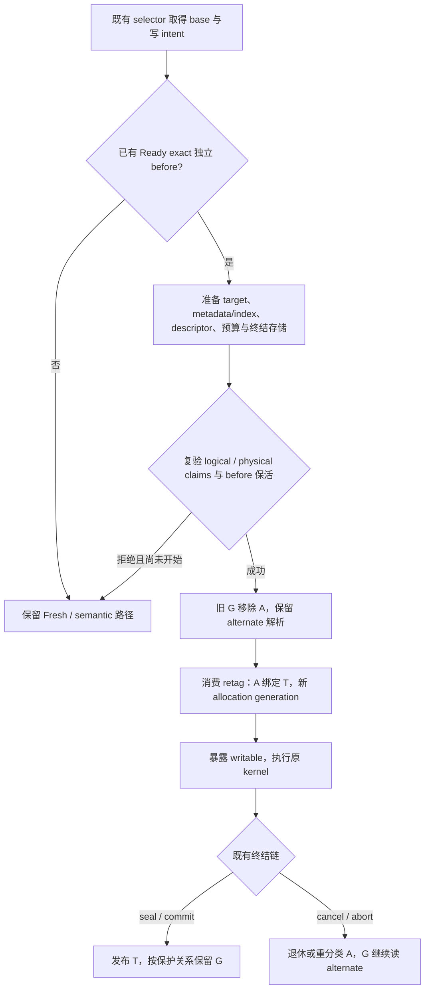

# 03a：S06 / M6–M7 的实施关系与检查点

返回[指南目录](/Users/apple/krita_gpu/docs/vulkan_gpu_design/br1_modification_guide/README.md)及[03：首写与 handoff](/Users/apple/krita_gpu/docs/vulkan_gpu_design/br1_modification_guide/03_write_plans_and_hot_path.md)。本篇细化 92 §2–§4、§10.1 的代码关系；阶段状态及测试证据只在 [92 §15](/Users/apple/krita_gpu/docs/vulkan_gpu_design/92_br1_m6_m8_execution_baseline.md:477)裁决。以 `5173c807c87b` 加当前工作树定位，2026-09-27。

下文“待改”是实施要求，拟议职责名不是现存 API。保留唯一 selector、metadata owner、MutationWriteSet 和 publication 终结链；每一个新凭据必须同时具有创建、验证、消费和取消的实际调用者。

当前M6验收统一按[92 §6.1](../92_br1_m6_m8_execution_baseline.md#m6-opportunity-gate)，CPU同状态命中正收益、miss不劣性及安全/容量/结构共同过门，原20%/30%不是硬出口。下文实施批次保留其冻结范围；本轮无产品/API迁移。真实来源、代际消费和GPU边界见[92 §6.2–§6.3](../92_br1_m6_m8_execution_baseline.md#m6-business-value)：CPU/GPU双映射不自动构成独立before，旧GPU last-use不因retag消失，M6通过不等于业务或GPU默认启用。

## 1. 先区分已存在的入口与待实现的能力

| 源码现状 | 准确含义 | 下一段仍须完成什么 |
|---|---|---|
| `select` 增加 RecoverableHandoff；`prepareWritePlanLocked` 由 native/generic 共用；同段命中仍使用既有 pending | 驻留 CPU exact before 子集已联合消费准备、claim、安装；Fresh 保留 | 补齐 legacy cache、拒绝原因观测及完整故障/并发/资源资格；不得在两个 caller 各自决定复用 |
| `KisCpuResidentBinding` 接收 expected allocation identity，读、写、reserve、retire 在原局部锁内验证 | 缓存对象不能凭过去的一次 provider lookup 获得任意 identity 的访问 | 完整 handle 已移入 stable binding，并有 physical claim/retag 原语；captured read 已接有界重解析，范围见 §9；生产共同计划已接入，见 §11；legacy cache 仍待迁移 |
| `KisCpuBackingHandoff::prepare/tryClaim/commit/reset` | 工作树具备 move-only 的物理候选：保留 provider，claim 取得存储排斥，commit 一次 retag 后交还已有 writer reservation | 原语自身不授予逻辑权限；生产共同计划须同时持有 before pin、metadata、ledger、descriptor 和终结存储，关系见 §11 |
| `KisCpuWriteBindingReservation` 可以 park / pin / unpin | 保留当前 binding writer，未 pin 时允许 swap | 不排斥所有外部 TileData 引用、alias/source 或 preclone；不授予改写可见版本的权限 |
| `BeginAuthorityHandoff / CommitAuthorityHandoff` | 同一逻辑版本的 replica authority 转移 | 不提供 G→A 解绑、A→T retag 和旧 G 的独立恢复 |
| `prepareMutation / installMutation` | 只准备、安装 `DetachPreparedVersion`；要求没有活跃 writer | 保持独立用途，不能用它安装 recoverable writer 或把它当通用不可失败安装 |
| `AcquireRecoverableWrite` 与 `prepareRecoverableWrite / installRecoverableWrite` | 工作树新增逻辑转移及准备安装入口；prepare 计算 Acquire + PrepareWrite，install 复验 revision 后替换 base 并增加 Writable target | 已由生产共同计划联合消费 provider/descriptor/计账；metadata 单独成功仍不授予物理写权限，完整消费顺序见 §11 |
| `KisExactGenerationArchive::contains/loadExact` 与 SSD seam | exact archive 接口；记录存在本身不是 canonical authority 或独立保活凭据 | 首版只接受已经能证明 Ready、exact、独立保活的恢复来源；不能以 `contains == true` 或等待中的 archive operation 代替 |

## 2. 从修改内容定位到具体代码段

| 子项 / 责任 | 主改段及联动消费者 | 具体改法与交付边界 |
|---|---|---|
| S06.1 缓存访问身份 | [binding 取 pin](/Users/apple/krita_gpu/krita/libs/image/pagestore/KisCpuResidentBinding.cpp:149)，`acquireRead/acquireWrite/reserveWrite/retire`；[binding 声明](/Users/apple/krita_gpu/krita/libs/image/pagestore/KisCpuResidentBinding_p.h:24)；[provider 创建 binding](/Users/apple/krita_gpu/krita/libs/image/pagestore/KisTiles3PageReplicaProvider.cpp:70) | expected 使用 provider、provider epoch、allocation slot、allocation generation 全身份；验证和授权在同一局部 gate。native、generic、copy/transfer 和 retire 都传入自己的 handle identity。不能保留可绕过校验的无参重载。当前工作树已接入这些消费者，资格见 92 |
| S06.2 失配后的读选择 | [captured view](/Users/apple/krita_gpu/krita/libs/image/pagestore/KisPageStore.cpp:2539)，`readResidentPageImpl`；[冷查找](/Users/apple/krita_gpu/krita/libs/image/pagestore/KisPageReadCoordinator.cpp:303)，`discoverCpuReadBinding`；[metadata cache](/Users/apple/krita_gpu/krita/libs/image/pagestore/KisPageMetadataCoordinator.cpp:2768)，`removeCpuReadBinding/cpuReadBinding` | 失配只淘汰相符的旧候选，从原受保护 version 重新选择；立即重试有界，常规命中不重新查全局 provider。保持原 captured root，禁止偷偷改为读取最新 current。Busy、NonResident、身份失配分别处理，不把失败当成随意 generic replay 的理由。已接入的有界重解析及生产联合验证要求见 §9 |
| S06.3 legacy cache 与裸 pin | [KisTile](/Users/apple/krita_gpu/krita/libs/image/tiles3/kis_tile.cc:349)，`lockForRead/refreshPageStoreData/ensurePageStoreWriteAccess`；[bridge](/Users/apple/krita_gpu/krita/libs/image/tiles3/KisTilePageStoreBridge.h:17)；[backend acquireTile](/Users/apple/krita_gpu/krita/libs/image/pagestore/KisTiledDataManagerPageStoreBackend.cpp) | `m_pageStoreNativeReadReady` 只表示缓存已准备，不能授予 retag 后的访问。bridge 内保存或重新取得受保护选择与 expected identity，先验证再 pin；不向 legacy iterator 传播第二套 generation 权威。已有 raw pointer 先到必须阻止 claim；claim 先到则旧 cache 拒绝并重新解析 |
| S06.4 恢复来源证明 | [base 决策](/Users/apple/krita_gpu/krita/libs/image/pagestore/KisPageWriteCoordinator.cpp:1369)，`prepareWriteBaseLocked`；[provider/archive 契约](/Users/apple/krita_gpu/krita/libs/image/pagestore/KisPageReplicaProvider.h:520)；[metadata replica 选择](/Users/apple/krita_gpu/krita/libs/image/pagestore/KisPageMetadataCoordinator.cpp:2790) | 从既有 exact replica/有效 archive 选择独立于 A 的 before，验证 layout、内容版本、Ready 与保活期限；凭据覆盖 detach 到 commit/cancel 后旧 G 的存活要求。没有证明即 Fresh，不为提高命中临时复制 before。若扩展 archive retention，必须连同 forget/GC/关闭与恢复消费者一起实施，不据此开启 BR3 production |
| S06.5 物理 claim 与 retag | [Tiles3 provider](/Users/apple/krita_gpu/krita/libs/image/pagestore/KisTiles3PageReplicaProvider.cpp:812)，`prepareSynchronousWriteCopy` 相邻写准备、allocation index、`retire`；[TileData pin](/Users/apple/krita_gpu/krita/libs/image/tiles3/kis_tile_data.h:79)；[TileDataStore swap](/Users/apple/krita_gpu/krita/libs/image/tiles3/kis_tile_data_store.cc:615) 与 duplicate/preclone | 在已有物理 owner 上实现 move-only、一次消费的 claim。复验 epoch/generation，排除 binding reader/writer、legacy raw pin、alias、source、swap/preclone、retire 和未完成 last-use。引用数只帮助判定 lifetime，不能单独作为许可。当前原语将完整 handle 收敛到 stable binding，provider index 只索引稳定 slot；retag 不再同时修改第二份 handle，旧 expected 立即失效。具体已实现边界见 §7 |
| S06.6 detach/target 的实际存储准备 | [metadata 准备](/Users/apple/krita_gpu/krita/libs/image/pagestore/KisPageMetadataCoordinator.cpp:2191)，`prepareRecoverableWrite/preparePublicationImpl`；[安装](/Users/apple/krita_gpu/krita/libs/image/pagestore/KisPageMetadataCoordinator.cpp:2539)，`installPublicationImpl`；[普通 transition](/Users/apple/krita_gpu/krita/libs/image/pagestore/KisPageMetadataCoordinator.cpp:3269)，`applyProjectedSequence` | 在 claim 消费前准备真实 slot、索引 bucket/node、activity、descriptor 及取消/退休记录。安装复验 page revision 与所有凭据，消费预备存储；不安装包含过时 pin/lease 的整页快照。当前 recoverable 原语已把 Acquire + PrepareWrite 放入准备阶段，详见 §6；descriptor/分类/物理凭据已在 §11 的 CPU 子集中联动，当前 CPU 安装区间的直接观测与验证边界见 §12。`applyProjectedSequence` 仍可能准备/增长存储，不能直接放在 retag 后当作不可失败步骤 |
| S06.7 共同计划与访问载体 | [plan/entry](/Users/apple/krita_gpu/krita/libs/image/pagestore/KisPageWriteCoordinator_p.h:45)；[selector](/Users/apple/krita_gpu/krita/libs/image/pagestore/KisPageWriteCoordinator.cpp:1645)；[native beginWriteImpl](/Users/apple/krita_gpu/krita/libs/image/pagestore/KisPageStore.cpp:1806)；[generic acquireWrite](/Users/apple/krita_gpu/krita/libs/image/pagestore/KisPageStore.cpp:3479) | selector 消费上述候选，明确未开始、已准备、已转移、已暴露的结果。两种访问载体共用该结果；native 保持直接 guard，generic 保留 request/lease 协议。失败前没有首字节才能按既有契约选择 Fresh；已开始失败交原终结责任，禁止重放 |
| S06.8 逻辑transition与取消 | [StateMachine](/Users/apple/krita_gpu/krita/libs/image/pagestore/KisPageStateMachine.cpp)的`AcquireRecoverableWrite`验证独立before；[Metadata](/Users/apple/krita_gpu/krita/libs/image/pagestore/KisPageMetadataCoordinator.cpp)的`prepare/installRecoverableWrite`在CPU模式只安装before转换及原私有结果；[WriteCoordinator](/Users/apple/krita_gpu/krita/libs/image/pagestore/KisPageWriteCoordinator.cpp)保留真实lease的`*LeaseWrite` | ed0f229821统一：首字节前完成预算/physical claim/metadata revision接受及retag；CPU后续complete/seal/cancel沿原result，取消把target交原paid retirement。异步lease的writer/before pin与真实completion保留；旧G继续经独立before解析，不倒写A、不新增恢复owner |
| S06.9 预算与退出 | [reserveBacking](/Users/apple/krita_gpu/krita/libs/image/pagestore/KisPageWriteCoordinator.cpp:1582)；[OwnerLedger](/Users/apple/krita_gpu/krita/libs/image/pagestore/KisPageOwnerLedger.cpp:1170)，`prepareBackingHandoff/commitBackingHandoff` 与 `prepareBackingChanges`；[回收与预算指南](/Users/apple/krita_gpu/docs/vulkan_gpu_design/br1_modification_guide/04_reclamation_and_budgets.md) | allocation 复用只收费一次；G retention、T pending、失败债务和稳定 binding 元数据均有实际计账。取消、最后 reader、provider revoke、close 都有唯一释放路径。payload 为零分配不代表 metadata 为零成本；联动 S09/S10 的进度与硬预算 |
| S06.10 M7 额外准入 | [epoch owner](/Users/apple/krita_gpu/krita/libs/image/pagestore/KisImageEpochReferenceModel.cpp:752)，`beginTransaction`；[capture/release](/Users/apple/krita_gpu/krita/libs/image/pagestore/KisImageEpochReferenceModel.cpp:1227)，`captureRetainedSnapshot/captureRetainedRoot/releaseSnapshot`；[publication install](/Users/apple/krita_gpu/krita/libs/image/pagestore/KisPagePublicationCoordinator.cpp:423) | M6 验收后，在同一 epoch admission gate 中判断 current/base 的外部保护、取得 fence 并限制新 capture；所有页 claims 和安装资源齐备后才写第一字节。扩展已有 epoch owner，不扫描 H roots、不另建 retention 账本；普通 `tryInstall()` 仍可失败，不能直接当作首字节后的不可失败提交 |

provider 的完整 handle 现在只由 stable binding 在同一局部 gate 下维护；它仍是物理 allocation 与 owner 指定逻辑版本的绑定，不是新增逻辑 generation owner。只能通过已取得 physical claim 的一次消费 retag，不提供可任意设置 tag 的 public setter。布局和实际驻留大小随真实消费者重新测量，不能以“字段在冷对象”免除 S10 计账。

## 3. 按生命周期检查实现顺序

这是 **M6 目标流程**；§11 说明当前 CPU 子集的生产接线，不代表全部 M6 出口已完成。把准备与终结拆开审查，但不拆成可独立发布的半个 handoff：旧 G 解绑和新 identity 转移之间，外部 reader 必须只观察受保护的完整状态。

可审查批次依次为：访问身份及 cache 消费者 → 恢复凭据/物理排斥 → 预备 metadata/descriptor/预算 → selector 与生产 transition → 全部成功/取消/退出验证。前置能力可以先落地；只有这些关系共同成立才能启用 recoverable plan。S06.10 随后实施，不能以 M7 不需要 before 为由跳过 M6 出口。

## 4. 每一条证明要落在哪个测试入口

| 待证明的关系 | 扩展入口 | 必须检查的结果 |
|---|---|---|
| 缓存 binding 的错误身份 | [PhysicalClaimTest](/Users/apple/krita_gpu/krita/libs/image/tests/KisPageStorePhysicalClaimTest.cpp)，`cachedBindingRequiresExactIdentity` | 1/4/8/16 BPP；provider、epoch、slot、generation、无效 token；空闲/read pin/parked writer 三种状态。拒绝错误访问、reserve、retire，原合法 holder 不被释放，随后合法访问仍正常 |
| 真实 retag / ABA，原 captured root 不变 | [ResidentReadTest](/Users/apple/krita_gpu/krita/libs/image/tests/KisPageStoreResidentReadTest.cpp)、PhysicalClaimTest | 旧 binding 活着但已经 retag 时拒绝旧 tag；重解析仍读旧 G 的 before，新 reader 才读 T。构造一个错误 token 的测试不能代替此项 |
| 旧 tile cache 和裸 pointer 的两种次序 | [tile_data_store_test](/Users/apple/krita_gpu/krita/libs/image/tiles3/tests/kis_tile_data_store_test.cpp)、[manager tests](/Users/apple/krita_gpu/krita/libs/image/tiles3/tests/kis_tiled_data_manager_test.cpp)、[iterator tests](/Users/apple/krita_gpu/krita/libs/image/tests/kis_iterators_ng_test.cpp) | 已解锁但仍存活的 cache 在 retag 后不能返回新字节冒充旧值；raw pin 先到拒绝 handoff，claim 先到拒绝旧缓存取 pin；解除阻碍后可进展 |
| 准备失败及可恢复取消 | [CpuMutationTest](/Users/apple/krita_gpu/krita/libs/image/tests/KisPageStoreCpuMutationTest.cpp)、[ReferenceTest](/Users/apple/krita_gpu/krita/libs/image/tests/KisPageStoreReferenceTest.cpp) | metadata/descriptor/budget/claim 每个失败点无半转移；写后 cancel/abort、晚 completion、provider epoch 变化后 G 仍 exact；生产与 oracle 一致，不临时制造 before copy |
| 安装存储已实际准备 | [FoundationTest](/Users/apple/krita_gpu/krita/libs/image/tests/KisPageStoreFoundationTest.cpp)、[V01 allocator 入口](/Users/apple/krita_gpu/docs/vulkan_gpu_design/br1_modification_guide/07_validation_and_migration.md) | 碰撞、索引 tier、并存 prepare、cancel/retry 都测真实分配器；install 无分配、rehash 或大对象析构。重新生成源码绑定调用图及所有权证据 |
| M7 的跨页原子性与 capture 排序 | CpuMutationTest、ReferenceTest、FoundationTest | capture 先到拒绝 fence；fence 先到 reader 等待新 root；第二页 claim 冲突不能改第一页面。首字节后失败为零；页数、字节和 hold P99 按 92 验收 |
| 对 stroke 的实际收益与控制成本 | [V01](/Users/apple/krita_gpu/docs/vulkan_gpu_design/br1_modification_guide/07_validation_and_migration.md)、[92 §14](/Users/apple/krita_gpu/docs/vulkan_gpu_design/92_br1_m6_m8_execution_baseline.md:444) | before copy/new payload/migration/retirement payload 按 plan 计数；记录真实 undo stroke、first dab、steady、pen-up、P95/P99 与 drain。H0 页写收益不授予 stroke 资格 |

## 5. 本主题交付记录的最小粒度

以 `S06.x → 符号 → owner/读者 → 准备失败点 → 成功与取消终点 → test case → 源码/二进制身份` 记录。对真实 handoff 另列旧 G、alternate、A 的旧/新 allocation identity 与 T 的生命周期；只有测试数字、文件列表或“增加 claim 支持”无法证明这些关系。

首批身份测试仅验证错误 token 被拒绝，逻辑安装用例仅验证 metadata；二者均不提供真实 retag、legacy cache 重新解析、独立物理恢复 retention、完整硬预算或性能资格。完整剩余工作仍由 92 管理；本篇不另设完成状态，也不允许根据局部测试跳过后续出口。

## 6. S06.6 / S06.8：已加入的逻辑原语怎样接到生产

以下约束继续适用于原语消费；已接入的 CPU 生产子集见 §11，其范围不能外推到完整 M6。A 表示旧 authority allocation，B 表示旧版本 G 的 alternate，T 表示新写版本。

| 顺序 / 所有者 | 现有代码段与本段保证 | 接入时必须补齐的关系 |
|---|---|---|
| 1. WriteCoordinator 选候选 | [共同 selector](/Users/apple/krita_gpu/krita/libs/image/pagestore/KisPageWriteCoordinator.cpp:1645)由 `prepareWritePlanLocked` 在联合准备后选择 RecoverableHandoff，拒绝时保留 Fresh / semantic | S06.4 取得已 Ready 的 exact B 及独立保活；不同 slot 不能证明不是 physical alias。B 可以有 reader/pin/last-use，这些保护原样保留；A 的冲突则必须排除 |
| 2. metadata 锁外准备 | [prepareRecoverableWrite](/Users/apple/krita_gpu/krita/libs/image/pagestore/KisPageMetadataCoordinator.cpp:2191) → `preparePublicationImpl`；[声明及前置责任](/Users/apple/krita_gpu/krita/libs/image/pagestore/KisPageMetadataCoordinator.h:362) | 传入 provider 已准备的新 identity：原 slot、相同 layout/domain、allocation generation + 1。原语准备 arena、exact/physical index、activity 的实际存储，复用既有 PreparedPublication；descriptor、provider retag、预算分类及取消/退休存储由对应 owner 另外先准备 |
| 3. logical + physical 复验 | [reference transition](/Users/apple/krita_gpu/krita/libs/image/pagestore/KisPageStateMachine.cpp:250)；[installRecoverableWrite](/Users/apple/krita_gpu/krita/libs/image/pagestore/KisPageMetadataCoordinator.cpp:2198) | 物理 claim 必须先取得并持续覆盖后续转移。任何 page revision 变化令逻辑候选拒绝，保留新到 reader/保护；安装前拒绝消费候选一次，按原 Fresh/failure 契约处理。不能先 retag 再调用可能拒绝的 install |
| 4. 逻辑转移 + 物理消费 | `installPublicationImpl` 的 RecoverableWrite 分支先移除 G→A、令 G.authority=B，再安装 T→A 的新身份和 Writable writer；普通 `AcquireWrite` 继续禁止 slot 重用 | 在现有 owner/claim 协议内紧接不可失败 provider retag 和已准备 descriptor/分类安装，再暴露字节。准备阶段已计算 `PrepareWrite`，retag 后不得另调用可失败的 `applyOwner(PrepareWrite)`。外部读者不能观察中间状态 |
| 5. 既有终结链 | [CancelWrite](/Users/apple/krita_gpu/krita/libs/image/pagestore/KisPageStateMachine.cpp:485)、[PublishWrite](/Users/apple/krita_gpu/krita/libs/image/pagestore/KisPageStateMachine.cpp:433) | write entry 的 baseAuthority/source 必须为 B，才能沿用原匹配与 before pin 释放规则。cancel 产生 T/A 的退休责任，不恢复 G→A、不倒写字节；成功则沿原 seal/publication。DeferredPublicationCleanup 在 gate 外消耗；拒绝、取消、析构同样归还 reservation |

原语只接受 Published 或本事务 Prepared base；Historical 本身不是写 base 准入。准备读取 current、exact base 和必要冲突 witness，不导出 H 个历史版本；只安装 base 与 T，strict revision 校验防止覆盖晚来的 lease/pin/last-use。这与 `DetachPreparedVersion` 的动态保护保留策略不同，不能合并为一个宽松的“mutation”许可。

具体验证入口为 [recoverableWriteGuards](/Users/apple/krita_gpu/krita/libs/image/tests/KisPageStoreReferenceTest.cpp:4962)、[preparedRecoverableWriteLifecycle](/Users/apple/krita_gpu/krita/libs/image/tests/KisPageStoreReferenceTest.cpp:5093)和 [recoverableWritePreparationHonorsBudget](/Users/apple/krita_gpu/krita/libs/image/tests/KisPageStoreReferenceTest.cpp:5249)。这些检查 oracle 一致性、候选一次消费、revision 竞争、普通 publish/cancel、元数据预算及资源释放。§11 的 CpuMutationTest 已联合真实 PageStore roots、physical claim/retag、旧 View 读取及提交/取消；全部并发次序、故障点和剩余缓存消费者仍须补齐。

## 7. S06.5：物理原语与下一段接线

[物理候选](/Users/apple/krita_gpu/krita/libs/image/pagestore/KisCpuResidentBinding.cpp:89)先保留 provider 并准备目标 handle，后调用 `tryClaim`；[存储排斥](/Users/apple/krita_gpu/krita/libs/image/tiles3/kis_tile_data_store.cc:331)非阻塞取得 iterator-read 和 tile-write 两个屏障，再检查 resident、唯一 binding 引用、零 legacy/source users、无 memento 和残留 preclone。引用数只排除外部 lifetime holder，真正排斥由两个存储屏障和 binding 状态共同承担。没有为了命中而 swap-in 或生成 before。

claim 不暴露字节。metadata 安装成功后，[commit](/Users/apple/krita_gpu/krita/libs/image/pagestore/KisCpuResidentBinding.cpp:108)在同一 binding gate 更新 handle，并在 store 屏障保护下把 tile-write 转为普通 tile-read pin，交回现有 `KisCpuWriteBindingReservation`。store 屏障在 pixel kernel 前释放；claim/cancel 是短且同线程的操作，不能跨任意 callback 或 job 持有。取消 claim 不 retag；消费后的候选仍保留 provider，必须在 owner gate 外 reset/析构，避免最后 provider 引用在安装区间内触发大对象销毁。

[PhysicalClaimTest](/Users/apple/krita_gpu/krita/libs/image/tests/KisPageStorePhysicalClaimTest.cpp)覆盖错误完整 handle、native/generic/raw pins、parked writer、同/跨 provider alias、source、额外 ref/user、swap/preclone、pooler iteration、取消/移动/重复消费、真实两次 retag 与 provider lifetime。这个 fixture 没有 PageStore roots 或 OwnerLedger，证明的是物理边界，不能代替完整 M6。metadata 的 pending-last-use/operation 拒绝和真正 before 的独立性还要在联合计划内复验。

维护联合接线须遵循以下依赖，当前 CPU 子集的实际调用关系见 §11；不能仅在 beginWriteImpl 中调用 commit：

1. **S06.9：预备计账身份转换。** 工作树已加入 `prepareBackingHandoff/commitBackingHandoff`，复用 OwnerLedger 的分类 claim、budget reservation 和原索引节点，详见 §8。§11 的生产联合候选在 physical claim 前持有该准备，并在 retag 后不可失败地消费；禁止 retag 后调用可分配的 registerBacking，也禁止为固定 K 复制整张 backing 表。
2. **S06.4 / S06.6：联合候选。** 既有 Ready B 独立保活、metadata 原语、descriptor 和终结记录全部准备后才 tryClaim；任何拒绝先释放候选，保持原安全路径。逻辑安装到物理 retag 之间不开放外部观察，也不留下可失败工作。
3. **S06.2 / S06.3：缓存消费者。** 旧 binding 的 expected 已会失配；captured read 从原 version 有界重新解析的工作树改动须按 §9 完成验证。legacy tile 的外部引用当前保守阻止 claim，其缓存迁移与 raw pin 次序仍须单独接通。
4. **S06.7：唯一 selector 与 native/generic 消费。** 共同计划消费联合凭据；写后 source/baseAuthority 为 B，接原 seal/commit/cancel 与退休。两载体不得各自推断物理独占或另建 write set。

完整状态与同源码证据见 92 §15；CPU 子集已联合消费相关原语，legacy cache 及完整四段资格仍须单独核对。

## 8. S06.9：计账身份转换的实际消费关系

| 责任 / 现有代码段 | 本批实现 | 生产接线要求 |
|---|---|---|
| [准备 API](/Users/apple/krita_gpu/krita/libs/image/pagestore/KisPageOwnerLedger.h:118)、[prepareBackingHandoff](/Users/apple/krita_gpu/krita/libs/image/pagestore/KisPageOwnerLedger.cpp:1170) | 只接受已登记、resident CPU、独占 physical charge 的 Current / ActivePending；完整 source/target 必须同 slot/layout/domain，allocation generation 加一。复用原分类 claim，冻结 source、target identity 与 physical domain，预留分类差量及 CPU RetirementDebt | 这不是逻辑授权，也不替代 provider claim。传入物理候选给出的 target，所有准备失败先取消 reservation，保留原 backing |
| [原 backing 索引](/Users/apple/krita_gpu/krita/libs/image/pagestore/KisPageOwnerLedger.cpp:98) | 单一索引改用可提取节点的标准哈希表；prepared 只保存 touched record，不复制整表。安装提取原节点、换 key 后插回，基数不变，其他登记造成的 rehash 不使候选失效 | 不另建 placeholder/影子 generation 表，不存跨 prepare 的失效 iterator；节点和 bucket 的实际常驻开销仍须纳入 S10，不因安装零分配而豁免 |
| [commitBackingHandoff](/Users/apple/krita_gpu/krita/libs/image/pagestore/KisPageOwnerLedger.cpp:1231) | 逻辑解绑和 provider retag 后，一次更新登记 key、physical representative 与 ActivePending 分类；预留 debt 留在原 ledger backing record，由普通发布/取消链消费，详见 §10。旧 identity 的查询/迟到释放不能命中新 backing | 在原 owner admission gate 内紧接 metadata、physical 与 descriptor 安装，首字节前完成；不能在其他 caller 提前单独消费，不给 native/generic 再各存一份终结 token |
| [生命周期与资源测试](/Users/apple/krita_gpu/krita/libs/image/tests/KisPageStorePhysicalClaimTest.cpp:390)、[拒绝与重试](/Users/apple/krita_gpu/krita/libs/image/tests/KisPageStorePhysicalClaimTest.cpp:471)、[索引增长](/Users/apple/krita_gpu/krita/libs/image/tests/KisPageStorePhysicalClaimTest.cpp:549) | 真实 retag 联动 ledger，验证取消准备、分类/预算/alias/驻留拒绝、旧身份失效、swap 后 representative、两代与索引增长、终结后归零 | fixture 没有 root/before retention；不得据此授予 production M6、全局 S10 或性能资格 |

现有 `KisBackingClassChangeReservation` 负责统一取消，typed handoff wrapper 防止混入普通 publication 分类消费；ledger 和 budget 必须覆盖 reservation 的生命周期。最初返回给 caller 的 CPU debt 已收敛到 ledger 内部，真实 domain admission 同步迁移其分类预留，普通 metadata retirement 消费该预留；CPU/SSD 直接终结的代码关系与单页硬额度验证见 §10。生产共同计划已接入，完整关闭压力及全局 S09/S10 进度仍须联合证明。

§11 已将驻留 CPU exact B、metadata、physical、ledger、descriptor 与终结存储组成唯一 selector 的生产候选；后续必须保持这一关系并补齐 legacy cache、完整故障/并发/资源；扩展安装路径时按 §12 重新验证实际区间。原语之间的局部测试不能替代整个消费区间的资格。

## 9. S06.2：读侧重解析的代码关系与验收边界

本节按当前源码定位读侧改动；是否通过及原始失败记录统一见 [92 §15](/Users/apple/krita_gpu/docs/vulkan_gpu_design/92_br1_m6_m8_execution_baseline.md:477)。后续修改必须同时维护以下四段关系，不能仅替换 provider lookup：

| 代码段 | 已写入工作树的行为 | 继续修改、审查与验收要求 |
|---|---|---|
| [readResidentPageImpl](/Users/apple/krita_gpu/krita/libs/image/pagestore/KisPageStore.cpp:2539) | 只从 retained view 解析一次 exact version；初次尝试加最多两次立即重解析；仅 `InvalidIdentity/Retired` 进入重解析；有无 status 输出参数都使用同一判断 | 覆盖 try/wait 两个入口、status=null、持续失配的有限终止；Busy/NonResident 保留原语义。热命中不多查 provider，不切到最新 current、不做 generic replay |
| [discoverCpuReadBinding](/Users/apple/krita_gpu/krita/libs/image/pagestore/KisPageReadCoordinator.cpp:303)；[声明](/Users/apple/krita_gpu/krita/libs/image/pagestore/KisPageReadCoordinator_p.h:108) | 冷路径迁入既有 ReadCoordinator；拒绝不同 version 的 stale link，优先使用并发已安装的 cache，再从同 version 选择合法 replica | 调用者须持有 exact version 的有效保活；helper 本身不创建 root retention、不授权 handoff。联合生产路径必须证明 G 的独立 before 覆盖读取生命周期 |
| [removeCpuReadBinding](/Users/apple/krita_gpu/krita/libs/image/pagestore/KisPageMetadataCoordinator.cpp:2768)；[声明](/Users/apple/krita_gpu/krita/libs/image/pagestore/KisPageMetadataCoordinator.h:266) | stale reader 同时比较 replica 和 cache 对象地址，只删除自己观察到的旧 link；retirement caller 保留按 replica 移除的原用途 | 验证旧 A 不删除新 B，以及旧 B link 不删除同 handle 的新 B link。完整身份验证仍在 binding gate，cache 指针比较不替代 allocation generation |
| [capturedReadRetriesStaleBinding](/Users/apple/krita_gpu/krita/libs/image/tests/KisPageStoreResidentReadTest.cpp:498)、[retainedVersionRediscoveryAfterRetag](/Users/apple/krita_gpu/krita/libs/image/tests/KisPageStoreResidentReadTest.cpp:595) | 前者向真实 captured view 注入失配；后者联合 metadata、physical、ledger、读选择原语，验证写新字节后旧 G 仍经 B 读取 | fixture 已补齐 provider capability/准入转发、prepared publication、失败退出 pin 清理与 gate 外 deferred cleanup。建立新 current 使用 generic discard，避免 oldData 读取提前暖缓存而绕过注入。保留初次失败记录；生产 selector/root 的 CPU 子集验证见 §11，完整并发验证继续补齐 |

两类测试的证明范围不同：captured-view fixture 覆盖真实读入口但没有生产 handoff；联合 fixture 覆盖 retag 后的 exact 选择但没有 PageStore root/selector 全链路。新增 160 个 case 的来源及范围见 [本批证据](/Users/apple/krita_gpu/docs/vulkan_gpu_design/evidence/br1_s06_read_rebind_20260927/README.md)。§11 已补生产 selector 下旧 View 与 commit/cancel/undo/redo 的 CPU 子集验证；新 capture 的完整并发双次序仍须继续覆盖，不能替代 S06.3 的 legacy cache 迁移或 stroke 性能门。

## 10. S06.9：预留债务接入普通终结链

生产接线不能让 handoff 临时对象持有债务，而取消时再向同一额度申请一次。现在 `commitBackingHandoff` 只返回消费结果，将 headroom 移入既有 backing record；它不增加 session page 字段，不建立第二个退休表。

| 代码段 | 当前关系 | 后续接线必须保留的条件 |
|---|---|---|
| [prepare/commitBackingHandoff](/Users/apple/krita_gpu/krita/libs/image/pagestore/KisPageOwnerLedger.cpp:1170) | 首次准备分类差量与债务；同一 pending 再次合法 handoff 复用原债务。retag 后原索引节点携带 reservation 到新身份 | physical claim 前完成全部准备；不能在 retag 后新增可能失败的账本登记或把 debt 移给 adapter |
| [domain admission 与 headroom](/Users/apple/krita_gpu/krita/libs/image/pagestore/KisPageWriteCoordinator.cpp:825)，`moveRetirementHeadroom` | 真实 domain move 后同步更新同一预算 slot 的 reserved 分类域；aggregate debt headroom 不变。SSD 预留表示已计费 payload 的未来分类转换，不新增 SSD payload 容量 | 只由 ledger 针对已登记且拥有预留的物理对象调用；实际 swap 的新域容量仍先经过原 admission。利用 handoff sole-owner/representative 不变量做 O(1) 查找，不扫描 aliases 或 history |
| [prepareRetirementDebt](/Users/apple/krita_gpu/krita/libs/image/pagestore/KisPageOwnerLedger.cpp:1276)、[commitPreparedBackingChanges](/Users/apple/krita_gpu/krita/libs/image/pagestore/KisPageOwnerLedger.cpp:1305) | 在原分类准备中按物理对象抵扣已持有的 headroom，未覆盖部分仍须准入；所有变更保持原 class claim。取消候选保留 headroom，成功退休消费它，发布到非 pending 分类释放它 | 只检查 touched records，不能扫描全部 backing。多个 aliases 同退只消费一次；保留 alias 时只改变逻辑引用分类，不重复收 physical debt |
| [单页硬额度/连续两代/取消重试](/Users/apple/krita_gpu/krita/libs/image/tests/KisPageStorePhysicalClaimTest.cpp:270)、[共享 backing](/Users/apple/krita_gpu/krita/libs/image/tests/KisPageStorePhysicalClaimTest.cpp:342) | CPU/SSD 两域、direct/prepared 终结、发布释放、先取消准备再重试、不同 aliases 顺序，结束后 live/reserved 归零 | 联合 ResidentReadTest 已接 metadata 的真实 debt callbacks；仍没有完整 PageStore root/selector，不能据此授予 M6 |

真实 allocator 探针另覆盖 funded/普通退休混合批、未覆盖额度拒绝后恢复、取消准备和不可失败消费。代码及证据见 [本批记录](/Users/apple/krita_gpu/docs/vulkan_gpu_design/evidence/br1_s06_terminal_20260927/README.md)。backing record 的 reservation 字段、prepared credit 索引/数组及其容量仍须进入 S10 的完整元数据计账；本批不豁免这些成本，也不授予 Fresh/stroke 性能资格。

## 11. S06.4–S06.7：驻留 CPU before 的生产联合消费

当前实现只消费已经存在的、同 exact version/layout、不同 physical slot 的驻留 CPU alternate B。初始导入声明这些 bytes 与 authority A 相同；共同计划不复制 before，也不等待 B swap-in。候选来自现有 base snapshot，不额外扫描历史。当前只尝试首个符合条件的 CPU alternate，失败保留 Fresh；SSD/archive 恢复来源尚未接入。

| 修改责任 | 具体代码段 | 实际消费关系与后续必须保持的边界 |
|---|---|---|
| 导入已有 exact alternate | [adoptInitialPage 重载](/Users/apple/krita_gpu/krita/libs/image/pagestore/KisPageStore.cpp:3085)；[声明](/Users/apple/krita_gpu/krita/libs/image/pagestore/KisPageStore.h) | 仅初始 manifest、operational 前导入；校验 version/layout/provider identity、重复 physical slot 和预算，失败只撤销本次登记。调用者保证各 replica 为相同 canonical 内容；不是运行中添加副本或制造 before 的后门，不开放 BR3 producer |
| 从原 base 取得候选 | [prepareWriteBaseLocked](/Users/apple/krita_gpu/krita/libs/image/pagestore/KisPageWriteCoordinator.cpp:2553) | 复用当前快照，排除 pending/default/removal；candidate 不等于写权限。外部 source 初始化通过 `SourceInitialization` 标记排除，不能将私有 source 当成旧 authority |
| 共同准备和唯一选择 | [prepareWritePlanLocked](/Users/apple/krita_gpu/krita/libs/image/pagestore/KisPageWriteCoordinator.cpp:2650)；[select](/Users/apple/krita_gpu/krita/libs/image/pagestore/KisPageWriteCoordinator.cpp:2839)；[descriptor 私有准备/安装接口](/Users/apple/krita_gpu/krita/libs/image/pagestore/KisPagePublicationCoordinator_p.h:181) | 锁外取得 B 的 resident-only pin，准备 physical target、ledger 与 metadata；返回 owner gate 后准备实际 descriptor nodes/capacity。所有准备、transient 限额和终结存储齐备后才 physical claim；严格 metadata 安装成功后紧接 physical retag、ledger 与 descriptor 安装。gate 外销毁候选、释放 B pin 与 deferred cleanup |
| native 载体 | [beginWriteImpl](/Users/apple/krita_gpu/krita/libs/image/pagestore/KisPageStore.cpp:1983)，共同计划调用位于 [共同plan调用](/Users/apple/krita_gpu/krita/libs/image/pagestore/KisPageStore.cpp:2109) | 预先取得原 session page 实际终结存储；失败移除空 slot，不能让 cancel 看到未准备 writer。成功沿用原 page.source=B、target=T、guard 与 recordPrepared；最终 payload 直接写入，discard 无最终输入则保持默认像素初始化语义 |
| generic 载体 | [acquireWrite](/Users/apple/krita_gpu/krita/libs/image/pagestore/KisPageStore.cpp:3925)，共同计划调用位于 [共同plan调用](/Users/apple/krita_gpu/krita/libs/image/pagestore/KisPageStore.cpp:4034) | 先准备实际 pending request/activity/page claim，再消费共同计划。成功使用原 ready completion 和 request/lease 协议，短 native writer 在 gate 外释放；Fresh reservation 拒绝移除预备 request。没有第二份 write set 或 adapter 终结 token |
| 多 owner 注册与 claim 的次序 | [Tiles3HandoffAdmission](/Users/apple/krita_gpu/krita/libs/image/pagestore/KisTiles3PageReplicaProvider.cpp:46)；[registerBackingDomainAdmission](/Users/apple/krita_gpu/krita/libs/image/pagestore/KisTiles3PageReplicaProvider.cpp:1176) | 相同 provider 曾登记不同 owner 时保守拒绝 handoff；claim 期间拒绝新 owner 注册，释放后可重试。短 gate 只保护注册排斥，不包住普通 provider resolve/copy/retire；不同 allocation 可并行持 claim。不能把本地 ledger sole-owner 或 TileData refs=1 当作跨 Store 独占证明，也未授予跨 Store 共享同 handle 的完整寿命资格 |
| 真实联合测试 | [initialReplicaImportFailure](/Users/apple/krita_gpu/krita/libs/image/tests/KisPageStoreCpuMutationTest.cpp:6890)、[productionRecoverableHandoff](/Users/apple/krita_gpu/krita/libs/image/tests/KisPageStoreCpuMutationTest.cpp:6936)、[productionHandoffFallback](/Users/apple/krita_gpu/krita/libs/image/tests/KisPageStoreCpuMutationTest.cpp:7035)、[handoffExcludesNewOwner](/Users/apple/krita_gpu/krita/libs/image/tests/KisPageStorePhysicalClaimTest.cpp:239) | 1/4/8/16 BPP；native preserve/payload/discard、generic preserve/discard；commit/cancel/abort/undo-redo；保留旧 View，验证地址复用、generation 更新、G 经 B 读取。反例覆盖 pin/lease/last-use/raw ref/无 B/B 不可用/transient 限额/多个 provider owners；拒绝后 Fresh 或明确预算失败 |

2026-10-05按[92 §16.113](../92_br1_m6_m8_execution_baseline.md#cp2-epoch-preparation-delivery)结算完整CP2代码/安全范围。原exact重解析、legacy/raw/batch保护和clone拒绝，真实provider epoch/numeric token重用/晚completion，以及共同plan的before pin、physical、accounting、metadata、descriptor和cleanup/原终结已逐项关联当前代码与[完整审查](../evidence/br1_cp2_epoch_completion_20261004/cp2-audit.json)。native实际分配拒绝接回原fail/discardUnprepared/cancel/abort；generic原catch及execution其他冷准备catch继续保留。各owner唯一性和gate外释放不变，无新恢复框架。下一CP3核验当前完整M6合同、真实共同安装allocator、结构/caller/ownership及资源/close/Fresh统一冻结；历史§12探针不直接授予当前正式资格。payload close归零也不表示仍由Store持有的metadata arena已析构。M7/M8和正式stroke性能保留其独立出口。

## 12. S06 / V01：共同安装区间与竞争验证

`prepareWritePlanLocked` 使用调用者已经持有的诊断 timer，不新建诊断 owner 或记录账本。没有候选的 Fresh 路径不进入这些阶段；诊断关闭时沿用原 TLS/分支，新增阶段不采时钟、不分配、不写热原子。此性质不替代 Fresh 吞吐回退测量。

| 修改代码段 | 观测或验证关系 | 必须守住的边界 |
|---|---|---|
| [诊断阶段与锁契约](/Users/apple/krita_gpu/krita/libs/image/pagestore/KisPageStoreDiagnostics_p.h:133)；[阶段名称](/Users/apple/krita_gpu/krita/libs/image/pagestore/KisPageStoreDiagnostics.cpp:63) | `RecoverablePrepare/Prepared/Cleanup` 在 owner gate 外进入；native mutation mutex 或 generic page admission 仍存活 | 外部测试可在这些点调度独立 reader/provider；不得重入同一 writer。observer 不能成为生产能力或候选修改后门 |
| [共同生产计划](/Users/apple/krita_gpu/krita/libs/image/pagestore/KisPageWriteCoordinator.cpp:1472) | `RecoverableInstall` 在 descriptor 实际准备后、physical claim 前开始；`RecoverableInstalled` 在 metadata → retag → ledger → descriptor 消费后、像素暴露前结束 | 二者持有 owner gate，只允许记录或发信号，不允许回调 owner。安装拒绝的观测在 `RecoverableCleanup` 入口结束，候选和 deferred destruction 随后在 gate 外处理 |
| [真实生产竞争测试](/Users/apple/krita_gpu/krita/libs/image/tests/KisPageStoreCpuMutationTest.cpp:7118) | 另一个线程在准备完成后或安装后进入：native reader、generic lease、立即释放的 generic reader、pending last-use、swap、新 provider owner、纯 root capture、B reader；另测 ledger 准备前的 swap | A reader 与晚 metadata revision 阻止安装；root capture/B reader 不应误拒绝可恢复写。ledger class claim 准备后禁止 A 改域，准备前允许 swap 并触发 Fresh；安装后的旧 G 始终读 B |
| [完整生产 allocator 探针](/Users/apple/krita_gpu/docs/vulkan_gpu_design/evidence/br1_s06_install_20260927/joint-install-allocation-probe.cpp) | 经真实 `beginWrite/overwritePage/acquireWrite` 调用上述观测点，覆盖成功、physical claim 拒绝与 metadata revision 拒绝；两种拒绝均继续验证 Fresh 的字节和终结 | 正控制、source/库哈希与阶段命中数必须一致。不得把准备分配、deferred cleanup、像素 kernel 或整笔 operation 宣称为零成本；本探针只证明指定安装区间的 allocator/frees |

前一批 legacy cache 审查确认：`lockForRead/refreshPageStoreData` 的 ready 标记不携带身份，wrapper 的长期 TileData 引用则保守阻止 retag。后续要同时迁移缓存身份、解锁后存储寿命、copy/compressor 等 raw consumer 及 detached tile 语义；仅放宽 `tryClaimBackingHandoff` 的 refs/users 检查会破坏当前保护。也不能给每个 manager cache 永久保存整个 captured root，使无 history 写被缓存永久保活。修改前沿现有 iterator scope/bridge 的实际保护关系拆分缓存和访问能力，并保留已借出指针直到原 unlock。

上述缓存关系现细化为 [03b：S06.3 的 L1–L10 修改段](/Users/apple/krita_gpu/docs/vulkan_gpu_design/br1_modification_guide/03b_legacy_cache_migration.md)。其中 §1 核对工作树的实际接线和剩余边界，§3 指定主改函数与联动终点，§4 固定 exact/oldData、Busy、取消及 detached 语义，§5 给出分批验收顺序。

S06.3已在provider签发紧凑expected cache，canonical暖读以binding gate重新取pin；§16.110已将原batch内Reserved writer读取接回同一mutation borrow，foreign拒绝与nested guard归还保持。detach/dead清bridge，旧借用保持到原unlock；retired后继续读取原wrapper拥有的immutable/COW bytes，身份失配拒绝。**移除idle强引用及其他业务raw consumer迁移仍属CP6–CP9**，不能提前放宽物理claim。实际函数和条件删除见[03b](/Users/apple/krita_gpu/docs/vulkan_gpu_design/br1_modification_guide/03b_legacy_cache_migration.md)。
