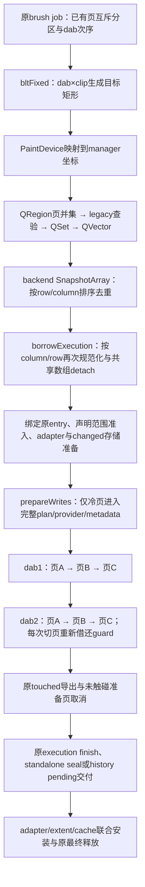

# 03c：CPU写入算法与实施蓝图

本篇落实[92 §16.144](../92_br1_m6_m8_execution_baseline.md#cpu-write-blueprint)的结构设计，接续S02/S03、OP1/OP9、S06/S07及V01。状态与领取顺序只由92维护。产品基准`2f22452e2dc76dca3e60c6231783534f44716ce4`；设计时外层父`c21d9896b`。**§1–§10保留实施前蓝图及条件估价，§11记录完整候选的实施实测与回退裁决：2420→152兑现，整笔收益未确认，不能将这项数量优化当成主差距的解。**

**当前后继方案与收益预测改读 [03d：按实测成本修订的蓝图](03d_cpu_cost_calibrated_blueprint.md)**：默认fill粒度已有因果校准，投影冷准备—交付仍需证明合法删量。下文§1–§10中的“首个实施责任”“下一”“预测”均属于原设计检查点，不恢复已回退候选，不使用旧2.258倍/55.7%分母指导新批次。

本篇的“理想”指保持当前正确性、预算、读者、失败和释放合同的可构造实现，不是删掉新合同后复刻upstream。原设计确定的首个实施责任是：**在原CPU operation内，一次形成目标范围，按页稳定消费固定源片段，保留一次全范围准备及原交付/取消边界。** 它改变访问顺序和重复表达，不改变何时创建业务版本、何时显示、何时提交。通用provider记录压平和跨operation合并尚不能作为确定收益方案。

## 1. 先纠正边界：哪些已有实现是正确的

上一轮“session27→1而76代际不变”的解释需要收紧：该计数说明本用例未减少页工作，**不能证明持久session里的暖页仍重建provider**。当前源码和既有反例测试都表明暖复用已经存在。

| 当前行为 | 源码/已有证据 | 本方案裁决 |
|---|---|---|
| 同一段内已有pending不重建backing | `prepareWrites`遇`bound.page`直接跳过；`beginWriteImpl`只有`!page`才走plan/provider | 正确，保留；不得重新实现第二个pending cache |
| warm guard不进入全局结构gate | `beginWriteImpl`的bound page命中只取execution局部gate，跳过scope/owner冷路径 | 正确，不能将每次pin都称为全局store锁争用 |
| 两页重复1/10/1000次只准备两页，checkpoint后重写一页累计三页 | manager `testPageStoreHistoryMutation`与CPU/painter复用测试已有断言 | 既有正确实现；本轮只审阅，未重跑，不新增其资格 |
| 普通node已经只有一次history canonical commit | 原业务计数；匿名root clients也已合并部分commit | 正确，不能预报删除“每dab全局commit” |
| operation先准备全部冷backing，再进入callback | prepare失败通过prepared位图撤销本execution新增页，已有pending保持 | 保留原首次准备和失败边界，不以边写边分配省掉它 |
| writer reservation与驻留pin分离 | `KisCpuWriteBindingReservation`在parked时仍排斥writer/retirement，但可swap | 正确，裸指针不能跨unpin保存；不跨job保留pin |
| slot稳定、borrow排斥重叠、touched复用原entry位图 | `borrowExecution/Private::BoundEntry/markTouched` | 正确，无第二页权威或touched哈希表 |
| canonical与tile adapter在原manager gate内共同交付 | `PreparedTileUpdates`与`completeAdapter` | 必须保留的可见性边界，不能简单删掉adapter安装 |
| readiness与retirement的完成条件不同 | provider ready在初始化/adoption后完成；retirement预备ticket留到实际终结 | 两项事实都必要，两个ticket不能当作无条件可删对象 |

现有普通模式与persistent在这个固定replay中同为76代际，仍需按真实操作的首次触页、checkpoint和复写位置解释。既有数据没有逐operation页访问序列，不能直接推出`Σ不同页数=76`或`2420→76`。

## 2. 当前不良路径：复杂度在哪被放大

### 2.1 一次普通操作的真实流程



`bltFixedImpl`目前以dab为外层、clip为内层，`applyDevice`再以64×64边界分割。对多个dab共同覆盖A/B/C的operation，访问序列可能是`A,B,C,A,B,C,…`。BoundedCursor只持当前页guard，所以每次转换都付：release execution gate → binding unpin → exposure/counter更新 → 新页范围查验/entry查找 → execution gate → binding pin/必要materialize → exposure/counter更新。pixel kernel本身不需要这些跨页往返。

这不是所有访问都浪费：连续命中同一页时当前cursor已经复用guard。真正变量是**页序列的连续段数R**，不是dab数、fragment数或不同generation数。一个页上的100个dab可能只需一次body pin；100个dab反复访问四页则可能需要400次。

### 2.2 已确认问题、条件问题与必要代价

| 编号 | 当前点 | 判定与理想表达 | 可删除量的边界 |
|---|---|---|---|
| W1 | QRegion→QSet→QVector→SnapshotArray→borrow副本 | 同一几何事实重复表达；native范围只规范化一次，其余consumer只读借用 | 每个非空native operation可删一份QSet、一份values导出及一份借用时数组detach；实际allocator次数仍需量测 |
| W2 | backend按row/column，borrow按column/row；非const局部range-for触发detach | 明确实现不一致；按原execution的`surface,column,row`统一，消费者const遍历 | 原root样本11/19范围异序只是实例，不代表所有范围都二次排序 |
| W3 | cursor `targets.contains`线性查验后，`beginWrite`又对BoundEntry二分查验 | 同一声明范围校验重复；保留原execution唯一检查 | 删前置contains及cursor对targets的第二借用；越界仍失败并poison，不删权限校验 |
| W4 | 固定源片段按dab交错页，保护反复归还/获取 | 对已证明页间独立的内部合成，稳定按目标页分组 | body pin从R降到P；R=P时为零收益。单页pin上限保持1 |
| W5 | 每个新代际的provider/metadata/budget/completion协议 | 成本高但不能整体判错；必须先区分真正首次写和重复代际 | 本确定方案`Δgeneration=Δcopy=Δticket=0`，不预支其它层收益 |
| W6 | readiness与长寿命retirement共享completion source | 可构造的寿命干扰：长pending阻止成功前缀压缩；见§7 | 结构模型成立，真实驻留/时间尚未测，列为独立条件设计 |
| W7 | 每operation派生tile/index交付，history checkpoint另有累计delta导出 | 有合法中间可见性/extent/兼容consumer；不能凭名字认定重复 | 本方案保持原交付；要减少次数，必须另证reader/失败/dirty边界 |
| W8 | 根projection余36条clear→composite | 共享原merge有潜力，但未证独立失败和读者边界 | 0.335ms是条件准备预算，不是本蓝图收益或无条件下一项 |

## 3. 理想流程：一次准备，稳定按页消费，原边界交付

### 3.1 适用域与输入契约

首个consumer为当前默认brush的**固定不可变源multi-dab合成**，复用已有`addDabJobs→bltFixed`链。已有分区保证同阶段每个manager页属于一个job；一个job仍可包含多页。确定的首版覆盖无wrap、无selection、稳定offset/manager映射的该路径；基线RGBA8 Buildup/OVER在此范围内。其它格式/composite逐项用原像素测试扩展，不仅根据op字符串推定未知实现可重排。

页间独立性来自现有并行固定源compositor契约：源只读，目标不同页不互读，各像素按原dab次序合成。不能把本方案套到任意`applyPixelOperation` callback、smudge、self-copy、会访问其它目标页的kernel或有跨调用状态依赖的第三方操作。跨页副作用若存在，原并行分区本身也需审查；它不是可忽略的正确性假设。

源/参数/manager选择沿既有job、PaintDevice strategy和WriteContext保活及复验。镜像阶段仍由原SEQUENTIAL屏障串接。第一次实现不改原patch大小128–512、job数量、操作边界、显示频率、checkpoint或默认persistent策略。

### 3.2 算法与等价证明

定义一个**绘图片段**为当前`applyDevice`最终交给原kernel的同一矩形，附原输入序号和源dab引用索引。它只描述几何及只读输入，不持页权限、指针、budget或事务。

```text
输入：按原顺序排列的固定源项、原clips、稳定映射
prepare：
  从原有序矩形映射coverage，形成唯一目标页范围；(column,row)规范化一次
  借用原execution、原range admission
  在原prepareAdapter hook内：
    按原dab→clip→tile边界枚举片段；保留重复clip的执行次数
    统计每页片段数及原序列页切换段数R，实际收费offset容量
    若R>P，预留完整片段容量并稳定填充（计数→前缀和→填充）
    完成原adapter/changed存储准备
  prepareWrites全部冷页；暖pending沿既有分支直接复用

execute：
  for page in 原canonical范围：
    for fragment in 该页的原序片段：
      原cursor.moveTo(fragment起点)       // 首次获取，页内继续命中
      从原dab重设opacity/average/flow及原source rowStride
      调用同一个kernel、同一矩形、同一源偏移与目标rowStride
    离开该页后才归还guard                // 同时最多一页

complete：
  清掉最后guard；原finishPreparedWrites导出touched/取消未触碰准备
  原execution finish；原standalone或history终结/交付
  原manager gate共同安装canonical/adapter；原失败和最终free
```

对任一目标像素x，其所属物理页唯一。稳定分组只交换不同页的片段，所有覆盖x的`(dab序号,clip序号)`相对顺序不变。因此不可交换的alpha-over等合成也保持每像素输入序列。进一步要求**每个kernel矩形保持原样**，不是只比较最终覆盖并集；这样不改变SIMD分块、边缘lane、隐藏RGB和浮点运算分组。`ParameterInfo::setOpacityAndAverage`在原multi-dab路径每次设置，新的片段执行也从对应dab重设；不能把`lastOpacity`误当跨页可变累计状态。

对于overlap clips，准入范围可以去重，绘图片段不能去重：原来同一像素画两次，目标仍画两次。仅用QRegion合并绘图输入会改变结果。wrap会让不同画布矩形映射到同一页，还涉及首周期/重复源顺序；首版保留原路径，不凭无wrap证明扩张。

### 3.3 复杂度与新增成本

设`T`为原dab×clip求交检查次数（含空交集），`F`为原kernel片段数，`P`为本operation不同目标页数，`R`为原页访问连续段数，`C`为冷准备页数。当前访问层近似为`O(F + R·P + R·logP)`加R次保护借还；`R·P`来自targets.contains，二分来自原BoundEntry查找。

目标保留F个kernel片段，将权限查找/保护借还降为`O(P·logP)`和P次；在原coverage已形成之后，geometry准备采用唯一canonical范围、两次片段枚举和稳定计数分组，普通二分定位时为`O(T + P·logP + F·logP)`，额外存储`O(F+P)`。原QRegion求并、准入、adapter与真正冷准备成本须另列，不能被此访问层公式省略。不采用`for page: scan every dab/clip`的笛卡尔重扫，以免大patch把查验变为`P×dab×clip`。

必要冷页preflight仍取得并归还C次pin，目标总pin为`C+P`；没有新pin缓存，也不把全部P页同时pin在内存。若`R=P`，重排没有访问收益，编译器应在计数后跳过额外分组buffer/填充；仍须记录这部分计数成本，不能声称零开销。低重用输入必须作为性能负控制。

片段buffer不是免费：按实际`sizeof(Fragment)`、capacity与控制块收费，峰值为**单个并发operation**实际F/P及并存量，不能把全stroke累计片段数当单次峰值。相反，也不能用单job容量掩盖四workers并存峰值。只读源引用借用原job，不能每片段复制完整dab或创建一个shared owner。

## 4. 实现形态：留在现有责任，不增加第二套状态

### 4.1 最窄内部桥

现有不透明callback没有声明“每个输入项可按页独立执行”，backend不能猜测或自动重排它。目标在**原PaintDevice pixel-operation桥内增加私有的有序矩形输入形态**，由固定源内部caller提供`矩形 + 原输入序号`及片段执行callback。示意数据为`OrderedRect{QRect area; sourceOrdinal}`、`Fragment{QRect originalKernelRect; sourceOrdinal}`；实际类型放image私有实现头或既有私有类内，不导出PageKey/claim/provider/budget到painter、paintop或UI。

public `KisPainter::bltFixed`、`KisPaintDevice::applyPixelOperation`及cursor ABI保持原义。只允许一个私有有序操作桥；原generic callback仍通过同一个backend `runCpuMutationOperation`执行原顺序。若需要私有friend/内部overload，必须对应这里唯一的fixed consumer，并同批替换其旧targetRects多次转换和不透明dab-major lambda；不为mirror、selection、async分别新增一组同义接口。

计划几何由PaintDevice原映射/manager适配层形成，在已有operation准备阶段完成收费；PageStore只消费目标范围和同步body，不知道brush/preset/KoCompositeOp。片段解释仍在原painter内部，按源序号取对应dab。计划是短寿命只读输入，没有commit/cancel能力；原history或standalone batch是唯一生命周期owner。

### 4.2 一次canonical范围

manager从原pageCoverage的互斥rects直接枚举唯一页，建立一次`KisPageSnapshotArray`并按execution既有`column,row`顺序规范化。同一范围用于legacy查验、原admission、adapter准备和execution绑定。boundingRect只负责extent容量，不扩张实际写页集合。

backend原QVector兼容入口如仍有consumer，保留一个边界normalizer；内部已canonical调用直接借用。公开`borrowExecution`对任意/重复输入的原集合语义保持，通过共同normalizer进入同一私有绑定实现；内部canonical借用不得再排序/detach。不能新增由上层布尔值自称“已授权”的捷径。

`KisPageMutationExecution::BoundEntry`继续是稳定entry的唯一执行绑定。cursor删除`targets.contains`及对第二份targets的引用，直接调用原`execution.beginWrite(key)`完成有界查验；无需再新增fast-index token API。未知页仍返回失败，cursor仍保持首次失败后poison语义。

已有touched/prepared位图继续决定changed和未触碰准备回滚，不另建per-page changed map。PreparedTileUpdates仍需要实际missing wrapper和联合安装凭据；该存储不是几何重复，保留。所有readiness、writer、old-reader、预算和retirement约束沿原路径。

### 4.3 五种实际路径的状态与成本

| 场景 | 理想执行 | 保留的成本/结果 |
|---|---|---|
| 同段首次写页 | 原plan/source/before与预算→provider初始化/COW→原登记→parked reservation→页内片段 | 1个必要代际、1次冷preflight pin、1次body pin；合同未变 |
| 同段暖复写 | 原BoundEntry已有page，prepareWrites跳过；页内所有片段共享一次body guard | 0新代际/新payload/新completion；1次body pin，非驻留仍materialize |
| 必要checkpoint后再写 | 原seal完整cut与retained view，新段首触页按原selector重新prepare | 不能延长旧mutable版本；必要COW/handoff照付 |
| 任意callback/跨页依赖/未覆盖映射 | 原有序callback，保留单operation失败与原cursor | 不承诺R→P；仍可受益于共同范围去重 |
| 完成/取消/晚释放 | 先释放guard与execution，再原seal/commit/abort；retained reader和物理free按原账本 | 不因source ready就提前完成retirement或退还容量 |

## 5. 失败、并发和内存边界

| 失败/交接点 | 已发生事实 | 唯一承接者与目标行为 | 不允许的变化 |
|---|---|---|---|
| 源/映射/范围不合法 | 尚未取得写权限 | 原PaintDevice/painter返回失败；原sink接续 | 把不合法输入当完成 |
| 计划/片段/adapter容量拒绝 | 像素0进入 | 在原operation准备段返回；若已借execution，正常finish保留先前history pending | 在body中首次分配计划，再误取消已有成功工作 |
| 第二页冷backing拒绝 | 本execution有部分prepared，未曝光像素 | 原prepared位图撤销本次新增页，原owner可按既有入口重试 | 写第一页后才发现第二页准备不了；重放整个dab |
| body期间pin/materialize失败 | 本操作可能已有私有写入 | 原standalone cancel或history失败/整笔取消；Changed不得当成功交付 | 在失败后fallback到legacy重做 |
| 原kernel发生异常/返回失败 | 部分私有页可能被写 | 原失败sink/transaction终结，保留callback失败保证 | 把本方案称为M7 commit-only |
| 空operation/未触页成功callback | 可能预备过页 | 原cancel untouched；不安装假changed | 仅因geometry出现就标记touched |
| 重叠页的并行borrow | 已有原range claim | 原admission拒绝/原顺序；不同页允许并行 | 用全stroke全局mutex换取简单 |
| checkpoint/abort与活跃guard竞争 | 原execution仍链接、guard仍曝光 | 原quiescent验证拒绝或由原业务barrier接续 | 跨job保留指针或checkpoint覆盖仍写页 |
| seal成功、capture输出拒绝 | overlay已接受，不能重复写 | 原session保留已完成事实，仅重试capture | 把capture失败当作重新执行像素 |
| adapter安装/终结后晚reader | canonical与派生表示已接受，旧reader仍持exact版 | 原retention/retirement持续收费到实际free | 为获得计数下降提前归费 |

按页分组可能延长**单页**连续pin时间：100个dab在一页执行期间保护不会中途归还。因此除了峰值仍为1，还必须测单页最长pin时间、swap/pressure等待、取消检查点和其它页推进。内存硬界不变不能替代进度证明。若原contract确实要求更短pin窗口，应在原安全点释放再取，公式成为`C+P+E`，E为必要让出次数；不得为了维持理想计数取消必要让出。

## 6. 改动与同步删除矩阵

下面B1–B12是本蓝图内的迁移行，不是新项目阶段。每行实施后同时补“实际+/-、删除检查、数量实测、行为证据”，没有完成证据前状态为“设计”。

| 行 | 文件/真实consumer | 原责任→目标 | 同批删除/保留 | 关键验收 |
|---|---|---|---|---|
| B1 | `kis_painter_blt_multi_fixed.cpp` / `bltFixedImpl` | 固定源输入序→私有有序矩形/源索引，片段调用原applyDevice | 该适用路径旧dab-major opaque lambda及重复devices/target投影；generic/scalar入口保留原语义 | 原kernel矩形、每像素序、opacity/flow/隐藏RGB |
| B2 | `kis_painter_p.h`、`kis_paint_device.{h,cc}` | 原pixel语义桥消费私有ordered形态 | public净增长0；一条私有桥，实际friend/overload列账；不向上暴露PageStore类型 | 关闭/不适用路径无专属分组扫描或分配 |
| B3 | `kis_paint_device_strategies.h` / mapper与原manager选择 | 一次映射、按原tile边界生成同形片段 | 替换适用路径的重复localRects投影；原wrap/selection路径暂留且不授重排资格 | offset负值/极值、目标变化、无错页或重叠遗漏 |
| B4 | `kis_tiled_data_manager.{h,cc}` / writePageStoreOperation | 由同一原operation持只读计划/canonical范围、实际容量 | native的QSet与values导出删除；extent、legacy gate、PreparedTileUpdates保留 | 全准备失败像素0进入；实际内存/费用/并存峰值 |
| B5 | `KisTiledDataManagerPageStoreBackend.{h,cpp}` / writeOperation、runCpuMutationOperation | 同一执行框架消费canonical输入与分组body | native二次建SnapshotArray/异序排序删除；兼容输入只在边界规范化 | 单operation/scope/原publish次数不增 |
| B6 | `KisPageStore.{h,cpp}` / borrowExecution | 任意输入normalizer与内部canonical借用共用绑定责任 | 非const共享数组detach、内部二次规范化删除；稳定slots、claim、prepared/touched保留 | 重复/乱序公开输入、foreign、并发重叠、存储拒绝 |
| B7 | backend BoundedCursor | 原execution检查范围，按页稳定消费 | targets.contains及第二targets引用删除；失败poison与single guard保留 | 越界失败不可被后续合法move掩盖；最大pin1 |
| B8 | manager PreparedTileUpdates/changed/原gate | 使用原实际delta，联合交付 | 保留必要wrapper/extent/安装，不把一次索引查找全称重复 | old tile cache、before、dirty、undo/redo |
| B9 | `kis_brushop.cpp`、page partition、strategy/freehand | 原job/patch/mirror/update/owner行为作为控制 | 主目标为生产0改动；若需要改这些来制造收益，重开设计审查 | job/更新/accepted dab/镜像屏障不变 |
| B10 | CPU binding/provider/ledger/metadata/retirement | 首写与真实释放合同作为保留项 | B1–B8不改此层的identity/ticket/COW政策；§7另案 | Δgeneration/copy/ticket=0，资源/终点不回退 |
| B11 | painter/manager/CPU mutation/真实DabRenderingQueue tests | 原oracle扩充为分组前后对照及失败/资源验证 | 更新适用路径数量断言；不放宽像素、预算、pin峰值等正确性断言 | 见§9有限矩阵 |
| B12 | matched freehand与原性能/结构工具 | 归因数量→未插桩收益→正式原控制 | 新诊断仅用于计数，不将插桩时延冒称收益；同步刷新真实caller图 | parent/upstream身份、全部失败、Fresh/H4与M6分开 |

先完成B1–B8的一个完整consumer及同批删除，再按B11/B12验收。不得先增加一个未被生产使用的通用plan框架，下一轮再迁caller；不得只修sort/const就将本蓝图报完成。出现新第二owner、job、queue、全局cache或writer状态表时，应回到原owner设计，而非继续叠加恢复政策。

## 7. 通用资源协议的深入判断：一个确定模型与尚未批准的改写

readiness和retirement两种事实本身正确。当前Tiles3在同一个`completionSource`交错分配`ready1, retire1, ready2, retire2,…`；ready在同步初始化/adoption后成功，retire可能存活很久。Registry每次`allocatePending`都分配一个`CompletionInterval`，成功前缀可以无节点表示，非连续终态只能保留区间。早期retire Pending因此阻挡后续ready成功前缀。

在**N次串行准备全部成功、尚无retirement完成**的构造场景：共享source保留`2N−1`个interval节点（N个Pending、N−1个被阻隔的Succeeded）；按“同步工作完成”和“物理退役完成”分两个source后，前者可推进成功前缀，后者保留N个Pending，少`N−1`个live interval节点，另增一个source记录。N=256时为511→256个interval；**两边仍各执行512次节点分配**，区别是释放时点和后续树规模，不是分配次数减半。

这说明更深的理想表达应使**同一顺序域内的事件具有相容寿命**，而非盲删completion。split source可继续使用原Registry和原ticket三元身份，不新增ledger；readiness与retirement各自仍只完成一次。source初始化须在物理adoption前完整成功，不能第一次注册成功、第二次拒绝后泄漏或每retry继续注册：若实施，优先在Registry原注册责任内预备两个节点后一次接受，原单source API也消费同一注册实现，避免provider新增半配置状态机。

但是该方案**尚不进入B1–B8必改列表**：真实业务同时保留多少interval、释放是否已及时压缩、额外source常驻成本、前台提前free及共享CPU provider影响均未量测。下一证据是原source的ready/retire时间线、live interval峰值及树操作独占成本；必须清点`KisCpuResidentProviderState::configure`、Tiles3 allocate/immutable alias/adoptInitialTile、transfer、`beginRetirement/revokeBindings`及其它共享该State的provider。失败/Cancelled旧ticket状态不能因压缩而消失，foreign registry/domain及溢出校验保持。

把同步Ready直接改成常量ticket，或删除Pending预备再在adoption后可失败地创建成功凭据，都不成立；后者会制造“物理已接受但无法交付证明”的新失败状态。OwnerLedger、physical slot、residency observer、budget record也不能仅因键相同便合成一个owner，它们的锁域和最后释放条件不同。共同冷协议仍是后续主残差，但当前证据不支持一次大规模压平。

## 8. 数量预测与收益预测

### 8.1 可验收的确定公式

对适用operation o定义`P_o`为实际触及不同页数，`R_o`为旧访问序列连续段数，`C_o`为冷preflight pin，`E_o`为已证必要的中途让出。则：

```text
当前pin = Σ(C_o + R_o)
目标pin = Σ(C_o + P_o + E_o)
可删pin对 = Σ(R_o − P_o − E_o)
Δgeneration = Δpayload-copy = Δdefault-init = Δcompletion-ticket = 0
Δjob = Δoperation = Δcheckpoint = Δcanonical-commit = 0
目标最大同时pin = 1
```

若实测代际/复制下降或operation变多，首先调查是否改变了语义工作量，不能直接当超额收益。generic不适用路径单列，其pin保持原量。目标范围正常化的确定删除对应B4–B7；输出、wrapper和真实cold元数据保留。

### 8.2 对本用例的条件估算

设计时已观测node为76代际、2420次pin。**只有在逐operation trace证明全部相关pin属于适用路径、冷pin=76、各operation实际页并集合计=76且E=0时**，才可预测`2420→76+76=152`，少2268对，减少93.72%。设计检查点没有该完整trace；后继§11已核定并兑现此删量，但时间收益未确认。76代际本身仍不能替代该证明。

本模型用原CP0冻结边际stroke中位数8.103ms作敏感度示例，非当前candidate测量。设每删一对pin及随附校验/锁/引用的独占成本为c微秒，新增geometry/存储成本A毫秒，关键路径映射系数α：`Δwall≈α·(2268c/1000−A)`。各项仍待实测，区间不是概率置信区间。

| 假设c | 删除2268对的毛CPU预算 | A=0.1ms、α=1时示例stroke降幅 | A=0.1ms、α=0.5时 |
|---:|---:|---:|---:|
| 0.10µs | 0.2268ms | 1.56% | 0.78% |
| 0.25µs | 0.5670ms | 5.76% | 2.88% |
| 0.50µs | 1.1340ms | 12.76% | 6.38% |
| 1.00µs | 2.2680ms | 26.76% | 13.38% |

在A=0.1ms条件下，盈亏平衡c约0.044µs；要取得示例10%整笔降幅，α=1要求c约0.401µs，α=0.5要求约0.759µs。这是决定是否值得实施和如何解释结果的价格门槛，不是预报“必快10%”。实际共享调度、竞争、cache和后台变化可能使简单α模型失效，最终看未插桩对照。

从2.258倍回到upstream量级需要减少当前约55.7%的stroke时间；本蓝图不承诺覆盖全部缺口。首次写、必要复制、预算、metadata、projection和退役仍在。不能把507/524管理协议样本全折成可删除时间。

### 8.3 必须保留的反例

- 同一页100个dab：当前body pin已为1，目标仍1，分组没有收益。
- 四页100个dab交错：构造模型body pin400→4，kernel矩形与每像素次序不变；这不是实际replay计数。
- 16个互不重叠页：16→16，新增计划可能变慢，必须作为负控制。
- 持续压力需要中途让出：E可能大于0，pin少于理论目标不等于可以阻塞swap/取消。
- source或kernel存在跨页依赖：稳定按页重排不合法，保留原路径。

## 9. 实施时的有限追踪与验证矩阵

| 检查 | 必须覆盖/产出 | 失败时裁决 |
|---|---|---|
| 前置真实序列 | 固定本用例普通/opt-in各两过程，顺序普通/opt-in/opt-in/普通；记录operation、P/R/F/C、真实cut、类型与必要E，不使用其时延作性能结果 | 序列与76/2420不符就修正预测，不继续沿152猜改 |
| 独立像素oracle | 原dab顺序逐像素oracle；同一页/四页反复、稀疏、不重叠、overlap clips、负坐标/offset、边缘64、opacity/flow/通道 | 整数逐字节、隐藏RGB保持；不放宽已有浮点合同来通过 |
| 实际compositor | 默认OVER及当前受影响factory、原Alpha Darken/COPY等适用测试；检查每次kernel矩形和source参数 | 未通过的组合在首字节前保持原路径，不能半操作fallback |
| 原准备与失败 | 第二页真实budget拒绝、计划容量拒绝、既有pending保留、未触页取消、越界后合法move仍失败 | 任一失败改变scope/owner结果即停止性能测量 |
| 并发/读者/终点 | disjoint jobs、同页冲突、old/exact view、checkpoint、abort、晚guard、undo/redo、最终free | 不用像素单线程通过替代所有权证明 |
| 资源/进度 | 1页最大pin、最长pin区间、pressure/swap/cancel、实际plan容量及4workers并存 | 不能用新增长期pin或调高预算换取时间 |
| 真实数量 | parent/candidate/candidate/parent四过程，类型/P/R/F/C/E与像素/更新固定，逐行核对§8全部Δ | 减少工作量、丢dab/更新或新增operation均不得算收益 |
| 未插桩业务 | 沿前包两架各24对/12顺序块的有限协议，预先固定端点/失败/退出；所有样本保留；低重用负控制另定固定协议 | pointwise95%跨零即收益未确认，不追加到通过；次端点回退保留 |
| 原控制/正式状态 | 触及共同准备/范围就跑相关CPU/manager/painter/producer及原结构、预算/释放；Fresh/H4沿原40对协议；独立M6资格另核 | 新局部通过不替代校准2/20、metadata分母、完整CP0/M6 |

前置序列诊断应使用已有test friend/证据fixture或仅诊断构建，避免在每个span计时扰动热路径。计数证据和真实lib身份冻结；每对进程而非内部循环是性能统计单位。收益必须扣新增计划生成、容量、释放和必要E的代价；不能只比较优化body。

## 10. 实施前设计置信度（冻结检查点）

本轮已核对现有暖复用、范围、guard、checkpoint、provider、completion压缩、adapter与终结链；[模型](../evidence/br1_cpu_write_blueprint_20261007/model.py)对30组输入核验原kernel矩形及独立逐像素顺序，反转同像素dab次序的负控制确实失败。它证明调度模型，不等于实际Krita像素/资源/性能测试。

确定程度：稳定按页分组的等价条件、`R−P−E`删量公式、一次canonical范围和删除重复membership检查有明确源码与算法依据；76/2420映射到152只是待trace核定的条件预测。completion按寿命分source有确定构造模型，但真实峰值与速度尚不具备决策证据。provider整体压平、减少checkpoint、默认persistent启用、跨clear/composite合并均未被本篇授予实施正确性。

实施蓝图的退出条件是B1–B8完整caller迁移与同步删除、B11行为/资源、B12数量/时间比较全部完成，并解释剩余差距；该设计检查点只完成蓝图。源码身份、模型输入/输出、数量原证据与核验见[设计证据](../evidence/br1_cpu_write_blueprint_20261007/README.md)。后继实际裁决如下；M6/M7/M8仍0/3。

## 11. 完整实施后的理论/实际比较与取舍

[实施证据](../evidence/br1_cpu_write_execution_20261007/README.md)完成B1–B8、B11/B12候选，而非仅改sort/const。需要经过原transaction的私有桥保持target/mapping复验，不能直接从PaintDevice绕到manager；计划放在原range借用后、像素前的prepareAdapter hook，拒绝正常finish保住已有pending。factory内检查真实scalar/SIMD OVER32类型，第三方同名op继续原序。分组计划、原范围/权限/交付仍由原owner持有，无第二权限cache。

真实27个operation的ΣP/R/F/C为76/2344/5363/76；后置R变76、F/C不变，总pin2420→152、删除2268对。node76代际/20复制/56初始化/27操作/1canonical commit保持；root132/72/60/228pin和19projection更新保持。root commit原并发归并本来在11～13变动，不把一次观测作常量或领取删除。最大单operationF=516/P=4，计划有效容量界12416B，实际费用经原allocator持续到free；超预算拒绝、此前pending保留/重试、原pressure/swap/单pin边界通过。本用例E=0；普通/opt-in诊断各一次最长单页body pin62.750/62.625µs，不能外推压力尾界。

最终候选两架选定用例9470/0/0，覆盖原完整painter/manager/CPU mutation/DabRenderingQueue/Reference及PaintDevice其它全部方法。原memory-fragmentation stress在冻结parent和候选都因跨页worker拒绝后空指针memcpy崩溃，保留失败，未授该方法或完整PaintDevice组通过。原结构阈值不变，6工具自测通过。详细每行迁移与反例见证据矩阵。

| 比较 | 理论/数量预测 | 未插桩实测及置信范围 | 裁决 |
|---|---|---|---|
| 固定源管理重复 | R→P，C保持，2420→152 | 四过程精确兑现；核定2268对 | 算法可构造且机制成立 |
| ARM整笔stroke | 取决于未测c、A、α，未承诺百分数 | 延迟减少0.276%，pointwise95%[−2.150%,+5.859%] | 收益未确认 |
| Rosetta整笔stroke | 同上 | 1.400%[−1.495%,+2.341%] | 收益未确认 |
| R=P负控制 | body pin无可删量，计数/offset仍付费 | 四桶均跨零；ARM单页点估计慢4.599%[−7.016%,+0.333%] | 不能忽略新增计划成本，未确认改善 |
| 复杂度 | 一条真实consumer闭包，所有替代同批删除 | 生产19文件+390/−59；测试4文件+271/−27 | 有消费者不等于值得保留；当前缺少业务收益依据 |

因此保留可复验的独立本地试验提交与证据，工作分支**完整回退候选**；没有遗留仅const/sort的半包领取完整蓝图交付。现有算法等价证明仍有效，但该方案不作为当前M6主线收益或下一优先实施项；原保护、身份与最终回退验证见实施包。没有追加样本到通过。

本轮更准确的结论是：静态重复及高次数不是核心成本的证明。`α·((R−P−E)c−A)`中的数量已知，仍不能从近零净收益唯一反推出c、A、α。原208个代际及对应92复制/116初始化、同步CPU通用replica/metadata/预算/ready+retire登记、联合交付/实际退役全保留；它们是下一完整计价责任，而不是直接按数量删掉的对象。

下一实施蓝图必须以前台/后台分开的独占CPU、等待与关键依赖账为前置，覆盖真实first-touch、warm与必要cut后复写，判断同一同步CPU owner能否减少重复记录及交接。不能用禁用计账/COW/锁模拟理想，也不能直接把completion分source或provider压平列必改。先证明足够净成本和可达原owner闭包，再动产品；当前证据不足以承诺解决upstream大差距。
