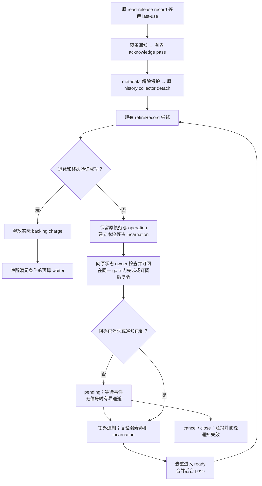

# S09：退休唤醒的代码关系与修改顺序

返回[指南目录](/Users/apple/krita_gpu/docs/vulkan_gpu_design/br1_modification_guide/README.md)。设计依据为 [92 §10.5](/Users/apple/krita_gpu/docs/vulkan_gpu_design/92_br1_m6_m8_execution_baseline.md:327)，资源边界同时服从 §10.6。本文细化 [04 的 S09](/Users/apple/krita_gpu/docs/vulkan_gpu_design/br1_modification_guide/04_reclamation_and_budgets.md:32)，不新增阶段资格。代码核对日期：2026-09-27；比较基线 `5173c807c87bb1619325249a07a8b4f4f8f09f09`，以下区分已接线的 CPU 事件/有界退避子集与完整 S09 的剩余出口。实际验证身份只在 92 §15 和所链接证据中裁决。

## 1. 从当前代码开始，不能把接口存在当成进度保证

| 当前落点 | 可确认的源码事实 | 当前边界 |
|---|---|---|
| [KisPageReadinessSubscription / Signal](/Users/apple/krita_gpu/krita/libs/image/pagestore/KisPageReadiness_p.h:18)、[实现](/Users/apple/krita_gpu/krita/libs/image/pagestore/KisPageReadiness.cpp:40) | 工作树新增可取消的一次性通知；`reset` 在 signal 锁外销毁捕获对象，`notify` 取出后执行回调 | 通知只承载调度，不授予页面权限或 owner 寿命；完整资源上界仍属 R10 |
| [CompletionRegistry::watchTerminal](/Users/apple/krita_gpu/krita/libs/image/pagestore/KisCompletionRegistry.cpp:245)、[声明](/Users/apple/krita_gpu/krita/libs/image/pagestore/KisCompletionRegistry.h:92) | 在 registry gate 内检查并订阅 Pending；已 terminal 返回 Ready，由消费者安排复验；`complete` 解锁后调用仅负责派发工作的订阅 | queue 经 ledger 原 operation 取得订阅；实际 ready 处理在既有 reclaimer 上运行，不在外层 provider gate 内重入 queue/owner |
| [binding::releaseRead / releaseWriter](/Users/apple/krita_gpu/krita/libs/image/pagestore/KisCpuResidentBinding.cpp:181) | 已接 exact identity 检查并订阅；最后 reader 或 writer 释放时派发通知，Reserved writer 仅 unpin 不通知 | Handoff 状态拒绝订阅，安装区间不引入通知；没有信号的阻碍已转入 R6 的有界延迟路径，完整预算保证仍待补齐 |
| [queue::finishAttemptLocked / schedulePassLocked](/Users/apple/krita_gpu/krita/libs/image/pagestore/KisPageRetirementQueue.cpp:340) | 已用稳定 list 节点和独立等待 incarnation；事件将对应 pending 节点 O(1) 移入 ready，后台每批最多 `WorkerBatchBudget` | 仅对允许后台退休的记录自动调度；已准入记录优先订阅事件，无订阅记录延迟复验准入/退休。完整 S10 等待者仍未完成 |
| [physicalPinDelaysDetachedRetirement](/Users/apple/krita_gpu/krita/libs/image/tests/KisPageStoreCpuMutationTest.cpp:3732) | 已改为释放后仅等后台 idle，native pin 与 generic provider lease 均验证自主清债；另测登记前释放和延迟 completion | 这些 CPU 场景不覆盖所有 provider/last-use 生命周期、压力和退出资格 |

最新冻结验证边界以 [92 §15](/Users/apple/krita_gpu/docs/vulkan_gpu_design/92_br1_m6_m8_execution_baseline.md:477) 为准。新通知源码不属于 S06 第九批的冻结身份；不能沿用其测试总数或 allocator 结论。下面 R1–R10 是完整修改要求；`watchRetirementReadiness`、`watchProviderOperation` 和 `watchCompletion` 已有生产定义与消费者，不能再按接口草案理解。事件子集的实际新增用例与完整 S09 剩余项分开记录。

## 2. 待改内容 → 具体代码段 → 必须联动的消费者

| 单元 | 主改代码段 | 要落实的行为 | 联动与交付终点 |
|---|---|---|---|
| R1：一次性订阅及取消 | [Readiness::subscribe / notify / reset](/Users/apple/krita_gpu/krita/libs/image/pagestore/KisPageReadiness.cpp:40)；[接口](/Users/apple/krita_gpu/krita/libs/image/pagestore/KisPageReadiness_p.h:18) | 仅在真实等待时创建；move/reset 恰好注销一次；已取出的回调仍需消费者复验。已补 release 构建的 ID 耗尽拒绝；继续保留这一失败关闭规则 | R2/R3 生产者、R5/R7 消费者一起验证；无 waiter 的普通 pin/unpin 不分配通知对象 |
| R2：物理阻碍的登记与解除 | [binding::releaseRead](/Users/apple/krita_gpu/krita/libs/image/pagestore/KisCpuResidentBinding.cpp:181)、[releaseWriter](/Users/apple/krita_gpu/krita/libs/image/pagestore/KisCpuResidentBinding.cpp:206)、[binding 接口](/Users/apple/krita_gpu/krita/libs/image/pagestore/KisCpuResidentBinding_p.h) | 现有 `watchRetirementReadiness` 在同一 binding gate 内核对 expected identity、reader/writer 并登记；已无阻碍返回 Ready。最后 reader、真正释放 writer 时派发一次 | 核对 [unpinReservedWrite](/Users/apple/krita_gpu/krita/libs/image/pagestore/KisCpuResidentBinding.cpp:284)：它仍保留 Reserved writer，不能当成退休就绪。联动 [finishHandoff](/Users/apple/krita_gpu/krita/libs/image/pagestore/KisCpuResidentBinding.cpp:65)、[retire / revoke](/Users/apple/krita_gpu/krita/libs/image/pagestore/KisCpuResidentBinding.cpp:324)，旧 identity 失效必须终止旧订阅，不能重新解释为新 allocation |
| R3：completion 终态通知 | [registry::complete / watchTerminal](/Users/apple/krita_gpu/krita/libs/image/pagestore/KisCompletionRegistry.cpp:213)、[sourceStatistics](/Users/apple/krita_gpu/krita/libs/image/pagestore/KisCompletionRegistry.cpp:317) | 保留 registry/source/domain/value 校验；Succeeded、Failed、Cancelled 都只通知“可复验”。最后订阅取消后，按 signal 身份和空状态删除原记录；通知表变空时释放容量。存活通知的硬字节计账仍待 R10 | 审查 [Tiles3::retire](/Users/apple/krita_gpu/krita/libs/image/pagestore/KisTiles3PageReplicaProvider.cpp:1083) 的锁内失败 completion，及其他实际生产者；消费回调不能持物理/provider 锁进入 queue/owner。终态失败不等于物理退休成功 |
| R4：operation 到 completion 的唯一映射 | [OwnerLedger::Private::operationCompletion](/Users/apple/krita_gpu/krita/libs/image/pagestore/KisPageOwnerLedger.cpp:288)、[verifyProviderOperation / releaseTerminalProviderOperation](/Users/apple/krita_gpu/krita/libs/image/pagestore/KisPageOwnerLedger.cpp:1593)、[ledger 接口](/Users/apple/krita_gpu/krita/libs/image/pagestore/KisPageOwnerLedger.h) | 在既有 ledger 上提供狭窄订阅入口；取出已保活 registry 和原 operation 的 ticket 后再登记；通知回来仍验证原 operation/replica 身份 | R5 记录沿用现有 `retirementOperation`；不能另建 completion 权威表，也不能在 Pending 时再次调用 provider `retire` |
| R5：等待原因、稳定记录与 ready 去重 | [RetirementRecord / Queue](/Users/apple/krita_gpu/krita/libs/image/pagestore/KisPageRetirementQueue_p.h:29)、[defer / finishAttemptLocked](/Users/apple/krita_gpu/krita/libs/image/pagestore/KisPageRetirementQueue.cpp:327) | 区分 physical pin、last-use、provider operation、债务准入及无信号阻碍；每次登记绑定唯一等待 incarnation。通知只定位对应记录并将 pending 移入 ready，不扫描全部历史/队列 | 已采用 queue 内稳定 list 节点及可失效的弱等待对象；事件定位不扫全表。无订阅时的失败原因细分、节点与订阅成本仍须纳入 R6/R9/R10 |
| R6：有界执行与无信号兼容重试 | [schedulePassLocked / process](/Users/apple/krita_gpu/krita/libs/image/pagestore/KisPageRetirementQueue.cpp:354)、[ReclamationExecutor](/Users/apple/krita_gpu/krita/libs/image/pagestore/KisPageStoreReclamation.cpp:62)、[调度接口](/Users/apple/krita_gpu/krita/libs/image/pagestore/KisPageStoreReclamation_p.h) | 一个 queue 合并一个已排队 pass，保留每批工作上限和跨 store 让出；无可用事件时安排可取消、有界退避的延迟维护 | 已在既有 executor 内增加惰性 deadline monitor；每 queue 一个可取消任务，1–100 ms 退避，每次最多移入 32 条。普通回收 worker 不 sleep；保留 provider 能力限制，计账与分配失败出口仍属 R10 |
| R7：通知与 owner 生命周期 | [queue 构造 / 析构](/Users/apple/krita_gpu/krita/libs/image/pagestore/KisPageRetirementQueue.cpp:40)、[Store::PrivateReleaser::cleanup](/Users/apple/krita_gpu/krita/libs/image/pagestore/KisPageStore.cpp:2672)、[lifetimeReferences](/Users/apple/krita_gpu/krita/libs/image/pagestore/KisPageStore.cpp:704) | 等待期间用可撤销的弱通知上下文；真正入队工作才持现有 owner lease。取得 lease 必须与 owner 开始销毁线性化，不能从零复活引用 | [~KisPageStore](/Users/apple/krita_gpu/krita/libs/image/pagestore/KisPageStore.cpp:2663) 已通过 [stopAutomaticWakeups](/Users/apple/krita_gpu/krita/libs/image/pagestore/KisPageRetirementQueue.cpp:513) 显式停止自动唤醒，保留已 ready 的有限工作与活跃 capability 寿命；不能假设所有 caller 先 close。禁止 queue→waiter→owner 的永久强引用环；晚回调不得触碰已销毁 queue 或 owner 其他成员 |
| R8：close、取消与重新登记 | [beginClose / cancelCloseAndSchedule / takeForClose](/Users/apple/krita_gpu/krita/libs/image/pagestore/KisPageRetirementQueue.cpp:522)、[Store::closeSession](/Users/apple/krita_gpu/krita/libs/image/pagestore/KisPageStore.cpp:2839) | close 先关闭新调度并使订阅/延迟重试失效；锁外等待正在执行的 pass。close 被活跃能力拒绝时，重新登记 pending 并复验期间发生的事件 | 已移入 `pendingShutdownReplicas` 的记录保留原 operation 与实际债务，不能被旧 queue 通知重新入队；close retry 继续消费原 operation，不重复 dispatch |
| R9：真正退休、预算归还与压力唤醒 | [retireRecord](/Users/apple/krita_gpu/krita/libs/image/pagestore/KisPageRetirementQueue.cpp:276)、[releaseRetiredBacking](/Users/apple/krita_gpu/krita/libs/image/pagestore/KisPageOwnerLedger.cpp:1360)、[budget controller](/Users/apple/krita_gpu/krita/libs/image/pagestore/KisPageWriteCoordinator.cpp:587) | 先完成现有 debt admission 和 provider 终态复验，再释放实际 charge；只有可用额度真实增加，才通知 S10 controller 的合适等待者 | 债务准入失败仍保留原分类/orphan reservation，不以收到通知为由绕过。物理释放、ledger 分类、可准入容量是三个不同判定；不能自动重放已写过字节的 callback |
| R10：预算、统计、构建与验证 | [queue snapshot](/Users/apple/krita_gpu/krita/libs/image/pagestore/KisPageRetirementQueue.cpp:585)、[registry statistics](/Users/apple/krita_gpu/krita/libs/image/pagestore/KisCompletionRegistry.cpp:317)、[image CMake](/Users/apple/krita_gpu/krita/libs/image/CMakeLists.txt:35) | waiter/信号/延迟任务的存储、数量与峰值可对账；纳入 S10 真实 allocator 及 V01 源码身份。当前 CMake 已加入 readiness 源码，实际构建/消费验证与 allocator 身份按本批证据核对 | 扩展 [CompletionRegistryTest](/Users/apple/krita_gpu/krita/libs/image/tests/KisCompletionRegistryTest.cpp)、[CpuMutationTest](/Users/apple/krita_gpu/krita/libs/image/tests/KisPageStoreCpuMutationTest.cpp)、[PhysicalClaimTest](/Users/apple/krita_gpu/krita/libs/image/tests/KisPageStorePhysicalClaimTest.cpp)，真实 queue/provider 测试不能由 signal 单测替代 |

R5 的稳定句柄只定位现有债务，不拥有第二份 replica 状态；R7 的弱上下文只保护通知交接，不另建回收 service。新增字段或容器需通过现有 layout/ownership/ratchet 检查，不先放宽上限。

## 3. 将登记、通知和退休分成三个明确边界

下图是完整目标链。CPU pin/completion 的事件复验与 R6 无信号退避已接线；局部 CPU 退休预算 waiter 已接 04b，完整共享额度与资源上界仍属 R9/R10 的剩余工作。

1. **登记不丢事件。** 状态检查与订阅必须在生产者同一 gate 内完成，或使用登记后状态序列复验。事件可能在 record 放入 pending 前到达；等待对象须记住它，安装 pending 时直接转 ready，不能覆盖为“尚未通知”。
2. **通知不是权限。** 唤醒只请求复验；执行退休时仍检查原 provider epoch、allocation generation、operation 与 last-use。身份失配不能选择当前新 allocation 代替旧债务。
3. **退出有唯一责任。** 队列取出记录、手动 `process`、close 接管、失败后重挂都先撤销旧等待身份。已经从 signal 取出的回调可晚到，必须成为无操作，不能二次减 bytes 或二次释放 reservation。

R2/R3 必须检查整个调用栈的锁。仅把回调移到 binding/registry 的局部解锁之后不够：generic release 或 provider 失败路径可能还持有外层 provider gate。当前订阅回调只取得弱寿命上下文、在引用仍非零时借用 owner 寿命，并向既有 reclaimer 派发；不进入 queue/owner gate。实际 pending→ready 和退休复验由不持生产者 gate 的 worker 执行。后续消费者不得在此派发回调中同步调用 `retireRecord`、读取页面或等待 worker。

## 4. 失败、寿命和资源责任不能模糊

| 边界 | 必须保留的责任 |
|---|---|
| 订阅存储准备失败 | 记录仍由 queue 拥有且原预算不丢；转入已具备存储的有界维护路径，或明确上报资源拒绝。不能为了登记 waiter 使原取消/清理失去可执行性 |
| completion 先完成、登记后到 | 合法 terminal 触发一次复验；非法/foreign ticket 拒绝。终态失败不释放成功退休所需的证明 |
| 取消订阅与通知交错 | signal 的 `reset` 只保证移除尚未取出的 callback；消费者 incarnation 处理已取出者。不能将 `reset` 当同步等待回调结束 |
| callback 与 owner 析构竞争 | 弱通知上下文与销毁交接同门；临时 owner lease 仅能在引用仍非零时取得，成功后入队沿现有 release 回收；失败则丢弃旧通知 |
| 无信号 provider / residency 变化 / 债务准入失败 | 保留等待原因并有界退避；只在允许的执行上下文重试。后台能力与预算资格不能由通知绕过 |
| close 被活跃能力拒绝 | 恢复 queue 调度并重新检查 pending 条件；close 窗口内的释放不能永久丢失 |
| queue idle、debt drained、session closed | idle 只说明即时 pass 未执行；drained 还要求记录/bytes/active operation 清空；closed 还包含其他能力和 shutdown 债务。三个状态分别验证 |

当前 `watchTerminal` 的最后订阅取消后，原 registry 会复验 signal 身份与空状态，移除仍 Pending ticket 的空通知记录；该 source 的通知表变空时一并释放槽容量，详见 §9。此过程不将 ticket 标为完成，也不归还未退休的 payload 债务。`readinessWaiters/signals/capacity` 分别报告订阅、记录与槽容量，仍不是元数据字节预算；有消费者的表、terminal 状态索引及其他通知节点继续由 R10 计账。R1 的 ID 上界仍采用运行时拒绝。

## 5. 按消费者验收，不只测通知原语

以下是完整验收要求；已执行的 CPU 子集以 §1 和 92 §15 的证据为准，未执行项不得由相似原语测试代替。

| 场景 | 现有验证入口 | 必须观察到的结果 |
|---|---|---|
| Pending 后订阅、terminal 后订阅；成功/失败/取消；foreign ticket；move/reset；回调重入查询 | [CompletionRegistryTest](/Users/apple/krita_gpu/krita/libs/image/tests/KisCompletionRegistryTest.cpp) | 一次通知或明确拒绝；不在 registry 锁内执行消费者；无遗留有效 waiter，存储统计真实 |
| 最后 reader、Active writer、Reserved writer 归还；只 unpin Reserved；retag/revoke/旧 identity | [PhysicalClaimTest](/Users/apple/krita_gpu/krita/libs/image/tests/KisPageStorePhysicalClaimTest.cpp) | 只有实际状态变化触发复验；无新的写权限、误退休或新 allocation 被旧事件触碰 |
| 最后 pin 在登记前/后释放，之后无编辑、不手动 process | [CpuMutationTest 的 pin fixture](/Users/apple/krita_gpu/krita/libs/image/tests/KisPageStoreCpuMutationTest.cpp:3732) | 自主退休，pending bytes 和实际 provider/ledger 资源收敛；以条件和有界超时等待，避免依赖固定 sleep |
| provider retire 已返回、completion 延迟；终态失败；事件早于 pending 安装 | [CpuMutationTest 的 TestProvider](/Users/apple/krita_gpu/krita/libs/image/tests/KisPageStoreCpuMutationTest.cpp:58) | 同一有效 operation 未终态时不重复 dispatch；成功才释放实际 charge；早到事件不丢 |
| 重复通知、旧 incarnation 晚到、手动 process 与自动 pass 交错 | [CpuMutationTest](/Users/apple/krita_gpu/krita/libs/image/tests/KisPageStoreCpuMutationTest.cpp) | 同一记录不同时处于两个容器；只计一次终结；每 pass 保持原工作上限 |
| close 拒绝再恢复、close 接管、外部 owner 直接析构、通知已经派发 | [CpuMutationTest](/Users/apple/krita_gpu/krita/libs/image/tests/KisPageStoreCpuMutationTest.cpp) | 无 UAF/强引用环/从零复活；旧通知不能复活 shutdown 记录；取消后存储可收敛 |
| 无信号与瞬时拒绝、tiny budget、两个 store、长期未完成 ticket | [CpuMutationTest](/Users/apple/krita_gpu/krita/libs/image/tests/KisPageStoreCpuMutationTest.cpp)及 S10 场景 | 无忙等、无单 worker sleep、无失控 waiter/timer 数；背景进度与前台预算均守界 |

**Stroke 优先的性能边界：** 无 waiter 的暖读、短 pin/unpin 和现有生产安装区间继续做实际 allocator 验证；新增信号只在冷等待路径建立。存在 waiter 时记录通知数量、合并 pass、维护工作量与资源高水位，再测真实 stroke 控制桶。零分配不等于无延迟回退；退休 microbenchmark 不能替代 stroke 的首 dab、持续绘画、pen-up 和 drain。

## 6. 修改批次与其他指南的关系

1. **R1–R4：生产者及原 operation 绑定。** 构建新增源码并覆盖注册/释放双顺序；核对所有外层锁，先取得通知原语的有限资格。
2. **R5–R8：唯一 queue 消费和退出。** 接上真实失败记录、去重调度、弱寿命、close/重挂；用真实 store 证明无新编辑仍有进度。
3. **R6/R9/R10：兼容进度与预算闭环。** 当前已有无信号退避、能力限制及终态归还；继续补 S10 waiter、准入原因、元数据上界与故障出口，再评估完整 S09。CPU 子集通过不能替代完整资格。

S06.3 的 [L10 idle 引用迁移](/Users/apple/krita_gpu/docs/vulkan_gpu_design/br1_modification_guide/03b_legacy_cache_migration.md)和 S02 的长寿命 scope 消费这里的资源进度保证；在其前置条件通过前，继续保留原 pin/COW 保护。S01 的取消重试可接预算可用事件，但不得把 signal 变成自动重放失败绘画的入口。阶段进度与实际证据仅回写 92，V01 另行验证结构、源码/二进制身份及 stroke 不劣性。

## 7. 事件与延迟重试接线后的边界

[prepareWait](/Users/apple/krita_gpu/krita/libs/image/pagestore/KisPageRetirementQueue.cpp:128) 优先订阅原退休 operation、last-use completion 和 exact binding。订阅前阻碍已消失时只允许一次立即复验；持续无信号拒绝转入同一 queue 的 `m_retryPending`。背景执行必须由 provider 能力允许；原分类仍须成功转 Debt，orphan 仍须原 reservation 覆盖真实 footprint，才调用 provider。重试不能补造缺失额度或把非法 handle 当新 allocation。

[scheduleRetryLocked](/Users/apple/krita_gpu/krita/libs/image/pagestore/KisPageRetirementQueue.cpp:228) 为 queue 合并一个可取消 deadline，从 1 ms 逐步退避到 100 ms；每次从重试分区头部最多移出 32 条，失败追加到尾部，沿原 worker 执行。等待事件、等待退避、ready 和 active batch 只是同一记录 owner 的互斥分区，不复制债务表。已有订阅的 Pending operation 不走轮询 timer，也不重复调用 retire。

[dispatchReady](/Users/apple/krita_gpu/krita/libs/image/pagestore/KisPageRetirementQueue.cpp:68) 在 producer 上先原子记录早到事件，再经通知 gate 取得非零 owner lease 并计入通知工作；不进入 queue/owner gate。close 在同一通知 gate 关闭新派发，取消 deadline 和等待身份后再等即时工作，因此晚通知不能跨过 idle 观察重新入队。close 被活跃能力拒绝后恢复通知准入与 pending 复验；已接管记录仍由 shutdown 路径独占。休眠 deadline 不持 owner 强引用。facade 析构调用 `stopAutomaticWakeups` 关闭后续事件/退避准入，防止慢批次与已到期通知连续保活 owner；已 ready 的有限工作可继续完成，不等待 provider，也不使活跃 capability 的原字节失效。

`waitForIdle` 只等即时 pass 和已准入通知，允许未来 deadline 与真实债务仍存在；`isDrained` 还检查所有记录分区、deadline incarnation、active 和 bytes。统计分别报告 `scheduledReclamationJobs` 与 `scheduledRetirementRetries`，不能用空 worker 队列证明预算已归还。

完整 S09 仍须补：last-use 冷失败与 metadata 释放拒绝后的完整恢复、S10 共享预算与前台等待链、waiter/list/deadline 的实际元数据计账和冷分配故障。已成功 ReleaseRead 的 CPU 上游 last-use 正常终态链已按 §10 接线。局部 CPU 退休等待者已接 04b，取消后的空 completion 存储已按 §9 回收；这两项不能再作为未接线接口重建。原分类准入有自动重试，但不能据此宣称所有资源拒绝都有可恢复的额度；更多压力/退出交错及真实 stroke 性能仍需证据。该子集不能单独授权移除 legacy idle 强引用或启用无限长 mutable scope。

## 8. R6 本批改动与验证的逐段对应

| 改动单元 | 实际代码落点 | 验证及继续保持的约束 |
|---|---|---|
| 延迟任务的唯一句柄与取消 | [Delay::reset](/Users/apple/krita_gpu/krita/libs/image/pagestore/KisPageStoreReclamation.cpp:219)；[Executor::scheduleAfter](/Users/apple/krita_gpu/krita/libs/image/pagestore/KisPageStoreReclamation.cpp:78) | [deadline 取消与 worker 空闲](/Users/apple/krita_gpu/krita/libs/image/tests/KisPageStoreCpuMutationTest.cpp:3531)：move/reset 释放实际排队捕获；远期 deadline 不占回收 worker；monitor 仅派发 |
| 有界队列、退避与跨 store 让出 | [scheduleRetryLocked](/Users/apple/krita_gpu/krita/libs/image/pagestore/KisPageRetirementQueue.cpp:228)；[dispatchReady](/Users/apple/krita_gpu/krita/libs/image/pagestore/KisPageRetirementQueue.cpp:68) | [129 页 × 四种 BPP](/Users/apple/krita_gpu/krita/libs/image/tests/KisPageStoreCpuMutationTest.cpp:3561)：持续拒绝到退避上限，另一 store 可完成；解除拒绝后无新编辑/手动 process 自动清空 |
| 无信号 pin 的实际物理复验 | [prepareWait](/Users/apple/krita_gpu/krita/libs/image/pagestore/KisPageRetirementQueue.cpp:128) | [无可订阅 binding 的 pin](/Users/apple/krita_gpu/krita/libs/image/tests/KisPageStoreCpuMutationTest.cpp:3597)：pin 保持时留债；释放后通过 timer 复验退休 |
| 原 reservation 与成功终结 | [retireRecord](/Users/apple/krita_gpu/krita/libs/image/pagestore/KisPageRetirementQueue.cpp:276) | [rejectedAllocationRetirementIsNotLost](/Users/apple/krita_gpu/krita/libs/image/tests/KisPageStoreCpuMutationTest.cpp:3142)：orphan 的即时/延迟终态均自动归还，Pending 不重派发；成功时在 worker owner lease 释放前销毁 reservation |
| close 通知准入与 deadline 寿命 | [beginClose / cancelCloseAndSchedule](/Users/apple/krita_gpu/krita/libs/image/pagestore/KisPageRetirementQueue.cpp:522) | [retry close/lifetime](/Users/apple/krita_gpu/krita/libs/image/tests/KisPageStoreCpuMutationTest.cpp:3615)：close 拒绝恢复、shutdown 接管清 timer、直接析构无强环，另用阻塞中的实际退休批次和已到期通知证明析构后不再续排重试；原事件寿命用例继续保留 |
| 无后台能力的兼容路径 | [process](/Users/apple/krita_gpu/krita/libs/image/pagestore/KisPageRetirementQueue.cpp:436) | [explicit-only provider](/Users/apple/krita_gpu/krita/libs/image/tests/KisPageStoreCpuMutationTest.cpp:3254)：0/负/小预算的准确尝试上限、部分归还与债务保留；不靠禁止生产 timer 来满足自动路径的旧假设 |

实际源码/二进制身份、矩阵与 allocator 证据见 [本批证据](/Users/apple/krita_gpu/docs/vulkan_gpu_design/evidence/br1_s09_retirement_retry_20260927/README.md)。该表是函数与验收的映射；阶段结论只由 92 §15 给出。

R9 的局部预算准入已接 [04b / W1–W8](/Users/apple/krita_gpu/docs/vulkan_gpu_design/br1_modification_guide/04b_budget_waiter_implementation_map.md)：controller 先授予实际 reservation，再由 ledger 和原 queue 复验/消费；原分类不再只依靠 timer。上文“完整 S10 等待者”仍包含未接的前台 job、共享额度、元数据收费与故障/压力出口，不因本批 CPU 退休接线而关闭。

## 9. R3 取消清理的代码与验收对应

该改动只清理原 registry 内无消费者的通知存储。逻辑 completion 状态、原 provider operation、物理退休与预算债务各自保持原 owner；取消订阅不能替代任何一个终态。

| 改动内容 | 原 owner 内的代码段 | 联动与验证终点 |
|---|---|---|
| 最后订阅取消 | [Subscription::reset](/Users/apple/krita_gpu/krita/libs/image/pagestore/KisPageReadiness.cpp:40) → [Private::releaseEmptyReadiness](/Users/apple/krita_gpu/krita/libs/image/pagestore/KisCompletionRegistry.cpp:138) | 先释放 signal gate，再取 registry gate；持原 state 防止地址 ABA，在 registry→signal 次序下重新核对 exact state 和空状态。新订阅先到则保留，替换 signal 不误删。[取消/登记三种次序](/Users/apple/krita_gpu/krita/libs/image/tests/KisCompletionRegistryTest.cpp:229)各 128 次。 |
| 空表容量和捕获寿命 | [releaseEmptyReadiness](/Users/apple/krita_gpu/krita/libs/image/pagestore/KisCompletionRegistry.cpp:138)、[complete](/Users/apple/krita_gpu/krita/libs/image/pagestore/KisCompletionRegistry.cpp:213) | 将 signal/空表移到 registry 锁外释放；terminal 清理空表在外部 callback 前完成，reset 释放空 state 在捕获析构前完成。[256 个 Pending tickets](/Users/apple/krita_gpu/krita/libs/image/tests/KisCompletionRegistryTest.cpp:130)、[257 项集中创建后清空](/Users/apple/krita_gpu/krita/libs/image/tests/KisCompletionRegistryTest.cpp:160)与[阻塞回调](/Users/apple/krita_gpu/krita/libs/image/tests/KisCompletionRegistryTest.cpp:285)覆盖计数/槽容量归零。 |
| 原 registry 寿命 | [watchTerminal](/Users/apple/krita_gpu/krita/libs/image/pagestore/KisCompletionRegistry.cpp:245) 中弱引用原 `Private`，仅清理期间临时保活 | 不捕获 facade/store/provider 强引用；registry 显式禁拷贝。[析构与取消竞争](/Users/apple/krita_gpu/krita/libs/image/tests/KisCompletionRegistryTest.cpp:263)对最后订阅、尚有 sibling 两种情况各执行 128 次；存活句柄失效，不建立新 authority。 |
| 冷登记失败的捕获终结 | [subscribeRetained](/Users/apple/krita_gpu/krita/libs/image/pagestore/KisPageReadiness.cpp:80)；[watchTerminal](/Users/apple/krita_gpu/krita/libs/image/pagestore/KisCompletionRegistry.cpp:245) 的准备局部变量和 bad_alloc 出口 | 先准备真实 callback 节点再 noexcept 移入捕获；失败时先释放 registry gate，再取消已准备订阅/析构捕获，空查找表容量也移到锁外。registry/signal 的实际分配失败已按 §14 验证；binding 等其他冷 caller、必要容量准入及自动接续仍未取得完整资格。 |
| 退出仍保存 Pending operation | 原 queue `takeForClose` 消费同一个 move-only subscription；[closePollsDetachedRetirement](/Users/apple/krita_gpu/krita/libs/image/tests/KisPageStoreCpuMutationTest.cpp:3695) | close 接管后 ticket 仍 Pending，但通知 waiters/signals/capacity 为零；之后完成同一 ticket，close 继续轮询原 operation 并归还真实 payload，不重新 dispatch retire。 |
| 冷统计与所有权审计 | [sourceStatistics](/Users/apple/krita_gpu/krita/libs/image/pagestore/KisCompletionRegistry.cpp:317)；原 [ownership 清单](/Users/apple/krita_gpu/krita/build-tools/ci-scripts/pagestore-audit/state-ownership.json) | `BR1-OWN-COMPLETION` 仍归原 registry。waiters/signals/capacity 分别是订阅数、通知记录数与查找槽数；capacity 不是 bytes，有存活记录时保留正常表容量，terminal coverage 不因通知取消而删除。 |

两架构修复前反例及本批身份见 [取消清理证据](/Users/apple/krita_gpu/docs/vulkan_gpu_design/evidence/br1_s09_subscription_cleanup_20260927/README.md)。不得用 `readinessWaiters == 0` 单独推导全部通知资源归零，也不能用空表回收代替存活通知的硬预算。下一批按 R9/R10 继续 last-use 的冷失败/压力恢复、共享额度、实际元数据收费与完整退出；不重建订阅服务或第二份 completion 表。

## 10. 上游 last-use 到实际退休的代码与验收对应

已成功 `ReleaseRead` 的原 `ActiveReadRecord` 继续持有 exact replica、lease ID 和 last-use ticket，直到 metadata 保护解除；删除原 `m_pendingLastUses` 复制记录的 vector，仅保留冷统计数量。通知只将该记录挂入 ready 链，既不复制物理债务，也不把完成 ticket 当写权限。无 last-use 的普通读释放和 native 暖读不创建通知上下文。

| 修改内容 | 主改段与联动终点 | 验收关系与仍待修改的边界 |
|---|---|---|
| 沿原读记录准备订阅 | [finishReleasedReadLocked / armLastUseLocked](/Users/apple/krita_gpu/krita/libs/image/pagestore/KisPageReadCoordinator.cpp:544)；[冷记录声明](/Users/apple/krita_gpu/krita/libs/image/pagestore/KisPageReadCoordinator_p.h) | provider release 后成功安装 metadata last-use 才登记；terminal 先到同步复验，后到订阅原 registry。[1/4/8/16 BPP × 三种终态 × 三种次序](/Users/apple/krita_gpu/krita/libs/image/tests/KisPageStoreCpuMutationTest.cpp:1537)覆盖 release 前、provider release 中、登记后完成；普通路径无外部 acknowledge。 |
| 生产者与后台职责 | [notifyLastUse](/Users/apple/krita_gpu/krita/libs/image/pagestore/KisPageReadCoordinator.cpp:113) → [dispatchLastUses](/Users/apple/krita_gpu/krita/libs/image/pagestore/KisPageReadCoordinator.cpp:132) → [processLastUses](/Users/apple/krita_gpu/krita/libs/image/pagestore/KisPageReadCoordinator.cpp:164) | 生产者仅锁通知 gate、链接既有记录并 notify 预备 wake；monitor 在非零引用上取得临时 owner lease，合并一个原 worker 作业。每 pass 最多 32 条，不扫描全 lease map；这不证明 metadata 内部销毁字节或时间上限。 |
| 共享完成 ticket 的收敛 | [acknowledgeRecordLocked](/Users/apple/krita_gpu/krita/libs/image/pagestore/KisPageReadCoordinator.cpp:656)；[metadata::queryLastUsePending](/Users/apple/krita_gpu/krita/libs/image/pagestore/KisPageMetadataCoordinator.cpp:3530) | metadata 一次清除同 ticket 的全部保护；其他已成功 ReleaseRead 的原记录以 exact metadata 查询确认保护已消失。查询不导出整页、不新增 ack 权威、不授予写权限。[129 条独立/共享 ticket](/Users/apple/krita_gpu/krita/libs/image/tests/KisPageStoreCpuMutationTest.cpp:1580)验证无假债务、至少 5 个有界 pass 和实际 payload 收敛。 |
| Close、析构、idle | [beginCloseLocked / cancelCloseLocked](/Users/apple/krita_gpu/krita/libs/image/pagestore/KisPageReadCoordinator.cpp:212)；[Store::closeSession](/Users/apple/krita_gpu/krita/libs/image/pagestore/KisPageStore.cpp:2839)；[waitForRetirementIdle](/Users/apple/krita_gpu/krita/libs/image/pagestore/KisPageStore.cpp:2820) | 先关闭准入/注销订阅，再锁外等待即时作业；close 主动轮询原 terminal 记录，拒绝后重挂。facade 析构停止新唤醒，休眠通知不保活 Store。idle 先等 last-use pass，再等 history/retirement；未完成 ticket 仍是实际债务。[排队事件的 close / 直接析构](/Users/apple/krita_gpu/krita/libs/image/tests/KisPageStoreCpuMutationTest.cpp:1623)及原 close 拒绝用例验证。 |
| 显式兼容消费者 | [acknowledgeLastUseLocked](/Users/apple/krita_gpu/krita/libs/image/pagestore/KisPageReadCoordinator.cpp:620)；[lastUseManualCompatibility](/Users/apple/krita_gpu/krita/libs/image/tests/KisPageStoreCpuMutationTest.cpp:1658) | 无后台能力时继续显式 acknowledge/close；重复无匹配仍返回 false。允许后台时，显式调用可能落后于自动消费，caller 应核对原保护已解除，不能要求两条路径都“首次成功”。 |
| 失败与统计 | [snapshotLocked](/Users/apple/krita_gpu/krita/libs/image/pagestore/KisPageReadCoordinator.cpp:843)；[session statistics](/Users/apple/krita_gpu/krita/libs/image/pagestore/KisPageStoreTypes.h) | 区分 active read leases 与 pending last uses；报告 pass、单 pass 数量和 dispatch failures。订阅/dispatch 准备失败保留原记录和 metadata 保护，close/显式 acknowledge 可继续；尚无完整冷故障恢复资格。 |

下一批必须接续三处，不能把本批正常终态链当成完整资源闭环：① 单次 metadata 终结的新增容量拒绝已按 §12 移除，身份/revision 等拒绝仍保留原 release-retry 记录；先按 §14 核对生产 gate，再为真正可达的可恢复拒绝建立接续，不将 reference 层 claim 交错直接当作生产重试前提；② cold subscription/dispatch 准备失败或 metadata acknowledge 拒绝后，尚无完整有界压力恢复保证；③ ready 链、ActiveReadRecord、订阅和 wake 的存活容量须纳入实际元数据硬预算，并验证多 store 公平性及真实 stroke 成本。不能通过忽略拒绝、清空计数或轮询整个 lease map 掩盖这些责任。

修复前双架构反例、8 文件增量及最终源码身份见 [last-use 证据](/Users/apple/krita_gpu/docs/vulkan_gpu_design/evidence/br1_s09_last_use_20260927/README.md)。只有 92 §15 更新阶段资格；本批仍不授权 M7 或长 stroke scope 的默认启用。

## 11. 待改：读释放与 last-use 确认的压力终结

本节细化 **S09 / R9–R10 与 S10**，依据 92 §2、§10.5–10.6 的终结与必要资源契约；单次终结、原 slot 消费及局部空块归还已按 §12 接线并取得本批 CPU 证据；外层空块释放已按 §13 接线；完整 T3 边界资格、T4 整轮时间/字节预算和 T5/T6 仍须继续。目标是让已准入的读保护可以利用已有存储解除，减少绘画期间的 metadata 复制及资源压力下的清理阻塞。这里讨论当前 CPU 读记录；GPU provider 的完成与资源资格仍须按其真实消费者单独证明。

### 11.1 已确认的代码关系

修复前，`ReadCoordinator::releaseReadLocked` 经 `MetadataCoordinator::applyOwner/applyOwnerSequence` 进入 `applyProjectedSequence`；后者复制相关版本、执行状态机、准备 arena/index 并安装，`acknowledgeLastUse` 也走同一投影路径。§12 已将单次 ReleaseRead 和已验证 acknowledge 接到 `applyReadProtection`，复用原节点；mixed sequence 仍使用原子投影安装。读记录、通知和 worker 的容量责任另由 T5/T6 承担。

必须区分两个原因：`MetadataShard::canMutate` 因 publication claim 或 revision 上界拒绝，是现有正确性边界；临时容器、arena 增长及安装准备，是可优化的存储成本。仅有 prepared publication 候选并不等于已取得 claim：读保护变化仍须推进 revision，使旧候选失效。不能为了保证释放成功而绕过 claim 或允许 revision 回绕。claim 的 reference 层排斥契约与当前生产 gate 下的实际可达交错分别审查，后者见 §14。

### 11.2 按代码段拆分的修改单元

以下 T1–T6 是本节内部子项，不新增阶段或状态 owner。**主改**表示要改变实现；**联动**表示必须一起审查和验证，不要求整份文件重写。

| 单元 / 待改内容 | 主改代码段 | 联动责任与目标行为 | 验收入口 / 判据 |
|---|---|---|---|
| T1：单个读保护终结不再复制安装版本 | [applyOwner / applyOwnerSequence](/Users/apple/krita_gpu/krita/libs/image/pagestore/KisPageMetadataCoordinator.cpp:3191)、[acknowledgeLastUse](/Users/apple/krita_gpu/krita/libs/image/pagestore/KisPageMetadataCoordinator.cpp:3503) | 在构造单元素 transition 容器前识别适用操作，交同一 metadata owner 的局部终结实现；多操作 sequence 保留原子性，不能逐项原地执行后遇错留下前半段。未验证的 acknowledge 仍不得经普通 owner 入口提交 | [ReferenceTest 原候选失效用例](/Users/apple/krita_gpu/krita/libs/image/tests/KisPageStoreReferenceTest.cpp:1697)联动扩展；与 reference 对照 accepted/rejected、保护集合和 revision，不仅比较返回值 |
| T2：复用原 overflow slot | [ShardRecordStore](/Users/apple/krita_gpu/krita/libs/image/pagestore/KisPageMetadataCoordinator.cpp:658)、[findReplicaSlot](/Users/apple/krita_gpu/krita/libs/image/pagestore/KisPageMetadataCoordinator.cpp:1240)、[arena::erase](/Users/apple/krita_gpu/krita/libs/image/pagestore/KisPageMetadataArena_p.h:448) | exact version/replica/lease 验证完毕后，无 last-use 的释放摘除原 ReadLease 节点；有 last-use 时将该节点转换为 PendingLastUse。已验证 acknowledge 摘除该 exact replica 上同 ticket 的全部节点。先完成必要校验，再修改链，保留 slot generation/隔离规则 | 以 [StateMachine 的 ReleaseRead / AcknowledgeLastUse](/Users/apple/krita_gpu/krita/libs/image/pagestore/KisPageStateMachine.cpp:223)为语义对照；补错误 lease/replica、重复 ticket、ABA、重复释放及批处理失败无半修改 |
| T3：原 claim、revision 和统计继续生效 | [MetadataShard::canMutate](/Users/apple/krita_gpu/krita/libs/image/pagestore/KisPageMetadataCoordinator.cpp:1713)、[applyProjectedSequence](/Users/apple/krita_gpu/krita/libs/image/pagestore/KisPageMetadataCoordinator.cpp:3269) | 局部终结在原 shard gate 中复验 page/claim/revision；成功后推进 revision，旧 publication 候选必须失效。局部计数按实际工作更新；没有安装版本时不能继续虚增 version installs。不得修改不相关 writer、handoff 或历史记录 | 原 prepared-candidate 测试继续通过；新增实际 claim 先到/释放先到、revision 耗尽、无关历史保护不变；区分因语义拒绝与因容量拒绝 |
| T4：slot 归还与物理 block 释放分开 | [arena::takeEmptyBlocks](/Users/apple/krita_gpu/krita/libs/image/pagestore/KisPageMetadataArena_p.h:485)、[MetadataArenas::takeEmptyBlocks](/Users/apple/krita_gpu/krita/libs/image/pagestore/KisPageMetadataCoordinator.cpp:210) | 摘链后 slot 可立即复用；空 block 的枚举、转移和实际析构另由有界维护承担。延期期间仍计入 reserved/live 实际存储；释放工作及转移容器也必须有已准入存储，不能把无界扫描、大析构或新分配放回读释放 gate | [metadataArenaBudgetTracksAllocator](/Users/apple/krita_gpu/krita/libs/image/tests/KisPageStoreCpuMutationTest.cpp:6491)扩展到释放/排空；分别核对 used slots、实际驻留 bytes、延期队列及最终归还，不以 used=0 推导物理 bytes=0 |
| T5：解除剩余阻碍后继续原清理记录 | [finishReleasedReadLocked](/Users/apple/krita_gpu/krita/libs/image/pagestore/KisPageReadCoordinator.cpp:544)、[retryReleasedReadsLocked](/Users/apple/krita_gpu/krita/libs/image/pagestore/KisPageReadCoordinator.cpp:592)、[acknowledgeRecordLocked](/Users/apple/krita_gpu/krita/libs/image/pagestore/KisPageReadCoordinator.cpp:656)、[processLastUses](/Users/apple/krita_gpu/krita/libs/image/pagestore/KisPageReadCoordinator.cpp:164) | 先按 §14 核对真实 caller/gate：当前三个生产 metadata 安装入口与 generic 读终结共用 store owner gate，不能由 reference 层 claim 反例直接推导生产轮询需求。真实可恢复拒绝仍须保留原 release-retry/ready 记录并接续；不可恢复身份/revision 故障须给出明确终点。可恢复拒绝沿原记录订阅阻碍解除或使用已有有界调度机制，去重并让出 worker。解除 metadata 保护后仍接 history→retirement→真实额度归还 | [lastUseBoundedBurst](/Users/apple/krita_gpu/krita/libs/image/tests/KisPageStoreCpuMutationTest.cpp:1580)、[lastUseCloseAndLifetime](/Users/apple/krita_gpu/krita/libs/image/tests/KisPageStoreCpuMutationTest.cpp:1623)补拒绝后解除且无新编辑的场景；无全 lease map 轮询、无忙等、无假 drained |
| T6：必要通知/派发资源随准入准备 | [armLastUseLocked](/Users/apple/krita_gpu/krita/libs/image/pagestore/KisPageReadCoordinator.cpp:89)、[dispatchLastUses](/Users/apple/krita_gpu/krita/libs/image/pagestore/KisPageReadCoordinator.cpp:132)、[processLastUses](/Users/apple/krita_gpu/krita/libs/image/pagestore/KisPageReadCoordinator.cpp:164) | 在允许产生这类终结义务前，按 provider 能力预备必要 record/subscription/wake/派发存储；ticket 可在 release 时才确定，容量责任须先确定。接 [S10 / W1–W8](/Users/apple/krita_gpu/docs/vulkan_gpu_design/br1_modification_guide/04b_budget_waiter_implementation_map.md)，原 record 继续持有义务。将 pass 内固定上限的临时容器改为固定或预备存储，并继续检查 history 下游的分配；close 注销和拒绝后重挂都消费原准备 | 对首次 context、订阅节点、worker 派发、pass 临时存储分别注入失败；债务不丢失、恢复不依赖新编辑，必要容量受硬预算约束；不以 `maximumPerPass=32` 代替字节上限 |

### 11.3 实施顺序与完成边界

1. **T1–T3 为一个语义单元。** 先补 reference 与实际拒绝反例，再引入局部终结。首版只覆盖能保持单次原子性的操作；mixed sequence 继续走原协议。共享 ticket 的 `removeAll` 语义保持，但不能因此声称节点访问恒定 O(1)；单 replica 保护数量的准入上界或后续有界算法需另有证明。
2. **T4 同批确定存储去向，T5 闭合剩余进度。** 不允许“为避免分配永久缓存空块”，也不允许“保护已清除”时丢失后续历史回收义务。先核对 §14 的实际 gate；真正可达的阻碍解除与退出两种先后次序均须有终点。
3. **T6 与 S10 联合验收。** 单个 metadata 操作不分配，只能授予该测量区间的资格；通知、派发、history 和 provider 退休全链的失败恢复、实际收费仍须各自闭合。
4. **性能先测读释放对 stroke 的干扰。** 对单次 release、有/无 last-use、共享 ticket 批量确认分别做实际 allocator 探针及分配正控制，记录节点访问、锁持有和释放字节；再测真实 stroke 首 dab、持续绘画、pen-up 及 Fresh 控制桶。已有 install/warm-read 探针不覆盖这些新边界，不能直接复用为零分配证据。

每批交付记录使用 [NEXT_EDITS 的统一格式](/Users/apple/krita_gpu/docs/vulkan_gpu_design/br1_modification_guide/NEXT_EDITS.md)，填写 S09/S10、T 子项、实际函数、未迁移 caller、失败终点及新源码证据；仅在 92 更新实现和阶段资格。

## 12. 单次 metadata 终结的代码与证据对应

本节对应 [S09 第五批证据](/Users/apple/krita_gpu/docs/vulkan_gpu_design/evidence/br1_s09_metadata_terminal_20260927/README.md)，不授予完整 T1–T6、S09/S10 或 M6–M8 资格。

| 实际改动 | 代码落点 | 验证与继续保留的边界 |
|---|---|---|
| 直接单次 owner 终结 | [applyReadProtection](/Users/apple/krita_gpu/krita/libs/image/pagestore/KisPageMetadataCoordinator.cpp:3215) | 原 claim/revision gate 保持，成功使旧候选失效；普通 owner 仍拒绝 unverified acknowledge；mixed sequence 仍原子拒绝。[满容量反例/修复](/Users/apple/krita_gpu/krita/libs/image/tests/KisPageStoreReferenceTest.cpp:3218)每架构 18 项。实际 claim 交错及 revision 耗尽的完整定向资格尚未新增。 |
| 原节点复用、顺序及精确移除 | [finishReadProtection](/Users/apple/krita_gpu/krita/libs/image/pagestore/KisPageMetadataCoordinator.cpp:1263) | last-use 转换将原节点移到链尾，ack 清除 exact replica 的同 ticket 全部节点；无关 writer/history 不变。[reference 对照](/Users/apple/krita_gpu/krita/libs/image/tests/KisPageStoreReferenceTest.cpp:3298)每架构 48 项，包含有效/陈旧身份、Pending ticket、重复及混合批次。 |
| 局部空块转移与实际 charge | [arena::erase](/Users/apple/krita_gpu/krita/libs/image/pagestore/KisPageMetadataArena_p.h:448)、[ReleasedBlocks::clear](/Users/apple/krita_gpu/krita/libs/image/pagestore/KisPageMetadataArena_p.h:229) | 只检查触及块，保留 reservation 已准入容量；迭代销毁，payload 释放后再释放预算。[四块回到一块与 reservation/ABA](/Users/apple/krita_gpu/krita/libs/image/tests/KisPageStoreReferenceTest.cpp:3388)。第五批当时只证明 shard 外析构；当前外层空块释放接线见 §13，整轮时间/字节预算仍待 T4。 |
| 首次线程识别无 TLS 分配 | [schedule / worker identity](/Users/apple/krita_gpu/krita/libs/image/pagestore/KisPageStoreReclamation.cpp:288) | 既有单 worker 在执行及捕获析构期间标记，结束清除；不增加第二 executor。[worker/前台/drain 后再执行](/Users/apple/krita_gpu/krita/libs/image/tests/KisPageStoreReferenceTest.cpp:3556)与新线程 allocator 探针验证；保留原 32 B 分配失败日志。 |

最终双架构各 42 个新线程终结区间 allocations/bytes 为零，实际释放块数分别为 10；五组既有探针的原区间仍零分配/释放，同库身份一致。节点 visits、slot reuses/releases、局部 transition 分开计数；版本投影/安装计数不再虚增。零分配不代表恒定时间：单次共享 ticket 的 removeAll 仍与保护节点数相关，外层 gate、整轮析构字节/时间、T5 拒绝接续及 T6 必要准入继续是待改项。

## 13. 外层 owner gate 之外的空块释放：代码与剩余修改责任

本节落实 T4 的实际存储去向及 owner 生命周期部分；对应 [S09 第六批证据](/Users/apple/krita_gpu/docs/vulkan_gpu_design/evidence/br1_s09_outer_cleanup_20260927/README.md)。原 slot/metadata 是唯一权威；新增的 [KisPageMetadataReadCleanup](/Users/apple/krita_gpu/krita/libs/image/pagestore/KisPageMetadataCoordinator_p.h:90) 仅携带已摘离的空块与原 charge，不另建 cleanup 队列、版本账本或 executor。

| 修改责任 | 已改代码段 | 必须一起保持的终点与验收 |
|---|---|---|
| 空块无分配拼接 | [ReleasedBlocks::append](/Users/apple/krita_gpu/krita/libs/image/pagestore/KisPageMetadataArena_p.h:215) | 使用原块的 intrusive 链和 tail；O(1) 转移，迭代析构。块在 carrier 内仍实际驻留。 |
| 原预算责任随 payload 转移 | [applyReadProtection](/Users/apple/krita_gpu/krita/libs/image/pagestore/KisPageMetadataCoordinator.cpp:3215)、[KisPageMetadataReadCleanup::clear](/Users/apple/krita_gpu/krita/libs/image/pagestore/KisPageMetadataCoordinator.cpp:3183) | 在原 shard gate 中摘离；charge 仍 live，物理 free 后才归还。不同 metadata owner 的 carrier 在修改前拒绝；move/reset/destructor 只结算一次。 |
| 外层 owner 活动责任 | [retainLocked / finish](/Users/apple/krita_gpu/krita/libs/image/pagestore/KisPageReadCoordinator.cpp:26)、[finishUnlocked](/Users/apple/krita_gpu/krita/libs/image/pagestore/KisPageReadCoordinator.cpp:45) | 首次接收块时在原 owner 下增加既有 activeProviderCalls；锁外 free/归还 charge 后，再取原 owner 锁减计数。作用域必须先于外层 locker 构造、不得逃逸调用者寿命。 |
| release / cancel / resolve 失败 | [releaseReadLocked](/Users/apple/krita_gpu/krita/libs/image/pagestore/KisPageReadCoordinator.cpp:576)、[Store::release](/Users/apple/krita_gpu/krita/libs/image/pagestore/KisPageStore.cpp:3877)、[Store::cancel](/Users/apple/krita_gpu/krita/libs/image/pagestore/KisPageStore.cpp:3849) | acquire 的取消重试、resolve 失败取消和 release 重试都传同一 scope；清理不改变原失败/重试记录。 |
| 显式及后台完成 | [acknowledgeRecordLocked](/Users/apple/krita_gpu/krita/libs/image/pagestore/KisPageReadCoordinator.cpp:656)、[processLastUses](/Users/apple/krita_gpu/krita/libs/image/pagestore/KisPageReadCoordinator.cpp:164) | 共享 ticket 仍由原 metadata 解除保护；后台 scope 在 owner 解锁后完成，先于 jobScheduled=false、idle 通知及 owner lifetime 释放；bad_alloc 退出也经此终点。 |
| close 自身清理 | [closeSession](/Users/apple/krita_gpu/krita/libs/image/pagestore/KisPageStore.cpp:2839) | retries/已完成 ticket 可形成 cleanup；必须先 finishUnlocked，再统计 outstanding capabilities，避免被自己的清理计数拒绝。其他正在清理的调用仍保留活动计数。 |
| abort 的 prepared request | [preparePublicationAbort](/Users/apple/krita_gpu/krita/libs/image/pagestore/KisPageStore.cpp:368)、[abortLocked](/Users/apple/krita_gpu/krita/libs/image/pagestore/KisPagePublicationCoordinator.cpp:1305) | 从公开 abort 传入同一作用域，经过原 PrepareAbort callback 到 cancelPreparedRequestsLocked；中途拒绝也保留已摘块的唯一清理终点，不在事务预检中临时释放 owner gate。 |
| 预算与路径验证 | [deferred carrier 矩阵](/Users/apple/krita_gpu/krita/libs/image/tests/KisPageStoreReferenceTest.cpp:3455)、[七条业务终结路径](/Users/apple/krita_gpu/krita/libs/image/tests/KisPageStoreCpuMutationTest.cpp:1692) | 8 个 release/ack、单/多 shard、clear/destructor 用例验证跨 owner 拒绝及 move 覆盖；7 个实际 release/cancel/resolve 失败/显式 ack/自动 ack/close/abort 用例验证实际容量归还、旧像素不变和最终排空。 |

实测边界：双架构各 42 个 carrier 转移区间 allocation/bytes/free 全零；随后 clear 的 42 个区间 allocation/bytes 全零，各实际 free 10 块。公开 acknowledge 的探针按实际 metadata cleanup 调用栈拦截 free，暂停期间另一线程可读 sessionStats/backingUsage，活动计数为 1、原预算仍 live；解除暂停后可以 idle/close。尺寸相同的确认列表扩容会干扰单纯按 malloc size 的筛选，早期探针结果及修正均保留，不将其当作空块释放的独立反例。

**下一批仍须修改：**

- T4：单个共享 ticket 的节点扫描/摘除及本次同步 scope 的总 free 字节/时间尚无上界；显式确认/close 的临时列表和其他大对象析构也未全部迁移。32 条原 read record 的 worker 上限不等于 block/byte/time 上限。本批只移走空 arena block 的外层锁内 free，没有授予整体低延迟资格。
- T5：保留原 release-retry / last-use record 的拒绝后接续，按 §14 核对真实阻碍，补齐事件先后、无新编辑与退出两种次序；不能以 scope 结束替代保护/历史/退休债务清空。
- T6 / S10：必要订阅与派发存储预备、原 budget owner 的硬计账及故障 continuation 仍要闭合；本批没有用新队列承诺未来进度。

未新增 Fresh 2% 回退、真实 stroke、GPU/Vulkan、TSAN 或 BR1-PERF 资格；M6/M7/M8 与完整目标仍开放。

## 14. 先核实生产拒绝前提，再闭合 completion 存储故障

本批对应 S09 / T5–T6 和 M1–M5 完成链的基础约束，实际代码与故障证据见 [S09 第七批](/Users/apple/krita_gpu/docs/vulkan_gpu_design/evidence/br1_s09_completion_atomicity_20260928/README.md)。本节修正设计前提，不新增 retry 队列或第二个完成状态 owner。

### 当前安装 gate 的核对

- commit/restore 在准备结束后重新取得 store owner gate，才调用 `KisPreparedMutationCommit::tryInstall`；其同步 epoch callback 安装 metadata。
- overlay 的 native seal 与 generic publish 在 `tryInstallLocked` 前已重新取得同一个 owner gate。
- recoverable write 在取得 physical claim 与 `installRecoverableWrite` 之间不释放 owner gate；metadata claim 只存在于同步安装函数内部。
- generic release、cancel、acknowledge 和后台 last-use 同样取得这个 owner gate。当前调用链未提供“publication claim 尚未释放，同时进入 generic 读 metadata 终结”的生产交错。reference 层可以独立并发调用 metadata，但那不足以授权生产层再建轮询清理队列。

对应源段与哈希保存在 [gate 核对记录](/Users/apple/krita_gpu/docs/vulkan_gpu_design/evidence/br1_s09_completion_atomicity_20260928/publication-owner-gate-audit.json)。这不是完整并发/故障资格；M7/M8 若新增独立 admission 消费者，必须重新证明此条件。T5 仍保留真正可达拒绝的接续及不可恢复身份/revision 故障终点要求。

### 本批已改：终态发布与冷订阅的失败原子性

| 修改内容 | 代码段 | 验收与联动边界 |
|---|---|---|
| 发布覆盖之前准备准确结果 | [CompletionSourceState::complete](/Users/apple/krita_gpu/krita/libs/image/pagestore/KisCompletionRegistry.cpp:112)、[markTerminal](/Users/apple/krita_gpu/krita/libs/image/pagestore/KisCompletionRegistry.cpp:64) | 先验证仍为 Pending，再准备 Failed/Cancelled 记录，最后发布 prefix/range 覆盖；range 分配失败撤销新状态项。返回 false 时不得变成 Succeeded、不得通知/丢弃原 waiter；调用者可重试。 |
| 保持原 registry/source/domain/value owner | [Registry::complete](/Users/apple/krita_gpu/krita/libs/image/pagestore/KisCompletionRegistry.cpp:213)、[registerSource](/Users/apple/krita_gpu/krita/libs/image/pagestore/KisCompletionRegistry.cpp:175) | std::map / unordered_map 替换原私有容器，不复制整张表来回滚。source 登记失败不安装半成品，旧 source/ticket 保持有效。顺序 Succeeded 覆盖推进不再因空 QMap 的可写 begin 分配。 |
| 订阅插入失败保留其他 waiter | [watchTerminal](/Users/apple/krita_gpu/krita/libs/image/pagestore/KisCompletionRegistry.cpp:245)、[subscribeRetained](/Users/apple/krita_gpu/krita/libs/image/pagestore/KisPageReadiness.cpp:80) | callback node 与 readiness map 的分配拒绝可以返回 Unavailable，已有 waiter/信号仍在；失败回调 capture 在 registry/signal gate 外析构。output subscription 的既有 reset 语义保持。 |
| 取消与 notify 仍有唯一清理终点 | [subscription::reset](/Users/apple/krita_gpu/krita/libs/image/pagestore/KisPageReadiness.cpp:40)、[signal::notify](/Users/apple/krita_gpu/krita/libs/image/pagestore/KisPageReadiness.cpp:92)、[releaseEmptyReadiness](/Users/apple/krita_gpu/krita/libs/image/pagestore/KisCompletionRegistry.cpp:138) | move 出 callback 后 erase node；最后 waiter 仍按原 signal 身份重查空表。源端空 bucket storage 在 callback 前实际释放，回调在原门锁外执行；不依靠 std 容器的 initializer-list assignment 释放 buckets。 |
| 验证重复发布不会覆盖原结果 | [54 项 range/status/duplicate 组合](/Users/apple/krita_gpu/krita/libs/image/tests/KisCompletionRegistryTest.cpp:412) | prefix、isolated、extend-left、prepend-right、bridge、已有 Failed prefix 六类结构，三种终态与三种重复结果；其他 pending waiter 保持，目标只通知一次且看见准确终态。 |

真实 allocator 故障：每架构 terminal-final 覆盖 46 个区间，其中 28 次定点拒绝均保持 Pending、旧 terminal 数量和 waiter，随后成功重试；readiness-final-02 的 26 个区间/20 次拒绝保留旧订阅/source，拒绝 capture 可重入查询且只析构一次。首个及后续顺序 Succeeded 的 1,024 个新线程区间 allocation/bytes/free 全零，包含 0/257 个历史非成功结果。修复前的部分终态、遗漏通知和 Qt QHash noexcept 分配导致进程终止均保留；独立 Qt 控制确认其实际路径。

**继续修改 T6/S10：** 本批保证存储拒绝不伪造完成，并未使所有 completion 都不可失败；乱序新 range、Failed/Cancelled、冷订阅仍可能申请存储。必要 ticket/status/range、callback、wake context、dispatch 和原 record 的容量必须在允许产生终结义务之前完成准入，或由已有 producer 保留拒绝后的 continuation。尤其 `armLastUseLocked` 的 Unavailable、dispatch bad_alloc 仍不能靠本批容器更换自动恢复；provider 中未消费 complete 返回值的失败终点也要联动。完整清理字节/时间预算、全局硬计账、故障及压力资格继续开放。

完整矩阵为 17 目标 × 两架构 6,072 passed、零失败/跳过。该结果不授予 M6/M7/M8、实际 stroke 性能、Vulkan、TSAN 或 BR1-PERF 资格。

### 后续 T6 / S10：逐段修改入口与交付边界

下表是待实现内容。修改顺序沿原义务的产生、执行、终结展开；每步必须同时修改实际消费者并完成故障验证，不能仅新增预备接口。stroke 同段命中不得重复承担这些冷准备成本。

| 待改单元 | 当前代码入口 | 具体改法及不能遗漏的边界 | 最小验收 |
|---|---|---|---|
| 终态存储随 ticket 准入 | [allocatePending](/Users/apple/krita_gpu/krita/libs/image/pagestore/KisCompletionRegistry.cpp:197) → [source complete](/Users/apple/krita_gpu/krita/libs/image/pagestore/KisCompletionRegistry.cpp:112) | 在原 source 内为允许发生的乱序 range、Failed/Cancelled 记录准备实际节点；成功准入后再允许 producer 开始不可撤销工作。终态压缩后的冗余存储归还原预算。不能只 reserve hash buckets，也不能复制一份 completion ledger。 | 首次/乱序/失败/取消全路径定点分配拒绝；首字节或真实退休后无存储失败；前置拒绝不签发无终点 ticket。 |
| CPU 与 tiles3 producer 终结 | [kisTransferCpuBinding](/Users/apple/krita_gpu/krita/libs/image/pagestore/KisCpuResidentBinding.cpp:386)、[Private::allocate](/Users/apple/krita_gpu/krita/libs/image/pagestore/KisTiles3PageReplicaProvider.cpp:613)、[prepareSynchronousSource](/Users/apple/krita_gpu/krita/libs/image/pagestore/KisTiles3PageReplicaProvider.cpp:962)、[retire](/Users/apple/krita_gpu/krita/libs/image/pagestore/KisTiles3PageReplicaProvider.cpp:1083) | 联动 scope guard 和所有 complete 返回值。transfer 的忙失败、alias 的 Failed/Succeeded 和 retire 的失败分支当前有忽略返回值的调用；retire 在真实解绑后才发 Succeeded，不能把发布拒绝当成“尚未退休”重放。优先消费前一行已准入终态存储；未迁移路径必须由原 operation 保留精确的待发布结果与接续责任。 | 第二阶段失败、真实解绑后发布、同 ticket 重复完成：无永久 Pending 缺口、无重复 copy/retire、无 Ready 携带 Pending ticket；成功才归还相应预算。 |
| SSD 完成与记录发布联动 | [storeExact](/Users/apple/krita_gpu/krita/libs/image/pagestore/KisUnifiedSsdPageStore.cpp:108) | 当前检查 complete 失败并回收 swap record；改造时将必要 completion 和 records 节点存储的准备前移，保持 payload、checksum、record 与 completion 的单次成功/失败终点。保留实际 I/O 错误契约，不因容器准备将 I/O 失败改成成功。 | completion/records 准备拒绝、storeRawRecord 失败和取消：无孤立 swap record、无部分公开的 exact before；原 bytes 对账。 |
| 读请求与 lease 的必要存储 | [registerRequestLocked](/Users/apple/krita_gpu/krita/libs/image/pagestore/KisPageReadCoordinator.cpp:320)、[resolveLocked](/Users/apple/krita_gpu/krita/libs/image/pagestore/KisPageReadCoordinator.cpp:380)、[armLastUseLocked](/Users/apple/krita_gpu/krita/libs/image/pagestore/KisPageReadCoordinator.cpp:89) | request 节点已先于 AcquireRead 准备，ActiveReadRecord/lease index 与 CPU/tiles3 provider 节点已先于 pin 准备，实际改动见 §15。继续前移必要通知容量并接硬预算：last-use ticket 可在 release 时才确定，届时只绑定已准备容量并复验；取消和 close 消费同一责任。 | 每个节点/首次 context/订阅准备失败不留下无 owner 的 metadata 保护或 physical pin；release 后无需新编辑也能完成；晚 callback 与 close 两顺序安全。 |
| 派发准备与恢复 | [dispatchLastUses](/Users/apple/krita_gpu/krita/libs/image/pagestore/KisPageReadCoordinator.cpp:132) → [kisSchedulePageStoreReclamation](/Users/apple/krita_gpu/krita/libs/image/pagestore/KisPageStoreReclamation.cpp:288) | 沿既有 reclaimer 准备可复用派发能力并计账；核对 QRunnable 和 Qt 执行器内部的实际分配，预造 lambda 不等于完整准备。派发拒绝保留原 ready record，并由已有调度机制提供有界 continuation；idle 和 debt-drained 分开，停止/退出取消同一调度身份。 | 首次 worker、队列增长、派发拒绝和退出交错；无 busy loop、无全 lease map 轮询，解除压力后无新编辑也有进展。 |
| 整轮临时存储与原预算 | [processLastUses](/Users/apple/krita_gpu/krita/libs/image/pagestore/KisPageReadCoordinator.cpp:164)、[reserveImpl](/Users/apple/krita_gpu/krita/libs/image/pagestore/KisPageWriteCoordinator.cpp:587) | 32 条 pass 的 released 容器改为固定或预备存储；继续向 history/retirement 下游核对必要分配、重析构与工作上界。所有新增实际容量接原 S10 reservation/live/release 责任，现有 TileDataStore payload 不能重复收费。 | tiny metadata budget、多 store、公平让出、完整 drain；分别验证节点/bytes/time，不把记录数量或 retained Pending 当成预算和进度证明。 |

这些条目共同服务 S02 长 scope、S06.3 idle 引用迁移和 S01 压力取消；其完整验收之前，不据本批 6,072 项 CPU 矩阵开启新的阶段资格。

## 15. 读请求与 lease：先准备记录，再产生保护和 pin

本节落实 T6 的原请求/lease/provider 登记边界，是长 stroke scope 的资源前置。证据见 [S09 第八批](/Users/apple/krita_gpu/docs/vulkan_gpu_design/evidence/br1_s09_read_admission_20260928/README.md)。原 owner 保持，通知、派发与完整硬预算继续按 §14 实施。

修复前，真实 provider 返回 pin 后的首个分配点拒绝使 ActiveReadRecord 构造抛出，留下 1 个 Resolving request、0 个 active lease，调用者没有可释放 lease。反例及旧库身份已保留。

| 修改责任 | 已改代码段 | 结果及联动边界 |
|---|---|---|
| 请求节点先于 metadata 保护 | [registerRequestLocked](/Users/apple/krita_gpu/krita/libs/image/pagestore/KisPageReadCoordinator.cpp:320) | 先准备原 request index 的实际节点，再 AcquireRead；准备拒绝不取得保护，metadata 拒绝移除未发布节点。成功后才增加 requestsCreated。 |
| lease 控制块与索引先于 provider pin | [resolveLocked](/Users/apple/krita_gpu/krita/libs/image/pagestore/KisPageReadCoordinator.cpp:380)、[ActiveReadRecord](/Users/apple/krita_gpu/krita/libs/image/pagestore/KisPageReadCoordinator.cpp:258) | 预构造控制块和可转移 map node，再标记 Resolving、释放 owner gate 调 provider。准备拒绝保留 Pending；provider bad_alloc 先恢复 owner gate，再恢复 Pending。成功后在 optional 内 noexcept move access、安装原 node，才消费 request。 |
| 并发增长与索引身份 | [resolveLocked](/Users/apple/krita_gpu/krita/libs/image/pagestore/KisPageReadCoordinator.cpp:380) | request/active 索引使用 std::map；active detached node 插入不分配。provider 返回后重查原 request id，不保存跨解锁迭代器。close/cancel 不消费 Resolving；预备节点不计为已交付 lease。cold generic 查找为 O(log L)，native 暖路径仍不进入此索引；通用读/真实 stroke 性能门仍待实测。 |
| provider 登记先于物理访问 | [kisAcquireCpuBindingAccess](/Users/apple/krita_gpu/krita/libs/image/pagestore/KisCpuResidentBinding.cpp:351)、[kisReleaseCpuBindingAccess](/Users/apple/krita_gpu/krita/libs/image/pagestore/KisCpuResidentBinding.cpp:373) | CPU/tiles3 共用原 activeLeases owner，改用可拒绝分配的 unordered_map；插入记录后才 acquireAccess，拒绝 pin 或异常只撤销本次记录。读写模式、exact identity、已有 lease 和 release/revocation 语义保持。 |
| 存储异常归还门锁 | [acquireRead](/Users/apple/krita_gpu/krita/libs/image/pagestore/KisCpuResidentBinding.cpp:149) | 手动加解锁改为无分配 RAII，保留 native try 与等待区别。pinStorage 准备失败不遗留 binding gate；不等于全部 swap/SSD 内部故障已验收。 |
| 原 cache 消费者联动 | [acquireTileReadCache](/Users/apple/krita_gpu/krita/libs/image/pagestore/KisTiles3PageReplicaProvider.cpp:902)、[tileDataForLease](/Users/apple/krita_gpu/krita/libs/image/pagestore/KisTiles3PageReplicaProvider.cpp:1205) | 读取同一 provider index；release、revocation、last-use、abort 和 close 沿原 record，未新增缓存身份或第二份 ledger。 |
| 失败与并发测试 | [四种 binding 路径](/Users/apple/krita_gpu/krita/libs/image/tests/KisPageStoreResidentReadTest.cpp:367)、[provider 拒绝后 retry/cancel](/Users/apple/krita_gpu/krita/libs/image/tests/KisPageStoreResidentReadTest.cpp:409)、[257 个读者并发增长](/Users/apple/krita_gpu/krita/libs/image/tests/KisPageStoreResidentReadTest.cpp:447) | 每架构 28 项新增用例：4 个 binding 路径、CPU/tiles3 × 1/4/8/16 BPP × retry/cancel，以及两 provider/four BPP 的并发增长。旧像素、统计、重复消费拒绝和最终 close 均验证。 |

真实 allocator 探针每架构：request node 4 区间/2 次拒绝；resolve 9 区间/7 次拒绝；provider 读写登记 10 区间/6 次拒绝。已有 0/257 个读者保持，原请求可重试或按原取消语义重新请求，最终物理释放和 close 均收敛。request 探针按调用栈筛选 registerRequestLocked 自身分配，排除 metadata 内部；不外推为全部 AcquireRead 故障资格。两种 active index 规模的 pin 返回区间没有分配尝试，注入未触发；有效性有修复前同路径反例和真实拒绝控制。

**剩余修改：** 原 request/active/provider 节点已前移，callback、wake、dispatch、retry record、pass 临时存储仍须随必要容量准入并接 S10。last-use 订阅/派发拒绝仍没有完整自动接续；T4 整轮节点/字节/时间、T5 实际故障终点、全 metadata/swap/SSD 故障及全局收费继续。通用写路径的原请求/lease 节点前移、能力复验和准备调用异常已按 [04c：通用写准入 GW1–GW7](/Users/apple/krita_gpu/docs/vulkan_gpu_design/br1_modification_guide/04c_generic_write_admission.md) 单独接线；内部故障、通知/派发和全局/metadata 收费仍须继续，不能由节点前移推定整个准入链完成。

最终双架构 17 目标共 6,128 passed、零失败/跳过；30 次最终探针 image 与矩阵一致。未新增真实 stroke、Fresh 2%、Vulkan、TSAN、完整 M6/M7/M8 或 BR1-PERF 资格。
