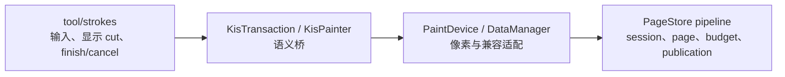

# BR1 新管线内聚与主干低耦合合同

返回[指南目录](README.md)。本篇细化 [92 §16.16](../92_br1_m6_m8_execution_baseline.md#mainline-intrusion-contract)的强制要求。它约束所有后续 BR1 实现、审查和默认启用；性能收益、测试通过或局部代码更短都不能豁免这些要求。

这里把“优雅的主干侵入”定义为可审查的工程条件：依赖保持单向；原 owner 继续拥有业务生命周期；跨层只有一个最窄语义桥；页、预算、回收和发布机制留在新管线内部；新增接口必须同批替代或删除旧责任。不能满足这些条件的实现，即使功能正确或更快，也不得作为 BR1 的最终形态。

## 1. 依赖方向与责任边界

依赖只沿图中方向成立。新管线不能让 PageStore 反向了解 UI strategy、paintop、preset 或 projection；`tool/strokes`、brush plugin 及 PaintDevice/DataManager 以上的公共层不能直接持有 PageStore session、page key、claim、borrow、publication token、budget record 或内部状态枚举。tiles3/DataManager 适配层已有的私有引用是受 architecture ratchet 管理的边界债务，不能作为向上扩散的先例。

主干模块只表达原有业务语义：事务开始/结束、一次像素操作、dirty 对外发布、取消与 undo。新管线的页归属、COW、pending/current、预算、回收和发布实现保持在 image/DataManager/PageStore 内部。跨层必须经过已有 owner 附近的最窄语义桥。

## 2. 强制设计要求

| 编号 | 要求 | 通过条件 | 直接拒绝的形态 |
|---|---|---|---|
| **MI1 单向依赖** | 主干只调用语义桥；新管线内部类型不越过 image/DataManager 适配边界 | UI/tool/paintop 及其公共 header 不 include PageStore 内部头，不新增其字段、模板参数或返回值；tiles3 既有债务不扩大 | UI/paintop 保存 session/token/page key；PageStore callback 依赖 UI 对象 |
| **MI2 原 owner 唯一** | `KisTransaction`、原 scheduler、原 painter 生命周期继续拥有 commit/cancel/display 责任 | 新能力由原 owner 签发和终结；没有第二套状态机、完成队列或成功标志 | brush job 成为 commit owner；共享 PaintDevice 安装“当前 writer”；另建 finish/cancel 通道 |
| **MI3 最窄桥接** | 一个跨层语义只保留一个桥；参数使用既有高层对象或无内部类型的值 | 新入口替代实际重复 caller，并登记删除或退出条件 | 为 async、1px、mirror、selection 分别增加同义 owner API；用 helper 数量掩盖重复政策 |
| **MI4 默认路径轻量** | 未启用模式保持主干语义，特性专属热路径至多一次可预测 inactive 判断 | 不新增特性专属扫描、容器构造、分配、锁、TLS 写入、页查询或 checkpoint；S01 通用 failure context 独立计账 | 为关闭状态遍历 painters/pages；每 dab 构造 scope；默认安装长期可变上下文 |
| **MI5 失败复用原协议** | 可恢复拒绝进入原 scheduler cancel/retry 和 transaction 终点 | 成功只登记一次 undo；失败不 replay、不提交部分结果 | 新错误队列、第二取消状态、写后 fallback、析构静默 commit |
| **MI6 公共 API 克制** | 测试不要求生产公共 flag/API；当前 pilot 之后，UI/tool/paintop/painter/PaintDevice/stroke scheduler 的 public/protected API 默认净增长为零 | 每个例外列 caller、不能复用的原因、同批替代/合并对象及删除触发条件；没有安全消费者时不先加结果枚举或包装层 | 测试专用 public flag；为未来模式预留未消费参数；只增不删的包装层；先加 typed result、以后再找 consumer |
| **MI7 主干局部性** | 修改落在原责任 owner 和真实观察边界，主干文件数与行数逐批记录 | 每个主干 hunk 能映射到 owner、cut、失败或终结中的一个必要事实 | 把页调度、预算、缓存策略放入 `tool/strokes`；跨无关工具批量改造 |
| **MI8 条件债务必须退出** | 临时 setter、friend、overload、模式判断都有消费者和删除条件 | 默认启用前重新审查；消费者归零时同批删除 | 把“以后可能用”当保留理由；通过提高侵入上限永久化过渡接口 |

## 3. 主干改动的准入问题

修改主干文件前必须依次回答，任一项没有具体答案就不改：

1. 哪个可复现问题或已选择的真实业务入口要求跨层？
2. 为什么现有 `KisTransaction`、`KisPainter`、PaintDevice/DataManager 接口不能表达？
3. 为什么修改必须位于该主干 owner，而不能留在新管线内部？
4. 关闭新管线时，新增分支的实际成本是什么？
5. 新增符号替代或删除了什么；若暂时不能删除，哪个消费者阻止删除？
6. finish、cancel、undo、显示和失败仍由哪个原 owner 唯一负责？
7. 哪个目标测试能证伪这项桥接；哪个测试只属于新管线内部、不需要重跑主干矩阵？

“更整洁”“以后扩展”“可能更快”和“测试方便”不构成主干改动理由。

## 4. 每批必须提交的侵入账本

每个涉及主干的批次在 API 映射和证据中同时记录：

- 对照 ref/commit，区分当前 upstream、较旧本地分支和本批前检查点；
- 主干生产文件清单及逐文件 `+/-`，生成文件和测试分列；
- 新增 public/protected/private 符号、字段、include、friend、锁和 TLS；没有也明确写零；
- 每个 hunk 对应的原 owner、真实 caller、关闭状态成本和失败终点；
- 同批删除/合并内容，以及所有暂留接口的消费者和退出条件；
- 目标行为测试、结构检查和必要性能证据。行数、API 计数和测试数只作审查输入，不直接证明质量。

若主干 diff 扩大而没有关闭新的业务断言、删除重复责任或减少既有工作量，本批停止并回退扩张。

## 5. 当前 direct stroke 的裁决

| 当前接点 | 裁决 | 后续约束 |
|---|---|---|
| `FreehandStrokeStrategy::Flags` | 已恢复主干接口；禁止为 pilot 重加公共 bit | 测试派生 strategy 使用 protected opt-in；正式配置成熟后复用既有能力表达 |
| `issueSetDirtySignals` 的一次调用 | 保留 | 它只标记 dirty 对外发布前的 cut；实现和 dirty 扫描留在原 transaction owner，关闭状态只有一次判断 |
| painter-based strategy 的 begin/bind/checkpoint/finish/cancel | 保留 | 只管理原 transaction/painter 生命周期；不得加入 page、budget、kernel 或缓存策略 |
| 全 painter-based failure reporting 与结果化终结 | 保留 | 属于可失败写的 S01 正确性；不得作为 pilot 性能收益计算 |
| `KisPainter::setStrokeMutationOwner` | 条件保留 | 作为唯一非拥有语义桥；不再增加并列 owner setter。若既有 execution context 可承载，迁移 caller 后删除 |
| protected opt-in setter 与资格判断 | 临时债务 | BC5/BC8/BC9/BC10 后由稳定策略配置或既有 preset 能力推导；禁止继续堆叠模式布尔值 |

Painter 的 owner 政策只允许上表一个绑定桥。`bitBlt`、scalar/multi-dab `bltFixed` 和 PaintDevice-source mirror 的 public 显式 owner overload 已收回 private implementation helper；测试也必须使用与生产 caller 相同的绑定路径。后续测试需要选择 owner 不是新增 public overload 的理由；新业务语义必须先证明原绑定桥不可表达，并在同批删除被替代的路径。

BC9 的资源压力不得成为扩大 `tool/strokes` 的理由。容量计算、永久拒绝与可等待压力的分类在 PageStore/DataManager 边界内产生；scheduler 最多消费“继续、取消或永久失败”的业务结果，不能看到 page、budget、reservation 或 waiter 身份。等待接续必须保存首字节前的原 job 输入，或从已经提交的 operation 边界继续；禁止由 UI 重放整个 dab，也禁止在 stroke strategy 中增加预算轮询、页释放回调或第二条完成队列。只有 scheduler 已有结果类型无法表达且目标反例已证明需要时，才允许在原 job owner 附近增加一个语义结果，并须同批合并旧错误分支。

2026-09-29 的压力反例在 8 MiB 配置下进入 PageStore metadata 容量拒绝（诊断运行分别观察到 `metadata arena budget is exhausted` 与 `metadata owning capacity budget is exhausted`）；它发生在后续释放慢 reader 的 job 之前。该事实证明缺少结构化拒绝/continuation，**不证明 UI 层需要新状态**。本轮因此只增加测试与证据，生产 `tool/strokes`、paintop、PaintDevice/DataManager 和 PageStore 均为零改动。

随后实现的普通 direct operation backing 边界继续遵守同一裁决：PageStore 在 callback 前创建、收费并在失败时回滚物理准备；DataManager backend 只通过私有策略参数为现有 cursor ABI 选择该政策。失败只撤销本 execution 新准备的页，原 history owner 与既有 pending 保持可重试；未触碰的成功准备页在 changed 导出前取消。没有 budget、page、reservation、waiter 或内部结果进入 DataManager 公共 API、PaintDevice、painter、paintop、scheduler 或 `tool/strokes`。当前仍返回既有 `Failed`；typed pressure 结果必须与可靠分类和原 scheduler 的实际 continuation consumer 同批引入，并同时合并被替代的模糊失败分支。

## 6. 当前 continuation 所有权裁决

2026-09-29 对当前 job 生命周期的源码复核得到以下事实：

- `KisStroke::popOneJob()` 会把 job 从 stroke 队列移交给 updater；`KisUpdateJobItem::setDone()` 在 `run()` 返回后删除该 `KisStrokeJob` 及其持有的 `KisStrokeJobData`。
- 通用 `KisStrokeJobData` 只有 LoD clone 钩子，没有失败后重试或转交原 job 的协议；`KisRunnableStrokeJobData` 又独占一次性的 runnable/closure。
- 一次 brush update 可拆成多个并发页 job，并在其后追加 dirty/checkpoint/递归 producer job。某个子 job 在 callback 前遇到压力时，兄弟 job 可能已经完成；重放整个 update、dab 或已经出队的 job 都没有幂等保证。
- 当前 `KisStrokeJobFailureContext` 只传递首个错误，不拥有 job、transaction、像素、预算 waiter 或重排位置；把它扩成第二个调度 owner 会违反 MI2/MI5。

因此，当前原 scheduler **没有可以直接消费 `RetryablePressure` 的安全 continuation 所有权**。在这一所有权闭合前：

1. 不向 PaintDevice、painter、paintop、`tool/strokes` 或 scheduler 增加 pressure 枚举、budget/waiter 标识、重试 setter、TLS 状态或第二完成队列；现有 `Failed → 原 cancel/abort` 保持唯一生产终点。
2. 不重放整个 dab/update，也不复制已执行兄弟 job。只有 callback 零进入且**同一个未执行工作单元**的输入、队列位置、取消权和析构权能一次性转交时，才允许等待后接续。
3. 若引入 scheduler-neutral 的 deferred 结果，必须与原 job 的 ownership transfer、唤醒、取消、finish 排序和旧失败分支合并同批交付；scheduler 只能看到 `continue/defer/fail` 业务语义，不能看到 page、reservation、budget revision 或 waiter 对象。
4. 若不能在一个有限批次证明上述条件，就保持 `Failed`，先完成 PageStore 内的完整收费、多 store/多文档公平和释放进度，不以“下一批再接 consumer”为理由预埋 API。
5. 已注册 backend 的数量只能表示对象拓扑，不能作为公平 demand。单个图像可同时拥有主 paint device、投影和辅助 store；禁止按注册数静态平分父预算。父层在没有已拥有等待请求时必须允许活跃 store 借用空闲容量；无饥饿次序只能由可取消、可析构、能回到原 job owner 的请求身份建立。

这项裁决把下一阶段从“先增加 typed result”改为“先证明唯一 continuation owner”。它是接口收敛门，不表示自动恢复已经完成。

## 7. 合并和默认启用门

默认启用前必须同时满足：主干公共接口没有测试专用增量；关闭状态符合 MI4；真实 direct fixture 关闭 owner/undo/failure/drain；BC9 资源与进度成立；所有临时主干债务重新列账；同依赖主干对照证明新增复杂度取得实际收益或不可替代的正确性。

审查发现同一能力可以留在新管线内部时，优先收回主干改动。确需主干接点时，选择原 owner 附近的一个语义桥，并把实现、数据结构和策略留在新管线内部。

## 8. 完整收口排期中的适用边界

当前顺序见 [92 §17](../92_br1_m6_m8_execution_baseline.md#br1-closure-schedule)，API动作见 [CP行动账本](API_CONVERGENCE_MAP.md#closure-api-actions)。CP1完整收费优先留在PageStore；CP2–CP4复用原selector/metadata/provider/publication，M7不另建事务或ledger。CP5用不超过1人日的方案检查选择一个实际job交接端点：优先核对派发前原队列保留未执行工作，或证明运行端callback零进入后的原job一次转交；没有consumer就保持Failed，不把两条路线都做成预留API。

只有在同包闭合输入/队列位置/取消/析构/后继排序、实际consumer与旧失败分支合并时，才允许必要的业务结果接口例外；MI6的默认净增长零规则保持。CP6/CP7每个入口迁走即删除等价适配，CP9汇总临时setter/friend/overload去向和ON/OFF成本，不能把所有删除留到最后。排期人日不足不构成扩大`tool/strokes`、降低关闭状态成本或静态分额的理由。
