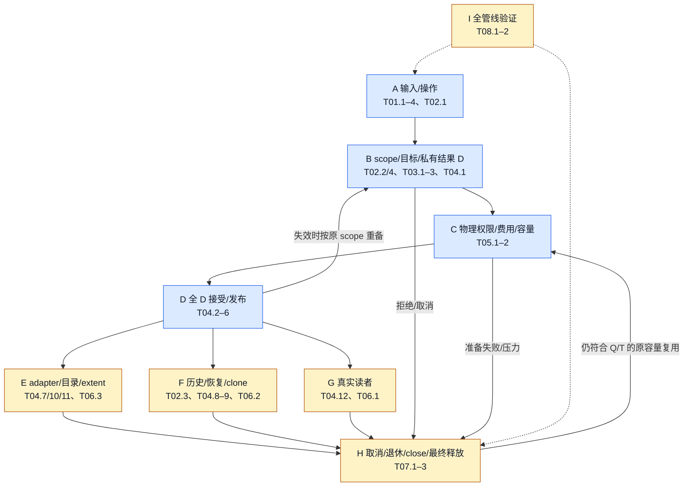

# 全管线重构覆盖图与成本追踪

**隔离重写已启动（2026-10-28）：** [原12项追踪矩阵](v3-minimum-write-rewrite-r0/MATRIX.md)记录候选分支 `codex/br1-minimum-write-rewrite`，生产基线仍为0473。技术检查点723a预建最终Value并删除独立facts槽、旧值覆盖及接受补容量链；633f统一Resource锁外pin/unpin/free/handoff与原责任终结。双架四套必要语义检查共8712项通过，Resource基础记录184→200字节；这是实现检查点，不授性能收益或整包完成。整项实施/删除/计价仍0/12，完整接受锁序、唯一Frame/Value/View、账户及全消费者迁移继续；以下旧记录按冻结版本理解。

**重写前裁决回填：** [设计修正与有限放行](v3-minimum-write-rewrite-r0/DESIGN_REVIEW.md#rewrite-readiness)记录于原MATRIX.prewrite_gate，原12行未勾选完成。允许隔离候选全部迁移，不允许旧/新主账按操作fallback或提前生产升格；19新增源码/已有反例锚点用于追踪身份、实际锁、收费类别、delivery及真实AVL布局。没有新增过程或单价，P1–P6继续由候选验证。

**上下游复审回填：** [完整责任审核](v3-minimum-write-rewrite-r0/FLOW_AUDIT.md)将六组问题和28源码锚点映射回原MW01–MW12，没有新增实施矩阵。重点修正范围读K项保留与whole-root的区别、adapter实际反向锁边、原位置消费、delivery末端及角色/费用/物理释放。七命名阶段45.271M加混合main余量9.467M仅是旧诊断代数覆盖，不含所有worker，也不授必要性、净省或upstream归因。无新过程，原状态和正式门保持。

**保留服务与完整边界：** [继续降价账](v3-minimum-write-rewrite-r0/REDUCTION_RESEARCH.md)将入口2.182M、Resource初建1.471M、seal输入/清理0.594M旧曝光归入原MW01/02/04/05/07/08/09/11，替代新价未知。MW11/12补完整DataManager返回及delivery末端；原7.881M仅backend，保留原外层后9.402M／9182条每页。12个新诊断过程、16源码锚点；观察等价未全过。原结构模型0.139M、P1–P6开放及实施/删除0/12保持，不授CPU、新版净价或理论最低。

**同构协议覆盖补充：** [11组入口语义审查](v3-minimum-write-rewrite-r0/BLUEPRINT.md#semantic-unification)已回填原MW01–MW12，新增24源码/11现有反例锚点，不新增第二实施矩阵。全部生产消费者须迁入同一Value/Resource/View权威；读、restore、surface/remove、alias/clone、swap、archive、费用与终结分别只触发实际变化。allocator、completion backend、scheduler和独立oracle保留各自责任。12行实施/删除/计价仍0/12，P2/P3未闭合；覆盖调查不是新方案正确性或性能证据。

**当前重写覆盖（2026-10-28，产品0473保持）：** [新蓝图](v3-minimum-write-rewrite-r0/BLUEPRINT.md)以稳定物理资源、写前取得最终版本、一份变化Frame和唯一视图权威替换旧服务组合。[MW01–MW12矩阵](v3-minimum-write-rewrite-r0/MATRIX.md)覆盖输入/写/接受/读/history/预算/Idle/终结/provider/冷入口/adapter与验收；48旧符号、53文件、2763词法匹配、56精确锚点。设计范围已列，实施/删除/计价0/12，6类证明开放；词法覆盖不授全consumer闭包。旧CP/CD/SA候选归入该研究而未改成完成，WG/TF已交付状态保持。无新性能样本，当前新方案指令预测未知；入口、读和真实尾均纳入最终净账。

**当前可行方向研究（2026-10-28，产品0473保持）：** [完整范围及定量约束](v3-write-feasibility-r0/RESULT.md)新增64固定普通过程、5个native合同过程5926通过。PageStore-only ThinLTO使H1全进程净省1.075M指令[0.986,1.163]，CPU收益/不劣未证，未升级生产构建。原WU暖余量约19234条/页；降至10000需净删9.456M，目标/finish任一假想免费仍不足。因此CP01–05须覆盖原物理身份、当代权限、原D接受及入口共同净账；净预测仍未知，不凭父桶百分比承诺。WG/TF保持完成，CP/SA未实施，正式0/3、calibration2/20、默认off。

**当前写单价覆盖（2026-10-28，0473）：** [WU结果](v3-write-unit-r0/RESULT.md)新增48诊断过程，已在原setup/write阶段分拆目标/选择/接受；暖四桶19.696M互斥守恒，必要性不授。WU01–06诊断完成，下一CP01–05原私有代交接/接受与冷入口CD01仅候选未实施；旧SA01–06也未实施。再次定位不足0.1M，下一大包不能只统一入口。观察等价不全过，生产0/新增净收益0；唯一状态在V3索引，下方较早价格按冻结版本解释。

**前一V3整包（2026-10-28，a245冻结）：** [交付/删除/成本账](v3-unified-acceptance-r0/completion/RESULT.md)。产品`a245fd02fdab`，WG01–WG10完成、134当前锚点、11756相关控制通过；旧Manager基线限制另列。修复版128确认过程：H0净省2.701M/4.21%、CPU0.676ms正收益；H1净省0.668M/1.12%，CPU未证。真实root/页工作保持，native三表与临时完整epoch delta已删，真实generic恢复尾保留。四写包络代数覆盖100%不表示必要性闭合；H1未达1M工程效果，最低成本/paid/管理比与正式门不授。旧条目按各自冻结身份理解，唯一状态仍在V3机器矩阵。

**当前覆盖与预算入口为 [V3 全管线形态](PIPELINE_PLAN_V3.md#pipeline-shape)、[当前账本](PIPELINE_PLAN_V3.md#current-budget)及[本轮完整计价](v3-write-generation-r0/RESULT.md)。** 原33行/RF00–RF21与已完成迁移保持；本轮形成阶段/非前台/责任价、事前预测、完整反测和误差桥，未宣称全局必要下界。

唯一索引 `pipeline_plan_v3` 回填 PW01–PW07 及 WG01–WG10：V3-01/02 本次计价范围完成；V3-03 [原事实统一接受设计](v3-unified-acceptance-r0/DESIGN.md)已完成双目的地/锁/失败/终结与[126 项消费者](v3-unified-acceptance-r0/CONSUMERS.json)审核；原事实验证/checkout 子责任已落 `281ad1da04` 并通过两架 5484 项行为回归，完整实施/布局/资源/删除仍待；V3-04 生产确认待前项。新增四个两架合同过程证明 hidden history 改变 committed/history/close，不能将 68→8 根频率移授生产。原 416+2 计价过程、受限原型净省 9.066M/1.589ms 保持冻结资格；原 RF 不重开。

进一步[写读全链覆盖审查](v3-unified-acceptance-r0/DESIGN.md#whole-write-cost-coverage)复用冻结数据：H1 暖写/读 26.823/7.413M，upstream 5.933/5.890M，写特有双差 19.368M；H1 写调用非两处复制核的 54.41% 在 seal 前。同一 WG 包据此覆盖目标取得/完成/费用及 Prepared/Published 接受，不能只改 canonical 末端。20 个补充成本锚点及互斥账可复算；该覆盖审查无新过程；随后原事实子责任已实现并做行为回归，新增性能样本为 0，新净收益未授。

此前覆盖图与逐轮成本记录

**当前完整价格（2026-10-27）：** [192过程结果](refactor-prepricing-settlement-r0/finalization-r1/joint-pricing/RESULT.md)、[22项联合覆盖及阶段净账](refactor-prepricing-settlement-r0/finalization-r1/joint-pricing/ACCOUNT.json)。原矩阵20/22证据维度完成，RF20观察/RF21目标仍开放。arm64 H1开启态净少6.083M/9.23%，普通CPU收益尚跨零；相对U仍多33.711M/2.795ms，写入与setup占CPU差额65.69%。当前分阶段CPU账代数闭合，不等于机制必要性或独立子任务价格已闭合。paid<1M/管理比/最低实现未证；生产、29批和正式门保持。下方为冻结检查点，旧P/K价格不代表当前C/U。

**2026-10-27 最后一组实现欠项收口：** [第29批](refactor-implementation-closure-r0/IMPLEMENTATION.md)、[入口与保留边界](refactor-implementation-closure-r0/CONSUMERS.md)。源`2d5d1aaf9f27`/库`ce1d02675511`；root最后保护解除统一原位置排队，删除受保护候选空查。双架8862/0/0、449检查；生产净−9行，无新增字段/owner/付费寿命。29批/19限定责任/11有限闭包；原实现未完结聚合组已核完，余资源/全包验收。净价和同义upstream尚未取得，正式门不变。

**2026-10-27 终态消费完整实施：** [第28批交付](refactor-terminal-consumption-r0/IMPLEMENTATION.md)、[全入口/删除索引](refactor-terminal-consumption-r0/CONSUMERS.md)。源`a8c66c6e730a`/库`e2a6be38b58b`；原record同窗准入准备、一次verified结算、writer封闭、原位置watch与接管撤销同迁，补共享orphan预约归零后的托管。双架8854/0/0、436检查；源码正常窗口7→3/查找4→0/验真2→1，非净性能。28批/18限定责任/8有限闭包、整项0/22；原资源/全图/净预算及正式门保持。

**2026-10-27 整包进度回填：** [V2 §10.101](PIPELINE_PLAN_V2.md#progress-review-27-batches-20261027)、[原矩阵](REFACTOR_TASK_MATRIX.md)。当前源`3ddd9814b896`/库`130a5d210b2b`保持；27批、17限定责任、8有限consumer闭包，另有§10.100设计完成未实施及2个开放汇总组，整项0/22。修正24批旧快照及已完Idle/费用欠项；8844/0/0和417检查是既有当前证据，本轮未重测。技术目标保持，净价/主要差额回收未证，防止结构扩展挤压资源/联合计价；原正式门保持。

**2026-10-27 类别转移与终态消费审查：** [V2 §10.100](PIPELINE_PLAN_V2.md#class-terminal-protocol-closure-review)保持原record和Idle边界，补齐operation一次准入/一次验真/原位置终结及初始接管撤销的不同授权。正常有界路径ledger窗口7→3、operation查找4→0、终态验证2→1是可构造源码预算，非实测或全服务下界；完整writer/终结consumer及回滚同迁后才可采用。仅设计，无新生产/测试/价格；原27批、正式门保持。

**2026-10-27 Idle调度边界已实施：** [第27批完整交付](refactor-idle-scheduling-r0/IMPLEMENTATION.md)、[入口/删除索引](refactor-idle-scheduling-r0/CONSUMERS.md)。源`3ddd9814b896`/双架库`130a5d210b2b`；单目标/纯期限查询/仅通知timer/原task每批16/关闭恢复同迁，旧混合回调及重复状态删除，R政策保持。8844/0/0、417检查；27批/17限定责任/8有限闭包、整项全维0/22。声明Store+context减120B，实际root6304B保持；新增调度/通知门计回，无净性能认领。原资源/全图/净预算及RF20门保持。

**2026-10-26 设计价值口径校准：** [V2 §10.97](PIPELINE_PLAN_V2.md#idle-design-merit-and-adoption)将结构收益、运行影响和合同分别裁决；正CPU收益不是结构重构的必备条件。N比旧实验B更干净，但删除的预检/续期状态在当前生产R中本来就不存在；R/N均按实际入库计龄，差别是候选选择。生产暂留R，依据包括尚无对R的整体结构净简化及命中取舍，不再仅凭无CPU收益否决。跨页到期的封装边界可独立审查，未知时间不排除设计问题。无新产品/实测，原矩阵和正式门保持。

**2026-10-26 Idle原年龄候选已判别：** [修正实现与完整时间结果](refactor-idle-policy-decision-r0/admission-age/RESULT.md)已删除发布预检和续期，仅在真实替换机会选择保留；14安全/数量过程、48固定时间过程通过。2页H1投影80→72、指令少0.014327M/0.60%，CPU未证收益；16页无新增手续。120ms反例多一次Fresh，净时间采用条件未满足，候选不迁生产。第26批及RF20/正式门保持；见V2 §10.96，后续回原事件/资源全图和整包净预算。

**2026-10-26 Idle责任深化：** [V2 §10.95](PIPELINE_PLAN_V2.md#idle-responsibility-and-renewal-design)区分候选/期限、语义撤下、费用、真实checkout独占和终结；原记录权属清楚，旧保留策略把未来预检和未变化候选续期混入发布。100ms是内部可借年龄，binding直取pin反例不等于公开guard回退；单页checkout的跨页到期维护也纳入时间账。当前生产替换政策及第26批身份保持，本次只有设计审查、没有新测试或性能样本。

**2026-10-26 时间优先与Idle策略裁决：** [有界同实现对照](refactor-idle-policy-decision-r0/RESULT.md)完成13安全/数量过程和48时间过程；两页H1投影80→72但CPU未证收益，16页零删行且多0.110M指令。本版保留/续期不迁生产，保留当前紧凑接受输出；不再把它列为必做重构。硬预算内空间增加不单独否决时间方案。生产仍第26批源`3cfededd17b0`/库`1508bae792a0`，非整包或upstream价格，RF20及正式门保持。下方旧“待迁入”按各冻结时点理解，现方案见V2 §10.94。

**2026-10-26 原记录退休生产迁移：** [实现/成本账](refactor-record-retirement-r0/IMPLEMENTATION.md)、[14类消费者](refactor-record-retirement-r0/CONSUMERS.md)。源`3cfededd17b0`/普通双架库`1508bae792a0`；原record贯穿准入、等待、Idle替换/过期、shutdown及最终退款，旧重复查找删除。8836/0/0、399检查；26批/16限定责任/8有限闭包、整项全维0/22。record888/queue416/physical272B保持，无新持续字段/paid寿命；非Debt准入条件查找2→0，不折净价。条件Idle续期/统一发布处置、完整资源与整包净预算仍待，未认领80→72生产投影。时间优先；RF20关闭、正式0/3、calibration2/20、默认关闭。

**2026-10-25 原ledger物理节点收敛：** [完整责任、资源反例与删除账](refactor-backing-storage-lifetime-r0/IMPLEMENTATION.md)。当前源`523057de5a5d`/双架库`fd683fc1993f`；原physical记录承担唯一identity/索引，删除逻辑24B key副本、临时map node准备/提取/重绑及最后按key定位。合并取块原型因1536B/额外尾1264B撤下，最终新取块仍2，共享alias物理申请仍0。两架完整布局分配1216→1168B、物理尾272保持；旧表示配未改付费服务，不是旧管线二进制或净指令价。双架固定**8600/0/0**、156有限检查；生产净+11。原矩阵13批、20/22启动、0整项验收，原Page/checkout/private接受全链和完整paid仍待；RF20关闭、正式0/3、calibration2/20、默认关闭。下方旧批按冻结身份理解。

**2026-10-25 原D准备寿命收敛：** [完整责任、删除与资源账](refactor-mutation-capacity-repair-r0/IMPLEMENTATION.md)。当前源`2e3e7cae4ec7`/双架库`938e929df07d`；删除同次容量冲突的整份重备、重复retry状态和增长政策，原D保留顺序/位置/旧预约，只补真实新槽；初次有序跳过排序。双架固定**8592/0/0**、142有限检查；C1/R1实际准备2条，旧模型3不是旧库实测；纯外部同硬额整prepare拒绝而原repair零分配成功，真实新增拒绝无半安装、同segment可恢复。carrier80/row320/native344/prepared88保持，生产净+89行及新扫描/补块计回。原矩阵12批、20/22启动、0整项验收；继续上游Page/checkout/ledger与完整paid，净指令/管理比未计，RF20关闭、正式0/3、calibration2/20、默认关闭。下方旧批按冻结身份理解。

**2026-10-25 原D旧mutation协议替换：** [完整责任、删除与资源账](refactor-original-d-closure-r0/IMPLEMENTATION.md)。当前源`5fdf7b6131b8`/实际双架库`13cd6fe92f3f`；Detachment通用分支、生产versions入口、逐页activity、独立失效清单和mutation Deferred job已删除，native/外部/remove/混合输入的准备、接受、取消、晚读者重备及锁外退出同迁。双架固定**8548/0/0**、125有限检查；324页同硬限额附加候选65536→96B，原D输入另计；row320/native344/prepared88保持，carrier头+32B及引用容量/重备重叠入账。生产6文件净减34行；11批、20/22启动、0/22整项验收。原D准备排序、checkout/ledger/完整单次paid等余项仍待，暖native原本不走旧external fallback，不认领13.107M或640条件预算。无普通/机制性能过程；RF20关闭、正式0/3、calibration2/20、默认关闭保持。下方旧批按冻结身份理解。

**2026-10-24账本/方向复核：** [十批交付、差额预算与纠偏顺序](PIPELINE_PLAN_V2.md#implementation-progress-direction-review)，[原22项矩阵](REFACTOR_TASK_MATRIX.md)。当前源`70dc36a5af5f`/双架库`0f3ca9ea6fef`不变；10批及22项摘要按当前源回填，20/22启动、0/22整项验收，17实施项迁移/删除均未整项关闭，不能报90.9%完成。当前固定双架8548/0/0、105有限检查；十批净指令/管理比/同语义upstream均未获新证据。四来源条件少640仅是旧申请差的50.8%来源预算；共同logical/physical删量不得抵主差额。第8/10批回到前台，但原Page/checkout/ledger/全D和完整单次paid收口仍滞后；补齐四类资源裁决，含最新idle尝试及history→原queue等待转移。此次无产品改动/新实施批/性能过程，RF20关闭、正式0/3、calibration2/20、默认关闭保持。下方各实施批仍按其冻结身份理解。

**2026-10-24撤下/费用/终结实施：** [完整交付、失败和成本边界](refactor-disposition-ledger-r0/IMPLEMENTATION.md)，[V2 §10.75](PIPELINE_PLAN_V2.md#metadata-disposition-and-ledger-acceptance)。当前源`70dc36a5af5f`/双架库`0f3ca9ea6fef`；删除逐页收费类别前置门和终结先查再take，原D按实际类别筛选，投影同锁消费原位置。内部输入144→24B、原row320/native344/ledger536保持；原funded record接受不枚举收费桶，effect必要Debt类别同锁取得。Debt满额保持原charge且不调用provider，释放后同record一次退休。生产8文件+139/−80；当前双架固定**8548/0/0**，十过程reap无超时；105检查/6352文件/32相关consumer。四个类别×capture交错及单一旧谓词反测有原身份；该反测旧private ABI未冒充最终库。原矩阵回填10项，累计10批、20/22启动、0/22整项验收；D/T删量须扣A/ΔI尝试及history→原queue等待转移，净价/管理比仍未知。原Page/checkout/ledger/全D及完整付费服务余项继续，原640和13.107M不核销；普通/机制性能0，RF20关闭、正式0/3、calibration2/20、默认关闭。下方按各批冻结身份理解。

**2026-10-24物理记录/登记实施：** [完整交付及成本边界](refactor-physical-record-r0/IMPLEMENTATION.md)，[V2 §10.74](PIPELINE_PLAN_V2.md#physical-record-registration-lifetime)。当前源`12d590e3fcf4`/实际双架库`3bdd1f22e8fb`；原physical记录同时承担global登记pin，删除Payload map node、第二候选及已得binding后的五类重定位。每同义成功新物理准备的provider metadata请求2→1，声明同时活280→288B；新纯global尾实际288B、最后pin准确退款，旧global声明104B，新增尾驻留仍待计回。生产3文件+166/−165、测试2文件+93/−7；当前双架固定**8540/0/0**、10过程reap无超时，81检查/6352文件/29相关consumer。原矩阵回填10项，累计9批，20/22启动、0/22整项验收；共同P/K删量不抵13.107M前台主差额或同义upstream，原Page/ledger/全D接受及完整付费服务仍待。普通/机制性能0、净价/管理比未知；RF20关闭、正式0/3、calibration2/20、默认关闭。下方按各批冻结身份理解。

**2026-10-24目标/布局协议实施：** [完整迁移、反例及成本边界](refactor-target-protocol-r0/IMPLEMENTATION.md)，[V2 §10.73](PIPELINE_PLAN_V2.md#single-target-acceptance-protocol)。当前源`6ca2d686317ef`/双架库`cbffdc0dbb10`；删除输入目标副本、整reuse候选/回写、旧plan契约及native alias通用descriptor手续，未接受本地布局不再使全局候选重备。输入384→256B、选择720→592B、原private344B保持；生产8文件+119/−116。当前双架固定**8534/0/0**、10过程reap无超时；恢复早失效的单一派生库恰好两条拒绝反例失败。原矩阵回填10项，累计8批、20/22启动、0/22整项验收；本批回到前台主线，完整physical/checkout及全D接受等原余项仍待。普通/机制性能0，净价/管理比未知，旧640条件申请及20.340M不核销；RF20关闭、正式0/3、calibration2/20、默认关闭保持。下方按各批冻结身份理解。

**2026-10-24 provider唯一binding记录实施：** [完整迁移、删除与成本边界](refactor-provider-record-r0/IMPLEMENTATION.md)。源码`c5fafde1b3b7`、实际双架库`219f45995c22`；生产tiles3与测试线性provider同批迁移，binding直接承担slot索引、physical身份及原retirement ticket，独立AllocationMap及两个Allocation载体已删；handoff仅写version/generation以保持slot不可变。生产3文件+100/−72；当前双架固定五组各4264/0/0，合**8528/0/0**，全部reap无超时。成功N次逻辑准备条件申请2N→N；binding200→288B、独立record56→0B、provider/index736B不变，外部strong/weak尾多88B声明驻留入账。P/K共同来源下降不核销旧1260/20.340M；净价和相对同语义upstream资格未授。**原22项/33行、20项启动及联合计价关闭保持；本批回填12项。** 普通/机制性能0，正式0/3、calibration2/20及默认关闭。下方旧批按各自冻结身份理解。

**2026-10-22完整执行范围已登记：** [重构任务矩阵](REFACTOR_TASK_MATRIX.md)将9类实测差距拆为RF00–RF21共22项，并反向映射原A–I/33行；[排查表单](REFACTOR_CHECKLIST.md)明确设计、消费者迁移、旧实现删除、行为验证、联合计价五个独立维度。唯一状态在原 `PIPELINE_REVIEW_INDEX.json.refactor_execution_matrix`。本包**0/22完成、联合计价门关闭**；旧r6八项删除不借作本包PASS。RF00–RF19全部就绪及候选/预测/协议冻结后才可整包计价，禁止局部小改后对账并宣告整体落实。当前只是表单与追踪工具，未改产品、未新增性能测试；详见[V2 §10.65](PIPELINE_PLAN_V2.md#whole-refactor-execution-matrix)。下方量价结论仍对应各自冻结批次。

**2026-10-21原型/当前同服务对账：** 产品仍`b0fb5acb04/698b7d553fd2`，未改生产。当前H1 paid **2976**，原型当前服务适配版1716（含ABI适配+4），1260次差额已逐栈100%核对；同批含最终drain全进程41.431947/21.091710M，差20.340236M。主要前台距离在stage/seal **6.539/6.568M**，付费服务差2.679M，投影/独立handoff仅0.124/−0.004M；前台模型仍有0.518M偏差。每段scope/entry/目录与页工作块继续重建，原八项删除完成不等于原型跨段寿命/工作生成率等价。

[完整计数/指令/差异账](prototype-current-reconciliation-r0/RESULT.md)及[V2 §10.64](PIPELINE_PLAN_V2.md#prototype-current-cost-reconciliation)为最新诊断。参照缺完整生产语义，不是upstream或可兑现收益；paid<1M与最低实现未通过，M6/M7/M8仍0/3、calibration2/20、默认关闭。下方为各批冻结证据。

**2026-10-21原型旧契约整体替换：** 当前工程候选`b0fb5acb04/698b7d553fd2`。[V2 §10.63](PIPELINE_PLAN_V2.md#prototype-replacement-implementation)与[完整r6结果](production-candidate-r6/RESULT.md)落实原33行索引中八项删除登记：原操作/原编辑、直接验证和接受、内部identity/commit、单capture及配套终结全部迁移。原生cold接受不再生成通用逐页Entry/activity/cleanup；真实外部lease、root和晚读者容量单列保留。最终消费者复核删除fill/copy未消费的整组execution预留后再测。全产品6345个C++/头文件旧符号归零；双架五套11764/0/0、结构检查通过。整包H0/H1含尾指令净省4.1822M/1.0326M（5.71%/2.43%），metadata峰值各−1024B；CPU未证改善。新paid次数未测，不能沿用旧3040。**已登记替换完成，最低成本与同义upstream对账未完成；M6/M7/M8仍0/3、calibration2/20、默认关闭。** 下方保留此前冻结证据。

**2026-10-21原D替换与反例修正：** 当前工程候选`81f65dfae9/cae2e551e5fb`，原生Page/原scope持有唯一发布行，发布、metadata、费用、adapter和退出一起迁移；删除native seal整行数组、slot重复索引、连续地址/stride假设。见[V2 §10.60](PIPELINE_PLAN_V2.md#prototype-original-d-replacement)、[完整结果与失败账](production-candidate-r4/RESULT.md)。H1 paid3068→3000，含尾指令43.5532→43.3764M（净省0.1768M，探索区间[0.0458,0.3078]M）；CPU未证改善。排序重复资格判断10472→1088修复约1.14M中间回退；H1 metadata峰值仍增加28.5KiB，资源不劣未获。最终arm64：5,878/0/0，x86在启动前停滞未验；本轮新增4UE＋2U。**仅保存工程候选，整体基线不升格、M6/M7/M8仍0/3。** B/C/H稳定事实与临时D工作区寿命、A/B scope、G/H独立payer仍须彻底替换；原33行不缩减。下方保留此前冻结结论。

**2026-10-21当前选择目录清理：** `4ea6484768/fce06bf5e5e5`替换D/T04.2–6中的节点目录及四个候选容器，F/G/H实际消费者与退出一起迁移；见[V2 §10.59](PIPELINE_PLAN_V2.md#prototype-selection-replacement)、[消费者与数量净账](production-candidate-r3/RESULT.md)。H0/H1每目录少20次申请，总数−1360/160，指令各净省3.4561M/0.3786M；CPU未证收益。原33行不变，B/C/H稳定事实、A/B作用域、B/D唯一原D、G/H独立观察仍保留明确未完成，不把次数账吻合当整体金额或最小成本闭合。

**当前候选4b69f8b800／79c8b5904978：** [V2 §10.58](PIPELINE_PLAN_V2.md#production-representation-closure)、[实施/缺陷审计/联合计价](production-candidate-r2/RESULT.md)。B/C/H原位换代、B/D/E/H原source借用、G/H捕获共同存储完成受影响消费者闭包；原33行未增加最低成本完成资格。H1 paid3356→3228，含最终回收指令净省0.5845M（1.31%）、CPU点省0.2849ms；资源峰值保持、严格不劣性仍未授。双架11740/0/0。全D准备表示、付费服务及独立保护的更低成本实现继续开放，不能将本批三项闭包当作完整原型等价实施。下方记录均为此前冻结状态，当前身份与证据见[唯一索引](PIPELINE_REVIEW_INDEX.json)。

**最新候选为630c52219d／25c75ba4affc，按[V2 §10.57](PIPELINE_PLAN_V2.md#production-whole-pipeline-implementation)及[完整实施／数量／普通净账](production-candidate-r1/RESULT.md)判断。** A–H原选择→private→接受→读→退出已贯通，旧冷块协议删除；原33行逐节点附最终代码与行为证据，不增加理论最低/全成本目标完成资格。H1 paid3804→3356、编辑增长544→96；含最终回收指令45.9510→44.4734M，CPU未证改善。冷写r0回退修正后未重现，但单页H0严格不劣性未授，H1 Metadata峰值增加20.25KiB。工程候选保存，整体性能基线及正式门不升级。

下方“当前/待实施”只对应此前冻结批次，不覆盖本段；最新源/库与原33行落实记录以[唯一索引](PIPELINE_REVIEW_INDEX.json)为准。完整paid<1M、管理/内容比、upstream同语义差额与原型参照差仍开放。

**最新实施：[V2 §10.56](PIPELINE_PLAN_V2.md#production-native-proof-candidate)。** 产品a0cfb113e4／普通库23a5完成原生发布身份的完整消费责任；原33行增加局部证据，不标为整体完成。最终双架11738/0；H0全进程指令−1.743M，H1−0.240M但区间跨零，CPU未证改善，不升格整体性能基线。B/C/D/E/G/H的编辑行、私有结果、全D表示及独立尾主体仍未迁移，本包不代表这些大项已经解决。以下旧金额和状态保留其冻结身份，当前源/库见[唯一索引](PIPELINE_REVIEW_INDEX.json)。

## 当前原33行的整体替换边界（§10.62）

以[V2统一差异表](PIPELINE_PLAN_V2.md#prototype-whole-replacement-audit)和索引每个node的`whole_replacement_contract`为准。A/B操作基础、B/D/E原结果到接受表示、F实际选择/root、G/H独立观察与最后payer相互依赖，不能分别挂“最小成本开放”后继续局部计价。C原付费服务为原型保留责任，终局<1M仍独立待完成。已删除旧节点/native另造D/空Page协议不重领；必须保留的是实际合同，而不是旧服务顺序。以下§0及数表记录各自冻结量价，本次无新成本样本。

## 0. 当前覆盖：次数、寿命、单价分别验收（2026-10-21）

**当前主线：[V2 §10.55 生产候选完整合同与基线裁决](PIPELINE_PLAN_V2.md#production-baseline-readiness)。** 新增12个行为过程确认参考callback自等待与provider拒绝分类不等价；可控真实退休拒绝的有限恢复P/K过，不增加普通写无条件等待。方案可更新、完整生产候选可开始，当前生产基线不可升格。原33行附`production_readiness`，无新增完成行或新净价。以下§10.54账单保持受限参照资格。 原33行的A–I附`whole_core_trial`属性，仍无生产迁移／最低成本新增资格。参考核覆盖原编辑、真实资源/费用、内容、全D、独立观察和原退出；H1指令参照距离25.000M、paid3804→1712，但通用能力/并发/独立尾未齐，不能作为生产收益。Debt早充回退已修正；普通一页压力双方过，组合压力已定位到旧退休预留占额后下一Fresh拒绝，H/C/B须补原压力推进/等待接续。参考paid计数模型的四项留出端点均吻合，但不授必要下界。详见[完整账单与资格](unification-research-r0/core-trial-r0/RESULT.md)。§10.53为总算法来源，§10.52的局部查询是下层证据。

**数量与桶外工作续接：** [V2 §10.50](PIPELINE_PLAN_V2.md#paid-count-and-other-work)补正3804的必要性与数百目标：4/8KiB混合容量离线模型为461/277次增长，但额外驻留、真实owner代次及并发未验证。B/C/E/F/G/H共同检查对象表示与容量域；模型仍保留3804逻辑寿命，不能把34.7748M按分配降幅销账。只是分析证据更新，原节点/33行未新增实施完成资格。

当前普通库3ccb58873c0a，当前细化设计以[V2 §0/§10.54](PIPELINE_PLAN_V2.md#whole-core-qualified-trial)及[§10.48付费服务目标](PIPELINE_PLAN_V2.md#paid-service-budget-and-transfer)为准；[当前源码索引](PIPELINE_REVIEW_INDEX.json)把原33行唯一映射到A–I。原33行冻结资格保持，没有节点获得“理论最优完成”。下表是当前整体复核，后面的旧映射/生成数表保留各自批次，不作为当前未实施清单或当前金额。

**保留组件目标：固定公开业务cut/合同，完整paid服务<1M。** C的父子准入/接受/退款与H的真实尾共同负责，A/B/D–G承接的迁出工作也计回服务。[原型§10.49](PIPELINE_PLAN_V2.md#paid-service-prototype-price)已回放3804个完整申请/free：服务7.016→5.435M，协议增量2.361→0.780M；物理服务4.65–4.69M，带原容量原型仍4.953M。该证据约束整体方案，但不指定独立的下一实现；它不是产品6.333M前台桶的新分解，尚未迁移/达标。34.7748M与其它桶、后台共同进入统一预测，缺价按能否改变方案选择有限补足。

| 节点 | 调用次数的理想驱动 | 资源/事实的必要寿命 | 当前实现与单价状态 |
|---|---|---|---|
| A 输入/操作 | 真实公开cut与实际输入，边界归一化一次 | 原operation及其实际guard | 范围/ordinal已有；H1有真实64次业务cut后读观察，不能合并cut；当前输入/夹具分价缺 |
| B scope/私有结果 | 实际变化行、实际容量增长；noop不生成写目标 | 热行/稀疏cold/阶段工作区，独立尾分开 | 冷目录删除、直接借用/同寿命归并已做；544块是当前形态结果，非全算法下界 |
| C 容量/权限/费用 | 真正块增减、用途/域变化；可兼容接纳组 | 原physical/record、真实预算许可与最后payer | 产品paid6.333M；回放单一权威协议有约1.581M降幅，原容量带到free另约0.547M；完整服务仍约4.95M，generic/等待/真实并发未迁 |
| D 全D接受 | 真实D、触及shard、实际失效行 | 全D claim到接受/取消，独立metadata尾 | 原行/原位置、局部重备与同步workspace已做；全D验证不能删，当前整项价仍缺 |
| E adapter/目录 | 已接受D及真实extent/default变化 | 原交付窗口和必要长期目录 | 既有D消费保留；重新解释/登记仍须逐consumer核查，当前独占价缺；通用收益两边对称 |
| F 历史/root | 真实可见cut、变化节点和保护者 | 不可变root、独立strong/weak与异步析构 | 合批persistent delta已有；node/control不能仅按创建同时就合并，完整价/尾资源缺 |
| G 读者 | exact view、实际页读、真实miss | view选择/保护与可逃逸guard，原释放记录 | exact/native/selection直传已有；H1另含64capture/1024页读，必须重新纳入当前粗账 |
| H 最后退出 | 真正最后消费者、到期/完成/压力事件 | 原record、队列、parent登记到实际free | 原记录复用和terminal detach已做；后台全价、byte-time与关键路径未齐 |
| I 验证 | 实际业务/失效边界及固定统计块 | 源/库/端点身份、全部失败原始记录 | 上轮11738/0、局部指令净收益；新整体预测、同批U/content及正式门未过 |

最新三项合计10.7833M是前台选定责任现价；其它前台34.7748M尚含内容、输入/读/其它管理/fixture。二者来自同一诊断，不能称全部PageStore成本或相对upstream差额，也不能把旧暖写桶拼进去“闭账”。普通47.5173M来自另一组固定净价，观察残差和后台不强行摊平。

下一工作沿同一图研究私有结果→当期D→接纳→长期可见状态/读者保护→终结的责任转换，同时审查费用和容量。逻辑对象、重复事实、定位/验证/登记、同步、分配和保留均进入同一账；存储形态服从真实边界。原型的单一权威不是可直接迁移的第二快协议，X01、生产锁数和896→56均未获交付资格；两轮原型不与旧产品价跨批相加。

以下为冻结更新与旧测量图表；其中“最新/当前/待迁移”只属于对应批次。历史生成表不覆盖本节状态。

**2026-10-20 3804实施与三项计价：** [实施与净账](intermediate-baseline/full-flow-trigger-audit/storage-granularity/service-closure/implementation-3804/RESULT.md)把B/T02–03冷存储、C/E/H退休/provider配套及C投影消费者迁移到唯一表示；原C01–P03完成，X01资源条件未过，V01完整资源与同义upstream资格仍开放。H1 paid4652→3804，投影1088行、独立handoff896保持；联合普通净省2.2974M/4.61%，CPU未分辨。当前前台三项现价6.333/3.503/0.947M仅支持三项排序，未给原A–I全管线金额对账率或必要性完成率加分。最终位置见[REVIEW](intermediate-baseline/full-flow-trigger-audit/storage-granularity/service-closure/implementation-3804/REVIEW.json)，方案见[V2 §10.46](PIPELINE_PLAN_V2.md#storage-3804-projection-net)。原33行、IB0与正式门保持；以下为各冻结记录。

**2026-10-20工作展开核算：** [V2 §10.45](PIPELINE_PLAN_V2.md#allocation-projection-unit-work)与[原始机制账](intermediate-baseline/full-flow-trigger-audit/storage-granularity/service-closure/unit-work-20261020/RESULT.md)将C/E/H再分为投影行、批费用、独立handoff。1514激活=128＋896＋其它490，1706结算=128＋896＋其它682；这里只闭合数量，不闭合指令。paid申请阶段准入/结算共18568次锁模型与子调用一致；最后free完整区间未授。

**2026-10-20设计覆盖续接：** [V2 §10.44](PIPELINE_PLAN_V2.md#cold-and-backing-storage-design)把Cold去目录、退休record内嵌节点、Payload内嵌登记映回B/C/E/H及T02–03/T07；[11行修改/删除索引](intermediate-baseline/full-flow-trigger-audit/storage-granularity/service-closure/origins-20261020/DESIGN_INDEX.json)覆盖35个源码/测试文件、772个关键词命中，命中数不是语义覆盖率。条件申请少848；设计完成、实施0、实测删量/金额闭合率未取得。独立physical、completion、集合和binding尾保留明确消费者，非最优认证。

**2026-10-20生成规模反查：** [H1来源账](intermediate-baseline/full-flow-trigger-audit/storage-granularity/service-closure/origins-20261020/RESULT.md)把B/T02–T03的ColdPageSet816、C/E/H的新物理页管理1920映回原管线。所有旧总数复现，不授必要性或金额闭合；process含408调用方输入构造。ColdPageSet条件成组目标136待完整合同验证，无生产/净价/正式资格变更。

**当前服务闭包（2026-10-18）：** [八项实现/消费者索引及资源边界](intermediate-baseline/full-flow-trigger-audit/storage-granularity/service-closure/RESULT.md)将C父子容量的layout/标量准入、D发布与restore的原workspace/投影、H通知和终结、各节点descriptor carrier统一落实到T04/R04/R05/T07，候选44cbc1843a80。H1分配仅−12，重复layout/native-size/process快照分别−8535/−8269/−4676；同步generic8→0，独立退休保留。净省2.2394M/4.31%是完整候选差，不是逐责任金额对账率；CPU未分辨。双架11738/0，指定峰值下降；压力自动重试时序、全资源轨迹和同义U缺口保留。原33行最低成本/正式资格不晋升，后文为冻结批次。

**2026-10-18管理存储粒度实施回填：** [逐项索引](intermediate-baseline/full-flow-trigger-audit/storage-granularity/IMPLEMENTATION_INDEX.json)将B的session/execution成组、D的同步发布工作区与按shard保活落实到原T02/T03/T04/T07；C的父子真实容量收费、F/G/H独立root/read/weak及清理尾保留并测试。候选为父8976工作树补丁/普通库bc643b366206。5个正常用例分配删量模型全匹配，H1仅4824→4664；[完整净账](intermediate-baseline/full-flow-trigger-audit/storage-granularity/RESULT.md)显示H1指令点省0.1932M而区间跨零，CPU未分辨，峰值区间约+3632B。双架11738安全通过不授原33行最低成本或金额闭合；源码迁移、事件数匹配、总体净差与全管线解释率分别报告。当前边界见[V2 §10.43](PIPELINE_PLAN_V2.md#management-storage-implementation-net)；冻结数表与正式资格保持，以下为历史冻结更新。

**2026-10-18管理存储设计覆盖补充（非实施晋升）：** [V2 §10.42](PIPELINE_PLAN_V2.md#management-storage-granularity)把B的operation/execution工作区、C的父子容量收费、D的发布临时/独立metadata尾、E的adapter输出边界、F的历史/root、G的独立读者和H的最终释放映射回原T02–T07；实际节点定义以下方图表为准。已有成组存储标为保留，剩余请求按真实存活域判断可合并性。当前代码`8976d9dac6`与既有净价不变，可合并数/新块数/资源拖尾未计价；本次不修改冻结数表、金额对账率或原33行完成状态。

**2026-10-18工程与净价回填：** [de3f38b74e共同接受实现](intermediate-baseline/full-flow-trigger-audit/operation-lifecycle/RESULT.md)逐项回填DS01–DS12与原A–I/T01–T08。原D、逐行接受、同claim位置、正常ledger归还和已知范围热存储已迁移；cold/独立控制寿命及真实费用、canonical/proof/root继续保留最低价格欠账。双架11736通过，H1净省0.490M/0.91%，CPU未分辨；管理分配−204而预算1514/1706未减，metadata峰值增加。此为工程中间基线，金额对账率、管理比、同义upstream和最低成本资格不晋升；以[V2 §10.38](PIPELINE_PLAN_V2.md#operation-lifecycle-implementation)及[92](../../92_br1_m6_m8_execution_baseline.md)为准。

**全管线运行时筛查已补齐入口触达：** [矩阵及价格边界](intermediate-baseline/full-flow-trigger-audit/runtime-screen/RESULT.md)将 operation/capacity/handoff/budget/class/domain/proof/metadata/publication/read/history/async/retirement/adapter 全 14 类接入 62/62 入口实测；不是 156 边覆盖或全部成本必要性证明。T03/T04 接受链 H0 metadata/proof 暴露 8.526M/3.319M，T04 晚读者局部→全 D 重备有确定性反例，T07/T08 等待/通知候选重建有发生量。保留此前 Idle 数量账，不能因 H1 无收益排除全局问题；按 [V2 §10.35](PIPELINE_PLAN_V2.md#whole-pipeline-runtime-trigger-account)统一追踪。金额对账率/可删额/最优资格仍未闭合。

**B/C/H候选寿命与真实消费者已贯通（生产未改）：** [新账](intermediate-baseline/full-flow-trigger-audit/shared-idle-investigation/RESULT.md)覆盖Idle接纳、alias消费、静态写门、physical/ledger/claim及最后释放，10计数过程已观测寿命全部对账。原压力没有物理尝试；窄用途解耦原型78成功同时新增1903失败，14次shared→成功/2次sole→shared反驳永久资格快照。H1仍896次真实复用；本方向主格删量0，金额对账率/节点最优资格未提升。下一服务替换必须同时处理内容需求与容量资格，不单独上线放宽门或全拒shared，见[V2 §10.34](PIPELINE_PLAN_V2.md#idle-consumer-lifetime-gates)。

**B/C/H收费交接补正，当前候选`f147892416`：** [记录级闭环](intermediate-baseline/full-flow-trigger-audit/drain-investigation/RESULT.md)解释并修复Debt遮蔽Idle/Optional的4KiB残留，旧IB0/父候选反例均失败，修复双架11722通过。收费在原准入点暴露幸存用途，最后释放不新增补偿协议；这关闭具体正确性缺陷，不升级节点净价格/最低成本资格。共享physical保有64个Idle别名但借出要求sole是新增条件误触线索，尚待总体计数与净价；不改下方旧金额、原33行状态或M6资格。

**B/C/D/H对应借还责任已有触发候选，未授完成：** [实现/实测](intermediate-baseline/full-flow-trigger-audit/IMPLEMENTATION.md)将原D直接输入原ledger、空实体与严格零费用变化分流、sole分组排序删除。H1全寿命数组60→0/排序120→0，而60个原准备槽/费用事务、960行定位/claim均保持；alias额外查找回退已消除。当前候选`498c3cb741`有一次未归因4KiB压力退出失败，无净价格；本图旧金额与原33行资格不因此晋升。

**各节点新增触发理由审计：** [14类最小触发集合](intermediate-baseline/full-flow-trigger-audit/RESULT.md)覆盖原T01–T08，冻结61个入口/155条生产调用边及其反向祖先；源码入口覆盖不等于实际误触率或最低金额。空changes、reference-only费用、局部晚保护全组降级与H1用途转换服务分别列账，已有门禁与条件疑点分开；当前节点完成状态和旧价格不因此改变。

**B/C/D/H节点的H1借还欠账已沿当前代码串联：** [服务账与索引](intermediate-baseline/h1-operation-debt/RESULT.md)对应原T03/T04/T05/T07，旧合格批轻准入升级+1.687M、批归还已测子账+1.596M、Idle取出+0.326M与其它项逐块合回3.725M暖差额。当前8个源函数体仍与C1相同，费用及handoff其它函数已修改；这证明部分工作仍在，不证明旧价仍在。节点现价/最低必要价/合法可回收率保持未知，覆盖表不另加实施状态；[V2 §10.30](PIPELINE_PLAN_V2.md#h1-operation-service-debt)以整条借还服务定义下一闭包。

2026-10-17，冻结价格视图。**原33项全部映射，累计算法已正常集成为 `ab1bf42e18`；整条管线的机制归因、合法可回收额与最终预测仍未闭合。** [集成结果](intermediate-baseline/integration/RESULT.md)记录工程出口与保留失败；它不升级下方节点的最低成本资格或跨批改写价格。唯一实施矩阵仍为[PIPELINE_PLAN §13](PIPELINE_PLAN.md#whole-pipeline-change-index)，当前工程身份以[V2 §10.29](PIPELINE_PLAN_V2.md#ib0-normal-integration)、金额预算以§10.19、正式资格以[92](../../92_br1_m6_m8_execution_baseline.md)为准。H1近4M操作单价欠账另在[原问题锚点](INTERMEDIATE_BASELINE.md#h1-capacity-operation-price)持续追踪。

**B/C/H节点重复基础已经实删，旧冻结数表不跨批改写：** [handoff-lifecycle-r0](../br1_pipeline_refactor_20261010/handoff-lifecycle-r0/RESULT.md)将T03.2/T05.1–2/T07.1的handoff槽/目标索引、空retained及无用发布准备实际删除；H1暖896组槽/索引/对象、1008次空retained归零，实际预算结算保持。H0/H1完整写净少0.673M/0.717M、进程少0.844M/0.787M，均八块同向，仅回收同批R−U写差额1.434%/2.179%。8010安全通过，24旧阶段预期失败保留；4个重编/6个候选端点及CPU资格未过。原33行前五列、产品及节点整体完成状态不晋升；其它A/D/E/F/G以及B/C/H保留服务仍须共同落实，不再重领本次删除预算。

**正向最小核取得真实资源构造，生产存在性尚未闭合：** [C++原语接入](../br1_pipeline_refactor_20261010/minimum-native-resource-r0/RESOURCE_CONSTRUCTION.md)把A/B/D/G/H的同步固定区域核接到C的原provider/physical/ledger/budget及H的原退休worker，最终48条合同轨迹与两个64操作寿命构造通过，Fresh/复用数量预测兑现。完整C父压力/权限、D稀疏发布、E派生输出、F完整history/clone、G并发捕获和H到期/异步外部尾仍缺，所有节点仍未完成。覆盖率按必要责任能否由完整生产构造承载判断；不以删除对象或测试数量代替。原数表未更新，普通性能过程0，分类峰值不授wholeStore资格。

**有限隔离构造计价，未改下方冻结数表：** [upstream-isolation-price-r0](../br1_pipeline_refactor_20261010/upstream-isolation-price-r0/RESULT.md)在驻留packed用例将全目标预备定价为H0/H1额外0.239M/0.235M写指令；PageStore C同批仍多46.850M/32.659M。80故障行、138成功格、845普通格和52计数格通过，case0读控制失败保留。A/B/D的服务生成由此成为重点必要性审查：晚失败由哪些真实合同引入、哪些由自身管理手续引入。R/P暖896次无物理指针变化，但不能据此删除逻辑版本。C节点pin峰值1→16，E/F/G/H能力、资源与退出并未获完整替代资格；没有节点升级为最低成本完成、没有PageStore新收益或新管理比，旧账不跨批扣减。

**新增必要性续证，未改数表：** [commit-window-necessity-r0](../br1_pipeline_refactor_20261010/commit-window-necessity-r0/RESULT.md)24个合同数据行证明输入销毁后的拒绝重试与16页失败原子性；两个8页cut替代会留下8页新值。52格计数/语义通过，H0/H1当前source物理claim各1024/1024成功，不能代替逻辑旧值、全D窗口资格或必要价格。K16超现行M7页数政策；政策可另证调整，不是算法定理。A/B/D节点保留可取消结果但继续清理其不必要管理寿命，C的物理机会不预领收益，E/F/G/H全部consumer/退出仍须纳入。新必要指令金额/完整替代价仍未知，无节点升级为最低成本完成。

**新增研究实现，未更新下方冻结数表：** [原D直接接受](../br1_pipeline_refactor_20261010/original-input-r0/RESULT.md)覆盖D节点T04.2–3及相关consumer，删除H1完整64次副本申请/释放、1024行复制，真实metadata工作保持。匹配安全8010项通过；普通H1写仅−0.097M点估计，块差跨零，9个重编端点与2个候选退出端点失败，未授稳定收益/产品迁移。第一批无探针计数及测试坐标失败保留。新C管理比未知；下方core-acceptance账不跨批扣减、不改成新C价格。下一共同责任须证明像素后失败与输入失效后的重试能由更便宜顺序承担，不能只删旧读者保护或继续按副本数量预报大额收益。

**必要性补证：** [首包](../br1_pipeline_refactor_20261010/cost-necessity-r0/RESULT.md)新增9个预算观察、33,856条有限模型路径、297项定向Qt测试；没有新产品优化或性能价。C节点的无条件896→56费用准入假设撤回，实际prepare/commit事件峰值、peer轨迹和失败前缀须验证。D/H节点重验晚保护/原退出，A/B/E/F/G的完整替代必要金额仍缺；没有节点升级为最低成本完成。既有桶和以下生成数表均不因此改动。

必须区分实现身份：产品仍为 `e238d170d30a505a92f209874826ead056841566`；下面生成数表属于 **core-acceptance-r0 研究原型 C**，父版 R 是同批重编的 budget-changes-r1，U 是同批 upstream。新增original-input-r0单列上段与其证据，不覆盖旧数表。原型累计包含多轮研究改动，但没有整体迁入产品，不能用 C 的成绩宣称当前产品已得到相同收益。

补价范围须另分批：下面的C/R/U普通端点保持原独立净价批；新增[全写账](../br1_pipeline_refactor_20261010/whole-fact-price-r0/RESULT.md)和[事实细价](../br1_pipeline_refactor_20261010/fact-transfer-price-r1/RESULT.md)仍测同版C，没有新C/R/U净收益。本轮无产品实现，原33行前五列不变。

<!-- BEGIN FULL_WRITE_BUDGET -->
| 新同批完整写预算 | H0 | H1 |
| --- | --- | --- |
| 普通write，M | 52.924545 | 39.094272 |
| 内容，M | 5.113027 | 5.078404 |
| 非内容代理，M | 47.811518 | 34.015868 |
| 非内容/内容 | 9.3509 | 6.6981 |
| 到1∶1还需净减，M | 42.698491 | 28.937465 |
| 同IPC筛查非内容预算，M | 2.719993 | 3.965767 |
| 合法整包替代净价 | 未知 | 未知 |
<!-- END FULL_WRITE_BUDGET -->

上表完整write比例来自一个批次，不再拼两个独立冷暖分母。同IPC筛查用另一冻结U参考，不是正式CPU门或新配对结果；1∶1和筛查线都是预算约束，尚无新算法的价格预测。全写残差算术吻合98.502%/98.419%仍不等于因果对账率。细价的H1五项事实责任仅3.001M现价，不能用其删除承诺整个28.937M缺口。各责任尚缺的合法替代金额继续保留未知。

## 1. 覆盖图：从输入到最后释放

蓝色表示已有部分改动和当前写责任价；黄色表示有总端点或部分旧证据，缺本版完整内部价格。**没有节点标为“最优实现完成”。** 图中节点是责任，可能在多个阶段执行；箭头不是额外的新协议或新的 owner。

以下映射使原矩阵 **33/33 行恰好出现一次**，可机器核验；跨节点的共同责任仍通过图中的边和原矩阵保持。这个 100% 只证明已有索引未漏挂，不证明索引之外没有遗漏，也不是 100% 实施或计价。

| 节点 / 原索引 | 已有优化或保留事实 | 最新价格覆盖 | 仍需收敛 / 缺价 |
|---|---|---|---|
| A：T01.1–4、T02.1 | 原输入选择/私有最终结果、范围 owner 与原行索引已有多轮改动 | 暖 operation/input；普通 setup、write 总端点 | 冷目标仍建立较重；同一事实跨入口、ordinal、布局的完整替代价未知；fill/copy/clear 不能由 dense write 代替验收 |
| B：T02.2、T02.4、T03.1–3、T04.1 | operation-owner 删除独立 reservation/adopt，暖管理申请少 952；原结果向接受端贯通 | 暖外壳、base/plan、管理存储；冷 Target 粗价 | 原 control capacity 生命周期、noop/partial/晚 guard、失败前缀及稳定定位未整体最优；当前桶不是可删额度 |
| C：T05.1–2 | 原容量/paid-record 接续；预算服务快路径修正；真实物理 claim 保留 | 暖费用/物理/ledger；冷 FreshProvider 粗价 | H1 曾因逐次费用维护回退；原 D 兼容组、父级扇出、真实峰值/动态限额和空路径净价未齐 |
| D：T04.2–6 | 原行接受、canonical 直接提交/紧凑表示、最新共同 record 替换 | 暖 native/acceptance/epoch；冷 canonical/metadata/overlay | 当前仍有逐页查回、proof 物化、原 D 多层解释；整个替代协议净价及真实必要底价未知 |
| E：T04.7、T04.10–11、T06.3 | 既有原 D 交付与旧投影清理保留；本包未重写全部 adapter | write 外层与 finish 总端点，不能独占归因到 adapter | extent/default/稀疏目录、wrapper/GC/barrier 的同版独占价及联合替代价缺；共同 manager/夹具不全是 PageStore 税 |
| F：T02.3、T04.8–9、T06.2 | 既有历史差量/真实 before-after 政策保留；原型影响部分 finish/退出 | finish/undo/redo 普通总端点 | clone/import/restore 和真实保留者下的控制存储、root 及退出未全量计价 |
| G：T04.12、T06.1 | 既有 exact ref/首窗读优化保留；本包没有新读算法优化 | 普通 read 总端点；H1 本包变化仅 −0.000054M | 不可据此称读已最优；case0 读控制越线，旧慢态和新表示全部消费者仍需确认 |
| H：T07.1–3 | 原 retirement owner、Q/T、有限缓存和最终退费已有实现/安全证据；容量复用已改变退出工作 | teardown 与完整 process 总端点 | worker、最后 holder、保留时长、wholeStore 峰值/byte-time 缺完整独占净账；窗口余量不能叫 worker 价格 |
| I：T08.1–2 | 最新 3997 原安全＋44 专项；普通 65 过程/845 格；冷暖独立价格及失败留存 | 当前数字可复算，控制失败可追踪 | 原控制、业务/其它压力、资源尾和独立完整预测未全过；M6/M7/M8 仍 0/3 |

原索引第一列包含代码入口，旧行号只属于原冻结版本。最新接受改动追到 [CODE_INDEX](../br1_pipeline_refactor_20261010/core-acceptance-r0/CODE_INDEX.md) 与 [source.diff](../br1_pipeline_refactor_20261010/core-acceptance-r0/source.diff)；容量/预算/operation 改动追到下表各包的代码索引。不能拿原型行号指认产品源码。

## 2. 哪些优化已经有净价

下表保留不同冻结包的实际净变化，负数是减少，单位 M 指令。**各行对各自父版，不相加；联合包可能覆盖前包，当前原型也不是全部候选的简单并集。** 这是有界责任的实测记录，不是本版每个桶的收益分配，更不是产品累计收益。

| 实际改动 / 证据 | H0 完整 write Δ | H1 完整 write Δ | 可确认的范围与限制 |
|---|---:|---:|---|
| [联合 native：原页事实/原行接受输入](../br1_pipeline_refactor_20261010/unified-native-r0/RESULT.md) | 本表不领取 | −5.917358 | 对原 R 的联合效果；包含前 native-activity，不能再加 −1.983M；完整目标未过 |
| [持久接受身份](../br1_pipeline_refactor_20261010/accepted-identity-r0/RESULT.md) | **+3.283835** | −3.143504 | H1 身份复用改善，但 H0 后续 consumer 重新投影引入回退；两主格方向均八块一致 |
| [接受 consumer 去掉旧投影重建](../br1_pipeline_refactor_20261010/accepted-consumer-r1/RESULT.md) | −3.230821 | +0.007511 | 修复前一候选 H0 的新成本；H1 暖零命中；不是额外全链收益 |
| [原行直接接受，删除暖 metadata 候选](../br1_pipeline_refactor_20261010/native-acceptance-r0/RESULT.md) | +0.221301 | −2.041198 | 暖 prepare/install 56→0、额外保活 896→0；H0 未获同额收益 |
| [原 operation/原行索引](../br1_pipeline_refactor_20261010/operation-owner-r0/RESULT.md) | −3.294297 | −2.510447 | 暖管理申请 2752→1800；整体 storage/plan 尚未收敛 |
| [canonical 原行提交](../br1_pipeline_refactor_20261010/canonical-direct-r0/RESULT.md) | −5.637195 | −0.039706 | H0 八块同向；H1 write 范围跨零，不能领取稳定收益 |
| [canonical 空表示清理](../br1_pipeline_refactor_20261010/canonical-compact-r0/RESULT.md) | −1.159141 | +0.008404 | 对重编 R 范围跨零；本体容量档位 65536→6144B，不等于同等比例指令删除 |
| [容量/登记跨 cut 寿命](../br1_pipeline_refactor_20261010/capacity-lifetime-r0/RESULT.md) | **−19.566210** | **+3.947552** | 大块 H0 冗余已实证；H1 费用手续回退同样八块同向，完整方案未合格 |
| [按实际变化维护费用约束](../br1_pipeline_refactor_20261010/budget-changes-r1/RESULT.md) | −0.857502 | −1.029355 | 只修部分昂贵服务维护；逐页宽 delta、事务及父扇出仍在 |
| [最新共同 record 接受](../br1_pipeline_refactor_20261010/core-acceptance-r0/RESULT.md) | **−1.005658** | **−0.198082** | H0 三类 record 新建/销毁各 1024→0；H1 子槽 rebind 各 896→0，写八块同向；尚未迁产品 |

以前已部署的统一读写、原 D、首窗读、adapter/history 清理不因上表未单列而视为未做；它们仍由原 33 项实施列和对应冻结报告记录。**本表关注当前研究链的机制价，缺少将整轮起点与当前 C 放入同一固定队列的端到端普通对照，因此整轮累计净收益不报一个拼接值。** 通用像素、上层共同优化不能当作 PageStore 同语义优势证据。

最近一包 H0/H1 全写 Δ 的八块范围分别为 **[−1.309888, −0.670447]M / [−0.292213, −0.132291]M**；完整 process 为 **−1.139164M / −0.221180M**，其中 H1 范围跨零。CPU 方向尚不稳定。范围是描述值，不是置信区间。

<!-- BEGIN CURRENT_SUMMARY -->
| 最新同批普通端点 | H0 | H1 |
| --- | --- | --- |
| C 完整 write，M | 52.970779 | 39.081774 |
| U 完整 write，M | 6.025400 | 6.029447 |
| 本包回收父版写差额 | 2.097% | 0.596% |
| write 占剩余 process 差额 | 70.378% | 61.442% |
<!-- END CURRENT_SUMMARY -->

“本包回收父版写差额”严格为 `(R_write−C_write)/(R_write−U_write)`。它回答最近一次改动消除了多少同批异常成本；不回答整个设计完成了百分之多少。

## 3. 当前还有多少成本，哪些没有内部净价

### 3.1 同批全过程差额：写之外的账也必须保留

来源 [core-acceptance-r0 普通账](../br1_pipeline_refactor_20261010/core-acceptance-r0/ACCOUNT.json)，全细节由该包归档的 DETAILS.json 复算。C−U 是剩余差额，C−R 是本包净改变量。表的前九行互斥，加到最后一行；最后一行不是又一笔支出。

<!-- BEGIN PHASE_ACCOUNT -->
| 互斥端点（M 指令） | H0 C−U | H1 C−U | 本包 H0 C−R | 本包 H1 C−R |
| --- | --- | --- | --- | --- |
| setup | 6.239846 | 6.452876 | -0.101286 | -0.009795 |
| 完整 write | 46.945379 | 33.052327 | -1.005658 | -0.198082 |
| read | 2.931705 | 2.501249 | 0.013763 | -0.000054 |
| finish | -0.274583 | 1.315419 | -0.000032 | 0.011583 |
| undo | 0.000000 | 0.827682 | 0.000000 | -0.015510 |
| redo | 0.000000 | 0.731232 | 0.000000 | 0.005668 |
| teardown | 2.171708 | 3.068403 | -0.038733 | -0.213390 |
| 前台未分段部分 | 0.010775 | 0.012485 | 0.000165 | 0.000881 |
| process−foreground 有符号窗口余量 | 8.679735 | 5.832520 | -0.007382 | 0.197518 |
| 完整 process | 66.704565 | 53.794194 | -1.139164 | -0.221180 |
<!-- END PHASE_ACCOUNT -->

H1 写之外还多 **20.741867M**，占全过程余差 **38.558%**；H0 写之外多 **19.759186M**，占 **29.622%**。这部分有总额，但大部分没有本版足够细的机制/合法替代价，不能并入“暖写已对账”而算已解释。

`前台未分段部分 = foreground − 七个命名阶段之和`；`窗口余量 = process − foreground`。后者包括统计窗口差，U 本身略为负值，故必须保持有符号；不能直接称后台 CPU 或 worker 管理费。表的加法闭合是恒等式，不构成因果归因。各阶段 Δ 也不自动表示该阶段代码被直接优化，比如本包 read 几乎不变，teardown 变化可由前面工作生成量变化产生。

### 3.2 暖写责任账：哪块仍然昂贵

同版独立暖计价批，896 写页；与上表普通净价不同批。H1 G2 细诊断超观察线，因此只使用合格 G1 粗父价及 G3 接受细价，不能把失败的 handoff 子价混入。下面互斥现价加残差回到该批普通总量。

<!-- BEGIN WARM_ACCOUNT -->
| 暖路径互斥现价 | H0 M | H1 M |
| --- | --- | --- |
| operation/输入/Target 外壳 | 4.958057 | 4.894106 |
| base/plan/handoff 编排 | 5.923541 | 6.198798 |
| 管理存储/底层申请释放 | 8.579394 | 3.933469 |
| 显式费用 | 2.127603 | 2.127607 |
| 物理观察/claim/commit | 1.108452 | 1.109460 |
| ledger 批处理 | 1.639868 | 0.770463 |
| native 登记/复验/记录更新 | 2.385573 | 3.221033 |
| seal/发布/epoch 其余 | 12.955239 | 4.061236 |
| 外层 write（含共同 manager/夹具） | 1.452046 | 1.446352 |
| 内容 | 4.504205 | 4.504194 |
| 有符号残差 | -0.632620 | -0.366217 |
| 普通暖总量 | 45.001358 | 31.900502 |
<!-- END WARM_ACCOUNT -->

这些责任都有程度不同的局部优化，但**没有哪一大组已证明整体最优或剩余全必要**。同版非内容/内容 H0 **8.9910 倍**、H1 **6.0824 倍**；H1 1∶1 诊断线仍缺 **22.892114M**，需净削减当前非内容的 **83.56%**，这不是已证明可删额。

H1 剩余 record 更新仅 **1.162054M**，即使免费比例仍 **5.8244 倍**。operation/input、base/plan/handoff、storage、fees 四组现价共 **17.153980M**，即使全部免费也填不满 22.892114M；不能继续只围绕记录清零或外壳小项期待达标。需要贯通原事实、物理/预算接受、D 发布和存储寿命的联合替代，而非把当前整桶一笔划掉。

### 3.3 冷建立：已有粗价，仍缺替代价

独立合格冷批覆盖首两写的 128 页，**不是 setup**。H0/H1 普通总量 **7.862478M / 7.201545M**，其中非内容 **7.253637M / 6.627338M**。H1 Target 余项 **2.427688M**、FreshProvider 余项 **1.692332M**，合计 **4.120020M**，占冷非内容 **62.17%**。包括真实首次分配及登记/费用/存储，尚不能全删。

冷暖批保持各自身份，不把上述冷总量与暖总量相加冒充“同批完整管理比”。第一、第二轮冷探针失败、权重分析修正以及最终批其它退出控制失败都保留，见 [冷价报告](../br1_pipeline_refactor_20261010/core-cold-price-r1/RESULT.md)。

## 4. 对账率：必须标出分母和含义

设独占责任之和为 S，未插桩普通总量为 I，有符号残差 `ε = I−S`。下面采用 **算术吻合率 `1−|ε|/I`**；非内容列使用 `I−内容` 作分母。S 略高于 I，因此不能直接把 `S/I > 100%` 说成超额解释。该指标只表示粗责任分段与普通总量有多接近，**不是置信度、因果解释率或可删除比例**。

<!-- BEGIN ARITHMETIC_AGREEMENT -->
| 范围 | 普通总量 M | 有符号残差 M | 按总量的算术吻合率 | 按非内容的算术吻合率 |
| --- | --- | --- | --- | --- |
| H0 warm | 45.001358 | -0.632620 | 98.594% | 98.438% |
| H0 cold | 7.862478 | -0.124786 | 98.413% | 98.280% |
| H1 warm | 31.900502 | -0.366217 | 98.852% | 98.663% |
| H1 cold | 7.201545 | -0.067131 | 99.068% | 98.987% |
<!-- END ARITHMETIC_AGREEMENT -->

| 需要回答的“率” | 当前答案 | 不能外推为什么 |
|---|---|---|
| 原方案索引是否挂全 | **33/33 = 100%**，九节点一对一挂接；原前五列未动 | 分母是既有索引，不是所有可能路径；不表示完成实现 |
| 完整过程总量是否加平 | 两主格逐块恒等式通过，余量显式保留 | 差额项按减法产生，不能称 100% 机制归因 |
| 冷暖写责任账吻合多少 | 上表约 **98.4%–99.1%**（总量口径） | 只限各自固定批；失败细价及写之外不能借此获资格 |
| 最近包消除了多少写差额 | **H0 2.097%、H1 0.596%** | 是局部净回收，不是累计改进率、置信度或全方案进度 |
| 整条管线机制已解释比例 | **未取得可辩护的百分比** | setup/读/历史/退出、窗口余量、其它入口与资源未闭；有当前责任价仍不等于解释为何必须这么贵 |
| 剩余成本中必要/实现低效/算法可避各占多少 | **金额未闭，不填百分比** | 已证明部分语义义务和冗余，但完整合法替代价格与必要底价缺失 |
| 整包达标资格 | **M6/M7/M8 0/3**，默认关闭 | 最新 read/teardown 候选控制、重编控制、资源/业务及 CPU 确认未全过；0/3 不是工作完成度 |

最新六端点控制见 [ENDPOINT_CONTROLS](../br1_pipeline_refactor_20261010/core-acceptance-r0/ENDPOINT_CONTROLS.json)：候选 case0 read **+2.768%**、case4/64 teardown **+3.221%/+2.506%**；重编 case5/66/67 teardown 也越线。主格写方向稳定不消除这些失败，不授产品迁移。

## 5. 下一次更新要补什么

仍按 V2 §10.19–22 的同一方案和原 33 行推进，先补会改变方案选择的证据：

1. **形成联合替代净预算**：原 operation/ordinal/D 将真实事实交给物理、费用、metadata/epoch；同时计新增分组/失效维护、原存储借还和退出。现价按责任分组，净收益只由同批普通对照领取，不能把四大桶相加当预测。
2. **冷建立与暖复用一起设计**：分别定价静态配置/布局事实、首次真实容量/登记、每代变化及必要内容；防止暖减费换成冷/退出加费。保留旧读者、晚失效、动态限额、失败前缀和 Q/T。
3. **闭合写之外的 20.742M H1 差额**：优先 setup 6.453M、窗口余量 5.833M、teardown 3.068M，再对读/历史分层；窗口余量须先证实计数覆盖和事件归属，不能直接造一个后台优化桶。该排序是剩余现价排序，尚非可回收额排名。
4. **补全范围与资源**：fill/copy/clear、noop/partial/sparse、clone/restore、读慢态、共享/压力、wholeStore 峰值、byte-time、最后 holder/close，以及最终独立留出。通过这些边界后才更新实施状态和正式门。

## 6. 复算与维护

派生数据及全部输入 hash 在 [coverage ACCOUNT](../br1_pipeline_refactor_20261010/pipeline-coverage-audit-r0/ACCOUNT.json)。执行 `python3 docs/vulkan_gpu_design/evidence/br1_pipeline_refactor_20261010/pipeline-coverage-audit-r0/audit.py` 可检查 33 行映射、前五列不变、冷暖互斥加法、普通块恒等式及本文四张生成表；不运行性能样本。缺本地 DETAILS 时直接从其原证据包读取并按 manifest 核对。

原始证据完整复算入口为 [verify_all.py](../br1_pipeline_refactor_20261010/core-acceptance-r0/verify_all.py)，该脚本验证四个归档并重放分析。本文没有新增测量、产品变更或资格；更新时保留批次、源码身份、原控制失败和有符号残差，未知价格继续填未知。

## 原physical节点寿命回填（2026-10-25）

原RF01/RF05/RF09/RF15–19同批consumer：直接physical准备、Fresh/alias/导入/直接adoption登记、共享class/domain/handoff、费用排序、最后成员及root销毁。唯一identity和索引属于原physical记录；逻辑key副本、临时map node准备/提取/重绑、最终key重找已删除。原2→1取块方向因1536B/1264B额外尾反例撤下，最终仍2，shared alias物理准备仍0；独立退款保留，原prototype不入生产成本或收益。

最终源/库及9项回填见[原22项矩阵](REFACTOR_TASK_MATRIX.md)和[完整证据](refactor-backing-storage-lifetime-r0/IMPLEMENTATION.md)。当前13批、20/22启动、0整项验收，双架8600/0/0、156有限检查。两架完整容量1216→1168B、尾272保持是资源证据；未补联合指令/管理比或同义upstream。原Page/checkout/private接受全链、完整单次paid和全局资源账仍待；RF20及正式门保持。

## 原来源选择消费者闭包（2026-10-25）

RF04当前产品有限consumer闭合：原entry/BoundEntry、native首次目标、首次alias、final-rect比较、generic lease、publication唯一选择、metadata准确source填写、真实pin失败generic读和动态private/lease接受；直接Reference及真实硬额度CPU消费者同迁。376B投影、三拆散helper/getter、双输入诊断及跨carrier转交/清零零残留。拒绝/错hint/Busy/default/非operational surface与真实解锁边界保持。

源/库、[完整证据](refactor-write-selection-r0/IMPLEMENTATION.md)与[原22项矩阵](REFACTOR_TASK_MATRIX.md)绑定14批；20启动、0整项验收，RF04等待整包冻结后统一verified。当前双架8600/0/0、174有限检查；实际选择592/input256及原D/private/physical不增，费用1168B/272B保持。没有净指令/upstream报价；夹具3→2不抵生产成本，RF01/03、RF05/09及整包退出压力仍待，RF20与正式门保持。

