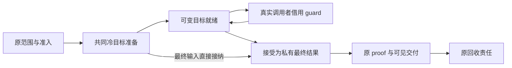
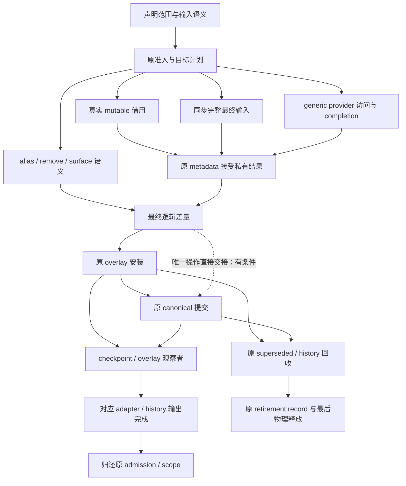
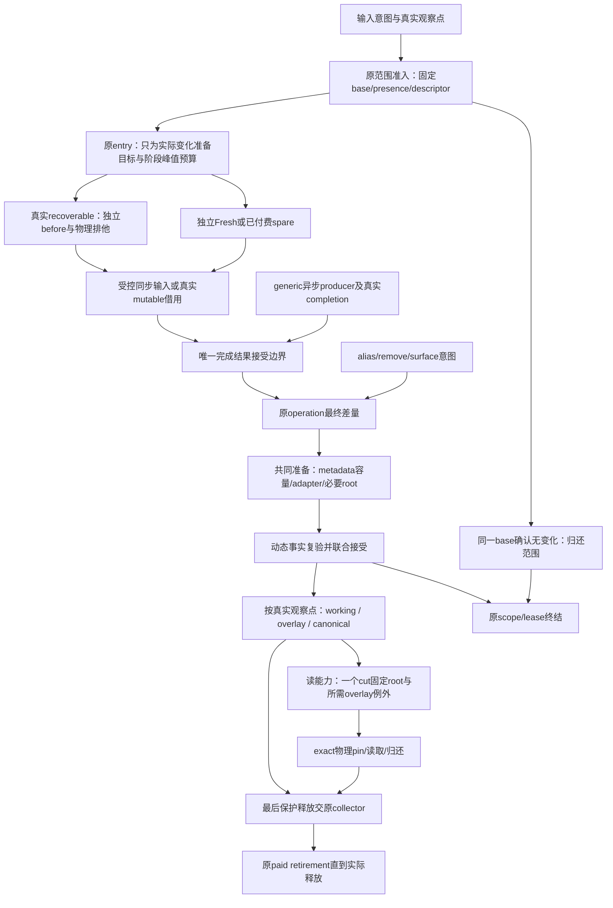

# PageStore原追踪矩阵与分批证据

**2026-10-17当前实施以[V2 §10.26](PIPELINE_PLAN_V2.md#handoff-lifecycle-removal)为准。** 真实研究库已删handoff槽/目标索引、空retained重建及native无用发布准备；H0/H1完整写净少0.673M/0.717M，仍余同批C−U写46.266M/32.208M。CPU/其它控制未过、产品未迁；已知冗余直接落实，不反复证明。证据追加原成本列，原33行前五列及正式资格保持，旧账不跨批扣减。

**2026-10-16整体校准：下一方案统一阅读[PIPELINE_PLAN_V2.md](PIPELINE_PLAN_V2.md)。** V2以产品e238、候选7609和r13同批账重建operation/result/D至最后退出的设计，补入activity连续责任、费用合批前的变化集形成成本，以及冷/暖/尾部完整预算。条件毛预算3.257146M只对应已报价子集，其余固定时仍8.623∶1，不代表整包净收益或可信最终比例。原§13的33行继续作为唯一实施状态/删除矩阵，前五列保持，各成本列已链接V2；本文件其余各批“当前/下一”均是冻结记录，不能覆盖V2设计或92当前裁决。产品未改、候选未迁、正式资格不变。

**2026-10-15当前入口：产品b756不变；最新实际候选见[§19.47](#original-result-pipeline-net)，下一整体设计见[§19.48](#work-generation-design-index)。** 先从容量/逻辑版本/操作权限的工作生成规则剪枝，保留每次公开cut，统一原owner的容量循环、无消费者旧版本直接脱离及原D接受。条件数量和敏感性不是已验证净收益；原子脱离和完整替代单价仍开放。以下开头及各批“当前/下一”保留冻结时点，不覆盖本条。§13仍为唯一33×6实施状态，前五列未因本次设计改变，M6/M7/M8 0/3、calibration2/20、默认关闭及原欠项不变。

**当前产品ed0f229821，最新实测为[§19.27](#rw-boundary-cost-audit)；当前联合候选以[§19.32剩余表示收口](#rw-final-path-selection)为最新修订。** 它接续[§19.28关系管线](#rw-relational-pipeline-design)、[§19.29审计](#rw-pipeline-minimum-audit)、[§19.30原计数/原节点](#rw-minimum-path-proof)及[§19.31尾段构造](#rw-tail-minimum-closure)：原D直接生产并移动交付，成功proof值无需清零；16B读ref配合capture首窗输出，不要求48B永久表示；adapter warm短借原map所有权。正常CPU主路结构选择可进入联合实现与反测，完整资源/净价仍未闭，不能称全局理论最低。产品未改，普通库读写额外52.445M/3.259ms、必要金额与合法替代净收益未知；§13原33×6矩阵为唯一实施状态。旧“当前/下一”不覆盖本段；M6/M7/M8仍0/3、calibration2/20、默认关闭。

本表接续[P01–P05](../br1_pagestore_comparison_scope_20261010/README.md#4-下一主线的唯一准备矩阵)。P04选中**整次同步写的准备、可见性交付和旧版本退出**作为结构责任。P05已有20fd最终输入候选及独立局部报价，但业务控制未闭合、活动产品恢复8198；不重新领取已清理的metadata小项，也不转回通用区域合并。[深入设计审查](#write-protocol-design-review)第1–8节建立准备/借用模型，第9–16节的[完整管线重构蓝图](#whole-pipeline-blueprint)将同一目标扩到发布、adapter、历史和退出。[第17节健全性复审及删除契约](#soundness-and-deletion-review)修正alias接受阶段、restore差量前提及遗漏consumer，并约束同批清理出口。较早条件设计只保留其适用前提；本文件仍是待实施蓝图，不是产品已清理证明。

## 必要算法与当前路径

upstream：保留一次history起点；每页首写必要COW后，同一当前tile继续可写；每次readBytes看到当前值，读锁结束即不再要求保留该次值；最终commit/undo/redo处理原memento。实测16次覆写仍只有首轮K次COW。即使H=0，fixture先commit的原committed tile也导致首轮COW，不能误写为零。

当前：每个公共writeBytes构造操作范围→取得claim/新mutation scope→捕获before比较是否no-op→为改变页选择计划/准备目标→执行像素→seal→联合adapter交付→回收scope/旧资源；下一次write不再拥有上次pending entry。H=1可以把canonical commit减到一个history终点，但本矩阵的每次operation仍独立seal和冷准备。即时读结束后没有业务保留该次读值，不应仅因为“发生过一次读”就判定下一次必须物理COW。

**这不是已证明可删除全部冷准备。** PageStore逻辑发布版本、物理backing、旧值恢复副本是不同对象。`beginWriteImpl`已经调用共同`prepareWritePlanLocked`，可进入RecoverableHandoff；不能称普通native完全没接handoff。最初cold计数仅表示成功新页准备；后继[四进程计划判别](PLAN_PROTOCOL.md)已确认共同矩阵全为FreshPayload、recoverableBefore全部无效，业务208次为116 FreshDiscard+92 FreshCow且也全部无before。因此本包确认了Fresh目标周转，不能将它说成同数量的旧页memcpy，也不能通过放松锁检查获得本来不存在的恢复副本。

两侧正常字节/历史能力相同，但额外保证仍须分账：PageStore的operation rollback、exact retained view、硬预算与晚释放责任比本次upstream正常路径更丰富。不能因未注入失败就认定所有失败合同一致；也不能把全部差额都划为这些保证的必要成本。

## 完整替代的条件设计

优先重用原coordinator/entry/发布终结，不增加第二CPU版本账本。以下顺序针对未来**覆盖现有可见backing**的受控入口；独立Fresh私有副本不必为此承担全部不可失败预备，具体区分见[深入审查](#write-protocol-design-review)。对于已声明完整输入、受控同步拷贝且可在首字节前准备全部后续动作的入口，条件顺序为：

```text
验证范围/输入和所有可失败准备
 → 从真实retained reader、history、pin和last-use决定哪些旧物理值必须保留
 → 准备逻辑目标、metadata/root/adapter安装及费用/退出记录
 → 原capture/发布门内取得有界权限，复验旧值可达性和physical identity
 → 受控不可失败像素操作
 → 消费已准备的安装与费用转移，交付新current，释放权限
 → 原回收管线处理确实失去最后消费者的对象
```

有有效alternate before时沿既有M6可恢复handoff；没有alternate时，上述原地覆盖属于现行[92 §4 M7](../../92_br1_m6_m8_execution_baseline.md#4-m7有界-commit-only-handoff)的commit-only责任，不能用“无读者”直接自授权。任意callback、普通可失败操作、retained exact reader、未准备的后页或安装失败点均保留安全Fresh。旧history起点A不能冒充“本操作开始前当前值B”的恢复副本。

**当前M7门未开放，且每fence至多8页。** 本矩阵K16不能靠改名/拆成两个有半提交窗口的fence绕过上限。若未来证明更大范围有界，须按原合同另测P99与资源并正式裁决；本轮不改阶段顺序、上限或默认值。先把现有M6机会/拒绝以及K1受限commit-only的理论条件对应清楚，不能预报K16可直接原地通过。

已静态清点的首字节后拒绝点如下。它们说明为什么不能只把Fresh换成原地写，也限定了下一准备前移的责任闭包：

| 当前位置 | 当前为何仍可拒绝 | 替代前必须满足 |
|---|---|---|
| Store `beginWriteImpl`，provider完整payload初始化之后 | registerBacking、binding取得、terminal provider result核验、preparePrivateWrite仍可能失败 | 不可失败的数据修改前，原owner已接受目标/物理/metadata及终结责任；不能把写坏的当前页当普通候选丢弃 |
| backend `writeBytes`逐页循环 | 先前页已初始化，后页read/no-op判别、cold storage/预算/provider仍可能拒绝 | 整个有界范围先完成比较/实际目标集合与所有可失败准备；不能靠首个页成功外推后页 |
| `runCpuMutationOperation` callback之后 | finishPreparedWrites、execution.finish、completeAdapter/batch.finish返回失败 | changed输出和原adapter/root安装都必须有可消费的接受证明，正常路径不再晚分配或补做权限决定 |
| Store `sealImpl` | prepareOverlayUpdateLocked、prepareSurfaceLocked、tryInstallLocked可拒绝；容量拒绝保留Sealing供重试 | 将实际overlay/metadata/surface容量及权限准备到前置，保留sibling/revision竞争的原线性化；不能在像素已原地改变后无限等重试 |
| WriteBatch `Private::finish` | seal后finishOwnedTransaction仍可能拒绝/转abort | canonical终结与原manager可见性一起预备，成功后不能补报回滚；失败与close责任不能另建第二owner |

## 量化预测的资格

四次manager寿命、每次K16×16覆写中，当前冷准备1024，upstream COW64；差960，数量差93.75%。这是**两种机制的观测差**，不是960次合法可删物理分配，更不是93.75%总时间收益。

条件模型：若已证明除首写外不需要保留前一current的物理副本，且受控commit-only合法，则物理Fresh目标需求可从约`L×K×N`降向`L×K`；逻辑generation、每次current可见性、实际retag/claim/预算和安装仍需支付。实际plan现已确认；M7许可和K16边界尚未成立，因此该模型只作条件预测，不填“已获净删量”。960份16KiB只对应15MiB累计逻辑payload请求量，不是峰值驻留节省或可删除的输入写字节。

未插桩K16/N16四寿命的write额外CPU为H0 8.256ms、H1 6.976ms，是端点差额而非可回收预算。新机制的净收益须扣去retag、权限复验、不可失败安装准备、fence等待/并行损失及最终清理；不能承诺追回全部差额。前台拆分提示write职责仍重于read本身，但两个诊断过程/侧不授精确排名置信度。

## 代码位置、保证与追踪

下表冻结20fd的实际实现与结果；其中模板返回形式等候选实现细节不是后续设计要求。当前改动/删除要求见下方深入审查第7节，仍沿用本表T01–T08，不另建状态矩阵。

| ID / 位置 | 原owner与理想表达 | 不得遗漏的边界/删除要求 | 状态 |
|---|---|---|---|
| T01 `KisTiledDataManagerPageStoreBackend.cpp::writeBytes` | 原packed producer明确完整输入与同步kernel；no-op比较只提供实际必要事实 | before scope不能被当作永久业务读者；对不变输入仍保留正确no-op与稀疏语义，不先删比较 | 20fd候选完整页接内部overwriteFinalPage；partial/no-op保持。控制未闭合，活动8198未采用 |
| T02 `runCpuMutationOperation` / `beginMutationBatch` | 原operation/history owner保留可见与失败边界，接收已有能力 | 独立operation rollback与整笔rollback不得混同；正常/拒绝/晚guard唯一终点 | 20fd复用全部原owner/失败终点，无新恢复域；scope/seal次数不变，跨操作替代仍未证 |
| T03 `KisPageStore.cpp::beginWriteImpl` / `KisPageWriteCoordinator.cpp::preparePrivateWrite` | 共用selector、原entry/claim，最终Fresh输入以AdoptPreparedWrite直接成为私有Prepared | handoff/ordinary overwrite/provider fallback保持；编译期bool/guard输出，无runtime wrapper | 20fd机制兑现：K16/N16 pin1024→0、metadata inputs3072→1024；write独立省1.186/1.360ms，但业务控制未恢复，候选保留未晋升 |
| T04 `sealImpl` / publication coordinator / metadata / `PreparedTileUpdates` | 已Prepared目标跳过重复mutable publication，其余proof/overlay/canonical仍共同交付 | 预算拒绝、root revision、sibling、adapter/extent原子交付；不能把reserve桶当node已备 | 20fd seal预算拒绝/原目标重试通过；未消除五处post-byte拒绝，前移不可失败安装与M7证明仍未完成 |
| T05 `KisCpuResidentBinding` / provider / owner ledger | 完成独立Fresh最终输入不索取mutable reservation，其余物理claim/retag按原owner | ABA、old cached identity、reader先到/写者先到、swap与晚释放；旧holder不能见新像素 | 20fd删除不被消费的临时writer/pin，原physical gate未放松；handoff16新增行及physical claim完整套件通过 |
| T06 capture/read coordinator / `KisPageStoreReadPage` | 完成的即时读与仍retained的读分开；原pin覆盖真实访问寿命 | 前者不自动增加未来COW需要，后者不可缩寿命；不得用取消capture冒充只读优化 | 20fd旧current/retained reader、provider回调materialize反例通过；读取实现及所有读者寿命未改 |
| T07 history collector / retirement / reclamation | 原generation退出与实际最后free共同结算，避免工作转移 | 前台节省/后台增加一起比较；全局pool和跨case尾单列 | 20fd全case省1.352/1.572ms且close归零；read过程额外CPU仍含后台，具体尾归属与freehand回退因果未闭合 |
| T08 tests / 此包共同夹具 / 原freehand | 先实际plan命中判别，再合法原型，最终独立确认 | no-op、partial/full、K1/8/16、旧reader、失败在首字节前/后、Undo/Redo、资源峰值/close；保持原门 | 20fd双架四套7266通过，97新增行；r1/r2负控制与r3宽区间负点完整保留。按停止规则恢复8198，正式资格未授 |

T03已证实实际alternate缺失，五处post-byte拒绝入口已列，不再调handoff拒绝检查或重复采同一计数。后续优先级按下方深入审查：先收敛原Fresh准备/借用/私有完成，不给可撤销的私有字节强加原地写的全部前置保证；不可失败准备单独对应M7依赖/8页边界。若合法删量为零或依赖未满足，明确保留而不做擅自原地覆盖；在原Fresh整次准备/发布/退出中选择有净价的完整表示替代。一次又一次少分配一个容器不再自动进入主线。

2026-10-10后继[最终输入候选完整结算](../br1_final_payload_pipeline_20261010/README.md)：20fd6d9897存于独立候选分支，当前仍8198。删量和同义存储收益成立，freehand CPU最终点估计回退0.540ms、区间跨零，不能将不确定性扩大称作恢复；r1/r2已观察回退，本包到此停止。重新接纳前须判别业务各阶段实际入口命中、普通路径的调用/释放与回退来源，不能再改输出形式后重复抽样。剩余同义write差额候选对upstream仍7.912/6.687ms；物理1024对64周转及不可失败安装责任未解决，不把本次局部机制当整条主线完成。

<a id="write-protocol-design-review"></a>
## 深入设计审查：准备、可变借用、私有完成与可见交付

本节基于活动产品8198和未接纳候选20fd的源码审查；身份/位置清单见[审查绑定](../br1_write_protocol_design_20261010/identity.json)。没有新增产品修改、测试运行或性能样本。结论是**需要对原写入责任做有界的纵向收敛**：分开“建立目标”“授予可变访问”“接受最终数据”，共同完成冻结、交付和退出。无需重写整个PageStore，也无需再给公共热函数加返回类型模式来尝试恢复性能。

此次纠正三个先前模型缺口：

1. 写入Fresh独立私有字节后仍可失败，与原地改写当前可见字节后不得失败，是两种不同合同。“首字节后仍有拒绝”不是一律应前移的缺陷。
2. 输入字节已齐全与调用者承诺不再修改，是不同事实。当前`InputBytesReady`只表达前者；普通`overwritePage`允许之后继续借用pending，不能自动变成最终输入。
3. freehand总时间的回退没有完成入口命中和线程归因。普通mutable调用本身没有final-input删量，不代表整段freehand必然零命中；不能把−0.540ms定责为guard、wrapper或指令布局。上轮两次表示修订只检验了假设，未证实因果。

### 1. 从合同推导必要工作

对一次同步操作，必要结果是：合法输入得到规定像素；成功返回后current/overlay和兼容索引一致；之前真实retained view/history继续看到原值；失败保持原合同；预算、provider权限及最后释放完整结算。是否使用四个metadata转换、一个临时guard或两个中间集合，不属于这些结果本身。

| 必要事实 | 唯一权威及失效点 | 最小表达 |
|---|---|---|
| 本次允许改哪些key，基于哪个before | 原admission/transaction与原mutation entry；释放claim或transaction终结失效 | 一份已准入范围，跨prepare/执行/交付沿原entry传递 |
| 字节是否独立、可恢复，旧值有谁消费 | provider物理身份/claim、metadata与epoch保护；新的reader、retag、last-use改变事实 | Fresh/recoverable/未来commit-only分别选择；不以refcount或“读完了”授权 |
| 调用者是否还需要修改 | 实际API合同，非buffer非空；完成输入必须禁止同key继续借mutable | mutable borrow与final payload分别表达，普通overwrite合同保持 |
| 私有目标是否已接受为不可变结果 | 原metadata接受结果；原entry只记录本scope已成功完成的动作 | 完成一次后不重放，proof仍由ledger独立核验 |
| 新结果在哪个观察点可见 | 原overlay/root publication和manager gate | 一次所需可见交付；没有消费者的中间表示才允许合并 |
| 剩余清理由谁完成 | 原retirement/history/资源owner直到实际释放 | 发布成功不因清理未结束改报未执行，不新增终结队列 |

最少工作模型采用实际变量：`B`为逻辑写字节，`C`为保留no-op语义所需比较字节，`A`为真实mutable借用数，`P`为仅为preflight创建的冷页guard数，`F`为可直接接纳的final Fresh页数，`G`为仍需产生的逻辑目标，`V`为真实可见交付次数，`R`为实际失去最后消费者的资源数。目标结构为`O(B+C+A+G+V+R)`及必要索引成本；不以现有helper数作为下界。每次改变current仍可能需要新逻辑generation，即使物理backing可复用，也不能把`G`直接减到唯一页数。

### 2. 当前实现相对理想表达的差距

| 位置/证据 | 当前行为 | 差距判断与置信边界 |
|---|---|---|
| `Store.cpp:1530 prepareWrites`、`:1578 beginWriteImpl(...,true)`、`:1670 guard::reset` | 预备冷页时创建完整guard，进入Exposed、取得pin，随即销毁；真正callback再beginWrite | **确定存在“准备借道暴露”的结构冗余。** 临时guard/Exposed转换可分离；物理pin若兼任驻留验证则须另证替代，不能直接预报P对pin全部消失。真实P命中和净时间未测 |
| `Store.cpp:2019 beginWriteImpl` | 同一长函数负责权限检查、冷目标准备、provider调用、已有pending恢复/初始化、payload复制及guard构造 | 冷准备与热借用职责耦合；20fd将全体调用改成模板返回形态，仍未拆开责任。可支持局部重构，不能凭函数长认定毫秒归因 |
| `WriteCoordinator_p.h:51`、`select:2951` | inputKind仅MutableGuard/Semantic；完整payload靠InputBytesReady附在MutableGuard上 | 最终输入能力表达不足。20fd以私有入口声明最终性是正确方向，但将差异传到整个热函数，不是最小影响边界 |
| `MutationPageEntryState:72`、`recordPrepared/recordExposure:3079` | entry的Prepared表示目标已准备；metadata的Prepared表示已不可变。alias和20fd seal又由writable是否有效推断已完成 | **同名不同语义、用资源有效性推断阶段。** 资源reservation的存活与metadata writer是否消费不是同一事实；需显式记录一次性接受点，不能多加独立布尔量 |
| `MetadataCoordinator.cpp:3655` | publishPrivateWrite已支持Prepared重试幂等；正常路径仍检查owner/metadata | 现有幂等性保证必须保留。候选不能仅凭“没有writable”跳过应有失败判断；若用entry接受记录省重复调用，必须证明它由原metadata成功产生且claim保持 |
| `Backend.cpp:2345 captureReadView` | no-op比较和逐页写交错，内部before view活到整个body结束 | before快照有真实比较消费者，但全范围比较完成后即可结束；该寿命不能永久当成外部reader需求。提前释放只为后续受控计划提供前提，不直接授权原地写 |
| `sealImpl:2355 → overlay`、`Batch::finish:611 → finishOwnedTransaction:1040 → commitLocked:866` | 单独无历史写也先进入transaction overlay，再由最终anonymous client提交canonical | 有潜在中间表示重复；H0和H1合同不同，且anonymous可能被其他worker共用。**仅“无memento”不够证明overlay可删**；目前没有净价或完整替代证明 |
| `OwnerLedger.cpp:2129 sealPreparedPage` | 取metadata snapshot、准备ledger node、验证provider、分配validation stamp | proof保证有真实消费者；若做不可失败交付，应前置存储与身份资格，并在实际生产完成后才兑现proof。不能提前伪造完成或无条件删除validate |

源链接及所有受影响consumer仍以T01–T08定位。调用次数确定性与性能置信区间是不同证据；上述结构诊断不把前台/后台未覆盖余项统称可删除开销。

### 3. 推荐目标算法：共用冷准备，分别授予能力

准备侧最小完整单元是现有`KisPageMutationSession/Execution + WriteCoordinator`的**目标准备→借用或完成→私有冻结**；它只是第9–16节完整责任的前半段，不能单独宣布管线收敛。provider、metadata、ledger、publication仍各管原事实；backend只表达输入和本次交付边界。下面是责任伪代码，不是新增公共API或新coordinator清单：



已有pending直接到可变目标就绪，不再经过冷准备；preflight停在就绪状态，不虚构一次借用。所有箭头仍在原owner和锁域之间交接。

```text
mutable beginWrite(key):
    在原execution/scope保护下找到entry
    已有可继续写的pending -> 恢复所需驻留 -> 暴露一个真实guard
    无pending -> prepareOriginalTarget(mutable intent)
             -> 暴露一个真实guard

prepareWrites(range):
    对未准备的实际目标 -> prepareOriginalTarget(mutable intent)
    保持原prepared位与“未被使用目标”的撤销
    不伪造对外guard，不进入Exposed，不标touched

acceptFinalPayload(key, rows):
    复用原选择/entry/预算/descriptor/backing接纳
    独立同步Fresh -> provider完成全部输入 -> AdoptPreparedWrite
    recoverable或provider fallback -> 原物理可变能力执行受控输入
                                  -> 同一私有完成政策消费metadata writer
    在metadata接受后记录此key已PrivatePrepared，标记实际touched
    返回前消费输入；之后该key不能再次借mutable

seal(scope):
    确认无真实guard/borrow逃逸
    尚未私有完成的mutable目标 -> 完成一次metadata publication
    已PrivatePrepared/AliasAccepted目标 -> 不重放writer
    尚有alias意图且未AliasAccepted -> 完成原adoption/replacement
    原proof/overlay/root/adapter接受结果
    接受成功才转移责任；原回收链负责真实退出
```

`prepareOriginalTarget`应从当前冷分支原位抽取，仅冷调用经过它；已存在pending的普通热路径不增加模式dispatcher、第二查表或通用包装层。公共普通overwrite仍允许反复修改，不能路由到final入口。final输入和完整准备分别返回其真实所需结果，不再让整个函数体按bool/guard返回实例化。是否内联只是编译实现结果，不是设计收益来源。

在冷intent中增加“最终完整输入”的表达有实际consumer；可扩展原InputKind枚举，或由私有final入口传入冷准备参数。选择标准是原selector能正交处理输入能力与Fresh/recoverable计划，且普通热借用不新增分派。不得让新InputKind意外跳过现有recoverable路径；相关`select/prepareWritePlanLocked/prepareFreshReplica/isCpuWrite`必须同批审核。

预备路径仍需要原physical writer reservation及真实backing准入，不能把“不创建公共guard”误写为“不取得物理权限”。若首次pin用于验证可访问性/初始化，保留局部受控pin并用原reservation解pin；只有provider Ready/layout/binding合同和反例共同证明该pin无独立保证时才删除。未触碰页仍沿`finishPreparedWrites`取消，不能因没有guard而遗漏其释放。

冷准备的错误结果还必须保持入口差别：preflight拒绝在原执行体尚未开始时，只回收本次未触碰预备，先前history pending仍可继续；实际写入阶段失败仍沿原scope失败/取消合同。共同冷函数负责完整返回已取得资源，原入口决定其既有失败范围，不能用一个无条件`scope=Failed`把前者变成整笔取消。

### 4. 状态与终结收敛

复用原entry的一个`quint8`状态域，区分`IntentOnly / MutableReady / Exposed / PrivatePrepared / AliasAccepted`。本次复审撤回只有一个Finalized就足够的表达：现有pending先publish为Prepared，再执行`ReplacePrivatePreparedBacking`，两次接受之间可拒绝，必须区分。PrivatePrepared只记metadata接受，AliasAccepted记原alias输入已成为target；两者都未表示overlay/root发布。不加新owner或并列布尔量，不提高Page/entry布局上限。详见第17.1节的实际反例。

```text
IntentOnly --冷准备mutable成功--> MutableReady <--> Exposed
MutableReady --原metadata完成接受--> PrivatePrepared
IntentOnly --独立final输入Adopt接受--> PrivatePrepared
IntentOnly --alias Adopt接受--> AliasAccepted
PrivatePrepared + 未消费alias意图 --Replace接受--> AliasAccepted
PrivatePrepared/AliasAccepted --proof/overlay容量拒绝--> 保持原阶段（Sealing重试）
MutableReady/PrivatePrepared/AliasAccepted --原取消接受--> IntentOnly/Detached
无待消费alias意图 + 私有结果 --publication接受--> 原发布owner持有；scope退出
```

物理writer reservation可在metadata完成后暂存到原proof/发布边界，所以PrivatePrepared与`writable.isValid()`不是互斥真值。scope的Active/Sealing/Failed/Detached继续决定是否可借用与是否允许重试，不把publication/retirement全部压入entry枚举。metadata、entry、physical binding是不同事实的owner，不能靠一个万能状态替代其并发保护。

必须同批迁移`recordPrepared/recordExposure/recordCancelled`、mutable借用拒绝、guard reset、alias adoption/replacement/retry、seal retry和cancel。每次记录紧跟其对应的metadata接受；取消失败仍由原scope/orphan责任保留。已私有完成的最终输入重复提交、再次borrow、late guard以及abort/close都必须有明确拒绝或原终点。不能只改seal的一个if而保留其他consumer继续用“有没有writable”推断阶段。

当前final producer承诺同key交付一次，故其PrivatePrepared之后的第二次final、mutable、remove或alias必须在接触字节/状态之前拒绝；若未来确需替换，须显式回到原取消/新目标协议，不能悄悄重开已声明不可变的目标。原普通mutable中的alias/remove能力保持，seal内完成的alias在Sealing下本来就不再允许外部修改。

锁序保持现有execution→scope→Store owner的实际上下文；provider调用和可能大释放仍在owner锁外，metadata/ledger沿各自原锁域处理。不得在已持scope/owner锁时为统一接口重新调用公开getter，也不得将guard或provider引用析构移到会重入同一锁的窗口。抽取冷分支时连同unlock/relock、activeProviderCalls及异常清理一起迁移，不能只抽成功路径。

### 5. 重新分类晚失败：哪些前移，哪些保留

| 失败源 | Fresh私有路径的合法策略 | 原地路径必须达到的条件 |
|---|---|---|
| 后页provider/预算/descriptor准备 | 可以丢弃已填的独立目标；保持操作原子失败。不必为所有Fresh操作增加整批不可失败预备 | 全部目标与真实node/capacity在改变任一可见字节前已接受；失败时尚未修改当前值 |
| 完成输出/borrow终结 | changed容量已经前置；`finishPreparedWrites`的空/unique/capacity检查及`execution.finish`的线程/activePins检查多属使用前提，需逐项证明 | 用原范围和唯一changed输出保证；不能把所有bool返回都视为会随机发生的业务拒绝 |
| metadata/private proof | 可在私有字节完成后验证，拒绝则取消 | 预备ledger容量、stamp空间、身份和可消费接受条件；实际受控kernel完成后兑现proof，不提前声称生产成功 |
| overlay/surface/root准备和revision竞争 | 准备可拒绝，仍保持旧current；容量拒绝按原状态重试 | 在首字节前解决容量与可达的revision变化；冲突需在尚可回退时重准备或Fresh，不能带入不可失败区 |
| adapter install | 当前已预备missing tile/extent。缺tile、preparation identity或map归属不符是具体拒绝来源；需证明claim保护，不能泛称“安装还有分配” | 接受前验证完整安装能力；受保护合法安装不可拒绝。不要仅改assert掩盖真实冲突，也不要在已canonical成功后改报未执行 |
| 已接受后的历史/物理清理 | 与成功业务结果分离，原owner保留尚未释放责任 | 相同；禁止把不可失败fence扩成等待provider/GC的长临界区 |

因此，旧“五处首字节后拒绝”列表仍是源码入口清点，但不是五个已证明必要、同等可达的正常失败。至少要拆成私有工作可撤销、真实容量/竞争、调用前提、不变量违例和已发布清理。重构应优先消除错误交接，不能为每类返回false新增一个恢复状态。

### 6. 发布与物理复用分层推进

**A：当前可设计的准备/能力/冻结收敛。** 保留Fresh、现有operation rollback和真实观察点，落实上面的一个冷准备和一个私有完成政策。它可以同时覆盖final输入及普通preflight的冗余，避免再次只优化F而改动全部A。需要新的完整责任原型/准入，不直接重新合入20fd。

**B：条件性的单独operation直接交付。** 对无history、确为唯一anonymous client、无其他mutation参与且无消费者要求中间overlay的操作，审查是否由原publication coordinator直接消费原entry/proof范围到canonical，省掉中间overlay map及再次export/验证的表示工作。history、共享anonymous transaction、legacy逃逸、持久scope仍保留overlay。`owned==true`或`currentMemento==nullptr`均不足以授权。当前`commitLocked`拒绝活跃mutation；若实现B，必须由原admission向原CommitPreparation做可核验的责任交接并排除新join，不能删掉全局activity检查或另建独立提交器。零分配install、manager联合可见性和失败前旧root稳定是验收条件，当前没有净时间预算。

**C：未来M7物理复用。** 全范围比较/实际改动集合确定后，释放仅服务比较的内部before，再在原epoch gate复验外部reader、transaction base、history、last-use和physical identity。准备真实容量/权限/可消费安装，进入有界fence才执行受控同步kernel和原子交付。省的是不需要新独立物理目标的代际周转，逻辑generation/每次可见性仍存在。M6前置、8页/256KiB、P99≤100μs保持；K16不能拆两个暴露半结果的fence绕过原子性，也不能把普通callback说成不可失败kernel。

A不依赖C开放；C也不能由A测试通过替代。Fresh的分配请求可能由底层pool满足，1024次Fresh不等于1024次系统malloc；新建一个二副本cache或pool不是自动的算法解决方案，必须另计容量/收费/最后释放，当前不建议增加。

### 7. 代码改动与删除闭包（沿原T项领取）

以下是设计要求，**未实施**；T01–T08上表的20fd实测状态不因此改变。

| T项 / 当前代码入口 | 目标及同批删除 | 受影响边界与验证 |
|---|---|---|
| T01 `Backend.cpp:2300 writeBytes` | 只在真实complete-and-final consumer表达最终性；共用原operation/交付。B/C若需两遍计划，使用原entry的有界计划事实，不复制write set | no-op/partial/输入stride/旧before/后页拒绝；不能复用touched位冒充“尚未执行的计划” |
| T02 `Backend.cpp:2064 runCpuMutationOperation`、`:611 finish` | A保持原history/batch/adapter终点；B另证唯一client交接后再删除对应临时overlay交付 | history/anonymous并行client、准备失败、借用拒绝、cancel/close、无已执行callback重放 |
| T03 `Store.cpp:1530 prepareWrites`、`:2019 beginWriteImpl` | 原位抽取冷目标准备；删除preflight临时guard与伪Exposed；普通热pending借用保持直接 | prepared未使用页取消、真实准备失败、保留物理驻留验证；先数P及物理pin原因，再定价 |
| T03/T04 `WriteCoordinator.cpp:2725/2951/3079`、`_p.h:51/72/396` | 输入能力和物理计划正交；原entry状态记录私有完成；不重引20fd全函数模板，删除活动实现的隐式阶段推断 | 所有select/record/isCpuWrite/alias/generic lease consumer迁移；布局不膨胀、不新增动态热查表 |
| T04 `Store.cpp:2355 sealImpl`、`:1119 prepareAliasLocked` | 同一私有完成政策，分别记录metadata与alias接受；删除writable空值阶段分支 | alias替换、proof拒绝、Sealing重试、不允许私有完成目标重新借mutable、原取消保债 |
| T04 `OwnerLedger.cpp:2129`、`PublicationCoordinator.cpp:251/271/376/866/1523` | A保留proof/publication权威；B/C才领取容量前置、有效revision交接和表示合并 | stamp耗尽、provider identity变更、root/sibling rebase、真实storage拒绝，不借assert移除保障 |
| T05 `CpuWriteBindingReservation`、`Store.cpp:1670 reset` | physical reservation只由原owner管理；仅真实borrow拥有公共guard，内部必要pin显式计数 | pin/claim/last-use不是同一事实；ABA、swap、retained raw reader、fallback/handoff全部保持 |
| T06 `Backend.cpp:2345 captureReadView` | A保持现有比较合同；B/C全比较完成后缩短内部snapshot寿命 | 外部retained reader完全不缩短；capture先到/复用fence先到分别验证 |
| T07 `Store.cpp:2606`后accept/cleanup、publication collectRetirements | 不新建清理模型；唯一接受点后按原记录释放 | process/thread CPU、末尾drain和峰值真实容量共同结算，未释放不算已删 |
| T08 原CpuMutation/manager/physical/read tests与两个fixture | 先增加能推翻设计的实际反例，再一次统一验证机制与业务控制 | 同一guard不准重复借、私有完成目标不准复开、alias拒绝不漏重试、输出失败原子、关闭清零 |

最小净删除验收为：preflight不再构造公共guard；final输入不再经历无人消费的可变暴露；seal/alias重试不再以资源空值充当阶段；普通热路径不经过新增final dispatcher；原prepare/成功/取消责任没有复制到第二owner。只搬函数、只改返回类型或新增一层统一wrapper均不算A完成。

### 8. 可预测量、实验准入与停止条件

在保持当前物理/发布选择时，先统计真实guard构造：现有约`A+P+F`，20fd约`A+P`，目标约`A`，其中F仅指适用直接final接纳的目标，普通overwrite不包含在F内。preflight若仍需私有pin，物理pin删量小于P；final handoff/fallback本身仍要取得物理可变权限，不能套用Fresh的零pin预测。metadata final直接接纳的已知删量为每F页少一个执行序列、两个version输入；G/V/输入字节不变。

20fd八块确认给F=1024的整包write节省H0 1.186/H1 1.360ms，是已测参考，不是抽取冷函数后必然再得的新增收益。A的新净预算为`已证final冗余收益 + P的实测可删成本 − 新交接/状态/代码路径及末尾净增成本`，后两项未知。A不能承诺追回全部7–8ms；B只能回收其实际受影响表示，不能领取整个canonical桶；C的960次周转差仍是条件机会而非获准删量。

下次准入先完成有界判别：按packed final、ordinary mutable cold/hot、preflight、history/anonymous、foreground/background及最终drain统计实际命中和独占责任。尤其核验freehand每阶段F/P/A，别再用总CPU差替代普通guard的单价。源码/运行库身份固定；计数观察与未插桩定价分开，采用既有同源公共矩阵，并增加真实普通mutable/preflight控制。若数据不支持主要净预算，停止A性能实施或只按明确结构价值裁决，不无价扩展B/C。

通过准入后再冻结新实验端点、工程δ、块数、区间family与停止规则；不复用r1/r2/r3样本取得新设计资格。最终同时比较父/新和新/upstream、完整生命周期及业务控制；各自语义/失败/资源反例先通过。结构收敛、机制删量、增量收益、控制非劣和M6资格分别裁决。没有新实测，本节不改变20fd否决、活动8198和M6/M7/M8状态。

<a id="whole-pipeline-blueprint"></a>
### 9. 扩大后的责任边界与理想必要图

本次扩大的是**设计与consumer审查范围**，没有实施产品改动，也没有赋予未知价格的候选性能准入。源码仍8198；[扩大审查的源码与consumer索引](../br1_write_protocol_design_20261010/expanded-source-index.json)绑定本文的位置。第7节是准备侧概要，以下细化沿用T01–T08，子编号只是定位，不另设阶段或第二份进度权威。

完整责任现在定义为：**一个真实操作/segment取得写权限，产生私有结果，将规定的变化交付给对应观察者，交还操作责任，直至旧资源由原回收链实际释放。** 从packed/cursor/fill/copy/alias、native legacy/generic lease进入；经原entry、metadata、proof、overlay/root，到manager兼容索引、memento、collector、retirement和close。上游job拆分和kernel仍为竞争解释与控制，不能把通用收益算给PageStore。本轮不改公共操作的可见性/失败粒度，不默许融合多个已可见操作。

设计项须按性质分账：冷准备/借用分离、显式接受记录和共同终结属于等价责任整理；内部导出删除和稀疏adapter属于待证明同义的性能替代；copy/restore等入口“发布后不再发生可恢复安装拒绝”须核对其原合同，是可能的保证补齐，不能先算成纯去重。若需要更多前置node/输出容量或更长claim寿命，增量成本单列；未证明原合同的部分不声称已修复bug。直接canonical与M7属于各有额外前提的条件研究，不因本次统一化而自动开放。

从头表达只需要六类事实：声明的目标范围、产生结果的权限、已经完成的私有结果、要交付的最终差量、对应观察点的接受、实际剩余资源责任。它们有不同所有者和寿命；**统一的是流向与接受规则，不是把这些事实塞入一个总状态机。** 预算/物理claim/最后使用者等安全事实仍由原owner决定。



图只表达依赖，不把所有执行顺序都串行化：普通持久history的working adapter可以在checkpoint前更新，公开current仍是上次checkpoint；overlay与canonical可以分别拥有真实消费者；回收可与后续操作重叠。不能为让图更短而合并这些观察点。

严格语义下界是输入/必要比较字节、实际修改的逻辑事实、真实观察点和最后消费者的交接。下面的算法只是可构造的工程目标，尚未证明全局最优：**同一层的一份事实在其保护期内形成一次；其他层仅建立有独立消费者的投影；同一接受结果不被调用者反复解释或重放。** root路径并集、extent收缩、动态metadata/provider检查和历史可达性各自保留必要工作，不宣称整链O(K)或一次遍历即可完成。

### 10. 分支收敛：正交意图与共同输出

当前已经有共同selector、`OverlayChange`、`KisPreparedOverlayUpdate`、`KisPreparedMutationCommit`、history collector和retirement record。应扩展这些原责任的输入/消费方式，不能重建“统一写入管理器”。下面各维度用原字段与真实入口表达，不照表实现一套可任意组合的运行时flags。

| 分支维度 | 必要差异 | 共同终点 / 不能混同的事实 |
|---|---|---|
| 输入能力 | mutable、同步final bytes、alias source、remove、surface change、generic completion | 最终变更只有“替换为已证明版本 / 删除显式页 / surface变化”；no-op没有交付项。最终bytes不等于普通overwrite |
| 物理计划 | FreshPayload/Discard/Cow、RecoverableHandoff、ReusePending、SemanticOnly | 由原selector一次选择；到达私有最终结果后，后续发布不再按Fresh或handoff复制整条管线 |
| 结果归属 | 单独operation、共享anonymous client、history segment、persistent pending | 规定何时seal、谁提交canonical；不能用owned代替“唯一客户端”，不能每次persistent borrow都seal |
| 访问结束 | 真正guard归还、legacy最后解锁、provider terminal completion | 各自完成访问且证据有效后进入共同私有完成/差量接纳；不把异步工作当ready-host completion |
| 交付目标 | working adapter、overlay、canonical、checkpoint输出、retained before/after | 每个目标保留真实观察点和所需存储；checkpoint输出失败不回滚已接受overlay |
| 退出原因 | 未工作拒绝、私有取消、已接受交付、仅输出拒绝、资源仍欠清理 | 从最后接受点继续；只有未开始工作的Unavailable/Borrowed允许fallback |

各实际入口的最终形态如下，所有行均属于检查范围：

| 实际入口 | 入口保留的专有工作 | 应汇合的位置 | 必须保留的分支理由 |
|---|---|---|---|
| packed全页最终输入 | stride/布局、no-op比较、同步消费buffer | 原冷准备→私有完成→同一operation交付 | provider fallback/handoff仍需真实物理写能力 |
| packed部分页 / cursor callback | 正确before初始化、真实guard、callback失败 | 同一冷准备；guard结束后私有完成 | callback可能失败，不能偷换为commit-only |
| fill/clear | 全页remove、局部像素、实际默认值语义 | 最终差量包含presence，复用同一交付终点 | 未修改页、implicit default、extent收缩不得变成普通replace |
| copy/alias/clone来源 | 精确source view、源强引用与descriptor | alias接受后成为相同Replace proof | source保活/partial copy/自重叠/跨store身份不能省；clone overlay导出有独立消费者 |
| 普通history中的operation | 每操作失败边界，已seal的历史delta | 同一overlay安装；由memento终点提交canonical | 不能把操作取消扩成整笔历史取消 |
| persistent history borrow | 原history owner、分区execution、working adapter | 先归还borrow；checkpoint/finish才私有冻结并交付 | 内部working值不等于公开current；中途显示freeze有真实必要性 |
| native iterator/legacy lease | 最后holder、可能foreign unlock、clear barrier pin | guard归还→原batch共同终结 | 客户端数、存活lease和事务活动数不是同一个计数 |
| generic write lease | releaseAccess、terminal验证、lease admission | 私有结果/proof→同一overlay接受政策 | 当前失败可能保留consumed lease等待abort；不得重放provider release |
| surface/default / conditional removal | revision、被观察版本比较、稀疏extent | 原publication差量与共同安装 | default变化可能影响未显式触碰的registered key；不可仅检查本次K页 |
| Undo/Redo restore | retained root、独立恢复目标/默认值 | 已有`KisPreparedMutationCommit::tryInstall` | restore没有本次writer或新payload，不绕回冷写管线 |
| cancel/abort/close与后台回收 | 每类原记录的接受进度、真实最后使用 | 原取消政策和原retirement record | 清理异步性不能变成新的业务失败状态或第二重试队列 |

复审起点的manager并非都已使用PreparedTileUpdates：`copyPageStore→copyFrom`完成batch后才refresh；restore、trim和read失败尾接受后重建全表，checkpoint/tryCommit也有独立refresh。copy已由081afa7072迁移。MementoManager原changedPages既不覆盖任意restore，也不覆盖root最终释放，2363d824b7已通过两条真实反例修复并删除该字段；不能再把它作为下游稀疏依据。manager应消费底层实际root差量。`tryAbort`的预备table/extent再交换是可复用交付原则，但不能据此要求每次小更新复制全表。manager余项仍待迁移，无新净时间价格。

“统一化完成”要求producer不再自行拼装下游的prepare/install/revoke顺序；但producer仍负责其访问结束条件、线程许可和失败范围。拒绝巨型switch、全函数模板模式、第二delta缓存及为全模式准备资源的万能packet。

### 11. 完整目标算法及合法切入点

**11.1 原操作形成事实。** 在原范围准入内验证输入与失败合同，准备入口本来要求前置的changed容量、missing tile/extent等存储。mutable preflight只停在MutableReady；final bytes在同步provider消费后直接接受私有结果。已有pending继续使用原热路径。remove/alias改变的是同一entry的最终语义，不能先生成一个无消费者的像素结果再撤销；确有先前pending时按原取消/替换规则处理。

完成写入后只形成实际差量。输入“声明了K页”不等于修改了K页；touched、预备、metadata私有完成、alias接受、已交付是不同事实。现有entry/原changed输出承担这些事实，禁止再复制完整write set。差量消费者需要的presence/删除类型，应来自最终entry语义及同一受保护base；不能凭“有proof”等同所有兼容索引最终状态。

**11.2 私有完成与proof。** MutableReady在原metadata接受后转PrivatePrepared；final Fresh直接到这一点，alias直接到AliasAccepted或先经过PrivatePrepared再完成replacement。只在没有未消费alias意图时才能取得最终proof。generic lease沿其原记录进入相同metadata/proof政策，不为统一而分配native entry。ledger proof仍在生产真实完成、descriptor与provider身份核验后取得；proof是后续跨锁域消费的凭据，不能由entry阶段代替。physical writer必须在向reader交付之前结束。失败回收由原scope/lease拥有，已经成功的接受动作不重放。

**11.3 一套overlay接受政策。** `sealImpl`、`finishWrite`、`stagePageRemovalLocked`现在都调用原`KisPreparedOverlayUpdate`，但仍各自编排prepare、重入owner、surface复验、install、cleanup和collect。目标是在原publication责任内统一这一段共同政策，入口传入受保护的最终变更和必须复验的事实，保留各自失败返回含义：native容量拒绝可保留Sealing；generic失败沿consumed lease取消；conditional removal版本已变则拒绝。不能通过一个默认回调把各入口的业务恢复塞进publication owner，也不能在owner锁内调用provider或外部callback。

边界收紧为原prepared aggregate的三段：owner内形成原candidate；owner外prepare；caller在owner内完成其专有复验后，由aggregate完成surface/install及已接受后的旧proof交接。三caller必须保留锁转换及专有复验，尤其conditional removal在unlock期间并未取得排他page claim。不能用同一个默认callback掩盖这个区别。metadata deferred cleanup优先并入原candidate寿命，由同一显式锁外销毁入口负责，不让析构偷偷取owner锁。具体的迁移/删除与顺序证明见第17.2节；不能只增加一层调用而保留三份原政策。

**11.4 内部提交消费原delta，消除无意义往返。** 当前backend/memento先`preparedPages()`导出三组容器，`commitLocked()`又逐项比对原`PreparedTransactionState`，再给epoch构造不可变delta。内部路径理想上由原`CommitPreparation`保护原delta，直接向metadata/epoch/history输出所需投影，不先伪装成外部提交者再校验自己。

具体约束：在同一owner入口确认transaction、无冲突活动及非空事实后取得原commit claim；原delta在所有unlock窗口中保持不变，descriptor/provider保活另保持。memento只准备必要的retained-before/after输出；原changed keys/default标志已由跨节点恢复与最终释放反例证明不完备并删除，不能重新加入。原epoch仍需要一份稳定、排序的不可变变化值供root准备和revision retry；这不是无用副本。优先把内部输入直接投影到该已有值，省掉中间`KisPreparedPageSet`导出与相等性往返；不引入第二可查询overlay或另一个持久“已校验缓存”。

对外`commit(transaction, prepared)`仍必须检验foreign/missing/duplicate/stale proof及surface/removal的一致性，然后进入同一提交核心；`preparedPages()`本身仍服务clone、history变化查询和其他外部consumer，不能全删。自动commit prune已被独立upstream公共API对照证明不合法，不能仅因为它曾消费导出就保留或给它新增交付框架。内部可信性来自**当前持有的原claim和原容器**，不是一个`trusted=true`布尔参数。跨线程裸引用、在claim前导出后假定不变、仅凭相同transaction id跳过核验，均不接受。

这项替代不需要取消overlay，因此可同时覆盖H0/H1的真实内部commit。是否值得实施仍需定价；对H1一次history只commit一次，不能把64次seal的数量全部算成导出往返删量。

**11.5 兼容索引与发布构成一个已准备的交付。** 当前packed/cursor的manager completion先调用publish再`PreparedTileUpdates::install`；clear还在publish后`resolveCurrentPagePresenceInto`。后者并非额外exact capture，但仍经过publication/backend/store查找，而且存在返回失败的接口。

2026-10-11语义复核修订：显式writeBytes(default)与隐式默认页的像素暂时相同，但extent、redo及后续setDefaultPixel不同。无工作判定必须同时证明已有显式页；history commit不得自动裁剪。1249396fa8已修正两者。73a9fde6b3进一步以原准入、session/alias、prepared adapter建立公开getTile(writable)缺页的显式presence，已有batch不提前seal；七类42个upstream观察点一致。native cursor仅声明目标、从未请求像素仍不建立页。此实现新增alias/metadata及独立发布费用，不代表发布粒度已为严格下界。restore/trim的集合扫描不能仅因旧intent缺口存在而永远认定必要：继续核验batch取消及raw恢复，再从真实consumer证明保留范围。独立backend经friend制造的不一致是防御性边界证据，不单独证明公共manager热路径必须为它付全量费用。显式purge(area)和clearAll仍有实际consumer，其准备/接受/交付纳入T04.10原项，不因删除自动prune而视为已完成。

目标在原admission存活、manager gate已取得时，证明所有实际changed key都有可消费的existing tile或prepared node、正确index归属及extent存储。先用覆盖关系、表寿命和排他修改约束建立不变量，不默认额外遍历一次D来重查安装本来要查的每个key。不能覆盖的具体变化才在接受前补验证并计价。clear所需presence优先由同一最终差量填入原`PagePresenceScratch`；若其语义不能等价表达，则保留原查询直到证明成立。不能用publication前的旧current presence冒充结果，不能把partial default写一律当删除。

所有能够导致部分adapter安装后拒绝的条件须在开始安装前处理；在保持同一gate/claim的前提下，publish成功后的合法安装只消费预备资源。真实迁移应沿packed、cursor、clear及相关history working adapter一次传播：删去已消失失败源的`if (!install)`业务取消/清空输出；仍可失败的入口继续保留明确拒绝，不能全改assert。现状只证明有晚拒绝接口，尚未证明正常执行可触发混合可见性bug；**若无法证明不可拒绝，方案不能宣告交付原子性已完成。**

不为这项保证再建全量tile计划。优先复用原prepared候选数组、changed/presence和range claim；一次额外全量验证若不可避免，必须计入净成本。faffef592c将旧m_missing扩为m_prepared的实际缺项/删除准备，普通warm写仍无记录；删除的GC/key能力也必须在接受前准备。manager gate仅覆盖必要验证及交付，不能搬入像素、provider等待或大析构。historyOwner的working adapter没有本次overlay/root publication，须保持这一实际模式，不能使用虚假的publish成功掩盖不同观察语义。

同一交付政策必须进一步覆盖copy、checkpoint、history commit/restore及trim：copy把固定source、准入后target和实际changed差量延续到prepared adapter交付，不能先finish batch释放保护再重查结果；checkpoint/commit用已接受segment/history差量，不因root拒绝而漏掉已经seal的cache失效。**restore的版本D是实际current→target根差异，但不是完整adapter差异。** faffef592c反测发现intent多项与独立backend缺项；数量相等也不证明集合相等。最终在接受前查原hash和目标root的完整集合，只为实际多项/缺项准备节点，原root D直接用于失效缓存；无manifest、N-key中间表或持久第二索引。最坏H log M+M+S log S加D交付仍计价，不能宣称纯D。接受后必须先释放backend/publication门锁，再进入tile barrier；manager gate及原transaction gate保留各自责任。trim保留完整候选发现需要的遍历，但已知changes应贯穿返回，避免成功后重建全部未变wrapper；同步输出的存储与寿命在接受前解决。

全量重建的第三个实际caller是`read(QIODevice*)`的读入/提交失败尾（当前:672），不能遗漏。它在先clear、再beginHistory之后工作，恢复目标按这个已有合同确定，不能擅改为恢复导入前整张图。`refreshPageStoreIndex`及精确view重装cache还服务rough/普通legacy copy、borrowed packed、planar失败回滚；在这些模式未迁移前不是死代码，详见T04.12/T06.3。原`rebuildPageStoreIndex`只有三个caller全部替换后才能连定义/声明一起删除；需要保留的是全量语义，不是必须保留这个“接受后清表再分配”的实现。

`allocatedPages()`本身也要分清consumer：完整列举确实需要N规模工作；当前将canonical manifest与overlay removals/proofs逐项`std::find`合并，另做最终排序，比较/移动最坏可达`O(D×(N+D))`，只有新增overlay页时也可能出现D²放大。理想全量列举从同一受保护视图，使用有序base与有序净delta归并或原root集合运算，付出必要N+D及排序成本；若原输入没有有序保证，必须显式计排序。稀疏交付则不调用全量列举。优先调整原导出表达，不新建常驻presence cache；这一冷/控制路径的规模问题单独定价，不宣称它解释K16 write循环。

**11.6 原交付终点与回收。** overlay接受时proof由producer交给原transaction；canonical接受时root/metadata/预算class和所需history输出一致完成。segment还可因adapter而继续持有原admission；这不等于仍可写。checkpoint若read输出准备拒绝，只重试捕获已接受结果，不能重放字节或再次提交同一段。按§17.6已完成的owner修订，独立owned终结、显式history commit和restore在各自原gate下收尾，不复制一份业务终结状态；旧last anonymous client合并及其假成功/整群abort已删除，不再作为目标算法。

旧proof失去选择资格后，原history collector按真实可达性决定是否退休；metadata接受detach之前已有paid retirement record/债务。原队列继续处理provider接受、terminal验证和最后free。`retireRecord`已记录provider接受结果并禁止重发，`acceptEffect`已是无新存储交接，这些是应复用的正确设计。允许合并无新事实的通知，但不能删除collector扫描期间的repeat、遗漏末次pin释放后的自主进度，或以延后drain伪造前台收益。

### 12. 后续管线影响与不能删除的投影

| 下游责任 | 上游收敛带来的影响 | 理想调整 / 必须保留 |
|---|---|---|
| metadata私有版本 | final目标更早成为不可变；取消不能只认MutableReady | entry记录成功动作，原metadata保留权威；Prepare/Adopt/Abort及重试consumer一起迁移 |
| ledger proof / provider | 不再保证每个目标都存在writer reservation | proof按真实完成与身份取得；动态provider epoch/descriptor/physical identity复验不因内部输入而删除 |
| overlay替换 | producer种类减少对交付的影响 | 继续由原change集合统一replace/remove；superseded proof到install接受前仍有效 |
| surface/extent/default | 直接delta及clear presence不再依赖重新查询同一结果 | 只扩张可按本段key；删除可能需要base+完整overlay子树边界；default变化有全目录consumer，不能套普通K页模型 |
| epoch/root | 内部输入可少一次导出往返 | 原不可变delta、root路径并集、revision/rebase保护保留；同一事实未改变才可复用已准备值 |
| adapter | 可使用已知结果类型，接受点更清楚 | 真实prepared node与表归属、manager联合可见、旧wrapper/raw pointer保护仍保持 |
| memento | changed keys/default flag与after retention可从受保护delta共同准备 | before/after/history dirty extent有真实持久consumer，不能借用结束后悬空或省掉retained输出 |
| capture / checkpoint | 私有完成结果可被内部消费，但尚未公开 | current/oldData/immutable exact保持不同selector；新增capture与发布/复用的线性化不变 |
| cancel / abort | 私有完成阶段更多，某些入口先接受交付再输出 | 每次只取消仍归本owner的对象；已交付proof不能由原scope再revoke；保留部分abort的剩余记录 |
| history / retirement | 更少临时表示可能减少引用及释放；真正generation数未必下降 | 原元数据可达性与physical last-use分别判断；不把commit完成当物理free完成 |

三类表示应明确区别：原transaction overlay是可查询权威；epoch不可变delta/root candidate是跨锁准备与rebase输入；memento/captured view是独立寿命的业务输出。它们不能因内容相似就合并成一个可变容器。当前真正可疑的部分是**没有独立consumer的导出往返、重复解释接受结果，以及producer复制共同终结政策**。每份待删投影须证明消费者已迁走，且变化/失效规则被原保护完整覆盖。

单独operation直接canonical仍为条件研究：在形成最终差量后，由原admission向原commit claim原子交接，阻止新join；证明没有消费者需要该次中间overlay、没有其他mutation/legacy/generic活动。这样才可能连overlay node与导出一起消除。若仅能保留overlay，也应完成上述内部输入与交付收敛；不能使整个蓝图被直接canonical或M7卡住。该条件路径仍复用同一metadata/epoch/预算/adapter接受核心，不另立提交器。

<a id="whole-pipeline-change-index"></a>

**2026-10-17必要性主线更新：** [可执行反证与源码索引](../br1_pipeline_refactor_20261010/cost-necessity-r0/RESULT.md)约束T05.1–2及T08.1–2，原准入时点的表示/服务生命周期清理继续，费用896→56×G仅保留为有资格入口的条件目标；不是现有全部手续必要，也不领取性能收益。297项定向Qt测试、9个预算观察及有限模型补证已完成；[V2 §10.20](PIPELINE_PLAN_V2.md#cost-necessity-admission)与成本学说§26为最新解释。原33×6前五列/生产状态保持。
### 13. 扩大后的修改索引与删除追踪

**2026-10-14当前主线见[§19.42](#instruction-cost-causal-mainline)：** 按用户要求形成能解释指令成本原因的闭环学说；先把主要语义事件、动作生成、机器展开与完整寿命连成可复算模型，再据合法替代净价选择根源优化。稳定槽/result/D等不预授主解；静态路径审计仅补T05.2/T08.2成本证据，原33×6前五列及状态不变。

**2026-10-14管理抽象审计见[§19.38](#management-abstraction-cost-model)：** 同一状态变化的多层协议展开是下一整体判别方向；range/cold仅约5.350M责任暴露，不能单独解释43.913M差额。最小表达与反推预算已列，替代净价仍未知；无新增性能样本、产品实施或完成项。

**2026-10-14最新分段诊断见[§19.37](#pipeline-segment-instruction-account)：** 产品仍b7565f0f6f；H1后14次896页物理复用仍约41.538M指令，每次公共write仍建range/batch/adopt。主格价格通过、部分控制格超门、计数库轻量目标失败均保留；只补原行成本证据，不新增完成项或状态表。

**2026-10-14最新派生证据见[§19.36](#h1-management-representation-trial)：** 产品仍b7565f0f6f；同锁事实、预算缓存、activity容量和清理交接完成固定48过程普通定价，原33×6相关成本列回填。activity节点1280→64证明该寿命周转有3.313M条件进程净价，但组合CPU、压力回收及最优稳定索引未过完整资格，以下生产实施状态不因此完成。未测的cold/D存储与物理稳定登记继续开放。

最新查账见[§19.27](#rw-boundary-cost-audit)，产品仍ed0f。普通读写额外52.445M/3.259ms重现；physical908次申请、activity后台退出和delivery1408次free已落实对象；收费准备/retag6.805M是plan内主要当前责任。以下仅补原成本列，不把责任暴露标为必要金额或净收益，原33×6状态不增加完成项；前批§19.25–26保留原账期。

2026-10-12统一读写实施以[§19.24](#unified-rw-implementation)及产品ed0f229821为准，本表33×6逐行回填；§19.22–23是bb62时的设计/定价依据。CPU版本迁移与删除已完成，预算合批、proof进一步合并及性能/资源资格仍有欠项。各行前批数量保留原批次含义，不移作新版事件实测。

2026-10-12指令责任更新只沿本表原33行推进：T03.1/T04.2/T04.3/T07.2承担完整身份建立/退出候选，T05/T06/T07.1及T07.3提供claim、读者、取消和最终释放闭包。具体索引、尚未关闭的五项设计门及数量/独立验收约束见[§19.11](#instruction-lifecycle-design)；没有将本次58个诊断过程写成生产实施或收益完成。

同日后续[§19.12完整性审查](#budget-completeness-review)补全额外指令与scope余项，将该候选明确限定为待比较设计：99.7M当前责任不授予净预算榜首，旧目标交接和预算类迁移未闭。原33行实施状态未变化，不增加第二张实施表。

最新[§19.13交接探针](#donor-lifecycle-capability)补出真实ActivePending窗口，原槽最多一个备用容量、实际checkout才物理独占；T03/T04/T05/T07及原出口的详细源码索引已补。只有能力/诊断和模型证据，原33行不标生产实现完成，完整替代净价保持未知。

2026-10-12候选02bccf1d12已完成[§19.15](#resident-operation-pipeline)的完整代码闭包；下面在原33行更新受影响状态，历史批次叙述保留原义。[结果/删量/新增费用/阻塞](../br1_pipeline_refactor_20261010/RESIDENT_OPERATION_RESULT.md)不另建实施矩阵。当前只有安全、结构和机制验证，净价与业务控制未验收。

这是同一T01–T08的**唯一实施索引**，共33子项、6列。以下每行以ed0f229821前缀为最新实施状态，“前批/此前冻结记录”保留各批原义；旧行号不视为新源码定位。产品迁移净价见[§19.24](#unified-rw-implementation)，最新普通库诊断差额见[§19.27](#rw-boundary-cost-audit)，未实施的关系管线设计见[§19.28](#rw-relational-pipeline-design)，并按[§19.29](#rw-pipeline-minimum-audit)、[§19.30](#rw-minimum-path-proof)、[§19.31](#rw-tail-minimum-closure)与[§19.32](#rw-final-path-selection)修订。用户授权的读写重写可改变metadata/预算/publication/adapter/回收依赖，不受旧保留标签限制；未实测的单项净价保持未知，不能将共享净收益重复分给多行。

[§19.20协议收敛](#read-write-converged-protocol)和[§19.21迁移净价](#native-read-write-migration-price)保留bb62账期，§19.24记录后继ed0f统一。原ledger逐页handoff准入合批、完整资源尾/业务资格仍开放，不能把已实施的结果表示替换等同全部蓝图完成。§19.28在18行成本列接入删除设计，§19.29在13行补最低成本审计；§19.30在6行追加原计数/原节点及零费用生命周期约束；§19.31在11行追加seal/read/adapter/root/退出约束；本轮§19.32在9行追加原D移动交付/读首窗融合/warm短借的选择，原前五列与实施状态不变。

**当前产品推进至b7565f0f6f，联合实施及净价见[§19.33](#rw-minimum-pipeline-implementation)。** 以下12行追加本批状态与成本；其他行保留原冻结证据，未因本批自动核销。上文§19.28–19.32“未实施/可进入实现”描述设计时点，由本批实际范围更新；activity/descriptor/ID/D紧凑化及完整资源尾仍开放，原33×6矩阵数量不变。

| 索引 / 原位置与实际consumer | 原owner / 生命周期及锁上下文 | 目标表达 | 同批删除或明确保留 | 验证、状态 | 成本账：必要／删除／新增与价格边界 |
|---|---|---|---|---|---|
| T01.1 Backend `writeBytes`→`runCpuMutationOperation`；manager getTile→ensureWritablePage/writeBytesBody | 原execution/batch与公共显式页语义 | final只传冷准备；no-op证明存在；公共writable miss沿原准入建立alias，原batch合并 **§19.19目标：原operation一次选择兼供比较与写准备，内部全capture退出。** | 删无消费者final guard、错误no-op及只建wrapper分支；原Private复用source/alias政策，无新存在账本 | **ed0f229821：noop比较之后发行两类页ID，删除writeFinalPage/overwriteFinalPage壳；原一次base选择保持；见§19.24。** 前批冻结：**bb62f28b7a：一次选择兼供compare/prepare，full/partial进final私有结果；写内部full capture=0，noop仍多一次空session，控制未过；见§19.21。** 此前冻结记录：**最高优先级重写设计，未实施（§19.19）；以下为既有冻结结果。** 1249396fa8/73a9fde6b3；双架9784，独立upstream七类42观察点一致；拒绝/已有彩色页重试/同批先前内容保留通过；新增实现费用及整包净价待测 | **2026-10-17必要性续证：24合同数据行/52计数格；隔离义务获证，1024/1024局部物理claim不授K16全D资格或必要金额；按[V2 §10.22](PIPELINE_PLAN_V2.md#cancellable-necessity-boundary)和[原责任定位](../br1_pipeline_refactor_20261010/commit-window-necessity-r0/NECESSITY_DESIGN.md)继续，未实施/未计价整包。**  **2026-10-17费用原语与父级计价**：[固定66过程/858格](../br1_pipeline_refactor_20261010/budget-primitive-price-r0/RESULT.md)H0/H1两组暖门通过，4项其它退出观察失败保留。H1每次delta/fits/activate约257/791/427指令，settle宽桶/retained约508/288；五项现价约2.035M，不是全可删。56次批归还有112次底层事务，父约束与本地变化不能混用单价。按[V2 §10.15](PIPELINE_PLAN_V2.md#budget-primitive-price)统一原D、实际变化项/父约束与稳定权威表示及最后退出；动态机器解释/替代净价仍缺，不迁产品或晋升原实施列。  **2026-10-16原操作/原行净价**：[operation-owner-r0](../br1_pipeline_refactor_20261010/operation-owner-r0/RESULT.md)，独立range/adopt退役，32位原行索引；暖申请−952，H1/H0 write−2.510M/−3.294M，派生净−35行。131项合同含真实等待反例通过；仍余30.316M/75.161M，CPU/重编控制/全资源与迁移未过，实施状态不晋升。  **2026-10-16同版共同账：r1暖非Pixels28.844M/6.403倍；外围9.139M、计划/接受编排7.263M、存储5.920M，以上免费仍1.448倍；当前现价不是可删预算。真实入口及整体替代见[V2 §10.5](PIPELINE_PLAN_V2.md#current-pipeline-budget)，观察失败保留，实施状态不晋升。** **V2整体校准：范围/语义判变与source合同；通用内容收益对称比较。** [当前设计/预估](PIPELINE_PLAN_V2.md#v2-generation)。  **r12比例复审：H1候选暖非内容42.039M、46919条/页；公开writeBytes范围/输入/operation不能被准备/接受三个子树22.015M包络替代。范围外20.024M未有合法替代价，通用工作优化仍须对称比较upstream。** [完整证据/方案评估](../br1_pipeline_refactor_20261010/implementation-preconditions-r12/RESULT.md)。  删final临时guard；新增显式存在/默认页正确性工作单列。旧业务writable_presence命中0不推广到其他入口；共享write阶段只记一次，局部净价未知。 §19.29审计（未实施）：有序producer直接消费原bound ordinal，删二分后再查原写集；公共随机key和输入边界验证保留。 [最低成本限制](#rw-pipeline-minimum-audit)。；[全管线构造§19.50](#whole-pipeline-lower-envelope)：本行原owner/失败/最后退出及删项已纳入方案；只有模型与预算原语证据，无新增产品或净价资格 [全链动作合同§19.51](#whole-pipeline-management-contract-index)：本行按entry责任的事实窗口、失败出口、动作数量及删除约束实施；仅设计，未授产品或净价。  **2026-10-17全写预算/事实细价：** [V2§10.19](PIPELINE_PLAN_V2.md#whole-fact-pipeline-budget)统一本行的原D、资源/费用、接受和退出删除条件；100过程1300格补价，无算法修改或实施晋升。完整替代价/资源仍未知。 **2026-10-17有限隔离计价：** 驻留packed全目标预备只增约0.24M，pin峰值1→16；不代表全部PageStore能力，继续原operation/D到全部consumer/退出的服务生成审查。 [证据及原索引责任](../br1_pipeline_refactor_20261010/upstream-isolation-price-r0/NECESSITY_DESIGN.md)。 **当前主线改为[最小必要的正向构造](../br1_pipeline_refactor_20261010/minimum-necessary-protocol-r0/MINIMUM_PROTOCOL.md)：必要事实→完整承载实现→保留成本；参考核已运行，完整生产接入与价格未闭，不以旧冗余清单替代。** |
| T01.2 Backend `fillRect:1963`、`copyFrom:2426`；batch `replaceFullTile` | 原entry/source；operation或segment | 用最终replace/remove/alias差量共同交付 | 合并fill/copy重复delivery收尾；保留source强引用和copy选择语义 | **ed0f229821：final、source初始化、mutable、alias均进入原私有结果；partial与removal共同回归；见§19.24。** 前批冻结：**bb62f28b7a：partial fill/copy迁入同一final结果协议；整页alias/语义删除保留；见§19.21。** 此前冻结记录：7c36dceb85合并fill；081afa7072将copy最终差量接入同一收尾，双架7364通过；净价待全包 | **2026-10-17必要性续证：24合同数据行/52计数格；隔离义务获证，1024/1024局部物理claim不授K16全D资格或必要金额；按[V2 §10.22](PIPELINE_PLAN_V2.md#cancellable-necessity-boundary)和[原责任定位](../br1_pipeline_refactor_20261010/commit-window-necessity-r0/NECESSITY_DESIGN.md)继续，未实施/未计价整包。**  **V2整体校准：范围/语义判变与source合同；通用内容收益对称比较。** [当前设计/预估](PIPELINE_PLAN_V2.md#v2-generation)。  fill/copy交付共用政策；source保活、alias及真实复制保留。当前存储覆写不代表这些入口都命中，独立时间未知。；[全管线构造§19.50](#whole-pipeline-lower-envelope)：本行原owner/失败/最后退出及删项已纳入方案；只有模型与预算原语证据，无新增产品或净价资格 [全链动作合同§19.51](#whole-pipeline-management-contract-index)：本行按entry责任的事实窗口、失败出口、动作数量及删除约束实施；仅设计，未授产品或净价。  **2026-10-17全写预算/事实细价：** [V2§10.19](PIPELINE_PLAN_V2.md#whole-fact-pipeline-budget)统一本行的原D、资源/费用、接受和退出删除条件；100过程1300格补价，无算法修改或实施晋升。完整替代价/资源仍未知。 |
| T01.3 manager `clear:824`、`writeBytes:1590`、`writePageStoreOperation:1769` | 原manager gate、PreparedTileUpdates、OperationDelivery | 统一已准备交付政策；明确实际changed/presence | 仅在等价证明后删clear发布后presence重解；输入覆盖去重有真实用途仍保留 | **ed0f229821：未改该consumer独立合同，联合双架回归通过；旧业务/压力缺口保留，不另领收益；见§19.24。** 前批冻结：**bb62f28b7a：本包未改变该消费者的独立合同；联合候选通过原回归，单行不另领净收益；见§19.21。** 此前冻结记录：ccbf0bcb0d已迁移三caller；clear直接交最终presence、发布后重解退出；稀疏/extent/失败与双架行为通过 | 2026-10-17：[共同接受及冷暖目标预算](PIPELINE_PLAN_V2.md#core-fact-target-budget)：H0三record新建/销毁各1024→0、H1暖子槽换代各896→0，净写−1.006M/−0.198M；H1暖非内容27.396M、1∶1缺口22.892M，首段非内容另6.627M。控制失败/缺价保留，原型不迁；原D/费用/接受与冷建立共同重构，不能以record小项达标。  **V2整体校准：范围/语义判变与source合同；通用内容收益对称比较。** [当前设计/预估](PIPELINE_PLAN_V2.md#v2-generation)。  删clear后的presence重解；PreparedTile仍需准备/安装。与T04.7同一交付链，不能重复计收益。 §19.26新同批backend外2.882M混合manager前段、packed范围建立和最后delivery；不能全归入口，未独立定价。 §19.27同窗外包络3.229M中manager/packed前段1.029M、最后delivery1.967M；全局及端点CPU门均失败，只领取指令责任，不算净收益。 §19.28设计（未实施）：range/adapter/原delivery最后退出随原存储一起清理；不早放claim。 [完整闭包](#rw-relational-pipeline-design)。；[全管线构造§19.50](#whole-pipeline-lower-envelope)：本行原owner/失败/最后退出及删项已纳入方案；只有模型与预算原语证据，无新增产品或净价资格 [全链动作合同§19.51](#whole-pipeline-management-contract-index)：本行按entry责任的事实窗口、失败出口、动作数量及删除约束实施；仅设计，未授产品或净价。 |
| T01.4 manager `copyPageStore:1173` / `refreshPageStorePages:1084`；Backend `copyFrom:2426` | 固定source、准入后的target view、原batch/manager | copy差量与admission贯穿共同adapter交付；目标no-op不得使用等待前事实 | 删除先finish再重解/创建wrapper、旧容量helper及三参数refresh；不新增双store锁嵌套 | **ed0f229821：未改该consumer独立合同，联合双架回归通过；旧业务/压力缺口保留，不另领收益；见§19.24。** 前批冻结：**bb62f28b7a：本包未改变该消费者的独立合同；联合候选通过原回归，单行不另领净收益；见§19.21。** 此前冻结记录：081afa7072完成；双架7364及真实wait反例修复；最终presence查询0、capture仍1；实际裁剪改变前置拒绝，范围外变化通过。a24062删除history刷新；2eb9f4236f迁完最后两copy并删exact-view refresh，live-source语义缺口见T06.3 | **V2整体校准：范围/语义判变与source合同；通用内容收益对称比较。** [当前设计/预估](PIPELINE_PLAN_V2.md#v2-generation)。  copy最终presence查询1→0、capture仍1属冻结数量；准入/差量贯穿成本仍在，单项净时间未知。；[全管线构造§19.50](#whole-pipeline-lower-envelope)：本行原owner/失败/最后退出及删项已纳入方案；只有模型与预算原语证据，无新增产品或净价资格 [全链动作合同§19.51](#whole-pipeline-management-contract-index)：本行按entry责任的事实窗口、失败出口、动作数量及删除约束实施；仅设计，未授产品或净价。 |
| T02.1 Backend `runCpuMutationOperation:2064` | execution借用→history或batch；provider/像素锁外 | 一次决定结果归属，成功/拒绝按接受点结束 **§19.19目标：原scope持一个操作计划与D，统一准备、接受和取消，其他接口随之迁移。** | 删除分支内重复的changed清空/交付解释；保留未执行拒绝不毒化history | **ed0f229821：原scope/entry统一CPU终结；空session尚有成本，不宣称noop全免；见§19.24。** 前批冻结：**bb62f28b7a：原operation/session承接原范围准入、原D和取消；没有第二owner，noop准入费用仍待修正；见§19.21。** 此前冻结记录：**最高优先级重写设计，未实施（§19.19）；以下为既有冻结结果。** 7c36dceb85已迁移；单一execution终结/失败输出，history与standalone真实接受顺序保留；双架通过 | **2026-10-17必要性续证：24合同数据行/52计数格；隔离义务获证，1024/1024局部物理claim不授K16全D资格或必要金额；按[V2 §10.22](PIPELINE_PLAN_V2.md#cancellable-necessity-boundary)和[原责任定位](../br1_pipeline_refactor_20261010/commit-window-necessity-r0/NECESSITY_DESIGN.md)继续，未实施/未计价整包。**  2026-10-17：[共同接受及冷暖目标预算](PIPELINE_PLAN_V2.md#core-fact-target-budget)：H0三record新建/销毁各1024→0、H1暖子槽换代各896→0，净写−1.006M/−0.198M；H1暖非内容27.396M、1∶1缺口22.892M，首段非内容另6.627M。控制失败/缺价保留，原型不迁；原D/费用/接受与冷建立共同重构，不能以record小项达标。  **2026-10-17费用原语与父级计价**：[固定66过程/858格](../br1_pipeline_refactor_20261010/budget-primitive-price-r0/RESULT.md)H0/H1两组暖门通过，4项其它退出观察失败保留。H1每次delta/fits/activate约257/791/427指令，settle宽桶/retained约508/288；五项现价约2.035M，不是全可删。56次批归还有112次底层事务，父约束与本地变化不能混用单价。按[V2 §10.15](PIPELINE_PLAN_V2.md#budget-primitive-price)统一原D、实际变化项/父约束与稳定权威表示及最后退出；动态机器解释/替代净价仍缺，不迁产品或晋升原实施列。  **2026-10-16原操作/原行净价**：[operation-owner-r0](../br1_pipeline_refactor_20261010/operation-owner-r0/RESULT.md)，独立range/adopt退役，32位原行索引；暖申请−952，H1/H0 write−2.510M/−3.294M，派生净−35行。131项合同含真实等待反例通过；仍余30.316M/75.161M，CPU/重编控制/全资源与迁移未过，实施状态不晋升。  **2026-10-16同版共同账：r1暖非Pixels28.844M/6.403倍；外围9.139M、计划/接受编排7.263M、存储5.920M，以上免费仍1.448倍；当前现价不是可删预算。真实入口及整体替代见[V2 §10.5](PIPELINE_PLAN_V2.md#current-pipeline-budget)，观察失败保留，实施状态不晋升。** **消费者r1：H0投影4096→0而validate/revoke各1024保持，净少3.231M write/3.604M process；H1暖投影0→0、实际无改善，主缺口仍在共同编排/生成存储。未迁产品，原实施列保持。** [同版价/原型/余额](../br1_pipeline_refactor_20261010/accepted-consumer-r1/RESULT.md)；[V2 §10.4](PIPELINE_PLAN_V2.md#original-result-consumers)。  **持久身份r0：原result/overlay/metadata/epoch/导出撤销派生贯通，H1 write−3.144M、H0反增3.284M，均八块同向；提交端两个仅需version的consumer仍重投影，独占价待测。原型未迁、实施列不晋升。** [净账/索引/下一条件](../br1_pipeline_refactor_20261010/accepted-identity-r0/RESULT.md)；[V2 §10.3](PIPELINE_PLAN_V2.md#accepted-identity-net)。  **V2整体校准：受控CPU原operation贯穿准入至退出；legacy/guard真实权限保留，控制capacity按最后consumer复用。** [当前设计/预估](PIPELINE_PLAN_V2.md#v2-generation)。  **r13工作生成诊断：两版共同暖write根上下文2744申请/2576普通释放，即每cut49/46；原operation/result/D应贯穿同一表示和最后consumer寿命，避免每层包装、登记与重新建立。14.400M根上下文尚未展开，这些次数不是全部可删量。** [互斥账/清理约束](../br1_pipeline_refactor_20261010/implementation-preconditions-r13/RESULT.md)。  **r12比例复审：完整暖内核须贯穿原operation准入至交付/退出；其成本在三个已测子树外仍未独立定价。唯一owner不等于每种状态都经过全部通用手续，不能改借不同history入口或复制状态表省事。** [完整证据/方案评估](../br1_pipeline_refactor_20261010/implementation-preconditions-r12/RESULT.md)。  业务46 operation及59 seal未因本重构减少（16a4观察）；统一结果解释不等于减少真实调用。独立价格未知。 §19.26范围准备3.947M，内含reserveRange2.973M/beginBatch0.447M/adopt0.416M；64次操作的range管理申请1408次，已知K下的节点粒度待统一，金额不是净可删。 §19.27原范围1280次free及batch/scope128次free延后至manager delivery，共1408/359424B已配对；范围存储优化须同时计最后退出。 §19.28设计（未实施）：已知范围原稳定槽/ordinal贯穿整次操作，cold按真实D准备；动态增长仍归同一owner。 [完整闭包](#rw-relational-pipeline-design)。 §19.29审计（未实施）：execution/scope逐页双门列入成本；有界借用与真实结构门分别证明，不预报固定锁删量。 [最低成本限制](#rw-pipeline-minimum-audit)。 **§19.37分段诊断：** 本公共H1每64次write仍新建64套range/batch/adopt，持久scope借用0；range3.918M，其中暖层3.383M。transaction复用未消除管理容量周转，不能直接改走发布语义不同的业务historyOwner入口。 [数据](#pipeline-segment-instruction-account)。 **§19.38抽象审计：** range/cold约5.350M跨组暴露仅占差额12.18%，scope重建是真问题但不足以解释主额。原权限逐cut结束、容量按高水位/最后借用复用，未实施。 [模型](#management-abstraction-cost-model)。  **§19.39计价纠偏：** 物理复用、收费稳定与metadata需求为不同状态；公共64cut和原权限边界继续保持，容量重建不冒领主要差额。 [新账](#protocol-core-price-and-design)。 **§19.44对象生成：** K16每cut write-set21笔，目标数组/范围/session/execution/batch等13笔；K4整式事前25笔、4次独立计数一致。真实可见cut保留，容量表示与权限寿命分别审查，未授净价。[数据](#management-object-generation)。 **§19.45完整责任价：** 完整operation存储/前台退出7.544–7.557M（同树区间、两校准），只清这些区间不足以解释43.922M差额；不等于所有66笔申请的全部费用。[数据](#management-object-envelope-price)。  **§19.46事实管线：** base选择2.129M、operation/adapter外壳2.580M，caller函数体仍余3.898M；原result/layout/physical费用/proof/D按真实失效审查。noop比较10.292M与changed0.339M分开；夹具根未全额核销。候选与20文件索引见[事实图](../br1_pipeline_refactor_20261010/state-fact-price-r0/FACT_PIPELINE.md)，净可删仍未知，无产品/状态晋升。 [§19.47原result联合候选普通H1写省4.193M、process省4.423M；operation整体存储未被替代，仍待净价。](#original-result-pipeline-net) [§19.48工作生成端统一方案：容量/版本/权限按真实寿命，条件剪枝及删除闭包；仅设计，原子证明和整包净价未闭。](#work-generation-design-index)；[全管线构造§19.50](#whole-pipeline-lower-envelope)：本行原owner/失败/最后退出及删项已纳入方案；只有模型与预算原语证据，无新增产品或净价资格 [全链动作合同§19.51](#whole-pipeline-management-contract-index)：本行按scope、lifetime_storage责任的事实窗口、失败出口、动作数量及删除约束实施；仅设计，未授产品或净价。  **2026-10-17全写预算/事实细价：** [V2§10.19](PIPELINE_PLAN_V2.md#whole-fact-pipeline-budget)统一本行的原D、资源/费用、接受和退出删除条件；100过程1300格补价，无算法修改或实施晋升。完整替代价/资源仍未知。 |
| T02.2 Batch `finishClient:585`、`finish:611`、`cancelForBarrier:470`、lease final unlock | batch leaseMutex/backend mutex；最后holder | 共同终结只处理最后客户端；clear barrier先满足专有保护再进入原取消 | 不合并clients/leases/activity为一个数；已终结客户端不再解释下一阶段 | **ed0f229821：未改该consumer独立合同，联合双架回归通过；旧业务/压力缺口保留，不另领收益；见§19.24。** 前批冻结：**bb62f28b7a：本包未改变该消费者的独立合同；联合候选通过原回归，单行不另领净收益；见§19.21。** 此前冻结记录：7c36dceb85已收敛最后登记撤离；删不可达privateCancelled/abort分支；foreign unlock、clear晚finish/新batch隔离通过 | **V2整体校准：受控CPU原operation贯穿准入至退出；legacy/guard真实权限保留，控制capacity按最后consumer复用。** [当前设计/预估](PIPELINE_PLAN_V2.md#v2-generation)。  **r12比例复审：范围外20.024M包含scope/batch/交付及真实退出，不能将整桶等同本函数或已证明必要税；稳定容量按实际最后holder返还，新执行单价未知项保留。** [完整证据/方案评估](../br1_pipeline_refactor_20261010/implementation-preconditions-r12/RESULT.md)。  clients/leases/activity各有事实消费者；最后holder政策去重。未测其独占时间，不能把整个batch桶领取。；[全管线构造§19.50](#whole-pipeline-lower-envelope)：本行原owner/失败/最后退出及删项已纳入方案；只有模型与预算原语证据，无新增产品或净价资格 [全链动作合同§19.51](#whole-pipeline-management-contract-index)：本行按scope责任的事实窗口、失败出口、动作数量及删除约束实施；仅设计，未授产品或净价。 |
| T02.3 Backend `finishOwnedTransaction:1040`、`commitHistory:1753` | transactionMutex→publicationLock；history还有memento owner | 内部提交直接消费原delta；selectors按原接受点隐藏/切换 | ce903删除纯commit导出往返；1249396fa8删除不合法自动prune；clone独立导出保留 | **ed0f229821：未改该consumer独立合同，联合双架回归通过；旧业务/压力缺口保留，不另领收益；见§19.24。** 前批冻结：**bb62f28b7a：本包未改变该消费者的独立合同；联合候选通过原回归，单行不另领净收益；见§19.21。** 此前冻结记录：**02bcc候选：共同commit接受原delta或借用operation行，history/memento保留原输出；净价未验收。** 空事务活动/无效身份拒绝保持；双架9750，显式默认写跨redo/改默认色验证；净价未知 | **V2整体校准：受控CPU原operation贯穿准入至退出；legacy/guard真实权限保留，控制capacity按最后consumer复用。** [当前设计/预估](PIPELINE_PLAN_V2.md#v2-generation)。  内部commit导出三容器退出；公共clone导出保留。与T04.4同一删除项，只入一次账。；[全管线构造§19.50](#whole-pipeline-lower-envelope)：本行原owner/失败/最后退出及删项已纳入方案；只有模型与预算原语证据，无新增产品或净价资格 [全链动作合同§19.51](#whole-pipeline-management-contract-index)：本行按history_restore责任的事实窗口、失败出口、动作数量及删除约束实施；仅设计，未授产品或净价。 |
| T02.4 原admission/session activity → `CommitPreparation` | 原scope拥有独立事务，claim贯穿owner unlock及adapter交付；显式history保留overlay | 条件性owned终态由原entry/候选直接进入共同canonical准备，避免无消费者中间表示 | 先证quiescent、无其他producer/overlay读者、原D覆盖交付；若成立同批删该路径overlay移交/无用extent/旧恢复，禁止第二写集/owner及删除动态activity保证 | **ed0f229821：未改该consumer独立合同，联合双架回归通过；旧业务/压力缺口保留，不另领收益；见§19.24。** 前批冻结：**bb62f28b7a：本包未改变该消费者的独立合同；联合候选通过原回归，单行不另领净收益；见§19.21。** 此前冻结记录：**02bcc候选：sole-session匿名H0直入共同canonical核心，68次过渡overlay实测为0，失败仍归原scope；净价未验收。** 新8过程：相同32个projection producer由父11～14个事务变为32个，cold仍132；独立失败保证有8个root拒绝反例，不能回退。中间表示净预算未知，按§17.6做有限判别，不预授收益 | **V2整体校准：受控CPU原operation贯穿准入至退出；legacy/guard真实权限保留，控制capacity按最后consumer复用。** [当前设计/预估](PIPELINE_PLAN_V2.md#v2-generation)。  独立producer事务11–14→32，canonical12–15→33（冻结前后观察）；新增18–21次发布不能漏计。当前commit/intermediate规模见§18，合法替代净价仍未知。 本批：H0 overlay68→0、匿名canonical68保持；整包K16/H0/W16指令省4.1571%、CPU省0.5366ms，不能单独归给直接canonical。；[全管线构造§19.50](#whole-pipeline-lower-envelope)：本行原owner/失败/最后退出及删项已纳入方案；只有模型与预算原语证据，无新增产品或净价资格 [全链动作合同§19.51](#whole-pipeline-management-contract-index)：本行按scope责任的事实窗口、失败出口、动作数量及删除约束实施；仅设计，未授产品或净价。  **2026-10-17全写预算/事实细价：** [V2§10.19](PIPELINE_PLAN_V2.md#whole-fact-pipeline-budget)统一本行的原D、资源/费用、接受和退出删除条件；100过程1300格补价，无算法修改或实施晋升。完整替代价/资源仍未知。 |
| T03.1 Store `prepareWrites:1530` / `beginWriteImpl:2019` 冷分支 | execution→scope→owner；provider调用锁外 | 一份完整冷准备，preflight停在MutableReady **§19.19目标：原稳定entry/版本槽直接承载紧凑准备，静态共有事实不逐页重建。** | 删除临时公共guard/伪Exposed；物理pin按真实驻留职责留或删 | **b7565f0f6f（§19.33）：原计数替代两处Retiring扫描；同锁选中record复用。activity/descriptor/ID仍开放。** 此前冻结：**ed0f229821：全部CPU producer使用KisPagePrivateWrite，通用writer准备/完成/取消fallback删除；真实recoverable只装before转换及原result；见§19.24。** 前批冻结：**bb62f28b7a：原冷entry持native reservation，接受前不安装Unpublished；1024写预留、896物理复用；见§19.21。** 此前冻结记录：**最高优先级重写设计，未实施（§19.19）；以下为既有冻结结果。** **02bcc候选：原write plan统一Fresh、recoverable和WorkingCapacity；896次实际复用，generation不合并；净价未验收。** 3f2826d464已迁移；未触碰取消/真实容量拒绝/先前pending通过；驻留pin有据保留 | **2026-10-17必要性续证：24合同数据行/52计数格；隔离义务获证，1024/1024局部物理claim不授K16全D资格或必要金额；按[V2 §10.22](PIPELINE_PLAN_V2.md#cancellable-necessity-boundary)和[原责任定位](../br1_pipeline_refactor_20261010/commit-window-necessity-r0/NECESSITY_DESIGN.md)继续，未实施/未计价整包。**  2026-10-17：[共同接受及冷暖目标预算](PIPELINE_PLAN_V2.md#core-fact-target-budget)：H0三record新建/销毁各1024→0、H1暖子槽换代各896→0，净写−1.006M/−0.198M；H1暖非内容27.396M、1∶1缺口22.892M，首段非内容另6.627M。控制失败/缺价保留，原型不迁；原D/费用/接受与冷建立共同重构，不能以record小项达标。  2026-10-17：[r1净价与同版比例](PIPELINE_PLAN_V2.md#consumer-lifetime-repricing)H1/H0完整写−1.029M/−0.858M；H1暖非内容/内容6.1153，仍无整包预测。3997安全通过，真实未来Idle时序已解释，控制/CPU/资源限制保留；研究基线r1，产品不迁。  **2026-10-17费用变化集净价未过：** [r0](../br1_pipeline_refactor_20261010/budget-changes-r0/RESULT.md)H1暖−0.577M、全写仅−0.431M，H0全写+0.375M；metadata准入丢失摘要快路径，完整服务净价须计入。[r1](../br1_pipeline_refactor_20261010/budget-changes-r1/RESULT.md)恢复摘要但1项退出观察未闭、无性能样本。按[V2 §10.16](PIPELINE_PLAN_V2.md#budget-changes-net)先闭合退出，再计原D联合净价；两候选未选用，当前算法C1、产品及原实施列保持。  **2026-10-17费用原语与父级计价**：[固定66过程/858格](../br1_pipeline_refactor_20261010/budget-primitive-price-r0/RESULT.md)H0/H1两组暖门通过，4项其它退出观察失败保留。H1每次delta/fits/activate约257/791/427指令，settle宽桶/retained约508/288；五项现价约2.035M，不是全可删。56次批归还有112次底层事务，父约束与本地变化不能混用单价。按[V2 §10.15](PIPELINE_PLAN_V2.md#budget-primitive-price)统一原D、实际变化项/父约束与稳定权威表示及最后退出；动态机器解释/替代净价仍缺，不迁产品或晋升原实施列。  **2026-10-16原操作/原行净价**：[operation-owner-r0](../br1_pipeline_refactor_20261010/operation-owner-r0/RESULT.md)，独立range/adopt退役，32位原行索引；暖申请−952，H1/H0 write−2.510M/−3.294M，派生净−35行。131项合同含真实等待反例通过；仍余30.316M/75.161M，CPU/重编控制/全资源与迁移未过，实施状态不晋升。  **2026-10-16同版共同账：r1暖非Pixels28.844M/6.403倍；外围9.139M、计划/接受编排7.263M、存储5.920M，以上免费仍1.448倍；当前现价不是可删预算。真实入口及整体替代见[V2 §10.5](PIPELINE_PLAN_V2.md#current-pipeline-budget)，观察失败保留，实施状态不晋升。** **消费者r1：H0投影4096→0而validate/revoke各1024保持，净少3.231M write/3.604M process；H1暖投影0→0、实际无改善，主缺口仍在共同编排/生成存储。未迁产品，原实施列保持。** [同版价/原型/余额](../br1_pipeline_refactor_20261010/accepted-consumer-r1/RESULT.md)；[V2 §10.4](PIPELINE_PLAN_V2.md#original-result-consumers)。  **持久身份r0：原result/overlay/metadata/epoch/导出撤销派生贯通，H1 write−3.144M、H0反增3.284M，均八块同向；提交端两个仅需version的consumer仍重投影，独占价待测。原型未迁、实施列不晋升。** [净账/索引/下一条件](../br1_pipeline_refactor_20261010/accepted-identity-r0/RESULT.md)；[V2 §10.3](PIPELINE_PLAN_V2.md#accepted-identity-net)。  **V2整体校准：选择/判变与执行分离；原result行直接消费，activity责任连续交接，typed保活不冒充写权限。** [当前设计/预估](PIPELINE_PLAN_V2.md#v2-generation)。  **r13工作生成诊断：idle取出清activity后erase，再经跨owner锁physical准备和claim，reservePrivateWrite用try_emplace重建；896次IdleIndex释放与896次PhysicalPlan申请支持该空窗机制。原activity连续移交准备/写责任，条件删896申请/释放，尚缺对象配对及合法净价。** [互斥账/清理约束](../br1_pipeline_refactor_20261010/implementation-preconditions-r13/RESULT.md)。  **r12比例复审：PhysicalPlan暖整树12.482M，C−P增2.684M；base/输入/private completion等外围未包入。原D费用/record事实收敛只领真实删量，不将整个责任金额当可删或理论必要价。** [完整证据/方案评估](../br1_pipeline_refactor_20261010/implementation-preconditions-r12/RESULT.md)。  **r11责任净账：H1物理计划净增均值2.639M，其中1024次TakeIdle（含128次未命中）1.222M。原D借用资格、费用与原activity/record定位须共同收敛，不能只数896次命中。** [完整证据与设计修正](../br1_pipeline_refactor_20261010/implementation-preconditions-r11/RESULT.md)。  **r9真实普通入口每write新scope；H0/H1均1024写集节点、512冷块、64scope周转，单缓存checkpoint不命中主格。同步工作存储按最后guard/adapter归还，原controller代次配对禁止跨Store误复用。** [完整账](../br1_pipeline_refactor_20261010/implementation-preconditions-r9/RESULT.md)。 临时P/F删除；新数量账确认1088 cold对应1088成功Fresh/rows/retire，upstream副本请求128。额外960个物理退出有直接证据，但合法删除及净价未知，见§18。 最新payload核对H1 cache hit95.4–98.5%，对象周转不等于系统分配；条件双工作目标加undo origin为H1少896对象，尚无实施/净价。 同步票据候选实际少1088申请（初报1092多算默认对象），record56→24 B，但H1净节省−0.0155ms，未获推进资格，候选撤回，见LIFECYCLE_DECISION §6。 本批：主H1非默认身份1088→192，新增checkout/retag/rekey与未命中成本尚未定价。 §19.25新ed0f计价：target21.351M，其中physical12.415M、target余项8.936M；均为暴露非净预算。 §19.26 target21.200M，前段2.525M（cold1.646M）、physical12.385M、128次Fresh4.794M、后段0.435M；未对齐1.061M区间跨0。cold申请768次与8block+4目录模型相符，条件一次K槽可少704申请/2816预算gate，完整替代净价未知。 §19.27 physical908次管理申请＝896 native activity＋4 handoff prepare＋8 prepared slot；Fresh另128 activity。descriptor prepare/install各1024调用、堆申请0；plan native准入2.917M含真实检查，非全可删。 §19.28设计（未实施）：原base/layout/result直传；activity稳定槽、cold容量及合成ID一起迁移，真实provider ID保留。 [完整闭包](#rw-relational-pipeline-design)。 §19.29审计（未实施）：queryMutationBase同锁复用exact slot；以原versionCount−historyCount−1推导transient，核对全部计数维护后删除版本链扫描，不加新计数器。 [最低成本限制](#rw-pipeline-minimum-audit)。；[最低路径构造](#rw-minimum-path-proof)：§19.30：native/generic两处准入以V−H−1推导，generic另计原未安装native；保留目标存在/缺页提前分支。同锁record一次投影，跨unlock重选不删。有限代数非产品回归，净价null。 **§19.33实装账：只核销重复扫描和定位，不把剩余写准备视为必要费。** [本批证据](#rw-minimum-pipeline-implementation)。 **§19.36派生实验，非生产完成：** 同锁事实A省0.341M write；activity容量C在A+B上再省1.481M write/3.313M process。临时缓存非最终稳定槽，cold/D与物理容量未测未核销。 [数据](#h1-management-representation-trial)。 **§19.37分段诊断：** H1暖Target12.095M；独立展开physical plan9.278M、coldPages1.236M，暖cold存储观察672次allocator入口。不是纯Fresh费用，当前责任非可删净价。 [数据](#pipeline-segment-instruction-account)。 **§19.38抽象审计：** 不重复造统一private result；现有原结果应以有寿命引用贯穿后段，静态layout/base在同锁消费，失效才重选。当前和理想均可能O(KW)，主要待证差在逐页协议展开。 [模型](#management-abstraction-cost-model)。  **§19.39细价：** 晚暖外推的真实physical observe/claim/commit约1.358M，private登记2.175M，不能把plan全叫物理锁费。原稳定activity/result/D整体事实链为下一判别单位；尚未实施。 [新账](#protocol-core-price-and-design)。  **§19.40派生净价：** 同锁activity登记复用已编入普通候选；与metadata合窗整包H1写省1.559M，不单领其净价。产品未迁移，稳定slot/result/物理费用生命周期仍待整体构造。 [证据](#fact-window-net-account)。 **§19.43动态接账：** H1稳态每cut Target约28、Seal4、Outside34次管理申请；申请prepare cache miss为0仍约3168次申请。下一按具体类型/构造/失效/最后释放解释生成量，不以缓存小修替代；当前存储链9.584M非净删额。[数据](#instruction-causal-dynamic-price)。 **§19.44数量闭环：** K16 cold为8块+4次目录增长，activity16笔；H1全部66笔/cut已分类，K4新规模25笔预测兑现。对象构造/转换价格组超门，不按33/66申请比例领取指令收益。[数据](#management-object-generation)。 **§19.45完整责任价：** PhysicalPlan剔除Activity后7.559–7.734M，晚暖约7956–8151条/页；此前Target申请均在cold/activity，指向无新节点的身份/收费加工。K9条件价误差约−1%。[数据](#management-object-envelope-price)。  **§19.46事实管线：** base选择2.129M、operation/adapter外壳2.580M，caller函数体仍余3.898M；原result/layout/physical费用/proof/D按真实失效审查。noop比较10.292M与changed0.339M分开；夹具根未全额核销。候选与20文件索引见[事实图](../br1_pipeline_refactor_20261010/state-fact-price-r0/FACT_PIPELINE.md)，净可删仍未知，无产品/状态晋升。 [§19.47派生native原layout传递实测3072次值复制表达及1024次自反读取→0；完整候选H1写省4.193M，不单独归价，未迁产品。](#original-result-pipeline-net) [§19.48工作生成端统一方案：容量/版本/权限按真实寿命，条件剪枝及删除闭包；仅设计，原子证明和整包净价未闭。](#work-generation-design-index)；[全管线构造§19.50](#whole-pipeline-lower-envelope)：本行原owner/失败/最后退出及删项已纳入方案；只有模型与预算原语证据，无新增产品或净价资格 [全链动作合同§19.51](#whole-pipeline-management-contract-index)：本行按result、lifetime_storage责任的事实窗口、失败出口、动作数量及删除约束实施；仅设计，未授产品或净价。  **2026-10-17全写预算/事实细价：** [V2§10.19](PIPELINE_PLAN_V2.md#whole-fact-pipeline-budget)统一本行的原D、资源/费用、接受和退出删除条件；100过程1300格补价，无算法修改或实施晋升。完整替代价/资源仍未知。 |
| T03.2 `beginWriteImpl`已有pending、guard `reset:1670` | 原entry稳定索引及真实borrow寿命 | 普通热借用直接；final输入不污染热分派 | 不重新引入20fd的全体函数bool/guard模板形态；保留真实pin/reset | **ed0f229821：未改该consumer独立合同，联合双架回归通过；旧业务/压力缺口保留，不另领收益；见§19.24。** 前批冻结：**bb62f28b7a：本包未改变该消费者的独立合同；联合候选通过原回归，单行不另领净收益；见§19.21。** 此前冻结记录：**02bcc候选：已有pending与guard热分支保留，新增spare源复制仅发生冷prepare；未引入每个guard的第二事实账；净价未验收。** 3f2826d464已迁移；reborrow/默认重置及原布局限制通过，普通业务性能待测 | **V2整体校准：选择/判变与执行分离；原result行直接消费，activity责任连续交接，typed保活不冒充写权限。** [当前设计/预估](PIPELINE_PLAN_V2.md#v2-generation)。  真实A次热借用与pin/reset保留；final不再污染热分派。与T03.1数量分母不同，不重复算删量。；[全管线构造§19.50](#whole-pipeline-lower-envelope)：本行原owner/失败/最后退出及删项已纳入方案；只有模型与预算原语证据，无新增产品或净价资格 [全链动作合同§19.51](#whole-pipeline-management-contract-index)：本行按scope责任的事实窗口、失败出口、动作数量及删除约束实施；仅设计，未授产品或净价。  **2026-10-17直接清理：** [handoff-lifecycle-r0](../br1_pipeline_refactor_20261010/handoff-lifecycle-r0/RESULT.md)实删handoff槽/目标索引、空retained与native无用发布准备；H1暖896组/1008次归零，真实预算结算保持。H0/H1写净−0.673M/−0.717M、进程−0.844M/−0.787M，八块同向。8010安全过、24旧阶段预期失败保留；CPU及4重编/6候选控制未过，产品不迁。已删除预算不再领取，完整目标见[V2§10.26](PIPELINE_PLAN_V2.md#handoff-lifecycle-removal)。 |
| T03.3 Store `finishWrite:4642`、Backend legacy `release` | activeWrites或native scope；provider访问结束后原claim仍在 | producer专有结束后汇合metadata/proof/overlay政策 | 删除generic独立编排overlay公共步骤；不重放releaseAccess | **ed0f229821：未改该consumer独立合同，联合双架回归通过；旧业务/压力缺口保留，不另领收益；见§19.24。** 前批冻结：**bb62f28b7a：本包未改变该消费者的独立合同；联合候选通过原回归，单行不另领净收益；见§19.21。** 此前冻结记录：**02bcc候选：generic acquire/finishWrite消费共同ReuseWorkingCapacity结果并保留公开独立proof和原overlay接受；净价未验收。** 4dc89bada3已收敛overlay接受/清理；lease专有release/private完成仍有真实合同，双架验证通过 | **V2整体校准：选择/判变与执行分离；原result行直接消费，activity责任连续交接，typed保活不冒充写权限。** [当前设计/预估](PIPELINE_PLAN_V2.md#v2-generation)。  native/generic共享overlay交接；generic releaseAccess仍必要。单项净价格未知，不能将全部overlay成本归本项。 **§19.31剩余路径：** scope门内用现有execution链和activePins判定quiescence；三处Exposed扫描一起迁移，不删真实guard/physical保护。 见[构造与反例](#rw-tail-minimum-closure)。；[全管线构造§19.50](#whole-pipeline-lower-envelope)：本行原owner/失败/最后退出及删项已纳入方案；只有模型与预算原语证据，无新增产品或净价资格 [全链动作合同§19.51](#whole-pipeline-management-contract-index)：本行按scope责任的事实窗口、失败出口、动作数量及删除约束实施；仅设计，未授产品或净价。 |
| T04.1 WriteCoordinator `_p.h` InputKind/EntryState；`record*`/selector | 原entry与metadata各自权威；原锁域 | PrivatePrepared与AliasAccepted分清已接受动作 | 删除资源有效性阶段推断；不增加并列布尔/owner | **ed0f229821：原activity借唯一私有结果；recoverable候选只增加非拥有指针，facts64B/冷Page512B门保持；见§19.24。** 前批冻结：**bb62f28b7a：原metadata activity借原entry；真实writer和未接受native reservation分清，冷投影保留准入事实；见§19.21。** 此前冻结记录：**02bcc候选：所有native/generic producer接入共同候选；无新write set，公开generic证明仍独立；净价未验收。** 3f2826d464已迁移；两次真实接受之间和alias之后proof拒绝均通过重试反例 | **V2整体校准：选择/判变与执行分离；原result行直接消费，activity责任连续交接，typed保活不冒充写权限。** [当前设计/预估](PIPELINE_PLAN_V2.md#v2-generation)。  PrivatePrepared/AliasAccepted区分两个接受点；状态表达变化不等于减少metadata转换或锁，净价格未知。 §19.28设计（未实施）：删除CPU entry未被实际消费的operation/writer；双架条件104→88B，权限改由原reservation表达。 [完整闭包](#rw-relational-pipeline-design)。 §19.29审计（未实施）：状态/现有bitmap驱动真实D，新增计数或索引须有consumer并计维护成本。 [最低成本限制](#rw-pipeline-minimum-audit)。；[全管线构造§19.50](#whole-pipeline-lower-envelope)：本行原owner/失败/最后退出及删项已纳入方案；只有模型与预算原语证据，无新增产品或净价资格 [全链动作合同§19.51](#whole-pipeline-management-contract-index)：本行按result责任的事实窗口、失败出口、动作数量及删除约束实施；仅设计，未授产品或净价。  **2026-10-17全写预算/事实细价：** [V2§10.19](PIPELINE_PLAN_V2.md#whole-fact-pipeline-budget)统一本行的原D、资源/费用、接受和退出删除条件；100过程1300格补价，无算法修改或实施晋升。完整替代价/资源仍未知。 |
| T04.2 Store `sealImpl:2355`、alias准备、四个seal入口 | scope门贯穿；owner按阶段释放 | 共用私有完成与差量；终点意图只在边界决定 **§19.19目标：native必要中间态由同一记录表达，删除无consumer工作值转换。** | 消除调用者对布尔参数组合的猜测；保留checkpoint try-lock/跨线程许可差异 | **b7565f0f6f（§19.33）：seal完成/proof与原D生产融合，activePins替代暴露扫描，成功proof清零及无source扫描退出；alias顺序保持。** 此前冻结：**ed0f229821：CPU原result直接封印；nativeWriteSnapshot/通用seal往返删除，固定completion在issuer绑定验证；见§19.24。** 前批冻结：**bb62f28b7a：内部proof消费完成的原native结果；CPU completion随issuer一次保留，facts仍64B；见§19.21。** 此前冻结记录：**最高优先级重写设计，未实施（§19.19）；以下为既有冻结结果。** **02bcc候选：内部CPU proof和descriptor归原预付version facts；alias/source初始化先归还不用spare；公开多凭证保留；净价未验收。** 3f/7c36已完成私有接受与四入口SealMode；终态/重试/worker checkpoint/捕获拒绝双架通过 | **2026-10-17必要性续证：24合同数据行/52计数格；隔离义务获证，1024/1024局部物理claim不授K16全D资格或必要金额；按[V2 §10.22](PIPELINE_PLAN_V2.md#cancellable-necessity-boundary)和[原责任定位](../br1_pipeline_refactor_20261010/commit-window-necessity-r0/NECESSITY_DESIGN.md)继续，未实施/未计价整包。**  2026-10-17 [原D直接接受](../br1_pipeline_refactor_20261010/original-input-r0/RESULT.md)研究删除detachment副本及ownerIndex，H1完整64次申请/释放、1024行复制兑现；普通写仅−0.097M点估计且块差跨零，不授产品迁移。 既有完整成本与阶段证据按[覆盖账本](PIPELINE_COVERAGE.md)、[V2 §10.18–21](PIPELINE_PLAN_V2.md#core-fact-target-budget)分批读取；本行前五列未改变，不以研究候选更新产品状态。 **2026-10-17有限隔离计价：** 像素后proof/接受存储失败点须区分外部义务和自身手续；晚seal重试合同保持，不能循环证明所有现价必要。 [证据及原索引责任](../br1_pipeline_refactor_20261010/upstream-isolation-price-r0/NECESSITY_DESIGN.md)。 **当前主线改为[最小必要的正向构造](../br1_pipeline_refactor_20261010/minimum-necessary-protocol-r0/MINIMUM_PROTOCOL.md)：必要事实→完整承载实现→保留成本；参考核已运行，完整生产接入与价格未闭，不以旧冗余清单替代。** |
| T04.3 Publication `KisPreparedOverlayUpdate:249–468`；native/generic/removal三caller | 原prepared candidate→原transaction；借proof直到install | 一套prepare/复验/install/cleanup接受政策 **§19.19目标：原D一次接受，退出native单页通用候选壳，真实generic/recoverable按consumer保留。** | 删除三caller重复共同序列；保留不同失败范围及superseded保护 | **b7565f0f6f（§19.33）：原changes向量提前生成并移动给共同validator；generic caller迁移，同一接受/取消。** 此前冻结：**ed0f229821：所有CPU完成结果进入原D；重复proof归属检查仍在，进一步合并未实施；见§19.24。** 前批冻结：**bb62f28b7a：原D联合接受直接消费native记录；无保护旧Prepared 960次occupied-slot代换，晚reader一次补D容量；见§19.21。** 此前冻结记录：**最高优先级重写设计，未实施（§19.19）；以下为既有冻结结果。** **02bcc候选：原PreparedPagePublication实现H1直接逻辑退出与H0借用输入；旧准备符号删除；净价未验收。** 4dc89bada3已迁移三caller；collected/旧collect入口退出，满额/延迟清理/最后allocator尾/同key与sibling通过；净价未知 | 2026-10-17 [原D候选](../br1_pipeline_refactor_20261010/original-input-r0/CODE_INDEX.md)以原行/原坐标统一native、generic、removal及晚保护重备，metadata真实参与行不减；外部能力不因发现native指针而绕检。8010匹配安全通过，退出控制仍失败。 既有完整成本与阶段证据按[覆盖账本](PIPELINE_COVERAGE.md)、[V2 §10.18–21](PIPELINE_PLAN_V2.md#core-fact-target-budget)分批读取；本行前五列未改变，不以研究候选更新产品状态。 **2026-10-17有限隔离计价：** 有限P未取得PageStore全D动态保护/接受资格，不预领metadata、共同安装或M7收益。 [证据及原索引责任](../br1_pipeline_refactor_20261010/upstream-isolation-price-r0/NECESSITY_DESIGN.md)。 **当前主线改为[最小必要的正向构造](../br1_pipeline_refactor_20261010/minimum-necessary-protocol-r0/MINIMUM_PROTOCOL.md)：必要事实→完整承载实现→保留成本；参考核已运行，完整生产接入与价格未闭，不以旧冗余清单替代。** **2026-10-17真实最小核构造：** [固定区域C++接入](../br1_pipeline_refactor_20261010/minimum-native-resource-r0/RESOURCE_CONSTRUCTION.md)使用原物理/费用/退休权威，最终48条合同和两个寿命构造通过；容量次数预测兑现，真实最后root释放。仅局部存在性，完整consumer/并发/异常/资源尾与机器价格未闭，不晋升本行或产品。 |
| T04.4 Publication `transactionDeltaLocked:1468`、`commitLocked:866`；Store commit边界 | 原CommitPreparation保护原delta；descriptor锁外保活 | 内部有保护的输入直接进入共同提交核心 | 删内部导出三容器和回比；公共输入validator及其他导出不删 | **ed0f229821：原canonical与overlay接受共同兼容全部CPU producer；非观察点不额外创建root；见§19.24。** 前批冻结：**bb62f28b7a：H0原canonical policy/root同步消费native结果；不把H1代换命中外推canonical删量；见§19.21。** 此前冻结记录：**02bcc候选：原epoch prepare消费delta或只读operation投影，共同metadata/root/budget安装；净价未验收。** ce903fe3e9 完成；内部/外部provider重入与拒绝、真实rebase均通过；新增owner/容器0 | 2026-10-17 原D候选保留公共proof与canonical当前服务；[失败/输入寿命审查](../br1_pipeline_refactor_20261010/original-input-r0/NECESSITY_BOUNDARY.md)说明写后拒绝与跨调用重试也是private职责，完整替代未获资格。 既有完整成本与阶段证据按[覆盖账本](PIPELINE_COVERAGE.md)、[V2 §10.18–21](PIPELINE_PLAN_V2.md#core-fact-target-budget)分批读取；本行前五列未改变，不以研究候选更新产品状态。 |
| T04.5 Epoch `prepareImpl/prepareCommit/installCommit`；Publication `commitOwnedLocked` | 原epoch mutex/revision；不可变delta跨unlock；原configured derived surface | 原root并集后派生extent；独立页不因派生extent假冲突，真正surface修改保持冲突 | 67ae4a8caa删除derived extent的整字段假冲突，复用原root bounds；不新增页集合/权威表 | **ed0f229821：未改该consumer独立合同，联合双架回归通过；旧业务/压力缺口保留，不另领收益；见§19.24。** 前批冻结：**bb62f28b7a：本包未改变该消费者的独立合同；联合候选通过原回归，单行不另领净收益；见§19.21。** 此前冻结记录：**02bcc候选：原epoch prepare消费delta或只读operation投影；共同不可变root与动态rebase保持；净价未验收。** 无自身surfaceChanges、删除/新增交错、两边缩边、真实default冲突及revision保持通过；当时local取消反例已由T06.3/T07.1后续修复，当前两copy及净价余项仍开放，见§17.6 | 2026-10-17 [original-input-r0](../br1_pipeline_refactor_20261010/original-input-r0/RESULT.md)的H0原无detachment副本；完整write +0.018M点估计且块差跨零，不能领取H1删量或关闭canonical目标。 既有完整成本与阶段证据按[覆盖账本](PIPELINE_COVERAGE.md)、[V2 §10.18–21](PIPELINE_PLAN_V2.md#core-fact-target-budget)分批读取；本行前五列未改变，不以研究候选更新产品状态。 |
| T04.6 Publication `prepareSurfaceLocked:271`、`stageSurfaceMetadataLocked`、`stagePageRemovalLocked:795` | owner及原surface/default revision | 专有surface事实进入共同交付 | 保留删除extent与default全目录语义；重复接受编排由T04.3原aggregate承担 | **ed0f229821：未改该consumer独立合同，联合双架回归通过；旧业务/压力缺口保留，不另领收益；见§19.24。** 前批冻结：**bb62f28b7a：本包未改变该消费者的独立合同；联合候选通过原回归，单行不另领净收益；见§19.21。** 此前冻结记录：**02bcc候选：surface/default候选从原change行计算，H0无需先安装overlay；原extent/default动态合同保持；净价未验收。** 16a4ff59eb保留合同复核：surfaceDefaultAndExtentMutateAtomicallyWithEpoch在双架验证current/retained/default/extent/undo/redo；实际树差量/derived冲突沿T04.5/9证据，未将全目录工作称为免费 | **V2整体校准：canonical/overlay/restore共用接受政策；首次可见/真实reader、default/extent及root前沿保持。** [当前设计/预估](PIPELINE_PLAN_V2.md#v2-acceptance)。  真实default变化需相应全目录工作；当前用例是否触发须看输入，不把保留核验算优化收益。 本批：主格facts块累计增长15872 B/四寿命（非峰值）；directory/引用、所有版本槽及字段增长须扣回。；[全管线构造§19.50](#whole-pipeline-lower-envelope)：本行原owner/失败/最后退出及删项已纳入方案；只有模型与预算原语证据，无新增产品或净价资格 [全链动作合同§19.51](#whole-pipeline-management-contract-index)：本行按surface_adapter责任的事实窗口、失败出口、动作数量及删除约束实施；仅设计，未授产品或净价。  **2026-10-17全写预算/事实细价：** [V2§10.19](PIPELINE_PLAN_V2.md#whole-fact-pipeline-budget)统一本行的原D、资源/费用、接受和退出删除条件；100过程1300格补价，无算法修改或实施晋升。完整替代价/资源仍未知。 |
| T04.7 `PreparedTileUpdates::prepare/install`、两hash `prepareTileUpdate/removePreparedTile`、extent manager | 原range claim及manager gate；storage活到交付后锁外析构 | 预备cold wrapper及可能删除的原map key/GC动作，成功后消费 | 删除clear/copy安装中的晚GC分配/map迁移；旧prepareMissingTile及caller迁走，不新增登记表/队列 | **b7565f0f6f（§19.33）：warm存在性与短借覆盖两种hash及原安装caller，无消费者返回SP退出；cold/GC/barrier保留。** 此前冻结：**ed0f229821：未改该consumer独立合同，联合双架回归通过；旧业务/压力缺口保留，不另领收益；见§19.24。** 前批冻结：**bb62f28b7a：本包未改变该消费者的独立合同；联合候选通过原回归，单行不另领净收益；见§19.21。** 此前冻结记录：**02bcc候选：候选D与原manager adapter窗口贯穿直接canonical；双架每侧128交付安装窗口alloc/free0；净价未验收。** faffef592c补齐此前遗漏的删除分配；producer准入后default事实收窄准备，partial/普通warm无删除记录；两hash迁移/foreign/重复/晚插入及双架9588通过 | **V2整体校准：最终presence/extent、checkpoint输出与restore/export消费者全部衔接；已实施收益不重领，输出失败不得重放接受。** [当前设计/预估](PIPELINE_PLAN_V2.md#v2-acceptance)。  新增接受前wrapper/删除节点存储准备以保证安装零分配；准备和锁外销毁均收费。安装alloc0不等于生命周期alloc/free0。 §19.28设计（未实施）：原D/claim寿命贯穿adapter；cleanup仅拥有残余资源，不让整个operation arena无谓后台保活。 [完整闭包](#rw-relational-pipeline-design)。 §19.29审计（未实施）：覆盖准备、候选sort、changed再次查tile/cache失效计入；比较原entry稳定目标和有序合并。 [最低成本限制](#rw-pipeline-minimum-audit)。 **§19.31剩余路径：** warm准备与安装重复查表可比较原行保留TileSP，新增K引用/保留须扣费；两hash表及cold winner都覆盖；操作前失败边界保留。 见[构造与反例](#rw-tail-minimum-closure)。 **§19.32表示收口：** warm Present改原门内存在性判断，安装短借原map/claim边界，保留两次定位而不保存K指针；现有tileExists仍构造SP不能照搬，冷/MayRemove/GC真实所有权保留。 见[最新构造](#rw-final-path-selection)。 **§19.33实装账：主格prepare/install各1024次，无SP路径命中；2048临时引用对条件删除，实际锁内定位仍保留。** [本批证据](#rw-minimum-pipeline-implementation)。  **§19.46事实管线：** base选择2.129M、operation/adapter外壳2.580M，caller函数体仍余3.898M；原result/layout/physical费用/proof/D按真实失效审查。noop比较10.292M与changed0.339M分开；夹具根未全额核销。候选与20文件索引见[事实图](../br1_pipeline_refactor_20261010/state-fact-price-r0/FACT_PIPELINE.md)，净可删仍未知，无产品/状态晋升。 [§19.47联合候选完整process省4.423M，其他端点合计另省0.229M；case2读慢态未归因，不能授adapter或调度最优。](#original-result-pipeline-net)；[全管线构造§19.50](#whole-pipeline-lower-envelope)：本行原owner/失败/最后退出及删项已纳入方案；只有模型与预算原语证据，无新增产品或净价资格 [全链动作合同§19.51](#whole-pipeline-management-contract-index)：本行按surface_adapter责任的事实窗口、失败出口、动作数量及删除约束实施；仅设计，未授产品或净价。 |
| T04.8 MementoManager `commit`；Backend `commitHistory`；Publication `transactionDirtyExtentLocked` | 原memento record、before/after独立寿命；原publication owner保护累计delta | 提交仅形成必要retained输出；脏区直接访问原proof/removal，不导出数组 | a24062b966删historyChangedPages及其完整prepared/key投影；前置无效record delta/自动prune已删 | **ed0f229821：未改该consumer独立合同，联合双架回归通过；旧业务/压力缺口保留，不另领收益；见§19.24。** 前批冻结：**bb62f28b7a：本包未改变该消费者的独立合同；联合候选通过原回归，单行不另领净收益；见§19.21。** 此前冻结记录：**02bcc候选：history保持真实overlay/canonical两种输出；两架全组与旧视图/undo/redo通过；净价未验收。** 双架10198/0/0、公共upstream42点同义；dirty extent/删除/空事务/undo/redo通过；必要H扫描及净价仍收费 | **2026-10-16原行接受净价：暖metadata候选56→0、额外保活896→0、槽资格1792→896；H1完整write净少2.041M/process少3.265M，仍比upstream多32.783M，H0差78.313M未解。派生98项通过，原失败/CPU/资源欠项保留，未迁产品。** [结果与下一责任](../br1_pipeline_refactor_20261010/native-acceptance-r0/RESULT.md)、[V2 §10.6](PIPELINE_PLAN_V2.md#native-acceptance-net)。  **2026-10-16同版共同账：r1暖非Pixels28.844M/6.403倍；外围9.139M、计划/接受编排7.263M、存储5.920M，以上免费仍1.448倍；当前现价不是可删预算。真实入口及整体替代见[V2 §10.5](PIPELINE_PLAN_V2.md#current-pipeline-budget)，观察失败保留，实施状态不晋升。** **V2整体校准：最终presence/extent、checkpoint输出与restore/export消费者全部衔接；已实施收益不重领，输出失败不得重放接受。** [当前设计/预估](PIPELINE_PLAN_V2.md#v2-acceptance)。  删historyChangedPages导出/投影，与T04.10共享同一H工作；必要retained输出保留，finish/undo/redo分别记账。；[全管线构造§19.50](#whole-pipeline-lower-envelope)：本行原owner/失败/最后退出及删项已纳入方案；只有模型与预算原语证据，无新增产品或净价资格 [全链动作合同§19.51](#whole-pipeline-management-contract-index)：本行按history_restore责任的事实窗口、失败出口、动作数量及删除约束实施；仅设计，未授产品或净价。 |
| T04.9 Publication `restoreRetainedEpochLocked:1178` / `KisPreparedMutationCommit::tryInstall:523` | retained source + root/metadata候选 | 原immutable树直接比较实际current→target差量，进入原共同安装 | 删声明完整delta入口、完整root复制及memento恢复双分支；不新建终结器 | **ed0f229821：未改该consumer独立合同，联合双架回归通过；旧业务/压力缺口保留，不另领收益；见§19.24。** 前批冻结：**bb62f28b7a：本包未改变该消费者的独立合同；联合候选通过原回归，单行不另领净收益；见§19.21。** 此前冻结记录：**02bcc候选：restore与tryInstall从原metadata facts取布局；双架canonical安装每侧80窗口alloc/free0；净价未验收。** 2363d824b7 完成底层；非相邻后续写及增删改/重复/默认/拒绝通过，manager交付见T04.10；净价未知 | **V2整体校准：最终presence/extent、checkpoint输出与restore/export消费者全部衔接；已实施收益不重领，输出失败不得重放接受。** [当前设计/预估](PIPELINE_PLAN_V2.md#v2-acceptance)。  全root恢复改实际差量；必要immutable比较与准备保留。只在restore命中，不归普通write全部差额。；[全管线构造§19.50](#whole-pipeline-lower-envelope)：本行原owner/失败/最后退出及删项已纳入方案；只有模型与预算原语证据，无新增产品或净价资格 [全链动作合同§19.51](#whole-pipeline-management-contract-index)：本行按history_restore责任的事实窗口、失败出口、动作数量及删除约束实施；仅设计，未授产品或净价。 |
| T04.10 manager `tryCommit/checkpointStrokeMutation/restoreHistory/setExtent/purge/clear`；Backend trim/clearAll/Memento restore | 原manager/history/retained root；原overlay候选与claim贯穿history交付 | history只借本段有序D，接受前准备→接受后安装→原候选清理；clear/purge仍用原表/PreparedTile，purge保留K页判定及外部排序 | a24062b966删累计history刷新、bool-presence晚refresh、内部capture及重复sort；前置purge/clear/rebuild/prune删除保留 | **ed0f229821：未改该consumer独立合同，联合双架回归通过；旧业务/压力缺口保留，不另领收益；见§19.24。** 前批冻结：**bb62f28b7a：本包未改变该消费者的独立合同；联合候选通过原回归，单行不另领净收益；见§19.21。** 此前冻结记录：**02bcc候选：commit/checkpoint/restore/trim/clear消费者随原共同候选迁移，真实history和保留输出保持；净价未验收。** 最终双架10198/0/0、公共42点同义；history两架96安装窗口alloc/free0，32空段无安装，内部capture0；不外推为purge无free。root拒绝已seal事实/重试通过；全包净价仍未知 | **V2整体校准：最终presence/extent、checkpoint输出与restore/export消费者全部衔接；已实施收益不重领，输出失败不得重放接受。** [当前设计/预估](PIPELINE_PLAN_V2.md#v2-acceptance)。  删内部capture、累计history刷新及重复sort；必要D交付保留。安装96窗口alloc/free0为局部，不覆盖最后析构；同T04.8不重复记。；[全管线构造§19.50](#whole-pipeline-lower-envelope)：本行原owner/失败/最后退出及删项已纳入方案；只有模型与预算原语证据，无新增产品或净价资格 [全链动作合同§19.51](#whole-pipeline-management-contract-index)：本行按surface_adapter责任的事实窗口、失败出口、动作数量及删除约束实施；仅设计，未授产品或净价。 |
| T04.11 Backend `allocatedPages:2693`；clone/clearAll/trim/rebuild consumer | 原Store owner一次固定事务base和D key；锁外树输出 | 同一cut有序base+净delta归并，稀疏consumer不全量导出 | 删除manifest、N-key中间表、完整prepared-set导出及逐项find/erase；保留全量输出和D排序 | **ed0f229821：未改该consumer独立合同，联合双架回归通过；旧业务/压力缺口保留，不另领收益；见§19.24。** 前批冻结：**bb62f28b7a：本包未改变该消费者的独立合同；联合候选通过原回归，单行不另领净收益；见§19.21。** 此前冻结记录：**02bcc候选：枚举消费者仅切换PageState.proof读者；原不可变输出和必要排序保持；净价未验收。** 0e55a60932完成；N1/17/257×D0/1/N及选基先失败反例，双架9456；O(N+D log D)，净价未知，不归K16 write预算 | **V2整体校准：最终presence/extent、checkpoint输出与restore/export消费者全部衔接；已实施收益不重领，输出失败不得重放接受。** [当前设计/预估](PIPELINE_PLAN_V2.md#v2-acceptance)。  全量consumer由反复find/erase改有序归并；N输出及D排序仍必要。K16 write没有该项独立收益证据。；[全管线构造§19.50](#whole-pipeline-lower-envelope)：本行原owner/失败/最后退出及删项已纳入方案；只有模型与预算原语证据，无新增产品或净价资格 [全链动作合同§19.51](#whole-pipeline-management-contract-index)：本行按surface_adapter责任的事实窗口、失败出口、动作数量及删除约束实施；仅设计，未授产品或净价。 |
| T04.12 manager `read`→Backend `beginMutationBatch/prepareMutationBatch/writableTransaction`→原batch/scope退出 | 原manager gate、owned transaction、D/B及最后guard；clear之后的恢复点，无undo输出consumer | 现有Managed batch拥有整次解码；idle-store准入保持，逐页归还pin，成功/失败共用原终结 | e1a26e14d9删PageStore导入私有memento、默认backing保活、before/after输出/脏区、专用history abort及之后tryCommit接续；公共undo/abort和legacy消费者保留，无新owner/队列 | **ed0f229821：未改该consumer独立合同，联合双架回归通过；旧业务/压力缺口保留，不另领收益；见§19.24。** 前批冻结：**bb62f28b7a：本包未改变该消费者的独立合同；联合候选通过原回归，单行不另领净收益；见§19.21。** 此前冻结记录：**02bcc候选：导入/原batch继续借用原scope终结与布局事实；bad-tail四BPP原语义差异保留，不作同义净价；净价未验收。** 双架10366/0/0；四轮root保活2/4/6/8→0/0/0/0。N17/257×四BPP逐页swap、最大pin1，真实root预算拒绝/重试、raw跨返回、异常展开通过。新/父42点保持、upstream成功24点同义，旧失败10点差异保留；D/B峰值、retained bytes与净时间未知 | **V2整体校准：最终presence/extent、checkpoint输出与restore/export消费者全部衔接；已实施收益不重领，输出失败不得重放接受。** [当前设计/预估](PIPELINE_PLAN_V2.md#v2-acceptance)。  导入四轮root保活2/4/6/8→0；必要D/B和页pin仍保留。公共覆写/绘画夹具不覆盖导入净时间，不能分摊收益。；[全管线构造§19.50](#whole-pipeline-lower-envelope)：本行原owner/失败/最后退出及删项已纳入方案；只有模型与预算原语证据，无新增产品或净价资格 [全链动作合同§19.51](#whole-pipeline-management-contract-index)：本行按read责任的事实窗口、失败出口、动作数量及删除约束实施；仅设计，未授产品或净价。 |
| T05.1 OwnerLedger `sealPreparedPage:2129`；CPU binding/provider | provider身份、metadata完成、proof保活分别管理 | 允许无mutable guard的最终结果，保留可信完成链 | 不用entry状态取代proof/provider动态验证；无新claim owner | **ed0f229821：CPU封印不再查询通用VersionInfo；动态provider验证、exact/layout/nonce保留；真实lease另验completion；见§19.24。** 前批冻结：**bb62f28b7a：本包未改变该消费者的独立合同；联合候选通过原回归，单行不另领净收益；见§19.21。** 此前冻结记录：**02bcc候选：内部CPU单凭证归metadata、绑定唯一issuer；公开多凭证与真实provider完成/身份验证保持；净价未验收。** 16a4ff59eb双架ownerLedgerVerifiesTerminalProviderIdentity及ownerLedgerSealsPreparedPageBeforeEpochCommit验证operation/provider epoch/completion拒绝、真实proof容量拒绝和准备后满额安装；动态验证有consumer，保留，不授最低价格 | 2026-10-17：[必要性反证与限定](PIPELINE_PLAN_V2.md#cost-necessity-admission)：9个真实预算观察、33,856条有效模型路径、297项定向Qt通过；提前预留改变peer/失败峰值，本地使用期限额不可变；896→56仅有资格组可领，当前逐页手续及金额仍未证明必要。无新性能收益/产品迁移。 **2026-10-17费用原语与父级计价**：[固定66过程/858格](../br1_pipeline_refactor_20261010/budget-primitive-price-r0/RESULT.md)H0/H1两组暖门通过，4项其它退出观察失败保留。H1每次delta/fits/activate约257/791/427指令，settle宽桶/retained约508/288；五项现价约2.035M，不是全可删。56次批归还有112次底层事务，父约束与本地变化不能混用单价。按[V2 §10.15](PIPELINE_PLAN_V2.md#budget-primitive-price)统一原D、实际变化项/父约束与稳定权威表示及最后退出；动态机器解释/替代净价仍缺，不迁产品或晋升原实施列。  **V2整体校准：原physical/record事实与兼容组费用；提前得到D和峰值不是免费，父费/Q/公平/真实claim全部保留。** [当前设计/预估](PIPELINE_PLAN_V2.md#v2-acceptance)。  保留provider epoch/completion/proof动态验证；必要保证与当前价格分开，未证明现有所有验证次数最少。 §19.28设计（未实施）：新旧1984关系仍成立，内部3968公共owns查询条件退出；公开/foreign真实性验证仍在。 [完整闭包](#rw-relational-pipeline-design)。；[全管线构造§19.50](#whole-pipeline-lower-envelope)：本行原owner/失败/最后退出及删项已纳入方案；只有模型与预算原语证据，无新增产品或净价资格 [全链动作合同§19.51](#whole-pipeline-management-contract-index)：本行按result责任的事实窗口、失败出口、动作数量及删除约束实施；仅设计，未授产品或净价。  **2026-10-17全写预算/事实细价：** [V2§10.19](PIPELINE_PLAN_V2.md#whole-fact-pipeline-budget)统一本行的原D、资源/费用、接受和退出删除条件；100过程1300格补价，无算法修改或实施晋升。完整替代价/资源仍未知。 **2026-10-17真实最小核构造：** [固定区域C++接入](../br1_pipeline_refactor_20261010/minimum-native-resource-r0/RESOURCE_CONSTRUCTION.md)使用原物理/费用/退休权威，最终48条合同和两个寿命构造通过；容量次数预测兑现，真实最后root释放。仅局部存在性，完整consumer/并发/异常/资源尾与机器价格未闭，不晋升本行或产品。  **2026-10-17直接清理：** [handoff-lifecycle-r0](../br1_pipeline_refactor_20261010/handoff-lifecycle-r0/RESULT.md)实删handoff槽/目标索引、空retained与native无用发布准备；H1暖896组/1008次归零，真实预算结算保持。H0/H1写净−0.673M/−0.717M、进程−0.844M/−0.787M，八块同向。8010安全过、24旧阶段预期失败保留；CPU及4重编/6候选控制未过，产品不迁。已删除预算不再领取，完整目标见[V2§10.26](PIPELINE_PLAN_V2.md#handoff-lifecycle-removal)。 |
| T05.2 WriteCoordinator `prepareWritePlanLocked:2754`及cancel、physical retag | 原recoverableBefore和physical claim | 计划与输入能力正交，后段不复制handoff专线 **§19.19目标：原ledger按操作准备费用并逐页保留真实physical权限，不新建第二账本。** | 不额外复制before；M7不进本次实现 | **b7565f0f6f（§19.33）：claim固定的原map iterator/physical节点贯穿handoff，原occupied/generation管零费用槽生命周期。** 此前冻结：**ed0f229821：CPU recoverable不安装合成writer；预算合批/domain同步/Retiring聚合尚未优化，物理claim与真实before保留；见§19.24。** 前批冻结：**bb62f28b7a：物理claim/rekey保留；逐页hand-off ledger/domain/预算admission尚未合批，明确不计已删量；见§19.21。** 此前冻结记录：**最高优先级重写设计，未实施（§19.19）；以下为既有冻结结果。** **02bcc候选：备用不授写权，prepare/tryClaim/retag/rekey/源复制共用原write plan；48循环和20保护反例通过；净价未验收。** 16a4ff59eb双架physicalBackingHandoffGuards覆盖14类实际物理阻碍，候选准备后新增阻碍仍拒绝且不retag；取消/旧reader保护保留。证明候选保护，不能算M7生产commit-only验收 | **2026-10-17必要性续证：24合同数据行/52计数格；隔离义务获证，1024/1024局部物理claim不授K16全D资格或必要金额；按[V2 §10.22](PIPELINE_PLAN_V2.md#cancellable-necessity-boundary)和[原责任定位](../br1_pipeline_refactor_20261010/commit-window-necessity-r0/NECESSITY_DESIGN.md)继续，未实施/未计价整包。**  2026-10-17：[必要性反证与限定](PIPELINE_PLAN_V2.md#cost-necessity-admission)：9个真实预算观察、33,856条有效模型路径、297项定向Qt通过；提前预留改变peer/失败峰值，本地使用期限额不可变；896→56仅有资格组可领，当前逐页手续及金额仍未证明必要。无新性能收益/产品迁移。 2026-10-17：[共同接受及冷暖目标预算](PIPELINE_PLAN_V2.md#core-fact-target-budget)：H0三record新建/销毁各1024→0、H1暖子槽换代各896→0，净写−1.006M/−0.198M；H1暖非内容27.396M、1∶1缺口22.892M，首段非内容另6.627M。控制失败/缺价保留，原型不迁；原D/费用/接受与冷建立共同重构，不能以record小项达标。  2026-10-17：[r1净价与同版比例](PIPELINE_PLAN_V2.md#consumer-lifetime-repricing)H1/H0完整写−1.029M/−0.858M；H1暖非内容/内容6.1153，仍无整包预测。3997安全通过，真实未来Idle时序已解释，控制/CPU/资源限制保留；研究基线r1，产品不迁。  **2026-10-17费用变化集净价未过：** [r0](../br1_pipeline_refactor_20261010/budget-changes-r0/RESULT.md)H1暖−0.577M、全写仅−0.431M，H0全写+0.375M；metadata准入丢失摘要快路径，完整服务净价须计入。[r1](../br1_pipeline_refactor_20261010/budget-changes-r1/RESULT.md)恢复摘要但1项退出观察未闭、无性能样本。按[V2 §10.16](PIPELINE_PLAN_V2.md#budget-changes-net)先闭合退出，再计原D联合净价；两候选未选用，当前算法C1、产品及原实施列保持。  **2026-10-17费用原语与父级计价**：[固定66过程/858格](../br1_pipeline_refactor_20261010/budget-primitive-price-r0/RESULT.md)H0/H1两组暖门通过，4项其它退出观察失败保留。H1每次delta/fits/activate约257/791/427指令，settle宽桶/retained约508/288；五项现价约2.035M，不是全可删。56次批归还有112次底层事务，父约束与本地变化不能混用单价。按[V2 §10.15](PIPELINE_PLAN_V2.md#budget-primitive-price)统一原D、实际变化项/父约束与稳定权威表示及最后退出；动态机器解释/替代净价仍缺，不迁产品或晋升原实施列。  **2026-10-16同版共同账：r1暖非Pixels28.844M/6.403倍；外围9.139M、计划/接受编排7.263M、存储5.920M，以上免费仍1.448倍；当前现价不是可删预算。真实入口及整体替代见[V2 §10.5](PIPELINE_PLAN_V2.md#current-pipeline-budget)，观察失败保留，实施状态不晋升。** **消费者r1：H0投影4096→0而validate/revoke各1024保持，净少3.231M write/3.604M process；H1暖投影0→0、实际无改善，主缺口仍在共同编排/生成存储。未迁产品，原实施列保持。** [同版价/原型/余额](../br1_pipeline_refactor_20261010/accepted-consumer-r1/RESULT.md)；[V2 §10.4](PIPELINE_PLAN_V2.md#original-result-consumers)。  **持久身份r0：原result/overlay/metadata/epoch/导出撤销派生贯通，H1 write−3.144M、H0反增3.284M，均八块同向；提交端两个仅需version的consumer仍重投影，独占价待测。原型未迁、实施列不晋升。** [净账/索引/下一条件](../br1_pipeline_refactor_20261010/accepted-identity-r0/RESULT.md)；[V2 §10.3](PIPELINE_PLAN_V2.md#accepted-identity-net)。  **V2整体校准：原physical/record事实与兼容组费用；提前得到D和峰值不是免费，父费/Q/公平/真实claim全部保留。** [当前设计/预估](PIPELINE_PLAN_V2.md#v2-acceptance)。  **r13工作生成诊断：暖显式费用增1.923M；管理存储周转增1.470M，其中nonMetadata重扫232→1400、增0.526M已含不可重加。管理申请已用栈上直接费用；应减少控制对象出生、逐页事务及快照失效，保留Q/旧总限/父费，整D合法替代价未知。** [互斥账/清理约束](../br1_pipeline_refactor_20261010/implementation-preconditions-r13/RESULT.md)。  **r12比例复审：当前候选借用controller价2.608779M，896→56条件毛省2.445730M，暖比仍8.788；聚合/claim/失败新价未知，全写仍比产品约多3.053M。费用合批不具独立整包交付资格。** [完整证据/方案评估](../br1_pipeline_refactor_20261010/implementation-preconditions-r12/RESULT.md)。  **r11责任净账：借用费用净增1.523M，ledger其他本体省0.180M；896→56同向费用合批条件毛省2.445M，未扣聚合/claim/失败成本，单项仍约回退2.95M。真实Controller同向8格及混向反例通过，完整Store原子/部分取消未证。** [完整证据与设计修正](../br1_pipeline_refactor_20261010/implementation-preconditions-r11/RESULT.md)。  **r10：** 稳定原槽使H1申请5752→5584（−168），原896费用准入不变；ledger槽328→280B、行32B、credit48→24B。新行高水位/冷批共存/拒绝后保留须补资源；同D费用窗口与首字节前失败语义继续。原phys claim可复用定位事实，不能替代预算准入。[账](../br1_pipeline_refactor_20261010/implementation-preconditions-r10/RESULT.md)。 **r9 H1原896借用中的noFee实际768→0、reserveChange128→896；旧896免收费预估被首次借用128次反例修正。r8相对r7仅增约0.572M写，主要整包增费不由新桶解释。下一同D批量准入的56次目标仍有峰值/alias/取消条件，不恢复无界spare或漏收费。** [完整账](../br1_pipeline_refactor_20261010/implementation-preconditions-r9/RESULT.md)。 **r8：Idle接入原physical收费优先序、出借/退出、预算准入/取消/父负费与跨用途公平性；删除optionalLimit参数链。类7→8、物理record200→208B，每reservation slot312→352B，新增遍历成本未计价。** [完整账](../br1_pipeline_refactor_20261010/implementation-preconditions-r8/RESULT.md)。 handoff资格与Fresh fallback保留；无额外before副本。非自然命中收益不得抵扣PageStore基础差额，M7未实施。  读写主线下一按§19.18审查operation共有准备；本轮未删物理claim/retag/rekey，也未改变M6机会资格。 §19.25新ed0f：896次handoff prepare/commit共6.220M；1024次budget/domain入口，合批条件与真实新增费用须分开证明。 §19.26主write预算感知管理申请5096次，本地/父prepare/settle各5096，共20384次该分配器锁入口；不含free结算/全部锁且未计等待。不能据此删父预算、真实收费或把数量换CPU单价。 §19.27 plan收费准备＋retag提交6.805M，实际physical claim0.232M；896交接仅12次账本管理申请，不能用malloc解释主要支出。operation共同事实/收费表达与逐页动态保护须分开，净价未知。 §19.28设计（未实施）：同一受claim保护的physical/backing收费计划直接兑现；批量需峰值/前缀/父层公平性证明，真实retag保持。 [完整闭包](#rw-relational-pipeline-design)。 §19.29审计（未实施）：prepare直传仍未删除generation map重键；比较稳定physical索引加expected-generation验证，alias/共享/债务先证明。 [最低成本限制](#rw-pipeline-minimum-audit)。；[最低路径构造](#rw-minimum-path-proof)：§19.30：保留原exact双索引，原claim固定节点贯穿prepare/commit/cancel；连续generation用提交时successor提示重键，禁跨unlock借邻居。严格零费用预算槽与原prepared存活解耦，fits/峰值/等待先闭合；不套旧768/128比例，不领取6.805M。 **§19.33实装账：896次handoff中768次严格零费用删空reservation/commit；非零128及通用批次真实预算保留，activity周转未改。** [本批证据](#rw-minimum-pipeline-implementation)。 **§19.36派生实验，非生产完成：** B仅用现有非metadata缓存进行零delta准入，在A上省0.496M write/0.536M process；预算锁、动态process采样仍保留，operation合批和scalar handoff未测。 [数据](#h1-management-representation-trial)。 **§19.37分段诊断：** 896次暖复用physical plan9.278M；计数观察936次全类fits、6552类扫描、约7037次process snapshot。计数扰动超门且真实权限/共享预算未闭，不把频次当合法批量删除。 [数据](#pipeline-segment-instruction-account)。 **§19.38抽象审计：** 管理节点触发父/本地prepare/settle，收费粒度放大存储周转；标量handoff仍需真实claim/retag。容量内复用与真实新增费分开，批量须前缀峰值、动态限额和公平性证明，不能直接缓存授权。 [模型](#management-abstraction-cost-model)。  **§19.39三层价：** 128次收费变化＋768次零增量handoff，完整ledger3.965M；prepared/release1.181M、加重键1.465M，均非净可删量。晚暖外推漏过渡已修正，标量表示不是44M主差额。 [新账](#protocol-core-price-and-design)。 **§19.42条件机器审计：** 当前普通arm64有父预算的成功申请已展开520条，任一侧nonmetadata缓存失效额外352条；实际频率、物理分配/caller/owner/free仍未知，不作差额核销或必要价。 [主线模型](#instruction-cost-causal-mainline)。 **§19.43共同存储价：** H0/H1申请/free/owner free为28.436M/9.584M；H1稳态两侧prepare cache miss均0，父child均值6且树步数未知。520/352不能乘全入口核销；owner allocate外壳/后台/必要费及替代净价未闭。[数据](#instruction-causal-dynamic-price)。 **§19.44生成责任：** H0 K16每Fresh页有10类管理申请；容量建立扩展成多方登记，另有canonical/history支出。共同allocator价格不能代替构造/查验/最后释放净价。[数据](#management-object-generation)。 **§19.45完整责任价：** 原physical/activity合10.068–10.243M，ledger/descriptor/授权关系仍须同状态展开；已有单元素细价不跨批叠加。K9 Plan单价外推通过。[数据](#management-object-envelope-price)。  **§19.46事实管线：** base选择2.129M、operation/adapter外壳2.580M，caller函数体仍余3.898M；原result/layout/physical费用/proof/D按真实失效审查。noop比较10.292M与changed0.339M分开；夹具根未全额核销。候选与20文件索引见[事实图](../br1_pipeline_refactor_20261010/state-fact-price-r0/FACT_PIPELINE.md)，净可删仍未知，无产品/状态晋升。 [§19.47原cookie标量physical承接896次handoff，单元素changes/physicals→0；动态准入、target登记/重键及claim保留。slot+8B、条件缓冲区净少136B/slot，不授真实资源峰值。](#original-result-pipeline-net) [§19.48工作生成端统一方案：容量/版本/权限按真实寿命，条件剪枝及删除闭包；仅设计，原子证明和整包净价未闭。](#work-generation-design-index)；**§19.49** [canonical root原子资格/费用计划证明](#canonical-detach-acceptance-proof)，仅证明、无新性能或产品实现；[全管线构造§19.50](#whole-pipeline-lower-envelope)：本行原owner/失败/最后退出及删项已纳入方案；只有模型与预算原语证据，无新增产品或净价资格 [全链动作合同§19.51](#whole-pipeline-management-contract-index)：本行按result、budget_physical责任的事实窗口、失败出口、动作数量及删除约束实施；仅设计，未授产品或净价。  **2026-10-15前置实证：33132de父费消费修复、0f526原收费接续反例；全Fresh保留Debt候选81格失败已撤回。仅资金原语/原退出能力通过，新暖内核/Q/T/净价未过。** [全部证据](../br1_pipeline_refactor_20261010/implementation-preconditions-r0/RESULT.md)。  **2026-10-15共同接受前置：0b116b04e8原epoch/metadata全D复验后直接脱离旧Current，原费用/退休record接续，小Current预算退回原history；双架7414通过。固定24普通进程H0 process省14.061M但write增1.724M，H1无指令收益；完整暖内核/Q/T/动作价格未过。** [范围及净账](../br1_pipeline_refactor_20261010/implementation-preconditions-r1/RESULT.md)。 **2026-10-15交接候选：63c07f0e5d的D结果/批量原record交接双架7462通过，H0 write省2.290M/process省3.678M；case0/4超观察线，候选未迁产品，当前仍0b116b04e8。完整暖内核/Q/T/单价未过。** [净账及失败](../br1_pipeline_refactor_20261010/implementation-preconditions-r2/RESULT.md)。  **2026-10-15 Optional前置候选84a105a2f8：原prepared来源消费允许Optional只付实际Pending变化，无新增未来Debt；Current/Pending保障保持，生产+15/−6且无新owner。 候选未迁产品，当前仍e238d170d3；完整暖内核/动作定价/留出仍开放。** [全部结果](../br1_pipeline_refactor_20261010/implementation-preconditions-r4/RESULT.md)。  **2026-10-15容量接受计划候选73e1c45265：原Entry/原D冻结释放集合，三入口共用一次保守重备；父库14个新合同反例、候选双架7532及真实费用构造通过。删安装后扫描/重复位/Store独立重试；冷回退最多多D页Historical，净价未知。未迁产品e238，idle/Q/T与完整暖内核仍开放。** [范围与失败](../br1_pipeline_refactor_20261010/implementation-preconditions-r6/RESULT.md)。 **2026-10-16：r7共同takeIdleCapacityLocked替代transaction-only检索，原physical claim/ledger rekey不放宽；失效容量交原退休owner，零新增未来Debt沿r4。**  **2026-10-17全写预算/事实细价：** [V2§10.19](PIPELINE_PLAN_V2.md#whole-fact-pipeline-budget)统一本行的原D、资源/费用、接受和退出删除条件；100过程1300格补价，无算法修改或实施晋升。完整替代价/资源仍未知。 **2026-10-17真实最小核构造：** [固定区域C++接入](../br1_pipeline_refactor_20261010/minimum-native-resource-r0/RESOURCE_CONSTRUCTION.md)使用原物理/费用/退休权威，最终48条合同和两个寿命构造通过；容量次数预测兑现，真实最后root释放。仅局部存在性，完整consumer/并发/异常/资源尾与机器价格未闭，不晋升本行或产品。  **2026-10-17直接清理：** [handoff-lifecycle-r0](../br1_pipeline_refactor_20261010/handoff-lifecycle-r0/RESULT.md)实删handoff槽/目标索引、空retained与native无用发布准备；H1暖896组/1008次归零，真实预算结算保持。H0/H1写净−0.673M/−0.717M、进程−0.844M/−0.787M，八块同向。8010安全过、24旧阶段预期失败保留；CPU及4重编/6候选控制未过，产品不迁。已删除预算不再领取，完整目标见[V2§10.26](PIPELINE_PLAN_V2.md#handoff-lifecycle-removal)。 |
| T06.1 Backend `captureReadView/checkpointHistoryMutation`、Store checkpoint/capture | publication gate/原capture retention；内部seal借原overlay候选到finishUnlocked之前 | 真实读者选择各自cut；仅需要成功/失败的内部checkpoint不创建view **§19.19目标：内部比较借原准入；范围read固定K个exact版本；真实完整view语义独立保持。** | a24062b966删内部无人消费capture及其拒绝/恢复分支；公开checkpointForRead及外部exact保活保持；前置匿名overlay选择/owned publication写锁已删 | **b7565f0f6f（§19.33）：full/range统一16B shard链，首窗并入retain，后续16项有界解析，内部同步借view；copy回调生成码回归已修。** 此前冻结：**ed0f229821：full/range例外共用exact-ref保护与释放；ordinal直达但可能多取shard锁；range不扩展为完整root保活；见§19.24。** 前批冻结：**bb62f28b7a：原release责任管理16B generational范围ref，按shard最多16项retain/release；当前root读粒度回退仍待修正；见§19.21。** 此前冻结记录：**最高优先级重写设计，未实施（§19.19）；以下为既有冻结结果。** **02bcc候选：旧CPU版本无逻辑读者才直接退出；read binding node转原锁外cleanup，无第二读权威；净价未验收。** 新旧缓存、未触碰声明、连续/空checkpoint、实际metadata硬满下内部成功而真实capture拒绝通过；最终双架10198/0/0 | **V2整体校准：真实view/LastUse与adapter barrier保持，短工作区和holder尾分寿命；旧16B读ref/短借不重复领取。** [当前设计/预估](PIPELINE_PLAN_V2.md#v2-lifecycle)。  内部无输出checkpoint capture删除；真实读者保活保留。capture及release成本共同入read账，不把读保护删除作为合法方案。  新同批read仍需64次capture、2048次保护转换及1024次binding冷发现；均是支出，不授删除价。下一将内部比较与真实公共cut分开证明，见§19.18。 §19.25新ed0f：主格16页实分8个shard；retain/release各1024→条件512，1024次slot重解析须有exact binding交付证明才能删。 §19.28设计（未实施）：实际shard分组及可选exact binding提示贯穿capture/访问/release；48B候选ref新增32B/页必须计价。 [完整闭包](#rw-relational-pipeline-design)。 §19.29审计（未实施）：48B ref不是唯一最小表示；比较原16B解析和可选binding，采用有据的稳定shard分区并计小K成本。 [最低成本限制](#rw-pipeline-minimum-audit)。 **§19.31剩余路径：** 16B ref以next替代ordinal，原页序不动，最多两轮radix/512B临时桶；主格capture+resolve+release 3072→2048，部分链前缀/默认页/32bit上限同迁，48B binding竞争单列。 见[构造与反例](#rw-tail-minimum-closure)。 **§19.32表示收口：** 16B链＋2376B固定首窗，由capture原shard门直接投影binding，后续窗分组；K16全驻留三段metadata入口3072→1024。逐页pin/原exact fallback保持，空窗/失效与初始化成本另计。 见[最新构造](#rw-final-path-selection)。 **§19.33实装账：主格metadata门3072→1024；临时2368B；最终read省0.694M／0.177ms，冷/失败仍走原exact和physical校验。** [本批证据](#rw-minimum-pipeline-implementation)。 [§19.48工作生成端统一方案：容量/版本/权限按真实寿命，条件剪枝及删除闭包；仅设计，原子证明和整包净价未闭。](#work-generation-design-index)；**§19.49** [canonical root原子资格/费用计划证明](#canonical-detach-acceptance-proof)，仅证明、无新性能或产品实现；[全管线构造§19.50](#whole-pipeline-lower-envelope)：本行原owner/失败/最后退出及删项已纳入方案；只有模型与预算原语证据，无新增产品或净价资格 [全链动作合同§19.51](#whole-pipeline-management-contract-index)：本行按read、lifetime_storage责任的事实窗口、失败出口、动作数量及删除约束实施；仅设计，未授产品或净价。 **2026-10-17真实最小核构造：** [固定区域C++接入](../br1_pipeline_refactor_20261010/minimum-native-resource-r0/RESOURCE_CONSTRUCTION.md)使用原物理/费用/退休权威，最终48条合同和两个寿命构造通过；容量次数预测兑现，真实最后root释放。仅局部存在性，完整consumer/并发/异常/资源尾与机器价格未闭，不晋升本行或产品。 |
| T06.2 Backend clone→Store固定view→Epoch输出/初始化→manager索引；原historyChanged consumer | 原capture保活和同一manifest构造寿命；不新建owner/目录 | 原root+有序D归并一次输出，采用同一版本并移动给索引；有序初始化直接建树 | 667c8d6516删clone完整prepared-set、current另取样、逐项find/erase、extent重扫、源working hash复制及有序初始化的临时目录/排序；a24062历史导出删除保持；真正外部prepared-set/无序初始化保留 | **ed0f229821：full clone保留必要root+稀疏delta，并迁移例外保护；未证明full峰值最优；见§19.24。** 前批冻结：**bb62f28b7a：binding/replica-slot/native-reader计数归64B facts；独立binding map/176B link/once_flag删除；见§19.21。** 此前冻结记录：**02bcc候选：capture/旧View保护不删；三组中间态测试移至真实接受前，保留新旧cut及并发断言；净价未验收。** 生产+119/−107；双架10302/0/0、公共upstream42点相同；base/current分离及private pending错位修复，真实预算拒绝/重试通过。投影O(ND+D²)→O(N+D)，两遍计数/写出及必要输出/建树/采用仍收费，净价未知 | **V2整体校准：真实view/LastUse与adapter barrier保持，短工作区和holder尾分寿命；旧16B读ref/短借不重复领取。** [当前设计/预估](PIPELINE_PLAN_V2.md#v2-lifecycle)。  clone投影由O(ND+D²)→O(N+D)，输出/建树仍在；本轮存储主端点不含clone，不虚领其时间收益。 §19.28设计（未实施）：full/clone不为无consumer的resident提示付费，复用同一exact保护及退出政策。 [完整闭包](#rw-relational-pipeline-design)。；[全管线构造§19.50](#whole-pipeline-lower-envelope)：本行原owner/失败/最后退出及删项已纳入方案；只有模型与预算原语证据，无新增产品或净价资格 [全链动作合同§19.51](#whole-pipeline-management-contract-index)：本行按history_restore责任的事实窗口、失败出口、动作数量及删除约束实施；仅设计，未授产品或净价。 |
| T06.3 manager `bitBltImpl`；原四raw恢复caller及iterator working adapter；Backend batch `finish/completeAdapters`；Store `sealForAdapterDelivery/sealedAdapterChanges` | 原显式batch/history的实际entry及存活raw/cache；copy像素循环后一次manager gate覆盖seal/prepare/accept/install；成功后候选在gate外、claim内销毁 | 本owner的D/claim贯穿结果交付，B复用原PreparedTile；prepare借原有序overlay，install借原retained write set，不复制D；mutable source不得冒充immutable | 2eb9f4236f删除提前warm替换、两处恢复scope及refresh helper，ordinary/rough合一，四caller迁完；16a4ff59eb再删无人消费的installPageStoreReadCache/takeIdleReadCache，将readCacheForPage收回private；无新owner/队列 | **b7565f0f6f（§19.33）：原adapter所有consumer使用共同warm短借安装，cache失效barrier保持；本行其余已实施政策不变。** 此前冻结：**ed0f229821：真实generic fallback/clone/完整捕获随统一ref回归；未改变旧业务欠项资格；见§19.24。** 前批冻结：**bb62f28b7a：full capture/clone与generic exact fallback共同迁移；旧read者/abort/provider拒绝保持；见§19.21。** 此前冻结记录：**02bcc候选：原manager联合交付保持；112旧phase假设失败已保留且双架130定向及完整组通过；净价未验收。** 最新双架10414/0/0、公共42点同义；前置8个root/16个segment反例及96安装窗口alloc0保持各自身份，free578/577另收费。两个live exact-view失败仍在，不能用前置live24点与upstream相同或最新全绿覆盖；语义选择及整包净价开放 | **V2整体校准：真实view/LastUse与adapter barrier保持，短工作区和holder尾分寿命；旧16B读ref/短借不重复领取。** [当前设计/预估](PIPELINE_PLAN_V2.md#v2-lifecycle)。  **r12比例复审：adapter交付/最后引用与scope存储不可因改造准备子树而漏账。范围外20.024M尚无独立替代价，只有实际消失的consumer和holder动作可入净删量；原barrier和退出保证保持。** [完整证据/方案评估](../br1_pipeline_refactor_20261010/implementation-preconditions-r12/RESULT.md)。  本owner D/claim贯穿交付；删除重复scope/refresh。96窗口alloc0但free578/577仍收费（冻结观测）；两个exact-view失败未闭。 §19.28设计（未实施）：expected exact identity在原physical gate验证；失配只重新发现同一exact，不重读后来head。 [完整闭包](#rw-relational-pipeline-design)。 §19.29审计（未实施）：读guard、virtual default、cold重发现和partial布局工作不得混入必要字节免审。 [最低成本限制](#rw-pipeline-minimum-audit)。 **§19.31剩余路径：** 保留tile invalidation barrier，atomic-only或ready=0跳过有旧缓存复活反例；warm指针复用及有序cold merge仅在原交付表示与真实输入合同下比较。 见[构造与反例](#rw-tail-minimum-closure)。 **§19.32表示收口：** installPage无消费者返回值改void，warm短借不跨operation/QSBR不跨tile barrier；主格条件去2048个临时SP生命周期对。两hash与restore/trim等原排斥边界均须验证。 见[最新构造](#rw-final-path-selection)。 **§19.33实装账：不新增K指针表；与T04.7为同一收益，禁止重复加总。** [本批证据](#rw-minimum-pipeline-implementation)。；[全管线构造§19.50](#whole-pipeline-lower-envelope)：本行原owner/失败/最后退出及删项已纳入方案；只有模型与预算原语证据，无新增产品或净价资格 [全链动作合同§19.51](#whole-pipeline-management-contract-index)：本行按surface_adapter责任的事实窗口、失败出口、动作数量及删除约束实施；仅设计，未授产品或净价。 |
| T07.1 Store `cancelPageLocked/cancelAndAbort/releaseOrRetain/retryOrphans`；batch Private::finish/析构、finishOwnedTransaction | 原scope接收owned事实并保留完整事务责任；实际lease保持线程槽，finished facade不保活；manager不进入orphan | 逻辑交付→私有cancel→owned abort共用原scope/原orphan；借用history不自动abort | 11adac3e3a删除batch owned副本、Backend abort wrapper/忽略返回、default重复退出及无消费者facade引用；surface-only不增加空scope | **b7565f0f6f（§19.33）：cancel/visitAdapter暴露判断使用原activePins，原cancel/orphan归属保持。** 此前冻结：**ed0f229821：CPU取消撤原reservation并交付原paid record；删除虚假的存储拒绝恢复，真正guard/provider拒绝仍接续；见§19.24。** 前批冻结：**bb62f28b7a：native取消撤原activity、保留generation消费并沿原paid capacity/retirement终点；无新重试owner；见§19.21。** 此前冻结记录：**02bcc候选：每个extract/erase、remove、cancel、abort消费原spare责任，root拒绝仍原scope退出；净价未验收。** 8个真实压力失败修复；最终双架10022/0/0、upstream42点同义。12个物理cancel压力行无输入清零，4个root拒绝当场abort，后者不冒充持续abort拒绝。原raw producer/完整关闭仍联动核验，见§17.6 | **2026-10-17必要性续证：24合同数据行/52计数格；隔离义务获证，1024/1024局部物理claim不授K16全D资格或必要金额；按[V2 §10.22](PIPELINE_PLAN_V2.md#cancellable-necessity-boundary)和[原责任定位](../br1_pipeline_refactor_20261010/commit-window-necessity-r0/NECESSITY_DESIGN.md)继续，未实施/未计价整包。**  **V2整体校准：原取消/idle/history/retirement/close唯一终点，Q/T不扩张；前台阶段迁移和实际free/byte-time计入净账。** [当前设计/预估](PIPELINE_PLAN_V2.md#v2-lifecycle)。  原scope承接owned cancel/abort，修复已成功兄弟被撤销；独立发布增量归T02.4，不能既记保证又漏其成本。 §19.26主write scope外1408次free/359424 B，原entry/claim沿OperationDelivery延后退出；finishSegment0.016M不是全收尾价。计数不含后台/process allocator，不以主线程分配释放差判泄漏。 §19.27 delivery退出1.967M与1408次free配对（range1280＋batch/scope128）；manager CPU扰动+11.78%失败，不能领取该尾ms或全部删除。 §19.28设计（未实施）：range/cold容量删量与最后delivery配对核销，部分构造/拒绝/晚guard沿原终点。 [完整闭包](#rw-relational-pipeline-design)。；[最低路径构造](#rw-minimum-path-proof)：§19.30：取消仍释放原claims/真实费用，原slot occupied与generation统一拒绝旧cookie；late old release、map增长/邻居删除/alias/domain/close覆盖，borrow不延寿到整个scope。 **§19.33实装账：未删真实取消/物理释放；本行不独领整包收益。** [本批证据](#rw-minimum-pipeline-implementation)。 [§19.48工作生成端统一方案：容量/版本/权限按真实寿命，条件剪枝及删除闭包；仅设计，原子证明和整包净价未闭。](#work-generation-design-index)；[全管线构造§19.50](#whole-pipeline-lower-envelope)：本行原owner/失败/最后退出及删项已纳入方案；只有模型与预算原语证据，无新增产品或净价资格 [全链动作合同§19.51](#whole-pipeline-management-contract-index)：本行按budget_physical、lifetime_storage、terminal_schedule责任的事实窗口、失败出口、动作数量及删除约束实施；仅设计，未授产品或净价。  **2026-10-15前置实证：33132de父费消费修复、0f526原收费接续反例；全Fresh保留Debt候选81格失败已撤回。仅资金原语/原退出能力通过，新暖内核/Q/T/净价未过。** [全部证据](../br1_pipeline_refactor_20261010/implementation-preconditions-r0/RESULT.md)。  **2026-10-15共同接受前置：0b116b04e8原epoch/metadata全D复验后直接脱离旧Current，原费用/退休record接续，小Current预算退回原history；双架7414通过。固定24普通进程H0 process省14.061M但write增1.724M，H1无指令收益；完整暖内核/Q/T/动作价格未过。** [范围及净账](../br1_pipeline_refactor_20261010/implementation-preconditions-r1/RESULT.md)。 **2026-10-15交接候选：63c07f0e5d的D结果/批量原record交接双架7462通过，H0 write省2.290M/process省3.678M；case0/4超观察线，候选未迁产品，当前仍0b116b04e8。完整暖内核/Q/T/单价未过。** [净账及失败](../br1_pipeline_refactor_20261010/implementation-preconditions-r2/RESULT.md)。  **2026-10-15关闭前置：e238d170d3：同步/后台/关闭共用原attemptRetirement主体，取消费用及原record保持；不把关闭接续记为写收益。** [因果反例与完整账](../br1_pipeline_refactor_20261010/implementation-preconditions-r3/RESULT.md)。  **2026-10-15 Optional前置候选84a105a2f8：Optional retag前取消保持原身份，retag后或归还拒绝保持Pending原费/原record；原通知最终释放，无第二取消协议。 候选未迁产品，当前仍e238d170d3；完整暖内核/动作定价/留出仍开放。** [全部结果](../br1_pipeline_refactor_20261010/implementation-preconditions-r4/RESULT.md)。  **2026-10-17全写预算/事实细价：** [V2§10.19](PIPELINE_PLAN_V2.md#whole-fact-pipeline-budget)统一本行的原D、资源/费用、接受和退出删除条件；100过程1300格补价，无算法修改或实施晋升。完整替代价/资源仍未知。  **2026-10-17直接清理：** [handoff-lifecycle-r0](../br1_pipeline_refactor_20261010/handoff-lifecycle-r0/RESULT.md)实删handoff槽/目标索引、空retained与native无用发布准备；H1暖896组/1008次归零，真实预算结算保持。H0/H1写净−0.673M/−0.717M、进程−0.844M/−0.787M，八块同向。8010安全过、24旧阶段预期失败保留；CPU及4重编/6候选控制未过，产品不迁。已删除预算不再领取，完整目标见[V2§10.26](PIPELINE_PLAN_V2.md#handoff-lifecycle-removal)。 |
| T07.2 Publication collect/commit/abort、read保护释放 → HistoryCollector → RetirementQueue | 原metadata事实、history work与paid retirement record直到实际free | D登记/最后根保护重扫H；read接受时交历史事实并提取原记录，GC/retire拒绝归原owner **§19.19目标：版本能力/GC/旧值退出共同迁移，直接访问省下的工作不得转成无界尾债。** | 11c6895ddf删读Released/Collecting、5布尔/1计数器、三处异常恢复，worker/manual/release/close/captured全迁；6f769候选数组/临时getter及cb942全N冗余删除保持 | **b7565f0f6f（§19.33）：captured refs/root语义释放后共同history/retirement推进，阻塞才入原intrusive队列，full/range共用。** 此前冻结：**ed0f229821：captured token逐页生产dispatch与cleanup字段删除；最后exact ref交原collector/retirement，无第二退出队列；见§19.24。** 前批冻结：**bb62f28b7a：最后native保护释放按shard归还并交原collector；192出生/192退出，后台费用入整包净价；见§19.21。** 此前冻结记录：**最高优先级重写设计，未实施（§19.19）；以下为既有冻结结果。** **02bcc候选：无保护旧Prepared960次直接退出，Historical0；backing出生/最终退出均192，原GC及退休队列保留；净价未验收。** 双架10466/0/0；父库footprint异常反例修复，硬满同node显式/自动重试、三条真实退休重入及晚ack/captured暂停恢复通过。生产净−56，无新性能价；6f769局部收益及原控制未闭按冻结身份保持 | 2026-10-17：[共同接受及冷暖目标预算](PIPELINE_PLAN_V2.md#core-fact-target-budget)：H0三record新建/销毁各1024→0、H1暖子槽换代各896→0，净写−1.006M/−0.198M；H1暖非内容27.396M、1∶1缺口22.892M，首段非内容另6.627M。控制失败/缺价保留，原型不迁；原D/费用/接受与冷建立共同重构，不能以record小项达标。  2026-10-17：[r1净价与同版比例](PIPELINE_PLAN_V2.md#consumer-lifetime-repricing)H1/H0完整写−1.029M/−0.858M；H1暖非内容/内容6.1153，仍无整包预测。3997安全通过，真实未来Idle时序已解释，控制/CPU/资源限制保留；研究基线r1，产品不迁。  **2026-10-17费用原语与父级计价**：[固定66过程/858格](../br1_pipeline_refactor_20261010/budget-primitive-price-r0/RESULT.md)H0/H1两组暖门通过，4项其它退出观察失败保留。H1每次delta/fits/activate约257/791/427指令，settle宽桶/retained约508/288；五项现价约2.035M，不是全可删。56次批归还有112次底层事务，父约束与本地变化不能混用单价。按[V2 §10.15](PIPELINE_PLAN_V2.md#budget-primitive-price)统一原D、实际变化项/父约束与稳定权威表示及最后退出；动态机器解释/替代净价仍缺，不迁产品或晋升原实施列。  **2026-10-16原操作/原行净价**：[operation-owner-r0](../br1_pipeline_refactor_20261010/operation-owner-r0/RESULT.md)，独立range/adopt退役，32位原行索引；暖申请−952，H1/H0 write−2.510M/−3.294M，派生净−35行。131项合同含真实等待反例通过；仍余30.316M/75.161M，CPU/重编控制/全资源与迁移未过，实施状态不晋升。  **2026-10-16原行接受净价：暖metadata候选56→0、额外保活896→0、槽资格1792→896；H1完整write净少2.041M/process少3.265M，仍比upstream多32.783M，H0差78.313M未解。派生98项通过，原失败/CPU/资源欠项保留，未迁产品。** [结果与下一责任](../br1_pipeline_refactor_20261010/native-acceptance-r0/RESULT.md)、[V2 §10.6](PIPELINE_PLAN_V2.md#native-acceptance-net)。  **2026-10-16同版共同账：r1暖非Pixels28.844M/6.403倍；外围9.139M、计划/接受编排7.263M、存储5.920M，以上免费仍1.448倍；当前现价不是可删预算。真实入口及整体替代见[V2 §10.5](PIPELINE_PLAN_V2.md#current-pipeline-budget)，观察失败保留，实施状态不晋升。** **消费者r1：H0投影4096→0而validate/revoke各1024保持，净少3.231M write/3.604M process；H1暖投影0→0、实际无改善，主缺口仍在共同编排/生成存储。未迁产品，原实施列保持。** [同版价/原型/余额](../br1_pipeline_refactor_20261010/accepted-consumer-r1/RESULT.md)；[V2 §10.4](PIPELINE_PLAN_V2.md#original-result-consumers)。  **持久身份r0：原result/overlay/metadata/epoch/导出撤销派生贯通，H1 write−3.144M、H0反增3.284M，均八块同向；提交端两个仅需version的consumer仍重投影，独占价待测。原型未迁、实施列不晋升。** [净账/索引/下一条件](../br1_pipeline_refactor_20261010/accepted-identity-r0/RESULT.md)；[V2 §10.3](PIPELINE_PLAN_V2.md#accepted-identity-net)。  **V2整体校准：原取消/idle/history/retirement/close唯一终点，Q/T不扩张；前台阶段迁移和实际free/byte-time计入净账。** [当前设计/预估](PIPELINE_PLAN_V2.md#v2-lifecycle)。  **r13工作生成诊断：活动连续交接不能只删erase或永久缓存空map项；跨锁claim/取消/retag失败、原deadline、压力和最后holder必须仍有终点。PhysicalFree增1152在暖前台，全write增5.560M而process只增3.879M，不把释放迁移当全寿命净增或可删。** [互斥账/清理约束](../br1_pipeline_refactor_20261010/implementation-preconditions-r13/RESULT.md)。  **r12比例复审：物理、逻辑代、费用用途、idle索引、控制工作区和尾部寿命分别记账；Q/T、压力/公平、冷段及最后退出不能由暖管理比例代验。未新增资源或CPU资格，原欠项保持。** [完整证据/方案评估](../br1_pipeline_refactor_20261010/implementation-preconditions-r12/RESULT.md)。  **r11责任净账：idle取出/接纳合计新增1.799M，额度/调度0.086M；960归还与896借用分开。Q/T不得为合批放宽，最早期限/真实待办变化驱动通知；r10拒绝容量高水位、父压力、全峰值/byte-time仍开放。** [完整证据与设计修正](../br1_pipeline_refactor_20261010/implementation-preconditions-r11/RESULT.md)。  **r8：持续拒绝重新入队不清零退避，252ms/199次→约253ms/9次；expiry与pressure先后两序通过。三页Debt一页压力中两页到期仍收费且不可借，解除拒绝后无前台输入释放；仅该格因果结论。** [完整账](../br1_pipeline_refactor_20261010/implementation-preconditions-r8/RESULT.md)。 旧空节点删量按冻结批保留；新off账将H1 reclaimer差额定为均值4.189938ms，Fresh/retire1088、free1092对upstream132。内部history/retirement桶仅线索，不授960删除或单位净价。 最新免扫描原型逐页前台CPU增1.833ms，其他线程省0.261ms，完整process增1.621ms；该替代净价已负向闭合，完整身份周转仍为下一责任。 最新44过程票据替代保持全部物理周转；H1净价95%区间[−0.265,1.0285]ms，未过0.75ms下界，不宣称零收益或必要成本。前台/其他线程/尾账已计入，完整身份复用净预算仍未知。 本批：实际192登记/192退出、896reuse、960直接逻辑退出；普通库整包H1净省2.8586ms/30.0088M；进程减前台省2.7201ms/37.1641M，仅为线程差值，不能独授reclaimer或本行价格。 §19.27 r2所选管理allocator窗口内配对闭合；主write5096出生中2640同write、84 finish、640 teardown、1732后台退出。含1024 activity；数量非后台CPU净价，不授全进程峰值/保留时长闭合。 §19.28设计（未实施）：activity槽回收可锁内逻辑结束、锁外实际free；真实prepared holder仍保留，禁止第二cleanup owner。 [完整闭包](#rw-relational-pipeline-design)。 §19.29审计（未实施）：原release入表/立即完成、真实history请求及调度分别计；已有空work早退不冒称新job。 [最低成本限制](#rw-pipeline-minimum-audit)。 **§19.31剩余路径：** refs及root语义释放在首次owner unlock前完成，成功不入队；受阻原record进原retry表；一次共同history调度检查不等于job减少。 见[构造与反例](#rw-tail-minimum-closure)。 **§19.32表示收口：** binding在原pin helper内直接move给guard；packed同步visitor借原view，公共会逃逸guard保活不变。原frame在view前清空，继承原语义释放/失败入队规则。 见[最新构造](#rw-final-path-selection)。 **§19.33实装账：正常64完成／0blocked；失败队列和最后owner保留；完整压力尾仍开放。** [本批证据](#rw-minimum-pipeline-implementation)。 **§19.36派生实验，非生产完成：** C含最后free及teardown新增费用的净价3.313M；D在C上再省1.639M process，CPU不稳定。新增固定5632B/manager及主格最多2304B闲置node，压力政策未闭，不直接生产化。 [数据](#h1-management-representation-trial)。 **§19.37分段诊断：** 暖Seal清理约1.038M；H1普通process−foreground10.006M仍为粗尾，不能全部命名为回收。管理容量复用必须计末尾与压力退出，本轮未证明资源/必要成本闭合。 [数据](#pipeline-segment-instruction-account)。 **§19.38抽象审计：** activity会erase/free的表示为安装零free派生holder和延迟清理。稳定收费槽可比较逻辑结束/物理释放分离，真实最后holder不可删；新净价必须覆盖初始化、末尾和压力保留。 [模型](#management-abstraction-cost-model)。  **§19.39降级空流程解释：** 暖零需求growth0.162M、安装reclaim0.335M，合计不足0.5M且有保留工作。下一收敛metadata事实/需求/holder准备窗口及稳定槽退出；保留全D claim、晚reader重备与门外析构。 [新账](#protocol-core-price-and-design)。  **§19.40合窗数量：** 暖准备窗口1792→448，zero-growth/reserve/reclaim448→0；claim/holder896不变。混合删除回收原出口保持，候选无新增持久容量、原Data最坏payload大小未减；小格控制未闭，未迁产品。 [证据](#fact-window-net-account)。 **§19.44尾部：** H1 K16每cut申请66、前台free49；差17与16 activity+1 metadata候选的原延期清理接续相符，未做跨线程逐对象配对。K1前台13/13，units≤8与压力同步回退进入模型，不以写内差当泄漏/免尾费。[数据](#management-object-generation)。 **§19.45完整责任价：** 本批只价前台对象退出，后台最后holder/时长峰值仍开放；不得将7.55M operation存储及退出冒称完整最终free净价。[数据](#management-object-envelope-price)。  **§19.46事实管线：** base选择2.129M、operation/adapter外壳2.580M，caller函数体仍余3.898M；原result/layout/physical费用/proof/D按真实失效审查。noop比较10.292M与changed0.339M分开；夹具根未全额核销。候选与20文件索引见[事实图](../br1_pipeline_refactor_20261010/state-fact-price-r0/FACT_PIPELINE.md)，净可删仍未知，无产品/状态晋升。 [§19.47原D/原result最后holder保持，布局提前取得的拒绝尾在锁外释放；H1完整进程省4.423M，压力/保留/间歇close仍开放。](#original-result-pipeline-net) [§19.48工作生成端统一方案：容量/版本/权限按真实寿命，条件剪枝及删除闭包；仅设计，原子证明和整包净价未闭。](#work-generation-design-index)；**§19.49** [canonical root原子资格/费用计划证明](#canonical-detach-acceptance-proof)，仅证明、无新性能或产品实现；[全管线构造§19.50](#whole-pipeline-lower-envelope)：本行原owner/失败/最后退出及删项已纳入方案；只有模型与预算原语证据，无新增产品或净价资格 [全链动作合同§19.51](#whole-pipeline-management-contract-index)：本行按budget_physical、terminal_schedule责任的事实窗口、失败出口、动作数量及删除约束实施；仅设计，未授产品或净价。  **2026-10-15前置实证：33132de父费消费修复、0f526原收费接续反例；全Fresh保留Debt候选81格失败已撤回。仅资金原语/原退出能力通过，新暖内核/Q/T/净价未过。** [全部证据](../br1_pipeline_refactor_20261010/implementation-preconditions-r0/RESULT.md)。  **2026-10-15共同接受前置：0b116b04e8原epoch/metadata全D复验后直接脱离旧Current，原费用/退休record接续，小Current预算退回原history；双架7414通过。固定24普通进程H0 process省14.061M但write增1.724M，H1无指令收益；完整暖内核/Q/T/动作价格未过。** [范围及净账](../br1_pipeline_refactor_20261010/implementation-preconditions-r1/RESULT.md)。 **2026-10-15交接候选：63c07f0e5d的D结果/批量原record交接双架7462通过，H0 write省2.290M/process省3.678M；case0/4超观察线，候选未迁产品，当前仍0b116b04e8。完整暖内核/Q/T/单价未过。** [净账及失败](../br1_pipeline_refactor_20261010/implementation-preconditions-r2/RESULT.md)。  **2026-10-15关闭前置：e238d170d3：queued不等于Debt，原记录顺序不再阻止本次已释放额度的接续；worker原政策保持，无新持久状态。** [因果反例与完整账](../br1_pipeline_refactor_20261010/implementation-preconditions-r3/RESULT.md)。  **2026-10-15 Optional前置候选84a105a2f8：可用Debt为0的借用及原费用接续得到实际验证；逻辑roots/闲置索引/Q/T调度未接线，不能冒充完整管线。 候选未迁产品，当前仍e238d170d3；完整暖内核/动作定价/留出仍开放。** [全部结果](../br1_pipeline_refactor_20261010/implementation-preconditions-r4/RESULT.md)。  **2026-10-15容量接受计划候选73e1c45265：原Entry/原D冻结释放集合，三入口共用一次保守重备；父库14个新合同反例、候选双架7532及真实费用构造通过。删安装后扫描/重复位/Store独立重试；冷回退最多多D页Historical，净价未知。未迁产品e238，idle/Q/T与完整暖内核仍开放。** [范围与失败](../br1_pipeline_refactor_20261010/implementation-preconditions-r6/RESULT.md)。 **2026-10-16：r7非拥有idle链＋metadata指针、原history单timer分别管理压力/expiry deadline；T100ms实测退出，Q仅准入受控，默认读使Optional256→272KiB，全局Q未过。**  **2026-10-17全写预算/事实细价：** [V2§10.19](PIPELINE_PLAN_V2.md#whole-fact-pipeline-budget)统一本行的原D、资源/费用、接受和退出删除条件；100过程1300格补价，无算法修改或实施晋升。完整替代价/资源仍未知。 |
| T07.3 Store `closeSession`、reclamation wakeup及facade析构 | 原composition root、activeProviderCalls、活动/债务 | 语义接受后原cleanup/captured记录继续覆盖实际锁外销毁，不阻塞已结束的读准入 | 不新增永久保活、tail队列或“成功但丢债”出口；保留真正metadata/last-use/collector/retire失败接续和captured逐版本processing | **b7565f0f6f（§19.33）：captured记录在首次unlock前语义完成或已入原队列；原lifetime覆盖锁外销毁。** 此前冻结：**ed0f229821：双架K1–1024最终物理归零；range新增688+16K B，完整保留/持锁/补资源资格未闭；见§19.24。** 前批冻结：**bb62f28b7a：activeReadRanges纳入close；最后guard保活，K1–1024/128KiB拒绝恢复通过；完整保留与持锁尾资格仍开放；见§19.21。** 此前冻结记录：**02bcc候选：硬预算/晚通知/close原完整组通过；容量保留时长、多文档/全部压力资格不外推；净价未验收。** 11c6895ddf双架10466/0/0，lastUseCloseAndLifetime、capturedReleaseKeepsOriginalFacts、firstRetirementRunsOffThreadAndCloseDrains覆盖；原paid record/债务无输入释放及晚通知终结通过。此前事务/快照18行仍覆盖；完整尾性能非劣未授予 | 2026-10-17：[r1净价与同版比例](PIPELINE_PLAN_V2.md#consumer-lifetime-repricing)H1/H0完整写−1.029M/−0.858M；H1暖非内容/内容6.1153，仍无整包预测。3997安全通过，真实未来Idle时序已解释，控制/CPU/资源限制保留；研究基线r1，产品不迁。  **V2整体校准：原取消/idle/history/retirement/close唯一终点，Q/T不扩张；前台阶段迁移和实际free/byte-time计入净账。** [当前设计/预估](PIPELINE_PLAN_V2.md#v2-lifecycle)。  **r8：disarm显式撤销budget waiter/subscription，grant直接交原record，删除中转字段；延迟callback强引用的16反例全过。此前一次x86 close pending未被40进程重现，不追认为精确归因；原单次close断言保持。** [完整账](../br1_pipeline_refactor_20261010/implementation-preconditions-r8/RESULT.md)。 新批额外drain尾均值仅0.02225ms process；主要后台费用已在原case内。即时drain不等于一般未来deadline/物理债务关闭；线程残差0.000333ms显式保留。 §19.28设计（未实施）：计入懒建目录/最小容量/压力裁剪/代际及最后holder；page索引不增大小不等于arena零增费。 [完整闭包](#rw-relational-pipeline-design)。 **§19.31剩余路径：** 失败在unlock前可见，原owner pin覆盖物理free；正常队列周转可删，原wake/backoff、公平轮转、close/drain及永久拒绝语义保留。 见[构造与反例](#rw-tail-minimum-closure)。 **§19.32表示收口：** 首窗/后续窗和早返回不得在metadata锁内析构旧hint，owner/shard门外清frame；部分capture、close、最后owner和实际保留时长仍为联合候选出口。 见[最新构造](#rw-final-path-selection)。 **§19.33实装账：两项pages65退休close拒绝保留且未归因，重跑通过不核销压力/close资格。** [本批证据](#rw-minimum-pipeline-implementation)。；[全管线构造§19.50](#whole-pipeline-lower-envelope)：本行原owner/失败/最后退出及删项已纳入方案；只有模型与预算原语证据，无新增产品或净价资格 [全链动作合同§19.51](#whole-pipeline-management-contract-index)：本行按budget_physical、lifetime_storage、terminal_schedule责任的事实窗口、失败出口、动作数量及删除约束实施；仅设计，未授产品或净价。  **2026-10-15前置实证：33132de父费消费修复、0f526原收费接续反例；全Fresh保留Debt候选81格失败已撤回。仅资金原语/原退出能力通过，新暖内核/Q/T/净价未过。** [全部证据](../br1_pipeline_refactor_20261010/implementation-preconditions-r0/RESULT.md)。  **2026-10-15共同接受前置：0b116b04e8原epoch/metadata全D复验后直接脱离旧Current，原费用/退休record接续，小Current预算退回原history；双架7414通过。固定24普通进程H0 process省14.061M但write增1.724M，H1无指令收益；完整暖内核/Q/T/动作价格未过。** [范围及净账](../br1_pipeline_refactor_20261010/implementation-preconditions-r1/RESULT.md)。 **2026-10-15交接候选：63c07f0e5d的D结果/批量原record交接双架7462通过，H0 write省2.290M/process省3.678M；case0/4超观察线，候选未迁产品，当前仍0b116b04e8。完整暖内核/Q/T/单价未过。** [净账及失败](../br1_pipeline_refactor_20261010/implementation-preconditions-r2/RESULT.md)。  **2026-10-15关闭前置：e238d170d3：原Queue在首轮实际释放后仅再试准入拒绝者；≤2N尝试、每record至多一次provider。删除Store复制终结循环；外部真实Pending仍保留。36个确定性原版反例修复，非所有间歇close资格。** [因果反例与完整账](../br1_pipeline_refactor_20261010/implementation-preconditions-r3/RESULT.md)。  **2026-10-15 Optional前置候选84a105a2f8：共享父/Q拒绝归还及Debt等待用真实资源触发；原queue负责最后释放，未扩大为生产到期/所有压力保证。 候选未迁产品，当前仍e238d170d3；完整暖内核/动作定价/留出仍开放。** [全部结果](../br1_pipeline_refactor_20261010/implementation-preconditions-r4/RESULT.md)。 **2026-10-16：r7close/facade摘idle索引后原record按原费退出；双架原close/last-use控制通过，Optional压力等待/byte-time及总预算归属仍待闭合。**  **2026-10-17全写预算/事实细价：** [V2§10.19](PIPELINE_PLAN_V2.md#whole-fact-pipeline-budget)统一本行的原D、资源/费用、接受和退出删除条件；100过程1300格补价，无算法修改或实施晋升。完整替代价/资源仍未知。 **2026-10-17真实最小核构造：** [固定区域C++接入](../br1_pipeline_refactor_20261010/minimum-native-resource-r0/RESOURCE_CONSTRUCTION.md)使用原物理/费用/退休权威，最终48条合同和两个寿命构造通过；容量次数预测兑现，真实最后root释放。仅局部存在性，完整consumer/并发/异常/资源尾与机器价格未闭，不晋升本行或产品。 |
| T08.1 原CpuMutation/manager/physical/read/history/epoch测试及同源公共upstream探针 | 原真实入口、真实库身份与故障点 | 独立同语义oracle及第16节反例覆盖责任 | fallback不能单独代替upstream；不把阶段输入量当实际交付量，存活资源区分in-flight drain与future retry | **b7565f0f6f（§19.33）：最终普通库双架七组10924通过，17计数核验，三方69能力格复核；历史坏尾4格仍不等价。** 此前冻结：**ed0f229821：最终普通同库双架10816/0/0；别名单独binding拒绝反例通过；三边能力69格，upstream旧差异保留；见§19.24。** 前批冻结：**bb62f28b7a：最终同库双架10834/0/0；69格parent/candidate一致，upstream保留52–55旧差异；失败全保存；见§19.21。** 此前冻结记录：**02bcc候选：候选普通库双架六组10626/0/0；candidate-original69格相同，upstream仅66格完成且4格旧导入差异；净价未验收。** 16a4ff59eb六组双架10414/0/0、公共upstream42点相同；完整diff/加载库/末尾hash及reap绑定。前置copy/导入/clone失败不改写；两个live exact-view失败和导入旧10点差异保持。保留项按真实测试断言复核，不能仅用通过总数授全矩阵资格 | **2026-10-17必要性续证：24合同数据行/52计数格；隔离义务获证，1024/1024局部物理claim不授K16全D资格或必要金额；按[V2 §10.22](PIPELINE_PLAN_V2.md#cancellable-necessity-boundary)和[原责任定位](../br1_pipeline_refactor_20261010/commit-window-necessity-r0/NECESSITY_DESIGN.md)继续，未实施/未计价整包。**  2026-10-17 [original-input-r0](../br1_pipeline_refactor_20261010/original-input-r0/RESULT.md)匹配R/C各4005项通过；含原D空档1/3坐标。初次3项测试迁移失败及构建失败保留；首4次计数无探针不授机制资格，专用4次52格补齐。 既有完整成本与阶段证据按[覆盖账本](PIPELINE_COVERAGE.md)、[V2 §10.18–21](PIPELINE_PLAN_V2.md#core-fact-target-budget)分批读取；本行前五列未改变，不以研究候选更新产品状态。 **2026-10-17真实最小核构造：** [固定区域C++接入](../br1_pipeline_refactor_20261010/minimum-native-resource-r0/RESOURCE_CONSTRUCTION.md)使用原物理/费用/退休权威，最终48条合同和两个寿命构造通过；容量次数预测兑现，真实最后root释放。仅局部存在性，完整consumer/并发/异常/资源尾与机器价格未闭，不晋升本行或产品。  **2026-10-17直接清理：** [handoff-lifecycle-r0](../br1_pipeline_refactor_20261010/handoff-lifecycle-r0/RESULT.md)实删handoff槽/目标索引、空retained与native无用发布准备；H1暖896组/1008次归零，真实预算结算保持。H0/H1写净−0.673M/−0.717M、进程−0.844M/−0.787M，八块同向。8010安全过、24旧阶段预期失败保留；CPU及4重编/6候选控制未过，产品不迁。已删除预算不再领取，完整目标见[V2§10.26](PIPELINE_PLAN_V2.md#handoff-lifecycle-removal)。 |
| T08.2 原公共存储/业务控制、结构审计工具 | 同源父/新/upstream身份及完整drain | 分别裁决结构删量、净价、控制和M6 | 无未定价责任桶全领；不复制阶段状态表 | **b7565f0f6f（§19.33）：最终固定8块48过程：write正收益/read非劣过；0.75ms收益下界及3个CPU控制未过。** 此前冻结：**ed0f229821：6760文件/17退役符号归零，结构门通过；固定48过程主格读写省1.065M，整包CPU门/控制未过；见§19.24。** 前批冻结：**bb62f28b7a：有限24探索+80确认过程完成；主格净省2.543625ms [2.328125,2.759750]、36.369050M；case4/5/67/68 CPU非劣未过，M6不晋升；见§19.21。** 此前冻结记录：**02bcc候选：126个新过程全部通过身份/语义/退出，独立H1局部指令/CPU/前台增费门通过；原结构/安全/数量保持。5个存储CPU控制、业务Stroke收益及Undo/Teardown非劣未闭，整包不授资格。** 原旧批与失败保留，不跨批相加；详见§19.16和计价报告。 | 2026-10-17 [original-input-r0](../br1_pipeline_refactor_20261010/original-input-r0/RESULT.md)固定65过程845格；9个重编端点、2个候选teardown端点越线，未扩样。H1写−0.248%点估计非稳定收益，新管理比/必要金额未知，正式门不变。 既有完整成本与阶段证据按[覆盖账本](PIPELINE_COVERAGE.md)、[V2 §10.18–21](PIPELINE_PLAN_V2.md#core-fact-target-budget)分批读取；本行前五列未改变，不以研究候选更新产品状态。 **2026-10-17有限隔离计价：** 80故障行、138成功格、845普通格、52计数格通过；主格指令控制过、case0读控制失败；无产品收益或新管理比。 [证据及原索引责任](../br1_pipeline_refactor_20261010/upstream-isolation-price-r0/NECESSITY_DESIGN.md)。 **当前主线改为[最小必要的正向构造](../br1_pipeline_refactor_20261010/minimum-necessary-protocol-r0/MINIMUM_PROTOCOL.md)：必要事实→完整承载实现→保留成本；参考核已运行，完整生产接入与价格未闭，不以旧冗余清单替代。** **2026-10-17真实最小核构造：** [固定区域C++接入](../br1_pipeline_refactor_20261010/minimum-native-resource-r0/RESOURCE_CONSTRUCTION.md)使用原物理/费用/退休权威，最终48条合同和两个寿命构造通过；容量次数预测兑现，真实最后root释放。仅局部存在性，完整consumer/并发/异常/资源尾与机器价格未闭，不晋升本行或产品。  **2026-10-17直接清理：** [handoff-lifecycle-r0](../br1_pipeline_refactor_20261010/handoff-lifecycle-r0/RESULT.md)实删handoff槽/目标索引、空retained与native无用发布准备；H1暖896组/1008次归零，真实预算结算保持。H0/H1写净−0.673M/−0.717M、进程−0.844M/−0.787M，八块同向。8010安全过、24旧阶段预期失败保留；CPU及4重编/6候选控制未过，产品不迁。已删除预算不再领取，完整目标见[V2§10.26](PIPELINE_PLAN_V2.md#handoff-lifecycle-removal)。 |

“同批”按完整政策迁移理解：例如T04.3三caller一起收敛；T04.7全部受影响adapter caller一起传播新保证。不能先写一个新helper后把旧分支无限期列为后续。需要暂留的真实consumer必须在对应原代码处写迁移标记、旧假设和删除条件，最终核对清除。核心包已删除其替代符号；其余行继续按完整责任实施，不能用首包通过代替。

### 14. 接受点、失败与锁域审查

| 接受点 | 接受之前谁保留责任 | 拒绝/重试的唯一接续 | 接受之后不可再做 |
|---|---|---|---|
| 冷目标接纳 | 原scope/activeWrite与预算reservation | 前置拒绝回收本次未触碰准备；真实写失败按入口原合同取消 | 不重复分配同一target或丢掉已取得claim |
| metadata私有完成 / alias替换 | 原entry/lease拥有目标和待消费source | 分别记录PrivatePrepared/AliasAccepted；取消认已接受阶段 | 不再次消费writer，也不能跳过尚未接受的alias |
| ledger proof取得 | producer保持目标与完成证据 | 原producer保留或revoke；overlay prepare只是借用proof | 不把prepare成功当proof已转移 |
| overlay install | 原prepared candidate、producer proof与原transaction | install前旧overlay保持；storage拒绝与身份拒绝分开 | producer不得再撤销已交proof；旧proof退出交collector |
| root/metadata/费用install | 原CommitPreparation和候选；history输出已备 | revision变则重准备必要投影，绝不重放像素 | 不因后续free或输出问题报“未执行” |
| adapter交付 | 原range claim、manager准备存储与gate | 发布前可拒绝；发布后消费须已证明合法不可拒绝 | 不清空已接受业务结果来伪装回滚；不fallback重放 |
| checkpoint输出 | overlay已接受，session可开始下一段但scope门尚护capture | 只重试capture，保持既有no-replay行为 | 不再次seal旧段以制造相同结果 |
| retirement接受/terminal | 原paid record一直持provider结果和债务 | 第一次未接受可重试；已接受只bind/poll原operation | 不重发retire，不早退费用/owner最后引用 |

这里的“接受结果”优先复用原对象和已有结果类型；bool不够表达某个真实接口时才沿该边界修正，不能新建全应用`PipelineState`。特别是scope的Detached仍可能保有adapter admission，generic lease被消费后可能仍留activeWrites，history提交成功后还需清理——这些不是同一终态，不能用一个done位覆盖。

锁审查采用实际上下文，**下表不是可以任意串接的新全局锁序**：

| 上下文 | 原持有/释放关系 | 新设计约束 |
|---|---|---|
| native借用/preflight | execution→scope→Store owner；provider/大析构释放owner | 冷抽取带走完整活动保护；helper不反调公开getter重复取scope/owner |
| seal / checkpoint | scope门贯穿；owner只在权威事实/安装窗口；checkpoint先try-lock | 共同完成不能把provider/metadata准备全搬进owner；保持执行体/真实guard排斥 |
| backend事务终点 | transactionMutex→publicationLock→短backend mutex；Store另取owner | 内部delta输入不得要求相反方向重新取backend锁；隐藏selector后保留原publication接受规则 |
| manager联合交付 | manager gate覆盖publish及prepared index消费；像素时已释放 | node/presence验证只增加必要有界窗口；不得为统一引入owner→manager回调 |
| publication候选 | owner保护源delta/claim，metadata/provider/epoch准备有原unlock窗口 | 借用原容器必须由commit claim贯穿；epoch mutex下不能回调去取owner |
| history/memento | 原record mutex到Store提交；输出先准备 | 内部提交不要反调memento公开方法；必要输出原地填充或原同步消费，寿命明确 |
| retirement / close | 原queue短gate取记录；provider操作及大free锁外；原owner lifetime | 不持queue锁再入manager；实际释放之前不结束budget/owner保护 |

接受前稳定事实可以复用；会因owner解锁、root revision、provider epoch、sibling delta、新reader或预算变化失效的事实必须继续复验。不能把“共同算法”误解为“一次验证永久有效”。

### 15. 数量模型、竞争方案及收益边界

扩展变量：`D_s`为实际交付segment差量大小，`D_t`为提交时transaction净差量，`J`为真实canonical提交次数，`U`为root受影响路径并集，`X`为真实extent/default附加工况，`R`为实际退休资源，`Q`为必要进度事件。F/P/A沿第8节；所有变量按真实完成工作统计，不能用声明范围代替。

工程目标工作为：`必要字节B+C + 真实借用A + 私有目标G + 各segment差量D_s + 各transaction投影D_t及必要排序 + root路径U + 语义附加X + 实际退休R及必要事件Q`。这不是已经证明的渐近下界；有序输入与原容器契约未证时仍计排序/索引费用。不同寿命投影各计一次，不把总项强行压成K。

| 可观察改变量 | 目标数量及保留量 | 净价/置信边界 |
|---|---|---|
| 临时公共guard | 减P+F，保留真实A；P的物理pin可能部分保留 | F旧候选有1.186/1.360ms参考；新共同交接和P成本未知 |
| final metadata输入 | 每适用F少两个version输入、一个执行序列；G不变 | 不能按转换数当锁数；与guard收益重叠，不重复相加 |
| 内部commit导出往返 | 合格J次少中间proof/removal/surface导出与对应回比；仍构造原epoch投影及必要history输出 | K16/N16四寿命：H0最多覆盖64次commit、累计1024个当次页项；H1为4次commit、最终64页项，且不含仍须prune/changed查询的独立导出。源码模型，未测实际净删除/单价 |
| overlay共同编排 | 三caller的一份政策替代多份相同序列；动态检查次数不预报全部减少 | 主要先获得维护收敛；新增调用/分派/锁成本必须验证，净毫秒未知 |
| adapter presence/拒绝 | 合格clear少一次发布后presence重解；安装前必要检查仍支付 | 不能领整个adapter桶；新增验证扫描与锁hold可能抵消收益 |
| 下游稀疏交付 | 合格restore/trim从重建全部N个wrapper改为处理实际D；restore的D是current→target差量；完整发现/default变化仍可需要N | 先扣差量证明/生成及预备成本；未证可直接复用record时，不报价N−record.changedPages；独立端点，数量/净价待验 |
| 全量allocatedPages合并 | 原逐delta项find/erase最坏可达D×(N+D)；目标有序归并N+D加实际所需排序 | 仅完整列举consumer命中；不把渐近模型当当前矩阵实测，不能重复领取已绕开的全量工作 |
| 单独operation省overlay | 仅实际无overlay消费者且交接合格的操作可省map/node/导出 | 与内部导出优化重叠，不能相加重复报价；无资格/无净价 |
| 物理周转 | 上述共同化不承诺减少Fresh G；960次差仍为M7条件机会 | 不把局部管线统一当93.75%提速或M6已通过 |
| 退出/后台 | 临时表示减少才减少对应free；真实旧版本R按消费者决定 | 完整case与末尾drain结算；CPU迁移到后台不算消除 |

竞争解释保留三条：分支编排与中间表示冗余；物理独立目标生命周期；真实新增保证及其尚未理想化的实现。当前证据只能确认部分重复机制，不能证明第一条就是最大差额来源，也不能把后两条余数都记成正常成本。**扩大设计范围不等于扩大可回收预算。**

不采用的捷径：新统一coordinator会复制现有权威；全量持久validated cache需要新失效协议；二副本pool不自动减少logical/publication费用；把所有Fresh失败前移会增加本不必支付的准备；把history与standalone强制同一步提交会改变观察和回退合同。优先选择原owner直接消费已有事实的方案。

### 16. 实施顺序、反证矩阵与收敛出口

本蓝图给出完整目标；价格未知部分先做有限判别，不直接以“已设计”领取产品性能实施。技术分包按责任验收，最终不能只完成准备侧就宣布整条管线统一：

1. **固定consumer和基线。** 按T索引核对实际F/P/A、内部commit导出、clear presence、三类overlay入口、history/checkpoint和退出命中。计数与未插桩净价分开；业务freehand各阶段及前后台/drain单列。零命中路径保留控制，不以扩大样本代替因果判别。
2. **原私有结果责任收敛。** T01/T03/T04.1–2/T05/T07.1同包完成冷准备、最终能力、状态、alias/remove/retry/cancel迁移及对应删除。普通热路径不新增final dispatcher；沿实际动态职责保留物理pin。
3. **共同交付责任收敛。** T01.3–4/T02/T04.3/T04.6–7/T04.10/T04.12按同一目标统一producer到原overlay的接受政策，以及packed/cursor/clear/copy/checkpoint/history/trim/导入失败的兼容交付；T06.3原legacy回滚语义单列保留。允许按实际责任技术分包，但未迁移consumer明确保留，不能提前声明全入口统一。若adapter不可拒绝证明未成立，必须保留该未验收项，不能只删返回false。persistent working adapter与checkpoint边界同批核验。
4. **内部提交表示收敛。** T04.4–5/T04.8–9及T06消费者闭包一起迁移，保留公共validator和独立导出，使用原commit claim。没有合法净预算则保留设计，不以无限容器重写替代。单独operation直接canonical是另一个条件替代，不偷偷混入这一包。
5. **完整退出与最终结算。** T07/T08跟随上述每包验证并在整体关闭时复核；不得最后才补取消/close。汇总真实生产/测试/派生物diff、删除项、保留consumer、机制与净价，比较新/upstream同语义和父/新增量，正式M6资格独立裁决。

| 必须能推翻设计的反例 | 要观察的事实 / 原测试责任 |
|---|---|
| 仅preflight且不执行、准备后第2页拒绝、history已有pending | 无伪借用/touched；仅未使用准备被取消，旧pending仍可继续；CpuMutation/manager |
| final后再次borrow/overwrite/remove/alias，alias准备重试 | 明确拒绝或原允许入口的替换协议；writer只消费一次，普通mutable合同不变 |
| native/generic/conditional removal分别在metadata/overlay容量与身份处拒绝 | 共同政策一致，恢复范围仍正确；generic releaseAccess不重放，旧proof未提前失效 |
| sibling扩张/删除、default变化、负坐标/溢出、同key替换 | 最终extent/default/presence与原观察语义一致，动态事实没有被“已验证”缓存掩盖 |
| 外部commit给缺失/重复/foreign/stale输入；内部claim持有时并发join/abort | 公共validator保留；内部不能越过activity，borrowed delta无悬空或竞态 |
| canonical root或descriptor revision在unlock窗口改变 | 只重准备受影响投影；不重放像素或provider访问；epoch/metadata |
| missing tile/表归属冲突、最后一个changed key才发现无安装能力 | publish前拒绝或证明冲突受claim排除；不得前面已安装后面返回普通失败；两种tile hash与manager |
| overlay已接受后checkpoint capture输出拒绝 | 重试只取得同一已完成结果；不重复seal和generation；read/CpuMutation |
| 显式clear/purge形成remove、默认值改变、after retention拒绝、Undo/Redo | changed/dirty extent及before/after与实际净delta一致；显式default写必须保留presence，不得恢复已删除的history自动prune |
| copy提交、checkpoint已seal、sparse restore、trim成功后的兼容安装；大N小D及全量default | 拒绝发生在相应接受点之前或只有输出重试；已知D不无故重建N，完整列举排序/合并同义；manager/history |
| foreign最后guard、clear barrier晚finish、部分abort拒绝、facade先析构 | 原holder只终结原记录，不误伤新batch；未接受的责任没有丢失 |
| provider retire先拒绝后接受、accepted result绑定拒绝、terminal迟到 | 同一record接续且已接受retire不重发；无新输入也能继续，债务到真实free才退出 |
| warm/no-op/partial/legacy/保留reader及未命中final控制 | 数量减少不能靠改变工作语义；零删量路径不承担未经定价的新检查/包装 |

实验仍用既有协议体系，新源身份另行冻结端点、δ、块数、区间family和停止规则；旧20fd样本不复用授予新方案资格。性能样本不与构建/分析器并行；观察扰动、全部失败和实际退出原样保存。本轮仅静态审查，以上反例均是后续验收要求，不声称已运行。

整体结构出口必须同时满足：原T子项有实际删除或具体保留依据；不存在第二owner/write set/提交器/重试队列；producer只保留专有访问与失败合同，共同接受/终结政策不再多处实现；已消失的失败源对应恢复代码同步移除；锁外借用、后台及最后释放都有原责任；普通热路径、布局和安装零分配资格保持。若只搬函数、增加包装或减少一条成功分支而保留旧恢复树，重构未完成。数量兑现、时间收益、业务控制及M6通过仍分别报告。

<a id="soundness-and-deletion-review"></a>
### 17. 健全性、高效性复审与必须关闭的删除契约

本次按活动8198重新检查代码；外层起点`ec94fc52b`。结论是：**原owner上收敛责任的方向成立，但上一版还不足以直接作为无条件实施规格。** 以下修正已经回写第3–16节及原T矩阵，不另建一套进度账。静态索引、实际caller位置及复核结果见[review-source-index.json](../br1_write_protocol_design_20261010/review-source-index.json)、[review-validation.json](../br1_write_protocol_design_20261010/review-validation.json)。这是源码反例和设计裁决，未运行新产品测试/性能样本；不赋予数值置信度或“算法已最优”结论。

#### 17.1 先修正可能导致误实现的假设

| 原假设或欠缺 | 源码证据与可构造反例 | 本次裁决 |
|---|---|---|
| 一个Finalized即可跳过私有完成及alias工作 | `sealImpl`先publish旧pending，再`prepareAliasLocked`；StateMachine的ReplacePrivatePreparedBacking只接受Prepared。若前者成功而后者容量拒绝，重试必须执行alias；alias已接受而proof拒绝时则不能重发alias | 分开PrivatePrepared/AliasAccepted，用同一quint8记真正接受动作。不能用writable空值或单一完成位推断两件事 |
| memento.changedPages就是restore最终差量 | MementoManager::restore只选择before/after和changedPages；epoch::prepareRestore安装整个retained root，未限定current为record另一端。例：M1只改a、M2后改b，再跳到M1.before，root也改变b，刷新M1的{a}不完整；2363d824b7前实测后续写b拒绝 | 已改成实际current→target树差量并删除声明式delta入口；manager须沿同一事实交付，未证时先备后换全量。不能静默将整根恢复改为只patch {a} |
| restore之外仍有purge consumer，所以history delta必需 | 2363d824b7前实测先purge M2再purge M1，前台多留16KiB，后台正常。root可最后持有memento自己未写的页，事务delta不是其完整释放范围 | 已统一原history work回收，删除record changedPages/default两字段、提交输出与专用release接口；consumer存在本身不证明保证或表示必要 |
| 三个overlay caller可直接共用完整编排 | native持scope/完整claim；generic持lease/preparation activity；conditional removal在锁外准备后仍重新比observed及pageClaimed。native先dispose再collect，generic/removal先collect再dispose | 只收敛同一机械接受责任；专有复验留原caller。清理顺序差异必须验证后才合并，不能以相同函数名推断同锁域 |
| prepared adapter只要预备cold wrapper就没有晚分配 | 插入的foreign/consumed拒绝仍真实；faffef592c查出原deleteTile另会分配GC记录并参加map迁移。root D也无法发现intent/独立backend造成的集合差异 | 在原候选中预备删除key/action，迁移clear/copy和restore交付；restore先核对完整集合。原claim、表身份、extent、存活证明仍保留，不能只把bool改断言。锁序按真实tile reader环等反例修正 |
| rebuild/refresh的caller已经列全 | rebuild有restore、trim及文件read失败三caller；exact-view refresh另有普通/rough legacy copy、borrowed packed、planar四个回滚caller | 补T04.12/T06.3；删全量重建helper必须覆盖第三caller，删raw cache恢复须先迁完四种真实模式 |
| trim不再重建即可去掉global activeCpuWritePages检查 | 当前代码明确以全索引重建为一项理由，但trim还发现全量候选、确定extent、提交共享事务；同页和无关页并发并非一个合同 | 移除重建后重新追踪该检查全部事实consumer。只有原准入替代涵盖发现/交付/extent所需排斥，才可删该全局拒绝。现有拒绝测试不是该保证永远必要的证明 |

alias最小状态设计选择保留上述五个值，而非新布尔位：source指针当前还有seal计数、初始化、取消与锁外释放consumer；直接在alias接受时清空它虽可能压回四状态，但需要同步改变这些事实的归属，不能当成免费简化。当前选择不增entry存储，也不加新查表。普通写在Sealing前仍可多次借用；有最终输入能力的PrivatePrepared不可再写。proof只认最终target，在pending alias仍未接受时不得产生旧target的最终proof。旧Prepared名称、record方法前提和所有阶段判断应同包改名/迁移，而不是保留兼容别名。

restore反例目前是**蓝图资格缺口及待验证的底层一致性风险**，没有新执行证据，不宣称已经复现现行产品故障。先复用原restore测试验证非相邻恢复、重复Undo/Redo和新epoch同内容；若公共合同本来要求顺序恢复，须找到实际约束及拒绝点，不能凭GUI通常顺序操作证明。若应支持任意retained恢复，应在原root/metadata共同准备内获得完整差量；不能在manager另建版本血缘缓存来绕开这一缺口。

#### 17.2 共同接受的最小实现形态

目标仍只用`KisPreparedOverlayUpdate`，不增加OverlayRunner、PipelineCoordinator、模式模板或业务回调。允许下面三段在caller中可见，因为锁域是真实差异；**相同的安装和旧proof移交政策只能由aggregate实现一次**：

```text
owner locked:   caller取得原权限 -> 原aggregate准备节点/差量
owner unlocked: aggregate准备metadata
owner locked:   caller复验自己的动态条件
                aggregate: surface复验/准备 -> install接受 -> 原旧proof退休交接
owner unlocked: 同一candidate释放deferred cleanup及旧节点
caller:         依原接受结果转移自己的proof/结束访问或保留拒绝责任
```

这是边界规格，不要求这些词成为新API。`prepareSurfaceLocked/tryInstallLocked/collectRetirementsLocked`不再分别让三个producer自由组合；应收进原aggregate的接受操作，旧公开内部方法降为私有或合并删除。deferred cleanup放回原candidate，去掉三caller各自维护的同义cleanup对象和兜底序列；不得为此增加长期owner引用或析构隐式加锁。该移动可能扩大已收费Data分配尺寸，必须按实际sizeof、峰值和寿命入账，不能因少了局部变量就声称减少分配。反例必须覆盖install前拒绝、install接受后旧proof交接和candidate销毁。

当前native先dispose后collect，另外两caller相反，说明不能凭机械搬动保证资源峰值/进度不变。优先证明同一接受操作先完成必需旧proof交接、锁外dispose后再按原入口推进后台仍等价；若不等价，保留明确的两段接受/排空接口，并统一各段政策，不用一个`cleanupMode`开关恢复三份顺序。新增状态只允许记录不可重放事实；已由`installed/collected`表示的事实不能再复制。现有prepared aggregate已正确共享的节点、surface与metadata算法也不能再包装一层领取去重收益。

adapter同理：`PreparedTileUpdates`负责预备资源及其正确消费，不替caller执行backend事务、不擅自unlock传入的manager locker。manager原调用域负责锁寿命与publish顺序，尾部大释放在锁外。消除目前helper内部`lock.unlock()`与caller重复unlock/失败解释的耦合，需同时迁移packed/cursor/clear；copy/history/restore的不同接受点按原T项汇入，不能由一套布尔组合模拟。没有新增第二份prepared tile map、全量validated列表或常驻presence cache。

#### 17.3 同批删除契约（状态仍只在第13节T矩阵维护）

“必须删除”指目标实现成立后的该包退出条件，**不是当前可直接盲删的代码**。以下每行是原T项的删除规格，不另设完成百分比；进入实现前，按实际diff填出替代位置、删掉的符号/分支及仍可达consumer。

| 对应T项 | 旧实现 → 最终归属 | 同批删除与验收方式 |
|---|---|---|
| T03.1–2/T04.1/T07.1 | prepareWrites借beginWriteImpl → 原冷准备；真实borrow独立 | 删除临时公共guard、伪Exposed/reset；`preparationOnly`不再贯穿热借用和每个失败分支，失败范围由两个真实入口承担。保留必要pin/驻留验证；preflight无touched、未用目标可撤销，热路径无新模式分派 |
| T01.1/T04.1–2/T05 | final完整输入及alias → 原metadata接受记录 | 删最终输入无人消费的guard、seal/alias用writable有效性推阶段、仅为旧Prepared语义服务的判断及兼容别名；迁移recordCancelled和guard reset前提。普通InputBytesReady overwrite仍可重借，该标志有consumer，不全删。20fd全函数模板在活动8198中不存在，不计本轮删除 |
| T03.3/T04.3/T04.6/T07 | 三caller分别安装/交退休 → 原prepared aggregate | 删除三份surface/install/collect组合、deferred cleanup重复责任及旧独立入口；不删conditional removal动态复验、native可重试Sealing、generic consumed lease取消失败记录。不得新helper旁继续保留原树 |
| T01.2/T02.1 | fillRect与runCpuMutationOperation重复结束解释 → 原operation终点 | 同批迁移并删除重复execution结束、batch交付、失败清空及取消解释；body、prepared source、history working和standalone仍各有真实差异。只包装两个原函数而代码政策仍两份不合格 |
| T01.3–4/T04.7 | publish后install拒绝/clear再查presence/copy独立refresh → 原prepared交付 | 仅在失败源排除后，连同调用者“已publish仍报未执行”的cancel/changed.clear/fallback恢复删除；delete分支从最终差量给presence。删除PreparedTileUpdates对外部locker的隐式unlock职责，不复制第二套完成callback |
| T02.3/T04.4–5/T04.8/T06.2 | 内部先export再与自身比较 → 原commit claim内投影 | 删除内部prepared set/回比/包装；memento仅保留retained输出；2363删除无效changed/default及释放双路。1249396fa8由独立upstream证据删除非法prune，不给它新交付机制。外部validator、clone/backend dirty输出和epoch稳定投影保留，不能加trusted bool旁路留下原来全部工作 |
| T04.10/T04.12 | 三处接受后rebuild及history晚刷新 → 原差量与必要消费者 | faffef/ee8a/e037完成restore/read/trim并删rebuild；a24062b966完成commit/checkpoint段交付，删historyChangedPages/refreshPageStorePages/bool refresh和内部capture；e1a26e14d9进一步删import私有history及tryCommit接续，取消复用原owned batch/scope。full/default保留必要集合检查，公共undo/abort保留真实history消费者 |
| T04.11 | allocatedPages逐项find/erase → 同一cut的集合合并 | 消除两条逐overlay项线性搜索循环和相关重复中间工作；保留接口、合法排序及实际完整输出。尚未建立同一cut前不并行裸读root/overlay；已被稀疏consumer绕开的工作不重复报收益 |
| T06.3/T07/T08 | legacy回滚和实际回收 → 各自原责任 | f25d/2eb9迁完四个raw恢复caller，精确cache helper的定义/声明与copy提前替换一起退出，普通/rough重复循环删除。旧未加锁cache测试改验同一wrapper加锁后的原像素，真实swap/refusal检查保留。真实retire重试/collector repeat/close仍有失败源，不能为清零分支数删除；live-source隔离责任仍开放 |

每个删除项还要清理其附属物：私有声明、仅转发的重载、模式参数、旧enum别名、无consumer的字段、迁移注释、仅服务旧路径的测试替身及诊断标签。不能为旧测试断言保留生产兼容路径；应把测试改到同一外部行为及本次关键反例。已冻结证据及其历史计数字段不改写，诊断含义变化须记录新旧定义。共享公共测试入口或仍被分析工具读取的标签先核对consumer，不以`rg`没有直接调用为死代码证明。

#### 17.4 高效性与有限验收

效率验收分三层，不能用删行数替代：

1. **普通路径不支付新机制。** warm mutable、no-op、partial、legacy/unavailable各统计新增分派、查找、pin/锁、动态分配和全量扫描；零删量路径的成本不填零。冷准备只走冷路径，阶段保留在原entry；不实例化两份完整热函数。manager gate不包像素/provider等待/大析构。
2. **中间表示只为实际消费者生成。** internal commit少export但epoch/history必要投影仍计；adapter先备资格不能额外复制D个权威记录；restore使用实际差量并扣生成费用；allocPages需要排序时计入，不能把无序输入的理想归并写成免费O(N+D)。不为统一全模式给每次操作准备全量资源。
3. **接纳后的工作不搬账。** 新锁hold、重试、surface收缩、output准备、销毁与drain都进入净预算；前台省下但后台增加的CPU不能算删除。overlay政策合并只先承诺减少独立维护点，不能声称节省整个publication桶。P、内部导出及稀疏交付仍未定价，旧F包收益不重复加到新包。

实施前先冻结受影响入口与删除规格，按第16节有界诊断决定性能实施包；相同责任的成功、拒绝、重试、取消和最后释放必须同批关闭。直接canonical和M7仍属条件研究，不进入本次“顺手加快路”。文件导入及legacy尾是删除闭包，不自动扩成新的性能主线；允许保留有消费者的模式，但不得以此推迟已满足删除条件的旧分支。

<a id="cancellation-terminal-review"></a>
#### 17.5 取消与最终提交拒绝的实测反证（2026-10-11）

首次反证时产品75dc8fca5f保持不变，测试补丁已冻结在[诊断证据](../br1_pipeline_refactor_20261010/cancel-diagnosis.json)和原始归档中；本节后段为后续生产候选及竞争原型的更新。原33项继续是唯一状态矩阵。`cancel-full-repro-r2`双架各32业务组合，覆盖BPP1/4/8/16 × 缺页/已有页 × 放弃scope（无写/实际写）、真实metadata硬满导致cache交付拒绝、overlay已接受后在原`CommitEpochPrepare`边界耗尽实际预算导致root提交拒绝。每架缺页16项全部失败、已有页16项通过；QTest另含init/cleanup，总数18 passed / 16 failed / 0 skipped。不是概率置信区间，也不是upstream性能样本。

失败后的canonical读已回到默认0x13，hash/extent仍有该页。再次公开`getTile(writable)`误走warm分支，没有重建显式presence；后续setDefaultPixel将该位置改为0x29。即使不以取消后的extent作为裁决，第二次公开writable取得后的default行为也违反已经由独立upstream探针确认的合同。生产主路径尚未修复，原73a9的成功路径42点不能外推为取消闭包通过。

实际不良流程为：`原session私有alias/像素 → working wrapper安装 → seal接受overlay并清原writes → 最后匿名client提交root拒绝 → abort丢弃transaction overlay → wrapper/extent仍存活`。私有取消也可在seal前产生同一结果。因此“给mutation.cancel加一个完成回调”不是完整方案：root失败时它已Detached，真实已接受差量归原transaction。四个既有raw caller只修各自rect，也不能自动覆盖该事务已经接受的兄弟操作。兄弟误撤销最初为源码推导，后续已由本节下方的共享/独立owner竞争实验复现，不能继续仅列为假设。

目标管线和实施前约束如下；这是原T04.10/T06.3/T07.1的责任深化，不新增一套终结状态机：

| 原责任与位置 | 必须成立的最终形态 | 同批删除条件 / 尚缺证据 |
|---|---|---|
| manager::getTile / PreparedTileUpdates；两hash PreparedTile | 只对确实新增的working wrapper B，第一次安装前具备必要的失败退出能力；warm命中不新增全量presence查询 | 比较复用原prepared能力与原entry事实；不得仅因缺口真实就增加常驻presence表或每页新协调对象。晚deleteTile仍可能分配GC/key，不能用它假装不可拒绝回滚 |
| WriteBatch::Private::finish / finishClient / cancelForBarrier | 私有取消只撤销本段；无活动raw访问后恢复本段adapter，在原权限释放前完成；物理取消拒绝由原scope保留 | clear成功替代旧batch和clear自身随后失败分别验证；准备失败、嵌套scope、最后foreign guard均有真实终点，不能让析构靠新分配兜底 |
| Store::sealImpl / finishSegmentLocked → Backend::finishOwnedTransaction / abortOwnedTransaction | overlay接受是责任交接：已接受差量由原transaction负责直到最终root成功或整笔abort；不重放像素 | 不能在seal后清空唯一接续事实，再建立第二changed ledger补救。原transaction delta可作为权威，安装/撤销能力的寿命与价格另计 |
| Tile::releasePageStoreLeasesLocked / unlockForRead / unlockForWrite → finishBatchLease | 最后batch可能由raw lease释放，终结若进入adapter不得在同一Tile barrier内回锁 | 当前释放链确在barrier内；单加adapter回调会引入重入锁风险。先证明原lease可在解锁后终结及缓存移交仍安全，不添加持久“待解锁队列” |
| backend transactionMutex/publicationLock → adapter Tile barrier | 保留原transaction身份/准入保护，同时避免Tile reader/writer反向锁序 | 只释放publication不足：raw writer也会进入transactionMutex。实际锁窗必须验证后才允许外部完成回调 |
| restore/trim集合核对；四raw refresh | 先消除公共入口能产生的集合不一致，再重审正常恢复可否只消费root D | 现在存在真实公共失败源，N核对不是仅由friend注入支撑；源头修复后再删多项/缺项补偿，不能反过来以它保留原缺口 |

上层拆分的竞争实验已执行，完整记录见[owner复审](../br1_pipeline_refactor_20261010/README.md#cancel-owner-review)。最初共享责任表中的“原transaction”必须限定为业务明确请求的分组，不能直接等同于整个backend的匿名cohort。

同一24行真实业务反测（BPP1/4/8/16 × cold/warm × 成功/私有放弃/root预算拒绝）显示：原共享算法8个root拒绝行丢失已返回Succeeded的兄弟operation；仅拆为独立事务，8行均保留兄弟效果，但4个cold成功行因surface extent整字段冲突拒绝。后者由`prepareCommit`把可由页树推导的extent当成独立权威导致。原型在原root并集后用现成子树bounds重算，仅允许配置过derived extent的surface忽略extent冲突，非extent元数据和同页冲突继续保留；24行全部通过。另覆盖本事务不产生surfaceChanges而兄弟先缩边、删除与新增交错、两边删除、真实default元数据冲突。首改使history extentRevision回退的失败已保留并修正为至少保持原overlay与current的revision；不能只看最终矩形。

因此下一完整实施形态选择**显式owner决定事务分组，canonical root决定普通读的发布点**。这一选择依据失败范围和所需事实数，不以原型净减行数或测试总数当性能依据。无history、未加入显式batch的operation完成时提交自身事务；同一iterator的原batch和显式history仍可合并页。原scope取消只恢复本scope working adapter，root拒绝也不能撤销其他已成功operation。对已经消失的跨operation失败范围，不新增撤销兄弟操作的能力链或恢复队列。

这还不是合格候选：原型完整manager检查仍有local adapter失败，以及原测试要求seal时提前可见、clone读取未root提交结果、匿名合并次数和共享最后client触发root的断言。**不得仅改期望值让其变绿。** 必须在原公开read/clone接口分别验证seal前的旧current、root接受后的新current、旧exact reader、adapter交付期间的锁序和失败后结果；最后lease锁窗要迁到仍真实发生的本地取消交付处。root默认值/布局冲突与进行中写入的关系、close/abort拒绝责任、显式导入history也要沿这次所有权变化重新核验。

以下仍映射原33项，作为本责任的实施次序与删除条件，不是新矩阵：

| 原项 | 修改索引与理想实现 | 完成时必须删除/保留 |
|---|---|---|
| T07.1 | Backend `writableTransaction/finishOwnedTransaction/abortOwnedTransaction`、batch `Private::finish`：原batch持有独立owned transaction；显式history借原transaction；拒绝仍保留原终结责任 | 删除`anonymousTransaction`、`anonymousFailed`、非最后client假成功和整群abort；活动数量只表达未终结owned责任，不提前归零、不成为第二事务目录 |
| T04.5–6 | Publication `commitOwnedLocked`将原配置derived surface传入Epoch `prepareCommit`；原合并root的bounds唯一决定新extent；原overlay仅服务显式history读 | 删除把派生extent当独立metadata冲突的分支；保留default/layout/格式等真实冲突、QRect溢出、revision溢出和实际root再验证；不导出manifest、不复制D-key |
| T06.1–2 | Backend `selectReadViewLocked/allocatedPages/captureReadView/configureClone/beginHistory`及manager读/clone入口：显式history可选overlay；普通已提交读只选current | 删除匿名overlay选择和它的stale-selector隐藏/恢复政策；迁移seal中间态测试为原子旧/新结果测试，不能删独立读者或clone覆盖 |
| T06.3/T07.1 | 原session/entry和batch持有本地adapter取消所需能力；无借用guard后在锁外交付，并在原claim结束前完成 | 先关闭28个实际缓存/presence失败，再删四个raw caller的局部refresh；不以全量N重建或每次warm presence查询兜底 |
| T04.10/T07.3 | clear barrier、clone/history准入、最终raw归还、abort拒绝和close沿原owner终结 | 保留真实晚raw pin及拒绝接续；删除只有隐式共享才需要的poison/最后client分支；不能只从cpuMutationBatches推导无活动owned transaction |

成本预测限定到可证明的机制：把r个互不相关但时间重叠的匿名操作拆开，root提交上界从1变r；显式iterator/history内的K页不因此变K次。一个实际控制已观测1→2提交，额外commit需在最终同义工作量中收费。派生extent直接读原树bounds，单surface整树命中为O(1)，跨surface取边界子树，不增加N枚举；原surface数组只在确有更新时仍需准备。raw终结统一新增一个原batch控制块分配，删除lease私有mutation/transaction/dirty，不能称零新增费用。保留B个冷adapter退出能力和D个本地缓存恢复仍有价格；**目前无净毫秒预测、无相对upstream性能收益或M6晋升。**

数量预测仅到有依据的边界：若原段/事务差量直接用于交付，可删其重复key导出、重新resolve与四caller恢复编排；B个冷adapter的撤销能力保活、D_transaction的真实abort工作、保留原权限及锁外交接都须收费。不能预报删除所有N扫描或给出净毫秒，不能拿别的通用清理抵账。先取得最小完整终结实现，再按既定父/新/upstream协议定价；最终M6裁决不变。

最终用三类证据关闭原T项：**行为**（第16节加本节alias两次接受、非相邻restore、读入失败及raw回滚反例）；**净简化**（替代前后生产/测试/派生物分别统计增删，逐个核对原符号和失败树，锁转换及必要参数不强求文本清零）；**性能**（父/新及新/upstream同语义、原业务控制和完整退出）。静态索引只提供位置与词法caller清点，不证明间接调用全覆盖，也不证明实际删量/收益。任何未删除项要写具体合法consumer或仍可达失败源；“暂时兼容”“以后统一”不能作为验收结论。该竞争轮结束时raw候选+125/−140、独立owner原型已冻结撤回；之后的实际实施见§17.6，完整重构及净价仍未完成。

<a id="owned-publication-migration"></a>
#### 17.6 显式 owner 与发布点迁移，以及剩余取消闭包（2026-10-11）

**当前11c6895ddf完成读终结删除闭包。** 原collector已接受通知，原retirement record已拥有物理接续，故普通cancel/lease/last-use/captured不再保留独立历史结束阶段；先移交原记录再解锁pump，真实拒绝保留原owner。父库footprint异常反例已修复；生产+71/−127、双架10466/0/0、结构门/6工具测试及903身份核验通过。[所有修改位置、删除与保留依据](../br1_pipeline_refactor_20261010/README.md#read-terminal-deletion)。原33项T07.2/T07.3更新，不另加表。当前成本排序已由§18三方总账更新：优先逐页cold及其生命周期、读侧，下面H0短暂历史仍是竞争候选；读historyPending等不再是待办。整体性能、T02.4、live-copy和M6仍未闭；以下为各次冻结的选择过程。

**6f769后12过程诊断改变下一选择，未改产品。** Setup两个metadata保护入口及原GC/读释放计数全0，89.36–92.15% CPU位于共有image创建；H0全24项工作计数父/新一致，均1088真实历史节点/扫描/移除、68调度；H1则直接删1968–1984空节点、真实历史工作保持。不支持新增通知直接消耗Setup或放大H0工作，但原68过程回退/非劣裁决不被改写。下一按同分母给H0“发布→短暂Historical→GC→原退休记录”与cold/commit/physical竞争责任定价；接受点无旧保护、epoch锁内callback不可重入、晚capture及可选debt失败必须先闭合。先反测相邻retireRecord的provider footprint异常接续，再决定是否删除原read historyPending阶段；不凭noexcept通知推断整个pump无失败。详细代码边界与全部证据见[当前归因](../br1_pipeline_refactor_20261010/README.md#setup-h0-attribution)，不扩33项或直接实施新退休框架。

**本次候选已交付为6f76902d4a。** 事件传递实现、两架10454安全检查、4计数及68净价过程完成：H1存储完整前台省0.903ms、业务Stroke省0.630ms，均有pointwise95%正下界；H0/部分控制和Setup/整进程反面结果保持。原33项T07.2/T08.2已原位更新，索引及详细保留/删除见[当前交付](../br1_pipeline_refactor_20261010/README.md#history-release-event-delivery)。下一优先核对回退责任；整体重构/M6/live-copy未宣布完成。

**T07准入候选进一步收窄。** 生产者闭包还包括未登记work的历史默认页和captured abort，不能直接让read只requeue。r1独立getter仅通过安全检查，因92 §16.163已有同类否决且需额外查询，采价前撤回。r2修改索引：MetadataCoordinator::applyReadProtection/applyCapturedProtection在原锁内把historyCount表达为短寿命result的historyNeedsRevisit；ReadCoordinator::releaseReadLocked/acknowledgeRecordLocked/finishCapturedReleaseLocked接受后立即交原requestKey；collectUnreachable只负责pump/scanAll。删除getter、候选数组参数和无条件候选循环，Store/Publication/read全部caller迁移；六个手工Historical测试显式登记再pump。原默认/abort/commit/restore、bad_alloc rescan及物理重试保留。无新增查询/锁/持久状态，净价仍未知；先完整安全，再4计数过程及68未插桩过程，无净收益则撤回。事前预测与停止条件见[协议](../br1_pipeline_refactor_20261010/PROTOCOL.md)。原33项不扩表。

**下一准入候选的锁域修订。** `visitPageKeys`在metadata shard锁内调用requestKey，不能在共同request入口加重新锁shard的getter。优先判别发布登记新历史、读者释放只重排已有H的事件分工；生产非空candidateKeys只有三个read终结caller，测试手工Historical初始化/容量拒绝另有真实用途。发布接受后解锁至D登记的窗口、初始化历史及原缺key rescan必须先闭合，m_work缺key不是无历史证明。不新增第二表或基于尚未成立的事实直接改生产；完整代码索引和条件见[本轮下一责任](../br1_pipeline_refactor_20261010/README.md#epoch-exit-net-price)。

**T07增量价已闭合局部业务结论。** 产品仍cb942b6eff，新增68过程较16a4业务Stroke CPU节省0.401ms [0.2405,0.7145]、2.42% [1.426,4.169]；同义存储及其他控制仍不确定。4观察过程全metadata访问580–648→0、新work1200–1230→706–818、后台pass111–114→85–90，退出33次和全阶段历史移除324不变。下一在同一T07检查无历史时的work准入，实际caller覆盖superseded proof、commit/restore和read/captured释放；先审metadata事实/Store锁域及失败缺key补扫，再有限原型定价空工作、真实工作和已有任务复用，不增加第二表或由节点数虚领CPU榜首。原33项不扩表；[实际价格、计数与限制](../br1_pipeline_refactor_20261010/README.md#epoch-exit-net-price)。

**当前cb942b6eff**：T07生产+22/−16、测试+100；双架六组合计10450/0/0、结构门/6自测通过。原33项及此前删除表达式再次核验，无新owner/队列或放宽上限。全包性能和live-copy合同仍开放，以下16a4性能数据按冻结身份解释。

**T07释放闭包深化。** 事务base退出反测揭示前台commit/abort遗漏D外16KiB历史页，首版“base旧于current”又在其他事务/快照仍保护时多扫H。最终以epoch现有逻辑准入为准：先登记D，只有旧base失去最后保护才重扫原H；后台不再把普通保护变化当作缺key补扫N。restore共用收尾；快照前台也只在原becameUnretained成立时扫描/处理。无新状态或队列，captured-token逐项释放、真实bad_alloc全N恢复、预算/重试/close保持。原33项不扩表，代码/算法/反例见[本包](../br1_pipeline_refactor_20261010/README.md#epoch-exit-closure)。本包时间收益未知，原0.723ms回退不因此关闭。

**T02.4有限定价没有获得实施资格。** 34过程observer on−off为−0.308ms [−0.586,+0.300]，未落入事前±0.2ms；观察owned中间处理0.166ms、commit1.027ms均含必要工作，不能当严格上界或可删时间。未加样、未大改direct-canonical；条件算法仍可审查，但下一选择必须补足可靠净预算。见[协议与结果](../br1_pipeline_refactor_20261010/README.md#owned-terminal-budget)。

**当前工作量裁决（16a4ff59eb，8个派生观察过程）。** 相同937 stroke job、46 operation、208 cold、59 seal下，projection的32个producer/132次冷准备由父11～14个匿名事务变为32个独立事务，全部Stroke commit入口由父12～15增至33。当前33次均有实际proof并成功；ensureWritablePage实际命中0。旧匿名合并已由root拒绝反例证明会撤销成功兄弟，不能当作可恢复的优化。原方案遗漏了拆分后的发布数量预算，本轮补回；观察CPU不能完成0.723ms因果分摊。下一只按原T02.4闭包检查owned终态是否能从原entry/候选直接准备canonical，联动T04.3–5、T07和T08.2，同批清掉无consumer的中间表示及其专用恢复；history/checkpoint、实际动态校验/资源拒绝/最终释放保留。禁止新增第二owner/写集/队列或借共有融合结算基础收益。具体代码端点、成立条件、条件净预算和全部证据见[工作量归因与理想管线](../br1_pipeline_refactor_20261010/README.md#business-work-attribution)。以下净价为原未插桩冻结结果，未追加样本；正式资格不变。

**当前净价裁决（产品仍16a4ff59eb）。** 存储及普通freehand三方比较各3个capability＋8块×6进程，共102成功进程，生产/测试源码无改动。K16重复写/H1存储write前台节省17.90%、完整case前台节省11.70%，相对upstream仍有5.232ms写和8.798ms完整前台差额；并非所有收益被后台抵消，但短控制及整进程仍不确定。同clear拆分业务Stroke CPU反而增加0.723ms [0.503,0.976]，回退4.50% [3.07,6.18]；Setup及整进程也回退，不能把存储增益外推。原T08.2的下一必需动作是量化这个业务反例的真实责任：新增显式presence/default保证、adapter准备/锁域、实际操作和页周转及后台尾均为竞争解释，尚未归因。无总时间点预测，不授预测技能闭环、整体性能通过或M6晋升；不回退正确语义以取快值。详细端点、全部控制与区间、依赖和失败记录见[整包净价](../br1_pipeline_refactor_20261010/README.md#whole-package-net-price)。以下各包仍按冻结资格解释。

**当前16a4ff59eb：T06.3附属删除与T08.2结构复核。** 删除最后copy迁移后无人消费的两个Tile缓存接口，Backend真实读选择方法收回private。运行时代码+1/−28，动态命中原本为0，不预授时间收益。此前各包明确的删除表达式、原core/overlay/owned-publication删除契约重新在最终源码核对；surface/proof/provider身份、14类物理阻碍、晚completion/close等保留项以原测试真实断言复核。结构图更新到87 TU/2253 API/30565边/26 callback；旧anonymous状态描述退出，原batch客户端寿命与原scope事务终结分开记账，无新增生产状态。双架10414/0/0、公共upstream42点相同，结构门和6项工具自测通过。仅manager经92逐责任复审调整60/4侵入上限，原收敛起点/删除证明不刷新；完整diff按生产、检查器、人工清单、派生物分列。T06.3两个live exact-view失败和T08.2完整净价/控制仍未完成，M6/M7/M8保持0/3。[删除闭包及可复现审计](../br1_pipeline_refactor_20261010/README.md#deletion-closure-review)。以下按各包冻结身份解释。

**前置2eb9f4236f：T06.3两copy交付与raw恢复删除。** 静态legacy source的八个真实root拒绝证明旧实现接受前改索引。新实现准备借原overlay D、安装借原sealed write set；原batch保留claim到成功候选gate外销毁，不新建D数组/owner/队列。像素循环后一次manager gate覆盖seal、准备、root/借用history接受和安装。删除提前warm wrapper替换、两处失败矩形恢复及refreshPageStoreIndex/refreshPageStorePage全部定义声明，四原raw恢复consumer至此迁完；ordinary/rough共用一个循环，原legacy目标和live-source值语义保留。

生产+101/−189、测试+152/−3；双架10414/0/0，公共42点和live24点分别与upstream一致。真实overlay拒绝覆盖部分边缘、warm/cold/default删除、先前history保留、自动取消、重试及undo；取消在预算解除后由原future wake推进，单次drain不保证该wake已发生。两架96实际安装窗口alloc0、32空矩形无事件，free578/577继续收费。可删W次warm重建及失败时一次capture/A页恢复；D/B准备、锁域、原像素/alias和释放仍有价，无净时间结论。[原始失败、算法和审计](../br1_pipeline_refactor_20261010/README.md#copy-prepared-delivery)。live-copy两个exact-view失败未修复，语义选择、最终全矩阵删除核验与完整性能仍开放；M6/M7/M8仍0/3。

**前置e1a26e14d9：T04.12导入结果寿命收敛。** 实际read/readFrame、KRA和clipboard caller只消费bool/设备内容，无undo结果consumer。导入复用原Managed batch，保持idle-store准入；删除私有memento、默认backing保活、before/after输出、脏区及专用history取消/后续tryCommit接续。成功和失败均使用原D/B交付与scope/orphan终结，不新增owner、队列或持久阶段；public undo/abort与legacy history仍有consumer。坏尾/空流按原当前语义保持，未借重构暗改upstream合同。

父反例四轮retained root的2/4/6/8变为0/0/0/0；N17/257×四BPP逐页真实换出，最终像素正确、单顺序session最大pin1，排除整文件必须同时驻留的假设。真实root预算拒绝/重试、raw跨返回与异常展开通过；最终双架10366/0/0、新/父公共42点保持，upstream成功24点同义，旧失败10点差异保留。生产+31/−29、测试+216/−16。更长D/B集合、metadata峰值及最终释放仍收费，token数不是upstream额外字节或CPU价格，未授净时间资格。[完整实现/模型/审计/父失败](../br1_pipeline_refactor_20261010/README.md#import-owned-lifecycle)。T06.3两copy语义/交付、最终删除核验和全包性能仍开放；M6/M7/M8仍0/3。

**前置667c8d6516 clone固定视图。** 原T06.2把capture的root+冻结有序D直接归并成一份M条输出，manifest、像素采用、manager索引共用同一cut；删除current另取样、prepared-set投影及逐项find/erase、updateSnapshotDerivedExtent和canonical源hash复制。private pending页不再混入目标索引，也不因clone读取working TileData而物化未暴露写意图。原manifest移动给最后索引consumer；下游有序初始化直接建树，真正无序外部输入才复制/排序。无新owner/队列/持久状态。

生产+119/−107、测试+178/−1；最终r6双架10302/0/0及公共upstream42观察点一致，真实metadata拒绝/重试、payload满额时无额外源写申请、逆序初始化及旧clone控制通过。最坏投影O(ND+D²)降为O(N+D)；D非空以两遍线性归并换取M精确容量，有序初始化删除M-entry中间数组。capture D排序/保护、M输出、节点/metadata/adoption/adapter及最终释放保留；整次clone时间和全包收益仍未知。[完整模型、身份及全部失败](../br1_pipeline_refactor_20261010/README.md#clone-fixed-view-delivery)。T04.12已由上述e1a26关闭；T06.3两copy仍需收口，两个live-copy exact-view失败未修复；M6/M7/M8仍0/3。以下各包按其冻结身份解释，旧余项不覆盖本段当前结论。

**前置a24062b966 history段交付。** `tryCommit/checkpointStrokeMutation`只借原overlay候选已经有序的实际D，接受前准备兼容能力，接受后/finishUnlocked前安装，原claim贯穿；不再扫未触碰声明，也不新增D数组。删historyChangedPages、累计history晚刷新、bool-presence refresh及重复sort；内部checkpoint无人消费capture，连同该无用失败分支一起删除。公开读快照及其真实拒绝合同保持。累计H只由原publication owner直接计算提交脏区，根拒绝保留sealed事实，重试不重放旧段。

生产+200/−110、测试+139/−2；最终r5双架10198/0/0、独立公共upstream42点相同，安装两架96实际窗口alloc/free0、32空段无事件，内部capture增量0。r2的48个真实漏交付失败和r3中间验证保留；最终改借原候选消除对已释放coldPages状态的依赖。r次新增不重叠d页的checkpoint交付从d·r(r+1)/2降为d·r；重复同页不享该数量收益，预备存储/锁域/最终释放和净价仍收费。上述零free不外推至purge或最终回收。[全部身份、数量模型、反例与验收边界](../br1_pipeline_refactor_20261010/README.md#history-segment-delivery)。两copy的exact-view冲突、clone投影、import history必要性及全包性能仍开放，M6/M7/M8仍0/3。以下保留各前置包的冻结检查点。

**前置c1f4efcf07 purge交付。** 在实际迭代器退出/设备写排序前提下，H个wrapper发现相交K页并保留原完整默认比较，一份D-key选择取代TileSP列表再导出keys，原remove batch只为D>0建立事务和claim。PreparedTileUpdates提前准备原key/GC，统一接受并安装，删PageStore晚deleteTile；不新增全局写禁令或K个候选claim，也不把删除时的claim误说成判定时的版本保护。无锁hash纯Absent只消费key/retirement，旧tile lookup/保活退出；链式hash因同步unlink保留候选引用，Present/MayRemove保留真实消费者。

生产+45/−12、测试+115；最终双架10142/0/0及独立upstream purge42观察点一致。初始“安装零free”预测被allocator真实反例推翻：r3双架各48个实际安装窗口均alloc0，但各删除1776页时free为1832/1835；额外ARM栈归因到闲置read cache及最后binding控制块，仍在原detach锁上下文。只结算无晚分配和业务原子性，不授零free/净性能；原候选锁外销毁不得外推为所有清理锁外。没有为指标额外建立cache保活队列，必要释放继续收费，选择容器改动属于通用清理。失败/首版/最终与r4归因分别冻结于[证据](../br1_pipeline_refactor_20261010/README.md#purge-prepared-delivery)。history commit/checkpoint、两copy和最终同义性能仍开放，live-copy两个exact-view失败未修复；旧检查点下文按各自身份保留。

产品 `67ae4a8caa` 从75dc实际实施§17.5所选方向，不再保持“原型撤回”的当前状态。原型失败记录不变。普通read/clone测试已迁到真实旧/新观察点：MutationSealCleanup仍为旧current，CommitCleanup及adapter完成后为新current；独立线程读取、旧exact view、clone在seal和完成后的两次结果均保留。新增16行在实际CommitEpochPrepare耗尽进程metadata预算，确认最终拒绝且读者只见旧结果。不是将早期断言直接改成新计数。

原raw/iterator/managed的像素生命周期共用原batch控制块；Tile只把最后引用交给unlock的栈变量，原swap barrier释放后才终结，无新队列。独立operation直接提交自身transaction；显式iterator/history仍按业务分组。原Store activeTransactions供clone/history/clear冷准入使用，不新增owned计数或事务表。删除anonymousTransaction/anonymousClients/anonymousFailed、匿名overlay选择及stale-selector隐藏/恢复、raw私有mutation/transaction/dirty和第二套finish。owned commit/abort不再取publication写锁，其Store→Publication锁参数和条件解锁分支一起删除；transactionMutex仍有history切换/准入消费者，不能因另一把锁删除就一并去掉。

双架六组各 **4961 passed / 28 failed / 0 skipped**；全部28失败仍为testPageStoreCancelledIteratorAdapters，不能声称完整候选通过。213项定向检查、Reference1019和CpuMutation1721通过；另以同一公共探针分别编译链接当前与冻结upstream，七类42观察点逐项一致。真实raw最终unlock的四个锁窗通过；原依赖匿名cohort触发root的四个scoped锁窗已移除，必须在实际本地取消交付处补回针对该责任的反测，不能计为已覆盖。身份、全部尝试及归档校验见[当前证据](../br1_pipeline_refactor_20261010/owned-publication.json)。

生产12文件+200/−254（净−54），测试3文件+420/−25；派生证据单列。新增raw控制块分配、独立重叠operation由1次变r次root提交，以及实际derived bounds/surface准备均收费；减少状态和锁不等于时间收益。没有新增性能测量，也没有相对upstream性能资格或M6晋升。

本次对余下T06.3/T07.1的健全性复审收窄到以下同一责任，尚未编码成新恢复框架：

- **原D不能提前消失。** 当前seal会清掉原write set，root拒绝发生得更晚；仅在cancel增加回调不够。原segment→原transaction的责任交接必须保留实际D和原claim至相应adapter交付，不能清掉后导出第二份key账本。语义seal失败会内部cancel，也在覆盖范围内。
- **B只代表实际新安装的冷wrapper。** 原PreparedTile已持有map key；若在暴露前补齐必要GC动作，可复用该能力进行失败退出。必须区分实际插入、输给已有winner与未安装，不能把“已消费”当“可删除”。两hash实现都要迁移；ordinary warm命中不增加presence查询或B记录。是否直接转移原cold准备存储，须与另配一份B容器的价格比较后实施。
- **逻辑恢复与物理拒绝分清。** 缓存失效/冷wrapper撤销必须在原claim释放前完成，实际guard未归还时不得开始；物理cancel拒绝仍由原scope/orphan负责。不能把manager裸指针或adapter回调带进可能晚于manager析构的Store orphan。若选择在物理cancel前交付，必须冻结借用并覆盖内部seal失败；若选择之后交付，必须证明原D与manager寿命仍在原owner中完整保留。
- **沿实际锁上下文交付。** iterator finish没有manager锁，packed/planar raw finish已有manager写锁，clear barrier有自己的外层锁；禁止在共同helper里无条件再取manager写锁。Tile swap barrier、backend mutex、Store/session owner及transactionMutex内不能调用需回锁的adapter。原hash/extent的线程安全能力与原claim是否足够，要用实际并发读/foreign最后归还验证，不能添加“caller已持锁”布尔补丁掩盖政策差异。
- **abort(false)不是已终结。** 当前finishOwnedTransaction忽略abort返回，batch物理取消拒绝后也可能只把session留给orphan；Store的preparePublicationAbort确有活动session、prepared reader及物理取消拒绝出口，scope回收不自动等于owned transaction退出。先在生产provider/真实预算下定位可达条件，再在原事务/原scope终结责任中收敛，不能新增backend永久retry队列，也不能用无限同步重试保证析构成功。

有限删除出口仍是原四raw caller的refreshPageStoreIndex及唯一exact-view refresh重装分支、无消费者的晚恢复编排。后续仍按原33项完成commit/checkpoint、purge/clearAll及最终同义性能，不能用本节局部发布迁移替代完整重构。

**e6fc6d687c实际接续。** 原D/claim已保留到adapter交付；两hash原PreparedTile用Prepared/Inserted/Consumed替代原bool，只有实际冷插入B可撤销，winner/未安装/重复撤销/表地址复用均反测。缓存交付在Store/session/Tile原终结锁外，且不重取caller可能已持有的manager gate；实际working adapter才登记，native无adapter路径不增加该交付。成功时实际cache匹配target就保持ready；失败冻结原session输入后先恢复adapter，再尝试物理取消。manager组合指针从不进入orphan。finish归还准入不等公开facade析构，并验证旧facade存活时新同页操作可开始。

32取消组合、8个raw/scoped最终归还锁窗（含foreign）、双架六组各4993和独立upstream42点通过，关闭父包28失败。cold getTile删除OperationDelivery/两层回调编排，单页installLocked无consumer后删除；生产+173/−68、测试+37/−8。B容量/GC能力、D lookup/barrier/version check和claim延长计入保证增量，净价未知，不能冒称整体净简化。[同源审计及全部尝试](../br1_pipeline_refactor_20261010/README.md#local-adapter-delivery)。

**继续保持的删除前置条件。** 四raw caller不能仅凭上述32组合一起删除：legacy两copy还在root接受前delete/add已有warm wrapper，B只可撤销新的cold插入；必须先将这些真实producer的准备/安装责任迁到原终点，并核验live-source语义。borrowed packed/planar已有manager gate，不允许共同终点重取。物理cancel/abort拒绝仍须以真实生产provider和预算耗尽验证事务最终退出；原native orphan测试在最后显式abort，不能替代owned生命周期。优先在原scope/transaction内收敛，不增backend队列或将manager回调带入orphan。完整余项未验收。

**live-source反测修订（父11ad）。** ordinary/rough copy后保留目标exact view，再改源原raw pointer，目标旧读随之改变，两个真实失败。相同公共探针当前/upstream24点相同：目标及clone都被源的未来写改变，history redo也保留改变后的内容。不能仅把wrapper延后安装就宣称immutable alias合法。复制完成即冻结需要每个live全页4096×BPP字节独立payload，并改变这个upstream公共边界；保留live alias则尚缺exact capture隔离的有效设计。用户语义选择待确认，未实施任一分支；诊断补丁/全部原始失败保留于[原证据](../br1_pipeline_refactor_20261010/README.md#live-copy-contract-conflict)。基础性能对照须将这项新增保证及必要费用显式分账，不能虚领为去重。

上述逐页复制只是可构造上界，不能直接当严格必要量。理想冻结按实际独立mutable payload的U及其身份/布局/观察时点计费；同一冻结结果可被多个target alias，真正immutable页不复制，不能把“整个copy选择fallback”误当全部K页都必须复制。后续优先核验原sources去重能否承接冻结后的source事实，避免另建目录。公开行为选择仍未决定，这一算法修订不授权实施或赋予性能资格。

**相邻T04.10的清理边界复核。** manager全量clear在backend clearAll成功后才调用hash clear；无锁hash此时仍分配逐页QSBR PreparedAction并可能因并发计数重试后抛bad_alloc。这是已核对的晚拒绝路径，尚未用真实分配拒绝复现混合结果。目标优先复用原PreparedTileUpdates和原表身份：clear barrier归还旧raw能力后，按实际索引准备删除token；同一个remove batch的claim保持到root接受及已准备删除安装。不得只把clear包装成noexcept，也不得无证明地替换整张表，因为无锁getTile与原prepared key仍消费原表。purge(area)还包含default内容判定，须核对其读事实与后续删除准入是否同一观察点；不能把全clear无需判像素的分支照搬进去。commit/checkpoint则应先核对原persistent producer已经准备的wrapper、独立backend的缺wrapper和checkpoint失败后的sealed事实，再删changedPages/refresh；不盲加第二份D或全量准备。以上仍在原T04.10/T06.2范围，未声称已修复或领取性能。

**f25d3085d0取消恢复删量。** packed/planar不再在原batch取消后扫描整个矩形、capture、resolve并重装cache。原D/B交付已承担其实际工作，12个后页真实swap拒绝组合验证外部raw owner不被取消、本次warm/cold回滚及同范围重试/undo。双架10046/0/0、公共upstream42点同义；生产+4/−10、测试+74。r2两项仅因误删原planar警告失败，r3保留诊断后通过，未改其失败断言。每次失败删除1次capture及至多A页恢复是静态数量上界，未实测时间。上述live-copy两个失败仍单列，不能被全组通过覆盖。原refresh helper只余普通/rough copy两个caller，必须完成真正source能力与root前warm替换迁移才可删除定义/声明。

**e9d2048b4c全量clear交付。** 上述父f25的clear晚分配已经迁移：原PreparedTileUpdates保有实际索引删除token，removePages准备成功后借原finishOperationBatch/OperationDelivery接受并安装；独立backend遗留的wrapper在canonical为空时仍删除，不新建空事务。原表身份保持；复用原removal准备，clear无需排序。PageStore不再进入成功后的hash clear分配/重试，legacy-only仍保留。原same-thread raw barrier先取消的顺序及外部排序合同保持，未承诺恢复该已接受取消。双架10070/0/0，upstream42点相同；实际allocator安装窗口双架各64场景均alloc/free=0。受控prepare拒绝不是allocator耗尽，正控制无效/缺事件的两次探针不计资格。生产+97/−30、测试+73；新增key/候选保活、提前准备及claim延长的净价未知。无新owner/队列，剩余purge与history仍在本行范围。[实际身份与所有失败](../br1_pipeline_refactor_20261010/README.md#clear-prepared-delivery)。

**11adac3e3a终结接续。** 父e6fc的8个真实进程MetadataArena硬满反例，解除压力后页claim已0而事务仍1；原scope orphan只取消了私有页。现把batch owned事实移入原mutation，最后release与原retryOrphans共用cancelAndAbort；未接受的事务退出留在同一原记录，无新队列、owner目录或manager回调。完成commit/abort解除责任；borrowed history保持原owner。backend的最后弱槽在原scope可靠承接后删除，普通finished facade归还原shared引用；真实lease未归还仍保持原batch/线程槽，最后锁外归还后继续原终点。显式OperationDelivery的原引用仍有真实consumer，保留。

同步删除Backend abortOwnedTransaction、忽略abort返回、batch owned副本、default三处分散退出和无用facade保活。surface-only/new-empty无像素proof/session/外部prepared reader，不引入空mutation或恢复框架；实际default拒绝/重试确认session数不增。successful owned commit直接进入原publication核心，省去公共Store入口的同事务orphan扫描；公共多scope入口仍保留。复用既有hasActiveTransactionLocked只用于abort拒绝后的冷复核，不重复验证成功提交。

最终双架各5011/0/0、upstream42点同义；真实native lease持有、failed finish仍保留facade、raw/iterator、旧像素及再准入通过。生产+128/−53、测试+124/−0；scope布局/必要终结新增成本未定价，不作相对upstream性能声明。12个物理cancel压力行观察页/事务1，解除后无新输入归零；4个root拒绝行已同步abort为0，不将其当持续abort拒绝的直接反例。[实际身份/全部失败与删除审计](../br1_pipeline_refactor_20261010/README.md#owned-terminal-delivery)。后续集中迁移原四raw producer及history交付，完成原33项后才进行统一性能收口。


<a id="current-cost-ledger-blueprint"></a>
### 18. 当前成本账与下一有界责任（11c689）

**2026-10-11复核后的执行规则以[§19](#full-flow-ledger-audit)为准：先完成全流程事实账和设计比较，不预选完整身份复用、读侧或任何局部优化。** 本节保留各批已测结果和当时的条件推导；其中“优先、下一闭包”不再构成新原型或产品实施顺序。原33项仍是唯一实施状态矩阵。

**最新生命周期净价裁决（产品未改）：** [56成功过程](../br1_pipeline_refactor_20261010/README.md#lifecycle-net-decision)确认H1全部960个superseded Prepared在接受后可通过原metadata保护/债务检查直接删除，但逐页前台执行使process CPU增1.621ms [0.838,2.793]、前台增1.833ms；其他线程仅省0.261ms。Fresh/retire/free不变；r1 ARM64六组5233/0/0及2040次真实准备点bad_alloc接续通过，原型因负净价否决，不生产化、不扩样。另一数量批确认H1 payload cache hit95.4–98.5%，额外对象free不是960次系统分配。下一原位闭包应聚焦provider/binding/metadata身份的建立与解绑，完整[消费者/算法/修改索引/条件数量界](../br1_pipeline_refactor_20261010/LIFECYCLE_DECISION.md)；T06读侧仍并列，不能先新增缓存或回收owner。

物理复用的条件数量修正：无持续外部消费者时，两个交替工作目标保留上一成功值；H1还要独立保留undo origin。四寿命K16/W16可构造H0 128、H1 192非默认对象，对当前1088为条件少960/896；不是已实现删量、严格下界或时间预算。复用已死的更旧目标与覆写当前可见目标不同，前者仍须证明原provider身份代次、budget/pressure、ABA、失败和最终释放；后者依旧受M6/M7门约束。逻辑generation和接受点未必减少。原先“960潜在周转”的表述不能直接充当H1承诺。

**前一机制净账（产品未改）：** [106成功过程＋1失败capability](../br1_pipeline_refactor_20261010/README.md#mechanism-net-ledger)已将H1其他线程落实到reclaimer：同批off均值4.189938ms，线程/边界残差0.000333ms，额外drain尾0.02225ms。K16/W16真实Fresh/rows创建/provider retire均1088，upstream副本请求128，实际free1092/132，额外960；K16/W1两侧free均132。因此优先审查逐次写读产生的完整生命周期，不能再把后台责任写成未定位。r1/r2内部计时均未通过所要求扰动门，不发放细桶或合法删除预算；以下170过程整包价格保持原批含义，不与本批相加。

原33行新增成本列，和原实施状态共用唯一追踪，不另立进度矩阵。当前整包价格见[170过程证据](../br1_pipeline_refactor_20261010/README.md#current-cost-ledger)：H1完整前台较8198省2.175ms、仍比upstream多8.330ms；业务Stroke省0.609ms、仍多6.992ms。配对中位数与95%区间用于净结果；17张互斥账使用同批块差额算术均值，包含frame残差和同期其他线程CPU，二者不混加。

**已经补齐的账。** H1前台差额均值8.517ms=write4.936+read1.951+setup0.937+finish0.181+undo0.161+redo0.120+teardown0.165+frame0.064（显示值四舍五入）；同期其他线程另4.610ms。write/read合计80.9%为阶段排名，不是合法删量。业务公共Setup的有利变化单列，不能抵扣PageStore基础差额。各行去重归属、必要保留与保证增量已明确；T02.3/T04.4及T04.8/T04.10等共享删除不得重复领取。

**发布责任的限定。** 业务独立事务11–14→32、总commit12–15→33的历史数量增量保留。当前33次真实成功只需34–35次尝试，root重基0；完整commit约1.038ms、owned中间段约0.149ms。只有±0.75ms粗规模资格，不能补授旧±0.2ms净预算。直接中间表示不具备解释约7ms差额的证据；发布诱发的外部回收/竞争仍未全部定价，不能因此认定整条发布管线无问题。

**优先T03.1联动T04/T07。** 当前K16/W16的H0和H1都调用cold1088次、seal68次，而commit分别68/8。前置历史合并只改变canonical频率，逐页目标周转仍随写入次数增长。H0冷准备观察约3.297ms为当前责任规模，含必要provider/payload/预算等；H1细分观察扰动门失败，时间只作原始资料。下一判别必须区分：①同一次cold中同一事实是否在原owner内被重复准备/验证；②seal后Prepared版本为何不能在下一合法操作复用；③其取消、读者、alias、预算及最后退休责任。候选净收益必须扣掉替代证明、重试及尾部，不把整个cold桶领取。

代码闭包：Backend::writeBytes/runCpuMutationOperation → Execution::overwriteFinalPage → Session::Private::prepareTarget → WriteCoordinator::prepareWriteBaseLocked/prepareWritePlanLocked/reserveBacking/prepareFreshReplica/preparePrivateWrite → OwnerLedger::registerBacking/verifyTerminalProviderResult → Publication::prepareDescriptorLocked/installDescriptorAdditionsLocked → seal/CommitPreparation → HistoryCollector/RetirementQueue。保持原owner、预算和恢复域；有限诊断先比较同一事实的真实消费者与失效点，不加第二写集或准入表。

跨操作复用的理想路径是“保留undo起点；无实际冻结时使用当前可写目标；真实读者冻结时分段；接受前满足失败恢复和容量；最终一次交付/释放”。这只是条件算法：上一次成功操作的值与undo起点不同，不能用undo能恢复证明操作失败可恢复；释放一次短读不自动证明没有其他exact/alias/last-use。当前K16不得拆成两个已改写8页段后再失败，以绕过M7的不可失败/页数边界。960次潜在周转删除必须另证这些条件，仍不是当前可删除量或性能预测。

**并列第二责任T06.1/读页。** Backend::readBytes → captureReadView → KisPageStoreReadPage::KisPageStoreReadPage → CapturedView::readResidentPage及原native pin → releaseCapturedView。保持同一调用的固定cut、resident/swap与跨页发布保证，区分root/版本逻辑保活和物理pin是否重复；不得把移除一致读语义当同义优化。公共packed write的no-op比较也走该读链，不能遗漏它的capture/归还，也不能将全部read职责重复计给write。

**未关闭的账与停止条件。** 旧4.610ms同期其他线程已由新批off具名线程读数落实到reclaimer，数值不能跨批互换；H1细机制单价、单项新增保证的净价、合法替代预算仍未知，没有按“正常管理”平账。r2后台单独观察也未通过联合扰动门，本轮定价停止，未追加样本。当前各控制、live-copy及正式M6未闭。后续只有合法算法、实际命中及净预算齐备才扩大产品重构。原T02.4继续条件研究，不以整包正向结果冒称它已定价。

下一闭包在原T03.1/T04.2/T07.2内联合追踪：`prepareTarget → seal/overlay → historySlice/可达性 → discardHistory → removeDescriptor → retireRecord → provider retire → backing/预算释放`。原33行仍是唯一索引。记录每个旧值的真实consumer、最后使用及失败恢复点，区分可少生成的代际与生成后必须完成的清理。当前960额外free是已测工作差；旧“960潜在删除”仍须另证可构造算法，不升级为删除承诺。若代际不能少生成，则同步CPU退休的prepare/bind/verify/release作为同一事实重复表达的备选，保留异步/last-use/失败接续，不先按未合格的1.874/1.736ms观察桶拆成两个局部优化。

本批事后探索的固定K16/H1 W16−W1对比：额外process CPU均值增加10.01444ms，其中前台6.35010ms、其他线程3.66434ms；占W16总差额83.7%。它是15次write＋read的联合差额，不是960次Fresh的因果单价、净可回收预算或独立确认。此模型只指向生命周期放大主线，不批准先做队列合并或削弱失败保证。

后续同步退休完成证明的有限判别已结算回T03.1/T07.2：每allocation私有Pending全寿命可合法删除，K16/W16少1088请求、record少32 B；但8块H1完整净节省−0.0155ms [−0.265,1.0285]，未过0.75ms下界门，四文件隔离候选撤回。初报删1092多算4个默认TileData，数量后时间前修正，未改时间门或扩样。此项有净价区间但未取得推进资格，不当作正常成本、零收益证明或已发现榜首。原完整身份建立/退出及T06一致读仍需竞争定价；新的物理复用必须同时覆盖retag、旧binding失效、预算/驻留/压力和最终free，不能只少一个小机制就宣称闭合整体。详细消费者、代码位置、44成功过程及失败保留见[同一生命周期账§6](../br1_pipeline_refactor_20261010/LIFECYCLE_DECISION.md#synchronous-retirement-proof)。

<a id="full-flow-ledger-audit"></a>
### 19. 全流程账本审计：数据先于方案选择（2026-10-11）

**结论：整体机制净账未闭合，尚无证据选定最优设计。** 已闭合的是指定公共矩阵的同批CPU算术账，以及本次补测的若干对象/身份从建立到退出的数量账。H1独占机制增量、等待因果、资源峰值、其他生产入口的性能覆盖和完整替代净价仍缺。不能把这些空项记成“正常管理成本”，也不能因一个大量重复机制被删除就认定命中主要瓶颈。

**后续补数A已执行，结果见[§19.7](#sampled-cost-capability)。** 68过程、完整调用树抽样将内部时钟比例降至约25%，但目标K16/W16/H0、H1联合扰动精度仍未通过。不能给主case机制价格；不续采、不预选产品优化。以下§19.2/§19.3仍是前批同批时间账和4过程数量账，新批单列，禁止拼账。

按用户本次要求，先停止新优化原型与产品改动。下面统一整理当前方案的流程、证据、未定价新增责任和补数门槛；**它是原33项的证据覆盖视图，不是第二实施矩阵**。不重开已结算旧项目。通用业务优化继续与PageStore同义基础性能分账；本轮没有安装技能更新或能力晋升。产品与原库仍11c689，正式M6/M7/M8 0/3、校准2/20、默认关闭及两个live-copy exact-view失败保持。

#### 19.1 哪种闭环已经成立

| 账本层次 | 当前证据 | 不能据此推出的结论 |
|---|---|---|
| 同义工作与端点 | K1/16×W1/16×H0/1，共8个公共case；每case四个manager寿命，初始写入/提交、W次交替完整写入和即时读、最终提交、H1 undo/read/redo/read、purge/销毁及额外drain均核验 | 没有覆盖全部公开入口、保留读者、失败或压力形态；不是全生产最优证明 |
| 同批阶段/线程总账 | 原106过程中的32个mode0计时过程重新逐块对账；七阶段、frame、尾部、线程边界与具名后台合计等于process | mode0仍有派生入口与边界观察；不是本次新性能提升，也不是机制因果 |
| 全寿命数量 | 本次4个基线过程补provider/binding/owner/proof/metadata/descriptor；八case两次总数完全一致、退出方程成立 | 没有峰值/驻留时长价格；线程分工不稳定；数量不能换算ms |
| 独占机制增量 | H0旧粗责任只具相应粗精度；H1前台/后台细观察扰动未过门 | H1各机制时间、必要/额外份额未知，不能排序为“最贵机制” |
| 替代净价 | 逐页前台直接回收净回退；同步票据净收益区间跨零且未过推进门 | 只评价两个具体实现，不能否定整条生命周期可优化，也不能证明剩余方案更优 |
| 完整设计与联合控制 | 尚无全流程对照完成；原业务控制和live-copy欠项保持 | 未闭，不能进入“最优方案已经确定”的产品实施 |

可信度按证据分别说明：同批加法及本fixture数量守恒可由原始数据确定性复算；统计区间只描述冻结样本的时间差，不是算法正确性的概率；机制排序/预测准确率和全局最优置信度**尚不能给出可靠数字**。

#### 19.2 同一批CPU差额，不再混用阶段账与线程账

下表均为current−upstream、ms/完整case、八个平衡块的算术均值，负数表示该责任当前较低。来自原`net-ledger-r1`的mode0；不是把170过程中的write/read差额加到106过程的reclaimer上。尾部已计入，不能再次添加原0.02225ms额外drain。

| 互斥部分 | K16/W16/H0 | K16/W16/H1 |
|---|---:|---:|
| setup前台 | 0.667703 | 0.842932 |
| write前台 | 6.295622 | 4.649351 |
| read前台 | 1.729878 | 1.698595 |
| finish前台 | −0.011859 | 0.161552 |
| undo前台 | 0 | 0.133557 |
| redo前台 | 0 | 0.102719 |
| teardown前台 | 0.194492 | 0.151222 |
| case frame前台 | 0.038991 | 0.030820 |
| drain前台 | 0.001719 | 0.001448 |
| 观察边界前台 | 0.000323 | 0.000471 |
| **前台小计（不重复相加）** | **8.916868** | **7.772667** |
| reclaimer CPU | 4.895375 | 4.189938 |
| monitor CPU | 0 | 0.002313 |
| pooler CPU | 0 | 0 |
| swapper CPU | 0 | −0.002875 |
| 未登记线程/边界残差 | 0.000070 | 0.000333 |
| **process合计** | **13.812313** | **11.962375** |

完整八case逐块账见[机器审计](../br1_pipeline_refactor_20261010/flow-ledger-audit.json)，最大加法误差3.56×10⁻¹⁵ms。H1 process配对中位数仍为原11.87075ms、pointwise95%区间[11.3505,12.6195]；中位数不能代替上表均值相加。write中的no-op比较也调用读链，故write和read是互斥业务区间、并非互斥内部机制。reclaimer包括与多个前台阶段重叠的后台执行，不能将它全部归属read或某一次write。CPU与wall不能相减当作锁等待。

#### 19.3 新补的数量账，以及此前简化遗漏的终点

基线C/U/U/C共4过程，保持原八case、四寿命，mode3不增加热路径时钟；所有像素、历史、销毁断言通过。下表K16/W16两种H均相同，非默认Fresh `F=4K(W+1)=1088`。upstream只有同义tile副本/退出量，没有对应provider等实体，不能伪造同名对照。

| 对象/事实 | 实际建立或接受 | 实际退出 | 分母与边界 |
|---|---:|---:|---|
| 非默认payload对象 | Fresh/rows各1088 | 连同4个manager默认对象共free1092 | upstream副本请求128、free132；多960次对象周转，不等于系统malloc/free |
| provider allocation / physical登记 | 各1088 | allocation提取/physical最后解绑各1088 | provider析构剩余allocation 0；无alias的本fixture，不推广一对一关系 |
| resident binding | 1088 | 析构1088 | 对象建立/销毁相等，仍不说明中途峰值 |
| owner backing / physical登记 | 各1088 | 各1088 | owner析构剩余backing 0 |
| sealed proof | 1088 | 撤销1088 | owner析构剩余proof 0 |
| metadata slot | 非默认1088＋虚拟default64＝1152 | 非默认显式删除1024＋default显式删除64＋最终arena记录64＝1152 | 统计实际新增/删除slot；不是唯一generation数、也不是payload数 |
| descriptor node | 准备1152、安装1152 | 显式移除1088＋最终map节点64＝1152 | 本fixture显式discard为0；候选替换/失败退出另需覆盖 |
| Pending ticket | 1096 | 本普查未新增逐ticket终态事件 | 发行数不是ticket全寿命闭环；此前局部替代实际可少1088，而非1092 |
| coordinator/provider析构 | owner/provider/metadata/publication各4 | 四次manager寿命均走实际析构 | 默认对象4、逻辑default64、非默认1088须分开 |

最终metadata还含64个replica记录，但provider/owner物理登记已全部退出；这是随关闭容器销毁的记录，**不是仍保活64块payload，也不是64次遗漏free**。本次补齐的是这些已观测实体的创建/退出；未逐项观测completion终态、每条read/retirement record和全部容器分配，不能写“所有管理对象已闭合”。

线程归属也留原始两次观察：H0两次均前台退休64/回收线程1024；H1分别为96/992和64/1024，实际free为100/992和68/1024，均含前台4个默认对象。H1第一次有32个metadata非默认删除和descriptor移除在前台，第二次均在后台；总数和最终对象数一致。**线程位置是调度结果，不是机制所有权或固定单位价格。** 计数观察也可能改变调度，不用这两个比例外推plain时间账。

#### 19.4 全流程与原33项逐项覆盖

以下编号只表示流程位置。重叠T项表示同一实现跨越多个阶段，其收益只计一次；33项集合校验通过。具体修改状态仍读§13，各批完成不因本次重新建立成本账而撤销。

| 流程 / 原索引 | 必要事实、当前实现与消费者 | 现有证据、未闭账及设计约束 |
|---|---|---|
| 输入与operation归属：T01.1/T01.2/T02.1/T02.2 | `Backend::writeBytes/fillRect/copyFrom → runCpuMutationOperation`；原execution选择独立/history/batch owner，保持上一成功操作及显式presence语义 | 本矩阵仅完整packed写；批/lease/取消数和独占价格不全。审查操作划分须先列真实可见cut与失败效果，不能固定现有operation数量为理论下界 |
| 选择旧值/比较：T06.1 | `readBytes/captureReadView/readResidentPage`，packed no-op比较同样消费固定cut；逻辑保活和物理pin保护不同事实 | 读阶段有额外CPU，write内读链份额未知；需区分capture次数、页查询、pin/锁和最后归还，不能把全部read阶段领取 |
| 物理目标：T03.1/T03.2/T03.3/T05.1/T05.2 | `prepareTarget → prepareWritePlan/reserveBacking/prepareFreshReplica/preparePrivateWrite`及provider adoption；最终输入与可写借用保留不同producer合同 | Fresh/payload/binding/provider数量本次闭合；raw、partial、失败及压力未定价。字节cache已有高命中，物理对象/身份复用仍是待比较设计 |
| 逻辑身份/布局：T03.1/T04.1 | `OwnerLedger::registerBacking/seal`、metadata私有版本与descriptor准备；代次、物理身份、预算/驻留承担真实不同consumer | 各层数量并非全为1088；metadata/descriptor含default和最终记录。同事实合并必须证明失效窗口，不能把必要身份变成另一份缓存 |
| 接受与发布：T02.3/T02.4/T04.2/T04.3/T04.4/T04.5/T04.6 | `seal → PreparedOverlayUpdate → CommitPreparation → metadata/epoch/owner安装`；接受前保留旧成功值，接受后才交出proof；不同事务粒度仍需实际visibility合同 | 业务commit尝试接近成功、重基0已测；直接中间表示预算小不等于整条发布最优。overlay/root/descriptor准备、接受、拒绝/清理和诱发后台必须连账 |
| adapter交付：T01.3/T01.4/T04.7/T06.3 | manager gate内消费`PreparedTileUpdates/OperationDelivery`，copy/clear继续原准入和已接受差量；raw wrapper不能悬空 | 已有安全/安装窗口结果；本矩阵不代表copy/raw。两个live-copy exact-view失败仍在，不能以快速路径绕开同义差额 |
| 读终结：T06.1/T07.2 | `ReadCoordinator`与`releaseCapturedView`按真实接受移交原retirement record；最后pin/last-use触发进度 | 已完成重复终结删除；本次没有逐read-record守恒或每种late reader的等待/净价，不能再把已删分支当待删量 |
| 历史/恢复：T04.8/T04.9/T04.10 | commit/checkpoint保留before/after，restore按真实root差量与完整adapter集合，purge/trim消费者保留 | 普通H1 undo/redo阶段有价，retained roots、checkpoint/非相邻restore、purge峰值和失败控制仍需独立账；不能用“无history”推出无旧值 |
| 列举/clone/import：T04.11/T04.12/T06.2 | `allocatedPages/snapshotForClone/configureClone/read(QIODevice*)`；单capture、manifest采用、流式导入及失败终点 | 已有语义/数量证据不等于本次性能覆盖；有序归并与稀疏delta的收益取决于N/D和consumer，不能套K16覆写分母 |
| 回收/退休：T07.2 | `collectSliceLocked/historySlice → discardHistory/removeDescriptor → retireRecord → provider retire → owner预算释放` | 后台4.190ms及多960个对象确实存在；来源、可达性、last-use/债务和终态仍需互斥价格。逐页移到前台已回退，不等于批量或完整寿命方案被排除 |
| 取消/关闭/最后释放：T02.2/T07.1/T07.3 | 原owner处理未接受部分，已接受记录由原队列接续；manager退出不等于最后reader或physical退出 | 本矩阵销毁和末尾drain、部分对象守恒成立；拒绝/异常/晚释放/cancel race及资源时长尚未进入同批成本账 |
| 同义证据/控制：T08.1/T08.2 | 固定源码/库/依赖、相同上层工作、完成和drain，counter和时间分离 | 本次4数量过程加旧32时间过程重算，不新增安全/正式M6资格；通用算法不得抵扣PageStore独有增量 |

统一流程从必要结果出发：`固定输入与真实可见cut → 准入/保留上一成功值 → 准备目标及可失败资源 → 完成私有结果 → 验证动态事实并接受 → 交付已准备adapter → 为真实reader/history保留 → 最后使用 → 回收/退休 → 预算及物理最后释放`。拒绝/取消从每个接受边界分流，按“尚归本owner/已交接”处理；不能把成功路径的末尾清理当失败路径的完整算法。流程中的表示数与协议次数是待优化变量，不是固定合同。

#### 19.5 全部当前方案回到同一流程比较，暂不排序实施

| 设计方向 / 对应流程 | 理想算法假设与有条件可减少的工作 | 必须纳入的新增/保留成本及当前裁决 |
|---|---|---|
| 当前Fresh基线 | 每次产生新私有结果，保留上次成功值到接受，后台按真实保活退出 | 已有8case总账与部分数量闭环；它是被比较对象，不是假定最优或必要成本模板 |
| 更旧、已不可达backing及身份存储复用 | 保持上一成功值；再用更旧且所有consumer已退出的工作目标；条件H0两目标/页、H1再加undo origin | 四寿命K16可构造128/192对1088，仅条件少960/896物理对象；逻辑generation未必减少。retag、binding失效、ABA、预算、驻留、压力抢占、失败与最终free全计；无净价，不预选、不建新pool |
| 同一次操作的证明/准入/布局收敛 | 原owner中未失效的事实只形成一次，后续消费已有能力或差量 | 列每个consumer、锁/epoch变化和需要重验的事实；动态provider与预算不能省。新增能力寿命、异常/拒绝接续可能抵消收益；没有合格独占价格 |
| 当前可见目标的handoff | 只有原合同规定的独占、恢复和首字节后不可失败条件成立时覆写 | 与旧目标复用分开；固定cut/跨页原子性、恢复源和M6/M7门均保持。K16不能切段规避边界；不能用CPU数量构造授予GPU或handoff收益 |
| operation/segment/overlay/canonical粒度统一 | 按真实可见cut及失败边界决定发布，删除无consumer中间表示；同一核心接纳不同owner | 独立操作失败不能撤销先前成功结果；history、adapter与读cut可能禁止合并。直接commit中间表示已有小额规模，间接回收和竞争未知；不把当前粒度固定成前提，也不承诺多毫秒 |
| 固定视图读与终结协议 | 同一个合法cut只选择/保活一次，按连续页或请求寿命消费，最后一次归还 | native pin、swap、raw、late capture、跨页发布必须保持；write比较也是consumer。已删重复历史终结不重领；逻辑与物理保护能否合并待事实表和计价 |
| 可达性/GC/队列及调度收敛 | 按真实新增事实驱动必要检查，合并无新事实通知，适当批处理，但保留末次释放自主进度 | 工作转移、等待、任务/锁次数、峰值和debt要连账。逐页直接前台回收已测净回退；未定价后台桶不构成另一回收器的预算 |
| 局部表示与同步完成证明 | 私有Pending可用provider已有完成事实替代；节点/容器表达可随完整设计一起删除 | 1088张票据删量成立但净收益未获资格；记录少32 B不等于峰值少1088×32 B。候选已撤回，无新全设计证据不重开局部试验 |
| clone/导入/默认值/稀疏交付 | 固定同一视图，用必要完整列举或净delta交付，失败沿原owner收尾 | N、D、别名、显式presence、default revision、流式压力与raw寿命不同；已有收敛代码保留，缺对应同义性能账，不从覆写fixture推收益 |
| 共有业务/几何/像素算法 | 消除无业务consumer的工作，双方使用相同上层策略 | 独立通用收益账；只有双方优化交互对照能说明差额变化，不能作PageStore本体性能证据 |

“最优”限定为：在明示合同、代表性工作分布和资源/延迟约束内，经完整流程比较后有证据支持的最佳设计。当前不能证明全局最优。设计删除应按因果联合计算：少生成一个身份可能同时减少metadata、descriptor、proof、队列和free，不能再把它们作为独立收益相加；合并锁可能增加持锁时间和阻塞，少做任务可能增大尾延迟。必要像素搬运还要分整页连续复制与大量小memcpy，字节相同不等于调用/缓存成本相同。

#### 19.6 补数据的顺序与退出门，不是优化候选优先级

| 补数包 | 必须回答的问题与观测 | 通过/拒绝标准 |
|---|---|---|
| A：时间机制分解 | 先对H1建立低扰动观测能力，区分当前责任/同义额外责任；覆盖前台与所有实际worker。调用数量、像素复制、对象/索引、证明/准入、根/adapter、回收分别给出互斥归属和未归属残差 | 事前冻结新的观测方法、精度/扰动与样本上限；先有界能力试验，再进入账本。已有r1/r2热scope失败，不原样续采；采样只可支持粗责任，不直接授予可删净价。未过门写未知，保留失败 |
| B：锁和调度因果 | 将一次work ready、enqueue/dispatch、开始/结束、acquire/release、最后使用连到实际owner/operation；分别记录线程CPU、wall、runnable和等待 | 锁等待不能由wall−process推算；scheduler时间不能从GC线程总量推算。先观测基线，不以减少锁数量为结论；跨线程关联与观察扰动均须核验 |
| C：资源全寿命 | 对payload对象/字节、binding、owner/proof、metadata/descriptor、ticket、read/retirement record、root/adapter同时记live/峰值/保留时长/最终残留，覆盖预算和压力 | 终态守恒不是峰值证明；对象数量不是系统分配，record大小不是全程节省。复用方案必须按实际重叠寿命支付保留和压力成本，不能按累计创建数估峰值 |
| D：入口与合同覆盖 | 以19.4所有consumer核对：full/partial/no-op/显式default与改default、clear/purge、copy/clone/枚举、history/checkpoint/restore、导入成功/坏尾、raw/held reader、swap/预算拒绝/取消重试和最终释放；业务投影作联合控制 | 先列每族代表性同义输入、接受/失败结果、规模与端点，成功/拒绝分别入账。已有42个公共语义点不替代性能覆盖；已知live-copy不等价点不得计合格性能。未支持能力保留拒绝/Fresh控制，不擅增合同 |
| E：全设计比较与选择 | 每个仍可能改变选择的合法方案给出完整路径、必要/删除/新增工作、资源和失败闭包；预测完整process、前台/wall及控制，显式区间与不可辨识项 | A–D在声明范围内齐备后，才冻结有限比较协议、必要的完整设计验证及净价门；不恢复“发现一个点就做一个点”。排除必须有反例、价格或在约束下被完整方案支配的证据；未知不能当零 |

A–D各自可以并行收集独立证据，但不能因某一包先出大数字就提前开产品优化。无需穷举无限状态；**必须先固定能力/规模/并发/压力覆盖表及不覆盖范围，并逐格给证据**，不得事后删去回退入口来获得“全面”结论。若多个方案的净价区间仍重叠，结论是无法区分，不能硬选榜首；有限实验失败后先修改观测设计，不追加同义样本直到过线。

前一审计完成：原32个时间过程同批重算、4个新增基线数量过程、33项到12流程全覆盖、失败与证据身份复核。A–D仍有上述空项，E尚未选定设计；产品/产品测试零改动，没有将该审计写成新的性能收益。冻结协议、计数锚点及全部派生源码/日志、可复算数据与原始包见[审计证据](../br1_pipeline_refactor_20261010/README.md#full-flow-ledger-audit)。后续补数A见下节。

<a id="sampled-cost-capability"></a>
#### 19.7 补数A：完整调用树抽样完成，主case仍缺合格机制价格

这轮只换隔离观察器，复用原net-ledger-r1全部产品派生对象和两侧ABI fixture，产品仍11c689。此前密集scope已失败，本次在每线程最外层scope按1/4概率选择整棵调用树，后代全部继承；选中树内继续使用thread CPU测inclusive/self，未选中树不读时钟。实际调用数全记，原始入选时间乘4作为设计估计。每个case/role都独立回放随机序列，并校验所有self之和恰为入选根时间，避免抽不同子集后相减。

事前固定四侧capability＋8块镜像共68过程，ARM64原8case、四manager寿命、全部像素/历史/销毁及显式drain保持。两侧都做off/on，所有过程成功且reaped；没有样本剔除或追加。新824项身份检查、旧878项输入复核及1360个case/role随机序列与加法校验通过。统计沿原八块、100000次bootstrap、seed20261011、pointwise95%；没有将内部调用当独立样本。

| 目标case | current时钟比例 | current前台on−off，中位数 [95%区间] ms | current process on−off，中位数 [95%区间] ms | 联合±0.75ms粗门 |
|---|---:|---:|---:|---|
| K16/W16/H0 | 23.76% | −0.1023 [−1.2864,0.4391] | −0.2098 [−1.9705,0.8105] | 未通过 |
| K16/W16/H1 | 24.98% | 0.0792 [−0.5546,0.2889] | 0.0667 [−0.9475,0.4810] | 未通过 |

两侧都必须同时通过foreground和process，后台还须单独检查reclaimer扰动；不能因为H1前台区间通过就临时豁免process。upstream两目标均在粗门内；current H1 reclaimer区间[−0.3940,0.2330]，仍不能弥补process失败。八case中0/2/4/5/6通过联合观察门，1/3/7未通过；合格控制桶还按实际入选数≥32、覆盖≥6块、区间半宽≤0.75ms逐项判定，结果全部保存在机器账。它们只支持各自规模下的粗责任，不推定目标case或正式性能门通过。

**新的可靠事实与仍未知部分：** H1全部16个on过程的前台cold1088、operation/seal各68、commit8、capture/release各140、独立read入口72次保持；H0对应commit68、capture/release各132、read64次。每层的实际调用数与入选数分开，稀有foreground history_pass等不能从零中位数推出零成本。主case冷准备、read、seal、history和retirement等抽样时间仍只作未合格线索，不作为时间排名或净可删预算；未覆盖与抽样误差共同留在残差中，负残差不强制归零。

**波动并不只发生在开启时钟的过程。** 事后查账保留全部样本：最后一块两个current-off过程index61/66的H1完整CPU为14.968/34.149ms，H0为14.208/32.486ms。H1的write前台5.161→14.494ms、read2.108→4.052ms；setup、finish、undo/redo、teardown和后台也增大，额外drain仅0.023→0.046ms。因此这次宽区间不能只解释为scope时钟增费或未收尾，也不能将慢过程当异常删掉。这里是同代码、同输入形状的描述对照，不是随机化执行条件的因果实验。当前没有测该过程CPU编号、实际核迁移/频率、缓存或等待，**不能给index66贴E-core或锁竞争标签**；92 §16.139已有异构执行与旧就地配对失败的边界保持，不能用再调顺序替代新证据。

本批off对照H1额外process中位12.2805ms [11.4280,13.4755]，均值13.357688ms；H0中位13.7070ms [12.9015,15.8125]，均值14.807250ms。产品完全未改，这些与§19.2旧批11.962375ms的差异不能说成回退或改善；不跨批拼接机制账。

**补数安排更新：** A本次能力试验冻结为“目标未合格”，不换采样率、加样本或重排同类runner追过门。先按B补实际执行条件及ready/dispatch/锁事件关联，同时可补C的资源寿命和D的入口覆盖。下一次时间观测须有可检验的新误差控制依据；不能用更小的观察器点估计直接宣称可靠。完整设计E保持未选定，合法可回收值仍null，产品优化继续暂停。协议、逐块数据、源码/加载身份、全部原始日志及独立bootstrap复核见[本次证据](../br1_pipeline_refactor_20261010/README.md#sampled-cost-capability)。

慢态也可能包含产品真实重试、忙等或资源行为，不能预先归为外部噪声。B应把同一过程/操作的执行条件与这些工作事件关联，以区分“相同工作执行更慢”和“实际多做了工作”；本轮on过程调用数稳定并不证明另一个off慢过程没有额外重试。无该证据，不删慢态、不按核号归一化、不用采样模式较快的点值覆盖plain基线。

<a id="execution-work-correlation"></a>
#### 19.8 补数B：操作/任务数量关联闭合，完整等待因果仍开放

本包产品仍11c689，产品源码/原库零改动，不实施优化。固定4个capability＋4块镜像32个诊断过程，复用原八case与四manager寿命。mode0关闭内部计数/事件，mode5同步记录全量工作计数、phase/job、成功enqueue/dequeue，以及HistoryCollector的ownerMutex和RetirementQueue自身mutex获取。事件记录monotonic、当前线程CPU、瞬时CPU编号和pthread QoS；不改核绑定/QoS。scope只计数，不再逐scope计时。输出在原case及即时drain后，观察器仍会改变内存/执行条件与线程交错。

36过程全部像素、undo/redo、销毁、加载身份和退出检查通过，无运行样本删除或追加。112313事件含12096个phase、9084次成功enqueue→dequeue→job关联、72965个有限gate获取。可复用job按FIFO每次入队关联，完成后不解引用job；288个case/role核验将全部前台计数准确分配给phase、全部reclaimer计数分配给job（job根自身计数单独补回）。1656项生命周期数量恒等、860项新身份、旧878＋498项身份、12项独立bootstrap通过。实施状态仍只有§13原33行六列。

**1. 稳定的是工作总量，不是任务数或执行线程。** 以下为八个正式mode5 current过程的范围，capability另存；K16/W16，每case四寿命：

| 真实工作/任务 | H0 | H1 | 解释边界 |
|---|---:|---:|---|
| Fresh＝provider retire＝retireRecord尝试＝成功 | 1088 | 1088 | 无失败退休尝试放大，不代表压力/晚reader场景无重试 |
| history pass / 实际版本访问 | 68 / 1088 | 88 / 1280 | 包含保留候选，访问不是成功删除数 |
| history页访问 / root访问 | 1088 / 1088 | 1408 / 1600 | 来自slice/advance真实工作 |
| scan重启、rescan、blocked、history/retirement retry arm及wakeup | 0 | 0 | 八case全部为0，保持覆盖限定 |
| history / epoch-storage / metadata prepared-cleanup / owner-close jobs | 68 / 68 / 68 / 4 | 88 / 8 / 76 / 4 | 临时对象清理与history删除分别记账 |
| retirement jobs / 全部jobs | 64 / 272 | 60–64 / 236–240 | 少任务不自动产生净收益 |
| 前台 / reclaimer退休尝试 | 64 / 1024 | 80–128 / 960–1008 | 总量不变，线程间分工实际变化 |

H1 setup、write、read、undo各自的前台计数签名在八个过程一致，总历史版本/root访问亦一致。**本次已记录区间**没有显示重试或扫描放大，不能替另一个mode0慢过程证明工作相同：本批mode0 index4/11的H0 process为36.995/15.087ms、H1为21.801/12.415ms；index4无内部事件，不给它贴核类、锁或外部噪声标签。慢态仍进入扰动和基线估计。

**2. 首次setup必须从稳态拆出。** 事后按冻结case顺序和四次寿命分解：H1为进程首case时，current首个setup线程CPU1372.54–1455.04µs，后续三个189.67–265.00µs；H1为最后case时，四次176.33–210.46µs。upstream首case的首个setup868.00–958.54µs，后续约25.04–27.46µs；最后case首个约28.58–31.54µs。双方都有首次增费，不能整块命名成PageStore steady新增维护成本。

mode0的四次setup原始线程CPU总和也按顺序分离：current首case1.9135–2.0228ms、末case0.6819–1.1972ms，upstream首case0.9218–1.1737ms、末case0.0940–0.0995ms；并非只在mode5见到该现象。仍只是原始事件的描述分解，不是初始化消融或净收益。源码有首次tile store/pooler/swapper及executor初始化路径（`kis_tiled_data_manager.cc`构造→默认tile，`kis_tile_data_store.cc`构造启动worker，`ReclamationExecutor`构造启动worker），但各初始化器未独立定价，cache、分配器及其它首次工作仍可能参与。计数签名相同只覆盖所计机制，不证明所有机器工作相同。事前1.5倍慢phase规则捕获H1 current两个setup和一个undo；没有捕获on模式下主write/read的同幅广泛慢态，不把未捕获写成已经解释或消除。

**3. 有队列/有限gate关联，尚无内核等待价。** H1各过程enqueue→dequeue平均11.38–12.33µs，最长92µs；前序job重叠平均8.51–9.99µs，未被这些job覆盖的平均2.05–2.87µs。H0总平均17.79–19.11µs、前序重叠15.70–16.99µs。未覆盖部分包含observer、队列gate、worker唤醒/调度等，不能称runnable等待；并行排队区间不可相加为业务关键路径或CPU差额。

H1所测history owner获取最大elapsed18µs，retirement queue为16µs；elapsed有微秒量化，零值不代表零成本。仅覆盖collector中的owner获取（前台4次/后台176次）与retirement queue获取，**不覆盖Store/ReadCoordinator/provider/owner其它caller、executor mutex及QWaitCondition内部重获取**，亦无持锁或内核blocked轨迹，不能代替全部锁账。前台QoS查询33、reclaimer21；CPU编号主要6–9，少量其它编号不满足同工作组各20操作/各3过程的比较条件。端点编号不证明驻留、实际核类或频率，不按编号校正CPU。

**4. 时间资格继续拒绝，不转成优化预算。** 固定4块、100000次bootstrap、seed20261011、pointwise95%：H1 current process on−off中位1.9545ms [−2.4410,2.2425]，前台0.8661ms [−2.0256,1.0794]；H0 process 0.3605ms [−10.0355,1.0925]。目标联合±0.75ms门均失败，八case中仅case0、4通过。四块是能力判别，不是正式性能验收；上述时间只能描述受观察器影响的区间，不填原产品机制价或合法可删价。同批mode0 H1额外process中位12.6190ms [11.3020,15.8085]，不与以前批次拼账或宣称产品变化。mode0仍链接派生钩子、终态census遍历和线程边界读取，**不是完全无插桩产品**，该差额只是本观察布局的同批诊断基线。

**有限收口：** B的操作/任务/所测计数闭合已取得；广泛慢态的内核执行条件、全锁/持锁/真实依赖等待仍缺，B未整体关闭。本包停止，不换顺序/删慢样/续采。A未有目标合格机制价，C资源峰值/保留时长和D其它入口/压力同义覆盖仍缺，E未选设计、净可回收值null。下一优先补C/D空格，并将首次setup单列到冷/稳态分母；若再解释mode0慢态，另冻结可直接观测running/runnable/blocked的新设计，不能重复CPU端点查询代替归因。[补数B证据](../br1_pipeline_refactor_20261010/README.md#execution-work-correlation)保留全部派生diff、两次构建准备失败和一次分析器语法纠错；没有增加产品/产品测试改动。

<a id="budget-resource-entry-coverage"></a>
#### 19.9 沿预算图补C/D与plain：资源周转、峰值、寿命和入口分账

产品仍11c689，生产/产品测试零改动；原33项六列不另建实施状态。固定36过程，原八case＋14入口×1/4/8/16 BPP，每格四寿命；两侧plain用原库，resource用隔离派生库。全部自身断言/退出/身份通过，64格仅60格跨实现同义：4种坏尾导入均返回false，但current清空、upstream保留已读16页，不授同义性能。committed-source copy不替代旧live-source缺口。

新批H1 plain额外process中位11.93675ms [11.439,20.803]，均值14.028875ms；原库index11为32.070ms，保留不剔除。不能替换旧主图均值11.962375ms。System Trace current 64case前台Running/Interrupted/Preempted/Blocked/Runnable区间完整，upstream缺前台tid，且不是同一个plain慢过程；B完整因果未闭。工具dylib重叠警告保留，不使用栈/地址归因。

12098796事件、5557317身份配对，H1活跃payload累计1092/132、峰值49/33，均最终0；provider/binding/owner各1088建立、峰值48、末端0；metadata/descriptor各1152、峰值48；completion记录1096、峰值49；retirement1088、峰值48～49；root128、峰值32。管理分配28155～28171次，峰值2049696～2122656 B，起止1115024 B为5个runtime存储。资源逻辑行与共同物理存储不能相加，960次累计周转不当作驻留删量。

H1观察payload平均活跃寿命377～404µs、binding/owner约369～394µs、root约1355～1463µs；metadata/descriptor仅cohort积分平均。CPU观察门20/64通过而主H0/H1失败，原库资源峰值/时长移授未获资格。pool备用块/RSS、native/pending read与adapter独立类型、reservation各自峰值/时长仍缺；不能称C全闭。

压力六组12过程682/2/0，同一冷`processStorageRejectsAndRetains`两模式失败。隔离marker见新增557056 B栈存储及240 B控制存储，进程退出均释放；总记账差573680 B中的剩余16KiB与原生线程控制收费一致但未单独打点。原库先暖`storeRootStorageRetained`后原测试5/0/0，支持冷baseline漏计首次monitor；原冷断言失败保持，未改原测试。压力组generic active-read也有实际类型寿命，不外推native guard。D已增加代表性证据，坏尾合同、冷测试边界及更多压力分布仍开放。

所有准备/能力失败单列，r1编译、r2容量上限、r3 upstream缓存锚点纠错均保留，r4不拼前批样本、不追加到通过。详见[完整账本/补图](../br1_pipeline_refactor_20261010/BUDGET_COVERAGE_LEDGER.md)、[64格矩阵](../br1_pipeline_refactor_20261010/BUDGET_ENTRY_MATRIX.md)、[协议](../br1_pipeline_refactor_20261010/RESOURCE_COVERAGE_PROTOCOL.md)、[复核](../br1_pipeline_refactor_20261010/budget-coverage-audit.json)。下一只针对B完整捕获、C缺类型/移授、D已知合同/冷基线和压力分布补证；A机制价、E合法全设计净预算仍未知，不按这批次数启动优化。M6/M7/M8 0/3、校准2/20、默认关闭、旧业务控制及live-copy失败不变。

<a id="slow-process-attribution"></a>
#### 19.10 慢态执行条件归因：同过程指令/P-E与H1对称干预

2026-10-12；产品仍11c689，原33项六列保持，生产/产品测试0改动。68自然＋72QoS干预全部自身语义/身份/退出通过，42760项独立复核；准备接口编译失败和Mach时间单位纠错保留。

自然矩阵直接捕获current clear与upstream copy/clone慢态，指令仅多0.3～1.0%，P核CPU降至48.64%/27.82%/2.14%，CPU增加66.91%/70.53%/122.10%。同过程指令×CPI÷有效速率精确闭合，所测无page-in或磁盘读；三个case观察粗门均通过。证明一类慢态来自执行效率变化，不能把它们全叫新增工作或锁等待；CPI变化仍含缓存/竞争等未细分因素。

H1干预原库counter off：current CPU default13.256→background47.0585ms，配对增量33.6643ms [31.1125,35.4070]；upstream1.3405→6.1140ms。观测模式指令近似保持、P/E与速率显著变化，但本干预两条件观察门均失败，off处理效应与on机制份额分账，不能拼精确机制价。QoS同时影响核类与速率，不是绑核；事前1.5～3.5倍范围上限未全兑现，未改预测或追加样本。

旧32.070ms过程case1～9跨入口共同放大、后续恢复，与该机制相符；本轮自然H1未复现>20ms，历史同一事件无内核计数，故只授“最有力、中等置信推断”，不冒充直接重放或删除旧慢样。自然批H0/H1观察门通过，H1正常P核额外CPU仍11.5975ms [11.112,11.808]、约6.84倍指令。counter同块均值11.5341ms＝8.3409ms数量项＋3.1932ms每指令成本项只是upstream单位参考代数账，不能领为可删预算或改写原图11.962375ms。

下一分开执行条件控制与产品本体责任：保留低扰动同过程计数及自然端点，沿现有前台建立/读释放/后台回收找到额外指令对应的实际机制，不用提高QoS、通用优化或剔除慢样抵扣PageStore差额。B取得有限因果而非全锁闭合，A机制价/C-D缺项/E合法净预算仍开放，M6/M7/M8 0/3等资格保持。[详细归因与置信边界](../br1_pipeline_refactor_20261010/SLOW_PROCESS_ATTRIBUTION.md)、[协议](../br1_pipeline_refactor_20261010/SLOW_PROCESS_PROTOCOL.md)、[原始证据](../br1_pipeline_refactor_20261010/SLOW_PROCESS_RAW.md)、[复核](../br1_pipeline_refactor_20261010/slow-process-audit.json)。

<a id="instruction-lifecycle-design"></a>
#### 19.11 额外指令实账与原身份复用的设计门

**后续限定：** 本节保留指令测量和条件设计；其中“下一候选/首位”不代表已完成净预算选型。当前资格与有限比较路径以[§19.12](#budget-completeness-review)为准。

2026-10-12，产品11c689，生产/产品测试0改动。用户明确继续处理不可接受的指令差；本包完成54个Tier 1＋4个Tier 2过程，详细账、观察误差和所有失败见[指令责任账](../br1_pipeline_refactor_20261010/INSTRUCTION_LEDGER.md)。原库H1额外153.246962M条，pointwise95% [151.456203,155.037721]M；102.324439M在前台，50.922523M在其他线程，注册角色支持后者主要为reclaimer。新fixture/首case初始化与上一批不同，未把比值变化当优化。指令scope on的cold53.95M、history25.19M、retirement task20.60M成组最大；CPU观察粗门失败，99.7M不授可删价。H0 canonical31.20M另为大责任，不能用H1排名包揽全部入口。

**本次选择的是有界设计/原型候选，不是已批准生产的最优实现。** 下一责任由“T03目标建立→T04旧Prepared交接→T07最后退出”整体领取，T05物理claim/T06真实读者为依赖。A/C/D旧缺项继续记录；无关覆盖不应无限阻止这一候选的有界验证，但候选自己依赖的预算/保护/尾部安全必须先证。下面只给原33行的修改闭包，不新增实施状态表。

1. **T03.1，`KisPageMutationSession::Private::prepareTarget`，`KisPageWriteCoordinator::reserveBacking/prepareFreshReplica`。** 原entry/owner拥有目标选择；保留上一成功值，优先领取已由原责任证明不可见的旧目标，无合格目标走原Fresh。payload/布局/所有准备拒绝仍在接受前；不能只改变allocator或把复用包装成第二种可见写协议。删除命中路径的重新建立，保留逻辑generation、真实payload写及现有接受点。普通partial、generic lease、source-dependent未完成同义证明前不领取命中，不改变其政策。
2. **T04.2/T04.3，`sealImpl`、`KisPreparedOverlayUpdate::tryAcceptLocked/finishUnlocked`。** 新proof接受并撤掉旧proof后，只有已证明从未canonical发布的本事务Prepared来源可免root扫描；真实capture/overflow/pin/active operation和last-use仍验证。旧960候选合法性已有隔离实验，但不能复制已否决的逐页前台effects/退债/销毁。目标是将可复用记录交还原mutation/owner责任，不发生随后立即重建的销毁。canonical旧页、alias、有读者/拒绝继续原collector；接受已成功后不得报整操作未执行。
3. **T05.1/T05.2依赖，`KisCpuBackingHandoff`、`KisCpuResidentBinding_p.h`、`KisTiles3PageReplicaProvider::Private::{prepareAdoption,adopt,retainPhysical,releasePhysical}`及`retire`。** 明确区分“覆写当前可见source”和“领取更旧不可见donor”。后者必须有独占物理claim、最后使用完成、无alias/读pin和匹配布局；新allocation generation拒绝全部旧handle，不复用旧operation/completion身份。命中时保留TileData、physical registration、绑定和可安全重用的原节点存储。不能仅因内存仍在，就把公开`retire`的成功/释放语义改成隐式cache；异步generic provider不承担这一CPU内部能力。
4. **T03.1/T07.2，`KisPageOwnerLedger::{registerBacking,prepareBackingHandoff,commitBackingHandoff,releaseRetiredBacking}`、`KisPageRetirementRecord_p.h`、`KisPageWriteCoordinator.cpp`预算实现。** 物理身份及收费在原owner内持续，逻辑键重代次；原retirement record只能有一个持有者，已交队列/正在provider retire的记录不得被旁路取走。保留buffer必须计实际容量/父子预算和有效class；若设计使用OptionalCache，须明确在限额、压力、cancel/close时由原终结者释放，不能继续谎记已归还Debt。原节点重用、claim/预算变更先准备后安装，真实失败恢复仍由原记录接续，禁止另造pool owner或重复恢复队列。
5. **T04/T07依赖，`KisPageMetadataCoordinator::{applyWriteSequence,discardHistory}`、publication descriptor/proof，`KisPageHistoryCollector`及`KisPageRetirementQueue::{retireRecord,process}`。** 逻辑generation更新仍必要。复用证据须由真实metadata删除/保护验证产生；仅撤overlay引用不等于无人使用。若仍逐页执行完整history/退债准备后才缓存payload，就没有完成所选管线替代。未命中保留原collector/异步债务、无新输入唤醒与最终物理free；不能留双份终结或在两个owner间交叉取消同一记录。
6. **T06.1/T06.3/T07.1，当前/retained读、mutation cancel、finish、manager/owner close。** 源capture先到与复用claim先到分开验证；读取上一成功值、undo origin、held clone/raw pin/late last-use均保持。取消在接受前只丢私有目标，接受后不得抹去已发生事实。finish/cancel/close必须把所有尚保留的原记录交回唯一最终释放，不把尾部或持有时长排出性能窗口。

上述位置是有限原位索引；实际符号/行及当前源码哈希见本包`instruction-source-index.json`。正式改产品前必须关闭五个设计问题：**donor唯一持有位置、metadata不可达凭证、物理retag/旧handle拒绝、收费class及压力逐出、所有失败与最终drain接续**。单有目标数模型还不能证明这五项；本轮没有将它们标“已完成”。设计若要求第二owner/cache账本，先比较在原record中的直接表达；新增持久字段只有真实consumer和失效规则齐备才可进入补丁。

**条件删量与保留量。** H1无持续外部保护时，四寿命K页W次写的物理建立由`4K(W+1)`降至`4K(1+min(W,2))`：K16/W16为1088→192，少896。两个工作目标加一个undo origin，不能只保留undo而覆盖上一成功值。960是旧Prepared免扫描候选；不能将其冒充896的物理删量。generation/必要写字节/每次接受仍保持，旧reader压力下的Fresh保留；对象保留时长和管理节点容量可能增加，须计入净账。H0没有同一Prepared来源证明，本候选不强行实现H0理想双buffer公式。

**事前价值门。** 本候选涉及多层生命周期变化，H1完整进程指令至少降低15%（约27M条）作为工程推进门，CPU仍要求原项目节省95%下界≥0.75ms，前台不出现>0.75ms净增；不是承诺会达到的预测。先用完整实现重新列实际删除/保留/新增，再冻结8镜像块独立确认，内部无scope，两侧相同外部计数，counter-off CPU另设同矩阵；安全/资源与K1/W1/H0/held reader/失败控制先过。只少completion或payload cache请求不算本包完成；不达门则撤回并保留反证，不追加样本。净可回收指令/CPU现在仍未知，M6等资格不晋升。

<a id="budget-completeness-review"></a>
#### 19.12 预算完整性：支出闭合，完整替代净预算尚未定稿

2026-10-12，产品/产品测试0改动，无新增基准。冻结原始包重算1393项核验通过，原33行六列与12流程覆盖保持。[完整性报告及图](../br1_pipeline_refactor_20261010/BUDGET_COMPLETENESS.md)补全全八格额外指令、全部exclusive/余项和两层观察窗口，不另建实施状态。H1原库153.246962M＝write73.659212M＋显式read13.420408M＋其余前台15.244819M＋进程减前台50.922523M。旧CPU图11.962375ms保持原账期；不将两批时间/指令比例变成机制单价。

Tier 1 on当前完整190.400867M＝已命名exclusive179.280155M＋scope外11.235415M−窗口修正0.114702M；后项有角色→observer及observer→fixture两层，均保留。99.737406M的cold/history/retirement成组责任仍包含必要工作；H0 canonical31.197258M、H1读/准入/接受等竞争责任不得忽略。完整旧身份复用有数量旁证，但没有相对这些方案的联合净价格，**不是已证实榜首，也不是生产蓝图已经获准入**。

本次静态复核补出具体交接缺口：`discardHistory`先预备RetirementDebt、revision重验后删除并提交退债；`prepareBackingHandoff`只接Current/ActivePending且要求单physical owner；provider `retire`实际注销/提取allocation。旧Prepared复用必须在原owner中完成不可达证明→保留/收费→新generation claim→接受或原退休的单一交接，不能先完整退债退休再接回，亦不能仅放宽budgetClass枚举。T03.1/T04.2/T04.3/T05/T07.2及读者/取消/close原依赖共同承担；当前未确定闲置目标持有者、收费类和metadata退出交接，完整性门未过。

当前足以开始有限设计判别，不要求无关的全平台/全锁都测完。下一先在§19.4/§19.5对照身份复用、共同准入/证明、读保护、发布及批量退出的联合事件差；给真实consumer、失效点、保留/新增费用和失败闭包后，必要时以合法完整替代的隔离原型定价。只补候选依赖的H1/K/W、H0控制、full/partial/no-op、held/native/alias、history、预算/swap/provider拒绝及晚释放；坏尾/live-copy与冷压力缺口不删。禁止stub安全机制、去掉逐写读取或用共有优化顶替本体净账；探索与最终八块独立确认分开，不追加到通过。

1088→192仍只是条件构造；15%门对应净省27.469453M，若只达此门仍余125.777509M相对upstream指令差。资源峰值不能按896累计删量推降，保留时长/预算压力须计。完整方案定稿要求支出→合法事件差→替代/失败/尾部成本→净预算的链条闭合，未知不会推翻声明范围的合法性与价值选择；未能证明唯一榜首时明确不确定并按复杂度取舍。`selected_production_design`和合法净指令/毫秒仍null，M6/M7/M8 0/3、校准2/20、默认关闭及旧控制欠项保持。

<a id="donor-lifecycle-capability"></a>
#### 19.13 实际旧目标窗口：原槽保留容量，取用时取得写许可

2026-10-12，产品仍11c689，生产/产品测试改动0。完成[事前协议](../br1_pipeline_refactor_20261010/DONOR_PROTOCOL.md)的2能力＋6正式诊断过程，共512公共case记录；[实际计数、完整设计和失败](../br1_pipeline_refactor_20261010/DONOR_LIFECYCLE_DESIGN.md)、[机器账](../br1_pipeline_refactor_20261010/donor-summary.json)、[源码索引](../br1_pipeline_refactor_20261010/donor-source-index.json)、[原始包](../br1_pipeline_refactor_20261010/donor-raw.tar.xz)。7900项复核含471身份文件、全部计数守恒/取消/输出及原33行，不是7900项产品测试。

**纠正§19.12的过宽推断：** 普通H1旧proof撤销后，960个metadata Historical目标的backing仍为ActivePending，原handoff prepare/owner准入/claim/cancel全部通过。因此现有收费类入口无须放宽，接口即时可接；缺的是在提交退休前保留跨操作工作容量。下一写896个已记录目标的metadata/owner都已退出，另192次尚无旧来源。诊断会改变调度，不以0/896断言plain永远零命中；全64case另有一个较小case尚存但physical准备拒绝，保留例外。已交原退休队列的记录不能反向取回。

**保留不授写权限。** held clone使64次物理claim拒绝，held native tile使4次binding准备拒绝，而metadata仍显示无逻辑保护。保留这些真实物理校验，但只在checkout执行；保留容量时不先完整handoff再取消，否则凭空增加960次准备/claim/cancel。这个避免量是拟议新增工作，不能计现有收益。probe没有commit、retag或metadata删除，不能授生产安全资格。

选定用于完整候选反测的最小设计如下，仍受§19.12净选型门约束：

1. 原publication transaction/page节点同时表达当前proof及最多一个备用handle；physical唯一owner、原backing/预付retirement record与预算责任不变。读者、export、capture、commit只消费当前proof；备用不进入root/overlay查找。原ProofMap全部consumer迁移索引见报告§4。
2. 原overlay接受准备内验证精确superseded Prepared的逻辑保护，准备接受时无分配安装的逻辑退出/备用责任移交；冲突或受保护继续原Historical collector。合并到原metadata detachment/安装，不逐页先调用完整discardHistory再补回对象，也不保留第二份metadata权威。
3. 保留明确收费ActivePending transaction工作容量及退出headroom，不能因逻辑删除提前退费。下一次同布局同步完整写在原write-base/page查找中取备用；准备新generation/descriptor等可失败工作，原物理claim成功后retag和owner原节点rekey，再走原私有写/接受。上一成功值、undo origin、stale handle与provider拒绝合同保持。
4. 未命中不加一轮全表查询。已有备用、布局不符、预算压力或物理保护拒绝均一次清退该备用，沿原record交队列再Fresh/原拒绝；无忙等/自等待。commit/abort的两处delta extract、单页erase/removal、scope取消、store close及最后reader释放必须先转交备用责任再销毁槽；已接受不假报失败。
5. 不做二级池、新retirement队列或镜像预算。实际保留时长增长、新槽存储、checkout及取消都收费。当前配置限额在运营后冻结；固定/父共享预算压力、provider revoke/swap、逻辑capture/pending read、代次溢出与晚释放仍需真实实现验证。

有界模型覆盖2616状态、5640转换；held字节/代次、上一成功值、pending独占及最后释放后排空成立，故意复用held对象的反例被拒绝。它不证明C++并发、精确父子预算或metadata/provider原子提交。四寿命K16/W16的**源非默认physical**建立量模型为：无持续holder1088→192；首写保留一页→196；保留16页clone→256。条件少建896/892/832，源每寿命峰值模型48/49/64；不含clone其余对象，也不授plain资源峰值。W1无删量，逻辑generation/接受/公共写读及960个逻辑旧版本退出仍保留。

五项设计门已形成明确构造，实际原子安装/retag与完整净价尚未关闭。下一完整隔离替代应同时消除对应provider Fresh、binding/physical登记、owner backing/退休存储建立及最终退出，并扣回checkout、保留、逻辑退出/失败/尾部全部新增工作。先核验合法性和实际删量，再冻结有限探索报价；观察与最终八块独立确认分开，实际未达门即保留失败，不扩大样本追门。不得将本次诊断价格、99.7M当前粗桶或条件82.35%数量下降写成性能预测。`selected_production_design`及合法净指令/毫秒仍null；M6/M7/M8 0/3、校准2/20、默认关闭及旧入口欠项保持。


<a id="budget-closure-recheck"></a>
#### 19.14 再次审查闭环：支出已对上，不等于没有欠缺

2026-10-12，无新基准或产品/产品测试改动。当前预算判定集中于[完整性报告§1及更新图](../br1_pipeline_refactor_20261010/BUDGET_COMPLETENESS.md)，原CPU树保留账期并明确mode0非plain；当前机器账纳入donor证据链、条件模型、60/64覆盖及2次压力失败边界。旧报告的“最新/下一”均按本节及§19.13限定，原33行仍唯一实施状态。

七层分别裁决：同义身份/支出加法在冻结用例内闭合；机制必要/额外/可删价格部分闭合；donor即时能力已证但完整原子交接未证；完整净预算和设计比较未闭；资源全寿命/压力、锁调度因果、入口/合同与正式资格各自部分闭合。旧H1慢态不是直接闭环，资源扰动门未获追认，坏尾/live-copy和原压力失败不因有界模型通过而消失。未给整体闭环百分比，也不把计数、模型状态数或pointwise区间当最优算法置信度。

下一判断只围绕完整替代：metadata接受内退出＋原槽收费保留＋下次独占/retag＋所有出口原责任清退，须连同未命中、失败、保留资源和drain一起定价。准备/取消探针不能替代实际安装；少896个physical是无持续holder条件数量，不是严格下界或82.35%收益预测。H0、准入/读/发布等竞争解释保留，重叠工作只计一次；没有完整净价便不授榜首，若价格不可区分可按复杂度取舍并明确范围。

§19.6旧“A–D齐备后E”的含义限定为候选声明域及受影响控制：必须覆盖会推翻合法性、价值或回退判断的依赖；不要求先穷举全锁、全平台、GPU。对未测锁/关键路径、其他入口与业务保持未知；总CPU净价不能代证wall、峰值或全局最优。正式生产推进须有实际删量、独立同义净价和必要控制；当前足以推进有界完整替代验证，尚不能交付收益资格已闭合的生产方案。M6/M7/M8 0/3、校准2/20、默认关闭不变。

<a id="resident-operation-pipeline"></a>
#### 19.15 下一完整方案：操作级准备与接受，版本事实与物理容量分离

2026-10-12设计冻结时产品11c689；后续完整候选02bcc及实测见§19.16。本节从外部合同推导，是**确定选定的下一设计/完整验证对象**，不是已获净收益资格的生产实现。§19.13的“原槽备用目标”纳入本方案，不再单独实施一个cache补丁。精确源码索引及条件事件模型见[resident-operation-design.json](../br1_pipeline_refactor_20261010/resident-operation-design.json)，[生成脚本](../br1_pipeline_refactor_20261010/build_resident_operation_design.py)核对19份生产/测试源文件、242处匹配；这些是定位点，不是242处必须改动。原§13仍是唯一实施状态表。

##### 19.15.1 从头推导的最小形态与方案选择

业务要求的是每次操作的正确结果、声明的可见cut、失败时的上一成功值、真实reader/undo旧值，以及预算内的最后释放。它不要求每次可见结果都重新建立physical、binding、owner登记和退休记录；不要求本owner完成的同步结果再次经过通用proof注册树证明；也不要求一个无人保护、从未进入canonical root的旧Prepared版本先进入历史扫描才能退出。

目标只有四类事实：**操作的输入/修改集合、逻辑版本及其真实保护、物理容量及其准入/驻留、接受后的可见root或overlay。** 每类事实仍由原owner权威维护。中间准备对象只能持有实际准备资源与一次消费的凭证，不得成为第二个可查询视图/owner/恢复账。

选择的完整责任是：`CPU操作输入 → 选定cut与范围准入 → 目标准备/执行 → 一次接受和adapter交付 → 旧逻辑退出/容量留用或退休 → 最后释放`。它同时改变工作如何产生及何时终结，不以单个容器、锁或allocator为边界。

| 竞争形态 | 第一性判断 | 本轮选择 |
|---|---|---|
| 仅给prepareTarget加donor查找 | 可少建physical，但每代的proof/descriptor登记、旧版本Historical绕行和H0 overlay往返仍在；还会新增保留/查找成本 | 不作为独立生产包 |
| 全量预检后直接覆写current | 对真正不可失败的同步操作可能只需当前工作页＋真实保留旧值；所以双工作目标不是普遍算法下界 | K16超当前M7的8页fence界，M6/M7资格未完成；不得拆fence或把callback“通常不失败”当证明。本轮不依赖此形态，也不修改M7门 |
| 全面改用root→version引用计数，废除所有GC | 可以从真实引用边推导可达性，但会改变所有root/capture/clone/restore/关闭及管理存储成本；新增边维护与最后析构代价未定价 | 当前H1的960个旧Prepared从未成为canonical，不需重写全图引用体系即可直接退出；保留真正历史的现有collector，不作全局RC重写 |
| **统一操作级准备/接受＋逻辑记录一体化＋有界物理容量复用** | 保留可失败操作的前后值隔离；把每代全寿命建立/退出改为实际容量变化，把共同证明放回原责任，H0直接root/H1 overlay只保留真实可见差别 | **本轮下一方案**。完整替代及原控制共同验收，不按内部小项累计领取收益 |

这是声明合同内的精简可构造方案，不声称已经证明全局最优或当前净收益榜首。H1选它有实际不可用窗口和数量模型支持；H0的canonical成本仍大，必须在同一操作管线中处理/控制，而不是只优化H1再外推全部PageStore。

**为何选两份工作容量而非一份：** 在一般全覆盖新值可与过去任意不同、private执行后仍可失败、undo起点持续保留的情形，第二次及后续写可能同时需要`undo起点A、上一成功值B、尚未接受的新值C`。不依靠压缩、重计算或不可失败覆写时，三份页容量是这类算法的最坏情形必要空间；两份工作页轮换加起点恰好覆盖它。首写B与A重合，才只需两份。这个论证针对单寿命、该失败合同下的容量，不证明fixture每次都有三个不同字节值，也不证明192是跨寿命所有算法的建立次数下界。实际有额外holder则容量还需增加；若未来证明受控写不可失败，工作容量可继续减为一份，那是另一项合同与实现证明，不能把现行8页门当数学下界。

##### 19.15.2 对当前放大机制的准确描述

当前已有稳定write-set slots、一次execution绑定、私有final payload接纳、批量overlay install与预付retirement节点；这些不重新计作本轮创新/删量。尚存的放大为：每次结果→逐页重新解析/准备target→Fresh建立及owner登记→每代descriptor节点→每页sealPreparedPage创建proof节点并回查metadata/provider→overlay验证与安装→旧proof撤销/Historical→再次可达性扫描→physical最终退休。

`sealPreparedPage`确实分配SealedProofRecord并验证completion、metadata、provider；`validatePreparedPage/ownsPreparedPageProof`随后继续消费该注册事实。`DescriptorMap`为每代增加一个独立有序节点，即使descriptor内容共享。旧Prepared detachment只改变publication，再由collector推导退出。账本的1088个physical、1088个proof、1152个descriptor和960个旧Prepared只是不同生命周期的计数，不能机械按同一删率乘费用。

本方案改变三条乘法关系：

- physical建立/最终退出：从每次写的`O(WK)`转为无持续holder条件下实际工作容量`O(K)`；代次仍随写变化。
- 独立证明/布局节点：从每代重建外部节点，转为原逻辑记录的字段/共享descriptor引用及原操作的准备资源；证明事实仍存在。
- 无consumer的旧Prepared：从进入历史候选再扫描，转为原接受事务内精确退出；真实历史/旧View继续保留。

每次公开结果的接受与必要页访问仍是`Ω(WK)`量级；H0 canonical root的真实更新也仍发生。操作级准备不能把K页验证写成O(1)，共享immutable事实只验证一次，可能变化的page revision、provider epoch和真实physical保护仍在合法窗口重验。

##### 19.15.3 目标表示、权威与生命周期

以下名称表达职责，优先重构原类，不另起平行coordinator。

| 表达 / 原归属 | 保存的最少事实 | 替换及保留规则 |
|---|---|---|
| 原execution的准备记录 | 原range claim、固定source cut、输入种类、每页原slot引用与revision、已准备目标/安装容量、接受目的地 | 不复制PageKey→pending表；复用BoundEntry/WriteSet，新增字段必须替换原cold page/候选中的重复字段。它不能被读者查询为overlay |
| 原metadata版本记录及其resident扩展 | version/slot incarnation、authority、publication/transaction、真实保护；对应不可变descriptor引用、已签发证明的stamp/状态 | 合并每代独立DescriptorMap节点和SealedProofRecord的同寿命事实。实际cold字段布局须先付预算；不能盲目扩大所有common record或破坏M6驻留降幅合同。无独立heap“sidecar”来搬家复刻旧节点 |
| 原owner physical backing/退休record | provider/physical身份、allocation generation、实际收费类、驻留/物理保护和预付退出责任 | 与逻辑版本分离；retag/rekey沿原原子协议，不同physical alias不冒充独立副本。复用不释放真实预算、不伪报provider已retired |
| 原transaction/page节点的一份备用handle | 对原owner有收费容量的选择引用，最多1份；不含旧proof/descriptor快照 | 仅当前活跃H1事务内留用，沿原ActivePending及headroom计费。本包不新建跨transaction OptionalCache或H0全局池；commit/abort/removal/close须先移交原退出责任再删槽 |
| 原root/overlay及adapter | 唯一可见选择、真实不可变cut、当前结果的必要交付 | H1保留overlay，因为每次写后可读；合格独占anonymous operation的H0直接准备canonical root。两种目的地共用同一接受与清退政策，不是两条CPU写入管线 |

外部/generic提供的proof仍须验证来源、completion、metadata、provider和实际claim。原owner内部的同步结果改用只能由该owner构造、一次消费的准备凭证；现有公开proof值若仍需要导出，从原权威记录投影，并验证stamp/代次/transaction。不能用“内部调用”布尔开关绕过验证。生产者完成与之后发生的provider revoke、metadata冲突是两类事实，后者不能凭旧凭证省略。

默认页和不同format/default revision的旧View仍须解析自己的descriptor；不可把descriptor全挪到“当前surface”导致旧格式失真。读入口迁移到同一受保护版本记录，合并已经相同的查找；这是删除DescriptorMap所必需的consumer迁移，不另计一份读优化收益。

**表示规格先定，不留一个任意增长的“扩展对象”。** 原shard的generational arena增加版本冷记录，common version仅持一个8B typed slot link；冷记录只含`shared_ptr<const Descriptor>`、原完整`KisCompletionTicket`及owner stamp。按当前LP64字段布局，原始字段16＋32＋8＝56B，冷记录payload上限64B；transaction/authority/version均从原version/replica记录读取，禁止复制整份`KisPreparedPageProof`进去。slot世代、arena块头、空槽和保留块另记实付费用，这不是64B实际驻留承诺。撤销证明清stamp/完成事实，descriptor直到版本最后退出才释放；没有proof-only heap或第二索引。generic票据不压缩成CPU成功位，跨registry/source/domain仍严格比较。

这是一份待C++布局验证的规格，不是已测sizeof：净存储必须比较`新增common link＋活跃/空闲cold arena容量＋共享descriptor保留时长`与`真正删除的descriptor map节点＋SealedProofRecord节点/索引存储`。若common record超过原128B约束，或实际整体驻留破坏原M6要求，就重排原字段/槽表示；不以多加一个heap sidecar或调宽合同过关。准备行引用原slot而不拥有该cold record，原metadata负责唯一销毁，避免owner互持成环。

stamp仍由原owner签发并处理溢出，不从公开version数字生成。签发、provider验证和cold容量预备都在接受前；原owner gate下按现有shard锁序安装/撤销stamp与完整completion匹配事实。generic验证从同一metadata快照比对这些事实，再在原合法窗口验证动态provider状态；不能先持shard锁再反向进入ledger。这样删除的是proof树节点和反查，非来源验证本身。

##### 19.15.4 算法流程与接受点

```text
选择一次source cut + 确认原operation/range归属
  → 按页建立准备行，分组准备真实metadata/index/adapter/root或overlay安装存储
  → 选择target：语义结果 / 已有私有pending / 合法备用容量 / 原recoverable / Fresh
  → 完成独立私有结果（partial保留必要源；full直接最终输入；no-op不造目标）
  → 形成原owner的完成凭证，复验仍可变化的事实
  → 一次接受：目的地为H1 overlay，或合格H0 canonical root
       当前结果与adapter交付沿同一既有可见边界
       旧Prepared：受保护则留历史，否则原metadata内直接退出
       退出的physical：原槽可留则继续收费，否则移交原退休record
  → 释放准备资源；真实reader/history最后使用后由原队列完成最后释放
```

准备阶段可以失败，private像素写后也允许失败；因为上一成功值从未被覆盖，不需要M7的不可失败fence。最后接受必须在所有实际安装存储准备好后执行，接受后不能再由普通callback拒绝。Fresh、备用复用、alias/semantic只是target来源，不能各自再拼一套seal、恢复、adapter安装和cancel。输入种类/可失败性不能由InputBytesReady推断；只有真实同步FinalPayload及已迁移的有界producer使用对应准备入口。

**H1直接退出条件：** 精确superseded Prepared确属该transaction，未进入canonical root，没有capture/read lease/pin/pending last-use/active operation或其他合法逻辑consumer；原metadata claim/revision在接受时仍成立。受保护则保留原Historical路径。不能调用一次完整discardHistory后再从RetirementDebt拿回对象。仅保留物理容量无需claim可写；下一checkout才检查native/alias/驻留/epoch并取得真实物理独占。失败一次即转原退休/Fresh或原拒绝，不在owner锁内等读者。

容量的完整转换为`当前可见 → 接受新结果时失去逻辑consumer → 原槽备用 → 原operation独占取出 → 原owner retag/rekey为新私有结果 → 接受为当前可见`。每个箭头仍由原record持有physical和预付退出责任，不能重建第二份backing登记。取出时在原owner/range范围内清空备用选择，锁外provider窗口由原operation持有，其他写不能重复取用。若在retag后取消，该新私有结果沿原record退休，既不恢复已删除的旧metadata，也不动上一成功值；不能凭“它原来是备用”盲目放回槽。partial写的源仍是受保护的当前结果，不能拿备用中更老的字节当源。只有一次完整接受同时决定新current和旧容量去向。

**H0直接canonical条件：** 内部创建、唯一anonymous client、无history、无其他mutation/legacy/generic活动、没有中间overlay消费者；原admission向commit preparation的排他交接在同一owner边界内完成。拿不到该证明就保持原overlay→commit；不能用“没有memento”或owned batch名字判定。新私有目标与旧current独立，读者仍能保留旧root；它不是current原地写，也不减少68次真实canonical提交。

具体交付接口使用原准备行的只读span，由同一metadata接受核心消费；目的地只决定预备`root delta`还是`overlay delta`及其实际存储。direct canonical不得为了调用旧commit再临时生成一张ProofMap。目的地claim失效时仍未接受，释放该目的地准备后走共同重试/取消；不能先安装root再补overlay，或把同一完成凭证消费两次。是否需要安全fallback由真实consumer决定，不能按入口名字维持两套seal实现。

**锁与并发：** prepared row只能在原scope/slot保活范围内借用。provider调用/物理claim仍用原activeProviderCalls与锁外窗口，接受前重验动态事实；tryAccept在原owner gate内，不从已持metadata shard的回调重入带锁getter。manager/adapter与store接受沿现有completion锁序，像素kernel不持全局owner锁；分片准备保留既有有限批量，不能用一个跨K页长锁“节省锁次数”。原物理gate的alias/native检查不可删。

##### 19.15.5 失败、压力与最后释放必须同批收敛

| 边界 | 原责任持有与恢复规则 | 必须反测的结果 |
|---|---|---|
| 行/容量/root/adapter准备拒绝 | 原操作取消未接受准备；当前overlay/root及前一次成功值保持 | 第二页/后页拒绝、预算满额、旧值与公共失败副作用 |
| 备用有native/alias/逻辑保护，或布局/epoch变化 | 不retag；只清退本次备用，原record接续；Fresh可合法拒绝 | 真clone、native、generic/capture两种时序、swap/revoke；拒绝路径增费 |
| private写后、接受前失败 | 只取消私有结果；实际准备record保有退出headroom | 不能靠恢复G0冒充恢复上一操作G1；原writer/slot不得泄漏 |
| 接受准备的revision失配 | 丢弃或保留原可重试准备，按现有合同返回；不重放已接受结果 | 读者到达、provider失效、原操作范围变化 |
| 已接受、清理/退休受阻 | 已执行状态保持；原record/队列持有债务和真实唤醒 | 不改报未执行、不重复provider释放，最终无需新写即可推进 |
| commit/abort、单页removal、close和晚释放 | 先移交全部备用与私有责任，再销毁原槽；跨锁析构沿原政策 | 最后holder释放、重试、manager退出与owner最后引用次序 |
| 低额度/长history/慢reader | 备用是可放弃容量，不能以等待自己持有的备用形成背压环 | live/reserved/peak/保留时间/末端一致；无单调队列或未收费保留 |

不引入新保证：公共可见cut、独立操作失败、历史/格式、预算及last-use均保持。删除的是同事实的重复表达和无人消费的中间路径。原两次冷压力失败、坏尾4格及live-copy欠项不被此方案自动修复或隐藏。

##### 19.15.6 原33项内的改动与删除闭包

| 原索引与当前代码位置 | 要形成的目标 / 同批删除 | 实施完成的检查点 |
|---|---|---|
| T01/T02：Backend::runCpuMutationOperation、finishOperationBatch；Store execution/prepareTarget/sealImpl | 原操作准备对象贯穿目标、完成与接受；把按页重复解释的共有事实移入已保活准备；删除仅用于中间协议转换的反复resolve/快照/临时候选 | 同入口Fresh/reuse/semantic共用接受和取消；无新facade、第二write set；无命中路径无额外全表扫描 |
| T03/T05：WriteCoordinator、OwnerLedger、binding/provider | 目标来源统一；真实physical建立时才登记和准备退出节点，备用仅换代/rekey | provider Fresh/binding/owner建立及最终退出共同下降；逻辑代次不被消掉；原physical排斥仍反测 |
| T03/T04：MetadataCoordinator/记录布局；Publication::DescriptorMap及所有consumer | descriptor与证明归入原版本事实及原准备记录，读/clone/import/restore/默认页统一取值；删除被替换的每代独立descriptor节点 | 新旧格式旧View均正确；实际metadata common及cold存储算净账，不能只报sizeof或malloc数量 |
| T04/T05：OwnerLedger::sealPreparedPage/validatePreparedPage/ownsPreparedPageProof/revokePreparedPage | 移除内部CPU路径的独立SealedProofRecord分配/注册/反查，原权威stamp与move-only凭证承接；generic从完整校验汇入同一核心 | 伪造/陈旧/外部proof仍拒绝；没有复制另一套proof注册表；未迁移consumer保留有明确删除条件的适配 |
| T04/T07：PreparedOverlayUpdate与metadata detachment/install/discardHistory | 无逻辑consumer的旧Prepared在原接受中退出并选留/退physical；删除该类Historical候选、重扫及其重复终结 | 960类事件在无holder条件不再进入collector；受保护、canonical历史仍走现有collector；不能全删GC |
| T02.3/T02.4/T04：Publication commit、Epoch prepareCommit/installCommit | 合格H0直接将同一准备结果交给canonical core，取消只服务内部过渡的overlay安装/再导出/再验 | 真实root接受次数和中间读可见性保持；无法证明sole-operation时原安全路径仍可达且有控制 |
| T04.4–T04.12/T06：proof/descriptor读者、capture、clone、import、枚举、history/restore | 引用统一权威记录，不重建与之镜像的表；所有对外ABI/旧reader能力迁移 | 精确caller索引逐个关闭；generic/alias的真实consumer不能因K16没触发而删除 |
| T07.1–T07.3：delta extract/erase、scope失败、RetirementQueue及关闭 | 原记录持有唯一未完成责任，跨所有出口交接备用/私有容量 | commit/abort两处extract和单页erase均覆盖；已接受provider结果不得重做 |
| T08.1/T08.2 | 用原计数/行为/性能夹具核对整个替代，不把以上各行收益加起来 | 语义→实际事件差/资源→无内部scope净价→独立确认，原33行统一记录 |

同批删除指完整方案交付时的闭包；实现可分审阅提交，但不能把第一批表示改动称整包完成。已存在的稳定slot、final payload接纳、预付退休及批量安装不重复收费/领功。若发现新增字段或状态没有替换任何旧事实，应停止堆叠，回到本节四类事实调整表示。

##### 19.15.7 数量预测、复杂度及价格边界

四寿命K16/W16/H1、同布局full write、无持续外部holder：

| 可证伪事件 | 当前基线 | 目标条件值 | 必须扣回/保留 |
|---|---:|---:|---|
| 非默认physical、binding、owner backing建立与最终退出 | 1088 | **192** | 896次复用的物理独占、retag/rekey、预算/保留/清退；首次目标不能凭空免费 |
| 无保护旧Prepared送入Historical候选 | 960 | **0** | 960个逻辑旧版本仍必须退出；在原接受内做必要保护验证和记录移交，不换算成960次GC job |
| 内部CPU每代独立proof heap节点 | 1088 | **0** | 仍有证明stamp/完成/epoch与代次验证；新增内联字段和真实存储收费 |
| 非默认每代独立descriptor map节点 | 1088（总1152含default） | **0** | 每代有效布局事实/共享引用仍存在；64个default语义单列，不伪称1152对象全消失 |
| 必要逻辑generation | 1088 | **1088** | arena本来会复用槽；不能将logical create次数当1088次系统malloc |
| 合格H0过渡overlay接受 | 路径推导68 | **0** | 4次初始＋64次覆写按现行匿名操作流程推导，非独立overlay计数实测；canonical提交实测仍68；H0 physical不在本包给出下降预测 |
| H1 canonical提交 | 8 | **8** | 64次中间操作可见cut保留，不把16次写融合成一次 |

一般H1条件physical建立量为`L·K·(1+min(W,2))`，当前为`L·K·(W+1)`；实际reader或压力退回按真实额外建立量计入，不硬套公式。首结果保留一页/完整16页clone时，旧模型给196/256，而不是192；这只覆盖源manager physical，非whole-fixture峰值。W1/2的physical删量为0，必须定价额外分派与字段成本。行/slot容量随活跃K及真实保留版本增长，不按W保留全部旧结果，也不承诺长history O(1)。

本方案与upstream仍承担不同的预算、身份与失败合同，不能假定做到192就接近upstream。当前99.737406M生命周期责任与seal/read等桶含必要工作和重叠，**不给未经测量的“省几毫秒/百分之几十”预测**。可信事前预测是上表事件和完整差集：

`ΔI = 不再产生的physical全寿命＋独立证明/布局节点＋旧Prepared历史绕行＋合格H0过渡工作 − 内联容量/复用/动态重验/保留/未命中/失败/最终退出新增工作`。

这个式子按联合实际事件去重，不把被复用省掉的retirement再单独领取。CPU必须独立测完整process，wall/峰值另测，不以全局平均每指令CPU换算。沿已有探索工程门，H1指令净省15%意味着至少27.469453M、current≤155.660235M；只达门仍有125.777509M upstream差额。0.75ms仍只是该探索价值阈值，二者都不替代M6正式门。数值为验收阈值，不是预测点。

##### 19.15.8 实施顺序、判别与停止条件

1. **先完成表示与内部能力闭包。** 在原owner/metadata/operation中形成一次接受的实际准备；完整迁移proof/descriptor caller与旧格式读者，先保留Fresh作为合法target来源。记录净管理驻留、非命中开销和原子安装真实零分配。不是先发一个getter/节点微优化包。
2. **同一管线接入H1容量循环及直接逻辑退出。** 对Prepared未入canonical的精确来源作接受内判定，合并所有留用/拒绝/取消出口；真实反测held/native/capture/alias及provider/预算。正常、W1/2、低额度三类数量必须同时满足预报或先修订模型。
3. **同一接受核心接入H0直接canonical。** 先证明排他anonymous操作和无overlay consumer的原子交接；保留不满足条件的现有目的地。H0不得因H1工作容量设计引入额外全局查找/常驻cache。
4. **以整包给净价，分支干预仅用于归因。** 冻结当前原库、完整候选、同义upstream三方；保留每写即时读取、undo/redo、四寿命及drain。机制单独跑，净价不加内部热scope；至少包含原8格、W2中间点、held/native、full/partial/no-op、H0及实际受影响其他入口。CPU与指令资格分账，独立8块确认沿现有口径，探索协议须在编译完成/运行前冻结具体身份、顺序和失败规则，不能用本设计文档冒充已冻结命令。
5. **失败即回到完整差集判断。** 删量未兑现就先定位哪条旧路径仍在；删量兑现但净价不足，就把新增查验/内联存储、保留压力和真实必要工作作为联合残差，不继续按scope热点逐节点补丁。不追加到过门，不把H0或holder回退与H1收益相抵，也不因M7尚未开放擅改8页上限。

有限退出是：本节声明入口使用共同准备/接受/清退，表中旧节点及中间路径完成迁移或有具体保留consumer；事件差、资源、失败和同义净价均可审阅。无净价资格时只能报告完整原型结果，不能默认启用。真正M6同代alternate handoff、M7无before原地写及M8业务scope仍按原阶段门独立裁决；本包旧不可见目标复用的896次不能填成M6机会型命中。设计冻结时产品/测试改动0；当前候选状态按§19.16和原§13，M6/M7/M8 0/3、校准2/20和默认关闭保持。

<a id="resident-operation-implementation"></a>
#### 19.16 完整候选实施、机制兑现与局部净价；整包未验收

2026-10-12，本地候选02bccf1d12。§19.15四项作为同一候选完成：版本facts归并、H1逻辑直接退出与一槽收费备用、合格H0直达canonical、原失败/退休闭包。原33行已就地更新；具体文件/哈希与被删符号见[新源码索引](../br1_pipeline_refactor_20261010/resident-operation-r1/source-index.json)，不覆盖事前11c689索引。

主格非默认backing建立/最终退出1088→192兑现，896次reuse、960次逻辑直接退出，Historical和CPU独立proof节点0；H0中间overlay0、canonical68不变。W2复用0，protected控制与partial必要复制单列。[完整结果](../br1_pipeline_refactor_20261010/RESIDENT_OPERATION_RESULT.md)给出全部分母、facts费用、净+625生产行、10626项安全与双架实际安装零分配证据。

整包未验收：存储case0/2/4/5/64的CPU不能排除>2%回退；业务Stroke省0.4158ms [−0.3950,0.6205]未确认，Undo/Teardown非劣未闭。有限实验已结束，不补样追门。下一原T02/T04责任为复用写的准备→收费/metadata转换→接受，先建必要工作与新增前台成本的因果账。全部资源/压力、M6/M7/M8及默认策略不变。旧native断言后OS退出失败和重启前恢复证据保留，读写锁等待归因已撤回。

重启后完成126过程：修订能力3、探索24、独立确认48、原业务51，身份/语义/退出均通过。[完整价格及可加账](../br1_pipeline_refactor_20261010/RESIDENT_OPERATION_PRICE.md)确认H1指令省16.7419%（单侧95%下界16.5468%）、CPU省2.8586ms（下界2.4320ms），前台增费上界0.1601ms；主门通过。其余线程少37.1641M指令而前台多7.1553M，write多8.4426M；剩余upstream额外指令122.6434M、CPU9.1133ms，write占其66.74%/55.33%。这仅支持完整候选的局部净价，不授各子机制独立价格或最优算法。

<a id="read-write-protocol"></a>
#### 19.17 读写前台主线：先定协议删量，再领取净价

2026-10-12，用户明确将读写相对upstream的基础差额设为主线。比较起点02bccf1d12；原K16/H1/W16写额外5.042664ms/81.854298M指令、读额外1.197889ms/11.815823M，均是责任支出，未授予可删预算。旧方案后台净收益不能替代本轮读写改善。

本轮先做有限判别：原公共13格fixture、arm64、同一02bcc普通库与隔离派生库；固定1个计数过程＋4镜像块×6过程（原库、派生off、派生指令观察）。不追加样本。只诊断前台，线程局部观察器不将后台混入前台；按公共阶段维护嵌套exclusive指令账，计时全部不作产品价格。原库→派生off衡量布局/钩子影响，off→on衡量观察增量；未知机制单价保持未知。源/库/依赖/输出/退出与全部原始结果绑定read-write-r0，不沿用11c689的内部桶价格。

竞争解释包括：①复用PrivateWrite通用完整工作值/重装；②每次写前和公开读的capture/逐版本保护及退出；③必要页访问之外的operation准备、seal和adapter接受；④真实像素复制与物理claim。先确认支出排名，再选择一项可完整迁移的责任；不把刚新增8.44M自动当全部写差额根因。原T02/T04/T06承接，不新增实施状态矩阵。

目标形态是：稳定事实由原owner沿其真实寿命保留；每次操作只准备实际变化、一次接受，读取取得同一可见cut并保活到最后消费者。PrivateWrite只更新base pin、新target和writer，不应复制/重装未变保护；RecoverableWrite真实解绑与authority迁移另有必要事实，不能删掉物理claim或把两者错误合并。若进入产品原型，必须提前写明旧路径删除、持锁上下文、失败/重试与实际安装零分配闭包。时间未知时只领取有界原型，不声称生产最优。

本轮收益端点优先为write、read及二者合计的CPU/指令；必须分别给出相对02bcc与upstream残差，记录setup/finish/undo/redo/teardown/后台增费。有限探索后再冻结独立确认，不能因整进程省钱而接受读写回退；正式M6/资源/业务控制不放宽。

**首个有界原型（产品编辑前）。** PrivateWrite准备/安装沿原PreparedPublication owner和寿命，只快照policy实际读取的scalar replica事实，最终只保留新target；base只增原authority pin，不替换任何replica/capture/lease/last-use链。准备时仍运行同一AcquireWrite→PrepareWrite policy；所有候选容量、activity、exact/physical index在claim前准备；安装仍严格复验整个page revision。拒绝/取消/延迟cleanup沿原Data，RecoverableWrite仍完整替换base，公共publication仍按原delta安装。无新增持久字段、owner、缓存或恢复域。

修改索引归原T04.3/T05/T06：`MetadataCoordinator::preparePublicationImpl`移除PrivateWrite的完整保护快照、无关published输入和base重装值；`installPublicationImpl`消费仅target reservation并在原锁内应用base pin；reserve/metrics按实际target计算，不给base重复准备replica/overflow。原代码中的PrivateWrite→putReserved(base)分支删除。ReferenceTest用有真实capture/read lease/last-use/多replica的base与完整状态机比较，并反测准备后reader改变使revision失效、拒绝重试和容量归还；原双架六组及实际安装分配探针覆盖受影响公共入口。

数量预测：H1主格896个PrivateWrite不再复制或重装base保护链，base replica重装896→0；逻辑generation、物理claim、公开读写、接受次数保持。完整PreparedPublication仍存在，不能将其全部责任价格计为删量。指令观察使H1 write约88.4→140.1M、read17.9→35.6M，扰动显著，内部桶只提供机制位置，毫秒/指令净预算仍未知。

实验停止：原型安全/机制后固定4镜像块三侧探索，13格；若H1 write指令点节省不足5%或CPU不改善，停止该原型，不通过扩样挽救。通过筛选才运行独立8镜像块，逐端点块级bootstrap10000/seed12345；write正收益及read/其余控制2%非劣分别判断，原整包0.75ms最小CPU收益与正式门不降。若只证明局部小收益，则保留原型证据并重评更上层责任，不能宣布解决数量级差距。

**本轮结果。** [读写前台报告](../br1_pipeline_refactor_20261010/READ_WRITE_PROTOCOL_RESULT.md)：896次PrivateWrite改为原位pin增量，write指令独立确认省9.91%，剩余相对upstream仍13.14倍；write CPU未确认、read CPU本批增加0.1489ms，原型未验收。完整样本和慢过程保留，不扩样追门。新增原型只有局部指令价值，不能据此认定主线已关闭；后续按§19.18上移责任。

<a id="operation-read-write-design"></a>
#### 19.18 读写协议的下一完整设计边界

**目标校正（用户复核，2026-10-12）。** [同一报告§5](../br1_pipeline_refactor_20261010/READ_WRITE_PROTOCOL_RESULT.md#5-目标校正局部删量尚未越过原有写成本)明确：81.8543M是write额外指令，不是独立read；上一包write增8.4426M，本轮省8.7169M，只达到近似抵消该增费的量级。11c689旧同批write差额73.4117M，d5f715新同批仍73.1848M；跨批不能声称已得到0.2743M累计净收益。下一候选须区分修复近期回退与减少原有基础差额，保留11c689、02bcc、d5f715和固定upstream的身份及相关同批对照，不以最近未验收候选的改善替代基础性能证据。

**目标不是减少公共操作数。** 本用例有64个独立write及64个随后read，1024页写入、1024页读取，每次结果可观察；这些边界保留。当前一次write内部同时具有范围准入、只服务no-op比较的immutable capture、逐页write-base解析、逐页候选/预算准备及统一seal接受。理想设计只应保留一份操作输入事实，由原scope持有准入与失败责任；每页处理实际发生的变化，operation共有事实不反复生成。

**必要工作与实现选择分开。** 主格完整输入交替改变，比较首个memcmp就不等；不是需要扫描完整旧页才能计算输出的算法。仍保留真实no-op/显式默认页语义，但内部比较使用完整capture、后续再次选择base、每页以count=1构造通用候选均须证明必要性。64次公开可见点不等于必须新建64套独立管理所有权，也不自动证明当前每页中间对象和准备轮次必要。逐页逻辑身份与权限仍按合同建立，不能从这一判断直接跳到原地覆盖可见字节。先统一原operation内事实的消费者与失效条件；批量只是可选实现，不能把896→56次调用本身作为根因已解决的证明。

先区分三种读者：①真实公共读/retained view，需要同一cut和独立寿命；②packed write内部的同步比较，只在原目标准入内使用，不跨operation；③partial/source-dependent像素算法，需要旧字节到最后使用。不能用①的完整capture协议无条件表达②，也不能把②的生命周期缩短推广到①或③。外部读者、native旧指针、clone、last-use和取消结果都不是冗余。

**原owner中的目标流程与修改索引：**

1. 原T01.1/T02.1，`Backend::writeBytes/runCpuMutationOperation`：先通过现有范围准入，在同一operation固定surface/layout和目标集合；输入比较、存在性与write-base选择消费同一次选择。无变化的已有显式页不创建target；写默认洞仍建立显式内容。检查输入布局、裁剪、source stride与默认色，不能只比较最终像素。准备Adapter所需存储仍在共同接受前。
2. 原T03.1/T05.2，`Store::Private::prepareTarget`、`WriteCoordinator::prepareWriteBaseLocked/prepareWritePlanLocked`：从原write-set稳定slot表达每页计划；共有transaction/provider/布局事实沿operation借用，Fresh/合法spare/保护拒绝汇入同一目标准备政策。仍逐页校验真实allocation generation、物理claim和源保活。比较“先完整确定D再批量准备”与当前交错路径，必须计入新增D存储、额外遍历和失败峰值；不得另建可查询的第二write set或side owner。
3. 原T04.2/T04.3，`MetadataCoordinator::preparePublicationImpl/installPublicationImpl`及`Store::sealImpl`：需要跨物理claim的可失败准备按原operation批次收费、预留和复验；每页状态转换仍由共享policy决定。候选最小输出为真实变化，禁止再构造未变保护链。原型已经证明PrivateWrite的base全镜像可删，但未证明所有逐页准备均可免费合并。批次任一页准备/claim失败必须保留上一成功值，已获取的资源回原scope取消，不重放用户callback。
4. 原T04/T06.1，`Backend::captureReadView/readBytes`、`Store::captureReadViewImpl/readResidentPageImpl`、`ReadCoordinator::discoverCpuReadBinding/releaseCapturedView`：真实公开read保持同cut；优先消除写内部仅用于比较的capture及重复authority发现，随后单独比较真实read的必要表示。cold binding关联应直接来自原已接受CPU版本/物理owner，不能把1024次冷构造简单移到write后就称读优化。若改驻留事实布局，新增常驻字节、未读版本、generic provider和退出成本必须扣回；不盲目扩大64B version facts上限。
5. 原T04.7/T07，manager adapter、publication接受、capture释放、history/retirement：保持同一接受点与最后释放；不增加缓存使本可直接退出的旧Prepared被内部读者保活。候选期间持有较多页、取消回滚、旧scope保留、全drain和没有后续输入时的自主回收共同计价。

**可证伪的数量目标与缺口。** 若原范围准入、事务base保活及原entry已能保证比较期间目标不变，则主H1 write的64次额外capture、960次retain和960次release可被同一输入选择替代；必须证明与并发commit/abort/default变化、declared-but-untouched页及跨页拒绝相容，目前未授删除资格。无holder连续复用中，896次单页PrivateWrite准备的共有存储/owner工作有条件按56个operation批次准备，896个页级实际状态/physical claim仍存在。新的批量数据结构、失败峰值和每批重验增费未知，不能按16倍推导时间收益。真实read的64个cut、1024个页访问仍必要；1024次独立binding冷节点构造是否可免，须先比较原事实直接访问与暖读退化。

**实施选择限制。** §19.17已排除“只消base完整重装就能解决数量级差距”。下一轮先用原scope/range/transaction的实际合同证明内部比较替代及批次所有权，再固定一个完整候选；不能未经证明把操作可失败保证移除，不能将M7当前8页实现边界写成数学下界，也不能借它绕过正式阶段资格。原矩阵T01/T02/T03/T04/T06/T07内迁移，不新增状态表。后续CPU门仍同时检查write、read、读写合计、全进程和受影响业务；本轮慢态及原型CPU失败作为反例保留，禁止只在P类样本上追认通过。

<a id="read-write-core-rewrite"></a>
#### 19.19 最高优先级：按必要读写责任重写核心，而非维护既有层次

2026-10-12，用户明确授权把读写核心重写作为高优先级，其他实现可随最优读写路径重构。本节扩大§19.18的责任与表示选择，不再以现有模块边界约束重写；保留其语义边界。**该研究阶段交付是源码研究、算法决策、修改/删除索引和验证设计，该阶段产品为d5f715实验候选，本节尚未实施或取得性能资格。** 当时73.1848M写差额、11.7101M读差额来自既有普通库确认，不引入新价格。源码定位、SHA及预算算式见[研究索引](../br1_pipeline_refactor_20261010/read-write-design-source-index.json)。§13仍是唯一实施状态表。

**优先级和允许改变的边界。** 当前优先完成这条基础管线：公共意图→一次选择/准入→必要数据访问→一致接受→最后使用/回收。metadata工作值、private-write准备API、publication候选、version facts、CPU binding关联、预算批次及manager adapter均是可替换实现；不能因为上轮已经收敛/测试通过或既有尺寸上限，就要求新算法迁就它们。必要的结构变化须同时给出旧对象删除、全生命周期驻留和热工作净账，更新真实布局/ownership审计；不得仅调高上限保留重复表示。独立通用kernel/调度优化、纯容器微调、正式门重复采样及非依赖入口扩展后移。真实数据、旧读者、取消/失败、硬预算及M6/M7阶段资格不会随优先级后移；受重写影响的依赖现在一并处理。

##### 19.19.1 重新区分必须兑现的行为与当前实现选择

| 必须兑现的行为 | 最少需要的事实/工作 | 不能直接当作必要条件的当前机制 |
|---|---|---|
| 64次write结果和随后64次read可观察 | 每次接受后的目标页内容、显式presence、format/default与extent一致 | 每次访问新建全overlay快照、通用PreparedPublication、独立binding map节点 |
| 同一read返回同一cut | 在一个接受序上固定本次实际读取集合；真实完整快照还须固定未访问页 | 对已知小范围read复制整个H页overlay；持整个像素复制期全局锁 |
| 旧view/clone/raw reader仍可读 | 所选择的exact版本保活；真实physical pin/last-use独立有效 | 每个内部比较都模拟独立外部快照；以shared_ptr计数授写权限 |
| 普通多页失败不暴露前缀，取消保留原成功值 | 接受前保留恢复内容或尚未修改可见backing；唯一私有输出集合 | 将每一层都建成可失败的重复候选，事后再叠恢复记录 |
| history/undo | 稳定before与最终after，真实冻结点产生必要版本 | 每次操作把整笔历史重新投影；把guard归还当公开提交 |
| native、generic、跨域访问一致 | 统一逻辑/物理身份与权限；异步入口另保留真实request/completion状态 | 同步CPU必须经过与异步入口相同的存储表示和每个中间状态 |
| 预算/退出 | 实际容量先收费，分类与物理拥有一致；拒绝/晚free仍有原owner | 逐页重复同一全域政策扫描；另建批量账本或无界缓存 |

固定upstream `9a24ae`的`kis_tiled_data_manager_p.h::writeBytesBody`直接取得WRITE wrapper再复制，没有写前memcmp/独立capture；本分支的no-op检测是额外策略。当前主格输入0x19→0x53/0x6d交替，第一次比较即不等；不能把大量保护/选择指令称作必要像素扫描。新算法保留当前no-op及显式默认页结果，通过同一已准入输入判断；不能未经消费者核验删掉可观察保证。upstream正常路径相同结果不意味着其所有失败/快照合同与PageStore相同：增加的保证应单列最小必要机制，不能把其现有实现全价自动合理化。

**物理数据下界的条件。** 在保留undo before、当前可见值且允许本次私有结果失败的full-payload策略下，无外部holder的稳定循环可构造为每页before＋current＋next三个backing，current/next交替。本轮192个非默认建立/退出＝4寿命×16页×3，已经达到这种策略的构造数量；这不是所有算法的绝对下界。全部可失败准备前移并取得受控不可失败写资格，才可能进一步改变buffer数，那属于另证的commit-only语义。现有M6/M7资格不能跳过。本主线先把同一192数量的管理工作压低，不能再次用1088→192领取收益。

##### 19.19.2 当前核心放大与可证伪解释

定义`K`为本次实际访问页数，`D≤K`为改变页数，`H`为事务当前sealed overlay页数，`S`为触及shard数，`B`为实际输入/输出字节，`R`为真正同时存活的读者，`F`为需要建立或重新发现的物理资源。H不是history根数量，四manager寿命不是独立统计样本。

当前写链为：`targets→managed range/write set→execution→全overlay capture→逐页resident compare→再次resolve base/authority/layout→逐页physical/accounting/metadata/descriptor候选→private completion→operation publication→adapter→旧版本退出`。

当前同步读链为：`全overlay capture→H项复制/排序及逻辑token保护→K次version解析→binding map冷发现/安装→K次physical pin/copy/unpin→H项token释放及回收检查`。`captureDeltaLocked`显式遍历proofs/removals/surfaceChanges，`captureReadViewImpl`排序并逐版本retain，释放端逐版本apply再检查history。除排序外至少随H线性；典型排序最坏O(H log H)。重复Q次小范围操作可能出现QH级管理工作，K16/H16样本本身不能验证大H斜率。

源码和旧计数支持三个相互关联的根因候选：

1. **输入作用域过大且反复建立保护。** 已获得范围准入的内部比较仍调用公共capture；主格64次写capture、1920次保护转换。已知范围公开读也取得完整overlay，而非只固定目标集合。
2. **同一操作事实在不同owner中反复还原为工作值。** `prepareTarget→prepareWriteBaseLocked→prepareWritePlanLocked`再取得源与descriptor；896次复用仍以`preparePrivateWrite(...count=1)`建通用publication候选。删base重装只改变最后一部分，并未退出该协议。
3. **新逻辑版本使CPU关联反复走冷路径。** 接受时物理binding已存在，随后读还经metadata map miss→replica→provider→map node/link/once初始化；主格公开read冷发现1024次。直接把它提前到write会转移费用，必须删除重复关联存储或证明全链净价。

目前只能认定结构重复及实际命中，不能宣称三者已对73.18M完整因果分摊，也不能把观察on中显著受扰动的内部桶当单价。竞争解释还包括必要的多页失败/版本隔离、额外适配和预算保障；整个重写要给它们更便宜的合法实现，而非关闭检查做消融。

##### 19.19.3 选定的目标：原operation持有一次选择和准备，版本记录直接服务读者

选择**范围明确的操作协议＋原版本记录的直接访问能力**作为首个完整重写方案。这里“能力”是不可伪造、绑定owner/slot incarnation和exact identity的寿命承诺，不是裸指针或调用者提供的verified布尔值；概念名称不要求新建一层facade。

权威保持三个职责：原scope/write set唯一拥有本次私有delta与取消；原metadata版本记录唯一拥有逻辑状态/读保护；原provider/ledger唯一拥有physical权限和收费。publication/adapter消费这三者已经形成的结果，不再分别复制一个完整页工作模型。可替换原entry冷区、facts和publication Data表示；不得并存第二个可查询写集或第二套terminal状态。

**写入算法：**

1. 规范化目标集合一次，原范围准入一次。固定transaction、surface/default/layout和目标页基底选择；选择结果写入原稳定entry，不再建立只用于比较的`KisCapturedReadView`。无变化页保留显式presence/no-op判断，不建立target；已有私有pending仍按原scope语义复用。
2. 对每页选择一次base/authority/descriptor和可用spare。物理访问只在需要比较/保留旧字节时取得精确source guard，比较结束即归还；full payload不用复制旧像素。输入与目标可能别名时，先证明源寿命/重叠规则，不能用“最终输入已齐”绕过它。
3. 原scope按实际D统一准备存储和费用，按S准备shard访问序；把共同布局、provider、transaction与预算事实保留到本操作终点。每页仍有真实generation、writer资格、allocation identity与物理claim。预算总量的聚合请求须包含正向峰值、Debt后备及父子容量，不能用各页正负抵消掩盖先写后退的峰值。
4. 同步CPU target直接在原entry/metadata预留槽中形成**一个紧凑delta**；准备读取实际必要事实，接受只应用变化字段。`Acquire→Prepare→private completion→publication`的政策仍由共享状态机/独立oracle约束，但无外部consumer的中间工作值和重复存储可以折叠。mutable callback/异步producer确有可观察中间态，使用同一记录的真实状态，不强行套final-payload不可失败模型。
5. Fresh或独立spare的kernel在owner/shard锁外运行；失败只取消本次尚未接受的输出。完整结果一次复验、一次发布到原transaction overlay或合格canonical；同一D随后完成adapter安装。复验只读取可能失效的事实，不能把“少校验”当优化，也不必重复序列化始终受原claim保护的静态事实。
6. 旧版本的真实reader/epoch/source/last-use决定是否保留；无保护者退出到原有一槽spare或retirement责任。成功后清理不得改报操作失败。范围准入/adapter存储/最后physical归还按原接受点终结，不增加永久cache或新重试owner。

**内部比较可不建立独立capture的源码论证：** `reserveManagedRange/borrowExecution`原claim排斥同页其他native/generic writer；`acquireWrite`也查询同一writeAdmission，removal通过原claim；活session由`transactionHasMutationActivity`排斥同事务surface/default变化和相冲突终结；transaction base由原事务保活，原sealed overlay在本次接受前仍是publication的权威。故在该受控同步范围内，可以借用原base选择到比较完成，真正物理访问仍须exact pin。并发reader可改变动态保护，不能覆盖其计数；同事务不相交兄弟段仍能进展。该论证覆盖现有受控入口，尚须反测准备窗口、commit/abort/default、兄弟段及真实GC，不能推广到越过operation的外部view。

**读取算法：**

- 对`readBytes`等明确K页的同步入口，在一个短接受窗口固定这K页的exact逻辑选择、presence及surface/default，形成范围读能力；窗口内取得逻辑保活，锁外逐页physical pin/copy/unpin。不pin全部K页，不在像素复制期间阻塞写者，不从变化中的overlay逐页追头。
- 范围能力直接持有原版本slot的带代际引用，复用其布局/authority或已接受的native访问关联。读端不再每代单独创建一份`cpuBindings` map节点＋大replica link来重建已有事实。binding仍可能因provider revoke/retag/不同CPU replica/物理退休失效，访问时验证真实identity；失配只在原exact版本中重新选择，缺页/跨域走原generic机制。
- 逻辑保活必须进入原metadata/GC可见的保护事实。可把内部范围能力的保护表达为版本槽上的受控borrow计数或原槽的强引用，替代每个token的通用工作值转换；不能仅加shared_ptr而让collector继续按旧token表删除版本。新保护与旧generic lease、capture、last-use的组合拒绝由共同policy验证。重复/foreign释放靠不可伪造的一次消费能力拒绝，slot延迟重用和owner最后释放纳入原allocator生命周期。
- 真正可任意访问、跨operation/abort存活的`CapturedReadView`、clone、save和retained root仍固定完整cut。只在第一次访问某页时才保护它是不合法的：该页可能在首次访问前已被替换或退休。范围能力不得偷换这些公开语义。

##### 19.19.4 为什么首包不直接重写整棵可见性树

范围读与完整快照共享同一版本/物理能力，选择集合由consumer决定。先消除已知K范围对H的依赖，和每次访问重建管理状态的常数；完整view继续使用现有有界实现，作为明确剩余consumer。以下是表示选择而非第二张实施状态表：

| 表示候选 | 读/捕获代价 | 写与退出代价 | 本次取舍 |
|---|---|---|---|
| 原可变overlay＋每次全量capture | H复制/排序/保护，随后K访问 | 当前逐页候选及H释放 | 在内部比较和范围read退出；真正完整view暂有consumer |
| 原overlay＋范围exact能力＋直接版本记录 | 选择/保护随K，内部比较借原claim；无H导出 | D紧凑delta，实际保护释放随使用量 | **首包选择**；主用例K=H仍需靠更少表示/转换获益，不能拿大H复杂度收益冒充主格价格 |
| 每次接受更新结构共享不可变overlay root | 捕获可为O(1)，查询随K和树高；需root直接保护exact记录 | D所覆盖路径并集的新节点、引用、收费和最后root释放 | 若真实完整capture高频使前者仍受H放大，原publication/epoch允许被此方案替换；先测新增写/尾/驻留价 |
| 整个读/写像素期持大锁，或原地改可见current | 表面管理工作少 | 阻塞并发、破坏旧view或失败保证 | 否决，不是同语义替代 |

不可变root路线不能仅把现有tree的`PageVersion`改为指针就宣布O(1)保护：根必须真正阻止exact记录及可恢复backing消失；当前tree主要存逻辑identity。也不能每次capture缓存一份H数组后称结构共享，因为一写一读时仍每轮全量建立。是否采用tree由`capture次数×H保护价格`与`写入路径并集价格＋尾回收＋峰值`比较决定；不先为追求形式统一让普通K页写付全局目录重建费。

范围选择在owner窗口内仍有O(K)工作，“一次”不自动意味着锁很短。必须按K报告持锁P95/P99及并发writer等待；若大K不满足进度预算，不能分成相互无关的多个cut或无限乐观重试，应转入有稳定root保护的完整选择设计。是否提前采用共享root由这项反证也可触发，不必等平均CPU成为榜首。新版本能力的具体编码（原slot受控引用或冷区中的聚合保活）仍须按真实布局、ABA/退出协议及净价选择；不能在编码未确定前宣称生产方案完全冻结。

##### 19.19.5 原记录、锁与失败闭包

| 窗口/变化 | 目标处理与唯一责任 | 验证反例 |
|---|---|---|
| 准入/选择/存储拒绝 | 未改可见内容，原scope释放已取得准备；不得poison此前成功兄弟 | 声明未触碰页、真实metadata满额、交错兄弟段 |
| 私有像素完成、后页或接受拒绝 | 丢弃本次私有target；原current/before仍在；retry消费同一未接受计划或重新选择 | 第二页拒绝、partial修改后拒绝、root/adapter准备失败 |
| late reader/last-use/provider epoch变化 | 静态事实借用不代表动态权限冻结；原claim处拒绝/安全重选 | reader先到/claim先到、retag ABA、revocation |
| 无关页或另一事务提交 | 本范围选择仍是exact；必要base/head冲突局部复验，不无条件重建所有页 | 同key冲突、不同key提交、default revision |
| 发布/adapter联合可见 | 所有可失败准备先于不可失败安装；沿原manager/Backend/owner锁序一次接受 | 读页间发布、clone/extent同时观察、安装alloc/free探针 |
| 最后逻辑保护/physical guard退出 | 先physical unpin，再释放逻辑能力；原history/retirement保留失败责任 | guard晚于facade、capture后abort、无新输入归零、满Debt重试 |

准备前移不要求在多个shard锁下执行kernel。原scope/execution结构锁、owner协调、metadata shard、provider binding/native锁分别保留职责；跨层callback不能在shard锁内进入owner。CPU binding直接访问必须沿现有非阻塞/有界重试规则，不用raw pointer缓存替代生存期。聚合预算可减少重复锁/扫描，但真实physical登记、reserved/live/retained与负delta顺序由原ledger消费；必须测取消、零D和预算动态下降时的新增批量费用。

##### 19.19.6 修改、删除与下游迁移索引

本节只引用§13原ID；那里统一记录实施状态。机器索引绑定当前d5f715源码，后续行号变化按symbol定位。

- **T01.1/T01.2/T02.1/T02.4：** `KisTiledDataManagerPageStoreBackend.cpp::writeBytes/runCpuMutationOperation/fillRect/copyFrom`与`KisPageStore.cpp::reserveManagedRange/borrowExecution/prepareTarget`。原entry承载一次输入选择和operation计划；删除内部compare全capture、二次base选择及每页重复共同准备。copy/source-dependent/partial复用真实源保活；尚未迁移的consumer不得偷偷落回已删除helper。
- **T03.1/T04.2/T04.3/T05.1/T05.2：** `KisPageWriteCoordinator.cpp::prepareWriteBaseLocked/prepareWritePlanLocked/preparePrivateWrite/publishPrivateWrite`、`KisPageMetadataCoordinator.cpp::preparePublicationImpl/installPublicationImpl/queryMutationBase`、`KisPageStateMachine_p.h`及`KisPageMetadataCoordinator_p.h`。按原版本槽/紧凑delta重写native路径，删除其通用工作值构造和单页PreparedPublication壳；共享policy与reference语义保持。Recoverable/generic仍有consumer时保留其必要表示，迁移后检查整族删除，不能双轨永久并存。
- **T03.1/T05.2/T07.2：** `KisPageOwnerLedger.cpp::prepareBackingHandoff/commitBackingHandoff`、WriteCoordinator预算准入、provider/binding retag。批量借原owner账，禁止第二份预算/physical权威；原scope清理实际取得的claims、reservations和target，必要retirement记录保留。
- **T04.3/T04.5/T04.6/T04.9/T04.10：** `KisPagePublicationCoordinator.cpp::preparePagePublicationInputLocked`及原`KisPreparedPagePublication`、`KisPageStore.cpp::sealImpl`、`KisImageEpochReferenceModel`。共同消费原D和准备结果，消除重新快照/解释；default/removal/restore/历史及full capture仍有实际消费者。按需更换overlay/tree表示，不能让其阻止核心重写，也不能无依据替换整棵tree。
- **T06.1/T06.2/T06.3/T07.2/T07.3：** Backend `captureReadView/readBytes`、Store `captureReadViewImpl/readResidentPageImpl`、ReadCoordinator `discoverCpuReadBinding/releaseCapturedView`、Metadata `cpuBindings/installCpuReadBinding`、`KisCpuReadBindingLink`及history/close消费者。范围选择和版本能力共同落地，原动态保护/GC消费同步迁移；只有所有真实caller退出后才能删旧capture release记录或generic binding关联。
- **T01.3/T04.7/T04.8/T06.3：** manager `writeBytes/readBytes/PreparedTileUpdates`、tile wrapper、iterator/raw与copy delivery。adapter只负责兼容索引/extent和联合可见；若现有回调/容器强迫核心重复建状态，允许改接口和布局，同批更新全部caller。没有用户输入工作量减少，不计通用收益。
- **T07.1/T07.2/T07.3/T08.1/T08.2：** cancel/abort/retire/drain、实际测试和结构审计。删掉失去失败来源的重试/撤销路径，但保留仍可达的物理失败、预算与晚读者接续。审计中生产/测试/生成物分开计行和字节；layout修改先定新表达及全量费用，再更新门，不抬门掩盖双份状态。

##### 19.19.7 数量目标、预算线与预期可信度

以下数量是候选目标，未实现、未认领时间收益：主格写内部capture **64→0**，对应1920次token保护转换退出该入口；1024页source选择只做一次，共享事实按64操作处理；896次复用的单页通用publication准备退出，真实896次physical复用/身份变更保留；公开read64次固定cut、1024次必要页访问保留，1024次独立冷binding关联目标退出。范围read的全overlay遍历H→K，K=H主格不领取渐近收益。新范围保护计数、直接handle驻留、批量存储、最后释放全部扣回；不能把1920＋2048转换次数直接换算CPU。

可达到的工作模型为：写成本随`K次输入选择＋必要比较字节＋D次实际变更/物理权限＋S个shard批次＋输出字节＋F个冷资源＋真实退出`增长；读成本随`K次固定选择/逻辑保活＋K次物理访问＋输出字节＋真正冷失配/最后退出`增长。lookup代价按实际索引计，不能未经实现就声称全部O(1)。普通小范围路径不含全事务H复制/排序；完整snapshot、全目录default/extent/clone仍可能有H/N项，单列其真实consumer。

净指令模型采用互斥责任：`ΔI = 写内部capture建立与释放的删除 + native准备/接受表示的净删量 + CPU冷关联建立与退出的净删量 − 尚未包含在前三项中的新能力/批次/资源费用`。capture项已含其token转换，不再叠加1920次；冷关联项不含必要physical pin与像素复制；准备项不能把整个write父桶领走。各项单价目前未知，预报只固定事件/表示变化。原有重复对象被真正删去且替代费用已测后，才填数值区间，不用剩余总差额反推每个待删对象单价。

当前主格write=79.2130M、upstream=6.0282M，差73.1848M；read=17.6980M、upstream=5.9879M，差11.7101M。用现有点值画工程预算线：

| 假设收回当前额外write指令 | 目标write总指令 M | 仍为upstream多少倍 |
|---|---:|---:|
| 50% | 42.6206 | 7.07× |
| 75% | 24.3244 | 4.04× |
| 90% | 13.3467 | 2.21× |
| 达到2×upstream | 12.0564 | 需收回91.76%的当前写差额 |

这不是可实现收益承诺或新正式门。它说明再拿几百万指令局部收益不能宣称核心已解决。read若以2×为工程参照，须再省约5.7223M，即48.87%的当前读差额。真实CPU预报仍未知：指令组合、cache和执行核心组成不同，不能用73M乘一个平均CPI换成毫秒。优先级高、语义替代可构造、收益量尚未确认是三个独立结论。

**设计置信度分层：** 当前全overlay复制/保护、双重选择、冷binding路径为源码事实；已有数量证明确实命中；内部比较借原准入的合法性有现有guard/生命周期证据，仍需并发/失败反例验证；稳定slot保活、紧凑转换和预算合批是待实现设计；总收益及全局最优未证实。不编造一个总体概率。

##### 19.19.8 有限实施顺序与停止条件

1. **先关闭算法假设。** 在原测试内验证内部借用输入与范围读的exact cut：同页竞争、不同页兄弟、default/abort/commit窗口、未访问页被改、guard晚于scope、swap/provider revocation。用当前接口/原owner做可证伪反例，不先新建万能计划框架。原`capturedOverlayFreezesSealedDelta/capturedCutStorageRefusalAndLifetime`证明完整view不能偷换为逐页晚选择；原`executionBorrowExclusionAndFailure`约束借用责任。
2. **实现一个完整native读写候选。** 原operation选择→紧凑目标准备→接受→直接版本读→退出作为同一可审阅候选，按§13迁移并删除原路径。可以分技术提交，不能只完成内部capture删除就宣布整个重写完成。先覆盖packed整页/partial/no-op与public read，受共享记录影响的其他caller同批适配并保留正确性；实际source/clone/legacy长寿命入口提供反例。
3. **安全与资源先于价格。** 双架受影响原测试、真实安装零分配/释放、父子动态预算/拒绝/晚free、actual payload/metadata峰值、无新输入drain；新结构最高同时驻留和保留时长计入。若表示改变，source-index、ownership、布局门按实际替代审查，不能继承d5f715安全数字。
4. **数量判别限定规模。** 保留原13格；另用事前固定的`K=1/16、H=16/256/4096、W=1/16、真实holder=0/1`覆盖范围/全量放大（明确H为overlay大小）；无需先把全部组合展开为新性能family。先选能区分H依赖、K依赖、固定费用和真实冻结的最少案例，冻结数量/停止规则后运行；数量未兑现先查实现，不进入反复计价。
5. **独立计价回答原问题。** 普通无内部观察库保留d5f715/02bcc/11c689/upstream身份，主确认同批至少新候选、11c689、d5f715、upstream；只有要给02bcc增量新结论才另纳该侧。报告write/read/合计、其余阶段/后台/尾、业务Stroke/Undo/Teardown与资源。探索选择后独立确认；样本量和δ按预期净价与既有方差预注册，不续采到通过。当前CPU噪声较大，不能用指令显著性替代CPU、删除非P慢样或按核心类型归一化授门。
6. **有限失败出口。** 若完整候选删量兑现仍只恢复近期回退，或读/尾/驻留新增费用抵消写收益，否决该表示，回到操作选择/版本拥有的竞争方案；禁止继续增加小缓存抬高局部分数。正式M6/业务控制未过仍不晋升。若范围方案通过但完整capture的H项成为实际主导，再以明确价格启动原overlay/epoch共享root替换；不会因本节暂留就永久冻结它。

本次研究不新增基准进程、不修改产品、不把预算算术当测量。明确已完成的是主线优先级、替代算法与原索引的重写授权；未完成的是上述产品迁移、数量和独立性能确认。

<a id="read-write-residual-obligations"></a>
##### 19.19.9 剩余成本复核：不能把物理复用当管理协议复用

用户追问后，按d5f715同一确认批补齐[完整剩余账](../br1_pipeline_refactor_20261010/READ_WRITE_PROTOCOL_RESULT.md#remaining-cost-audit)：write额外73.184785M/read11.710149M之外，还有其他前台14.821256M、进程减前台13.754525M，合计113.470714M。相应CPU为5.016220/1.262464/1.448151/1.530414ms。大部分额外指令集中在读写，支持主线优先级；剩余25.18%的指令不能从验收中消失。setup还含初始写/commit；进程减前台不是已完成机制归因的“正常后台费”。

**完整性边界。** 现有索引覆盖相关文件，不等于已经说明73.18M由哪些可删机制构成。读写核心尚未重写，§19.19.7是工程预算而非预报。观察on的显著增费仍禁止用内部scope价格外推。当前存在性强证据与替代净价未知并存，不宣称“全部正常维护费”或“92%肯定可删”。

实施时沿原§13核销以下约束，不新增第二状态表：

1. **T03/T05：物理权限与收费表示分开。** 896次physical复用保留所需generation/ABA/claim检查；不冻结896套prepare-change容器、全域同步/预算检查、descriptor候选或backings索引rekey为必要成本。原ledger已有physical slot与allocation identity两层表示，先审查能否由原稳定记录承载代际变化、共同预算事实和批次正向峰值。只有净价及全部provider/retirement/查询consumer支持时才改键/布局；不能用裸slot代替generation或另加一套权威缓存。
2. **T04：准备和接受必须共同退出冗余。** 不能只删`preparePrivateWrite`壳，仍保留同量通用工作值于`publishPrivateWrite`、proof和detachment。按真实观察/拒绝点区分必须保留的私有完成/联合接受，与可折叠的中间状态和D集合重解释；成功/失败/重试共享原delta，最后释放计入净账。
3. **T06/T07：新逻辑版本的周转必须计到终点。** 直接读能力要同时减少原关联建立和退出，保留必要逻辑/物理保护；删capture不得换成等价大小的临时工作值、逐页关联cache或更长无界保留。192个backing建立量不能掩盖1024页次上的logical record/proof/descriptor周转。
4. **T01/T04/T07/T08：阶段外支出不能被转移后忽略。** 同批报告setup、finish、undo、redo、teardown、前台余项和进程减前台。只把读写降到upstream且其他不变时，进程条件值仍为2.08倍指令/3.14倍CPU；这是检查漏账的算术，不是重写后的不可突破下界。若setup或后台跟随核心净降，按同批实际数认领，不将全部28.58M预授给核心。

下一完整候选继续按§19.19.8推进，不为这次复核再做高扰动全函数插桩，也不把全锁普查作为实施前置。合法的表示替代和覆盖主要责任的事件变化用于判别，未插桩完整端点及原控制用于净价；共享政策带来的额外保证单列，不能用upstream缺少的保证粗暴消融来压低数字。

<a id="read-write-converged-protocol"></a>
#### 19.20 读写核心方案收敛：私有结果到接受时才成为版本

2026-10-12继续研究。**本节确定首个完整候选的协议、表示和删除边界，取代§19.19中尚未选定的slot保活编码；不是生产实现完成或性能预测兑现。** 该研究阶段运行产品为d5f715普通库，新增代码只有reference测试。验证见[机器结果](../br1_pipeline_refactor_20261010/read-write-design-r1/checks-r2.json)、[布局](../br1_pipeline_refactor_20261010/read-write-design-r1/layout-final.json)、[有界模型](../br1_pipeline_refactor_20261010/read-write-design-r1/model.json)；完整来源/失败记录见[研究索引](../br1_pipeline_refactor_20261010/read-write-design-source-index.json)。实施状态仍只在§13。

**执行更新：本节以下是迁移前的冻结设计，不再代表“当前仍未实施”。bb62f28b7a 的实际迁移、未完成项与独立价格统一见 §19.21；§19.20.5 的逐页 hand-off admission 合批仍未兑现，不能将方案全文视为完成。**

##### 19.20.1 核心改变与限定入口

当前写协议使一个尚不可见的结果先成为metadata writer/Unpublished version，再经历Prepare/BeginPublish/Publish、proof、overlay候选与退出。选定方案让**原operation唯一持有未完成的私有输出；metadata在接受点直接表达最终变化**。generation预留和真实physical权限仍存在，但不再通过完整通用writer工作值表达它们。

首包适用已知输入的同步packed full/partial write、可生成完整结果的内部fill/copy；partial保留未覆盖字节，copy保留实际源/重叠保护。只有最终私有结果准备完成才进入同一接受算法。外部mutable callback、长span和异步producer仍需要真实未完成态，复用原entry的原writer政策；不能对它们声称4→1转换。RecoverableWrite若要改可见authority仍保留独立before及原M6物理条件；本节的spare/Fresh私有输出方案不提前取得M7资格。不是永久保留两套owner，而是同一owner按真实输入/可观察状态选择必要表示。


**“到接受时才成为版本”不是延后登记物理费用。** backing在实际建立/retag时就由原ledger计费并归属scope；未安装metadata的target也必须有paid retirement/cancel终点。先前逻辑版本和输入仍受原transaction/session与范围claim保护，真正取字节仍使用physical pin。源只能借到本次接受前，不能向外发放无保活指针。

##### 19.20.2 写入的具体协议与失败状态

1. **准入与选择。** Backend规范化K集合一次，原scope/write set保留transaction、surface/default和输入选择。选择不得错用外部overlay读取尚未seal的history pending：已有原entry按既有history/execution语义消费；独立packed操作选择最后sealed结果。对相同字节且已显式存在的页跳过，对隐式default写相同字节仍产生显式内容。内部比较不建立公共capture，且比较后不再次解析同一base/descriptor。
2. **预留身份与私有输出。** 改变页D在原metadata activity/原entry之间持有一次native reservation，范围claim排斥其他writer；预留逻辑generation、实际arena/index需求、provider/ledger资源。reservation复用原activity生命周期，不新增查询目录或恢复owner。没有完整Unpublished版本时，`hasWriter`、transient limit、commit/abort/close准入必须看见这份实际活动；未安装target仍计入相应待提交数量，不能绕过限额。取消保留generation已消费事实，物理allocation generation也不倒退。
3. **执行。** 原entry持有独立Fresh/spare、已收费physical claim和必要source pin；锁外完成kernel，释放source pin。取消只处理本次私有输出，原可见值未被覆盖。最终结果保存在原entry，不经逐页通用`preparePrivateWrite(count=1)`、base pin往返或`publishPrivateWrite`工作值。共同provider/layout/transaction事实一次准备，动态physical permission仍逐页验证。
4. **准备接受。** 从原D建立一次索引插入/容量需求与adapter变更视图，不复制第二份语义写集。准备好必须的metadata槽、overlay节点、预算峰值、cleanup容量和adapter存储；provider结果必须终态且exact。允许私有像素之后因存储拒绝而保留/取消私有计划，不能暴露前缀，也不重新执行已有结果的kernel。普通可取消路径不需要假装所有拒绝都发生在首字节前。
5. **联合接受。** 保持现有manager/Backend publication/Store owner及shard锁序，先取得全部D的短metadata安装claims，再复验影响权限/选择的事实。准备阶段的全页revision不能作为合并旧快照的通行证：late reader保护必须读取当前值并保留；共享policy验证最终delta。安装新版本、旧Prepared退出/保留、overlay及已准备adapter使用同一接受窗口。原canonical消费者仍连原epoch root安装，不能把H1 overlay成功外推为H0已优化。锁内无provider调用、像素kernel、分配或析构释放。
6. **终结。** 成功清理只释放被取代的资源，不改变已接受结果。原entry记录“身份已预留、physical已接纳、结果已完成、接受已发生”的实际进度，沿原cancel/drain政策归还；不能以一个done位掩盖不同责任。未发布target的取消不再调用不存在的metadata writer撤销。可保留为spare时归原事务一槽容量；事务已终结、额度/physical拒绝时归原retirement债务。没有新cache/全局pool/重试队列。

**可折叠依据与范围。** 新增`finalAdoptionMatchesPrivateWriter`20格覆盖Published/Prepared基底、0/20 capture token、两个replica、既有lease/pin/last-use，以及四步间到达的真实reader；在现有reference状态机与真实compact metadata安装中，`Acquire→Prepare→BeginPublish→Publish`与final `AdoptPreparedWrite`终态完全相同，保留保护并拒绝identity冲突。该试验不证明“在目标尚未完成时就Adopt”合法，也不证明跨页安装或physical claim；它证明完整结果无需保留那些中间工作值。取消反例确认nextGeneration已前进一位且仍有target退出效果，新reservation必须保留这两项责任。

##### 19.20.3 把逻辑generation与元数据槽周转分开

真实读者每轮能够观察新结果，所以1024页次的逻辑身份变化不直接删除。但当前接受时已经会直接退出无保护旧Prepared版本；这为**在原接受点代换旧metadata槽**提供了条件，不能继续默认每次都先新增target槽再删除旧槽。

- eligibility沿当前`installPublicationImpl`直接unused退出的完整谓词，另加native范围读者数为零；限定非canonical、同事务被替换的Prepared、单个idle CPU replica、无capture/lease/pin/last-use/active operation。真实root/历史/多replica/reader不能被跳过。
- 对eligible页，原version/facts/replica槽在全部D获得安装claim后重绑定为新identity，更新exact/physical索引及邻接链接；arena slot incarnation必须前进，旧句柄失效。保留block/slot存储，旧binding/descriptor引用移入预备cleanup并锁外释放。incarnation耗尽沿原quarantine政策，走预备新槽，不绕过ABA。
- 不能把prepare时的“无reader”冻结到接受。若late capture使旧槽必须保留，先撤销本次短安装claims、在锁外补齐新槽容量，再接受同一私有结果。首次这种变化后按最多D个新槽一次准备，避免逐页无限扩容；仍受真实硬预算限制，可返回原可重试存储拒绝。所有可失败补容量发生在任何可见安装之前，不重放pixels。
- 既有960次旧Prepared直接退出只是本用例的**候选命中上限**，不是本轮已实现删量。主格896次physical复用和960次logical旧值退出是不同分母。保留读者时slot节省降低、真实旧版本驻留增加，全部入净账。

首包因此同时删除不必要的中间writer表示与可代换槽的出生/退出；不是再加一个持久池来隐藏分配。新arena rebind、索引删除/安装和现有Projected/参考快照消费者必须同批更新；诊断输出如需未完成writer信息从原reservation冷投影，不能为诊断恢复热路径全量对象。

##### 19.20.4 范围读的保活、绑定与具体布局

**确定编码：原facts中的受控native reader计数＋原generational slot句柄。** 范围对象只持一次Store/metadata owner寿命、一次surface/default值和已付费K项选择；按shard组织的entry为`version slot(8B)＋shard(4B)＋ordinal/presence(4B)`。确切K、字节上溢、计数上溢和分配拒绝必须在发放成功能力前处理。不是每页shared_ptr版本对象，也不持锁外arena裸指针。当前arena明确要求get与解引用都在所属shard锁内。

**选择/访问/释放：**

1. 预备K项存储及原release责任，在Backend publication gate与owner的一次选择窗口固定surface/default和全部目标exact版本；按shard增native保护。失败则在同一责任中回滚已retain前缀。此处的O(K)不能宣称常数短锁，后续按K测持锁尾部；不把多个独立cut拼成一次read。
2. 页访问持shard锁验证slot incarnation、读取exact replica、复制必要identity/layout及binding强引用到局部值；解锁后physical pin/copy/unpin。范围护住逻辑版本，binding护住物理对象，物理pin决定当次访问权限，三者不互相替代。虚拟default由已固定surface/default值生成，保留presence区别；不为每个隐式页创建版本记录。
3. 已接纳native producer把已知binding及对应replica slot写入原facts。取消每代独立`cpuBindings` map节点和176B `KisCpuReadBindingLink`，不将冷发现移到写端再保留旧缓存。CPU replica重选、retag、provider revoke仍验证exact identity；有限冷重发现只更新同一原facts，旧binding锁外释放。generic/跨域fallback必须消费同一个范围exact能力，禁止失败后追当前head。完整CapturedReadView也迁移这一binding存储，原token/full-root语义保留；最后caller退出才删map/link/once_flag。
4. 最后physical guard先归还，随后范围owner按shard减native计数；计数本身的释放不分配、不丢失。需要history复查的key交现有collector，其分配拒绝已有rescan责任；collector/retirement不放在每个计数递减的内部循环里。保留原release记录及owner寿命直到必要交接完成，不新增队列，也不把释放本身变成无人重试的布尔失败。

**64B facts方案。** 初稿将binding/slot/计数直接追加，会使facts64→96B，512B arena每块6→4槽，已否决。源码确认生产`sealCpuPreparedPage`只有Store `sealImpl`一个caller，传入Store初始化时建立的同一readyHostCompletion。选定将该immutable完成票据与issuer绑定在原owner/configuration一次保留；facts内以binding(16B)、replica slot(8B)、nativeReaders(4B)替换重复completion(32B)，descriptor/stamp/transaction仍在。双架实编译得到facts **64B、每块6槽不变**，range entry16B；这是布局可构造性，不是实际内存下降测量。泛型/异步/多凭证继续由原SealedProofRecord保存实际completion，不能用固定Host票据替代未完成任务；native issuer必须校验绑定票据、owner incarnation与stamp，不对任意输入省略验证。

已核对原`putReserved`：每次建立version原本就同时建立facts，并非只有写proof才有facts。因此这个布局不会为Published/Historical读能力另造一份每版本记录；隐式default仍不建版本。范围release责任由一个不可复制的原范围对象持有；若guard需要共享寿命，只共享整个范围责任，不能复制条目后各自减同一次retain。新facts中的binding可能延长物理对象寿命，其真正驻留与最后释放仍须资源实测，不能由64B布局直接推算总内存收益。

新增native计数的consumer闭包包括：snapshot/working projection及roundtrip、versionInfo、readableVersion、abort、discardHistory、direct unused detachment、ReplacePrivatePreparedBacking、physical handoff eligibility、配置/close与最后owner释放。共享reference policy增加独立native保护事实，不能伪造一个capture token塞进旧集合；现有RetainCapturedVersion只允许Prepared，新范围能力也需要保护Published/Historical。任何一处漏读计数都会使“稳定slot”成为悬空能力。

##### 19.20.5 预算与物理身份：合并真正相同的事实

**按实际阶段峰值收费，不按最终净delta，也不机械累加每页所有正delta。** 对每个受限class/domain及父级共同约束，以真实准备/执行/接受/退出顺序计算最大尚未被实际释放抵消的增量；原预算reservation保持这份容量到交接。spare已收费且class不变时不虚构新payload收费；metadata候选、fallback新槽、Debt和部分失败资源仍有真实峰值。原子批次内可以同时转移的分类与先分配后释放的对象不同，不通过过量headroom把合法操作变成拒绝。

原ledger一次准备该操作的变化集合和有效预算事实，保留每项真实backing记录及其claim；零delta也要执行一次必要动态限额/父子预算检查。限额或provider domain变化后不能用旧admitted布尔值跳过；固定CPU domain的稳定事实与动态journal分别处理。不能持预算锁跨像素kernel，也不能先花未来retirement credit。

**本包明确保留现有allocation-key rekey，合并其周围逐页准备。** 原ledger的allocation identity与provider报告的physical footprint是两层：多个alias allocation可能共享同一physical。直接用physical slot替换全部backings键会合并本来不同的责任，现有通用provider合同也未证明每个allocation slot只能同时出现一个generation。没有价格支持为省896次extract/reinsert新建二级索引或限制provider合同，因此首个完整候选不做这种替换。rekey属于仍可优化的实现成本，不是理论下界；本包净价之后若它实际主导再定完整替代，而非阻止当前协议折叠。

##### 19.20.6 原索引的具体迁移与禁止遗漏项

继续使用§13原行；以下是目标/API责任映射，不是第二状态表：

- **T01.1/T02.1/T03.1：** Backend `writeBytes/runCpuMutationOperation`、Store `Private::prepareTarget`及原entry/execution。把内部before选择、generation预留、独立target完成和已完成delta放回原operation；删除内部capture、第二次base解析及final路径writer中间阶段。`reserveManagedRange/borrowExecution`、`preparePublicationAbort`、transient准入同时消费reservation，不能只迁像素入口。
- **T04.2/T04.3/T04.5/T05.1：** Metadata `preparePublicationImpl/installPublicationImpl/applyWriteSequence`、StateMachine policy、Store `sealImpl`、Publication候选与OwnerLedger `sealCpuPreparedPage/bindCpuProofs`。native final由短准备/接受直接安装，旧槽合法代换；原activity/arena/index/cleanup承接。完成票据绑定到原CPU issuer，现有generic proof消费者保留原语义。同批删除native count=1通用壳、重复private完成、base pin往返、重复proof事实生成；不删除真实动态provider验证。
- **T04.3/T07.2/T08.2：** `KisPageMetadataArena_p.h`、原record store的exact/physical索引、`putReserved/eraseChildren/discardHistory`及布局审计。增加受控occupied-slot重绑定并使所有slot/link incarnation一致，gen耗尽fallback；撤销不需要的旧容量增长和释放分支。不能把new+erase藏到新的rebind helper。
- **T06.1/T06.2/T06.3/T07.1/T07.3：** `KisPageMetadataCoordinator_p.h` facts、reference/working protection、Backend `readBytes`、原read coordinator/native guard/full capture及generic exact fallback。范围ref与64B facts共同迁移，旧binding map/link所有caller退出，最后归还与实际GC联合验证。新增scope只表达一次真实范围读，不成为第二版本目录。
- **T03.1/T05.2/T07.2：** OwnerLedger `prepareBackingHandoff/commitBackingHandoff`、预算controller、retirement记录和provider domain准入。批次准备真实费用和物理claims；保持allocation/physical双层身份与原rekey。退出时保留或退休的是原paid backing，不创建额外pending ledger。
- **T01.3/T04.7/T04.8/T04.9/T04.10/T08：** manager adapter/extent/default、H0 canonical、undo/abort、clone/raw/partial/no-op、末端压力与业务控制。相同D直接提供prepared adapter视图；不得把成本转到setup、finish、read或后台后只报write下降。

##### 19.20.7 可核验预测与本轮收口

数量模型现在比§19.19更具体：final独立输出分支每页的四步writer metadata解释→一次最终delta；其中既有896复用命中对应最多2688次中间policy步骤退出的**事件模型**，不等于2688次锁或73.18M全删。1024个可观察逻辑结果保留，旧Prepared槽代换候选上限960；内部capture64→0及其保护转换目标保持；公开read仍64个cut/1024页访问，native逻辑保护以聚合计数表达，独立176B link及map节点目标退出。facts64B和512B块几何不变，不引入96B普遍驻留税；range、activity reservation、D清理存储与fallback容量仍计费。没有上述事件/存储的未插桩净单价，所以CPU/指令收益量仍未知，不能承诺收回91.76%。

验证结果：双架四个目标的有限函数集合共**702 passed/0 failed/0 skipped**，含新增20格×双架的final adoption比较，其余为相关既有合同。普通产品dylib SHA仍`209a3e9e1abe6d0ba346b6f4cab8a520973bebf9080db03f143754768c1a3bc3`。有界模型枚举495条两页成功交错、165条第二页失败交错；去掉逻辑保活、拆成不同cut和提前接受三个错误版本分别产生209/4/3条反例，另保留预算净额/动态限额/slot ABA反例。模型不含真实锁/provider/allocator，不能代替新实现的并发与资源测试。

所有失败保留：首次shell找不到cmake后改用仓库已配置路径；layout首次漏链接QtCore；runner首次root层级/经arch传DYLD方式有误；首次reference的Published格误用只允许Prepared的capture transition，8格拒绝，改用真实late read lease后通过。修正的是探针/测试输入，没有放松产品策略或删失败样本。原33×6矩阵、实际产品/测试身份及新研究源文件由研究索引复核。

**设计阶段退出点：首个候选的算法、记录编码、失败/晚reader处理和原代码删除边界已选定。** 该阶段没有性能样本；后续产品迁移与计价已执行，结果见下一节，不将算法收敛冒充全局最优或生产资格。

<a id="native-read-write-migration-price"></a>
#### 19.21 原结果接受与范围读：已迁移计价，控制门未过

2026-10-12，候选 **bb62f28b7a**。仍只用 §13 原33×6矩阵，逐行已回填。完整算法/资源/失败/有限批次见[报告](../br1_pipeline_refactor_20261010/NATIVE_READ_WRITE_RESULT.md)，精确源码/消费者/哈希见[索引](../br1_pipeline_refactor_20261010/native-read-write-r1/source-index.json)，互斥端点账和同批旧锚点见[account.json](../br1_pipeline_refactor_20261010/native-read-write-r1/account.json)。

已完成原私有结果延迟成为版本、metadata activity原位reservation、H1直接安装/H0共同canonical、旧槽incarnation代换及晚读者全D补容量；packed/full/partial与内部partial fill/copy迁移，真实guard/recoverable/alias/removal保留。范围ref16B、facts64B，独立binding map/link/once_flag退出；完整capture、generic fallback、abort/history/最后guard/close共同迁移。主格实测1024 native reservation、960槽代换、写内部capture=0；896 physical reuse和192出生/192退出保持。

**预算范围修正发生在确认前并保留原预测。** §19.20.5 所述逐页hand-off ledger/domain/预算admission并未合批。实际retag在准备期间逐页发生，不能推迟收费到最终D接受；当前保留原动态检查/rekey，原publication仍合批真实class change。此处仍是可优化实现成本，既不声称已经完成，也不作为必要费用免责。新候选只领取已经删除的表示/周转成本，原收益门没有下调。

双架同一普通库六组 **10834/0/0**。slot代换到incarnation耗尽后拒绝wrap、late full/range reader、generic比较、partial/repeated-row/noop、128KiB拒绝/释放后恢复、K1–1024和最后guard关闭通过。范围存储实增736+16K B，全部payload最终归零。按K的锁持有P99、完整保留时长、真正补容量拒绝的跨页压力及联合安装alloc/free观测仍未闭，不以单次capture/close时长替代。

有限4块探索后独立8块确认；13价格格，每边每块两次，确认加入11c689/02bcc同批旧锚点。主格write省 **22.889M/1.514ms**，read省 **8.516M/0.709ms**，完整process省 **36.369M/2.543625ms [2.328125,2.759750]**。write正收益、read非劣及0.75ms包收益门通过；相对11c689同批write省23.016M、整包省5.497ms，确实越过旧协议成本。

**整体非劣门未过。** case4/5/67/68 CPU下界越过−2%；case5与noop68已确认回退，分别净增0.132125ms和0.240250ms。所有原样本保留，不追加至通过。主格upstream差额仍 **77.244M/5.695ms**，write占 **50.218M/2.953ms**；write指令仍9.32倍upstream，不能宣布根因全部找到或剩余为正常管理费。生产净+847、测试净+255，生成探针另计；真实fallback消费者未被当作冗余删掉。

下一责任仍围绕当前账本：先修复零D/短history中已有immutable root却再建立K项范围保护的粒度问题，以及noop空session费用；复用原准入/选择/接受，不恢复重复base解析。写差额随后对ledger动态检查、physical claim、proof/D/adapter准备和最终退出继续分账。主格事件命中支持协议方向，尚不能据其净价为每项分配独立价格。M6/M7/M8 **0/3**、calibration **2/20**、默认关闭保持。

<a id="rw-single-protocol-audit"></a>
#### 19.22 责任价格后的统一读写协议目标

2026-10-12，以下冻结于bb62设计阶段。192个有限诊断过程及观察器失败保留在[责任价格报告](../br1_pipeline_refactor_20261010/rw-protocol-audit-r0/README.md)。后续统一实施与净价见§19.24；继承§13唯一33×6矩阵，不覆盖§19.21实际交付和控制失败。以下目标不自动成为已实现项或全局最优证明。

##### 19.22.1 审查裁决与成本约束

**存在不同阶段优化表达的叠加，但不是两套完整协议对每次写都执行。** 原entry持有native结果、原shard activity借其指针，尚未构成第二transaction owner；问题在于同步CPU内部结果仍被投影回通用快照/封印接口，native与record有多处双来源查找，随后publication两阶段重复查询proof。同一public contract可以有不同producer能力，但不应让调用者选择几代内部协议。

主格1024个新proof、960个被替换proof，在prepare/accept分别查询，构成**3968次ownsPreparedPageProof**。1024个同步CPU seal仍反复验证固定readyHostCompletion；总completion验证1152次含128次其它provider完成，不能一起删。noop只有比较结果，却先发行两类ID各1024次并执行64次空seal。

隔离稀疏报价：final_input约1.88ms、seal约1.15ms；最后拆分的target_prepare约1.10ms，其中physical_plan约0.78ms。逐页handoff_prepare约0.27ms、proof_seal约0.18ms，单独优化两者不足以支持原0.75ms包收益门。它们是inclusive责任暴露，不是可删预算；读resident细价受扰动否决，range_capture仅方向性约0.22ms。因而下一实施单元必须覆盖**原操作的输入/物理准备→最终结果接受→读能力→退出**，不能再选一个短函数，增加一条永久快路径后就结束。

##### 19.22.2 唯一事实流及分支边界



图表达责任和依赖，不要求把不同观察点串行执行或每次都构造root。每项事实只由一个原owner写入：entry/scope决定操作意图及已消费输入；metadata决定逻辑generation、保护、可见性；provider决定物理claim；budget决定已准入额度；publication决定D接受；retirement决定未完成物理债务。不得新增总coordinator、第二write-set、共享trusted布尔或第二重试队列。

必须保留的能力差异：普通mutable guard有未结束借用，异步producer有未完成票据，recoverable需要独立before，generic可能不是CPU域；history checkpoint、canonical提交和clone全root有不同观察合同。这些不是应删除的“旧版本”。LegacyFinal/LegacyAdapterDelivery还承担foreign最后unlock与原adapter交付，不因名称legacy而删除。

##### 19.22.3 从头表达的算法

**A. 选择一次，按变化建立责任。** 原范围准入保留base和presence，比较在这同一选择内进行；全noop可不发行writer/operation页身份、不分配目标和proof。changed输出与adapter存储须满足实际失败边界；仅当有修改时建立所需session内容，不能先退范围再以新base重开写入。共享history借用的拒绝不得取消此前成功pending。隐式default与显式存在不同，像素相同不能单独认作noop。

**B. CPU目标使用同一个原entry生命周期。** 目标形态是所有由scope完全拥有的CPU私有写，用原entry和shard activity表达准入/完成；final payload直接到完成，mutable在最后guard结束后到完成。无需因producer不同创建另一套可见Unpublished version，然后再解释相同结果。是否能迁移普通mutable、alias初始化和real recoverable须由其base pin、abort、诊断投影、并发读者、last guard及generation消费测试共同证明；未完成迁移前通用writer路径保留，不能先删除其保障。

`entry.state`与`native.completed/reserved`目前分别受scope/shard观察，不因字段相似就无锁合并。目标要指定唯一的跨owner接受事实及发布锁域，scope只能消费其已接受结果；若保留缓存必须证明失效与成对更新。不是把两个布尔压成一个枚举就完成统一。

**C. 物理计划和预算一次成组准备。** 复用原ledger/backing reservation，对本操作实际D建立stage peak费用与取消责任，页内消费既有已付费对象。固定domain/immutable provider配置可在受保护有效期内共用；动态domain journal、共享父预算、公平等待、跨类总额/负delta/溢出仍在其真实变化点验证。批量准备不意味着持预算锁跨kernel，也不提前花未来释放额度。真实retag仍逐allocation执行且首字节前已付费；rekey不是新identity目录的理由。先claim还是先预备存储按原no-fail边界选择，晚reader导致新容量时仍由原candidate保留结果，拒绝不重放像素。

**D. 完成能力直接交给共同接受者。** 同步CPU issuer已经绑定固定完成票据，操作内验证/持有一次；每页的exact target、layout、物理claim和逻辑代次仍单独证明。删除从原native result构造VersionInfo，再回查相同result封印的往返。generic先完成其真实release/completion协议，再提供同一可消费结果契约，不能借固定Host票据越过异步完成。

proof在跨owner边界仍需要不可伪造的来源与一次消费语义；目标是由原issuer和受保护result形成，后续读取这个能力。prepare持有scope/commit claim时，固定归属不反复查询；accept只复验解锁期间可能改变的overlay head、reader、slot可替代性、provider incarnation等。3968次查询可以减少多少取决于这种有效期证明，不能先把3968全划为可删或跳过accept动态检查。

**E. 一个D、一个接受政策、按观察目标生成必要投影。** 原entry生成实际替换/删除/surface差量，publication candidate只保存不能由受保护输入推导的安装/撤销事实。按shard准备真实node/arena容量；联合claims全部成功后安装。H0在真正独占事务时直接canonical；H1交overlay，checkpoint/finish才到对应root；adapter消费同一次D的presence变化。不得为统一让H1每写都建root，也不得把H0硬套overlay中间结果。通用policy仍是oracle/非CPU合同来源；CPU提交只消费一次经过验证的差量，不为复用旧接口反复构造完整WorkingVersion。

**F. 一个cut、与消费者匹配的读保护。** 同一原CapturedReadView/release责任表达root与overlay例外。committed或零D读保留不可变root；overlay范围读只保护所需exact例外，完整clone/export仍有全delta消费者。混合root+例外必须在一个publication窗口决定，surface/default/removal也属同一cut。按ordinal直接访问范围条目，另以临时shard分组组织锁批次，避免排序后逐页二分；比较“直排ordinal+短索引”与“分组排列+位置映射”的真实峰值，不能为减少比较永久增加第二版本表。逻辑版本保留、binding寿命、物理pin仍是三种事实。

**实施修正（§19.24）：** 对range保留完整root会扩大到范围外历史页的保活，本轮未采用；最终仍O(K) exact保护。ordinal直达已实施，但仅相邻同shard合批，分组索引尚未实现，不能将以上root候选/锁批次目标标为兑现。

**G. 原终结责任贯穿所有出口。** 未接受结果由scope/lease取消，已接受D不能因后续清理拒绝重报失败；重试从原最后接受点继续。保留旧读者所需记录直到最后保护归还，collector/retirement沿原paid记录继续；不创建native-only释放队列。resource、read、setup和后台增费一起进入新候选净价。

##### 19.22.4 原修改索引的替换与保留边界

以下是§13行的本次具体目标，不是另一份完成矩阵；全部状态为“设计/待原型证明”，bb62已实施项不重复领取。

| 原行 / 当前代码位置 | 收敛与同批删除目标 | 必须迁移的消费者及拒绝边界 |
|---|---|---|
| T01.1/T02.1 Backend `runCpuMutationOperation/writeBytes`；Store `writeFinalPage`；WriteCoordinator `prepareWriteBaseLocked` | 同一base完成noop选择后再发行身份；消除空session的写责任，保留一次范围准入 | full/partial/fill/copy、隐式default、history借用、adapter准备拒绝；禁止恢复前后两次base查询 |
| T03.1 Store `prepareTarget/prepareWrites/sealImpl/cancelPageLocked`；Metadata `reserve/complete/cancelNativeWrite` | 原CPU entry统一私有写生命周期；删除已迁入口的native/通用writer双编排、仅服务中间表示的恢复 | mutable/legacy最后guard、source初始化、真实recoverable、scope关闭与冷投影；generic writer有真实consumer继续保留 |
| T03.1/T05.2 WriteCoordinator `prepareWritePlanLocked/reserveBacking`；OwnerLedger `prepare/commitBackingHandoff` | 操作级准备物理计划和stage peak预算，页内消费原reservation；删可证明稳定的逐页全局同步/准入 | shared parent/公平等待、零delta也可能受动态限制、late reader、第二页失败、ABA/rekey、取消debt |
| T04.2/T04.3/T05.1 OwnerLedger `sealCpuPreparedPage/sealPreparedPageImpl/ownsPreparedPageProof`；Metadata `nativeWriteSnapshot/sealCpuProof` | CPU原result直接产出能力，移除投影往返与有效期内重复查询；fixed completion按操作验证 | generic `finishWrite`真实完成保留；不能删动态provider validation，stamp/issuer跨store伪造反例仍拒绝 |
| T04.3/T04.5 Publication `preparePagePublicationInputLocked/tryAcceptLocked`；Metadata `prepare/installPublicationImpl` | 准备/接受共用受保护D；去掉无独立消费者的changes/working投影和重复排序，保留必需安装容量 | canonical、H1、remove/surface、alias、slot晚保护补容量、accepted后输出拒绝；install零alloc/free单独再证 |
| T04.7–10/T06.3 manager `PreparedTileUpdates`、copy/restore/clone | 同一次D完成presence/extent/adapter交付；不为读取重建全表 | undo/redo、setDefaultPixel、显式presence、raw/导入失败尾；既有未同义四格不自动豁免 |
| T06.1–3/T07.1–3 Store `captureReadRange/captureReadViewImpl/Private::resolve`；Metadata native读；ReadCoordinator captured release | 一个选择与释放责任，root+真实overlay例外；去排序后二分，删零D逐页保护 | retained range/full/exact、clone/export、generic fallback同一exact、最后guard、abort/close、K1–1024资源 |
| T08 API/测试表面 | `overwriteFinalPage`及单项`retainNativeRead/releaseNativeRead`目前仅测试调用；迁成真实生产入口/批量测试后可删除专用壳 | 不删除验证的反例；不把测试专用API当第二生产协议或优化收益来源 |

静态producer审查覆盖libs/plugins/sdk；源码与caller清单见[绑定索引](../br1_pipeline_refactor_20261010/rw-protocol-audit-r0/source-consumers.json)。真实generic `sealPreparedPage`、legacy seals、完整capture都有生产consumer，因此不列“无条件删除”。

##### 19.22.5 预测、实施顺序与有限验收

数量预测先于毫秒：noop两类ID1024→0、无结果seal64→无写结果封印；CPU ready验证1024→最多64（其余真实provider完成保留）；逐页domain/admission合为受保护操作批次，真实896次retag不虚删；3968次proof查询按有效期合并，具体删量待claim证明；范围索引去O(K log K)重排/再查，root零D保护不随K增长。以上是待实现目标，未当本轮实测收益。

先以**物理目标准备与结果接受**构造一个完整CPU候选，连带迁移取消/重试/最终释放和root/range控制；必要技术分批仍共享上述终态。原型先证明普通mutable也能使用同一原result表达，不能再次只优化final并增加永久双路径。合法替代若需要更多状态或保留全部旧链，则回到本节重新比较，不能以小项正收益判定收敛。

时间预测目前只能列责任暴露区间，**尚无可信净毫秒预测**。原0.75ms整包收益门、read非劣和12控制保持；候选实施前须用完整替代原型冻结可回收净预算，扣除新的范围索引、批量容量峰值、取消和最后释放费用。没有这一步，不把1.88+1.15ms领取为可删预算，也不承诺回到upstream。

验收需要：①上述入口共同消费目标协议；②旧符号/分支/状态的真实caller归零或有明确合同保留；③CPU私有结果没有第二owner，重复事实有有效期证据；④首字节前/后失败、reader两种顺序、普通mutable/generic/alias/default/ABA/预算父子及完整drain反例通过；⑤同候选普通库净价、资源与原控制通过。生产/测试/派生物分别统计，结构审查不设机械净删行门。现阶段证据足以否定“上一轮已证明最优”，不足以证明某个唯一全局最优算法；下一目标是这套可验证、更少重复表达的统一协议。

<a id="rw-necessity-audit"></a>
#### 19.23 53.451M差额的必要性分层与删量修订

以下为bb62时冻结的定价，无当时产品/测试改动。[新136定价＋2计数过程](../br1_pipeline_refactor_20261010/rw-protocol-audit-r0/NECESSITY_RESULT.md)在原13格完成1794次语义/身份/退出核对。本节只深化§19.22及原§13的T03–T07，不另建矩阵；后续实施与新的同批差额见§19.24。

write额外50.218M/2.953ms，占读写额外53.451M/3.374ms的93.95%指令、87.53%CPU。当前费用与语义必要费用不能等同；upstream读写12.029M/0.778ms已是差额之外的参照实现成本，不能再塞入额外账作为“必要部分”。三类精确金额保持未知：A必要事实；B必要但承载它的表示昂贵；C稳定事实重复证明/无消费者中间步骤。已有B/C实证，不支持“全部只是正常管理费”，也不支持全额可回收。

- **T03/T05物理费用粒度：** 896次spare交接全部ActivePending，其中768次zero delta且已有debt headroom，128次确需新headroom。原“按操作准备”方案必须将付费对象责任延续与真实新增费用分开；不能无条件跳过896次预算调用。128次补费是当前真实费用，不是已经证明的最低必要次数。保留动态限额、父预算、公平等待、负delta和取消debt；不为省一次调用另建永久责任owner。
- **T03 native准入：** `reserveNativeWrite`1024次、版本链访问1984次、Retiring=0。必要的是准确transient约束，不是遍历所有历史版本来重算Retiring数；把原shard状态变化时维护聚合列入既有准入重构，并将该聚合的增量更新/存储成本扣回净价。当前3.035M/0.202ms是整个准入桶，不能全领为扫描预算。
- **T04能力接受：** proof归属3968次暴露2.832M/0.287ms；CPU链至少7936次ledger/shard锁获取。优先去掉native→通用snapshot→native、generic空查询与固定归属重查；动态head/reader/slot/ABA仍在接受点复验。1024次固定completion验证可合至最多64次，但包括真实provider的全部1152次验证也只暴露约0.035ms，不再把它当独立主方案。
- **T05域同步：** 1024次provider探查、dirty/change均0；暴露仅0.270M/0.045ms。仍按有效期与变化journal设计，不直接cache一个“当前稳定”布尔。该项是整包顺带收敛目标，不冒领毫秒级预算。
- **T06/T07读：** ordinal直达与零D root粒度仍成立为候选；新range-resolve微计价扰动26.25%CPU，否决为产品价格。主格有真实overlay，不能将零D控制优化算成主格全部read差额的回收。

同批physical plan暴露12.707M/0.752ms，内含ledger prepare/commit合计6.050M/0.401ms；实际物理claim约0.241M/0.038ms。因而下一完整原型应重写**原付费物理对象→原CPU私有结果→共同D接受**的粒度与表示，而不是先删物理安全检查或只加zero-delta短路。没有合法完整替代前不按768/896乘总时间、不把责任暴露从53.451M里直接扣除、不以新增路径的小收益宣布协议统一。保持§19.22.5整包净价、原控制和资源/退出验收，正式阶段资格不变。

<a id="unified-rw-implementation"></a>
#### 19.24 统一读写协议实施与旧协议清理账单

本轮按用户授权完成版本统一，产品**ed0f229821**，后续性能工作只在此协议上继续。[最终实现/删除/资源/净价报告](../br1_pipeline_refactor_20261010/unified-rw-r1/RESULT.md)。事前产品为bb62f28b7a，源码、普通运行库、可运行fixture与172处旧关键字命中已冻结在[unified-rw-r1](../br1_pipeline_refactor_20261010/unified-rw-r1/before-identity.json)。本节是§13原矩阵的实施明细，不建立第二状态权威。

唯一CPU协议：原scope entry持有私有结果，metadata activity借用它决定排他与generation；物理存储准备及真实recoverable before转换先成功，才暴露可写字节。final输入立即完成，mutable在最后guard归还后完成，alias原位替换同一结果。完成结果形成一次能力，交给原D接受边界；拒绝保留原结果，取消归还原已付费物理记录，接受后由原overlay/root与retirement接续。不得再为上述producer制造Unpublished writer记录并在seal重解释为另一个Prepared结果。

真实异步lease仍需operation/completion、before pin与晚完成取消，是另一种producer合同；其完成结果进入同一Prepared/D消费边界。通用状态机是这类合同及oracle的实现，不能靠关键词归零删除真实能力。recoverable私有结果仅复用其before转换验证，不保留合成writer/target版本。完整、exact与范围读使用原captured release责任；不可变root保留和私有overlay例外保留有不同分母，但例外使用同一exact引用/释放实现。

| 原矩阵 / 旧关键字与位置 | 最终归属与本轮清理 | 验收约束 / 状态 |
|---|---|---|
| T03.1 `KisPageNativeWrite`, Store `prepareTarget/writeFinalPage/sealImpl/cancelPageLocked` | 推广为所有CPU producer的原私有结果；删除final专属选择及通用writer完成/取消fallback | 已实施；mutable最后guard、取消、late reader、source初始化回归通过 |
| T03.1 `AcquireRecoverableWrite`, Metadata `prepare/installRecoverableWrite` | before转换与原私有结果在同一revision接受；不安装临时writer/target | 已实施；独立before、ABA、物理claim前失败、旧读者、取消通过；真实lease/policy保留 |
| T03.1 `AdoptPreparedWrite/ReplacePrivatePreparedBacking`, Store alias | CPU alias使用同一原结果准入/替换；删除scope及state-machine的alias分支 | 已删除；provider/binding拒绝保留旧结果并回收本次allocation，原结果替换反例通过 |
| T04.2 `nativeWriteSnapshot`, OwnerLedger CPU proof | 从原结果封印，删除CPU的VersionInfo投影往返及generic seal内部CPU分叉 | 已删除；exact/layout/issuer/nonce及异步完成通过；重复ownership查询尚在 |
| T06/T07 `nativeRange/RetainCapturedVersion/ReleaseCapturedVersion` | 全部captured overlay例外共用exact引用和原释放队列；范围ordinal直接寻址 | 已实施；生产token dispatch归零，参考模型保留；range不保活完整root，分组锁仍可优化 |
| T01 `prepareWriteBaseLocked` | 选择和noop比较后才发行CPU目标operation/writer身份 | 已实施；同base及隐式default/显式presence合同保持；空session费用不归零 |
| T08 `overwriteFinalPage/retainNativeRead/releaseNativeRead` | 测试迁到实际生产入口及批量接口后删除专用壳 | 已删除；双架完整六组10816/0/0，旧enum组合迁为新能力反例 |
| T03/T04 generic `prepare/publish/cancelPrivateWrite` | 仅保留真实lease producer，明确命名和consumer；共同publication不是CPU fallback | 已改为LeaseWrite族；requestWrite/finishWrite/cancelWrite、非CPU、异步保持 |

锁和失败规则保持原owner→shard顺序；scope及guard状态不与shard排他事实强并为一个无锁枚举。新增字段只能属于原短寿命candidate或原entry，不新增owner、队列或版本目录。所有旧关键字在libs/plugins/sdk和构建入口检索，逐项记录删除或具体合法consumer。预算合批、retiring聚合及进一步proof查询合并属于新版后续优化，不能用于保留已被替代的CPU路径。

事前数量目标已通过路径/consumer/反例核对：CPU mutable/alias/recoverable的中间writer版本归零、CPU seal的VersionInfo往返归零、noop两类页ID发行归零、生产captured例外token链归零。没有本批内部计数器，不能另报这些为1024/3968次新实测。全量6760文件17个退役符号归零；生产净−170、测试净−47，工具及派生物另计。精确[source-index](../br1_pipeline_refactor_20261010/unified-rw-r1/source-index.json)、[consumer/合法保留](../br1_pipeline_refactor_20261010/unified-rw-r1/protocol-consumers.json)。

最终普通同库双架六组10816/0/0、结构门及6工具测试通过。range实增688+16K B，K1–1024最后释放归零；full峰值净差、完整保留与持锁资格未闭。先3个能力过程，再固定8镜像block/48过程/13价格格；无内部phase，全部身份/语义/退出通过，无扩样。[互斥净账](../br1_pipeline_refactor_20261010/unified-rw-r1/account.json)：主格write省1.174M，read增0.109M，读写合计省1.065M；process省0.944M，CPU节省−0.418125ms，95%区间[−1.376591,0.299878]。write CPU正收益、read CPU非劣、0.75ms包收益门及10个CPU控制非劣未通过；未将区间跨0解释为确认无损，也不声称10格全部确认回退。

新版相对同批upstream：读写仍额外**52.407M/3.535ms**，其中write49.060M/3.130ms；process额外76.195M/5.936ms。旧53.451M/3.374ms不跨批扣减。本次指令回收仅占同批读写额外约1.99%，不能宣布必要成本已定或性能最优。后续在此协议内按T03/T05付费物理计划、T04能力接受、T06/T07 exact-ref锁组织继续；预算合批、Retiring聚合和proof有效期合并未实施。M6/M7/M8 0/3、calibration2/20、默认关闭保持。

<a id="rw-minimum-cost-audit"></a>
#### 19.25 统一后差额重新计价与最低责任路径

产品仍ed0f，无生产修改。[203过程完整报告、数量模型和责任索引](../br1_pipeline_refactor_20261010/rw-minimum-cost-r0/RESULT.md)。新同批普通读写额外 **52.402M [52.363,52.442] / 3.263ms [3.008,3.568]**；前批52.407M/3.535ms保持冻结，不能跨批领时间收益。

首完整嵌套指令观察器使write几乎翻倍，金额否决；改用事前固定152过程分层观察后，主格指令扰动均过5%点门，seal CPU +11.78%未过10%门。所有数据保留；第123过程控制格2的metadata prepare出现65而非64次，否决该格责任金额，只续跑未运行的预定索引。坏尾四格仍不等价。区间是探索性pointwise，不包含观察偏差。

当前55.085M写端互斥账：target21.351M、seal17.965M、final输入其余8.366M、外包络7.403M；前两者合占71.37%。target内部handoff6.220M、physical其余6.195M、target其余8.936M。seal内部D准备3.993M、metadata准备2.728M/安装3.109M、accept其余2.444M、seal其余5.691M。proof查询2.810M已包含在父桶，不能再加；单删它只覆盖额外读写指令5.36%的原执行量，替代仍收费。operation body−final为负且区间跨0，细分不可分辨，不能截为0冒称完整闭合。

最低责任是64次可观察写/读截面、1024页结果与每方向16MiB有效字节；一般页寻址工作量Ω(B+ΣK)。upstream12.016M是能力子集实现价格，不是带全部PageStore合同的理论下界。原付费物理对象续用、一次私有结果能力、同一D安装计划、动态事实接受点复验才是下一完整路径；只移除稳定事实的重复注册/查询/排序，保留真正跨unlock输入、失败恢复和最终释放。预算/domain入口1024可条件合至64+失效重准备R，页级真实许可仍1024；不能假定R为0。3968公共proof查询可在受保护typed事实证明后消除，1984个新旧关系仍必须成立。

读端capture/resident/release暴露1.991/0.734/0.475M，其余6.133M；不把3.200M全部当净可删。源码hash推导主格16页分布8个shard但16个相邻段，retain/release现各1024，真实分组可各512；同capture交付exact binding后才可再去掉1024次slot重解析。metadata锁入口模型3072→2048→条件1024，不等于全部锁或等待；索引、binding寿命和失效费用要扣回。范围外root保活仍禁止用来偷省引用。

后续责任仍由原T03.1/T05.2（物理续费与target）、T04.2–5（能力与D）、T01/T02/T04.7（7.403M外包络）、T06/T07（range保护）承担。精确必要金额、8.936M及5.691M余项内部机制、完整替代净预算未闭。不得按父桶总额预测净省，亦不得继续将版本统一当作算法最优证明。192与条件128副本模型不升级为本批出生实测；K16不能直接使用当前最多8页的M7 fence。正式M6/M7/M8 0/3、calibration2/20、默认关闭。

<a id="rw-residual-cost-audit"></a>
#### 19.26 余项补账：操作存储粒度与交付后的最后退出

产品仍ed0f，生产/产品测试0改动。[318过程报告、源码区间及机器账](../br1_pipeline_refactor_20261010/rw-residual-cost-r0/RESULT.md)补查§19.25三个余项。3能力+312价格+3数量过程，4470条case、518身份核对；全部运行退出/语义通过，upstream坏尾52–55仍不等价。新同批普通读写额外 **52.414M [52.404,52.424] / 3.193ms [3.139,3.269]**，旧批CPU不相减。

同批写端55.084M＝target21.200M＋seal17.746M＋final其余7.946M＋外围8.192M，后两项仍是差额责任。target直接非physical三段7.753M：前段2.525M（含cold1.646M）、128次Fresh4.794M、后段0.435M；与physical12.385M相加后未对齐1.061M [−0.334,2.979]，不可分辨。seal七直接子段5.503M，含proof发行1.744M、接受后清理1.681M；D3.904M、metadata准备2.738M、accept5.443M不能再与内部安装重复相加。范围准备3.947M内含原range准入2.973M。backend外2.882M [2.147,3.825]仍混合manager前段、packed范围建立与最后delivery析构。

新数量证据由正反序复现主格write全部事件：预算感知mutation allocator申请5096次，累计请求2317088 B、实际容量2678720 B；本地/父预算prepare/settle各5096次，共20384次该分配器内锁入口。不是全部分配、锁等待、峰值，也不是upstream差值。cold每操作8个2槽block＋4次目录增长，共768次；构建期192次free＋seal销毁576次，次数/容量合计匹配。range每操作reservation1＋两个8槽block＋目录2＋bucket1＋hash node16，共1408次。scope外另有1408次free/359424 B；retainAdmission延后原entry/claim退出，不能把finishSegment的0.016M当全收尾价。全case有120条计数记录顺序差异，含主格redo/teardown，保留而不推广为全寿命闭合。

T01/T02/T03/T05/T07现在共同约束原operation存储：目标K已知，原owner可条件一次准备稳定槽位，避免按页/小块反复预算往返；不新增第二权限表或生命周期owner。cold若合法采用一块K槽存储，申请条件768→64，少704次及2816次该分配器预算gate；slot构造、最后释放和延长保留费用仍在，未实现且无净毫秒。仅预留目录只少192次，不能冒领全部。range的逐页hash节点是否可由原ordinal替换须覆盖稀疏/动态新增、incarnation、取消和late guard；1408不是已准删除数。physical12.385M及D/accept仍是核心大责任，不能只据容器桶选择唯一榜首。

本轮36责任主write指令点扰动门通过，FreshBudget CPU+22.99%拒绝；即使其他CPU点门通过，seal/backend/body父子差仍出现区间完全为负的非物理结果。**不授精确CPU机制分账资格**，不将负值改0或比例凑平。当前责任支出不等于必要机器成本；必要费与完整合法替代净价保持null。下一有限补账是manager前段/最后delivery的互斥费用，以及physical908次管理申请的真实对象/收费续接；候选实施前给全协议事件账，最终普通库全寿命独立计价。原33行状态不变，M6/M7/M8 0/3、calibration2/20、默认关闭。

<a id="rw-boundary-cost-audit"></a>
#### 19.27 未闭边界：收费表达、活动记录周转与最后交付

2026-10-13，产品仍ed0f，生产/产品测试0改动。[完整报告、源码链、互斥价格与最终数量账](../br1_pipeline_refactor_20261010/rw-boundary-cost-r0/RESULT.md)。固定r1四能力＋40价格过程，另r2两次数量顺序复核；原r0两次运行（一次观察器中止）全部保存，共48次启动/1005条case。普通库读写额外 **52.445M [52.402,52.489] /3.259ms [3.119,3.409]**，不是相对上一批的产品变化。

**数量缺口关闭：** physical908次管理申请＝896个144B metadata activity节点＋4次handoff准备存储＋8次prepared slot存储；Fresh另128 activity。descriptor准备/安装各1024调用、管理堆申请0。1024个activity在write出生，全部在后台释放；原native准入→原D preparedPublications→接受清native/claim→原cleanup releaseActivities→空activity erase这条链完整。真实写权限/claim/准备计数必须有表达，但逐页建树节点再销毁不是已证明必要算法。

**最后退出接回：** manager OperationDelivery析构发生在backend返回和manager locker退出后，主write1408次free/359424B＝range1280＋batch/scope128。manager同窗backend外3.229M，其中前段1.029M、最后delivery1.967M。manager指令观察门通过，CPU全局+11.78%、端点+11.98%均拒绝；不报合法CPU尾价。r2全部69格两方向的所选allocator配对通过，主write5096出生的释放去向2640同write＋84 finish＋640 teardown＋1732后台，正反序相同。其他格250事件分组差异保留；窗口内配对不等于全进程资源、保留时长或后台费用闭合。

**plan机制排序：** 同次连续区间合计13.395M/1.002ms（主格粗探索）；收费准备＋physical retag/账本提交6.805M，native准入2.917M，descriptor往返1.364M，实际physical claim0.232M。费用同窗互斥，但都是当前责任，不是upstream extra或净可删价。896交接只有12次账本存储申请，大费用不能仅用反复malloc解释。descriptor链已有inline容量，冗余候选是base布局查询、target探查、候选安装及原result按target自取的中间表示，不再追逐不存在的descriptor堆节点。

**原索引的下一完整责任：** T03.1/T05.2沿Store prepareTarget、WriteCoordinator prepareWritePlanLocked、OwnerLedger prepare/commitBackingHandoff及预算reserve/commit，区分operation共有事实/收费变更和逐页动态权利；T03.1/T04.3/T07.2沿原page/activity/private result、native reserve/complete/cancel、publication claim/install、releaseActivities及shard/close统一事实生命期；T03.1/T04.3连同descriptor prepare/install/versionDescriptor/exchange与default/restore/generic消费者清理布局往返。T01.3/T02.1/T07.1范围存储与delivery最后退出仍为竞争责任，同一开销不重复领。

条件目标采用真实容量增长G：活动存储申请1024→G、该allocator四个准备/结算入口少4×(1024−G)，G未确定。比较原page最小链接/状态＋原已收费记录与原shard有界复用；不得无账地永久增加96B/页或新建第二活动目录。布局直接进入原private result并交同一D；真实layout/default revision、generic/lease、失败存储仍有消费者。收费表达改变须保留动态限额/父预算/公平性/负delta/真实debt、解锁后变化及ABA，不能因零delta省掉公共合同。本轮未重测旧768/128收费分类。

**未闭部分：** 必要机器成本、合法完整替代净收益、活动/预算具体可删金额、保留峰值/时长及全部入口资格均未知。连续区间加法只是同窗恒等，不证明局部观察无偏；不缩放凑平。下一步应准备有限的完整替代及条件事件预报，之后普通库全寿命独立计价，不继续用小点叠加假装理论下界。原33行前五列/状态未改，M6/M7/M8 0/3、calibration2/20、默认关闭。

<a id="rw-relational-pipeline-design"></a>
#### 19.28 读写关系管线：原事实贯穿、动态许可就地兑现、退出不再重建事实

2026-10-13。设计依据是ed0f当前源码和§19.25–27各自的冻结实测，**不是又一次协议版本迁移或已实施优化**。[本轮证据](../br1_pipeline_refactor_20261010/rw-pipeline-design-r0/README.md)保存6239个当前跟踪C++文件的检索，34文件、11组关键字、1391条族内命中及源码hash；同一行跨族可重复，不是1391个运行消费者。双架派生布局编译4成功/2失败全部保存，产品、产品测试和性能运行均0。以下细化原T01–T08责任，§13前五列及状态不变。

**核心判断：版本名称已统一，事实的表达粒度和生命期尚未统一。** 写端原entry已经知道准入、base、目标及私有完成，仍逐页生成兼容ID、用key回找activity、把原结果转成proof和D副本，再由metadata重新解释；读端已固定exact slot，却在消费时再次找到该slot的binding；接受后又用key找回activity完成逻辑退出。预算准备/提交还会经多个身份重新定位同一受保护对象。应删除的是这些无失效事件的重复表达，而非所有检查、所有锁或所有版本关系。单改allocator、少一个helper或省一次map查询不足以完成这条责任。

##### 19.28.1 最低路径与读写相互约束

设K为请求页数、D为实际改变页数、S为该范围触及的shard数、B为有效像素字节、C为合同要求的比较字节、G为实际存储增长、R为真实失效/竞争后的重准备次数。最低结构仍含Ω(K+B+C+D)、按原隔离合同的准入/索引工作、真实物理许可和每个可见截面；未证明这些工作的最低机器指令数。主格64个write之后各有真实read，**64个可见截面不能压成4个history commit**。1024个页结果/读取和每方向16MiB保持，896次物理续用与128次Fresh不因这次表示收敛自动改变；192 backing模型不能擅自升级为128，当前K16也不能绕过M7的8页fence。


读者既决定旧逻辑值的保留，也约束物理续用；写者接受决定读者可捕获哪个版本。两侧必须围绕同一logical version/physical allocation关系设计，但二者不是同一个身份或同一把锁。释放即时reader可恢复未来的复用机会，不能反推其存活时不需要保护。history origin、真实retained reader、正在访问的pin和spare capacity各有不同消费者，不合成一个模糊refcount。

| 事实 | 原权威与可直接传递的内容 | 必须重新核验的失效边界 |
|---|---|---|
| 范围准入与原entry | 原managed reservation/claim，稳定ordinal与incarnation | claim交还、scope取消/结束、同key重用；跨session冲突仍由原全局准入索引裁决 |
| base和布局 | 原base selection固定的exact版本、拥有寿命的不可变布局、default revision | 改默认值、真实surface/layout变化、选择失效；不得读下一时刻head补回旧source |
| 私有目标与完成 | 原cold result，原scope冻结后借用；issuer固定配置可一次绑定 | 取消/替换、尚有mutable guard、foreign输入；不能用一个trusted布尔代替能力 |
| activity与安装 | 原shard中的唯一活动记录，page只链接当前slot | slot退役/重用、晚prepared holder、publication claim；外带引用必须有代际与实际reservation |
| 物理与收费 | 原prepared backing记录、真实physical claim及原budget reservation | retag、ABA、domain/债务、parent与waiter/live/reserved变化；只有真实claim能使指针跨unlock有效 |
| 读exact与驻留提示 | 原capture的exact引用是权限；binding仅是有寿命的候选定位 | resident撤销/换代、allocation identity变化；实际访问仍须物理门检查并pin |
| 接受及交付 | 原overlay/root revision、manager gate和PreparedTileUpdates | sibling/revision、late reader/capacity、adapter接受点；成功后不能再改报未执行 |

##### 19.28.2 一条写算法，而不是每层各造一个“准备结果”

```text
原 operation 取得唯一范围 claim，稳定 entry 就位
  对输入选择 exact base；比较只读这个选择，no-op 在目标/ID发行前结束
  为真实 D 准备原 cold 存储、布局及物理/预算计划
  以真实计划完成私有字节：final 直接完成，mutable 由最后 guard 完成
  冻结原 D；共同接受核心仅准备 shard 顺序、真实缺槽和 root/adapter 资源
  有界逐 shard 取得安装 claim，复验当前动态事实，接受原结果
  原 overlay 或 canonical 与 adapter 按既有观察边界交付
  结束已无消费者的逻辑预留；锁外原 cleanup 只处理实际残余资源
```

这不是强制把所有可失败工作搬到第一字节之前。Fresh私有字节在失败后可撤销，允许逐页准备/执行；原地改写可见值才需要M7式不可失败预备。已知完整输入可先得到D再批量准备，但该遍历必须维持同一base选择、比较和源保护，额外遍历/保留时间要计价；不能重读head，也不能为凑一次分配恢复全范围capture。任意callback、未知/动态D允许原owner中的增长存储，完成/接受/取消政策仍相同。新增布局不得以先为所有K分配冷512B槽来惩罚no-op。

已知K的range entry可一次准备稳定槽，原ordinal负责局部定位；稀疏目标需要一个紧凑的key→ordinal索引时，只保留这一份。动态新增保留原稳定handle及容量策略。原跨session claim索引负责并发冲突，不能因为删了本operation的逐页hash节点就一起删除。cold在真实D已知时采用一块收费存储；若只知道K，则明确预留上限的内存代价与压力行为。避免小块反复申请的同时，保留allocation失败、部分构造和最后delivery退出。

##### 19.28.3 activity：消掉周转的原因，而不只换树

当前 `MetadataPage` 为96B，`MetadataPageActivity`为96B、map node实测144B。`reservePrivateWrite`为每次改变建立活动节点；preparePublication增加preparedPublications，install清native/claim，cleanup再查key减计数并erase。`installPublicationImpl`明确因**不能在安装锁内free树节点**而把活动预留延至锁外cleanup。这是写、接受和后台之间的一条可收敛链。

目标是**原page→原shard稳定activity槽**，native、generic writer、handoff和publication共用原来的一份活动事实；不是另加native目录或另一套完成状态。双架布局显示在page现有填充中放4B当前索引仍96B，而8B代际handle会变104B。4B索引只可在原shard锁下解释为当前链接，绝不能作为跨unlock/后台的无代际能力；外带prepared引用使用完整incarnation，且真实reservation存活到最后消费者退出，防止ABA。

逻辑活动结束后，槽内状态/空闲链的归还可以在原锁内无分配完成；需要归还的空block先从原owner拆离，锁外经原cleanup释放。只有这样才可一起删除“为避免锁内free而延后逻辑预留”及后台重查，而不是把1024个free粗暴搬到前台。若还有prepared holder或真实publication责任，逻辑引用仍必须存在，不能在accept后无条件清零。

容量政策尚需有限比较：直接把现有200B空arena嵌进64个shard替换48B空map，**固定多9728B/store**，未含payload/目录。现有104B MutationStorage也会固定多3584B，且其空块即释放政策会恢复原周转，不能直接套用后宣称成功。既有arena的256/512/1024/4096B块分别放2/4/9/36个活动槽；主格每shard只有2页，盲用4KiB会放大保留。采用原shard懒建的紧凑稳定槽和有界已付费容量，按真实增长G计申请；最小保留、压力裁剪、目录、代际耗尽、close和最后外带引用全部收费。**表示责任确定，具体容量档和净价格未定。**

##### 19.28.4 layout、ID、proof与D：同一结果不再绕一圈才被信任

布局：当前prepareDescriptor查base、探target、exchange安装，Store再按target取回刚存的descriptor；主格prepare/install各1024且堆申请0，优化对象是往返查询和表示转换。原base selection直接带拥有寿命的不可变layout，进入原private result，接受时交同一D。default/restore、source alias、generic lease和canonical root的真实布局消费者同时迁移；改变layout/default revision时重新选择。删除CPU路径的通用descriptor候选壳，保留确有外部输入/跨unlock责任的验证，不制造layout cache。

新发现的兼容ID：`prepareTarget`在物理计划前发行operation/writer；`recordTarget`把两者又写进CPU entry。这个entry中的ID只由alias的`writeTransition`重建消费，而该调用随后立即用新ID覆盖二者。可以同批删持久字段及对应机械重建测试；双架entry **104→88B**。native admission改为消费原reservation/result之后，其仅为合法形状生成的writer token也可退出，真实provider/source/transfer请求的operation ID仍保留。主格静态条件为native writer发行1024→0、operation发行1024→128次真实Fresh请求；发生真实miss/retry/source时另加。不得把当前`reservePrivateWrite`的valid检查简单改成允许0，须同时迁移权限输入与cancel/alias消费者。

proof和D：scope冻结后，原D及完成记录可直接作为内部输入，原claim覆盖它被借用直到最后adapter消费者；原issuer固定事实不再按每个新旧proof经过公共registry往返验证。3968次owns查询的条件删除不等于删除1984个新旧关系，也不取消accept时head/root/revision/reader复验。外部/foreign/stale/generic公开proof在真正边界仍有验证，不能以“internal”标签跳过原真实性约束。

接受前只形成**紧凑安装计划**：原D的ordinal/permutation、必须跨unlock持有的动态快照、真实缺槽和root/adapter准备。D的key顺序与metadata的shard顺序有不同消费者，可保留一个紧凑置换；不是把所有排序/数组一概删除。迁移原Data::changes、detachments、metadata Entry和重复proof拷贝，逐字段证明保留理由；旧public validator无内部调用后再删对应内部桥接。晚reader需要补容量时仍重备安装资源，不能重放像素callback。cleanup若长于scope/cold寿命，必须拥有实际残余资源或移走原必要记录，**不得拿悬空D指针，也不得为了一个释放项把整个operation arena保活到后台。**

##### 19.28.5 预算与物理：减少同一事实的重定位，保留真实准入

§19.27中收费准备与retag/提交6.805M是最大的已拆plan责任；896次handoff只有12次该账本存储申请，不能仅靠activity allocator清理覆盖它。实际physical claim仅0.232M，同样不支持先去删真实pin/retag保护。

原prepared slot在持有真实claim时直接引用已定位的physical/backing和收费表达，提交消费同一计划；删prepare→cookie→physical→backing的无失效重复定位。每个实际目标generation/retag及真实release继续逐页完成。operation共有provider/layout/domain配置只取一次，动态计费变化不能假装共有事实。`configureLimits`本身受无live/used/reserved等条件限制，不应虚构“任意在途改限额”；但live/reserved/domain/waiters及父层状态仍会变化，process bootstrap也有实际配置边界。**零delta或限额没变都不构成跳过准入的证明。**

可批量的原budget reservation需覆盖真实分类/域的峰值与执行前缀，不能仅对最后有正有负的delta求和；尚未实际释放的负额不得提前抵扣。按原父预算、先来waiter、公平性和硬界取得总预留，各页兑现原切片，取消交还未用部分，已发生物理retag的剩余责任归原私有结果。若提前预留抬高峰值、使旧成功用例在压力下被拒绝，必须记录为增费/退化并修正粒度，不能用normal budget掩盖。预算门内不进入provider/metadata，不新增长时大锁或多owner嵌套。1024→64＋失效R＋不可批量准入只是条件方向，**不是已合法少960把锁**；需要先完成该语义证明再采用。

##### 19.28.6 读端：capture交付exact事实，访问只办真实驻留许可

主格16页分布8个shard，但row-major相邻同shard段有16个；当前retain/release只有相邻合批。用原capture的一份ordinal置换真正按shard分组，每组仍最多16页，不持多个shard锁；原row-major ref定位不变。release沿同一分组进度消费，部分成功/claim冲突/重试沿原release记录继续，不能重新从头扣引用或把未成功capture的页混进来。

retain固定exact slot时可以同时交付可选resident binding提示及必要逻辑generation/default revision；读访问直接请求该binding的**expected exact identity**物理许可，省掉先回metadata把slot再解析一遍。当前binding没有可直接用于此目的的完整入口：其私有readIdentity只在既有guard保护下成立，不能搬出来无锁用。需要在既有physical gate内验证expected identity、allocation/retag、访问权并输出最小冻结layout；冷/撤销/失配沿同一个exact引用重新discover，禁止改读后来head。guard仍持有原view和binding，先unpin再交还exact引用；不预pin整个K范围，不用整root保活替代小范围保护。

不能把完整144B `KisCpuReadBinding`逐页搬进capture。派生紧凑候选是原16B ref＋shared binding＋generation/default revision，共48B，**每页新增32B**；若再用u32分组索引，共新增约36K B，K16为576B，K1024为36864B，另有固定头/容量取整与shared_ptr操作。成本需计入allocate、retain/release、并发及close；full/clone无逐页驻留访问的capture不应被迫填满binding。所有入口共享同一exact保护/退出政策，resident hint是可选定位信息，不是另一种权限或owner。

条件热路径下metadata入口retain/resolve/release从1024/1024/1024变成512/0/512；仅分组则512/1024/512。物理pin门仍1024次，真实miss、恢复和重试另记，不能把3072→1024称作全部锁减少2/3。读端当前约3.372M对upstream差额也不能全归这三段：旧批capture/resolve/release的3.200M是当前责任价格，不是同批extra，更不是可全删费用。

##### 19.28.7 接受点、失败与最后释放必须一起迁移

| 事件 | 唯一处理与必须保留的关系 | 不允许的“省成本” |
|---|---|---|
| no-op、准备拒绝、部分cold构造 | 原scope释放已经取得的对象/未用预算，未执行不毒化history；无target不发行兼容ID | 预分配全K冷页后称no-op免费；靠整笔abort替代原局部拒绝合同 |
| 部分页已写、后页失败 | 原私有结果保持可撤销；已retag物理对象和账本责任完整取消/回收 | 把history origin当本次before；丢弃已发生物理副作用 |
| 晚reader、revision或capacity变化 | 原D不重做像素；重备确实失效的安装计划/容量，保留真实保护 | 跳过动态检查、读新head补旧事实、再次执行任意callback |
| alias/source、removal、default/restore | 同一完成/接受核心，表达真实输入差异；source/layout及before/after按实际consumer保活 | CPU快路另造接受政策；删掉generic/restore真实proof和root输入 |
| H1 overlay与H0 canonical | 保留真实history累计D和H0 root，复用共同metadata接受；adapter按原观察点交付 | 为减少seal把64次即时可见压成4次，或重新引入已删的无消费者overlay中转 |
| 接受成功、adapter及delivery退出 | accepted事实不回滚；range claim保持到最后交付消费者，原delivery锁外结束 | 为早free缩短claim，或把全部cleanup移到manager gate内 |
| cleanup、读部分释放、close/晚guard | 原清理记录拥有残余资源，原进度/重试终点；最终body、域债务、目录与slot全部结算 | 第二队列/owner、后台借悬空D、空arena永久保留但不记资源账 |

##### 19.28.8 原修改索引的完整删除闭包

以下只是原矩阵各责任的**代码迁移和删除索引**，不新增实施状态。文件默认在`krita/libs/image/pagestore`，行号绑定ed0f；完整词法命中见[consumer-index.json](../br1_pipeline_refactor_20261010/rw-pipeline-design-r0/consumer-index.json)，需区分真实调用、声明、注释及测试。

| 原矩阵责任 | 当前入口/消费者 | 同批迁移与删除出口 |
|---|---|---|
| T01.1–4、T02.1、T07.1 | Backend `runCpuMutationOperation:2020`、`finishOperationBatch:2004`；Store `reserveManagedRange:2191`、`adoptReservation:2277`；WriteCoordinator `KisMutationWriteSet` | 原范围稳定槽/ordinal与真实claim贯穿delivery；清理局部重复hash节点及小块目录周转，所有稀疏/动态/取消caller仍可达；最终range/batch释放随之归账 |
| T03.1–3、T04.1、T05.1–2 | Store `ColdPageSet:710`、`prepareTarget:1344`、`writeFinalRect`；WriteCoordinator `recordTarget:3113`、`writeTransition:3160`、entry头定义；Store alias约1168、Fresh约3016 | 原D容量、base/layout/result相连；去entry两ID、native合成writer/无consumer operation及结构镜像断言；保留provider/source/transfer真实ID、mutable guard和alias独立输入 |
| T03.1、T04.3、T07.2–3 | Metadata `MetadataPage:518`、`MetadataPageActivity:547`、activities目录、`reservePrivateWrite:3903`及complete/replace/cancel/seal/owns；prepare/install、releaseActivities及metrics/close | 原shard唯一activity存储+page索引；所有目录读者迁移，再删旧map、以key回查和只为锁外free延后的逻辑预留；保留真实writer/handoff/publication消费者与代际保护 |
| T03.1、T04.3–6、T04.9 | Publication `PreparedDescriptors`、prepare/install/exchange；Metadata `versionDescriptor:3843`、`exchangeVersionDescriptor:3872`；Store约1493自取 | 原选择直接传有寿命布局；删CPU prepare/install/self-read往返，default/restore/generic的真实接口按迁移后consumer决定保留，不留无人调用壳 |
| T03.1、T05.2、T07.2 | WriteCoordinator共同plan/cancel；OwnerLedger `prepareBackingHandoff:1574`、`commitBackingHandoff:1648`；Budget `reserveImpl:1014`及commit/cancel | 同一prepared物理/收费计划直接兑现；删稳定身份重定位，审查批量峰值和父层公平性；只在等价成立后合并重复budget/domain入口，真实claim/retag/债务不删 |
| T04.2–5、T04.7–10、T05.1 | Store `sealImpl`约2690；Publication原Data::changes/detachments、prepare/accept；Metadata `preparePublicationImpl:2592`、`installPublicationImpl:3126`；OwnerLedger owns/seal/revoke | 冻结原D借至最后consumer；紧凑shard安装计划替代重复全记录，内部owns往返退出；统一native/generic/removal接受与root/adapter输入；cleanup只带拥有的真实残余资源 |
| T06.1–3、T07.2–3 | Store `captureReadRange:3432`、`resolve:3102`、`readResidentPage:3240`、`finishCapturedReleaseLocked:1000`；Metadata retain/nativeReadVersion/release；CPU binding acquireRead/identity | 真正shard分组、可选exact binding提示及原物理门验证；删热resident slot二次解析；range/full/exact/cold、retry、clone及late release共用保护和终结，不遗留第二读协议 |
| T07.1–3、T08.1–2 | 原OperationDelivery、DeferredPublicationCleanup、history/retirement、close，全部受影响测试与普通库端点 | 核对出生→逻辑结束→实际free，验证新保留/压力峰值；删除旧接口/旧协议测试桩后再净计价，旧失败、控制格和坏尾不隐去 |

##### 19.28.9 数量预测、费用归属与执行出口

| 责任 | 主格条件删量，不是已实现 | 已知价格与不可相加边界 |
|---|---|---|
| activity表达与最后退出 | 1024节点申请/释放→真实增长G及最终释放；旧147456B累计节点请求退出，新增槽/目录/保留另计 | §19.27 native准入2.917M还含真实检查；1024节点费用贯穿多个桶，不能全领准入/cleanup |
| descriptor往返 | 原base/target/exchange/self-read的静态4×1024调用模型退出CPU链，原布局传递与动态失效仍在 | §19.27准备/安装责任1.364M，self-read有外部边界；堆申请原为0，不预测省1024堆节点 |
| 收费共同事实 | 1024次入口条件变64＋真实失效/不可批量项；逐页真实许可1024保持 | §19.27 6.805M是prepare+retag/commit责任，需扣真实physical/预算工作，不是全可删 |
| 原D与内部proof | 公共owns3968→内部0，1984个关系保留；复制/排序减为有消费者的紧凑计划 | §19.25 owns暴露2.810M已在D/accept内；不能再加进另批seal或本批13.395M计划价 |
| cold/range粒度与最后交付 | 已知D冷存储768→64申请；range逐页hash只在原ordinal等价时删除，1408申请不是全部可删 | §19.26 cold1.646M/范围3.947M与§19.27 delivery1.967M各守账期；free是原出生的末端，不能再次算独立对象删量 |
| 合成ID/entry | native writer1024→0、provider operation条件1024→128；entry104→88B | 新源码与布局证据，无独占价格；真实请求ID、原scope身份和generational索引仍付费 |
| 读capture→消费→释放 | 3072 metadata入口→条件1024；新增约36K B字段/分组索引，真实physical pin保持 | §19.25 3.200M是capture/resolve/release当前暴露；不是同批3.372M额外成本或净预算 |

同一allocator路径若新申请仍各有四个预算入口，cold少704次申请对应2816次入口，activity对应4×(1024−G)；如果新存储收费协议也改变，则按实际新增事件重算，**不能同时领取“少申请”“少预算”“少最后free”的三份总时间**。这些都是某一机制的不同视角。

最新普通读写对upstream差额仍为52.445M/3.259ms。§19.27主格plan当前13.395M中，收费6.805M＋native准入2.917M＋descriptor1.364M约11.086M、占82.8%，说明三者构成同一大责任；**不表示能删掉11.086M，也不包括整个seal/入口/读/后台**。§19.25、§19.26只定位各自余项，不与其跨批加法。必要指令最低价、完整可删指令与净CPU预测继续为null；确定性较高的是源码冗余和条件数量，动态许可替代及全局最优没有置信百分比。

下一执行对象是上面**一个完整的事实传递与终结责任**：原存储/活动链接、布局及ID、原D接受、收费计划与读引用一起审查接口，按依赖迁移；中间可编译检查，但不把每个小点单独计价后叠加。尚未证明等价的预算聚合保持原逐页动态准入，不为“全删”放宽合同。候选先通过旧协议关键词/真实consumer删除闭包、双架适用语义及必要反例：no-op/partial/full、稀疏/增长、alias/default/restore、H0/H1、晚reader/guard、foreign/stale proof、generation复用、provider/预算拒绝、部分retag和安装重试、manager交付、压力/close/最终free。

结构通过后冻结一个有限计价包：当前普通库/候选/upstream同语义配对；先核实预测次数、真实新增容量/峰值/保留时长和allocator首尾，再以无内部观察的完整write/read/finish/undo/redo/teardown及进程drain比较净收益，保留业务与Fresh/保留reader控制。观察器资格独立，不以无负CPU子桶充当正确性。若计数兑现而净效益不符，检查新增索引/引用计数/失效/保留及最后退出，不继续零散加缓存或重复补采。**本次完成的是可实施责任与删除账单，未关闭净价和M6。**

<a id="rw-pipeline-minimum-audit"></a>
#### 19.29 再审计：生命周期框架覆盖，不等于全成本覆盖，更没有达到理论最低

2026-10-13，审计产品仍ed0f，审计前文档dd097007a。**两问均不能肯定：整条生命周期的主要责任有框架覆盖，但每段工作和新旧代价未全展开；§19.28只是有依据的整合候选，尚未构成最低成本的完整算法。** 本轮找到具体漏项和替代方案内部仍可能昂贵的操作，不能把问题只归为“还没测”。[源码边界与条件模型](../br1_pipeline_refactor_20261010/rw-pipeline-lower-bound-audit-r0/README.md)绑定20段当前责任，产品/编译/产品测试/性能运行均0，原§13前五列与实施状态不变。

##### 19.29.1 覆盖必须分四层裁决

| 审计问题 | 当前可以说什么 | 不能推出什么 |
|---|---|---|
| 入口→发布→最后释放是否列到 | §19.28已覆盖主要native正常/取消/重试及读写关系，并映射generic、history、adapter等消费者 | 名字列到不等于每个入口已有完整算法、同义证据与资源预算；GPU/全部业务/所有压力并未覆盖 |
| 支出是否对账 | 冻结用例的端点支出及部分机制可复算，所选allocator出生/退出已有配对 | 不能把未细分余项认作必要工作，也不能将多个账期拼成最新同窗完整机制树 |
| 方案是否达到可构造的最小工作量 | 原事实直接交付能消掉多类表示往返 | 保留接口内部仍有重复查找、多轮扫描、逐页锁和全D重准备；新存储也非唯一最小表示 |
| 机器指令/CPU是否最低 | 尚无完整实现与独立净价 | 源码检索、sizeof、O(K)或删量兑现均不能证明最低指令、最低CPU、最佳延迟/峰值，更无全局最优置信百分比 |

必要事实、执行这些事实的工作次数、执行机制的单价是三个不同层次。当前最强结论是部分结构冗余有源码证明；对最低指令金额、合法净回收金额和全资源最优，证据仍不足。不要把“尚未证明全部最优”升级成必须穷尽整个系统才能实施，也不要把“可进入有限原型”升级成已选定最低生产实现。

##### 19.29.2 重新展开整条成本管线

下面是原责任的**覆盖审计**，不是第二份实施状态表。价格均保留原账期；不同列不能相加为52.445M。

| 流程与必要消费者 | §19.28尚未落实的工作/代价 | 原责任与价格边界 |
|---|---|---|
| 上层输入与实际可见截面 | 主格64次write/read截面确定；业务operation/job之间是否仍有放大、不同入口是否需要同样scope，不能由主格外推 | T01/T02/T08；通用projection收益不抵PageStore本体 |
| 几何/输入验证→范围准入→execution绑定 | manager/backend/页入口重复验证；有序已绑定范围仍按key二次定位；局部索引与全局冲突索引成本未分净 | T01.1/T02.1/T03.1；§19.27 manager前段1.029M，§19.26范围准备3.947M各自保留 |
| no-op比较/源读取→实际D | 对旧source的读取/pin、比较粒度、partial保留字节、两遍收集D代价；D=0仍会建立scope并扫全K | T01/T03/T05；§19.25 final扣target余8.366M，不是纯memcpy或已证必要费 |
| target/base选择、Fresh/物理续用 | 同锁内重复exact查找、逐页execution/scope门、退休数量扫描；稳定物理身份与带代际索引重建未比较 | T03/T05；§19.27 plan13.395M，真实claim0.232M，不能把其余全部删掉 |
| 完成、封印、D形成 | 8轮全写集扫描、另一次D流和source清理；私有事实输出仍可能重新遍历K而非真实D | T04.1–3；§19.25 seal余5.691M含这些责任，缺独占净价 |
| metadata/root接受 | 双遍claim/install、分shard有界性、容量退出；晚reader局部失效当前扩大成全D新容量；H0树的真实更新前沿未量化 | T04.3–5；不能用H1 slot替换代证H0 root算法最小 |
| adapter与兼容索引 | 先覆盖K准备、后按changed再查tile；无缺页的热路径仍有lookup/cache失效；保留理由不证明当前表示最小 | T01.3/T04.7；不能把manager外包络1.967M最后delivery误当adapter专价 |
| read capture与逐页访问 | capture body/release node/数组成本；48B提示方案的引用计数、分组算法、cold重发现与virtual default；guard构造/终结仍有费用 | T06；§19.25 capture/resolve/release3.200M及其余6.133M是当前责任，upstream共同工作未同机制拆净 |
| 逻辑release→history/retirement→实际free | 原release先入重试表再立即尝试，空历史检查、调度、最后block释放/收费；scope中已结束不代表全进程尾已结束 | T07；§19.27所选allocator已配对，不包含全部调度CPU、保留时长与物理驻留 |
| 压力、失效、取消、close | 真实重准备集合、拒绝分布、限额下预留峰值、代际耗尽、晚holder与progress；新增arena保留费用仍需构造 | T03–T07；不能用正常主格代价预测这些路径 |
| setup/finish/undo/redo/teardown/完整drain及关闭态 | 原控制需在完整候选重核，新增固定arena及通用入口分支会在无命中时付费 | T08；读写差额52.445M只覆盖所述两个端点，不是整个进程差额 |

特别是§19.27的82.8%只覆盖**plan13.395M内部**。seal、adapter、range、读和退出不因三类热点覆盖充分就自动闭合；§19.25的8.366M/5.691M及读余6.133M也不能作为最新批次的可加残差。它们说明还需完成哪些责任的最小表达，不提供新的净收益预测。

##### 19.29.3 新发现一：有序已绑定输入仍重新寻找自己

`Backend::writeBytes:2279`按row-major遍历原targets，`Store::writeFinalRect:1880`先调用`Execution::Private::find`在已经绑定的BoundEntry数组中二分，再调用`scope->writes.findIndex(key)`回到原写集索引；BoundEntry本来已有原entry指针和page指针。**原ordinal贯穿不是只删range hash，还须让最终输入循环直接消费原bound entry。** 将需要entry index的内部target/cancel入口改为消费已保护的entry或已有handle，避免为迁就旧签名重查；真实随机key API、动态新增及入口检查保留。

主格静态路径有1024次二分入口和1024次写集回查。标准二分模型K16遍历全部key共66次排序比较，64次操作为4224次，另有相等性判断；这不是运行指令数。目标是已验证有序生产者每页O(1)直接消费原绑定，而不是O(log K)再次证明成员关系。K1不应增加额外索引、虚调用或新分派。新接口仍须防foreign/unlinked/finished及跨borrow使用，不能公开一个无寿命raw pointer API。

`writeFinalRect`每页还取得execution和scope两个mutex，主格静态2048次入口。保护有用途，但粒度未证最小：受控同步生产者可比较一次有界execution借用、scope只在真实结构/状态交接处进入的方案。外部callback、可重入provider、并发execution、取消/close及scope增长决定锁必须在哪里；**不能直接预报2048→128，也不能把一把锁拉长到整幅图换计数好看**。新增等待和P99要与总工作一起计价。

##### 19.29.4 新发现二：一次seal仍有多轮全写集扫描

当前`sealImpl`在2719/2746/2785/2808/2823/2841/2857/2975有8个完整写集循环，分别检查暴露、处理removal/count、私有完成、alias、proof、归还writer、统计D、清proof；此外`readChange`输出原D，`clearSources:1026`再次扫全写集。主格成功且K=D=16的静态模型为**10×1024＝10240次entry访问**；成功D=0且K16的路径没有D流，仍有约9×16＝144次这类访问/操作。没有宣称这些都是实测或可全删，也没有把alias、取消和各接受点合并成一个不合法循环。

补充目标是**按真实状态与最后消费者安排固定次数的遍历**：原执行边界已经持有touched/prepared bitmap和activePins，先审计它们与整个scope暴露检查的对应，不能用某个execution无pin代表所有borrow已结束。private completion/proof发行可按原结果状态汇合；alias/removal只处理真实集合；D的计数与只读投影在冻结点形成一次；proof/source在同一终结遍历或原记录析构结束，不为清空每个字段另扫K。真正跨接受点的工作仍分开。

此处“按D遍历”不是新建第二D副本。利用原entry状态/现有bitmap/原稳定ordinal，并给清理过程保留必要的原集合；要为alias/removal新加索引时先计维护成本。每个保留全K循环必须注明消费者，给正常、no-op、partial、alias/removal与失败的遍历账。§19.28仅承诺“同一D”，还没有满足这一要求。

##### 19.29.5 新发现三：选择和收费的索引算法仍未最小化

`queryMutationBase:3730`在同一shard锁内：查base是否存在、`versionInfo(selected)`内部再查selected、随后为descriptor/binding又查selected。base=selected时是同一exact identity三次查找；base≠selected时，selected也被重复查询。返回已有slot/record并一次投影即可条件减至**同身份一次、两个不同身份各一次**。H1的base与sealed可能不同，不能把整个主格都算成3→1；alternate replica发现仍按实际需要处理，跨unlock后的动态复验不能使用这个删量。稳定事实直接传递也必须深入到这些内部查询，不能在新外层接口中原样保留。

`reservePrivateWrite:3930`为计算Retiring数量遍历page版本链，遇到许多Historical而没有Retiring时仍会走过它们。这项工作可能随保留版本数V增长，原先只用K/D/S的模型遗漏了这个维度。进一步审计已有五种publication状态及唯一Published不变量，得到更直接的替代：`versionCount = Unpublished + Prepared + Published + Historical + Retiring`，`mutableCount = Unpublished + Prepared`，而Published=1，所以**`transient = mutableCount + Retiring = versionCount − historyCount − 1`**。原page已经维护versionCount/historyCount；在同shard稳定合法状态下可用常数次整数操作替代扫描，无需新计数器、索引或额外页头。实施前核对link/unlink、phase转换、native replace/install、撤销/回收全部维护原计数，并保证不会在中间状态/无Published页调用，防无符号下溢；不能为计算此式额外扫描验证整页。算法恒等式成立，不等于当前产品已经使用或净CPU已测。这一例也纠正“先加缓存计数”的惯性：优先推导原事实。

收费端即使prepare保存了指针，`commitBackingHandoff:1663`仍按allocation generation对原map节点extract/reinsert，然后再找physical记录。896次成功handoff条件对应896次重建索引键，并不是896次malloc。应比较**原索引以稳定physical key定位、记录内核验expected generation**是否能满足旧handle拒绝、alias/shared backing、provider epoch、多收费引用和取消语义；若成立可避免随代际变动的树操作，若不成立明确其必要关系。不能新建第二索引或只省prepare lookup而把重键视为必然成本。`synchronizeBackingDomains`的provider枚举/dirty探查仍须计入，只有真实失效协议才能合批。

这些是下一有限构造要比较的表示，不是已授权删除全部索引、扫描和预算保护；无独占价格，也不领取6.805M整桶。

##### 19.29.6 新发现四：有界锁与重试存在必须显式建模的成本

设E为真实安装计划项数，E_s为每shard项数，`J(E)=Σ_s ceil(E_s/16)`。当前安装先取得全部逻辑claim、再修改，每次最多16项且不嵌套shard锁。**在这个既定接受算法内**，正常claim和mutation至少各一遍，即2J(E)；容量growth取消/空块拆离、准备和最终activity release另计。claim清除已在mutation锁内完成，不能再虚报“可删第三遍claim锁”。一般多key原子可见和有界锁是否能通过另一个提交描述符实现更低门数，是不同算法，要计入读端间接寻址、失败和回收；当前没有证明全局锁下界。

现有晚reader使一个reuseNativeSlots拒绝时，`installPublicationImpl:3202`将**所有native D项**标为freshMetadataRequired，确保一次全D冷容量重备。§19.28的“只准备真实缺槽”尚没有替代这项策略。理想费用应按失效集合F与重试次数R解释，而非默认为R×D全重做；可以比较只修失效项并保留固定次数后整体fallback的有界方案，但必须保持progress、原子接受、不重放像素、收费和晚reader继续到来的行为。正常主格未注入该时序，不将此处空间算进其收益。

公平性、预算峰值和最坏重试都是目标约束，不是平均热路径之后再补的功能。如果一种更少指令的准备把压力成功变成拒绝，或无限推迟cancel，它没有达到同合同的更低成本。

##### 19.29.7 新发现五：读、adapter和清理还没有唯一最小表示

原读方案的48B ref只是一个可构造候选。应比较：16B exact ref＋更紧凑的一次消费解析；原capture中保留可选binding；以及将只需要同步访问的原借用表达得更直接。选择必须同时计body/control block、release node、引用计数、default buffer、失效重发现和退出；任何方案都保留exact选择，访问时的physical pin不能因为capture已有逻辑保护而省掉。K16每页省一个metadata gate是否值得新增32B和binding引用，尚无净价。

分组也须明确算法：固定64个shard可用计数/前缀和作稳定分区O(K+64)，只保留一份ordinal置换；原D若已按key有序，稳定分区保持shard内顺序，不再完整复制/排序每一层。小K的64项清零和索引容量也要计价，不能只凭O(K)证明机器更快。随机/外部输入的去重与验证保留。capture refs保持原定位能力，release的部分进度必须与同一置换对应；已有protected slot不允许因重排变成另一个版本。

adapter的`PreparedTileUpdates`仍有覆盖K的准备、候选sort、changed安装时的tile查找和read-cache失效，当前热页没有prepared候选也会再次找tile。可比较在原准入保护下沿原entry传递稳定的兼容目标，或者将有序变化和候选作一次合并；冷插入竞争、table替换、copy/remove/default及extent必须成立。不能笼统删除tiles3索引，它仍有真实公共consumer，也不能为消查找新增一套wrapper cache。

`releaseCapturedView`先把原记录入retry表再立即尝试完成，`finishCapturedReleaseLocked`可能请求history、检查调度，并在owner unlock窗口释放物理存储。这些成本未被“release一次”模型表达。应区分无阻塞终结、真实重试和实际history工作；若尝试延后入表，必须证明unlock时close/后台仍能找到未完成责任，不能让原记录失去可达性。现有history调度已有无work早退，不得将每次collect调用冒称一次后台job。先补事件因果/实际激活，才谈少唤醒或等待收益。

##### 19.29.8 修订理论模型与下一出口

严格下界目前只到语义信息和实际结果：在既定页接口、任意输入及真实观察点下，必要字节访问、被观察页定位、改变结果表达、真实保护交接和实际退出不能消失。`Ω(B+K)`是渐近信息下界，不是最低机器指令数；no-op所需比较可早停，不能将完整比较字节固定为每个改变页都必须读取的额外一遍。页/operation边界、数据布局、CPU缓存、并发与资源预算共同决定具体实现价格。

完整候选的工作模型至少要包含：

```text
输入遍历和验证(K)，实际比较/复制(B,C)
＋原entry/版本/physical的唯一定位及必要公开索引维护
＋按实际D的准备、完成和接受（列明遍历轮数）
＋真实shard分组 J、execution/scope/owner/physical/budget各自的门
＋canonical更新前沿、adapter改变集合及必要布局投影
＋实际失效集合F、重试R、history版本V、provider/domain变化
＋每次capture/借用/释放、实际回收集合和调度任务
＋容量增长G、固定存储、峰值、保留时长和最终free
```

这些是事件与资源维度，不是可以按统一系数相加的指令模型；相同工作的allocator/锁/退出视图继续去重。理想复杂度目标是“原输入一次定位、稳定事实不重证、按D和实际失效/更新前沿处理、真实交接有界”，其中真实map/root/并发实现有自己的查找与更新成本，不能把全局复杂度直接写成只有O(K+D)。

下一步仍做同一个完整替代，不重新开七个零散优化包；但§19.28尚未冻结的容器/预算/读表示先作有限构造比较，**不得直接以‘最低方案’名义全面实施**。原T01/T02/T03需补ordinal与锁粒度、T04补逐遍历账和局部重备、T05补索引身份及预算、T06补三种读表示与分组、T07补真实调度/退出。各路径的旧工作、保留工作、新工作和失效点必须能逐项核对，资源/负控制也有上限；未知单价填null，不把“保留”填成“必要最低”。

能关闭本轮指出的缺口的证据是：完整可执行候选与原consumer迁移；正常/空工作/失效的数量符合预算；实际内存峰值/保留与最后退出无隐藏转移；最后普通库同义当前/候选/upstream比较及原控制通过。即使全部通过，也先裁决**所测合同与范围内的局部最优/有效性**，除非排除了可能改变结论的竞争实现，否则不宣布理论全局最低。最新52.445M/3.259ms差额和M6资格未改变。

<a id="rw-minimum-path-proof"></a>
#### 19.30 最低路径继续收敛：先推导原事实，再复用原节点，不替每项重复劳动增建状态

2026-10-13，产品ed0f、文档起点80829c7a2。本轮完成[15段源码闭包与有限构造](../br1_pipeline_refactor_20261010/rw-minimum-path-proof-r0/README.md)：版本准入代数模型、同一map的重键实验，以及零费用交接的预算生命周期审计。**前两项已有具体可替代算法；预算项缩小到严格零向量交接，仍有合同条件。** 没有产品改动、产品编译/测试/性能运行；§19.29其他缺口保持，不再将三个局部结果扩大成整条最低结论。

##### 19.30.1 临时版本数量：覆盖两处入口和完整计数维护

page中的计数只由本文件原link/unlink维护：versionCount为所有已安装记录V，historyCount为Historical H，mutableCount为Unpublished＋Prepared。外部初始state经`registerPage:3649`完整不变量校验，恰好一个Published；原槽`publishedVersion`由`assignHeader:1406`统一安装。故稳定合法状态中`transient=V−H−1`。这里的“版本”不含尚在activity中的原native私有结果。

| 原修改路径 | 计数与Published关系 | 读取公式的边界 |
|---|---|---|
| register/replaceAll | clear旧集合，再put每个snapshot；初始state须通过唯一Published校验 | 页在完整安装后才进入pages；不能在clear的中间态使用公式 |
| putReserved新增/更新、setPublication | 新增linkVersion＋indexPublication；状态改变先unindex再index；H/U/P各入原链一次 | 同shard锁下完成整个接受序列后才对外观察；不把单个delta中间态当合法页 |
| putNativeReserved | 新Prepared记录同时linkVersion、linkMutable | Published和H不变，临时数增加1 |
| replaceUnused | 只接受无人持有的Prepared；unlink旧V/U，rebind原槽，再link新V/U | 计数最终不变，不新建缓存计数 |
| remove、history收集、原generic接受 | remove先unindexPublication再unlinkVersion；历史快速路径只删合格Historical；generic由共同状态机决定最终集合/header | 删Historical使V/H同减，临时数不变；删U/P/R使临时数减1；不能删除唯一Published后暴露中间态 |
| native reserve/cancel/complete | reserve写原activity，尚未linkVersion；complete只标原结果完成；cancel撤原activity | native准入先拒绝已有writer；通用准入必须额外考虑原activity中的未安装native |

源码全量匹配到计数6处增减、record publication 3处直接赋值（setPublication/assign/assignNative）和Published槽1处赋值；原全record重置发生在受控replaceUnused中，已纳入。共同状态机accepted路径及安装期间的同锁边界是归纳前提，源码检索本身不等于形式化证明。

具体替代两个入口：

```text
reservePrivateWrite:
  保留原identity/base/generation/physical/writer检查
  t = uint64(versionCount) - historyCount - 1
  t >= limit 则拒绝，否则原activity准入

canAddTransientVersion:
  无core/无page -> 保留 limit > 0
  已有exact target -> 保留 true
  native target恰好等于target -> 保留 true
  t = uint64(versionCount) - historyCount - 1 + bool(activity.nativeWrite)
  返回 t < limit
```

公式需要`V>=H+1`及唯一Published；使用宽中间值，并把非法计数作为不变量失效处理，不能无符号下溢后继续准入，也不为热路径加入全版本校验扫描。通用入口的native加1不能遗漏；原来提前成功的目标存在分支不能移到limit比较之后。`limit=0`亦覆盖。

有限模型枚举0–6个其他状态的所有排列、插入唯一Published，共36,409个序列和728,180个准入判断，原扫描与公式结果一致；无Published/两个Published都有反例。这证明有限模型与恒等式相符，不是当前C++并发回归。可删的是**两处入口每次实际执行的版本链扫描**，从O(V)变O(1)，原计数维护增量0；不能把上批1984次访问填成本批实测，也不能领取native准入整桶2.917M。

同一原则适用于`queryMutationBase:3730`：原page和selected槽在同shard锁内已经存在，应由record一次投影Info/descriptor/binding/alternate输入。有效base与selected相同时三次查找（discoverBefore还可能第四次）收敛为一次；不同时两个不同identity各一次。`versionSnapshot:3792`也有Info后再查exact，`queryPublication:4114`已有published槽却重新按identity定位；共用record投影入口，保留缺失版本、native未安装结果及unlock扩容后的重选分支。禁止只优化外层而留下helper内部重查。

##### 19.30.2 纠正上一方案：无需替换exact索引，也能消掉重键位置搜索

`KisPageBackingIndex`是真实`std::map`，按provider/epoch/allocation.slot/allocation.generation排序；它与收费physical索引表达不同关系。`KisReplicaBackingFootprint`允许多个逻辑allocation共享一个physical payload，现有alias测试确实覆盖。因此“每physical只留一个backing记录”不合法；把整个索引改成忽略generation还需处理通用provider多代关系，当前没有理由先承担这项重构。

handoff自身更强：`prepareBackingHandoff:1574`保证provider/epoch/slot不变、旧generation非最大、新generation恰为旧＋1、目标不存在，并取得原physical class claim及目标claim。按上述全序，**两个连续整数generation之间不存在第三个key**。提交时新key必处于旧key原位置与其当前successor之间，不需重新全树搜索。

```text
prepare（原ledger gate内）:
  正常定位source、确认target不存在、定位physical并检查单一owner
  在原prepared slot保存已解析backing节点/physical借用，取得原claims
  跨unlock只保留被claim固定的原节点，不保留邻居

commit（重取原ledger gate，校验原cookie/slot生命周期）:
  直接使用原backing与physical，应用真实class变化
  successor = next(backingIterator)     // 在此刻计算
  node = backings.extract(backingIterator)
  node.key = target.allocationIdentity; node.replica = target
  installed = backings.insert(successor, move(node))
  更新原physical representative；按实际delta提交费用；释放原claims

cancel:
  不触碰source identity；释放真实费用及原claims；使原slot失效
```

这仍有必要的树节点移除/重插及平衡工作，不能声称“896次树操作归零”。删除的是`extract(key)`的位置查找及无提示insert搜索；正确相邻hint的插入和iterator extract采用容器的摊销常数路径，不承诺每次旋转/next遍历或P99均为常数。

节点借用的生命周期已检查：`registerBacking`拒绝claimed physical新增alias及claimed target；reclassify拒绝原prepared source/physical；domain admission拒绝classClaim；`releaseRetiredBacking:1774`在claim存在时等待并重查；其他map插入不使原节点失效。唯一原map换容器入口是尚未attach或空账本，不能在活跃claim下发生。prepared slot的vector可增长，所以不保存slot地址，仍由原cookie解析；借用的是两个map的稳定节点。commit后原iterator已被extract，必须用insert返回值；不可用失效iterator，也不可把邻居跨unlock保存。产品测试中“索引增长后不能保存iterator”的旧注释来自更早容器假设，需要按当前map与claim语义修正，而测试的增长/旧handle拒绝合同继续保留。

独立libc++构造覆盖48格/192次重键，16–16384个节点、其他节点增长及删除相邻节点后，原方法每次平均7.75–77次键比较，提示方法1–2次；两边申请均0、记录地址保持、旧key不再命中。**这不是PageStore加速或锁安全实测**，未统计树旋转、缓存、gate、等待和实际CPU。

同一原准备项还应传递已解析节点，停止`storePreparedChange`、`applyBackingChange`、commit、releasePreparedClaims按key再次寻找它们。无其他活跃准备、source已为ActivePending的成功路径，源码有backing 5次key定位及physical 5次定位；直接传递后目标为prepare的backing 2次（source与target）＋physical 1次，commit/释放0次重查，另保留上述就地重键。source需改class时当前还多一次physical查找。此为限定路径的静态次数，外部公开lookup、目标claim hash、真实批次去重、cookie验证和失效处理不在删量内；重键查找已经包含在backing 5次里，不能重复加价。

实现索引：OwnerLedger原`PreparedBackingChangeSlot/changes`、prepare/store/apply/commit/cancel/release，以及RetirementRecord原map类型的使用点；将节点借用放在原准备责任内，**不另建pointer cache或第二索引，不延长claim到整个scope**。通用批次保留共享physical聚合与排序，单项handoff不为一元素数组做查找/排序往返；二者使用同一prepared生命周期与原取消，不再派生独立CPU账本。

##### 19.30.3 零费用交接：必要的是身份claim，预算槽并非身份凭证

只有同时满足以下条件才是真正零费用：source和目标收费class均ActivePending、单一physical owner/domain/bytes不变、**原retirementHeadroom已有效保留**。此时准备delta、installed delta、追加retained delta的每一个class/domain分量都为0。总字节和为0不够：Current→ActivePending、RAM→SSD仍分别有正分量；缺headroom时必须补RetirementDebt。旧bb62必要性账中768次严格零delta/128次补debt证明这个分支实际存在，当前ed0f的896次handoff没有同窗零delta分布，本轮不套旧比例。

当前仍无条件`reserveChange({})`：准备7类×4域、检查fits/waiter、占用/激活ReservationSlot、更新零reserved/peak、在commit再遍历全部桶、清槽、失效缓存并notify。原因之一不是费用，而是`Private::preparedChange:315`用`slot.reservation.isValid()`判断准备是否存活；直接删reserve会令合法claim看似不存在。理想算法应让**原PreparedBackingChangeSlot的occupied/generation负责生命周期，budget reservation只代表实际费用**；不得再造第二“免预算许可”对象/队列或以无效reservation代表成功。占用在原slot取得和归还处统一管理，取消/重复提交/旧cookie均按同一状态拒绝。

本轮只选收窄方案，不选“零delta就无条件免检查”：

1. 原ledger claim仍固定backing、class、domain、bytes及已有headroom；原target claim仍防冲突，physical pin和provider retag仍保留。
2. 真正零向量不创建额外budget slot，也不执行零量commit/release；保留一次必要的预算可接受性检查。当前`fitsLocked`读processStorage与所有使用量，即使delta=0也可能因已超限而拒绝，不能未经合同裁决跳过。零向量不会与prior waiter的正分量冲突，但这个事实不代表所有fits条件恒真。
3. 预算峰值观察需保留：零activate原来还读取processStorage并更新metadata peak；不能静默删掉唯一观测。用原预算观察/准入边界处理真实峰值，不为此保留空费用槽。不得新建常驻fits缓存；现有nonMetadata缓存仅在真实变化时失效。
4. 释放空槽原来会notify预算waiter。删掉整个空槽生命周期后，没有实际费用释放，但须验证等待推进不依赖这次偶然通知；真实容量/费用释放的通知及physicalClaimsChanged仍保留。稀缺存储下少占一个空槽是合法降成本，不必人为复现其旧申请失败。
5. 非零费用和缺headroom继续走原真实reservation；在相同原prepared生命周期内区分有无费用，不复制commit/cancel协议。批量最终delta为0但途中有正峰值的情况不适用。

条件兑现时，每次严格零费用交接少一次空reservation周转和其零commit gate，保留准入检查、真实身份claim、原headroom寿命和费用。未确定ed0f次数、峰值观测的替代费用与等待控制前，不给净指令/ms预测。现有6.805M包含这些工作和其他责任，不是可全部删除的预算。

##### 19.30.4 同一管线的保留/删除账与下一出口

| 责任 | 已具体化的删除目标 | 必须保留/新增的代价 | 证据强度与价格 |
|---|---|---|---|
| 临时版本准入 | native＋generic两处O(V)扫描 | 原计数维护、常数推导、native未安装项及原提前分支 | 源码归纳＋有限代数一致；当前净价null |
| 同锁版本投影 | selected/helper内重复exact lookup | 每个真实不同identity一次定位、动态unlock后重选 | 静态责任成立；实际命中数量与净价null |
| 收费准备→commit→cancel | claim内重复查key；generation连续重键的搜索 | 原exact双索引、目标claim、树链接/平衡、短借用及实际费用 | 源码寿命闭包＋容器实验；产品并发/净价待验证 |
| 严格零费用handoff | 空budget槽及零量commit生命周期 | 原prepared占用语义、fits/峰值、真实headroom与通知合同 | 条件方案；当前次数和净价null |
| seal/read/adapter/最后退出 | §19.29已有候选，本轮未冒称完成最低构造 | 多接受点、protected exact、物理pin、实际D/回收和压力前沿 | 未闭，不以本轮结果抵扣其未知成本 |

本轮收敛了一个设计取舍：**先保留原exact索引，用连续代际顺序和现有claim消掉搜索；不先投入稳定physical主索引重构。** 此项与原activity/descriptor/D事实管线属于同一个完整替代，不能拆成多份收益相加。原§13只在T03.1/T04.3/T05.2/T07.1/T08.1/T08.2成本列追加约束，状态不变。

实施验证必须迁移上述两处计数入口和record投影消费者；ledger覆盖prepare→provider失败/取消→commit→late old release，增长/删除邻居/目标冲突/共享alias/domain变化/保留headroom/等待/close；零费用取消及重复cookie不能碰坏原paid reservation。完整候选再按原正常/无命中/压力、完整最后释放及current/candidate/upstream计价。容器实验只指导算法选择，不抵代真实PageStore本体指标。现在可以把这些局部算法列为联合实现的明确约束；仍不能保证整条管线已达理论最低，52.445M/3.259ms差额与M6状态不变。

<a id="rw-tail-minimum-closure"></a>
#### 19.31 剩余路径闭环：seal、exact读、adapter与最后退出

本轮继续§19.30最后一行，产品仍`ed0f229821`，外层起点`aea586e809`。限定为算法审计与可验证构造；没有产品改动、产品测试或性能运行。[源码与有限模型](../br1_pipeline_refactor_20261010/rw-tail-minimum-closure-r0/README.md)绑定20段源码和普通库SHA。§19.27的52.445326M/3.258686ms仍是最新实测，不能用下面的访问/锁次数比例抵扣。这里闭合的是部分算法选择与反例，不把“已给出构造”提升为机器最优或净价闭合。

##### 19.31.1 seal：先合并已有阶段，不先增加第二份D

`Store:2714`已在scope门内拒绝仍存活的execution；真正暴露指针只经`recordExposure(true):2584`产生、`recordExposure(false):2087`归还，并同步维护所属scope/execution的activePins。execution guard保活其execution控制块；execution退出时断言自身activePins为0，再在scope门内摘链，合并计数不合并activePins。因此，在**scope门内且execution链为空**时，`scope.counters.activePins==0`足以判定无暴露写guard。不能拿一个execution的0代表整个scope，也不能在execution未退出时只看scope计数。`writeFinalRect`的内部短pin由原锁域包住且不暴露指针，不是反例。

三个消费者一起迁移：`sealImpl:2719`、`cancelLocked:934`、`visitAdapterPages:2640`的Exposed全K扫描，用现有execution链＋activePins判断替代。保留线程、state、transaction/session及动态claim验证；不新增缓存计数，不删metadata真实保护。源码检索是归纳依据，不等于C++并发证明。

成功seal现有八轮全写集遍历，加readChange流内部遍历与clearSources，共约10K entry访问；D=0约9K。这只计§19.29所列十处循环，**不包含claimsHeldLocked等helper、metadata/root/adapter处理、冷资源销毁及writeSet析构**。不得称整个seal只剩这些访问。

选用不新增D容器的构造：

```text
scope锁：execution为空 && activePins=0；冻结Sealing
原owner阶段，一遍K：
  取消所有最终removal的未发布target，释放其冷容量
  同时统计实际D、source数A、private数及最终写/删/source统计
保持原activeProviderCalls，进入锁外准备：
  A=0：一遍K，对每个实际page complete → seal proof → drop writer
  A>0：保留private completion遍历 → 原alias接受遍历 → proof/drop合并遍历
原共同接受：readChange一遍K填原candidate的D；动态复验、metadata/root/adapter照常
成功后：保留原一遍K清除转移后的proof
  A=0跳过空source清理；A>0保留原clearSources遍历
实际D=0：首遍后跳过上述无page的遍历；仍执行原segment/surface/事务终结
```

这不是新增两套协议；A来自原输入统计，只决定原阶段是否存在与能否融合。所有入口仍共用同一个seal、原私有结果、同一candidate与失败出口。统计D须按removal或page或待接受source计数；alias会新建page，不能提前只数已有private page。计数只在成功后并入全局统计，失败重试重新派生，不能重复累计。

| 条件成功路径 | 当前循环访问 | 本轮可构造上界 | 必须保留的次序 |
|---|---:|---:|---|
| A=0、D>0 | 10K | **4K** | 先取消全部removal；每页complete先于proof，proof先于writer退出，所有准备先于接受 |
| A>0、D>0 | 10K | **7K** | 全部removal容量先退出；保留private完成→alias→proof三阶段，避免加逐页owner往返 |
| D=0、A=0 | 9K | **K** | 无候选并不免除原事务、surface和segment结束责任 |

主格无alias的64次K16完整成功seal，条件访问10,240→4,096，减少6,144；不是60%的seal时间/指令收益，也不是新实测。新增持久字段、第二D数组和额外heap申请目标均0。A>0路径不能套用4K，也不能把循环融合实现成每页重取owner锁。

两个禁止的过度融合：①若早面的alias先占用容量、后面的removal尚未释放，则紧预算下原可成功的请求会被拒绝；②`replacePrivateWrite`拒绝已生成proof的私有页，同一页必须完成alias接受后才能seal proof。失败后仍由原entry的PrivatePrepared/AliasAccepted及page.proof恢复；提前释放已封好页的writer只在无guard、Sealing不可再借可变指针时成立，其他页拒绝后仍不得重放已接受alias或已存在proof。

有限事件模型另覆盖长度0–5的3,906种no-op/CPU/removal/source/source替换private组合，以及44,727个中断前缀后从原状态重试；两种阶段顺序最终事实相同，并检查alias先于proof、所有removal先于alias。容量1且已有待删除target的反例说明先alias会拒绝、先removal可接受。此模型不包含provider内部、真实分配失败或metadata并发，不能替代这些产品控制。

**4K不是严格最低。** 其中readChange扫描K和成功清proof扫描K仍有进一步收敛空间。本轮当时未核验proof类型及原向量移动语义；关于“非平凡proof”的判断已由[§19.32实际类型编译](#rw-final-path-selection)纠正，后者用直接填原D向量、移动交付以及删除成功清零完成构造，不需要union/tag、entry指针反查或提前清metadata中的有效proof。本节4K是上一轮条件构造，当前选择按§19.32，不把两个方案重复计价。

##### 19.31.2 exact读：原数组不动，用16B ref自身串分片链

现有`KisPageNativeReadRef`是version slot 8B＋shard 4B＋ordinal 4B。range resolve按原页序直接索引ref；完整capture的ref与versions保持对应。全量consumer中ordinal仅由两种capture赋值、由retain回调读取；不应为了retain分片排序移动ref后再增加每页反向索引。

构造是把原ordinal字段改为**next原数组下标**，ref仍16B：

1. capture在任何retain前准备原release记录及ref数组，按原序建立0→1→…→END链；原下标已经是ordinal，retain回调从当前节点下标得到它。range随机resolve仍访问原数组位置，无反向查询。
2. 对链做稳定radix分组，不搬ref。64个head＋64个tail、各quint32，共512B临时栈；每轮先保存oldNext，再按当前6bit串桶，最后连接非空桶。配置允许1–4096个shard，因此最多两轮；S=1不用分组。不是假定系统永远64shard，也不新增常驻分组目录或heap数组。
3. capture沿分组链，每次只锁一个shard，最多处理16项；callback依原下标取得原视图exact identity。默认像素不增加nativeReaders，仍算已处理链节点。实际版本的slot/状态/overflow/claim检查保持。
4. 原release记录的`retained/next`改为“尚须释放的已接纳数量/当前链下标”；capture失败记录已接纳的**链前缀**，不能当作数组前缀。release只在实际成功后扣remaining并前移，0进展保留游标，下次从同一个节点继续。revisit仍用原16项栈数组，并在owner门内交给原history索引。
5. END为UINT32_MAX，最多允许UINT32_MAX项、最大合法下标END−1。range已有上限检查；完整capture当前size_t→quint32赋值也要在首次root/native retain前统一验证，拒绝溢出，不能截断。原metadata core/shard配置的存活条件不变。

在全为实际版本、每shard最多16项/次且不嵌套锁的限定策略下，retain或release的最少锁次数为`G=Σ_s ceil(K_s/16)`，链恰好达到。它不是所有读协议的无条件下界：默认页可另按既有exact选择事实避免metadata访问；去掉16项公平性上限或扩大锁域也会改变该式，须另证尾延迟。主格16项形成16个原相邻run、8个不同shard，因此每段由16降到8。

| 主格1024页、64次capture | 当前metadata入口 | 16B链方案 | 不领取的额外收益 |
|---|---:|---:|---|
| capture retain | 1024 | 512 | 仍执行1024项真实身份选择/保护 |
| 每页resolve | 1024 | 1024 | exact slot与当前resident binding仍动态读取 |
| release | 1024 | 512 | 仍逐项释放真实nativeReader与记录revisit |
| 合计 | 3072 | **2048** | 不写成1024；后者还要求48B binding表示替代resolve |

有限模型枚举4-shard长度0–6的5,461种排列，覆盖422,343种捕获前缀、阻塞点和真实/default组合；另35格覆盖1/4/64/65/4096shard、0–1024页、16项批次边界。模型检验稳定分组、同一原下标、无重复释放和游标续行；不是产品并发/压力测试。分组要付建链、最多两遍K及固定桶初始化成本，K16时常数尤其不能忽略；每页内存不增不表示CPU必降。

读侧其他代价归位：48B ref带binding仍是一个**竞争表示**，每页新增32B及shared引用维护，只有确实移除resolve gate并在physical gate校验logical/physical incarnation才可能划算；本轮不与16B链叠加计收益。同步packed copy可借原view消掉每页guard的scope共享引用，但公共可逃逸guard/iterator必须保活；任何实现仍复用同一exact resolver、物理pin与cold fallback，不能另建弱保证读协议。default buffer的bounded cache和旧default revision强引用保留；主格非默认页不能领取其优化预算。

主格RGBA的tile stride256、目标宽256像素的row stride1024；整块tile连续memcpy不等价于逐行放入目标。只有源/目的连续跨度确实一致才可合并；通用row copy改善仍不能当作PageStore本体证据。packed read固定整次exact视图后释放publication门并逐页pin，真实页间并发发布控制排除了“整个copy一直持publication锁”或一次pin全K作为免费替代。

##### 19.31.3 最后读退出：先完成语义释放，只给受阻者排队

`ReadCoordinator:957–1040`当前先把每个release记录放入intrusive retry表，再尝试完成；正常成功也经历push/erase。它不是多余heap分配——节点本来就嵌在首次retain前已准备的原record里。真正可删的是成功路径上的队列周转，以及两处历史收集调度检查的重叠；不能将其计为删除后台job。

原实现释放refs后可能先收集history并解锁做physical retirement，然后才释放root token。这解释了为什么目前必须先入队：中途unlock时尚有未完成的语义责任。不能只把push挪到函数末尾。

统一算法：

```text
取得原owner lifetime pin，在owner锁内 advanceSemanticRelease(original record)：
  顺链释放真实refs，更新原游标；将真实revisit交原history索引
  全refs完成后释放root token；成功则清token，更新captured/nativeRange计数
  任一语义步骤受阻：把原record转交现有retry表，再允许unlock/唤醒/退避
  全部语义完成：若本来在retry表则摘除；否则从未入队
统一完成后处理：
  如有真实root变为unretained，执行原root收集条件
  一次原history.collectUnreachableLocked(becameUnretained)，处理退休
  owner锁外销毁原record；最后归还同一个owner lifetime pin
retry仍调用同一个advanceSemanticRelease，不复制第二释放协议
```

epoch.releaseSnapshot当前只取原epoch门、摘真实token并更新root计数，不依赖先做physical retirement；history requestKey失败已有rescanRequested/blocked兜底。将root释放移到首次owner unlock前具备源码依据。语义受阻时必须在unlock前可被close/drain发现；已完成记录在物理销毁期间仍由原owner pin保护。token永久无效/owner不operational仍按原拒绝政策处理，不借有限模型声称能自动修复。

初次尝试仍由原unique_ptr持有，只有受阻才release给原表；retry调用者已经拥有表内节点，不能再次push。原processing防重复处理、失败轮转和wake/backoff继续由同一个finish入口维护，不为成功/失败分别创建control block或释放函数。已释放的token和capture计数只提交一次，物理销毁之前不能再返回“语义待重试”。

112种有限边界状态核对refs完成/部分、token有无/拒绝时的unlock资格；另有前述链前缀模型。对于64次无阻塞读退出，队列insert/erase各64→0；存在B个实际受阻record时仍须B次真实入队及最后摘除、原公平轮转/wake/backoff/close。原record、nativeRefs、root token、owner pin的准备与销毁均保留。history内部已有无work快速检查，少一次函数调用不代表少一个实际collector任务；保留一次共同调度检查直到其他推进来源全部证实。

##### 19.31.4 adapter与root：明确哪些保证不能删，哪些价格仍有竞争

`PreparedTileUpdates`在操作前prepare覆盖K，已有Present tile也做一次查表后丢弃返回的TileSP；接受后的D又定位现有tile。warm重复定位确实存在，但直接保存所有TileSP会增加K个强引用/保留，而当前warm路径的cold prepared数组为空。可比较在原交付行里传warm tile与保持两次查表；不能新建tile cache，也不能在未计增费时给“查找归零”净价。hash_table2及旧hash_table两套真实实现都要迁移，冷页允许竞争插入的等价winner。

把全部adapter准备推迟到像素之后也不普遍合法：historyOwner可能继续改前一轮pending内容，原准备失败发生在首次不可逆像素修改之前。迟分配失败不能无代价恢复此前pending。确定实际D的preflight若能在该边界前完成才可收窄；不为了主格Fresh另造失败协议。仅有序唯一D可用一次merge替代cold lower_bound；其他restore/trim/raw输入不得暗中假定排序与唯一。

**tile失效barrier保留。** `setPageStoreBridge`已有同bridge早返，并非每页必加锁；真实`invalidatePageStoreReadCache:75`的barrier不能改成单个atomic store，亦不能看ready已经0便跳过：

```text
reader持tile barrier，ready=0，选中旧exact值
publisher发布新值；无barrier地写ready=0（或看到0便跳过）
reader完成旧缓存更新，写ready=1
结果：发布后旧缓存重新被标为ready
```

事件有限枚举的6种顺序中存在上述反例；保留barrier的4种合法顺序无此反例。它证明的是这项直接删除不合法，并非所有实现都必须此mutex。epoch stamp方案会把代价转移到读验证并增加状态，当前没有净价足以选择它。现有嵌套读保持旧exact直到最后unlock的语义也不能删。

canonical root已有`applyPageRootDelta:310`按共同受影响路径复制、未触及子树复用；dense分支`1378`仅在D≥ceil(N/4)时做一次O(N+D)构造。因此不能再把当前费用归因为“每页重建整棵root”。仍可沿原有序D消除重复sort/逐项查找，但完整输入去重、旧前缀/并发revision验证及generic无序入口保留。H1的64个真实读可见cut不能缩为4个history终点，H0 canonical与H1 overlay/root也不能相互代证。剩余root前沿节点数、平衡/申请及tail调度净价仍须实际计量。

##### 19.31.5 修改索引、必要成本与本轮的准确出口

以下是原§13成本列的展开，不新建实施状态表。所有原33项前五列保持，未把模型通过记作产品完成。

| 原行 / 当前代码位置 | 本轮应删 / 原表达替代 | 必留和能推翻方案的控制 |
|---|---|---|
| T03.3、T04.2；Store cancel/visit/seal、guard/execution归还 | 三处Exposed扫描→原execution链/activePins；合并统计、private/proof/writer阶段及跳过空source阶段 | live guard、execution未join、checkpoint try-lock、alias两次接受、removal先释放、失败重试及取消 |
| T04.3；Publication input/changes、Store readChange与proof转移 | 先保留原D值数组；两个进一步K遍历列为有界表示竞争，暂不新增union/第二D | H0/H1、真实generic/alias、接受后adapter借用至finishUnlocked；不得提前清proof |
| T06.1；Metadata ref/retain/release、Store两种capture/resolve、CapturedRelease原字段 | ordinal→next；原数组不动；两caller与释放续行一次迁移 | 默认页、全量/范围、跨16项、4096shard、超32bit拒绝、部分capture/claim阻塞、旧exact不可退到新head |
| T06.3；manager PreparedTileUpdates、两hash table、tile refresh/lock/invalidate | warm重复定位纳入原交付行竞争；保留已快速早返；不删失效barrier | 并发刷新/发布、嵌套旧读、冷winner、原失败边界、restore/trim输入顺序 |
| T07.2、T07.3；ReadCoordinator release/finish/retry、HistoryCollector、close/drain | 语义释放先于首次unlock，成功不排队；失败原record入原表；合并一次调度检查 | root拒绝、0进展、部分释放、最后owner、foreground/background、lost wake、close并发；原pin到物理free结束 |
| T08.1、T08.2；原read/mutation/adapter/epoch测试与公开探针 | 只新增能证伪上述合同的边界，按完整scope/进程/drain独立计价 | K1/no-op/default/alias/H0/H1、压力/late reader、管理峰值与尾、current/candidate/upstream三边；不以有限模型替代产品测试 |

必要事实已更清晰：exact身份/物理pin、动态reader状态、alias真正接受、失效与refresh的序关系、所有未完释放在unlock时可见、最后owner与真实费用仍不可省；**逐次获取这些事实的当前锁/查找/队列实现不是自动必要**。本轮提供16B链、原计数quiescence、无第二D的seal融合、先语义后物理的释放构造，并否决无锁失效和逐页重建root这两个误判。

现在尚缺的不是另一份泛化蓝图，而是几个会改变选择的有限价格：①16B建链固定成本对8次锁节省，及48B binding竞争；②4K构造的实际删量与两次剩余K遍历的原candidate表示成本；③adapter保留warm TileSP对重复查表；④原后台任务/物理释放的净增减和峰值。各项均为null，不将13.395M父责任桶或全部52.445M充作可删预算。与§19.30的原计数/原节点/预算生命周期一起构成同一个联合候选；下一验证应先完成该候选的安全/数量出口，再做未插桩配对及原控制，禁止重复用此轮模型数量宣称净收益或全局最优。M6/M7/M8仍0/3，calibration2/20，默认关闭。

<a id="rw-final-path-selection"></a>
#### 19.32 剩余表示收口：原D直接生产、短读窗口与adapter借用

外层起点`cd5c1d2d8`，产品仍`ed0f229821`；[证据包](../br1_pipeline_refactor_20261010/rw-final-path-selection-r0/README.md)包含22段源码、实际头文件双架类型编译和有限模型。这里把§19.31剩余三个表示问题落实成同一个联合候选的具体构造；没有产品实施或净价，最新额外52.445M/3.259ms不变。目标是收口正常CPU主路的结构选择，不能保证所有入口或机器上的全局最低。

##### 19.32.1 成功清proof不需要另一份转移记录，可以直接退出

双架编译纠正上一轮假设：`KisPreparedPageProof`为**176B、trivially-copyable、trivially-destructible**；其中32B `KisCompletionTicket`只是domain/registry/source/value标识，没有共享引用、析构撤销或预算归还。`KisMutationSession::Private::Page`也没有撤销proof的析构动作。是否持有权威由metadata原activity/record事实决定，不由一个值副本是否全零决定。

当前Store对`page->proof`只有四处直接consumer：seal前判有效、验证原owner、生成publication输入、成功后清零。成功后的`installAdapter`消费原candidate的key/presence；`sealedAdapterChanges/visitAdapterPages`消费原entry的key/state，不读取冷页proof。随后coldPages被移到局部sealedPages并正常销毁；所有seal模式，包括checkpoint与retainAdmission，都在原冷页销毁后才完成segment，retainAdmission只留下原entries/claims。

因此删去`Store:2975–2976`整轮K清零，不把它挪到metadata单页接受阶段、不增加accepted标志或借用指针。H1原metadata安装仍将stamp/transaction写入facts并清activity.nativeWrite、令reserved=false；H0仍由共同commit接受。source值保留到原冷页销毁不会延长任何ticket/descriptor/payload所有权——值本身不拥有这些对象。原page的descriptor/binding寿命不变。

失败分支在该循环之前返回，原scope保留proof以便重试；真正取消仍调用`cancelPrivateResult/revokeCpuProof`，更新cpuProofs及权威事实，不能删除。不得把“成功值副本可以不清零”扩大为“失败撤销也多余”。主格条件删除1024次176B对象赋值及一次K遍历；176B是类型大小，**不是已测的实际store字节/内存流量**。

##### 19.32.2 在生产proof的遍历中生成原D，随后移动进原candidate

剩下的readChange全K遍历并不要求union或第二份D。原`KisPagePublicationChanges`就是最终candidate的行数组：先在scope函数的局部变量中构造它，完成后移动给原Data.changes。实际allocator的`propagate_on_container_move_assignment=true`，该vector的移动赋值为noexcept；双架sizeof分别为**行384B、vector控制块40B**。元素仍是完整原值，没有每行借用指针、phase tag或新容器。

```text
scope冻结，原execution/activePins检查
一遍K：取消全部removal目标，释放其容量；派生D/A和成功统计
有alias时：保留原private completion → alias接受阶段；全部成功后才准备D存储
局部原changes.reserve(D)，D=0不分配
原proof遍历（无alias时合并private completion）：
  removal：向changes写原完整removal行
  实际page：完成/验证proof → drop writer → 向changes写原完整proof行
  no-op：跳过
重取owner：创建原Data，move(changes)到Data.changes
  仍执行共同排序/重复key/原proof与transaction验证、metadata/root/adapter接受
成功：不再扫K清proof；按原顺序销毁coldPages、清真实sources、结束segment
失败：销毁局部/原candidate；未被接受的原scope proof仍归原scope，按原出口重试/取消
```

将现有`preparePagePublicationInputLocked:1704`拆成“取得原行存储”和“消费完整行并验证”两个内部步骤；通用输入caller也进入同一个验证/接受/取消实现，不并存旧回调政策和CPU专用接受政策。移动目标最初为空，不做第二次reserve/copy；原Data的状态、proofInsertions/removalInsertions、原unlocked cleanup仍是唯一权威。源向量即使已移空，其allocator保活也须随原栈及时结束，不另留在delivery。

**压力账不能省略。** D行申请被前移到proof遍历之前，向量存储本身及最终容量没有增加，但存活区间变长；预算值为384D对应的原行申请，并非净新加384D。alias的provider/backing准备必须在此前结束，不能让早申请D与尚未释放的removal/alias临时容量叠峰。主路tiles3 validate、metadata.complete/sealCpuProof只是既有门与标识操作，没有此处新增payload或proof节点；这支持构造，不保证任意provider验证或并发预算的峰值/准入时序相同。实际保留时长、processStorage和压力拒绝控制必须计价。早分配失败仍是同一个冻结segment的storageRefused，不接受任何publication，不增加恢复域。

已知无序输入仍排序。直接填D不自动证明按key有序；只有producer能随填充证实单调且唯一时才可向共同验证传递该事实。不得为了省sort跳过generic任意顺序/重复key的拒绝语义。

| 上轮指定循环口径 | §19.31 | 本轮构造 | 从当前10K/9K计算，不能相加 |
|---|---:|---:|---|
| A=0、D>0完整成功 | 4K | **2K** | 主格10240→2048，少8192次指定entry访问 |
| A>0、D>0完整成功 | 7K | **5K** | 保留alias阶段及真实source清理，不增加逐页owner往返 |
| D=0、A=0 | K | **K** | 不加D数组或无效candidate |

这是可达到的结构上界，不是全seal成本，也不是严格渐近下界；原claim helper、D验证/排序、metadata/root、adapter及对象销毁另计。D行值生产一次仍必要，删除的是先生产proof后再回头遍历写集提取的安排。

##### 19.32.3 读表示：把首次binding选择并入capture，后续用有界窗口

继续采用§19.31的16B ref分片链。48B持久binding ref不再是减少resolve的唯一方案：packed read已有一个同步消费函数和原完整capture，足以在调用栈上保存**最多16项**临时selection。派生`ReadWindow`为16个原`KisCpuReadBinding`、16个原数组下标和16bit剩余mask，双架sizeof **2376B**；不含其他循环局部量，也不代表allocator/RSS。binding内已有完整replica/version/layout，未命中的空项不伪装成有效能力。

选择以下统一管线，不创建新的读协议：

1. packed caller持有原view变量及其后声明的固定window，向原range capture提供首窗的空output span。分片retain已有record/facts与shard锁；对于原ordinal在首窗内的成功retain，在同一锁内投影当前可读resident binding到对应output槽，不再回头resolve。只复制已有binding引用，不进入provider/physical gate，不分配，不提前pin。
2. 只有整个capture成功才消费outputs。capture失败丢弃首窗，仍走原部分捕获释放；输出不是逻辑capture成功凭证。复用frame前在所有owner/shard门外清掉上一窗的引用，禁止在持metadata锁时覆盖最后一个旧binding引用并触发析构。
3. 大范围的后续窗按原页序取最多16项，按shard分组解析到原下标的output；每组一把shard锁。仅临时访问顺序改变，实际pin、copy和错误返回前缀仍是原页序，最多一个实际physical pin。
4. 空binding/default、失效allocation、Retired、NonResident和不支持provider，复用原exact resolver/discovery/generic fallback；不得转到新head。Busy等原拒绝保持，原3次立即pin/rediscover上限保持。选好的hint被retag或退休时，原`acquireRead(expected allocation)`在physical门内拒绝；延长“metadata选择→pin”的窗口不增加授权，原单页路径本来也允许其间任意调度。
5. range/native与单页入口复用同一个“从已锁record投影binding”的内部实现，不在retain锁内调用再次上锁的`nativeReadVersion`。全部消费者最终仍经同一个physical acquire/release，不增加弱保证的旁路。

当K≤16且全驻留命中时，所有selection都由capture已有门产生，额外resolve门为0。K>16时，额外resolve门数为`Σ_{后续window w} distinctShard(w)`（全实际版本、每窗最多16）；首窗不另计。默认/冷/失效会改变命中，不能套热路径数字。既有capture/release每组16项上限及公平性保留。

该方案**不在总存储上支配48B表示**：K16的ref加新增frame名义尺寸为256＋2376＝2632B，而旧48B草图的ref为768B；双方原有guard/局部量均未计入，此比较也不是RSS。窗口用的是已有完整144B binding/handle，换取无需新增physical身份解释或长期cache契约；48B草图更紧凑，但仍须落实其身份校验/布局取得与失效协议。选择固定窗口是一个可实现、可取消的联合原型决策，不是以“栈内存免费”判定最快；独立计价若显示更紧凑表示更优，需在同一读协议中替换这个表示，而非再加一套读路径。

| 主格64次K16全驻留读取 | 当前 | 仅§19.31链 | 仅加分组resolve | **选定：首窗融合** |
|---|---:|---:|---:|---:|
| capture metadata入口 | 1024 | 512 | 512 | 512 |
| 额外resolve metadata入口 | 1024 | 1024 | 512 | **0** |
| release metadata入口 | 1024 | 512 | 512 | 512 |
| 合计 | 3072 | 2048 | 1536 | **1024** |
| 持久ref字节/页 | 16 | 16 | 16 | **16** |

三个预测是同一候选的演进，不能叠加领取；3072→1024也不表示读时间减少2/3。新增工作是首窗output赋值、局部整理及最多16个binding引用更早存活，旧选择所需的replica/layout事实并未消失。固定frame的默认初始化也有成本，K1/空命中控制不能因“只有栈”就按零收费。frame需在view释放前清空；异常和早返回也必须保持这个析构顺序。实际并发/冷恢复/持有时长仍须产品验证。只靠nativeReaders保留slot便锁外读record指针不是替代：当前generic `assign`会在原门内`*record={}`再重写同一version，哪怕值相同也不允许无锁读，不能用32B裸record方案绕过该边界。

读函数内部还应合并两次引用交接：当前`readResidentPageImpl:3279`把link.binding再复制到局部binding，随后移给guard，产生可避免的引用增减。直接用link.binding完成pin，成功后move到guard；失效时先把原link交给同一discovery，再覆盖，保持旧identity清理。packed同步copy由原局部view保活，可在同一内部pin helper的同步visitor里用原guard清理pin，避免每页再复制scope shared_ptr；公共会逃逸的guard/iterator仍由原wrapper安装m_scope。内部helper不对外返回无scope的可逃逸guard，也不能把同步borrow标志扩成第二种公开读许可。主格分别条件删除1024个binding重复引用对、1024个scope引用对；必要的binding所有权、物理pin及cold lease不删，未计指令/ms。

##### 19.32.4 adapter：优先短借原所有权，避免为了省查表保存K个指针

当前warm成本不只有两次查表，还包括`prepareTileUpdate(Present)`先构造TileSP又马上丢弃，以及`installPage`构造TileSP返回给不消费返回值的caller。准备阶段真正需要的是“存在，无需预备冷wrapper”；安装阶段只需在原manager/claim保护内设置bridge、失效cache。不能把这两次临时保活误当必要数据。

构造：

- Present准备在原table保护内做一次存在性查询，warm立即返回无冷candidate，不构造TileSP；不存在时沿原cold准备，MayRemove/Absent沿原真实准备。**现有tileExists不能直接复用**，两种hash实现的tileExists都仍调用返回TileSP的getExistingTile。
- 安装仍定位一次warm tile，借原map所有权与原admission（或restore/trim的manager排他边界）保持该wrapper，立即完成原bridge/cache操作，借用不逃逸；`installPage`的无消费者返回值改为void。hash2的QSBR只保护定位，不跨可能阻塞的tile barrier；离开QSBR后的存活依据是已存在的原claim/manager边界，不能凭一个裸map指针自行成立。旧hash也须在其表锁内定位，并避免链遍历helper暗中复制TileSP。
- 所有不能证明上述短借边界的caller继续返回强引用；冷candidate、冷并发winner、MayRemove回滚/移除GC记录仍按原真实所有权处理。不能把借用接口暴露成通用无保护lookup，也不能让warm借用跨到另一次operation。

主格全warm时仍有K+D=2048次定位，条件消除2048个临时TileSP生命周期对；不加K个强引用/指针存储，不扩展冷prepared数组。实际引用原语/RMW/CPU另测，旧hash碰撞链的额外复制没有套入这个保守数量。与“保存K指针，省一次查表”的竞争仍存在，但后者增加表示、容量与保留；本轮选无持久增费的直接表达作为联合候选，**不宣称其机器时间一定更低**。

§19.31的失效barrier竞态仍有效，锁不删；bridge相同早返也不重复计收益。原准备必须在首个不可逆像素修改前完成，不能借短借设计把冷分配推迟到接受后。两个hash、packed/operation、segment adapter、restore/trim/installMissing及异常退出都属于同批consumer闭包。

##### 19.32.5 原矩阵内的完成条件与剩余价格

| 原行 / 修改位置 | 本轮选定表达与删除 | 生产验证出口 |
|---|---|---|
| T04.2 / Store seal、coldPages结束 | proof遍历直接生产D；删readChange回扫、成功清proof；继承§19.31融合 | alias先后、部分proof重试、storageRefused、cancel、H0/H1/checkpoint/retainAdmission；原CPU proof计数及末端资源守恒 |
| T04.3 / Publication prepare输入、Data.changes、allocator | 原向量一次生成、移动交付，同一验证/接受/取消；无union/第二D | 不同allocator owner、已移空allocator尾、提前行申请时长/峰值、无序/重复输入、空D、全真实generic caller |
| T06.1 / Store capture/单页读、Metadata retain/选择、Backend packed read | 16B链＋首窗capture输出＋后续有界窗口；原exact/physical pin；内部复制改move | capture部分失败、窗口16/17边界、逐页发布/退休/retag、swap/cold、default、原错误前缀、pin峰值1、frame先于view销毁 |
| T04.7、T06.3 / PreparedTileUpdates、两hash、tile cache | warm存在性与短借，不持久保存K指针；原真实冷/删除准备保留 | 删除/clear/restore排斥、cold winner、manager/claim解除前借用结束、QSBR不跨barrier、旧hash链、失效竞态 |
| T07.2、T07.3 / window/guard退出、原capture release | 所有临时hint在view前退出；接续§19.31语义先释放、真实失败才排队 | 早返回/异常/部分capture、最后owner、后台重试与close/drain；不把hint当pin或逻辑保留凭证 |
| T08.1、T08.2 / 原CPU/mutation/read/adapter控制及三边探针 | 按一个完整候选迁移，原33项状态不因模型改变 | 实际数量兑现、普通库current/candidate/upstream独立净价、无命中/压力与完整尾；失败保留，不跨批扣除 |

至此，§19.31列出的两个seal回扫、48B读表示是否必需、warm tile是否必须新增K记录，都有更直接的具体答案；不必继续靠新增持久字段把流程碎片补起来。**正常CPU主路可以结束这轮纯结构排查，进入联合候选实现与反测。** 未闭的是选定构造的真实兑现和资源/净价，而非需要再铺一份平行蓝图。16B分片建链与2376B短窗的整理成本、384D原行前移存活、warm短借相对保存指针、失败/后台/物理尾的净增减均保留null；这些价格足以改变最后的机器选择。

22段源码、双架类型事实、21,845种分片顺序/32格规模/32种pin状态/1,093种输出前缀模型只支持上述限定推导，不授全局最优置信百分比。首轮分析驱动命名遮蔽Python types模块导致一次运行失败，发生在编译前，改名后两架构均成功，失败在证据包保留。产品编译/产品测试/性能运行0；M6/M7/M8 0/3、calibration2/20、默认关闭及必要金额/净收益未知不变。

<a id="rw-minimum-pipeline-implementation"></a>
#### 19.33 最低路径联合实现、复制回归纠错与最终净价（b7565f0f6f）

产品由ed0f229821推进至 **b7565f0f6f**。实现§19.30–19.32已有具体构造的责任：原计数/选中record复用、claim内handoff节点与严格零费用槽、seal直接生产原D、16B exact分片链与capture首窗、有界同步消费、warm adapter短借、captured共同终结。原所有权和失败恢复域不变，旧路径随全部相关consumer迁移；17个此前退役符号全源码复查仍为0。详细实现与未删理由见[本批报告](../br1_pipeline_refactor_20261010/rw-minimum-pipeline-r1/RESULT.md)，逐文件/hunk及真实caller见[source-index](../br1_pipeline_refactor_20261010/rw-minimum-pipeline-r1/source-index.json)、[consumer-census](../br1_pipeline_refactor_20261010/rw-minimum-pipeline-r1/consumer-census.json)。唯一状态表仍为§13，本批没有另建跟踪矩阵。

主格64次K16的机制量兑现：指定seal访问10240→2048、成功proof赋值1024→0；read metadata门3072→1024；正常captured完成64/blocked0；896次handoff中768次严格零费用，另128次保留真实费用。warm查询各1024次仍在，无SP路径消除条件2048对临时保活。ref仍16B/page，固定窗口2368B；原384D行申请提前，时长/峰值不能按0。生产 **+500/−274（净+226）**、测试+138/−23，生成物另计；实现减少重复工作，不冒称总代码量下降。

首次固定48过程证实读指令反增4.11%，拒绝按少锁数授收益。ARM机器码定位为新同步回调每行重读引用capture：循环8→25条。固定局部复制参数后回到8条，真实复制/pin/cut不变；[纠错规则及生成码](../br1_pipeline_refactor_20261010/rw-minimum-pipeline-r1/READ_COPY_CORRECTION.md)保留原失败。修正后重新固定8块48过程，不追加到首次样本，不改统计门。

最终同批配对：process省 **6.376921M／1.299125ms**，CPU双侧95%区间[0.321750,2.743623]ms；write省 **5.149097M／0.720385ms**，read省 **0.694333M／0.176569ms**。write正收益/read非劣通过，但process CPU单侧95%下界 **0.406869 < 0.75ms**，case0/1/2 CPU非劣未证；指令控制均过。区间为8个独立镜像块的逐端点bootstrap，不是family同时资格。读写结果属于PageStore同义比较，不能由通用优化领功。

相对同批upstream仍有 **46.583442M／2.884032ms** 读写差额，其中write **43.947822M／2.622310ms**（约94.34%指令差额），read **2.635620M／0.261721ms**；完整process差额69.753300M／4.962187ms。旧52.445M／3.259ms保留旧批身份，不能跨批相减。必要费仍未定价，不把这46.583M打包认定为正常管理费用。

最终普通库双架七组共10924通过，17项机制核验、结构门和工具6项自测通过；能力格candidate/original69签名一致，既有upstream坏尾52–55仍不同，13个确认格同义。仍保留两项pages65的间歇性退休close拒绝：孤立和后续全组通过不能解释其因果，完整关闭/压力资格未闭。持久capture实测688+16K B，原全进程峰值、保留时长、持锁P99及多文档资格未授。

裁决：本批选定责任完成代码迁移、数量验证和有限计价；读写局部收益成立，整包门及M6未通过。§19.28的activity周转/容量、descriptor与ID、原D重复证明/紧凑化、有序bound直接消费、晚reader局部容量仍未实施，继续保留原矩阵条目；下一优先审查write剩余43.948M的原事实/冷准备与交付，不重领已核销的read门数。M6/M7/M8 0/3、calibration2/20、默认关闭不变。

<a id="h0-h1-lifecycle-expansion"></a>
#### 19.34 H0/H1 膨胀诊断：同时审查容量寿命和 generation 管理寿命

产品保持b7565f0f6f。按[限定协议](../br1_pipeline_refactor_20261010/h0-h1-write-expansion-r0/PROTOCOL.md)，重分析§19.33的全部48过程，并以当前源派生一个只计数的库，固定运行原13格一次；身份、退出及像素/历史断言均通过，无产品修改、新普通性能样本或门禁晋升。[完整报告](../br1_pipeline_refactor_20261010/h0-h1-write-expansion-r0/RESULT.md)保存同批账、准确路径、源码位置、条件构造和未定价项。

K16/W16/B4/4lifetimes的H0 write为87.367737M，upstream6.026633M，差81.341104M；H1为49.977413M，upstream6.029591M，差43.947822M。H0−H1 write为37.390323M，事后逐点95%区间[37.352962,37.436123]M；并入finish仍多35.227647M，不能用提交延后解释。完整进程相对upstream差额H0/H1分别140.572363M/69.753300M；进程减前台残差的H0−H1为37.830680M，包含后台和端点差，不能独占归给某个collector函数。原慢过程36的case7有约4.9% P核指令，全部保留；CPU/指令比例差不能证明少访存指令膨胀。

实际计数明确：H0 1024次页写全部因无spare/independent before返回FreshPayload，物理handoff尝试0，64个自有transaction及canonical接受；H1为128次FreshPayload、896次ReuseWorkingCapacity、64次借用history transaction及overlay接受，960次旧overlay backing转spare，finish退出64个最后spare。聚合的896次handoff不是RecoverableHandoff计划，后者本格0；FreshPayload也不等于额外旧页COW复制。held clone/旧指针分别保留192/132次Fresh，动态权限不能删。

原T04/T06/T07/T08责任的下一优先级提高到完整寿命：原page/backing owner下以真实消费者和压力决定工作容量寿命，transaction保留发布/历史责任；每个新generation只更新失效事实，避免物理容量复用后仍重建全部管理手续。保持64个真实可见cut，不能将H0改成H1作为同义优化。无外部保护、一个额外工作backing且旧current可在下一写前安全交回时，双槽构造的H0写阶段Fresh目标1024→64/复用0→960；这是未实施的条件数量，非严格下界或960次的现成净收益。canonical/root更新次数仍64，新增容量、时长、预算、late reader和末尾释放必须计价。

H1已有87.5%复用仍比upstream多43.948M写指令，故只补跨事务spare缓存不足以完成主线。下一先以扰动受控的粗边界把target Fresh/复用、seal其余、canonical metadata/root/账务和后台root/history/backing终结与普通总账对齐，再做保留可见cut的容量寿命因果原型。尚不能把H0/H1的37.39M/70.82M差值全领为可删除成本；原33×6状态矩阵不另增一表，未实施项和原资格保持。

<a id="instruction-inflation-account"></a>
#### 19.35 指令膨胀的互斥责任账：Fresh建立、发布和最后回收

2026-10-14，产品仍b7565f0f6f。[本批报告](../br1_pipeline_refactor_20261010/instruction-account-r0/RESULT.md)深化§19.34，同一公共13格、四个镜像块，保留32/56/72三个有限诊断批的全部原始过程。最终72过程的加载、退出、语义及嵌套指令加和均通过。只在派生库插桩，无产品修改；原33×6矩阵不改变完成状态。

同批普通H0/H1 write分别87.208900M/50.013622M，对upstream额外81.186224M/43.985087M；完整process额外140.417183M/69.770476M。前台七阶段、未分阶段和process−foreground互斥加回总量，不能漏掉setup与后台尾。H0−H1合并write/finish仍差35.023956M，另有37.842634M的process−foreground差，不能仅解释为提交延后。

空树用实际observer.o校准叶边界1612条和父桶每直接子区间1670条观察费。最终mode2/3/4通过事前5% write/8% process扰动门；mode1粗组超2% write，mode5 allocator两格失败，mode6更细Fresh只H1通过。失败全部保留，不加样到通过，不以统一系数缩放。通过组也只是限定责任估计；4块范围不是95%区间，不消除系统误差。

H0主写账：Target42.897897M +canonical28.167190M +Seal其余4.920896M +Backend其余9.355688M +write外层4.539466M =89.881137M，加有符号残差−2.672237M才回到普通87.208900M。H1对应Target17.297345M +Seal15.626736M +Backend13.336638M +外层4.054422M =50.315141M，加残差−0.301519M回到50.013622M。父子桶不能重复计价；upstream整体write分别单列扣除，不虚分摊给现有责任。

真实膨胀链已落到代码：H0 Fresh provider18.408M、backing准入/退休预备10.164M、registerBacking3.640M；每个全新退休record在像素前就准备本体与三个真实安装node，provider另准备completion、allocation索引、residency登记和binding。小管理分配逐笔经过budget/owner手续。H1合格细分中128次Fresh退休预备0.959M、adoption准备0.992M，各自大于TileData/payload分支0.799M，支持管理对象周转解释。H0对应更细价格因超门只作线索；不能把allocator申请数量转成锁时间。

canonical独立细分：metadata准备9.640M、安装2.888M、epoch/root准备3.912M、proof验证2.935M、类变化准备/提交3.710M、commit其余约5.095M。它解释64次接受中的大量管理工作，不支持“每页重建整树”或删除真实cut。后台独占账H0 discardHistory15.847M、provider退休11.399M、retireRecord其余6.108M、metadata候选析构4.042M、job其余7.475M等合计48.567M，加−0.496M残差回到普通process−foreground48.072M；root收集仅0.181M。H1后台责任和8.995M，剩1.234M差额；抽样方差明显，不把残差和job其余冒称调度锁成本。

下一最高优先责任保持T04/T06/T07/T08原owner完整寿命：在64真实cut、失败/late reader/预算与最后释放不变时，让容量及稳定登记按物理寿命保留，generation只更新变化事实，发布与退出共同迁移。若§19.34条件Fresh1024→64成立，provider+backing预备的旧路径受影响金额约26.786M，**包含payload，非净可删量**；必须扣working替代、必要像素工作及容量/清理新增费。canonical28.167M不随Fresh自动消失，H1复用后的Target/Seal也是前列责任。尚未证明唯一根因、必要金额、合法净预算或理论最低；原M6/M7/M8 0/3、calibration2/20、默认关闭和间歇close等缺口不变。

<a id="h1-management-representation-trial"></a>
#### 19.36 H1管理表示的有限因果试验：节点周转有价，但远未收敛

2026-10-14，产品仍b7565f0f6f，无生产改动。[事前协议、预测与完整结果](../br1_pipeline_refactor_20261010/h1-management-trial-r0/RESULT.md)固定四个累积普通派生版本：A同锁activity/proof事实及原位计数；B复用已有预算缓存进行零增量准入；C原activity map保留两空节点；D原清理阈值8→16。48过程/624格、另4冒烟/52格与3564项arm64现有测试通过。另三次计数、两次类型布局编译；所有源码差异、身份、加载、运行和观察证据归档，不追加样本获取显著性。

H1逐层write指令减少0.341306M、0.496293M、1.481463M、−0.052708M；完整process减少0.279547M、0.536135M、3.312931M、1.638596M，四块进程指令均同向。这些是依赖前一层的条件净价，不能当成独立因素价格。C相对B的CPU四块同向，但C整包相对plain只平均省0.295422ms，块范围[−0.132146,0.830708]；D整包均值省0.163437ms，范围[−0.696917,0.786229]，其中一个H1过程有23.57%指令未在P核执行，原样保留。原CPU/控制门未因此通过。

完整生命周期计数：H1 activity节点申请1280→64、复用1216，逻辑erase仍1280，末尾64节点析构，活动残留0。每个节点144B；少175104B累计申请周转，不是峰值节省。C的MetadataShard1528→1616B，64shard固定增5632B/manager；主格16空节点可闲置2304B，任意长空闲时持有无时间上限。临时缓存缺共享压力回收政策，不能生产化或保留为最终第二协议。

C整包write省2.319062M、process省4.128612M，已扣teardown新增0.360126M等；D整包省2.266354M/5.767209M。进程账由七阶段、前台未分阶段及process−foreground严格加回，后者不命名为纯锁/调度。节点申请减少95%，C相对B的write只少3.02%，证明该项真实且有限。同批对upstream剩余write仍为C41.595797M、D41.648505M；不得称剩余必要或已到理论下界。H0剩78.915512M/79.703653M，全部Fresh的物理寿命责任未被解决。

原T03.1/T04.2/T04.3/T07.2下一形态保持§19.28的原page/shard稳定activity槽：同锁直接消费事实，D保留有代际及prepared-holder保护的原槽，接受结束写权限，最后holder释放后复用，原owner处理高水位与压力/close。须迁移native/generic/handoff、prepared拒绝、cancel、最后holder、footprint及最后析构，并删除被替代map/cache；C仅提供条件参考净价。T05.2预算锁和动态process事实保留，operation合批/scalar表达未测；coldPages/writes/D管理容量仍未测；T04/T06/T07/T08物理容量、provider binding、retirement稳定登记仍为另一前列责任。D指令收益不授予固定阈值16的最终设计资格。

§13只回填原五行的证据，不新增状态矩阵、不核销其余冗余。M6/M7/M8 0/3、calibration2/20、默认关闭及既有欠项不变。下一实施以前述完整生命周期和压力协议为边界，不把节点缓存的小包进步代替整条管线收敛。

<a id="pipeline-segment-instruction-account"></a>
#### 19.37 管线分段计价：物理复用后的管理作用域仍逐次重建

2026-10-14，产品仍b7565f0f6f，普通库4639ff22；无产品优化。按[事前协议及完整报告](../br1_pipeline_refactor_20261010/pipeline-segment-r0/RESULT.md)分离稀疏指令价格与事件普查，4冒烟＋56诊断＋16计数修复共76过程、988格语义/加载/退出验证通过，原始exclusive父子守恒通过。本轮未重跑产品Qt测试，不复用前批测试数量冒充本批。固定样本结束，不继续加样获取资格。

同批普通H0/H1 write87.147432M/49.940152M，相对upstream额外81.118666M/43.912531M；process额外140.156107M/69.882694M。setup、write、read、finish、undo、redo、teardown、前台未分段及process−foreground全部入账。价格按前2/后14位置抽样；两批计数均确认主H1前层128 Fresh、后层896 ReuseWorkingCapacity。H0后层仍是Fresh，held控制不能自动按位置命名为纯复用。

同一Backend组H1互斥写账：Target17.354194M＋Seal15.648248M＋范围准备3.918297M＋base选择2.421534M＋像素段4.769422M＋Backend外write3.926101M＋其余2.234100M＝50.271896M；加**−0.331744M观察残差**回到普通49.940152M。Seal/Target展开组各自责任和50.473843M/50.310073M，残差−0.533691M/−0.369921M；不跨组拼成无误差细账，不将upstream总量任意分摊到内部桶。

后14次复用层占41.538394M；其中Target12.094957M、Seal13.784848M、range3.383191M、base2.131045M、像素4.768526M。独立Target组将暖physical plan定为9.277877M、coldPages存储1.236424M；独立Seal组将暖D准备2.824766M、metadata准备2.419725M/安装2.812285M、接受其余2.055643M、proof1.807148M、清理1.038009M。均为当前责任暴露，不是净可删预算。像素段含57344次行copy/14MiB必要输入，不全部归PageStore管理税，也不领取通用copy优化为本体收益。

**新路径事实：公共H1复用transaction，却不复用mutation作用域。** 8个计数修复过程均为64次reserveManagedRange、beginMutationBatch和adoptReservation，historyMutation.borrowExecution为0。当前Backend prepareMutationBatch借history transaction后仍beginMutation；runCpuMutationOperation未传显式historyOwner时仍reserve range→begin batch→adopt→seal。主格暖层B_Range有1568次管理allocator入口（28/write）、coldPages有672次（12/write）；每页4次ownsPreparedPageProof和21次被测activity()查询。它们给出管理寿命/操作粒度的具体审查点，不能等同系统malloc、全部查表或合法删除数量。

方法资格必须分开：H0/H1 K16/W16 disabled及三价格组通过2%/5%、5%/8%扰动门，残差约普通H1 write的0.66–1.07%；部分小格超门，不授细价。count原H1增加39.32%写指令，一次固定修复后仍增加33.51%，轻量目标失败；受异步/资源影响的申请和预算计数只作范围观察。原入口固定次数另有源码支持。观察器TLS取址/逐scope调用的汇编线索保留，不把观察费算进产品。未来计数应优先原操作局部聚合/一次汇总；本轮停止第三次试验。

下一仍在T02.1/T03.1/T04.3/T05.2/T07.2原责任内设计原owner管理容量跨cut复用、真实权限逐cut结束、原D及共享收费事实按最小合法粒度交接。不可直接把公共write切到发布语义不同的持久historyMutation来获取数字，不删除64个真实cut，不引入第二cache/owner。旧被替代段减新复位/检查/保留和最终清理才是净预算；尚未证明必要金额、合法总删量或毫秒收益。H0 Fresh/provider/稳定登记主线、Backend外3.926M、H1 process−foreground10.006M及完整资源/压力/间歇close缺口仍开放。§13只补原六行证据，原33×6状态和M6/M7/M8 0/3、calibration2/20、默认关闭不变。

<a id="management-abstraction-cost-model"></a>
#### 19.38 管理成本的抽象原因：同一变化展开多层小协议

2026-10-14，产品仍b7565f0f6f。[完整源码审计、理想形态和机器预算](../br1_pipeline_refactor_20261010/management-abstraction-r0/MODEL.md)复用§19.37的价格，不新增性能过程/产品修改/产品测试。25个当前源码定位及固定upstream blob绑定身份；所有反推值由脚本生成。

修正上一轮因果优先级：range3.918297M＋cold1.431904M来自两价格组，只能作为约5.350201M的暴露量级；即使都免费也只解释43.912531M差额约12.18%，不能仅凭64次新scope就命名全部根因。同一Backend组Target＋Seal共33.002442M，才是应重点解释的责任规模；包含必要工作，不能直接核销。前批activity申请少95%只省1.481M write，A+B+C合计2.319M，也否定单个容器/重复查询能解释全部差额。

当前有证据支持四条相互放大的机制：（1）稳定物理容量与短期逻辑操作仍共用较短的管理存储寿命；（2）原private result/D虽已统一，跨层仍传key/handle/proof后重新定位、准备和验真；（3）容器粒度把一次管理容量需求展开为多次父/本地预算prepare/settle，free再结算；（4）会erase/free的中间表示为安装零free派生保活与门外/后台清理，正确性手续部分由表示选择产生。它们不是四个独占价格桶，不能相加领奖。多锁调用不证明等待，当前O(KW)也可能因这些常数展开而落后一个数量级。

本主H1 metadata采用Detachment，已跳过通用Publication镜像/state-machine流程；不能继续拿这条未执行分支解释H1。剩余prepare有事实、demand、growth复验、activity预留，install有全D claim和修改，最后还有释放；零demand应审查是否仍进入完整准备，但896 physical reuse不自动等于896零metadata demand，后者本轮未重计。

最小可构造候选沿原owner、原private result、原D：容量按高水位收费/增长并在最后借用后复用，权限逐cut取得/结束；同锁事实由有寿命的原record引用贯穿，只在真实失效窗口重验；单physical handoff使用原claim内标量事实；真实新增费用按中间峰值及父层公平性准备，无变化维度不生产完整generic候选；接受前仍claim全部，late reader/ABA/provider/取消/实际退休保持。目标是替换现有表达，不叠加新cache、owner或终结器，也不把公共write切到不同发布语义的history入口。

量化边界：同组暖write41.538394M减暖像素4.768526M＝36.769868M非像素，约41,038条/页，包含部分外层/fixture费用。若首两次Fresh、暖像素与观察残差固定，当前49.940152M＝保留13.170284M＋暖非像素36.769868M。要回收差额50%/75%，候选write须≤27.983886M/17.005753M，暖非像素须≤16,533/4,281条每页；90%和追平在该固定前提下不可能。哪怕暖非像素为0也余7.142664M差额。这是反推设计预算和条件反例，不是严格下界或新方案的收益预测；理想净价与已证明必要金额保持null。

下一因果判别应联合覆盖原operation容量、physical账务、原结果到D的交接、零需求metadata准备和最后退出。仅range/cold下降而Target/Seal不降，就否定“容量缓存已经命中主要膨胀”；申请减少而指令不降，继续查每页状态/授权表达；只把费用移到初始化或后台也不算净收益。候选编译、语义/资源及无内部观察的完整生命周期价格取得前，不以大责任暴露升格生产实施。责任位置账约1%残差已合，必要成本和替代净价账尚未合；原33×6状态、M6/M7/M8 0/3、calibration2/20、默认关闭与原欠项保持。

<a id="protocol-core-price-and-design"></a>
#### 19.39 协议核心计价：零需求与标量表达降级，补齐暖态收费过渡

2026-10-14，产品仍b7565f0f6f，无产品修改/新增Qt测试。[完整报告、设计闭包及机器账](../br1_pipeline_refactor_20261010/protocol-core-price-r0/RESULT.md)完成160个过程、2080格语义/加载/退出校验。首批H1 disabled写扰动+2.026565%严格失败；一次内联空观察修复后的light批H0/H1全部门通过，小格0/4 metadata仍失败。独立三层ledger批13格全部观察门通过；三批不拼样本。light三组有符号残差+0.066/+0.089/+0.060M，三层ledger−0.415M；不强行归一化。当前普通H1 write50.061617M、upstream6.026501M，额外44.035117M；process额外70.065959M，完整生命周期各段加回总量。

新的局部聚合计数将主格扰动降至约0.1%量级，8次重复均确认：后14写896个native全部reuseNativeSlots，version/replica新增需求0，但仍构造448个零需求growth组并调用reserve。前2写另有64个metadata复用，说明物理Fresh/Reuse、metadata复用和收费稳定是不同状态，不能共享一个“暖态”单价。

原两层样本漏过零基位置2/3，补充三层[0,2)/[2,4)/[4,16)证明128次reserveChange、768次admitUnchanged；全量旧入口计数交叉相符。完整ledger handoff价格修正为3.964574M，旧晚暖外推3.532172M少约0.432M。这是责任分摊修正，不是产品退化。标量候选直接涉及prepared/release1.180826M，加重键1.465103M；含必要claim/ABA/通知，不能将这些暴露全部删掉。整个ledger仅约9%写差额，标量化不应独占主线。

同样，896页暖层的零需求growth仅0.162456M，安装reclaim0.335440M，两段即便免费也只有差额1.13%，更不能把metadata prepare/install约5.900M全称零需求税。真实物理observe/claim/commit晚暖外推约1.358M，private metadata登记2.175M；plan不全是物理锁成本。所有跨组/跨批金额保持各自身份，不拼成新的精确总和。

下一最小协议细化为原稳定activity/result/D贯穿target→seal→install→cleanup，metadata准备在原有界shard窗口一次完成事实、需求选择与必要holder登记；只有真实增长/跨unlock失效才重备，安装前仍claim整个D，晚reader按原D一次补容量。零growth及ledger标量是从属清理项。旧会erase/free的activity表示、prepare多遍定位和延迟holder链必须作为完整替代闭包；candidate不能简单借用早销毁D的span，descriptor/binding仍门外析构。原owner高水位收费、压力trim、最后holder和close一并验证，不加第二cache/owner。

价格否定了“空预留或单元素容器能解释主要差额”，但尚未证明多层协议暴露全部可删，也未证明剩余必要。暖metadata准备合窗涉及约1.895M现有四段工作，仍需扣替代必要逻辑；整个事实链的可编译候选及净价尚缺，理想总价继续null。原反推4.28k/页是预算，不是收益预测。原33×6只更新六个成本单元，生产状态、M6/M7/M8 0/3、calibration2/20、默认关闭及原欠项不变。

<a id="fact-window-net-account"></a>
#### 19.40 原事实窗口普通候选：可删净价与单页预算距离

2026-10-14，产品仍b7565f0f6f。[完整实现、价格、失败与下一设计](../br1_pipeline_refactor_20261010/fact-window-r0/RESULT.md)将上一条metadata合窗落实成两个PageStore .cpp的普通派生候选，净+23行，无新owner/持久cache/字段/公共接口。原同锁activity/state定位复用，Detachment事实/slot需求/holder合并；真实增长、generic policy、全D claim、晚reader补容量与原最后holder保持。首版审计发现混合删除也需回收，修订后才定价；不把零需求无条件当作零回收责任。

固定局部计数确认896暖页准备窗口1792→448、zero-growth/reserve/reclaim448→0；真实需求0、claim896、holder896不变。前两写metadata仍64新增/64复用，物理与metadata暖态不混。H1计数库write扰动+0.091%/+0.031%，主格数量合格；case0两计数库process超过8%线，未修到过门。

固定24普通探索过程主H1 write49.945405→48.386184M，配对省1.559220M，四块[1.514899,1.582831]；process96.314881→94.740622M，省1.574258M。九个互斥阶段及有符号尾加回完整过程，teardown增量与后台减量一起计入，未见末尾抵消。写/完整CPU省0.201/0.379ms为本批探索观测，不授正式CPU置信门。预测0.6–1.4M低估11.37%；H0写仅省0.098M且块范围跨0。

候选仅回收同批upstream写差额的3.55%，剩余42.353654M未证明必要。每1024次页写摊薄省1522.676条；不能叫暖管理新单价。按之前41,038→4,281条/页的条件反推预算，即便全部新收益都归896暖页，仍约39,298条/页、还需31.375M暖管理删量。这是跨批带假设的距离，不是新测下界。下一完整单位是原稳定activity/result引用、原D事实闭包、容量与代际身份分离、准备表示和最后退出共同收敛；不能继续把不足2M局部查找清理称为单页目标主要方案。

case0普通读控制+2.622%越过事前+2%观察线，四块方向不一致，未归因。保留候选，不追加探索求过关，不执行产品迁移与独立确认。两版原arm64测试合计7128通过，41 fixture过程/533格语义加载退出通过不等于全控制合格。原33×6仅四个成本单元补证据，前五列/完成状态、M6/M7/M8 0/3、calibration2/20、默认关闭与资源/close原欠项保持。

<a id="management-account-method-audit"></a>
#### 19.41 方法审计：分段支出表尚不能预测单页成本

2026-10-14，[完整审计](../br1_pipeline_refactor_20261010/MANAGEMENT_ACCOUNT_AUDIT.md)只复核已有代码/机器账，不新增性能过程、产品改动或测试。产品仍b756、最新普通批额外43.913M write；未迁移候选余42.354M不能代替产品基线。

现有总量和大额责任已有证据，主要机制的数量×实现价格、upstream内部差额映射、必要费用及可执行替代价未闭合。896后期页写的非像素成本同组可分成Target约13499、Seal约15385、其余约12154条/页，共41038；它混合128次收费过渡和768次稳态，不是一个确定状态的原子页价。4.28k只是固定其他费用后反推75%差额回收的要求。不能用小残差、源码行数或局部计数证明理论最低。

上轮前已经知道合窗主体只有1.895M暴露，仍把完整result/slot/D判别缩成合窗+同锁查询，并以0.5M局部门承接主线；这是选项排序及实施范围失守。1.559M与局部预测接近不证明主线方法有效，小格控制也不是主目标未兑现的主要原因。

下一应先形成可复算现行页成本、按真实状态和动作次数/实现费用预测完整替代净价的机制账；从最大未解释责任向下追，计入共同allocator/父子预算/引用/最后释放，按原owner和失效边界给可执行替代定价。未解释金额不能大到改变候选排序或吃掉预测收益；不以更多小补丁或直接扩大重构规模代替这一工作。原矩阵仅T08.2成本列补本裁决，其余状态及M6资格不变。

<a id="instruction-cost-causal-mainline"></a>
#### 19.42 当前主线：解释指令成本的生成原因并完成反测闭环

2026-10-14，用户明确指定下一主线为形成解释指令成本原因的闭环学说。[主线模型](../br1_pipeline_refactor_20261010/INSTRUCTION_COST_THEORY.md)规定语义事件→当前表示的动作数→有条件机器价格→完整寿命净额→独立普通反测。现有阶段支出仍保留，按原因归集不再重复入账；区分动作过多、单次实现过重及观察归属错误。稳定容量/原result/D、授权窗口和调度边界均为待验证解释，不能以某种结构名直接选定重构。

本轮首次审计当前普通arm64库的条件机器路径。非空本地及共享父预算、有效缓存、无争用/等待、一次child树迭代、一次一致snapshot等前提下，成功管理分配已展开部分为520条；两次fit分别74/93条，任一缓存失效增352条。内部callee逐次展开且只计一次；容量换算、物理分配、caller、retained owner与最终free未闭。实际分支频率仍未知，不使用超扰动的3694入口乘该值。详见[脚本、原汇编及分支清单](../br1_pipeline_refactor_20261010/instruction-causal-model-r0/conditional-paths.json)。这不是性能测量、完整分配价或必要下界。

下一依次补主要责任的动作/状态、未展开机器价和尾费，复算当前H1及H0，并在冻结模型后预测新状态/规模和合法替代净价。无法分辨大额排名时只领取有限诊断，不再让不足2M已知子集靠低δ承接主线；已有13格重放不称独立验证。最后须用完整迁移、数量与普通生命周期净价反证模型，方可评价技能闭环。

产品仍b756，最新普通批额外43.913M write；无新运行/产品测试或生产修改，动态归因/必要费/替代价未知。原矩阵仅T05.2/T08.2成本列更新，前五列和33项状态、M6/M7/M8 0/3、calibration2/20、默认关闭及资源/间歇close欠项保持。


<a id="instruction-causal-dynamic-price"></a>
#### 19.43 指令生成模型的第一次动态接账

2026-10-14；产品仍b756，无生产/Qt测试改动。[事前协议、完整结果、原始失败和复算账](../br1_pipeline_refactor_20261010/instruction-causal-price-r0/RESULT.md)记录密集3＋48过程、独立粗版3＋48过程，共102过程/1326格语义及加载检查通过。密集观察失败后只做一次已冻结的观察器粗化，不拼样本；H0/H1粗版主格各组通过，facts在0/4、storage在0/1/4/5/6/64失败，proof和disabled全13格通过。四块范围不是置信区间，不晋升为性能验收。

同批普通H0/H1额外write为81.425511M/43.970857M。共同申请/释放链分别28.436381M/9.583932M，proof链2.754525M/4.094824M；均含必要和可替代部分，净删额未知。两价格组独立观察，不拼成精确总账；storage观察残差−2.043741M/−0.503614M和proof残差+0.126597M/−0.169875M明确保留。后台和owner allocate外壳等未覆盖，不能宣布差额已闭。

H1后12写768页中，申请prepare两侧缓存失效0，但共同管理申请仍3167.625次；Target/Seal/Outside约28/4/34次每cut。下一追踪具体对象类型、构造/登记/值转换与最后释放的生成规则，缓存失效不再作稳态主因。H1 proof由输入准备和接受各查新旧值产生2N＋2V，K16为3968，K1为248；H0的2N也与8个计数过程一致。稳态H1每页4次owns＋1次seal约4109条；K16单价转同批K1事后误差H1+0.95%、H0−5.97%，不能称独立预测。

原矩阵仅T03.1/T04.3/T05.2/T08.2成本列补本证据，前五列/33项状态不变。主线模型已部分落地，主要对象生成、机器展开、必要费、合法替代净价及独立确认仍未闭；M6/M7/M8 0/3、calibration2/20、默认关闭与完整资源/间歇close欠项保持。

<a id="management-object-generation"></a>
#### 19.44 管理对象生成规则与新K4数量反测

2026-10-14，产品仍b756，无生产修改或新Qt测试。[完整结果/事前模型/失败与原始证据](../br1_pipeline_refactor_20261010/object-generation-r0/RESULT.md)完成H1 K16稳态每cut的66笔申请类型账：write-set21、cold12、activity16、其余operation13、publication4；Outside/Target/Seal为34/28/4。首次在新K4公开工作上事前预测25笔/cut，4个独立census过程各1200/48cut，类型及上下文完全一致，disabled和census观察门通过。它验证数量生成式，不能代替指令/CPU或净收益预测。

H0 K16后期另有每Fresh页10笔管理登记、canonical/history额外77笔/cut及1笔epoch transaction，条件总304；本批少0.375笔已定位activity申请减少。H1前台66次申请/49次free的17笔差，与activity及原metadata候选延期退出的源码接续相符，后台逐对象配对/价格未测，不能算泄漏或可省费用。≤8 units同步清理与压力回退保持。

普查1+32、对象价格1+32、新规模12，共78过程/1014格语义和加载通过。普查主格通过，case2/4失败；对象价格全13格失败，H1写+5.810%/process+9.393%，不采纳其金额，不调整观察器或扩样。实际854.75个非根边界约2.781M，揭示总动作×3/64预算漏掉早期密集层；下一按Σ分层动作/权重预算少量同级粗边界，继续完整生成/事实加工/退出责任计价。

原矩阵仅T02.1/T03.1/T04.3/T05.2/T07.2/T08.2成本列更新，前五列/33项状态不变。对象数量模型已有一次新规模独立反测，完整指令生成原因、必要费、合法替代净价和实施反测仍开放。普通写差额约43.9M，M6/M7/M8 0/3、calibration2/20、默认关闭及资源/间歇close欠项保持。

<a id="management-object-envelope-price"></a>
#### 19.45 完整责任指令价及新K9条件价格反测

2026-10-14，产品仍b756，无生产修改或新Qt测试。[事前协议/责任价/独立预测/原始记录](../br1_pipeline_refactor_20261010/object-envelope-r0/RESULT.md)完成原fixture1+32、新K9 12过程，共45过程/585格语义检查通过。去掉allocator嵌套时钟后H0/H1观察门通过，主格实测381个边界小于408预算；active小格0/1/4/5仍失败。原0/1/16校准的零子scope首层异常完整保留，原估计及1/16线性敏感性同时报告，不用普通总量拟合。

同树H1 operation存储/前台退出7.544–7.557M，publication/metadata13.377–13.402M，physical/activity10.068–10.243M，caller/segment余项10.055–11.331M；区间为两种校准，不是置信区间。原/敏感性残差−1.544M/−0.030M，不能以接近0授原因闭环。H0 Fresh含payload35.333–35.533M、发布30.837–30.874M，残差仍−2.483M/−0.969M。所有金额均是当前责任，不是必要费或净可删。

晚暖PhysicalPlan扣Activity后约7956–8151条/页，结合前批同源码申请来源，指向无新节点仍反复处理身份/权限/收费与descriptor的手续。K9价格预测事前冻结四项PhysicalPlan/Activity/ProofProduce/Pixels，各后期加权432次命中；敏感性口径单项误差−0.997%/+0.450%/−0.631%/+0.0005%、合计−0.462%，原口径亦全通过±5%工程门，K9观察门通过。只验证四项同状态条件价，不验证完整write/CPU/后台/替代净收益；两镜像块不伪装为四个独立统计块。

下一围绕一次页状态变化的跨权威事实承载及caller余项，形成合法替代的完整净价，不能只清申请或取某个小helper承接主差额。原矩阵仅T02.1/T03.1/T04.3/T05.2/T07.2/T08.2成本列更新，前五列/33项状态、M6/M7/M8 0/3、calibration2/20、默认关闭、资源/压力及间歇close欠项不变；技能整体闭环不晋升。

<a id="state-fact-pipeline-price"></a>
#### 19.46 页状态事实加工与调用方余项

2026-10-14；产品仍b756，无生产修改/新Qt测试。[事前协议、完整同树价与失败](../br1_pipeline_refactor_20261010/state-fact-price-r0/RESULT.md)记录1+32过程/429格语义、退出、加载通过。H0/H1主格disabled/active及新warmup校准通过；585个非根写边界小于事前600。active的0/1/4/5/6/64失败，不扩大其价格资格。

H1 base选择2.129M、旧内容比较0.339M、target descriptor/非Fresh完成0.403M、operation/adapter外壳2.580M，另有3.898M函数体与0.772M最外层未解释。physical/activity9.737M、publication/metadata13.381M仍是主要相邻责任；当前暴露不是必要或净可删额。互斥和50.135M加有符号残差−0.191M回到普通49.945M。普通相对upstream差额H1 43.915M、H0 81.267M；未变产品的批间波动不算收益。

case68 noop比较10.292M、target/publication未发生，changed比较仅0.339M；相同行前缀与“删检查会重新生成多少协议”必须进入模型。外层夹具补充控制4过程成功，但timed0.726M相对根0.772M偏差−5.926%，未过事前2%门；不能全额核销或再次从upstream差额扣减。

[事实管线与候选索引](../br1_pipeline_refactor_20261010/state-fact-price-r0/FACT_PIPELINE.md)限定原result贯穿layout、物理/费用claim、内部proof与D，区分真实失效和表示手续，并覆盖Fresh、动态reader/预算、失败/重试、adapter及原最后holder。已识别descriptor自反读取0.278M，但不单独领取主线。20文件/261处词法引用不是运行调用数；必要费、替代全寿命净价与普通独立收益仍未闭合。

本轮只更新原矩阵T02.1/T03.1/T04.3/T04.7/T05.2/T07.2/T08.2成本列；前五列和33项状态不变。M6/M7/M8 0/3、calibration2/20、默认关闭及资源/压力、间歇close欠项保持；技能闭环不晋升。

<a id="original-result-pipeline-net"></a>
#### 19.47 原结果贯穿候选的动作与完整净价反测

2026-10-15，产品仍b756。按[事前协议](../br1_pipeline_refactor_20261010/result-pipeline-r0/PROTOCOL.md)构造跨layout、原费用slot、内部proof查找与D准备的普通派生候选，未增加持久缓存/第二owner。原layout直接交付原cold result；单页handoff原cookie直接保留source/physical；新proof精确验证与native定位合窗；D准备复用原事实窗口。旧proof跨unlock撤销、真实动态预算、target登记/重键、全D claim、晚reader补容量与最后holder保留，不能把25.651M相关责任暴露全部领取为可删预算。

[完整结果、消费者和净账](../br1_pipeline_refactor_20261010/result-pipeline-r0/RESULT.md)：H1 descriptor值复制表达3072→0、自反读取1024→0，handoff集合896→0，owner通用proof查询3968→1920，同时保留2048次新proof精确复验。D准备窗口2048→544，holder/成功claim均1024不变；主H0/H1计数观察门通过，case0 process失败保留。固定24普通对照过程，H1写省4.193450M、process省4.422936M，四块均同向，符合事前3–7M；H0写省2.446338M，符合1–4M。只回收相对upstream写差额9.5458%／3.0056%，候选仍余39.736551M／78.947147M，必要费/最优路径未证明。

case2 K1/W16/H0读均值+4.0572%越过+2%观察线，四块方向不同；另一组原定观察器控制又出现约2.74M读慢样本。保留未归因异常，不用未改读函数或计数为0证明无回退，不追加样本求通过。四套安全验收3564通过；旧descriptor候选计数3→2的唯一初次失败完整保留，派生测试只更新该计数并重跑完整受影响套件。41 fixture过程/533格语义和加载通过，生成/编译失败亦保留。

5个TU/3个头的派生生产差集+187/−130（净+57）；原prepared slot328→336B，单元素缓冲区条件净少136B/slot，真实峰值、保留及压力净价仍未知。没有产品修改/独立产品确认/技能整体升级。本批原定下一为解释读控制慢态；当前用户要求的主线顺序见§19.48，控制仍须在迁移前关闭，不能再次计入已删除的layout/proof表达。原矩阵只补T02.1/T03.1/T04.3/T04.7/T05.2/T07.2/T08.2成本列，前五列、33项状态、M6/M7/M8 0/3、calibration2/20、默认关闭及原欠项不变。

<a id="work-generation-design-index"></a>
#### 19.48 从工作生成端剪枝的完整构造与删除索引

2026-10-15，按用户要求从成本学说整体审查可回收差额。[原模型§11](../br1_pipeline_refactor_20261010/INSTRUCTION_COST_THEORY.md#work-generation-design)给出必要工作图、上层替代比较、目标算法、原子脱离条件、数量/资源预算、不能认领的价格和有限反证。本轮只有源码审计与已有账本算术，产品仍b756，无新性能样本/产品改动/阶段晋升。[可复算账](../br1_pipeline_refactor_20261010/work-generation-r0/model.json)和[全产品C++词法索引](../br1_pipeline_refactor_20261010/work-generation-r0/source-index.json)冻结输入；词法命中不等于动态调用量或已完成caller证明。

**本包完整责任：保留公开cut，统一容量和版本寿命；同时覆盖原操作准备、物理身份/收费、canonical或overlay接受及最后释放。** H0先在无其他受保护root且无直接reader/pin的可证条件研究旧current直接脱离；H1仍保留before，继续压缩每代事实加工。上轮r0材料仅为候选组成，不能将4.193M与本包相对产品总收益叠加。下面是原T行的修改/删除索引，不是第二张完成状态表；所有新增目标均未实施。

| 原T行／实际代码责任 | 本次目标和同批删除账 | 必须保留或完成的证明 |
|---|---|---|
| T01.1–4；manager writeBytes、Backend writeBytes/runCpuMutationOperation | 普通packed输入交给一次原operation及D；复用准备容量，删除对应每cut重建/销毁；不把historyOwner传参当实现 | 每公开写后读可见、legacy borrowed及未执行拒绝、prepareAdapter/completeAdapter的manager锁与完整D交付 |
| T02.1–4；beginMutationBatch/writableTransaction、Store reserveManagedRange/adoptReservation、KisMutationWriteSet | 原scope权限按cut结束；管理容量按真实借用/增长/压力结束。删除选中容量的反复节点构造、allocator/父预算结算及delivery free | 保留range冲突和各operation权限；最后holder未退出不得重用。current transaction的base/rebase/registry先保留，除非另证同义替代，禁止伪history事务 |
| T03.1–3；Store ColdPageSet/prepareTarget/writeFinalRect/cancelPageLocked | 原D一次承载base/result/layout及物理计划，CPU/generic在真实输入边界汇入；删无consumer的投影与双重阶段解释 | partial/default/presence、真实可失败producer、源别名、第二页失败及cancel，私有目标不能误当当前值 |
| T03.1/T04.3/T07.2；MetadataPage、activity、reserve/complete/cancel/sealNativeWrite、DeferredPublicationCleanup | 原metadata owner复用稳定存储，逻辑incarnation与物理容量寿命分开；删除暖路径activity反复出生/延期释放 | retained活动、同页新操作与旧cleanup并存、增长和关闭；不强定每页一槽，不把activity内容跨代复用 |
| T03.1/T05.2；WriteCoordinator prepareWritePlanLocked、OwnerLedger registerBacking/prepareBackingHandoff/commitBackingHandoff、provider/binding | 真实allocation沿用原provider/binding/physical/retirement record；只更新变化tag、成员和收费。删合格H0每写Fresh登记及对应死亡；稳定事实从原claim传递 | 保留exact代际、真实physical claim、对外索引及ABA；已实现的map节点复用不重领。跨provider/layout、shared、swap、异步失效回原路径 |
| T04.3/T05.2/T07.1；PublicationDelta::PageState.spare、takeWorkingCapacityLocked、commit/abort/erase退出 | 把可复用容量从transaction终点解耦，由原page/physical责任承接有界optional容量；迁移所有取出/替换/删除/abort/commit/close消费者，删除旧transaction-spare所有权 | 稳定容量索引字段及锁序先冻结，不另建平行cache账本；原ledger持有唯一物理退休责任。总量/空闲/压力上限和失败归还明确，非合格版本不能放入optional |
| T04.2–5/T05.1；proof生产、preparePagePublicationInputLocked、commitInputLocked、metadata prepare/install | 原D贯穿两种真实接受目标及费用/adapter；删CPU内部重复验证/重建输入及原D以外同义数组 | r0 layout/proof合窗只领取一次。generic/外部proof仍须验证；跨unlock撤销/late reader/root rebase保留；canonical已直达，不再删不存在的overlay中转 |
| T04.3–6/T06/T07.2；Epoch admitsRoot/installReservedRoot/installCommit、capture/retain；Metadata CommitTransaction/detach/discardHistory | 在原接受中证明旧version无消费者后直接结束逻辑身份，容量交原owner；删该类Historical出生、history请求、再扫描/债务/物理退休链 | 同一epoch保护窗口及全D原子安装；更早root选择同页、第三方事务base、独立native/captured reader/pin。保护存在则保留历史，不能只查前一root或shared_ptr引用数 |
| T05.2；BackingBudget/OwnerLedger预算准备及收费接受 | 真正变化域和操作峰值在原owner准备；删除由被替代临时对象诱发的分散预算事务 | 所有维度及父总额max-prefix、动态限额、零delta准入、公平性、取消债务；证明不足就保留逐页授权，不能偷记合批收益 |
| T04.7–10/T06.1–3；PreparedTileUpdates、read/capture、clone/import/restore/default/removal | 同一D交付adapter；每种读选择能追到原事实，真实旧版本按保护继续保留 | 不允许把manager大锁包住整个pixel kernel以绕过并发合同；保持原exact读和布局失效，读慢态控制须关闭 |
| T07.1–3；Publication finish/abort/erase、HistoryCollector、RetirementQueue、close | 未出生的旧记录不入队；真实保留/拒绝由原record继续；optional容量最后裁剪/关闭统一退还 | 原collector/队列仍有真实consumer，不能全删；最后物理释放与前台净省一起计价，间歇close欠项保持 |
| T08.1–2；原安全套件和三边公开夹具 | 核对整包数量→资源→普通process净价→独立产品确认；禁止按子helper相加领收益 | 加入旧root同页、直接reader竞态、容量压力/空闲和W外推；固定实验后不扩样求通过；r0未迁移不得充当产品基线 |

设计的可判别数量为H0 Fresh 1024→64/复用0→960，H1仍128/896；64次公开接受不减少。上述数量依赖全部脱离/压力条件，尚无新运行证据。H0目标payload 512 KiB、H1独立before时768 KiB/活跃manager只是无额外holder/退休尾的构造容量，不是实测资源节约。H1已有每cut66次申请说明要研究准备容量，但7.625M存储责任全免也不足主额；需要原D/事实和版本寿命联合定价。

同批价格敏感性把960次H0 Fresh换成已测H1过渡/晚暖目标单价，只得17.771–21.021M目标段差；H0收费状态及新脱离/保留/尾费未定价，不可当保底、统计区间或正式性能预测。H1三大相关桶30.743M，若其他不变，回收一半43.915M差额须从它们净减71.42%；小幅手续收敛不支持该目标。**本包可领取原子证明及一次完整构造定价，不能提前领取产品主解完成。**

原33×6只在相关行末补本设计证据链接，前五列及全部完成状态不变。读慢态是迁移控制欠项，当前主线按本节追工作生成原因；M6/M7/M8 0/3、calibration2/20、默认关闭、资源/压力与close欠项均保持。

<a id="canonical-detach-acceptance-proof"></a>
#### 19.49 canonical接受的root证明及费用计划约束

2026-10-15，按“继续证明”完成[真实epoch窗口、交错/失败和有限模型证据](../br1_pipeline_refactor_20261010/canonical-detach-proof-r0/RESULT.md)，对应[成本学说§12](../br1_pipeline_refactor_20261010/INSTRUCTION_COST_THEORY.md#canonical-detach-acceptance-proof)。产品仍b756；派生库仅观察原状态，不实施canonical旧metadata删除或容量缓存。14个真实epoch场景、13格语义及1657项原保护测试通过。原H0 K16/W16 write候选/资格/成功64/64/64，H1 finish4/0/0。原protected链只含current、本操作为唯一base且无retention的谓词，在原epoch安装窗口内足以排除接受后的全部旧root消费者；仍须逐页检查独立reader及真实physical/费用条件。

本节只细化原行的证明和修改索引，不产生新的完成状态：

| 原T行／位置 | 本次证明或设计修正 | 下一实施必须覆盖 |
|---|---|---|
| T04.3–6/T06.1；Epoch installCommit/installReservedRoot、admitsRoot、retainRootLocked/beginTransaction | 既有epoch锁覆盖metadata callback、head切换及本base结束；锁外capture/transaction准备回来再次准入，迟到旧root不会复活。谓词一次O(log R)定位，无新保护表 | 将原窗口资格传给同次安装，禁止metadata callback递归锁epoch；保守排除其他protected root，retainedAfter只留新root |
| T04.3/T04.5/T06.1；Metadata installPublicationImpl/canMutate/retainNativeReads、StateMachine CommitTransaction | 全D先claim再修改及reader revision提供原边界；仅root合格不足以删metadata。现规则仍生成Historical，Prepared detach不是canonical替代 | 共同状态转移和独立oracle同步修改，逐页脱离选择/保护校验，第二页拒绝时第一页仍未变；native/captured/operation/pin不漏 |
| T04.3/T05.2；Publication appendPublicationBackingChanges、commitInputLocked、tryInstall；OwnerLedger prepare/commitBackingChanges、prepare/commitBackingHandoff；原BudgetReservation | retain与recycle的费用分类不同，不可在callback静默切换。现有原输入及Rejected重备位置可用；class claim保护精确预付计划。离开ActivePending释放headroom，重新handoff可能又reserve RetirementDebt，live零delta未覆盖此费 | 原D冻结同一掩码、live费用和退休额度来源；同域等长双容量转移原headroom仍待证，不能只改class。晚资格失效在修改前typed拒绝，同操作最多新增一次保守降级，无producer重跑/新队列；原有一般冲突重试不受此次数承诺 |
| T05.1–2/T07.1–3；原physical record、page容量引用和退出 | 费用在root成功后、Store gate内完成；逻辑退出不授下一次覆写权。新容量不得在费用交接前公开 | 同一owner有界存储、交接后才checkout；每次physical claim/代际保留，压力裁剪/闲置/关闭和原transaction spare消费者迁移仍未实现 |
| T08.1–2；proof.cpp、model.py/coupled_model.py及原三套安全测试 | 真实测试和有限模型均通过；去除root窗口、全D claim、费用一致性或physical claim有反例。第一版observer签名错误及生成失败完整保留 | 实现后须新增实际canonical删除/费用拒绝/多页原子/容量压力测试，再验证1024→64数量及普通完整净价；本轮无性能资格 |

冻结源码位置/哈希见[source-index.json](../br1_pipeline_refactor_20261010/canonical-detach-proof-r0/source-index.json)，过程原始证据和失败见[manifest](../br1_pipeline_refactor_20261010/canonical-detach-proof-r0/manifest.json)。有限root枚举2592组合、两页39/41状态及费用256组合是明示域内反证，不是统计置信度或完整C++并发证明。H0的root覆盖不等于全页可脱离覆盖；H1既有128/896不重领；17.771–21.021M仍只作条件敏感性。下一是共同canonical转移、精确费用及有界容量交接的完整可执行构造；整包净价尚缺，不拆成新点状收益。

原33×6只补相关末列证据链接，前五列/全部完成状态、M6/M7/M8 0/3、calibration2/20、默认关闭以及读慢态、资源/压力、间歇close欠项均不变。

<a id="whole-pipeline-lower-envelope"></a>
## 19.50 全管线最低管理成本构造和删除闭包

2026-10-15。完整算法、资源条件、状态机、失败出口及全生命周期预算统一见[成本学说§13](../br1_pipeline_refactor_20261010/INSTRUCTION_COST_THEORY.md#whole-pipeline-lower-envelope)；[本轮验证](../br1_pipeline_refactor_20261010/pipeline-lower-envelope-r0/RESULT.md)不另立方案或完成状态。本节将原33行全部接到同一构造，保持§13矩阵前五列不变。

**本轮新证据：** 普通库16×1024次退休额度移动不增加准入；新增OptionalCache→ActivePending路径暴露父费用漏退，派生原预算TU修复后父账精确减少16KiB，完整退出及1038＋398＋221原保护测试通过。24个K/W/H有限构造、25个边界及3个删除条件反例通过；首次可见代判据53,760次有限判断无错误释放，最近发布代替代它有restore反例。全管线方案闭合不等于尚未写出的产品实现已安全，也不授新M/ms净价。

以下是**原行的修改/删除索引**，不是第二张完成表。全量检索记录位于[source-index.json](../br1_pipeline_refactor_20261010/pipeline-lower-envelope-r0/source-index.json)，覆盖pagestore和tiles3生产源，不含归档/构建目录。关键词命中可能同时包含必要分支，必须按下表的责任删除，不能全文替换成0。`preparedBy`、`spare`等真实public/generic语义不能不加区分地清空。

| 原矩阵行 | 原位置 / 检索闭包 | 本版唯一目标、要删除什么 | 失败/最后退出及不可删除项 |
|---|---|---|---|
| T01.1–4、T02.1 | Backend runCpuMutationOperation/fillRect/copyFrom、manager writeBytes/clear/writePageStoreOperation/copyPageStore；entry_input组27处 | 所有CPU入口只选择/比较一次并把真实changed结果交同一D；full不先复制旧值；不为了批量省发布改变公开cut | partial/default/alias/clone源保护；通用上层融合双方单独计价；noop输入比较仍收费 |
| T02.2–4、T03.1–3 | Store MutationSession::Private/ColdPageSet/prepareWrites/beginWrite/finishWrite；batch finishClient/finish；scope_and_result组69处 | 原scope/D/control storage按capacity寿命借还；删除每cut重建同容量、同一result的重复投影及同锁重查；不缓存已结束权限 | 原transaction/base/范围身份、late guard、取消和最后holder；有尾部占用时不能借同一槽，容量按实际收费 |
| T04.1–4、T05.1–2 | WriteCoordinator InputKind/EntryState、Store sealImpl、Publication commitInputLocked/KisPreparedOverlayUpdate、OwnerLedger PhysicalBackingRecord/PreparedBackingChange；acceptance组29、capacity_owner组110处 | 原result/layout/physical fee/D一条事实链；原claim内合并checkout/retag/class，共同canonical/overlay判定旧值；删PageState.spare所有权、重复prepare/export/lookup及无意义release→reserve | 原生/外部能力边界、完整D首修改前claim、真实physical/pin、费用接受；晚失效typed拒绝，最多新增一次保守重备，已发布结果不能回滚成普通失败 |
| T04.3–6、T04.9、T06.1–2 | Metadata record/working/public snapshot、StateMachine、Epoch保护链/install/restore；version_origin组123、root组53处 | 原8B阶段字段保存Prepared transaction或首次可见epoch；所有setPublication、snapshot投影、generic更新、restore消费者迁移；原gate中F>Emax充分剪枝；根比较原树收费容量复用与16项不可变块后选择一种表示 | Prepared从未canonical的Historical原F=0；restore不刷新F；未知import保守0；native/captured独立否决；旧结构holder禁止覆写；首/暖/保留的结构容量计费 |
| T04.6–11、T06.2–3 | Publication surface/remove/dirtyExtent/restore、Memento commit、Backend allocatedPages、manager PreparedTileUpdates/refresh/extent、两hash prepareTileUpdate/removePreparedTile；adapter_history组58处 | 同一D准备root/adapter/目录变化；history仅保必要before/after；有序diff消费原树，不另造全页列表；所有spare/旧投影caller同时迁走 | 真实default全目录、冷wrapper/GC/barrier、clone共享COW、before/after；安装前备齐，最后manager/结构holder退出再回收；不领已实装删除的第二次收益 |
| T04.12、T06.1、T06.3 | Store captureReadRange/CapturedRelease/retainNativeReads、Backend read/capture/working adapter；read_and_tail组中的读消费者 | 原shard capture首窗输出exact refs，原read存储到最后view才借还；删同一稳定record的重复定位/无消费者投影 | 当前/working/before/exact选择语义、generation/layout/revision、真实pin；原case2读慢态保留为整包控制，不能拿代码未改作通过 |
| T05.2、T07.1–3 | Budget prepareBudgetChange/reserveChange/sharedNonPayloadDelta/commit/commitRetaining/retainOnly/moveRetirementHeadroom/releaseSharedNonPayloadLive，OwnerLedger全部消费点；budget组56处 | 闲置用OptionalCache；signed child先映父再裁正部；阶段max-prefix备峰值；原唯一credit移动；负向父结算不需要新正向准入；全部提交/取消/保留消费统一 | 原class/physical claim、不同域/大小、shared child公平/资金守恒、取消反向费用；派生修复只覆盖commit负向，不能漏commitRetaining或以它宣称产品已修 |
| T07.1–3、T02.2、T03.2–3 | Store cancelPage/cancelAndAbort/retryOrphans/closeSession，Publication collect/abort，HistoryCollector/RetirementQueue及原reclamation调度；read_and_tail组共325处 | 原稀疏activity闲置ref＋原record互斥intrusive索引，有限Q/T，pressure/expiry/close统一摘除；删除无人需要的历史/退休任务、重复调度，不加第二队列owner | 真正旧读者/transfer/LastUse/provider进度保留；索引非拥有、retirement唯一拥有；有限T需接原调度的延时唤醒，现代码不因此自动具备deadline；最后债务清零前close可拒绝 |
| T08.1–2 | 原Reference/PhysicalClaim/ResidentRead/Epoch/CPU/manager、公共upstream夹具、源/加载身份与唯一矩阵 | 使用独立value/snapshot oracle和事件数量斜率；完整ordinary process对比，不把有限模型或派生单原语变更当产品整包 | 普通性能/资源压力/读慢态/间歇close/业务矩阵仍开放；不加样求通过，不混批价格，不删失败 |

**实施合并/删除账：** `PageState.spare`的取得、替换、abort、commit和析构必须全部迁往原ledger/activity；`preparedBy`变更必须覆盖record、WorkingVersion、public snapshots、prepare/native安装、publication delta、restore以及独立state machine；`OptionalCache`变化必须覆盖本地和共享父、正负/混合/保留/取消/压力；若计价选择root块，必须迁移build/applyDelta/bounds/diff/manifest/last-holder，不能只做dense用例。新typed事实作为原D字段，不新增私有策略入口、root反向表、备用recovery队列或第二费用owner。

**部分写补充消费者（T01.1–4/T03.1–3/T04.1–3/T05.2/T06.3）：** Backend writeBytes/fillRect/copyFrom提供可信覆盖W/预读R，BoundedCursor/raw未知则保守；原write plan控制目标初始化，D传入成功后的差异上界，原activity保存exact current/spare配对，cancel/restore/layout/generation失效，clone/alias保持源保护。只复制`P ∩ ((page−W) ∪ R)`；不能在初始化前跳过producer真正需要的旧像素。当前BoundedCursor可返回rawData，其操作名不足以证明W/R；本版不给它无条件“纯覆盖”标记。参考额外generation8B＋rect16B仅在稀疏activity存储，不新增全画布表；真实布局/字节与微小copy价格进入完整净账。独立[部分写oracle](../br1_pipeline_refactor_20261010/pipeline-lower-envelope-r0/partial-support.json)和失效反例作为设计证据，不授产品或full主格收益。

模型可预测条件数量，但旧普通H0/H1过程差额仍为140.788M/69.874M，write为81.393M/43.930M；根结构/首次代/父费用/保留和尾部实际单价未知，既有960次替换敏感性不授净收益。下一是按本完整责任包做候选、同义控制及全寿命定价；本节不把“设计覆盖”升级成任何原行产品完成。M6/M7/M8 0/3、calibration2/20、默认关闭及原欠项保持。

**管理/内容比例复核：** [成本学说§13.10](../br1_pipeline_refactor_20261010/INSTRUCTION_COST_THEORY.md#management-content-ratio-budget)用state-fact-price同批暖段得到8.220∶1（非像素含外层/未解caller）；要达到1∶1，全暖协议非像素须从41332降到约5028条/页，减少87.83%。T02/03存储、T05物理、T04发布三大暖桶即使假设全免费，其他暖非像素仍1.971倍内容，所以原33行的全流程简化和caller责任不能再遗漏。约2.5k–5k仅为0.5–1∶1反推预算，非新方案预测或正式门；首/尾和CPU仍需独立净账。本轮无新性能运行、产品/前五列/完成资格变更。

**管理实现再审计：** [成本学说§13.11](../br1_pipeline_refactor_20261010/INSTRUCTION_COST_THEORY.md#management-implementation-audit)收紧本节“闭合”的含义：责任覆盖和部分条件数量已有构造，真实锁/查找/费用/重备等完整动作数量及其价格未闭合。原owner不等于必须沿用旧层级；T02/03须证明range/batch/adopt及退出的具体删量，T04/05须证明稳定事实贯穿而非只缓存存储，T05/T07须计分类循环和父费用，T04/T06须计全D重备、保守root拒绝及最后holder。上表“根改16项块”改为待计价候选，须与原树收费容量复用比较后选择一种表示，再迁移完整consumer；不得仅因文档先选B=16强制重构。部分写24B、Q/T、未知caller均保留净成本。下一先在原owner内实现并计价完整暖路径原型，再冻结留出规模/状态预测及整包迁移预算；不以单helper结果或语义测试数证明成本正确。不另建状态表，本轮无产品/性能运行，原33×6前五列及正式资格不变。

<a id="whole-pipeline-management-contract-index"></a>
## 19.51 全管线管理合同复核及有限删除索引

**V2设计入口接续（2026-10-16）：** [完整校准计划](PIPELINE_PLAN_V2.md)集中替代本节及此前散布的后续方案指令；[预估§8](PIPELINE_PLAN_V2.md#v2-estimate)仅用r13合格同批价格，显式保留剩余合法删量、新增价和误差。全部33行成本列已接入，原责任/删除/状态五列不改。下面证据保留冻结身份，不构成额外实施路线；本轮仅文档、源码索引与算术复算，无新产品/性能资格。

**2026-10-16 r13工作生成诊断：** 合格主格暖回退5.241M互斥落在显式费用+1.923M、管理存储周转+1.470M、idle索引/维护+1.155M等；预算重扫+0.526M已含，metadata本体只+0.010M。idle取出先清activity并erase，写准备随后try_emplace；896次索引内释放和896次plan申请强支持活动交接空窗，逐对象配对/合法净价尚缺。原operation/result/D连续表示、activity真实责任交接、直接消费原行、批级费用及最后consumer存储寿命为同一下一责任；两版共同每cut49申请/46普通释放及候选14.400M未展开write不能遗漏。三批342过程/4446格，观察超门及混合object链接失败保留，最终114过程只授H1暖价，其他8条观察失败保留；产品e238/候选7609未改未迁。仅T02.1/T03.1/T04.3/T05.2/T07.2/T08.1–2七行成本列补证，前五列及正式资格保持。[完整互斥账/失败](../br1_pipeline_refactor_20261010/implementation-preconditions-r13/RESULT.md)、[完整清理约束/实际位置](../br1_pipeline_refactor_20261010/implementation-preconditions-r13/MECHANISM_REVIEW.md)。

**2026-10-16 r12管理比例/方案复审：** 固定12镜像块218过程/2834格通过语义加载，主格六个夹具/off/on控制通过。产品/候选H1暖非内容∶内容 **8.180/9.331**，近似条件95%区间[8.176,8.184]/[9.316,9.346]；候选非内容46919条/页，占90.32%。新费用合批条件毛省2.445730M只到8.788；PhysicalPlan/Overlay/单独MetadataPrepare共22.015M即使全免费，范围外20.024M仍约4.445倍内容，不能将r11新增回退95.5%解释率当整包覆盖或未来成功概率。新预测式保留范围外净删量、合法替代价、新跨边界价，未知不填0；完整operation至交付/退出的低成本预测仍未过。case0三条观察控制失败、19条产品指令观察越线保留；H1/upstream全写差额49.410M。仅回填T01.1/T02.1–2/T03.1/T04.2–3/T05.2/T06.3/T07.2/T08.1–2的11行成本列，原33行前五列保持；产品e238/候选7609未改未迁，M6/M7/M8 0/3、calibration2/20和默认关闭不变。[完整实测/置信边界](../br1_pipeline_refactor_20261010/implementation-preconditions-r12/RESULT.md)、[成本学说与方案复审](../br1_pipeline_refactor_20261010/implementation-preconditions-r12/ASSESSMENT.md)。

**2026-10-16 r11回退机制前置：** 两独立固定批116过程/1508格通过语义加载。首批ledger只解释H1回退约47.1%，完整计划/发布/idle边界扩展后解释普通写增5.494M的约95.5%（描述性88.1%–105.4%，非置信概率）；取出/接纳另增1.799M、归还分类1.198M、发布本体0.665M，metadata核心约不变。56批借用与60批/960页归还分开；费用合批毛预算2.445M仍不足抵消回退。原D费用＋原record/activity直接交接＋稳定caller工作容量＋Q/T调度为同一下一实施单元，不能恢复旧spare双协议。9个Controller边界构造通过不代替完整Store部分取消/公平性；高水位拒绝/父压力、全资源及独立净预测继续。仅更新T03.1/T04.3/T05.2/T07.2/T08.1–2成本列，前五列冻结；产品e238、候选7609未迁、M6/M7/M8 0/3与calibration2/20保持。[完整互斥账](../br1_pipeline_refactor_20261010/implementation-preconditions-r11/RESULT.md)、[理想管线及代码清理索引](../br1_pipeline_refactor_20261010/implementation-preconditions-r11/NEXT_DESIGN.md)。

**2026-10-16 r10前置更新：** 原ledger准备行贯穿正常/拒绝/取消/提交，删除临时投影、重复physical列表和提交重查，H1申请5752→5584（−168）；双架7994与父库失败的满Metadata交错反例通过。相对r8 H0/H1 write−2.143M/−1.405M，但2条指令观察线失败、CPU增量范围跨零；独立对产品H1仍+5.529M/+11.07%，候选7609d46f96不迁。896费用准入及300 caller数组增长仍在，原槽高水位/过大拒绝/父压力需补资源合同；下一同一D费用接受与operation工作存储不变。本次仅补原T04.3/T05.2/T08.1–2成本列，前五列冻结；产品e238、M6/M7/M8 0/3、calibration2/20、默认关闭保持。[完整实现、预测命中/边界和40普通过程净账](../br1_pipeline_refactor_20261010/implementation-preconditions-r10/RESULT.md)。

**2026-10-16 r9反测更新：** 完整r8候选的H0 write−17.498M，H1却+6.900M；39条指令观察线18条越线，不能迁入产品。真实owner代次/类型账将H1新增464申请闭合为352费用数组＋60物理投影＋52handoff节点；原noFee768→0、费用准入128→896。r7/r8独立比较仅约0.572M H1差，不能把主要回退归给新桶。下一仍在本矩阵内完成稳定result/D与同一D的物理/费用批量接受：checkpoint缓存不覆盖普通每写新scope，root/D最后holder与同步工作区不能提前共用返还点，batch费用不得销毁handoff原容量。56次批量准备只是16页H1的条件目标，尚待峰值/失败/alias和动作单价；不用240次vector增长削减代替整包。完整[普通净账、所有预测偏差和源码索引](../br1_pipeline_refactor_20261010/implementation-preconditions-r9/RESULT.md)保留，产品e238、原前五列与正式资格不变。

**2026-10-16用途预算与退出边界：** 候选b01e574aa0在原预算区分Idle与默认Optional，保留总限/父费及等待公平性；删除按调用传Q和中转grant。修复持续拒绝退避重置（252ms/199次→约253ms/9次）及callback延迟引用保留等待权限（16确定反例）。最终双架7992、结构及6工具测试通过；先前一次x86关闭pending现场未被40进程重现，因果边界保留。生产相对r7净+55行，Controller+152B、slot+40B、physical record+8B均入账；完整result/D、全负载资源和ordinary净价仍缺。候选未迁、产品e238，正式阶段不晋升。[完整报告](../br1_pipeline_refactor_20261010/implementation-preconditions-r8/RESULT.md)与原33行同一裁决，前五列保持。

**2026-10-16共同闲置容量候选：** d354304c84组合r4/r6，真实H0/H1借还、原record到期/关闭接线及旧spare删除；双架7794安全通过，父版/候选同夹具H0 Fresh1024→64、H1均128。但默认原生读使Optional256→272KiB，证明候选只有缓存准入Q约束，不是既定全局Q闭环。产品恢复e238，未迁候选，无新ordinary指令/CPU资格；预算用途/父费、压力尾、稳定result/D和原欠项继续。[完整报告](../br1_pipeline_refactor_20261010/implementation-preconditions-r7/RESULT.md)及原33行成本列为同一裁决。

**2026-10-15接受集合前置补证：** 候选73e1c45265在原metadata Entry→原D固定H1释放集合，接入native/generic/removal共同一次保守重备；父库14个新合同反例、定向28及双架7532通过。原费用两页接受/晚保护拒绝/预留取消/Optional硬限不足均守恒；生产+87/−67，无新owner/表，删除安装后结果扫描、重复位和Store独立native retry。冷回退可能多留最多D页Historical，价格未知。候选未迁产品e238，r2/r4组合、idle/Q/T/稳定result与全链净价继续开放，正式阶段不晋升。[代码索引、全部失败与验证](../br1_pipeline_refactor_20261010/implementation-preconditions-r6/RESULT.md)。仅回填原T04.3/T05.2/T07.2/T08.1成本列，前五列保持。

**2026-10-15计价前置更新（当前产品e238d170d3）：** T08固定80普通进程/1040格语义加载通过；原KIS_BR1_SEED不固定Qt布局，32个random观察seed各异、32个zero为0。同库A/A也出现random case0 read+2.916%、process−4.608%，zero case2 read−2.031%；将实际seed身份、同库负对照和夹具O/A加入后续计价条件，原+2%仍是观察线，未修改正式门。当前写端点A/A未越线，故不把r4 case4写失败追认为噪声；本批A/B单向通过不自动迁移候选。H0/H1同库/O-A控制最大约0.60%，当前额外write仍约83M/44M，主差额继续待完整暖管线解释。本轮无产品变更/C++安全/性能收益新资格，原T08仅更新成本列、前五列不变。下一仍在原owner贯通result/D/physical/费用、H0/H1闲置与Q/T和最后释放后计完整动作，原资源、读慢态及其它压力欠项保持。[判别设计、全账及原始数据](../br1_pipeline_refactor_20261010/implementation-preconditions-r5/RESULT.md)。以下为各批冻结证据。

2026-10-15。唯一目标细化在[成本学说§14](../br1_pipeline_refactor_20261010/INSTRUCTION_COST_THEORY.md#whole-pipeline-management-contract)，修正§19.50及更早构造中没有界定实现动作的部分。本节仅为原行的修改/删除和验收说明，不另立完成状态。已逐行接回原33×6的成本列，前五列及产品b756不变。[可重跑审计](../br1_pipeline_refactor_20261010/pipeline-contract-audit-r0/audit.py)扫描6357个tracked C/C++文件，88文件/2211处词法候选；[源索引](../br1_pipeline_refactor_20261010/pipeline-contract-audit-r0/source-index.json)保存文件hash、行、文本和测试标志，不把这些数量当执行次数或人工逐行审查完全部文件的声明。

| 原行 / 原位置 | 本版替换与删除的具体对象 | 必留边界、取消及最终退出 |
|---|---|---|
| T01.1–4；Backend writeBytes/fillRect/copyFrom、Store writeFinalRect、manager各入口 | 语义D包含像素、presence/default/extent/alias；可信ordinal直达原entry，删重复key定位/相同layout投影 | noop需全部语义相同；source固定和alias保护、等待后目标事实、legacy fallback不重放 |
| T02.1–4；reserveManagedRange/beginMutationBatch/adoptReservation/claimAll/finishClient | 普通CPU短包装合入原operation，复用收费capacity而非旧权限；统一范围至adapter终结 | legacy clients/leases/activity不合数；增长解锁重验，完整范围claim；history保留真实独立接受 |
| T03.1–3、T04.1、T05.1–2；WriteCoordinator、PrivateWrite、physical/binding/metadata | 原result携稳定事实，内部不往返导出proof；相同physical寿命不重生登记；Optional借用进入原prepared行 | 跨unlock/arena换代、原始guard/最后unpin、外部proof、physical共享/域变化；旧Current不在像素期被长claim |
| T04.2–5；sealImpl、PreparedPagePublication、commitInputLocked、installPublicationImpl | 同一D view及精确费用掩码；按失效依赖保留准备结果，删除无依据的全D freshMetadataRequired扩散和重复像素准备 | 全D claim在首修改前；root变化重算相关资格/费用；原一般冲突不被虚假固定重试上限替代 |
| T04.6–7、T04.10–11、T06.3；surface、PreparedTileUpdates、两hash/extent | 同一D给最终presence/extent，删除重新解释结果和无消费者输出；root竞争方案计价后只选一种 | default真实全目录、GC/barrier、兼容tile安装、双Store锁序；不能因新表示只覆盖dense而删sparse/restore |
| T02.3、T04.8–9、T06.2；history/clone/import/restore及preparedBy所有投影 | before/after和retained diff统一；首次可见事实不随restore重置；字段布局需覆盖全部consumer | source导出是真实用途；不能按关键字删generic能力；Prepared与首次可见两值能否复用仍需状态证明 |
| T04.12、T06.1；capture、NativeReadRef、CapturedRelease、checkpoint | 原读storage按最后holder借还，删除重复选择/投影；checkpoint明确接受与输出两阶段 | exact selector、分片/首窗真实retain、provider miss同版本、部分释放游标；capture失败只重试输出 |
| T05.2、T07.1–3；Budget/OwnerLedger所有reservation消费 | 按distinct physical算费，按owner/域/阶段聚合；唯一credit移动、完整负父账；cache拒绝走已付retire | local/parent、shared公平/阶段峰值、混合正负、无donor/异域/共享、取消反向收费；不能无限缓存quota |
| T02/03、T04.3、T06.1、T07；scope/control/root/read storage及activity | 删除缓存反向保Store、同结果多份终结、过度保留整个operation；idle非拥有索引不制造逻辑存在 | 最后view/结构holder、incarnation、真正空闲才借；unregister/restore/default/close摘链与失效；压力裁剪持续收费 |
| T07.1–3；history requestKey、orphan/read/metadata cleanup、retirement/reclamation/close | 由实际新增history/保护释放/剩余尾生成工作；删除空登记、空任务、已完成阶段重放 | root结构清理不因history=0而漏；expiry与retry原因不互相取消；idle≠drained，close拒绝/部分关闭接续、facade后最后holder |
| T08.1–2；原安全、源/库身份、普通同义fixture及业务控制 | 原型→动作计数→留出输入预测→完整ordinary净价→迁移/独立确认；有意义的安全但多工作变体须被成本检查拒绝 | 当前未知单价、未解caller、读慢态、峰值/byte-time、共享压力/间歇close均显式保留，不授M6或技能升级 |

全量检索使用语义allowlist解释保留：generic/legacy/真实history中的相同符号不误删；内部CPU被替代consumer必须全部迁走，不能剩一条旧快路。`PageState.spare`全部取得/归还/析构、`preparedBy`所有投影、预算全部commit/retain/cancel、root选定表示全部API和最后holder分别作为删除验收单位。每个暂留内部分支须记真实输入/未满足迁移条件，不能只写“后续清理”。

**本轮资格：** 覆盖/静态索引及设计修正，不是C++实现安全或价格证明。新控制池、依赖局部重备、费用聚合等均需在原owner真实窗口中反证；不存在新增可信指令/ms预测。原33×6前五列、M6/M7/M8 0/3、calibration2/20、默认关闭及原控制欠项不变。

**2026-10-15前置实施补证（更新上述冻结资格）：** T05.2/T07父费原语已由33132de1ec修复：signed映射后取受限维度需求，commit/commitRetaining/retainOnly及无正父票据的负消费共同归还，cancel及子拒绝退票。两个无consumer的controller包装同批删除。最终产品0f526aea1d双架四组7364通过；预算修复固定24普通过程全部13格的读/写/process指令观察门通过，没有CPU/整包收益资格。全Fresh保留Debt至发布的两行候选使原CpuMutation81格失败，按事前规则撤回；新增24格测试证明原队列可保留Current/Pending/Optional收费至Debt准入、正常唤醒/close和实际释放。**删除“所有target发布时必有credit”的假设，不新增长期future quota；已有credit才条件转移，其余用原收费与原终结记录接续。** Q包含未释放的Optional等待，T限可借用年龄，不保证外部物理退休期限。详见[完整报告](../br1_pipeline_refactor_20261010/implementation-preconditions-r0/RESULT.md)及成本学说§14.4/14.8。

本次仅更新原T05.2/T07.1–3/T08.1–2成本列；前五列保持。T02–T06的新稳定事实/D/canonical/overlay/adapter暖内核、Optional借用与直接脱离原子安装、Q/T和完整进度资源、动作价格/留出预测仍未满足，不写“全部实施条件通过”。预算与原退出能力通过不等于删除矩阵已完成；下一在原owner内构造这些共同窗口，保持真实旧reader/失败/最后holder，原正式阶段及默认关闭不变。

**共同接受窗口补证（2026-10-15，0b116b04e8）：** 上段“直接脱离原子安装未验证”现由真实原owner窗口推进：epoch准备事实仅供选择，安装门复验root消费者，metadata全D revision/claim成功后才摘旧Current；原record带原费进入原队列。没有Current→Current分类票据或新增未来Debt保证，Current峰值拒绝则重备原history，像素不重放。原Pending/spare/取消调用全部迁至同一`acceptDetachedBacking`，旧名归零。T04.4–5/T05.2/T07.1–3/T08.1–2成本列已回填，前五列不改。双架7414通过；24普通进程H0 process省14.061M、write却增1.724M，H1无指令收益。生产+148/−33，原authority/delta各增8B按capacity收费；完整峰值/byte-time未知。**接受窗口通过不等于暖内核通过**：原result/D稳定贯通、可选容量Q/T、内部动作价格/留出预测及原控制仍待完成，下一继续同一内核的低成本交接与资源政策，不另起局部优化主线。见[本批索引/失败/净账](../br1_pipeline_refactor_20261010/implementation-preconditions-r1/RESULT.md)。

**实施前过关复核（2026-10-15）：** [成本学说§14.13](../br1_pipeline_refactor_20261010/INSTRUCTION_COST_THEORY.md#management-preimplementation-check)及[可复算检查](../br1_pipeline_refactor_20261010/preimplementation-check-r0/result.json)确认原33行映射、88源码hash及库身份，修正2.5k–5k“总预算”的误称。当前暖非像素41331.56、Pixels5028.03、合计46359.59条/页；1∶1只给非像素5028.03/总量10056.06条/页的反推预算，非新预测。固定当前暖Pixels且首段/残差假设免费时，1∶1仍为upstream完整写指令的1.494倍，不能用比例代替同义基础性能。设计覆盖有条件通过，完整价格/实际内核/资源及生产迁移未过；下一只领取原owner内贯通H0/H1接受目的地和实际尾部的验证原型。新Optional分类须先补父费及全部消费出口；具体Q/T、typed寿命、动作内部计数和预测留出条件须按§14.13固定。这里不新增实施状态或正式门，原前五列及全部阶段资格不变。

**接受结果交接候选（2026-10-15）：** 63c07f0e5d按本节T04.4–5/T05.2/T07.1–3实现原D历史事实和至多16页原record交接，三条无条件history输入循环及detached旧binding重查删除；原费用、真实history、root最后退出、generic Debt失效保持。双架7462安全通过，Entry144B不增，生产+103/−42。固定24普通进程H0 write省2.290M/process省3.678M；H1无明确收益，case0/4写+2.281%/+2.126%超观察线、CPU未获收益资格。候选保存在独立本地分支，当前产品恢复0b116b04e8，不扩样求通过。原八行只回填成本证据，前五列保持；完整暖内核、Optional/Q/T、独占动作价格/留出预测及所有原欠项仍开放。交接清理仅回收同批H0额外write约2.75%，不能据此宣布主要写差额已解释，下一仍按全暖管线事实/容量生成与终结计价。见[候选、全部失败与完整净账](../br1_pipeline_refactor_20261010/implementation-preconditions-r2/RESULT.md)。

**关闭进度前置（2026-10-15，e238d170d3）：** T07.1–3的原终结主体返回临时结果，close在首轮实际释放后只再推进准入拒绝者一次；不重放provider拒绝/已接受Pending，无新持久owner或队列，Store复制循环及测试8次close补救删除。公开processRetirements(1)固定轮转使原版36格全部pending，修复双架7486通过，原partial/canonical立即close断言保持。固定24普通进程312格和39项指令观察控制通过；完整process指令与CPU四块范围跨零，不授读写收益，H0/H1仍额外write83.186M/43.901M。原五行仅回填成本列，前五列不变；r2候选未迁产品、单次异步失败没有现场轨迹，完整暖内核/Optional/Q/T/动作定价/留出及其它原欠项开放。[源码索引、所有结果与原始档案](../br1_pipeline_refactor_20261010/implementation-preconditions-r3/RESULT.md)。

**Optional借用前置（2026-10-15，候选84a105a2f8）：** T05.2原prepared/class claim按来源真实取消出口消费费用，Optional不新增未来Debt；Current/Pending保障保持。原版24格拒绝来源，仅加来源仍24格因Debt准入失败，完整候选24格各16代循环及56格新增Optional防护通过，双架7646通过。生产+15/−6、测试+163/−4，无新持久字段或owner；原Queue/record接续准备取消、晚pin、父预算/Q拒绝归还与写后取消，真实费用/最后物理释放守恒。理论删量只是Optional无原headroom的未来Debt预占pagebytes→0，真实分类reserve/重键不省，指令价未知。固定24普通进程312格语义加载通过，case4写+2.386%未过原观察线；完整process/CPU四块跨零，候选冻结于本地独立分支、未迁产品，不补样。恢复e238后双架7486通过，当前产品同批仍额外write H0/H1 83.318M/43.957M。原六行只回填成本列，前五列不变；没有roots的物理fixture不授逻辑脱离、闲置索引、生产Q/T或完整暖路径资格。下一沿原owner将稳定result/D/费用/Optional与实际尾部接通后计全包动作和留出预测；原读慢态/资源/其它压力及M6等资格保持。[候选补丁、源码索引、所有失败与完整账](../br1_pipeline_refactor_20261010/implementation-preconditions-r4/RESULT.md)。
