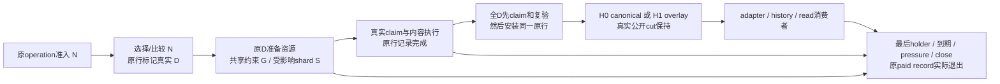
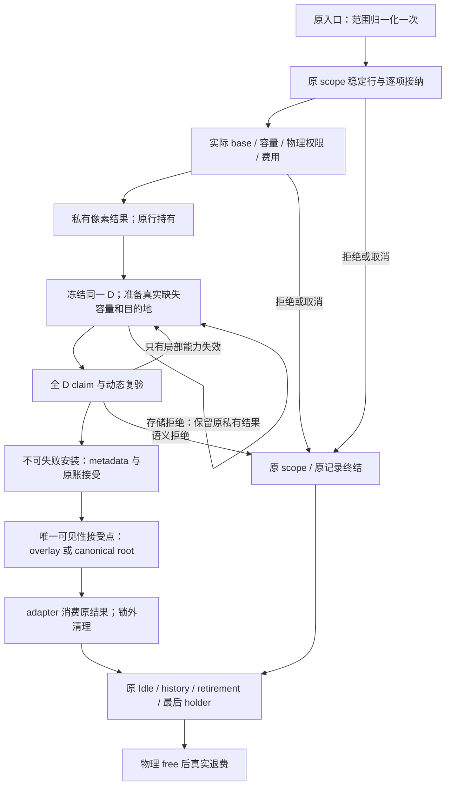
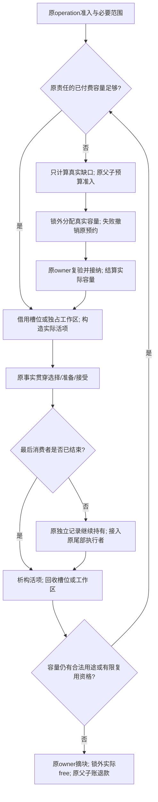
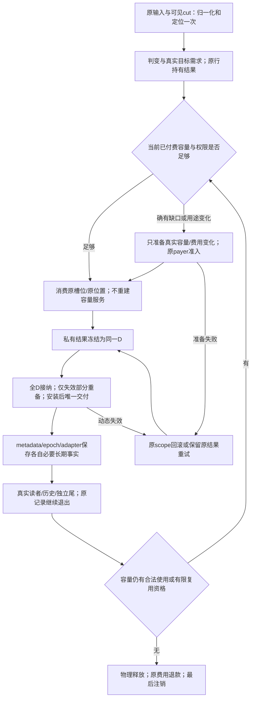
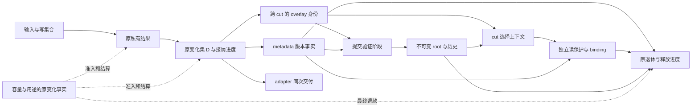
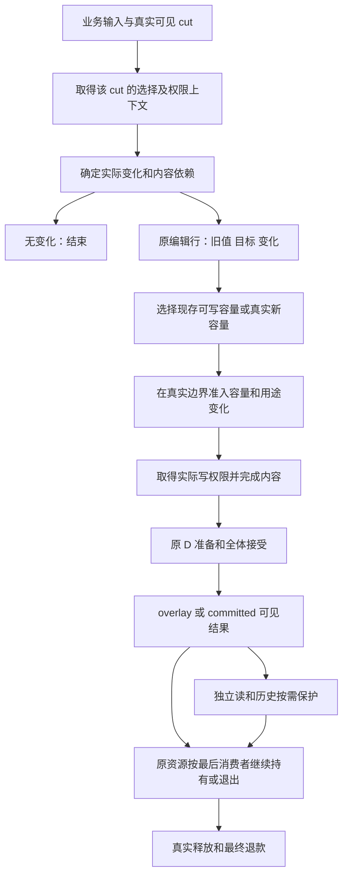
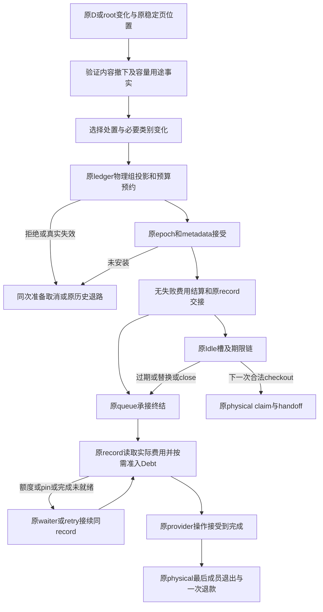
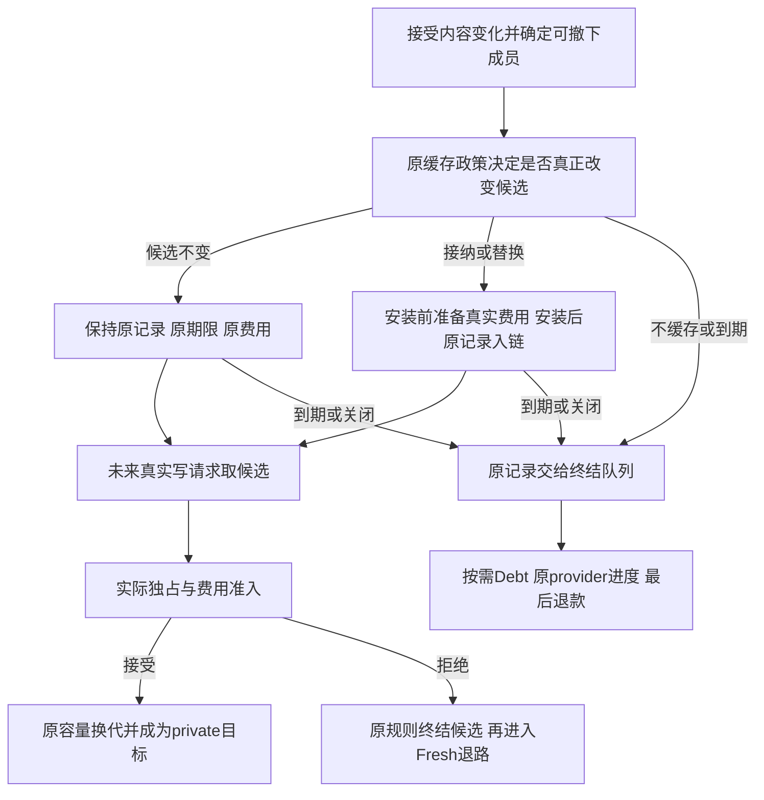
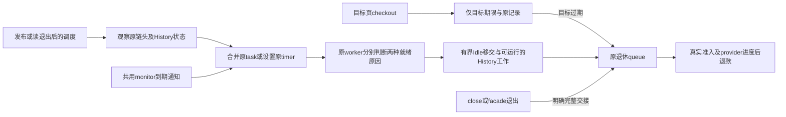
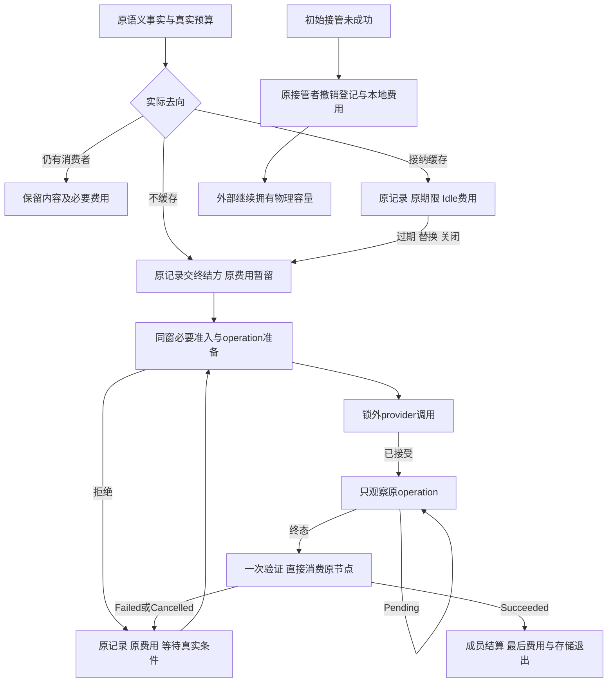

# PageStore 管线计划 V2：按事实与资源寿命消除重复管理

> **已由 [PIPELINE_PLAN_V3](PIPELINE_PLAN_V3.md) 接替当前规划（2026-10-27）。** 本文停止追加，保留原型研究、实施和冻结判断的来源。当前阶段总结、预算和下一主线只读 V3；下文旧“当前/下一/待迁”不重新构成任务。

**当前阶段裁决（2026-10-27）：** [§10.108原型优化迁移验收](#prototype-migration-stage-acceptance)确认已定核心优化全部实装并完成生产化适配，无登记未迁项，阶段完成，可切换。RF20观察/总体成本目标/M6仍开放，独立维护，不继续延长迁移阶段。当前public9.23%不能与旧native原型54.09%直接比较；剩余实现价格是否合理进入下一主线。下方为各批冻结检查点。

**当前联合价格（2026-10-27）：** [§10.107](#joint-package-price-20261027)、[完整实测账](refactor-prepricing-settlement-r0/finalization-r1/joint-pricing/RESULT.md)。固定192过程完成，11520用例通过。arm64 H0/H1开启态指令净省13.31%/9.23%，普通CPU H0区间正、H1跨零；当前H1仍为同义U的CPU2.760×／指令2.291×。原矩阵20/22证据维度完成，RF20观察资格、RF21成本证据仍开放；不能把价格已取得称为paid<1M、管理比或最低实现达标。生产与29批不变，正式0/3、calibration2/20、默认off保持。下方为各批冻结检查点。

**2026-10-27 最后一组实现欠项收口：** [第29批](refactor-implementation-closure-r0/IMPLEMENTATION.md)、[入口与保留边界](refactor-implementation-closure-r0/CONSUMERS.md)。源`2d5d1aaf9f27`/库`ce1d02675511`；root最后保护解除统一原位置排队，删除受保护候选空查。双架8862/0/0、449检查；生产净−9行，无新增字段/owner/付费寿命。29批/19限定责任/11有限闭包；原实现未完结聚合组已核完，余资源/全包验收。净价和同义upstream尚未取得，正式门不变。

**2026-10-27 终态消费完整实施：** [第28批交付](refactor-terminal-consumption-r0/IMPLEMENTATION.md)、[全入口/删除索引](refactor-terminal-consumption-r0/CONSUMERS.md)。源`a8c66c6e730a`/库`e2a6be38b58b`；原record同窗准入准备、一次verified结算、writer封闭、原位置watch与接管撤销同迁，补共享orphan预约归零后的托管。双架8854/0/0、436检查；源码正常窗口7→3/查找4→0/验真2→1，非净性能。28批/18限定责任/8有限闭包、整项0/22；原资源/全图/净预算及正式门保持。

**2026-10-27 整包进度回填：** [V2 §10.101](PIPELINE_PLAN_V2.md#progress-review-27-batches-20261027)、[原矩阵](REFACTOR_TASK_MATRIX.md)。当前源`3ddd9814b896`/库`130a5d210b2b`保持；27批、17限定责任、8有限consumer闭包，另有§10.100设计完成未实施及2个开放汇总组，整项0/22。修正24批旧快照及已完Idle/费用欠项；8844/0/0和417检查是既有当前证据，本轮未重测。技术目标保持，净价/主要差额回收未证，防止结构扩展挤压资源/联合计价；原正式门保持。

**2026-10-27 类别转移与终态消费审查：** [V2 §10.100](PIPELINE_PLAN_V2.md#class-terminal-protocol-closure-review)保持原record和Idle边界，补齐operation一次准入/一次验真/原位置终结及初始接管撤销的不同授权。正常有界路径ledger窗口7→3、operation查找4→0、终态验证2→1是可构造源码预算，非实测或全服务下界；完整writer/终结consumer及回滚同迁后才可采用。仅设计，无新生产/测试/价格；原27批、正式门保持。

**2026-10-27 Idle调度边界已实施：** [第27批完整交付](refactor-idle-scheduling-r0/IMPLEMENTATION.md)、[入口/删除索引](refactor-idle-scheduling-r0/CONSUMERS.md)。源`3ddd9814b896`/双架库`130a5d210b2b`；单目标/纯期限查询/仅通知timer/原task每批16/关闭恢复同迁，旧混合回调及重复状态删除，R政策保持。8844/0/0、417检查；27批/17限定责任/8有限闭包、整项全维0/22。声明Store+context减120B，实际root6304B保持；新增调度/通知门计回，无净性能认领。原资源/全图/净预算及RF20门保持。

**2026-10-26 Idle调度边界审查：** [V2 §10.98](PIPELINE_PLAN_V2.md#idle-scheduling-boundary-review)确认schedule为查询期限执行全部到期移交，timer又在进程共用monitor取得Store锁，形成跨Store通知耦合风险。目标收敛为单页checkout、纯期限查询、仅通知的timer及原task有界执行；Idle到期与History压力分别就绪，单一任务准入和close同迁。原queue移交不等于已退款，同页Fresh前真实准入保持。结构方向明确，净CPU/延迟未测；仅审查回填，无新产品或批次，原门保持。

**2026-10-26 设计价值口径校准：** [V2 §10.97](PIPELINE_PLAN_V2.md#idle-design-merit-and-adoption)将结构收益、运行影响和合同分别裁决；正CPU收益不是结构重构的必备条件。N比旧实验B更干净，但删除的预检/续期状态在当前生产R中本来就不存在；R/N均按实际入库计龄，差别是候选选择。生产暂留R，依据包括尚无对R的整体结构净简化及命中取舍，不再仅凭无CPU收益否决。跨页到期的封装边界可独立审查，未知时间不排除设计问题。无新产品/实测，原矩阵和正式门保持。

**2026-10-26 Idle原年龄候选已判别：** [修正实现与完整时间结果](refactor-idle-policy-decision-r0/admission-age/RESULT.md)已删除发布预检和续期，仅在真实替换机会选择保留；14安全/数量过程、48固定时间过程通过。2页H1投影80→72、指令少0.014327M/0.60%，CPU未证收益；16页无新增手续。120ms反例多一次Fresh，净时间采用条件未满足，候选不迁生产。第26批及RF20/正式门保持；见V2 §10.96，后续回原事件/资源全图和整包净预算。

**2026-10-26 Idle责任深化：** [V2 §10.95](PIPELINE_PLAN_V2.md#idle-responsibility-and-renewal-design)区分候选/期限、语义撤下、费用、真实checkout独占和终结；原记录权属清楚，旧保留策略把未来预检和未变化候选续期混入发布。100ms是内部可借年龄，binding直取pin反例不等于公开guard回退；单页checkout的跨页到期维护也纳入时间账。当前生产替换政策及第26批身份保持，本次只有设计审查、没有新测试或性能样本。

**2026-10-26 时间优先与Idle策略裁决：** [有界同实现对照](refactor-idle-policy-decision-r0/RESULT.md)完成13安全/数量过程和48时间过程；两页H1投影80→72但CPU未证收益，16页零删行且多0.110M指令。本版保留/续期不迁生产，保留当前紧凑接受输出；不再把它列为必做重构。硬预算内空间增加不单独否决时间方案。生产仍第26批源`3cfededd17b0`/库`1508bae792a0`，非整包或upstream价格，RF20及正式门保持。下方旧“待迁入”按各冻结时点理解，现方案见V2 §10.94。

**2026-10-26 原记录退休生产迁移：** [实现/成本账](refactor-record-retirement-r0/IMPLEMENTATION.md)、[14类消费者](refactor-record-retirement-r0/CONSUMERS.md)。源`3cfededd17b0`/普通双架库`1508bae792a0`；原record贯穿准入、等待、Idle替换/过期、shutdown及最终退款，旧重复查找删除。8836/0/0、399检查；26批/16限定责任/8有限闭包、整项全维0/22。record888/queue416/physical272B保持，无新持续字段/paid寿命；非Debt准入条件查找2→0，不折净价。条件Idle续期/统一发布处置、完整资源与整包净预算仍待，未认领80→72生产投影。时间优先；RF20关闭、正式0/3、calibration2/20、默认关闭。

**2026-10-25 原ledger物理节点收敛：** [完整责任、资源反例与删除账](refactor-backing-storage-lifetime-r0/IMPLEMENTATION.md)。当前源`523057de5a5d`/双架库`fd683fc1993f`；原physical记录承担唯一identity/索引，删除逻辑24B key副本、临时map node准备/提取/重绑及最后按key定位。合并取块原型因1536B/额外尾1264B撤下，最终新取块仍2，共享alias物理申请仍0。两架完整布局分配1216→1168B、物理尾272保持；旧表示配未改付费服务，不是旧管线二进制或净指令价。双架固定**8600/0/0**、156有限检查；生产净+11。原矩阵13批、20/22启动、0整项验收，原Page/checkout/private接受全链和完整paid仍待；RF20关闭、正式0/3、calibration2/20、默认关闭。下方旧批按冻结身份理解。

**2026-10-25 原D准备寿命收敛：** [完整责任、删除与资源账](refactor-mutation-capacity-repair-r0/IMPLEMENTATION.md)。当前源`2e3e7cae4ec7`/双架库`938e929df07d`；删除同次容量冲突的整份重备、重复retry状态和增长政策，原D保留顺序/位置/旧预约，只补真实新槽；初次有序跳过排序。双架固定**8592/0/0**、142有限检查；C1/R1实际准备2条，旧模型3不是旧库实测；纯外部同硬额整prepare拒绝而原repair零分配成功，真实新增拒绝无半安装、同segment可恢复。carrier80/row320/native344/prepared88保持，生产净+89行及新扫描/补块计回。原矩阵12批、20/22启动、0整项验收；继续上游Page/checkout/ledger与完整paid，净指令/管理比未计，RF20关闭、正式0/3、calibration2/20、默认关闭。下方旧批按冻结身份理解。

**2026-10-25 原D旧mutation协议替换：** [完整责任、删除与资源账](refactor-original-d-closure-r0/IMPLEMENTATION.md)。当前源`5fdf7b6131b8`/实际双架库`13cd6fe92f3f`；Detachment通用分支、生产versions入口、逐页activity、独立失效清单和mutation Deferred job已删除，native/外部/remove/混合输入的准备、接受、取消、晚读者重备及锁外退出同迁。双架固定**8548/0/0**、125有限检查；324页同硬限额附加候选65536→96B，原D输入另计；row320/native344/prepared88保持，carrier头+32B及引用容量/重备重叠入账。生产6文件净减34行；11批、20/22启动、0/22整项验收。原D准备排序、checkout/ledger/完整单次paid等余项仍待，暖native原本不走旧external fallback，不认领13.107M或640条件预算。无普通/机制性能过程；RF20关闭、正式0/3、calibration2/20、默认关闭保持。下方旧批按冻结身份理解。

**2026-10-24账本/方向复核：** [十批交付、差额预算与纠偏顺序](PIPELINE_PLAN_V2.md#implementation-progress-direction-review)，[原22项矩阵](REFACTOR_TASK_MATRIX.md)。当前源`70dc36a5af5f`/双架库`0f3ca9ea6fef`不变；10批及22项摘要按当前源回填，20/22启动、0/22整项验收，17实施项迁移/删除均未整项关闭，不能报90.9%完成。当前固定双架8548/0/0、105有限检查；十批净指令/管理比/同语义upstream均未获新证据。四来源条件少640仅是旧申请差的50.8%来源预算；共同logical/physical删量不得抵主差额。第8/10批回到前台，但原Page/checkout/ledger/全D和完整单次paid收口仍滞后；补齐四类资源裁决，含最新idle尝试及history→原queue等待转移。此次无产品改动/新实施批/性能过程，RF20关闭、正式0/3、calibration2/20、默认关闭保持。下方各实施批仍按其冻结身份理解。

**2026-10-24撤下/费用/终结实施：** [完整交付、失败和成本边界](refactor-disposition-ledger-r0/IMPLEMENTATION.md)，[V2 §10.75](PIPELINE_PLAN_V2.md#metadata-disposition-and-ledger-acceptance)。当前源`70dc36a5af5f`/双架库`0f3ca9ea6fef`；删除逐页收费类别前置门和终结先查再take，原D按实际类别筛选，投影同锁消费原位置。内部输入144→24B、原row320/native344/ledger536保持；原funded record接受不枚举收费桶，effect必要Debt类别同锁取得。Debt满额保持原charge且不调用provider，释放后同record一次退休。生产8文件+139/−80；当前双架固定**8548/0/0**，十过程reap无超时；105检查/6352文件/32相关consumer。四个类别×capture交错及单一旧谓词反测有原身份；该反测旧private ABI未冒充最终库。原矩阵回填10项，累计10批、20/22启动、0/22整项验收；D/T删量须扣A/ΔI尝试及history→原queue等待转移，净价/管理比仍未知。原Page/checkout/ledger/全D及完整付费服务余项继续，原640和13.107M不核销；普通/机制性能0，RF20关闭、正式0/3、calibration2/20、默认关闭。下方按各批冻结身份理解。

**2026-10-24物理记录/登记实施：** [完整交付及成本边界](refactor-physical-record-r0/IMPLEMENTATION.md)，[V2 §10.74](PIPELINE_PLAN_V2.md#physical-record-registration-lifetime)。当前源`12d590e3fcf4`/实际双架库`3bdd1f22e8fb`；原physical记录同时承担global登记pin，删除Payload map node、第二候选及已得binding后的五类重定位。每同义成功新物理准备的provider metadata请求2→1，声明同时活280→288B；新纯global尾实际288B、最后pin准确退款，旧global声明104B，新增尾驻留仍待计回。生产3文件+166/−165、测试2文件+93/−7；当前双架固定**8540/0/0**、10过程reap无超时，81检查/6352文件/29相关consumer。原矩阵回填10项，累计9批，20/22启动、0/22整项验收；共同P/K删量不抵13.107M前台主差额或同义upstream，原Page/ledger/全D接受及完整付费服务仍待。普通/机制性能0、净价/管理比未知；RF20关闭、正式0/3、calibration2/20、默认关闭。下方按各批冻结身份理解。

**2026-10-24目标/布局协议实施：** [完整迁移、反例及成本边界](refactor-target-protocol-r0/IMPLEMENTATION.md)，[V2 §10.73](PIPELINE_PLAN_V2.md#single-target-acceptance-protocol)。当前源`6ca2d686317ef`/双架库`cbffdc0dbb10`；删除输入目标副本、整reuse候选/回写、旧plan契约及native alias通用descriptor手续，未接受本地布局不再使全局候选重备。输入384→256B、选择720→592B、原private344B保持；生产8文件+119/−116。当前双架固定**8534/0/0**、10过程reap无超时；恢复早失效的单一派生库恰好两条拒绝反例失败。原矩阵回填10项，累计8批、20/22启动、0/22整项验收；本批回到前台主线，完整physical/checkout及全D接受等原余项仍待。普通/机制性能0，净价/管理比未知，旧640条件申请及20.340M不核销；RF20关闭、正式0/3、calibration2/20、默认关闭保持。下方按各批冻结身份理解。

**2026-10-24 provider唯一binding记录实施：** [完整迁移、删除与成本边界](refactor-provider-record-r0/IMPLEMENTATION.md)。源码`c5fafde1b3b7`、实际双架库`219f45995c22`；生产tiles3与测试线性provider同批迁移，binding直接承担slot索引、physical身份及原retirement ticket，独立AllocationMap及两个Allocation载体已删；handoff仅写version/generation以保持slot不可变。生产3文件+100/−72；当前双架固定五组各4264/0/0，合**8528/0/0**，全部reap无超时。成功N次逻辑准备条件申请2N→N；binding200→288B、独立record56→0B、provider/index736B不变，外部strong/weak尾多88B声明驻留入账。P/K共同来源下降不核销旧1260/20.340M；净价和相对同语义upstream资格未授。**原22项/33行、20项启动及联合计价关闭保持；本批回填12项。** 普通/机制性能0，正式0/3、calibration2/20及默认关闭。下方旧批按各自冻结身份理解。


<a id="current-pipeline-state"></a>

## 0. 当前整体状态与唯一实施依据（2026-10-22）

**当前执行入口：[完整重构任务矩阵](REFACTOR_TASK_MATRIX.md)与[排查表单/放行条件](REFACTOR_CHECKLIST.md)。** §10.64的9类差距已转成RF00–RF21共22项，保持原A–I/33行唯一映射；状态只在 `PIPELINE_REVIEW_INDEX.json.refactor_execution_matrix` 更新，Markdown由工具生成。**本包0/22完成，联合计价门关闭。** 不允许完成一小项就普通对账并宣告整体落实；技术分批仅允许推进构建、结构和实际合同的安全/资源验证。整包规则见[§10.65](#whole-refactor-execution-matrix)。本次无产品改动、无新性能过程。

**当前判断：已登记旧契约删除完成，但原型的跨段管理寿命和工作生成率尚未等价。** [本次同服务对账](prototype-current-reconciliation-r0/RESULT.md)及[§10.64](#prototype-current-cost-reconciliation)给出最新计数和指令来源；生产身份仍b0fb5acb04。

**当前工程候选已完成本次登记的八类旧契约替换。** 实现、删除核查、双架行为及整包计价的唯一当前结果见 [r6报告](production-candidate-r6/RESULT.md)、[§10.63](#prototype-replacement-implementation)。产品与普通库精确身份由该报告和 [原33行索引](PIPELINE_REVIEW_INDEX.json)记录；§10.56–10.62保留以前各批的冻结结论，不作为当前未完成状态。

**原型差异按实际用途处置。** 原生 edit 输入、直接验证、原D接受、内部 accepted identity、commit、scope/initial execution、capture和终结消费者一起替换。已知范围仅在确实具有整组初始 execution 的入口共同准备容量；fill/copy 只有范围预留时不付这一块费用。native 冷接受只准备实际 arena 增量，不再建立通用逐页准备/cleanup；外部完整 proof 只在实际能力边界物化和验真。

原索引 `replacement_items` 登记旧源码/契约、目标、修改后身份、消费者及删除证据；`whole_replacement_contract` 区分新实现与明确保留的生产偏差。没有已标记项因技术批次结束被遗忘。真正 sparse/default/root、独立 borrow、外部 lease、全D原子性与异步尾继续存在；存在这些义务不证明服务当前单价最优。

本次完成的是已登记的旧协议替换，不是“管理成本理论最低”的证明。paid<1M仍是必做终局目标；原型本身保留旧付费/handoff服务，所以该责任不能靠复制原型自动关闭。现行门以[92](../../92_br1_m6_m8_execution_baseline.md)为准，M6/M7/M8仍0/3、calibration2/20、默认关闭。生产变更净价仍以r6机器账为准；当前原型距离、计数及责任价以§10.64同服务对账为准，H1 paid2976，禁止再沿用r5的3040。仍无本版同义upstream或content-only价。

冻结PIPELINE_PLAN.md不修改。后续优化只在当前统一协议上推进，不恢复已删除的通用原生准备或内部能力往返。

## 1. 校准后的目标与基线

用户优先目标是PageStore相对upstream的**同语义基础性能**。正常像素/历史行为同义比较，operation失败恢复、exact retained view、预算和晚释放等额外合同单列；既不把其当前实现价格认作必要税，也不删掉真实保护。通用内容/上层优化须对双方对称比较，不能独领PageStore收益。

计划建立时的冻结基线来自[r13报告](../br1_pipeline_refactor_20261010/implementation-preconditions-r13/RESULT.md)及[机器账](../br1_pipeline_refactor_20261010/implementation-preconditions-r13/FINAL_ACCOUNT.json)，不代表最新研究原型。K16/W16、四寿命、16KiB页；完整写1024页，H1暖为后14次写，共56 cut/896页。下列M均为百万指令、8个固定镜像块均值，非新置信区间：

| 端点 | 产品e238 | 候选7609 | upstream |
|---|---:|---:|---:|
| H1完整write | 49.953627 | 55.513483 | 6.028556 |
| H1暖write | 41.369165 | 46.610324 | 4.912407 |
| H1暖内容Pixels | 4.505089 | 4.505180 | 未独立取得同范围价 |
| H1暖非内容代理 | 36.864076 | 42.105144 | 不以总暖减候选Pixels推导 |
| H1首两次写 | 8.584462 | 8.903160 | 1.116150 |
| H1完整process | 96.602826 | 100.481474 | 26.573309 |

非内容代理含上层/夹具与未知责任，不是全部可删PageStore税。候选相对产品暖+5.241M、全write+5.560M、process+3.879M，前台新增释放可能部分来自阶段迁移，不能当作同额全寿命新增。H0候选全写69.859616M、upstream6.024601M，额外63.835015M；H0分段观察未过，禁止套用H1机制单价。

r12冻结非内容/内容比例的条件95%区间是产品8.180 [8.176,8.184]、候选9.331 [9.316,9.346]，只覆盖其固定机器/布局/状态的统计变化；不含模型错误、观察系统误差或未来方案成功率。r13描述性比例为8.183/9.346，最新研究原型不能沿用这个区间。

## 2. 本版改变什么，哪些已实现内容继续保留

| 旧计划隐含前提 | 校准后的判断与执行要求 |
|---|---|
| 物理容量复用意味着主要管理生命周期也稳定 | 物理、逻辑代、费用用途、activity、控制capacity、reader/root尾分别计寿命。候选idle→写的空状态使活动节点删除再建；目标必须消除该工作生成路径 |
| 原owner、同一管线自然便宜 | 每项事实保留唯一权威，同时缩短跨层表示转换；按已知有效事实走最少动作，不强迫每种来源重走通用查找/登记 |
| 费用896→56可以在现有逐页入口内直接完成 | 需先形成可稳定消费的同cut变化/来源集合，并付提前准备及峰值成本。当前逐页比较/准备/执行不足以免费提供这个集合 |
| repair idle回退即可接近完整低成本 | 即使回到产品仍约8.18∶1；共同每cut49次管理申请/46次普通释放、plan/metadata及14.400M未展开write均在本版责任内 |
| 暖0次malloc意味着管理成本归零 | 活动前缀构造、引用、查找、claim、费用、清零/析构及真实最后holder仍计费。缓存空scope可能形成Store保活环，不能直接保留旧对象 |
| 增加安全机制可待性能阶段再计价 | 每个新提前准备、持久字段、保活、失败出口先列真实消费者及费用；其替代净价与原动作一起验证 |
| 一个新增调用只是少量标量操作；现价乘删掉次数即可预测 | 先追踪该语义事件展开的完整子操作、状态变化和最后退出，再区分新增次数、路径升级和单次实现价格。平均排他价不等于整操作边际价，见§10.14 |
| 原D贯穿后可以保留底层原语的现有实现 | 同时审查费用的宽表示/多遍扫描、metadata三记录/两索引重绑和调用者重新定位；必要事实不等于这些实现动作必要。保留原语须拿出条件成本依据 |

保留产品已修复的父费用负向结算、e238关闭进度及已落地读表示/adapter等能力，不重复领取收益。候选7609的原record定位贯穿、Idle用途/Q/T和已验证接受集合作为下一原型起点，**只保留有真实消费者的语义与结构**，不能整体认作高效实现；不恢复transaction spare与全局idle两套所有权。B=16根布局、字段union、更细partial差异表示均为待比较选项，不是本版预算前提。

## 3. 唯一目标形态与事实寿命

最小完整责任是一次公开CPU操作的**准入→选择/判变→私有结果→D接受→adapter交付→真实退出**，同时覆盖H0 canonical和H1 overlay/finish。每次公开cut、独立失败与观察点保持；不借另一种history入口或延迟发布降低次数。普通私有目标可以在像素后取消，不强加M7原地覆盖的不可失败前置；M7及其原限制不由本计划放开。

```text
原 operation：一次范围准入，沿原 ordinal 选择输入和语义变化
    ↓ 同一原 result 行；能力、来源、布局及失效依赖随行
分组预备真实物理/费用 → 私有数据执行 → 原行冻结为语义 D
    ↓ 全 D claim，复验受影响事实；必要输出/费用已准备
canonical / overlay / restore 接受 → 原 adapter 消费同一 D
    ↓ 权限结束；实际仍存的资源各归原 owner
idle资格 / history保留 / retirement等待 → 最后 holder 与实际 free
```

本流程的每个箭头同时承担成本证明：原行复用必须真的消除后续重新定位；费用缩窄不得增加metadata等服务查询；稳定记录不得在epoch/adapter恢复旧投影；当前任务idle不得替代未来到期与最后退出。按§10.17的consumer、状态和完整寿命计净价，任何一步未知都不得在总预估中记零。

这是一条事实流，不新增巨型coordinator、第二账本或统一所有锁的全局门。Metadata、Epoch、Budget、Ledger、reader及manager各保留自己的权威。原operation控制本cut的未接受结果；原page/result行承载一次选择及完成事实；原ledger record承载物理及终结责任。D是这些行的有序view和必要shard链接，不再拥有一套target/layout/proof镜像。

| 事实 | 有效窗口 | 目标表示与失效处理 |
|---|---|---|
| 范围、ordinal及语义变化原因 | 原准入至交付；实际冲突/成员变化另验 | 同一行贯穿，不在bound定位后再按key找回；外部随机key保留检索 |
| exact base、layout、输入来源 | 原transaction/admission及对应holder；跨窗口不自动有效 | 首次解析输出实际事实；default/source/provider epoch改变则重验依赖，不再解析新head替代旧选择 |
| 私有target、完成及取消责任 | 未接受至原取消/接受完成 | 原result记录已发生动作；generic边界输出真实proof，CPU内部不导出再找回 |
| activity与idle record | 结构保活至接收者真实接续，写权限另行取得 | 交接不经过可删除空窗；保活不冒充writer或physical claim |
| 费用/释放集合、接受与输出 | 原准备版本至一次接受；晚保护使相应计划失效 | 同一行记录选择及真实许可；全D先claim后install，已接受后输出失败不得重放提交 |
| 存储、root/read/cleanup尾 | 各自最后真实consumer | 权限结束不等于capacity可复用；尾部只保留实际责任，最后释放再退费 |

所有稳定引用需有真实owner/claim、typed incarnation和不搬移保证。vector有capacity不证明跨增长指针稳定；原slot的世代检查也不代替权限。新增字段允许承担不可合并的真实事实，但必须列sizeof、初始化、最后退出与被替代字段，不能凭“唯一协议”免计费。

<a id="v2-generation"></a>
## 4. 原operation至物理准备：先减少工作生成

### 4.1 范围、判变和控制存储

将受控CPU的range、batch façade、adopt及execution短包装收敛到原operation的一次准入/结束；legacy多client、raw guard和跨线程最后unlock保留真实能力，消费共同内核。复用原storage的空闲capacity/槽，不缓存带Store lifetime pin的旧scope，也不保留已结束权限或整份D尾。无增长且没有尾部占用时，选定短工作区的heap申请目标为0；全Store所有申请为0不是本版承诺。

沿可信ordinal解析base/layout，真实读pin只覆盖比较/读取。D为**语义变化集**，包括presence/default/extent/alias，不能把像素相等一律当noop；noop仍付必要准入、选择和比较。full覆盖不先复制旧页，partial按合法保留字节处理。整页memcpy与大量小memcpy分别计调用和字节，不能按少复制字节预报同等速度收益。

共同2744申请/2576普通释放只是待逐对象分类的范围：原cut独有短对象可合并；有最后holder的对象只缩小真实尾；永久配置移至实际setup但仍计价；上层共同工作不得由PageStore独领。不得为实现“零申请”新增通用对象池或每页缓存查询协议。

### 4.2 合批费用的前提必须显式落实

当前`writeFinalRect`逐页比较后立即`prepareTarget`并执行；不能在最后seal得到D后，倒扣先前已做的896次借用收费。受控write/fill及固定source copy应在原行内分离“选择/判变”和“数据执行”：先得到同cut实际变化、target来源、distinct physical及费用组，取得这些组的合法准备，再执行数据；避免第二份选择数组及第二次内容比较。

提前收集不默认免费：需计原行活跃字节、base/source保活时长、跨窗口复验、未命中页检查、较早预留的预算峰值和拒绝清理。原admission不能保证选择稳定的入口不得携旧事实；raw/callback/未知future变化只对已知准备波次分组，B可大于cut数，不能给所有入口套896→56。若前移扩大拒绝面，须在同一准备记录内采用原允许的更小波次/安全来源，而非添加第二所有权协议。

不能为简化全D收费延长可见Current的physical写锁、提前剥夺晚reader、或新增长期未来Debt。真实新代、provider/domain、pin及预算公平保护全部保留；同一组内也要逐member更新语义和逐distinct physical形成费用，不是把16页工作全部变成一次常数操作。

### 4.3 activity连续交接

早期7609的`takeIdleCapacityLocked→exchangeIdleCapacity(nullptr)`空窗与活动节点重建是冻结反例，不能再作为C1尚存的896次节点删量。后续native-activity与capacity-lifetime研究构造已改变原页活动表示和容量寿命；当前C1仍新增Idle维护0.839M、ledger编排0.770M和显式费用1.935M。目标继续保持真实准备责任连续性，同时降低**接续这项责任本身**触发的完整事务和重复表示成本。不得提前设置`nativeWrite`伪造写权限，或借publication claim改变其他consumer语义；已兑现节点删除不再计入下一预算。

优先在原有状态/准备lease表达该责任；若现字段无合法表达，允许在原activity/原prepared对象增加最小typed准备标识，并把新增字节/查询/取消算入预算。记录被移除的资格、原deadline和incarnation；跨owner解锁期间不暴露可借idle，也不因保活阻断原合法close进度。physical/费用/metadata准备失败后，只有原资格仍有效才回原idle；不得重置T延长寿命，否则归原retirement记录。最后一个真实责任消失才erase。目标不是永久保留空活动表。

<a id="v2-acceptance"></a>
## 5. D、费用、接受与adapter一次贯通

`capacityChanges`从已知释放行再push_back、随后重新查replica/physical并排序，最后又按replica/key找record/activity，是本版删除对象。原准备行直接提供冻结释放选择、稳定physical/record引用和费用分组；真实alias按distinct physical去重，不能重复收费。预备/shard索引可以存在，但不能复制第二份权威D或增加镜像owner。

费用在同budget owner/domain/阶段及兼容峰值组内准入/消费。正负父账、旧Optional总限和Idle子限Q均保持；混向净零不授权中间超限，cache可选失败不能阻断已有合法退休。已有credit才转移，没有credit沿原收费record等待Debt，不恢复“所有pending长期预付退休额度”。当前管理存储已使用栈上直接收费，保持其实际路径；先减少不必要对象出生，再按真实失效域维护预算快照，未触碰类别可能已超限仍需合法校验。

全D metadata claim后才安装，不能逐页claim/逐页可见。H0/H1/restore用同一接受政策和不同合法目的地，root充分条件、首次可见代、真实reader/pin独立核验。晚失效只重备依赖行/费用组/root前沿；已完成私有像素不重拷。最多一次关闭本cut可选直接复用的保守降级保持；一般冲突按原API合同处理，不增加任意重试次数上限。

接受后的真实权威表示也必须收敛：比较稳定current/working槽和按真实旧消费者P建立额外记录，不能把现有`replaceUnused`的三arena重绑、两exact索引更新、解链/重接和宽字段重置原样列为必要底价。世代失效、exact旧值、capture、alias、物理唯一性与slot ABA仍是必要事实；由哪种表示保证这些事实属于待比较的实现选择。原D少一份载体而底层仍全面重述，不构成最低成本设计。

adapter准备/安装消费同一D的最终presence/extent，manager保护覆盖实际交付；不在禁止重入的锁域执行callback/昂贵析构，不提前放范围claim。已实现warm短借、16B读ref/首窗等继续保留，不重复计收益。checkpoint需要输出capture时，接受前准备可准备的输出；若仍可出现“已接受、输出失败”，原scope记住接受，重试只完成输出。

<a id="v2-lifecycle"></a>
## 6. 读、history、资源和终结仍属于整包

current/working/before/exact按各自选择边界读，provider miss保持同一selected version；共享view至最后consumer才释放。读存储复用不省真实retain/release，不跨新capture复用旧选择。clone/import/公开generic proof/异步GPU保留真实能力边界，CPU同步完成不能替代LastUse。

真实history/首次可见保护决定旧值是否保留。无剩余history工作不先登记后发现为空；root结构、metadata清理和provider退休分别处理，原collector/Queue/close推进同一记录，无第二终结队列。实际释放与解除阻塞才触发相应工作，idle期限和压力退避使用各自deadline，不能相互吞掉唤醒或每次重入队重置退避。

保留候选Q=256KiB/Store、T=100ms的冻结验证政策，Q=0合法；Q覆盖Idle live+reserved及仍以Idle收费的退休等待，T限制可借资格而非承诺物理free时限。Q不随K自动扩大；控制/root高水位容量仍占实际Metadata预算，不隐藏扩张旧限额。首次增长、冷输入与预备集合共存、失败保留、外部holder、最后释放、峰值与byte-time全部计账；256KiB只限idle payload，不是整个Store驻留上限。

close停止准入/复用，摘资格、撤必要等待，在原owner处理已付Debt、未准入记录和最后holder；保留e238有限重试进度。queued不等于已付、idle不等于drained。外部holder未结束时允许原合同拒绝，不能清零统计或丢债报成功。原读慢态、间歇close和全压力缺口继续明示。

## 7. 完整代码责任索引与删除边界

以下是原33行的设计映射，不是第二张完成状态表。建立时的两版hash见[原源码索引](../br1_pipeline_refactor_20261010/pipeline-plan-v2-r0/source-index.json)；当前C1诊断边界及原文映射见[当前索引](../br1_pipeline_refactor_20261010/operation-fact-price-r0/SOURCE_INDEX.json)，昂贵原语审查入口见§10.14。旧矩阵行号和已删除符号仅代表当时版本，不直接用于当前修改，也不重复领取删量。

| 原ID | 实际文件/consumer | 本版实施/保留边界 |
|---|---|---|
| T01.1–4 | Backend `writeBytes/fillRect/copyFrom`、manager原write/clear/copy/refresh入口 | 接原operation与语义D；保留source、存在和fallback合同，无消费者的重复范围/结果表示删除；通用内容收益对称计价 |
| T02.1–4 | Backend `runCpuMutationOperation`、batch `finishClient/finish`；Store `reserveManagedRange/adoptReservation/borrowExecution`；原session/preparation activity | 统一受控CPU短包装与真实结束；legacy/client/guard的独立权限不合成含混计数；接受/取消/最后借用同批迁 |
| T03.1–3、T04.1 | Store `prepareTarget/writeFinalRect/beginWriteImpl/finishWrite`，WriteCoordinator的原entry/selector与Metadata activity | 分离选择与执行；原行贯穿，activity真实责任连续交接；内部proof往返、重复key/layout定位按consumer删除，raw最后unpin保留 |
| T04.2–3 | Store `sealImpl`；Publication `installOverlayLocked`；Metadata prepare/install；native/generic/removal caller | 一套冻结释放/费用集合及全D接受；删除capacityChanges和晚安装后重新选择/扫描，保留真实重备 |
| T04.4–6 | Publication `transactionDeltaLocked/commitLocked/commitOwnedLocked/prepareSurfaceLocked`；Epoch prepare/install；default/removal | H0/H1/restore共用事实与费用，保留可见点/全D窗口/必要root前沿；结构重用与首次可见事实不凭字段union假定 |
| T04.7–12 | PreparedTileUpdates/两hash/extent；Memento commit；restore/checkpoint/purge/allocatedPages/read导入等所有原consumer | 同D最终presence/extent/能力；只删真实无消费者的中间投影，输出/导出/恢复保留；不重复领取已实施优化 |
| T05.1–2 | Ledger prepared/handoff/class commit/cancel；CPU binding/provider；WriteCoordinator预算与物理prepare | 原record稳定定位、按distinct physical与组收费；保留物理claim/retag、真实正负父费；共享与跨域来源准确表达，避免通用保证层层继承 |
| T06.1–3 | capture/read、clone/导出、原raw恢复与adapter complete | 真实view/LastUse、原barrier保留；工作存储只在最后consumer后复用，所有输出路径跟随同一D；旧读ref收益不重领 |
| T07.1–3 | scope cancel/orphan、HistoryCollector/RetirementQueue、reclamation/close | 无第二终结政策；idle/准备/取消回归真实末端，阶段转移和后台额外工作进入净账，已修复进度不回退 |
| T08.1–2 | 原安全/同义/资源/结构测试、普通产品/候选/upstream及业务控制 | 核验输入对象闭包与目标路径；预测冻结后留出反测，失败保留；正式门不因局部正收益晋升 |

旧内容的具体删除账：独立受控CPU短包装及重复定位→原operation/row；activity清空重建→真实责任交接；caller capacityChanges/重复physical列表→原prepared行直接消费；单页通用费用事务→真实兼容组；无实际history任务登记→原D的真实待办；同一失败多处重试→原准备/终结owner。公共generic/legacy/export/reader与仍真实可拒绝的路径不按关键词误删。先全量检索声明、调用、模板allocator/rebind、callback和测试，再逐consumer标明归属；无消费者旧接口与仅服务已消失失败源的恢复分支同批删除。

<a id="v2-estimate"></a>
## 8. 新版预估：局部条件预算与整包模型分开

**本节8.1–8.3保留建版时r13/7609的条件算例，不是C1当前预测。** 当前观测分母见§10.13；预测资格及操作计价规则由§10.14校准。2.440M旧费用算例和2.456M后续C1曝光均只是在旧排他单价保持时的条件毛额，不能充当新分组事务的边际净价。

### 8.1 可计价的条件动作

仅用r13同一合格账期，父子exclusive不重叠；未用混合分配平均价乘次数。[可复算模型](../br1_pipeline_refactor_20261010/pipeline-plan-v2-r0/assessment.json)记录输入hash、原假设和所有结果。

| 条件改动 | 数量预估（H1暖） | 现价与条件毛预算 | 尚须扣/验证 |
|---|---|---:|---|
| 兼容借用费用合批 | 896次→56组；逐member/physical仍处理 | 借用费用2.602880M；固定每组费用单价时毛省 **2.440200M** | §4.2变化集形成、聚合/峰值/claim/部分取消/公平；非兼容波次B更大；不把归还56组再次算896→56 |
| activity不销毁再建 | 条件少896次申请/896次释放 | PhysicalPlan→StorageAlloc **0.444813M**＋IdleIndex→RetainedFree **0.178136M**外壳，共 **0.622949M** | 逐对象配对及合法责任交接；分配器/准入孙级价格未归属，不包含在这两个外壳价中 |
| 原释放行直接消费 | 条件少280次caller数组申请/280次释放 | Overlay→StorageAlloc **0.138330M**＋Overlay→RetainedFree **0.055668M**，共 **0.193997M** | 新引用/聚合/alias去重/保活；不是加reserve的224次增长删量 |
| 上述组合 | 条件少1176次管理申请/释放；3984申请→2808 | **3.257146M毛预算**，约当前暖非内容7.74% | 条件同时成立且作用域不变；没有完整物理子价，也没有新增成本，故不是净收益预测 |

0.622949M与0.193997M只给已定位调用外壳的条件删除暴露；不能把共享StorageAdmission/PhysicalAlloc/Free或0.526M重扫增量再全额叠加。共同2744/2576以及plan、metadata、root/read/尾部尚无合法净删量，保留未知。

### 8.2 整包预测方程及当前可报告范围

单位M指令，在当前主格固定内容及身份下：

`M_V2 = 42.10514375 − G_fee − G_wrappers − D_remaining + A_new + ε_model`

`G_fee`在完整同向合批、相同单位价假设下为2.440200；`G_wrappers`在两种对象身份和删除均确认时为0.816946。未命中按实际集合重算，不填满额。`D_remaining`只计未包含在前两项的合法删除；`A_new`至少含提前收集/保活、typed准备、组费用、失败/重备、索引失效维护和延后退出。`ε_model`保留校准、抽样及单位价/布局交互误差，不能用负观察残差当收益。

剩余删除必须逐一落在原互斥桶中：存储周转扣去已报价外壳后的 **7.632349M**、费用扣去合批毛省后的 **0.471631M**、idle **1.155430M**、plan/ledger **8.272379M**、metadata **5.197771M**、overlay **2.095454M**、write根上下文 **14.399681M**；这些是现有支出范围，不是可删承诺，且不能与父桶重复相加。当前有符号残差−0.376696M单列。

完整端点为`write_V2 = cold_V2 + Pixels_warm,V2 + M_V2`；`process_V2 = write_V2 + outside_write_process_V2`。后项覆盖read/setup/finish/history/teardown、后台及实际计数范围残差，按完整process与write差核对；不能把可能重叠的阶段/线程计数直接相加，也不能把变化量当绝对价格。不能保持旧分母而独领通用内容优化，不能从指令比例估毫秒。

| 假设情景 | 暖非内容M / 比例 | 判断 |
|---|---:|---|
| 当前候选实测 | 42.105144 / **9.346∶1** | 当前失衡明确 |
| 只兑现费用合批毛预算，其他固定且新增免费 | 39.664944 / **8.804∶1** | 局部条件预算，仍高于产品 |
| 费用＋两类外壳毛预算全兑现，其他固定且新增免费 | 38.847998 / **8.623∶1** | 完整write仍52.256337M，比产品多2.302711M；不能当整包完成 |
| 假设存储周转、全部显式费用和全部idle共12.516556M全免费，余项固定 | 29.588587 / **6.568∶1** | 仅用于反证局部范围不足；不是全V2下界或可实现预估 |

本版完整设计同时覆盖其余共同路径；其净价不由上表推出。**可信的最终管理比例区间当前不可给出。** 对当前回退/比例的置信证据较强；对象生成解释有源码和计数支持；完整替代价格、单页指令和新方案成功概率未知。不得用任意乐观/保守百分比填出预测区间，也不沿用旧2.5k–5k条/页作为新实测预报。

### 8.3 目标反推与必须补足的预算

以下固定Pixels=4.505180M，均为本格诊断预算，不是新正式门或普遍“合理比例”：

| 暖非内容/内容目标 | 非内容指令/页 | 相对候选需净减 | 净减比例 |
|---|---:|---:|---:|
| 2∶1 | 10056.21 | 33.094784M | 78.60% |
| 1∶1 | 5028.10 | 37.599964M | 89.30% |
| 0.5∶1 | 2514.05 | 39.852554M | 94.65% |

只按3.257146M条件毛预算，距离1∶1仍差 **34.342818M净删除＋全部新增成本**；即使上述12.516556M局部范围免费，也还须从其外删25.083407M并支付替代价。由此决定下一责任必须深入operation/base/result/plan/metadata/交付，而不能仅继续idle和费用helper。

首两次写若维持8.903160M，暖非内容即使免费，完整write仍是upstream的 **2.224倍**；暖1∶1时约 **2.971倍**。首段假设免费且暖1∶1，仍约 **1.495倍**。这些只证明暖比例不能代替同义完整端点，不是机器下界，也不据此判正式CPU门必败。冷、读、历史和尾部必须随方案计价；H0不借H1价外推。

## 9. 实施顺序、验证与有限出口

下一验证原型从候选7609读取其已具语义能力，产品e238保持；先核验当前身份，不合并其他冻结候选的收益。技术步骤是一个完整责任，不各自宣布性能交付：

1. **闭合生成账。** 给896 activity与280caller数组做对象/代次配对，把共同2744/2576按原consumer分类；把14.400M write根上下文拆为选择/比较、operation、完成、seal/adapter/退出及真实残差。冻结互斥归属、入口命中和阶段迁移，不再用函数名作必要底价。已有观察/反例能回答的内容不重复扩样。
2. **形成可执行的统一原型。** 在原owner内同时贯穿range/result/D、activity责任交接、兼容费用与原行接受；H0/H1、真实无变化/partial、取消/最后holder均接原终点。先兑现必要数量与存储/字段账；若仅保留旧多层手续外加缓存，则回到设计纠正，不扩迁其他入口。
3. **定价后冻结整包预测。** 取得替代动作与新增费用，填写§8方程各项及误差来源；同时核对冷/暖/全process、峰值与byte-time。未知量足以决定成败时，保持预测未过；不以3.257M局部预算或消除5.241M回退领取整包资格。
4. **留出反测并完成consumer迁移。** 独立输入改变K/W、noop/partial、保留、间隔跨T、Q=0/不足、共享父压力、alias/域、最后holder；沿原33行迁全部真实caller并删除被替代代码。样本数/顺序/误差线/最小值得净收益在取新样本前依据分辨率与价格冻结，不在此凭空设新门。普通产品/候选/upstream、CPU/指令/资源、业务控制分别验收。

必须有的行为反例：准备中晚reader/增长/ABA；第2页或部分组拒绝后第1页责任不丢；混向净零中间峰值；借出后取消不能重置T；cache拒绝仍可沿原退休；接受后capture输出失败不重放；raw晚unlock、generic/clone/restore、provider pending及close沿原owner收口。新增控制状态同时检查准入/查询/关闭consumer，不能只测新热路径。

性能运行核验完整源码/object/库闭包及实际目标路径计数，最终像素相同不能掩盖fallback；observer off/on门按各端点通过才用分段价，失败批完整保留。固定单位为配对/镜像块，不能把循环当独立样本；不加样到通过。r13的两个失败批和其余8条观察失败继续有效，未因本计划消失。

本版设计收口条件：33行均有归属，旧假设被明确修订，估算可复算且未知不置零。**生产收口另需**实际动作兑现、完整净预测留出命中、所有consumer/失败终点迁移、真实资源/业务控制及原正式门通过；当前均未获得整包资格。实施状态只更新原矩阵，不以文档“V2”名称代表协议已经完成。

<a id="bidirectional-requalification"></a>
## 10. 达标方案重新取证：从必要算法和异常实现双向收敛

**联合r0阶段基准及预算（2026-10-16，已由§10.5更新）：** [unified-native-r0](../br1_pipeline_refactor_20261010/unified-native-r0/RESULT.md)将原result/layout、ledger标量claim、native proof/D同窗与原页活动事实接到e238同一派生源。普通81过程H1 write少5.917M、process少8.452M，八块同向；相对仅紧凑表示再少3.954M write。仍比同批upstream多37.996M写指令、7.301倍。另49过程重新计价，主格观察门过：暖非内容31.669M、比例7.030，核心11.380M＋外围状态加工13.722M＋管理存储5.937M＋显式费用0.989M＋残差−0.358M闭合。不能把旧分批净价相加，也不能用旧桶解释组合后的余额。普通两条读观察、内部四条观察失败、CPU跨零、资源及全替代价缺口均保持，产品/7609未迁，正式资格不变。以下前批价格保留各自身份；本段证明联合r0阶段，当前推进依据为§10.5。

**原页活动事实构造已有完整净价（2026-10-16）：** [native-activity-r0](../br1_pipeline_refactor_20261010/native-activity-r0/RESULT.md)以原页32B共同事实＋稀疏generic payload，替代每代native活动节点；原96B值仅作栈上快照投影。暖申请3708→2812、少896个144B请求；原页96→128B，常驻代价纳入实际完整过程。H1 write净少1.983137M、process少4.342772M，八块同向，剩余write/upstream差41.940266M（7.952倍）。这只回收写差额4.515%，尚不支持达标方案；2744个同cut对象、metadata候选、physical/ledger与整链重复转换未被该构造消除。CPU范围跨零、case0读+6.759%观察未过，原2个布局预期失败及派生两行适配结果均保留，不迁产品。节点请求差32N＋120G−144A为条件表示模型，不是全资源峰值或byte-time。原33行T03.1/T04.3/T07.2只取得此派生组成价格，实施状态不晋升。产品e238及候选7609未改；不能将此净价与下述同步阈值或未迁候选条件毛预算相加，整包替代/留出预测仍待完成。

**终结位置新增净价（2026-10-16）：** [cleanup-policy-r0](../br1_pipeline_refactor_20261010/cleanup-policy-r0/RESULT.md)固定66过程/858格，派生8→16同步清理阈值，H1暖56批全部由入队转同步。完整process少1.779M，但全前台多1.606M、write多1.177M，八块同向；证明既有可避免净工作，也有阶段搬移，不能领后台余量减少3.385M为全部收益。其净省仅约同批进程差额2.54%，仍无完整替代价；不推荐单改阈值，不从暖非内容36.909M减该process差。产品到本格1∶1诊断预算仍须净减32.403M/87.79%，候选已有条件毛预算兑现后仍缺34.343M及新增成本。后台绝对全寿命价、必要原语/统一原行替代价及资源/冷读控制继续；当前实施/正式资格不变。

当前否决对象是“已有可用方案”的判断；不能以本文件覆盖33行、修完候选回退或取得3.257M条件毛预算结束目标。完整任务仍是给出能支持目标的实现构造及净价格，独立实测验证预测。若构造达不到目标，应继续更换表示和管线，而非降低目标或只提交更容易通过的helper。

新批产品H1暖普通41.413609M、非内容36.908514M、比例8.1926∶1；同义完整write49.994843M对upstream6.031537M。原根对应新exclusive项共14.386657M，保留根剩余1.401496M及全暖观察残差−0.682725M。当前physical plan＋handoff＋metadata＋overlay本体即使其外管理全免费，仍14.947980M、内容3.318倍。因此§4的容量稳定化必须与§5的原生接受表示共同替换，保留旧核心算法再叠缓存不支持目标。以上是范围反证，不是可实现下界。

正向以N输入、D语义变化、S受影响shard、G兼容费用组、R真实最后consumer释放建模：`选择N＋私有结果D＋动态接受(D,S,G)＋真实退出R`。保持每次公开cut及其失败、原子接受、精确读/历史和预算合同。为每个必要动作给出实际owner/记录、变化事件、最低可构造操作序列与价格；O(D)标签和当前函数价格都不构成最低成本证明。

反向以[本批23类对象与exclusive账](../br1_pipeline_refactor_20261010/algorithm-reprice-r0/ACCOUNT.json)约束实现：每cut6个target集合对象、21个写集/索引对象、12个冷页/目录对象、7个范围/作用域/执行包装、3个发布表示对象，共49个，全部同cut释放；另16个activity节点与一个metadata候选进入回收线程。完整替代必须删去不必要的事实再编码和它生成的终结责任，不能仅改变释放线程。

当前进一步要比较的最小构造是：原operation按ordinal持有同一行；page/activity指向该行的真实活动事实；原physical record提供稳定定位；CPU内部在原metadata全D窗口直接接受；公共proof仅在真实能力边界产生或消费。generic/外部provider/late reader继续走同一权威事实的合法能力出口。不能把原始指针当稳定权限，不能把96B activity永久内嵌所有N页来免掉分配账；字段、ABA、增长与N/D资源代价必须一起比较。尚未实现/定价的构造不称唯一最优。

下一缺价直接阻断方案资格：49对象完整收费/分配器/析构价格及替代初始化/保留价；physical plan/ledger和native metadata的必要原语与重复转换各自价格；56候选后台终点及其与原行统一后的净价；冷/读/history/资源新增价。896 native活动节点的删除现有上述完整干预净价，但不是节点独占单价，也不能与其他重叠干预相加。现有二维parent/scope表不能给每种对象的孙级物理价，禁止平均价乘次数。按原§9冻结完整原型与留出预测，仍沿原33行迁移/删除；未达标时目标保持开放，不把本批诊断收口当任务完成。

### 10.1 同版余额对下一构造的限制

新合格暖账见[互斥预算](../br1_pipeline_refactor_20261010/unified-native-r0/BUDGET.json)。核心11.380M单独仍为内容2.526倍，即使存储生命周期或费用事务免费也不能达标。到1∶1诊断预算还须净减27.164M/当前非内容85.775%；核心＋外围25.102M甚至尚不足填满缺口，且它们并非可删总额。因此下一不再以去节点、加buffer、改单页费用或同锁getter为完整方案，而要在原operation内同时收敛下列事实链及其生成的存储/退出责任。

| 原位置与实际consumer（沿原33行） | 统一原行构造 | 删除目标与保留约束 |
|---|---|---|
| Store range/adopt/execution/writeFinalRect；T02.1/T03.1 | 原ordinal在同一entry/result行携带选择、layout和完成事实，D从实际变化行取得 | 不再从bound绕回key/index或重造完整transition；N输入与D冷资源分开，noop不因新行扩大到N份重型冷资源；增长/ABA/逃逸guard仍有原寿命 |
| WriteCoordinator plan、OwnerLedger prepare/commit；T03.1/T05.2 | 原physical记录及原prepared行提供有期限的借用，动态费用按真实兼容组处理 | 避免将同一source/target反复导出再定位；实际physical claim、异步reader、父费/限额及失败释放仍在权威owner；不能用cached-valid代替 |
| Store seal、Publication changes/detachments、Metadata Data::Entry；T04.3 | 内部D直接消费原冻结result，metadata必要接受事实在原接受行承载 | 外部能力边界才物化公共proof/通用transition；generic/exported/restore仍走同一权威政策，不能删真实consumer或并存第二权威 |
| Metadata prepare/install、Publication accept/finish；T04.3/T07.2 | 按真实新增需求形成S组容量准备；原D取得全体claim并复验实际变化 | 零新增路径不造独立每页候选表示；晚reader/原子拒绝/有限重备仍有效；释放旧descriptor/binding在真实最后consumer后、门外执行，不能把整个operation拖到后台 |

表中是尚待构造/反证的完整责任，**没有已经成立的27M收益预报**。继续在统一基准上量实际必要动作与替代价，填入冷/暖/读/历史/全process及N/D资源峰值、byte-time；该同一方案达到足够净预算后才能冻结留出预测和迁移。原33行实施列保持，不以此表复制完成状态。

<a id="native-duty-budget"></a>
### 10.2 动态保护、持久接受与最低动作预算

2026-10-16，[native-duty-price-r0](../br1_pipeline_refactor_20261010/native-duty-price-r0/RESULT.md)在同一联合C库另测49过程/637格。H1观察门通过，但on/off write+4.958%接近5%边界，其它10条观察失败保留。新互斥账中真实物理claim/commit仅0.346M；proof生成/查回/归属验证2.916M；plan/ledger编排4.128M、publication/metadata候选编排4.181M；槽资格/改写1.910M、base查询/native登记1.558M。全部动作及未再细分外围与存储/费用/残差闭合为31.669M非内容，不从上轮父桶扣第二次；完整[预算](../br1_pipeline_refactor_20261010/native-duty-price-r0/BUDGET.json)保留parent及校准敏感性。

**新的设计约束：当前核心不能原样照搬。** 若原封保留物理claim/commit、base查询/native登记、两窗槽资格/改写、页claim/候选保留，其现价3.946M（约4404条/页），以1∶1诊断预算计，其余仅余0.559M（约624条/页）。这些动作并非理论必要底价，也不是新构造价格；此条件账只否决“收敛外围后继承原核心自然达标”。即使proof、全部管理存储和显式费用免费，剩余仍4.850∶1。因此物理排斥不应成为削弱保证的理由，proof或getter的单项删除也不能成为下一完整方案。

当前“原operation/result/D贯穿”进一步明确到持久接受端：**原operation完成后真正存活的是overlay的逻辑选择、metadata的已接受版本/能力事实、ledger的物理及费用责任**，不是整个operation，也不必天然是三份完整proof/handle镜像。原结果内的短借用不能直接替代跨cut事实；必须由原接受记录在接受点接续。下一构造同时审计这三个真实owner的字段与消费者，沿原T02.1/T03.1/T04.3/T05.2/T07.2实施，不能另设第二状态权威。

1. **选择与执行。** 原ordinal/result行保存exact选择、layout及目标准备。N只付真实选择/判变；D才产生变化资源。原record/binding借用必须保持typed世代、实际owner与失效窗口；不在同一已持锁窗口反复按key找回。任意callback/raw guard/alias等真实入口仍消费共同政策，不能假定它们都可提前提供D。
2. **完成与冻结。** 受控执行结束后，原结果行成为D输入；内部不先物化公共proof再反查原结果。提前alias消费等确需已完成状态的入口保留同一完成政策，不能删除其同步或延迟必要可见性。公共proof仅在真实外部能力边界生成；实际晚reader、provider失效及原子拒绝仍由权威owner验证。
3. **全D接受与持久事实。** 原接受行承载必要claim/slot/需求；按真实S组预备新增容量，按D取得全体claim后安装，保持有界shard窗口与有限冷重备。overlay长期状态只保留其实际消费的逻辑选择及能力来源；metadata保留已接受版本、外部proof所需不可伪造事实及读者保护。先检查全部export/restore/history/capture消费者，再决定字段删量，不能仅改seal后仍照搬旧proof map。
4. **物理/费用与退出。** 原physical record及prepared行承接实际retag/收费，不因代际变化重新产生独立身份映射和短命容器。兼容组费用必须来自真实D，并覆盖父费、动态限额、混向净零、失败和最后释放。旧descriptor/binding在最后consumer后门外释放；不得用延长整个operation、无限缓存或第二idle责任换表面少申请。

算法方向的预算对象是“实际N选择＋D内容/物理权限＋D接受状态变化＋S/G容量与全局费用＋E真实外部能力＋L实际最终释放”，不是当前函数调用次数。当前异常方向则要求上述同一构造覆盖计划/接受编排、外围、生成存储与proof交接，而非仅截取0.346M物理内核。两边尚未由完整实现接通，**不填写最终管理比或收益预测**。下一取得字段/动作删除清单、失败前缀与实际替代价，再检验整包是否足够；本批无生产改动，原33行实施状态和正式门不晋升。

<a id="accepted-identity-net"></a>
### 10.3 持久身份交接的实际净价与提交侧反例

[原型及全部失败](../br1_pipeline_refactor_20261010/accepted-identity-r0/RESULT.md)已贯穿native result、overlay、metadata接受、epoch/capture、导出/撤销；原source移入result，能力保存version/transaction/stamp/allocation，ledger原登记负责不可变authority，metadata两窗核验真实stamp/authority。公共输入的layout/completion不可因紧凑身份相等被接受。原四组3740通过/3旧预期失败完整保留，派生尺寸适配及不可伪造/撤销反例16通过；未授全资源或其它架构资格。

同六TU重编控制下，H1完整write44.000512→40.857008M（−3.143504M），process88.224557→85.504149M（−2.720409M）；H1 finish反增0.252423M。H0 write84.600914→87.884749M（+3.283835M），process+3.603209M。H1 CPU范围跨零；case0重编控制及case1/3写、case2读观察失败保留。故该表示构造只有局部正证据，不能迁移或宣称预测兑现。原型净增126行，PageState304→216B，但Change仍344B、detachment56→72B；尺寸减少不保证动作减少。

**改进设计必须约束读取动作的成本语义。** 原来`proof.authority.version`是现有值上的字段读取，新原型部分caller变成`projectProof`后经ledger锁/查询和metadata归属核验。`commitInputLocked`生成CommitTransaction输入及backingChanges两类循环只需version，当前却重新物化完整proof；它们是具体待删的新投影consumer。真正provider验证、外部完整输入、撤销仍需原能力政策，不能一起跳过。H0频繁canonical提交与H1 overlay复用产生相反净账，支持此解释方向；**各循环的命中、重备放大和独占价格尚未测，不能将H0+3.284M全额归给它们**。

下一仍沿T03.1/T04.3/T05.2/T07.2的同一责任：按consumer需要的version/authority/完整能力直接提供原事实；有失效窗口的动态检查在原owner执行，保留同D原子接受。有限动作模型是`N选择＋D真实状态变化＋S/G准备＋E真实能力出口＋L退出`，不能让原低成本读字段自动转成E。先补新投影次数/价格和H0反例的净账，再对统一物理/接受编排及生成存储给出替代价；无论此回退是否完全收回，A的27.164M诊断预算缺口都不自动消失。

当前最新普通H1 C仍为upstream6.774倍指令；最新**合格内部**A管理/内容仍7.029倍，到本用例1∶1需净减27.164M/85.8%。如果仅假定A的Pixels单价不变，C暖端点对应条件比例约6.396、仍差24.309M；这是跨批固定分母算术，不是新内部实测或最终预测。完整可实现管理比、冷/读/history/generic增量、峰值/byte-time及留出确认继续未知。不得将局部回退修复或此条件估计写成达标方案。

<a id="original-result-consumers"></a>
### 10.4 原结果到真实消费者：投影回退与暖余额分别裁决

本节更新§10.3的未计价项。[49过程定价](../br1_pipeline_refactor_20261010/accepted-consumer-price-r0/BUDGET.json)把r0 H0四类投影分开：仅version的两类合计1.701M，真实验证/撤销前投影另2.324M，总4.025M；H0观察通过。H1 finish观察+55.580%失败，不用它出内部价格。r0同版H1暖非内容28.821287M、Pixels4.505062M、比例6.39753，诊断预算缺口24.316226M；范围和身份保留，未知不能填零。

原行的正确消费形态现在有可执行反证：**内部输入不能先丢掉仍活着的原target，再从紧凑身份重新定位它。** r1让canonical的只读视图保留Replacement借用；仅version消费者直接读身份，真实完整能力消费者从原result组装值，再执行原动态validate/revoke；跨operation的overlay仍消费原登记的不可变authority。原result没有延长寿命或进入后台，无第二owner/缓存；无caller旧getter同批删除。完整[消费者与代码索引](../br1_pipeline_refactor_20261010/accepted-consumer-r1/SOURCE_INDEX.json)归T02.1/T03.1/T04.3/T05.2/T07.2，原33行实施列不晋升。

数量模型兑现：H0 write投影4096→0，validate/revoke各1024保持；H1 finish投影256→128，validate/revoke各64保持。普通H0 C/R write−3.231M、process−3.604M，八块同向；C/C0分别−2.840M/−2.830M，八块同向。相对联合A，H0 write−0.409M但块范围跨零；不能声称正式非劣。H1 write+0.0075M、warm+0.0015M，符合零暖投影命中；finish−0.122M。原3740通过/3旧预期失败、派生反例16通过，case0控制/读观察失败、CPU/资源欠项保留，产品未迁。

4.025M为独立批次毛暴露，实际C/R净回收3.231M，约0.794M数值差尚含原result组装/identity比较、观察与代码/重编差异；不把它当新必要底价或已经验证的净预测误差。原r0管理比是同版实测，r1只新增普通净价和数量，不能伪称完成r1内部重定价。

**下一主责任的选择限制：H1暖proof投影已为0，继续围绕该项不能填24M缺口。** 仍按原operation/result/D及真实物理/费用/metadata接受统一构造：原选择与typed槽位直接贯穿，必要动态检查在原owner做，删除各层为同一事实新建计划/候选/索引及其存储终结；全D原子接受、晚reader与有限重备不删。先对r1同版重计计划/接受编排和生成存储；旧联合A的8.309M/5.914M只供选责任，不能当当前可删预算。H0 canonical接受本体也须纳入，不能以本轮新增回退修复代替原有78M差额。完整冷/读/history/generic、资源峰值/byte-time和必要原语/替代净价闭合后，才可给最终管理比与留出预测。

<a id="current-pipeline-budget"></a>
### 10.5 当前共同管线预算及整体替代的准入条件

[accepted-pipeline-price-r1](../br1_pipeline_refactor_20261010/accepted-pipeline-price-r1/RESULT.md)完成§10.4要求的同版暖重定价。首批49过程因暖扰动6.673%失败，不授价格；合并高频子probe后的独立49过程通过主H1观察门（暖4.813%，接近5%），case6失败保留。普通产品与r1源码没有变化，不能把观察变化算优化收益。

H1暖56cut/896页，普通33.349105M、Pixels4.505082M、非Pixels28.844023M/6.40255倍；32192/5028条每页。到1∶1诊断预算须净减24.338941M。互斥现价为外围9.138741M、plan/ledger4.130457M、publication/metadata3.132650M、存储5.919560M、物理权限0.345850M、物理观察0.766298M、base/native登记1.557927M、槽资格/改写1.909226M、seal身份1.239834M、费用0.995204M、残差−0.291724M。原Pixels之外含必要选择/判变等，不把全部非Pixels叫额外税。

**同版责任现价已取得；下一是整体替代构造及其净价，不能仅重复同一层现价采样。**

1. **实际入口到原结果。** writeBytes未传historyOwner，H1同样走reserveManagedRange→beginMutationBatch→adoptReservation，只有history事务复用；Borrow/RangeClaim暖命中0。原operation须吸收原范围、独立失败、控制capacity及原结果，公共cut/adapter观察保持。控制容器不应跨层拆建，但不得把长寿命scope和Store pin当普通可缓存容量。
2. **原结果到权威接受。** 原选择/typed槽位、目标与D通过同一原行交接；只在失效窗口按真实owner重验。元数据、ledger、overlay各自消费者继续有唯一权威；消掉仅为跨层传值而重建的计划、完整能力、候选和多份索引。公共proof仍在真实外部能力出口形成。
3. **核心也必须改变表达。** 即使外围＋两组编排＋存储22.321M全部免费，剩余6.523M仍1.448倍内容。若物理权限、base/native登记、槽资格/改写原样保留需3.813M，其它整链只余0.692M。这些是范围反证，既非必要下界也非合法删量。逐项审计原页/arena槽的三重rebind、exact/physical索引重建及同窗再次定位；正确逻辑代与旧reader保护不自动要求当前每步容器操作。
4. **直接表达须证明引用窗口。** typed槽位跨锁只带定位信息，不带永久权限；slot incarnation、旧reader、provider epoch、额外alias、全D原子接受及有限冷重备均须反例覆盖。不能先删rebind、晚reader或恢复，再用目标性能论证安全。
5. **生成存储和退出随原行替代。** 暖申请2808，前台普通free2576/retained free172；底层allocator层不能与它们相加。二维parent只给包装producer，不能把PhysicalAlloc/Free完整价格按对象平摊。替代原型的新增/保留capacity与worker终点须一起计价，峰值/byte-time不置零。

沿原T01.1/T02.1/T03.1/T04.3/T04.8/T05.2/T07.2，[源码与删改责任索引](../br1_pipeline_refactor_20261010/accepted-pipeline-price-r1/CODE_INDEX.md)明确实际位置，原33行仍唯一实施矩阵。先构造同一责任的有限替代，验证原能力反例与动作数量；再取得整段新价格和完整未插桩净账，纳入H0、冷/读/history/generic、退出和资源后冻结留出预测。当前不能填写最终管理比例、达标概率或可删净预算，不迁生产、不升级正式门。

<a id="native-acceptance-net"></a>
### 10.6 原行直接接受的净价与尚未替代的责任

[native-acceptance-r0](../br1_pipeline_refactor_20261010/native-acceptance-r0/RESULT.md)已完成原result到metadata的一段直接接受：借原detachments和writer/Sealing寿命，全D先claim；新descriptor/binding交metadata，旧引用回原result既有字段锁外退出。冷/暖共用接受原语，原slot代次/索引及晚reader冷重备保持。暖候选56→0、额外保活896→0、槽资格1792→896、申请2808→2752，替换/像素工作保持896；完整6TU/5头、能力与新失败反例通过，原3739通过/4预期失败和派生98通过分别保留。净+122行尚非整链简化完成，具体保留/删除见[索引](../br1_pipeline_refactor_20261010/native-acceptance-r0/CODE_INDEX.md)。

固定65普通＋2计数过程共871格通过；H1 C/R write净少2.041198M/process少3.264529M，相对父原库A也八块同向；只回收同批R/upstream写差额5.861%。新C完整write38.815343M、U6.032426M，仍多32.782917M/6.434倍。H0新C84.337669M、U6.025069M，仍多78.312600M；相对父版变化范围跨零。H1首段7.399773M本身仍大于upstream完整写6.032426M，暖路径充分优化也不等于完整目标成立。候选13格指令观察未越线，case0重编read−2.742%未过；CPU相对原父库范围跨零，不授正式收益。父版6.403比例不得跨批减价后充当新C实测。

下一继续同一最小完整责任，**不重复优化已消失的暖metadata候选，也不只沿H1暖路径追逐小项**：

1. 实际reserveManagedRange→batch/session→execution仍逐cut拆建；将范围准入、原entry/result和结束责任收敛到原operation，保留公开cut/独立失败/adapter观察。沿T01.1/T02.1/T03.1检查真实legacy/generic/最后client，不缓存整份旧scope或Store pin。
2. 原result仍经过physical plan/ledger及changes/detachments转换；继续同窗定位和权限窗口的统一，不把本次原行metadata接受变成另一套长期协议。现有两模式只对应真实容量需求，随后上游原D表达须共同消费。
3. H0 canonical及首段剩余费用必须和上述构造一起归属/补价，不能套H1暖单价或以修投影回退替代78M差额。保持root/元数据原子安装、旧reader及provider能力；当前缺价仍不能用比例猜测。
4. 新同版必要/替代价、完整对象producer到worker终点、读/history/generic增量、资源峰值/byte-time及独立预测继续开放。已有父版责任价格足以启动完整构造，新的计价应回答改变构造选择的缺口，不能以同层现价复测替代实施。

原33行只更新成本列，产品e238/候选7609未迁、M6/M7/M8 0/3、calibration2/20、默认关闭保持。完整达标方案尚未成立。

<a id="operation-owner-net"></a>
### 10.7 原操作范围与原行索引的实际净价

[operation-owner-r0](../br1_pipeline_refactor_20261010/operation-owner-r0/RESULT.md)完成三个实际范围入口到原session的收敛：inert scope先持有原writes/claim，等待后选事务，再原位激活。删除独立reservation及adopt转移；私有索引只存32位原行槽号，key/incarnation留在原权威。保持公共cut、legacy/重入、guard/orphan、晚reader与adapter终态。完整6348源检索三符号归零，6文件+150/−185、净−35行；7TU/8头重编，代码索引见[本包](../br1_pipeline_refactor_20261010/operation-owner-r0/CODE_INDEX.md)。

暖56cut/896页管理申请2752→1800、普通free2576→1624，事前952次删量兑现；Pixels/physical plan896、直接接受56及元数据暖候选0均保持。16页已知范围写集live/peak4016→3248B，本体328→296B；20局部资源格最终归零，不代表全Store峰值/byte-time。原四组3738通过/5预期差，派生131项含真实两个线程等待后选择新canonical并保留旧reader；开发失败、通用flat表未采纳构造及预算测试错误均保留。

固定65普通＋2计数过程871格通过。H1 C/R write−2.510447M/process−2.710161M；H0−3.294297M/−4.135567M，均八块同向，相对原父库A也保留方向。分别回收同批写差额7.648%/4.199%。新C H1写36.351957M/U6.035697M，余30.316260M、6.023倍；H0写81.188373M/U6.027109M，余75.161264M、13.471倍。H1首段7.121037M仍大于U完整写。case2重编read+2.713%未过，CPU相对原A范围跨零，不授正式收益。新内部管理比未测，旧6.403不能跨批减价。

**下一仍是完整可达构造，而非补一个可通过的小门。**

1. 提高H0 canonical及首段的取证优先级：同批剩余75.161M不能被H1暖优化替代。H0原Pixels边界缺价，下一计价须覆盖真实payload初始化路径和canonical接受的互斥责任，区分必要动作、同窗重复加工与最终退出；不把H0−H1状态差直接归给canonical，也不套H1内容单价。
2. 原operation/result/D继续贯穿physical/ledger及metadata/canonical权威。此次只删除range owner和节点索引，batch/execution、hot/cold row、changes/detachments仍在；后继须消除重复事实与查回，保留真实跨锁失效复验，不能把保留结构写为必要底价。
3. 补价必须改变构造选择或给出替代净预算。新的整体价格、必要原语下界、对象producer到最后释放、冷/读/history/generic、资源峰值/byte-time及独立预测仍开放。申请少34.59%只对应写指令少6.46%，不能从次数线性推剩余收益。

原33行只更新成本列，产品e238/7609未迁，M6/M7/M8 0/3、calibration2/20、默认关闭保持。完整达标方案尚未成立。

<a id="canonical-content-budget"></a>
### 10.8 内容、canonical与完整管线的同版预算校准

[canonical-content-price-r1](../br1_pipeline_refactor_20261010/canonical-content-price-r1/RESULT.md)没有改变operation-owner-r0算法，补齐provider实际行拷贝及首段。r0首段观察失败保留；r1固定82过程/1066格语义通过，H0/H1首段和暖段观察均过，其他case4/67关闭探针控制失败。以下均来自r1同批，不跨批减价；[机器预算](../br1_pipeline_refactor_20261010/canonical-content-price-r1/BUDGET.json)可复算。

| 完整write，M指令 | H0 | H1 |
|---|---:|---:|
| 普通原型 / upstream | 81.172 / 6.029 | 36.345 / 6.035 |
| 真实内容核 | 4.594 | 5.082 |
| 非内容代理 | 76.578 | 31.263 |
| 非内容/内容 | **16.6704** | **6.1518** |
| canonical链 | 30.014 | 0 |
| fresh-provider非内容 | 13.888 | 1.703 |
| 其他非内容 | 35.062 | 29.879 |
| 有符号残差 | −2.386 | −0.318 |
| 距1∶1诊断预算的净缺口 | **71.985** | **26.181** |

非内容代理含上层/夹具和未知，不全是可删PageStore管理税。H0暖内容4.019M、比例16.6749，H1暖4.508M、比例5.4825；首段分别10.128M/7.124M，不能用暖段替代完整端点。H0暖残差约−3.24%、H1约−0.79%，不得偷偷分配为某个机制收益；块范围不是CI，不能给达标概率。1∶1仍不是机器下界或正式门；即使达到该诊断预算，完整指令仍是同批upstream的1.524/1.684倍。

**从大额责任回到生成算法，而不是从桶中直接扣成本：** H0每次canonical、每页Fresh，暖管理申请15176，其中canonical4424、fresh-provider5376、其余5376；H1同样896页只有1800申请但仍24.714M暖非内容。canonical不是仅root构建：暖26.504M包含metadata prepare/install9.662M、存储7.320M、provider validate/revoke3.612M及编排/epoch/ledger。fresh-provider非内容以外还存在Fresh收费/目标登记和退出，不能漏记。假设canonical免费仍10.137倍内容，再假设fresh-provider非内容免费仍7.113倍；因此这两项也不足以独立构成达标方案。

下一保持原operation/result/D完整责任，同时检验以下三个互相约束的构造；代码位置已映射回[原33项索引](../br1_pipeline_refactor_20261010/canonical-content-price-r1/CODE_INDEX.md)，不另设实施状态表：

1. **物理寿命不再被事务cut重建。** `takeWorkingCapacityLocked`目前只从当前transaction的prepared-state取得spare；canonical后的旧物理record走退休，下一cut再次分配/登记。比较在原页/ledger owner内将合法无消费者的旧容量连原paid record交回下次操作；必须计Q/T、共享父费、晚reader、压力拒绝及真实最后释放，不新增第二owner/登记表。若只在接受后交回、并保持私有目标直到原子发布，本格条件Fresh1024→128而非64；64须另证全D无失败原地写与晚reader可见性，不能凭root可detach推出。这个数量只属于所述双缓冲构造，不是全局严格下界。
2. **canonical接受直接消费原结果。** 同步原scope及commit preparation已保留输入穿过unlock/retry，比较让原D直接驱动epoch必要frontier、metadata新旧行及ledger变化组，移除仅为内部传递再次物化的publicationChanges、epoch delta副本、通用candidate与backingChanges重组。每个消费者是否真的能借用须核验最后使用点；公开持久输入、default/removal、all-D claim、root冲突、晚reader及预算降级保留，不用trusted标志跳过原能力合同。目标是同窗事实只加工一次，不能把当前30.014M全作删量。
3. **共同路径仍须替代。** H1已没有write内canonical和暖Fresh，仍有physical-plan5.867M、seal2.611M、native接受2.318M及外围。原选择/事实应贯穿physical、费用、seal和最后交付；batch/execution、冷热行、重复D只按真实consumer保留。物理复用原语/候选已经暴露的旧错误不能继承；各段必须以同一完整构造和完整process净价验收。

下一实验应给上述联合构造的**可观察删量、必要动作价格及新增/退出净价**，而不是重测已够分辨的大桶。当前仍缺全consumer合法替代、后台独占价格、完整资源峰值/byte-time与独立留出预测；不把现价、存储次数或两个条件预算相加当最终收益。原33行仅成本列更新，产品e238/7609、M6/M7/M8 0/3、calibration2/20、默认关闭保持，整包达标方案未完成。

<a id="canonical-direct-net"></a>
## 10.9 原行提交已经兑现约5.6M，通用表示残留仍须清理

[完整净账](../br1_pipeline_refactor_20261010/canonical-direct-r0/RESULT.md)在同一父源上移除canonical metadata的working图、generic apply和native模型安装，保留共同commit政策、全D claim及原revision/保护。固定8旋转镜像块H0 write−5.637M/process−7.584M，分别回收同批额外write7.511%；H1 write无稳定收益、process−1.334M。新C对upstream仍多69.416M/30.287M写指令。67过程/871格全部语义加载退出通过，13格原控制与候选指令观察无失败；CPU探索H0写−0.556ms但正式留出/family门未做，不能授M6。

数量预测兑现到已解释部分：暖896次generic模拟归零、896次原行直接转移与native新行保持；局部delta申请删896，批级backing向量新增56，已解释净删840。实际总申请15176→14336/14304，额外32次差异落在Seal尚无逐对象配对，不扩大可预测删量。H1暖1800保持。

**对最优实现的再次校准：删除算法模拟后，不能继承它的空表示。** 编译器布局确认Publication每页1768→1888B，其中installRecords成员1032B，在direct canonical始终为空；next完整header664B，而提交只改变发布标签和native预留身份。两个56B delta从堆移入后本体增120B，少申请不等于同等少字节。K16空工作数组占16,512B/候选；对应指令净价尚缺，不按字节比例预测收益。

下一仍按原33行及[本包consumer索引](../br1_pipeline_refactor_20261010/canonical-direct-r0/CODE_INDEX.md)推进同一个完整构造：

1. canonical候选只保留真实发布变化与安装增量，原权威行保存不变字段；依靠既有revision/全D claim保证输入窗口，删除空working容量和完整header往返。generic/default/restore需要的真实输出按需存在，计新增拒绝、存储及读/history价格，不能把通用入口成本藏起来。
2. 原D仍需贯穿publication/epoch/metadata/ledger，不再重新生成同义投影和索引；所有真实consumer与外部proof能力边界共同保留。当前局部净价不等于30M链已最优或完整可删预算。
3. 与容量/原paid-record跨cut复用及共同plan/seal/退出联合构造；保留§10.8双缓冲1024→128的严格条件、Q/T、晚reader、资源峰值与最后释放。H1共同差额仍30.287M，本轮不够解释它。

本包派生+140/−92，新增为共同policy及直接consumer，不建立第二owner。完整管理比例、必要最低价、整包可达区间与达标概率尚未成立；产品/正式资格保持，不能将局部成功改写为目标完成。

<a id="canonical-compact-net"></a>
## 10.10 空表示责任已闭合，下一必须处理工作生成与共同协议

[完整净账](../br1_pipeline_refactor_20261010/canonical-compact-r0/RESULT.md)及[算法成本判断](../br1_pipeline_refactor_20261010/canonical-compact-r0/COST_ASSESSMENT.md)区分三层证据：已证明冗余、当前大额责任、合法替代净价。canonical本体1888→160B，generic仅真实消费者在原分配中拥有1696B输出；原Data增加24B视图，无第二owner。header提取/安装896→0，直接规则896保持。K16候选64→6KiB与父账−59392B完全闭合，混合资源144格最终回基线。

固定65普通＋2计数过程871格语义通过。H0 C/R write−1.159M、process−1.397M，但八块范围均跨零；对父原库write−0.984M八块同向、process−1.033M范围微跨零。H1写无明显变化，符合零canonical命中。case0重编read+4.499%控制失败，CPU两对照范围跨零，不能授正式资格。新C相对U仍多H0/H1写68.487M/30.316M，为U的12.356/6.028倍；没有新同版内容分母，不更新内部管理比例。

这轮反证“布局体积大即主要指令成本”。空small_vector没有构造全部容量；90.625%的候选收费削减只带来约1M写指令增量，且估计仍有控制/精度限制。源三文件+133/−94，原与派生/旧oracle测试通过范围、两次驱动错误及资源终点均见报告。停止继续领取此空表示预算。

下一同一完整责任包含三部分：

1. **原物理容量及paid record跨cut接续。** 保持每次公开观察/失败边界、私有目标和原子发布；原owner保存合法无消费者的旧容量。按§10.8条件双缓冲，本fixture Fresh1024→128，而不是64。计创建、费用登记、identity/binding/completion和最终退出删量，扣接续资格、Q/T、压力、晚reader及保留峰值/byte-time；净价未知，不用父版provider13.888M乘数量比例充作收益。
2. **原D贯穿各权威及共同plan/seal。** H1已经复用容量、canonical零命中，仍多30.316M；需要消除选择结果到handoff/ledger/metadata、seal changes再到接受的重复加工。同窗事实不重复生成，跨锁失效复验和真实外部proof保留。不得把其现价全当可删或只修H0宣布充分。
3. **联合替代价格与达标预测。** 按互斥机制及全过程同时补新增接续和最后holder费用，覆盖冷/读/history/generic/压力。旧30.014M canonical、13.888M provider及35.062M其他桶只作父版定位；本轮没有给出完整合法删量、必要最低价或成功概率。原33行及正式门保持。

<a id="capacity-lifetime-net"></a>
## 10.11 原容量/登记寿命取得大额净价，费用用途与操作粒度仍不合格

[完整实验](../br1_pipeline_refactor_20261010/capacity-lifetime-r0/RESULT.md)、[修改/删除索引](../br1_pipeline_refactor_20261010/capacity-lifetime-r0/CODE_INDEX.md)与[净账](../br1_pipeline_refactor_20261010/capacity-lifetime-r0/ACCOUNT.json)为最新研究依据。C1将物理容量、原paid/retirement记录留在原ledger，Metadata原页加非拥有Idle索引；删除transaction spare、takeWorkingCapacity以及activity交接空窗。H0/H1用原Q=256KiB/T=100ms政策、父限额和原history/retirement出口。原费用槽复用已定位行，删除第二physical数组及commit重查，caller过大载体及时释放。13派生文件+523/−323，产品0改动。

原预测1024→128错放到write分母；fixture setup已付64页，H0实测write64、全构造128，H1保留历史根而setup64/write128。两次暖896页Fresh/register均0，H0申请14336→5320，H1申请1800→1856。公开cut、私有目标、旧reader、全D原子和真实physical claim未省略，不能将其解释为原地无失败写下界。

固定65普通＋2计数过程871格语义加载退出通过；3997安全项通过，原C0八个失败case、ABI头顺序编译失败及真实过大carrier修复保留。40TU完整ABI闭包，R同范围重编与同源fixture控制。H0 C/R完整write−19.566M、process−39.155M；H1反+3.948M/+4.070M，8块各自同向。case2重编read+3.300%、14条候选观察超线、CPU范围跨零均保持，**不迁产品**。H0前台−17.864M、窗口余量−21.291M闭合；H1前台+5.197M、余量−1.127M闭合，避免把后台移动等同删除。

这轮证明生命周期是大额工作生成边界，同时否定“同一owner/同一入口就足够便宜”。H1已有复用，本轮Fresh不再减少，却每页Idle→ActivePending收费、每cut再批转Idle。显式reserve/settle从父固定计数128/148到952/952（896次checkout＋56次接纳），另多56次caller载体申请。这是新增工作链，尚不能把3.948M全归给费用函数；需要新的同版独占定价。

下一完整构造的约束：

1. **原D连贯而非逐页重新讲述用途变化。** 实际私有claim、物理incarnation变化和真实预算事实分别保留；同cut共同准备/结算原行。原operation须先形成可稳定消费的变化集，才能替换每页费用事务；不能仅把896次API套进循环称合批。
2. **零净delta不自动免审。** 动态限额、共享父额、分类峰值、退休余量、取消和跨锁失效仍需合法验证；费用批级化必须说明什么时候既有事实仍有效、什么时候拒绝、谁保留原容量。不恢复两套spare政策来掩盖H1回退，也不通过取消Q/T逃避额外保证成本。
3. **补新增与必要价格。** 先在本C1对费用转换/接纳、共同plan/seal、原D接受及退出作互斥定价，再冻结批级替代预算；H0联合净价不能全分配给provider，也不能用旧父版13.888M按命中比例推算。新C−U仍48.875M/34.276M，尚无合法必要底价。
4. **资源与最终预测独立。** 页128→136B、record期限字段、budget第8类以及实付保留容量纳入wholeStore峰值/byte-time；有界Q/T测试不能代替该账。没有新同版内容分母，旧16.67/6.15不可扣成新管理比。原33项只更新10成本格，原实施/正式资格保持。

<a id="capacity-pipeline-budget"></a>
## 10.12 费用回退已闭合，原D必须继续覆盖共同操作与权威接受

[本批报告](../br1_pipeline_refactor_20261010/capacity-pipeline-price-r1/RESULT.md)、[互斥预算](../br1_pipeline_refactor_20261010/capacity-pipeline-price-r1/BUDGET.json)、[算法约束与修改索引](../br1_pipeline_refactor_20261010/capacity-pipeline-price-r1/DESIGN_REVIEW.md)为当前价格和下一构造依据。A是canonical-compact，C是capacity-lifetime/C1；两独立固定批各148过程/1924格，全部语义/加载/seed/退出通过，不混合取价。r0高频空release探针导致主格观察失败；r1测真实controller、单读开关、退出改粗边界，阈值未改。r1两版H0/H1首/暖价格通过，H0 A及H1 C退出off/原库失败，因此跨版teardown机制价仍未知。所有范围是8块描述范围，不是95%区间；22条分组观察失败和此前生成失败保留。

H1暖回退3.724662M由互斥费用+1.934952M、Idle+0.839066M、ledger批处理+0.770378M、存储+0.272986M、其余−0.002666M及有符号残差−0.090054M闭合。实际physical权限变化仅+6条、内容边界差为0。原A含768次不变准入与128次完整收费，C变为896次完整收费，另56次归还；**用途状态变化放大了管理事务数量**，而非每次收费单价全面变坏。共同申请1800、新增Overlay56，总1856；Target672、Operation616、外围336等主要producer仍在。

| 同版完整写，M指令 | H0 A | H0 C | H1 A | H1 C |
|---|---:|---:|---:|---:|
| 真实内容边界 | 4.594716 | 5.113100 | 5.078529 | 5.078529 |
| 非内容代理 | 69.711641 | 49.823885 | 31.228346 | 35.210072 |
| 非内容/内容 | 15.1721 | **9.7444** | 6.1491 | **6.9331** |

内容边界包括当前实现地址计算等，不是纯memcpy；H0两边源码均为行复制，同量字节的边界/实现变化使内容增加0.518M，不能编成整页复制与小memcpy差异。通用像素改进须对upstream同义重测，不能作PageStore管理收益。普通本批C−A H0 write/process−19.369M/−38.697M，H1+3.982M/+4.218M；C−U完整write仍48.909M/34.259M。前台与窗口余量逐块闭合，退出普通增量1.363M/1.771M仍计入。

C暖H1非内容28.433082M/内容4.504192M＝6.3126倍，距1∶1诊断预算23.928890M；H0为42.290326M/4.504204M＝9.3891倍，差37.786122M。H1责任中operation6.279M、base/plan3.204M、handoff/proof3.951M、publication/metadata/epoch4.271M、ledger0.770M、存储3.993M、费用2.933M、Idle0.839M、实际physical1.109M、根1.449M、残差−0.365M。它们是当前价格，尚非全部可删除量或必要底价。

1. **已经证实的大块非必要工作**是H0容量/登记每代重建，净价已包含创建和最终退出，不能把所有收益归单个provider。H1不享受同量删除，并有新回退；不以一格抵另一格。
2. **有数量和单价的条件冗余**是每页费用事务。C handoff reserve/settle合2924指令，896→56少840对，毛曝光2.456160M。原D、源信用、真实分类/父额峰值、动态限额、取消及新聚合成本尚未支付；只占H1诊断缺口10.26%，不能当净预测或下一完整方案。
3. **最重要的剩余设计责任**是把原D贯穿共同操作、plan、原生proof与权威接受。即使预算/handoff/存储三组全免费，H1仍3.8979倍、H0仍5.9679倍；这只是反事实充分性检查。需要删除没有外部consumer的第二changes/proof/fee载体，并让稳定原行携带已定位且有效的事实，而不是给旧步骤再包一个总入口。
4. **原合同不能用便宜分支偷换。** manager像素前解锁保护before-image可读性；保持私有目标和真实physical claim。H0 root/epoch复用须证明旧版本、节点、capture、历史及导出消费者，根唯一不等于内部唯一。全D前置可能改变同时驻留与预算峰值，必须实证并计价。

下一生产实施前须补完整低成本构造的数量预算与各未知价格；由同一原operation的实际D准备稳定存储、共享上下文和批级费用，像素后直接消费原行，全D接受，最后consumer从原scope/record退出。修改责任详见设计索引，原33项只更新10成本格，未授实现完成。worker、wholeStore峰值/byte-time、完整替代净预测、原控制及独立留出仍未闭；产品e238/7609、M6/M7/M8 0/3、calibration2/20与默认关闭保持。

<a id="operation-fact-budget"></a>
## 10.13 原D的共同事实价格与实际管理表示约束

[完整取证](../br1_pipeline_refactor_20261010/operation-fact-price-r0/RESULT.md)、[可复算条件预算](../br1_pipeline_refactor_20261010/operation-fact-price-r0/CONSTRUCTION_BUDGET.json)与[源码/区间索引](../br1_pipeline_refactor_20261010/operation-fact-price-r0/SOURCE_INDEX.json)在冻结C1上新增82过程/1066格。三组只细分不同子责任，共用父/存储/费用/物理scope排他扣除；H0/H1暖门通过，其它11条失败保留，未授退出/CPU/产品资格。新暖非内容比9.3828/6.3091；H1普通32.921737M、内容4.504192M、非内容28.417545M，1∶1诊断缺口23.913353M。跨组只导入各自排他责任，共用项计一次，H0/H1联合残差−0.872967M/−0.315647M保留。

### 已缩小的竞争解释

- H1实际事务选择56次仅0.003639M。范围准入1.059551M、batch准备0.283005M、batch建立0.051263M和范围外框0.009386M，合计1.406845M。这说明共享事务并未共享控制存储，但单独删除这些工作的毛上限也只占缺口5.88%，真实claim仍不能删。显式historyMutation允许working/private跨调用保留，普通packed逐cut seal；不能直接切入口改变可见性。
- handoff身份比较0.265216M、源/physical行定位0.673052M、域同步0.212296M、slot建立0.348727M，合计1.499291M；base metadata查询0.841728M、其余选择/布局/transition1.017974M。它们说明共享事实和定位应沿原行传递，也说明单独少一次typed检查不是主线充分解。
- native接受验证0.508304M＋可替换资格0.325632M；实际record替换1.246285M＋安装其余0.228200M；seal发现/输出0.873584M；provider/proof编排0.900536M＋metadata封存0.338240M。每一项是现实现价，尚非合法删除量。H0新Canonical12.921196M包含本批未拆开的metadata/epoch等子工作，不能与旧同名2.327M作增量比较。

### 对“最优实现”形态的新约束

若保留当前physical observe/claim/commit、NativeReserve、实际record安装、原值比较、adapter准备和write外围，其余非内容工作都免费，仍需5.265571M/内容1.1690倍；再令physical observation免费才到4.501063M/0.9993倍，已经没有预算容纳scope、费用、世代/布局、接受和退出。因此“共同协议清理＋原核心原语保持”也不能作为达标方案。该反证只约束保留这些实现的方案，不证明任何工作是算法必要税；外围含fixture/manager，通用优化也不能作PageStore同义证据。

下一构造按同一条管线表达，延续§10.12的原scope/原D/真实约束，进一步覆盖实际表示：

| 阶段与原33项责任 | 可构造的目标形态 | 原位替换及必须保留的边界 |
|---|---|---|
| 操作进入，T01/T03 | 原范围一次准入，等待完成后选择事务；原scope持有provider、surface/layout、预算域等共享F；原行ordinal直接绑定执行 | Store reserveManagedRange、Backend runCpuMutationOperation/prepareMutationBatch；去掉相同原行的第二key定位和仅作周转的控制表示。真正冲突、等待后选事务、legacy重入及取消责任保留 |
| 实际D选择与存储，T03.1/T05.2 | 已知最终输入先确定真实变化页；由原scope按D准备稳定行，未知增量继续在同一存储规则下增长 | writes、ColdPageSet、BoundEntry、touched只保留各自真实事实，合并重复索引/表示。已暴露guard的地址稳定、no-op、partial、alias/removal消费者须覆盖；不能只放大2页块或缓存旧对象 |
| 权威定位与准备，T03/T05 | 一次取得原metadata/backing/physical位置及其失效条件，真实claim保住已定位行；共享布局只按真实revision重取 | queryMutationBase/prepareWriteBase/prepareWritePlan/prepareBackingHandoff；内部原行消费已有事实，外部typed输入仍验证。跨锁的reader/保护/限额不能假定不变 |
| 全D费用，T05.2 | 按真实兼容组聚合G；原prepared slot记录源信用与已定位行，一次prepare/commit/cancel处理该组 | Idle原paid/retirement记录不重新建立；已有ActivePending信用与需要新retirement headroom的冷路径分别支付。不能用零净额逃过分类/父额峰值、动态限额或把单笔费用引用偷换成多页可重复信用 |
| 私有执行，T03/T05 | 原行从prepared到completed，像素写私有目标；内容只写一次，原值仍可读 | manager大锁不跨像素/等待；保持真实physical权限、完整输入与partial保留语义。失败从原scope处理，不增加第二日志/owner；不可用不发布中间cut换性能 |
| 原D接受，T04.3/T04.5 | 同一原行提供结果、旧权威与真实失效信息；全D验证后统一接受，内部不物化无消费者的第二changes/proof/费用输入 | seal→publication→metadata共用真实行/策略；外部proof在真实边界生成，身份/issuer/ABA仍成立。晚reader引起容量变化时保留原私有结果进入原whole-D拒绝/冷准备，不重放像素或无条件提前准备最坏容量 |
| 实际权威表示，T04 | 比较原页稳定current/working位置＋真实旧消费者P的额外记录，与每代三arena重绑/两index重键的现表示 | Metadata replaceUnused/assignNative/exactVersions/physicalSlots、epoch prepare/install；对只换内容身份的原行避免重新表达相同key/layout/provider。必须验证exact旧generation、捕获View、alias、物理唯一性、所有slot消费者；根唯一不等于无共享节点，未经证明不得取消COW |
| 交付/退出，T07/T08 | adapter消费准确D，原scope/原record在最后consumer退出；原Q/T和费用终点保持 | 同批删除被替代载体、清理重复源/target/descriptor引用和恢复分支；保留真实旧reader、失败接续及资源峰值/byte-time。没有worker独占价时不把process余量全算后台 |

上述是一份完整构造的约束和原位删除范围，不是已实现方案，也不预报凭空的低指令数。下一有限原型必须让同一D穿过这些consumer，并给出正常暖路径、冷/晚保护/失败与退出的实际数量和替代价；若技术分步，仍按同一原33项记录未完成删除，不把局部正收益改称最终达标。现有底层原语只是候选保留项，必须同时比较更直接的稳定表示，才能给出有置信度的最终管理比。完整净预测、资源、独立留出及M6–M8资格继续开放。

<a id="operation-price-audit"></a>
## 10.14 操作放大与单次实现计价：总方案再次校准

2026-10-16，针对“小幅增加管理操作却回退数百万指令”的质疑复算已有固定批，无新性能运行或产品改动。[PRICE_AUDIT.json](../br1_pipeline_refactor_20261010/operation-fact-price-r0/PRICE_AUDIT.json)与[复算脚本](../br1_pipeline_refactor_20261010/operation-fact-price-r0/audit_operation_prices.py)保存输入hash、逐块恒等式和抽样限制。此次改变的是**方案的计价和预报资格**：不能只按责任桶完整，就称已解释操作为什么贵。

### 10.14.1 3.725M增量实际增加了什么

capacity-pipeline-price-r1同一A/C批，H1暖56个公开cut、896次页写入不变；内容变化0、真实physical access仅+6指令。约3M不是新增一个函数调用的价格，也不是业务操作次数增加，而是同样业务工作触发了更重的管理路径。按C的显式费用对均价作参照，可以逐块重建费用差：

| 路径变化，单位M指令 | 复算方式 | 差额 |
|---|---|---:|
| 768次不变准入升级为完整预留/结算 | 768 × (2924 − 727) | +1.687296 |
| 原128次完整费用对的条件价格变化 | 128 × (2924 − 3119.84375) | −0.025068 |
| 56次新增批归还费用对 | 56 × 5583.892857… | +0.312698 |
| A的嵌套settle在C本暖样本中消失 | 原加权计价总额 | −0.039974 |
| **显式费用增量** | 四项互斥加总 | **+1.934952** |

再加Idle维护0.839066M、ledger本体0.770378M、存储0.272986M、其它责任−0.002666M及有符号残差变化−0.090054M，闭合到未插桩暖写 **+3.724662M**。这是一种参考价格分解恒等式，**不是四次独立干预结果**；旧完整费用对均价混合容量/来源状态，不能把−0.025M称同条件单次优化。按页摊约4157指令、按cut摊约66512指令，只能说明放大量级，不是页操作或batch本身的单价。

结论同时包含两部分：工作生成把768个轻路径升级为重路径；被升级到的显式费用对本身已经约2924条排他指令。此前只强调“事务次数增加”不够，**重路径每次为何需要这些机器工作也必须解释**。但warm本批回退不能扩写成所有剩余28M非内容成本的归因。

### 10.14.2 昂贵原语不能继续作为黑箱价格

当前费用不是简单改两个数。冻结C1的`KisPageWriteCoordinator_p.h`有8类预算、4个domain；`prepareBudgetChange`、`fitsLocked`、`activateReservationLocked`、`commitRetaining`多次展开宽向量和聚合量，登记/结算slot，处理父账、峰值和可能的等待者通知。每个完整类×域遍历的源码范围是32格；它不等于32条指令，也不证明所有分支都会执行。普通无waiter时notify会快速返回，不得把可能的调度链算成已发生的大额成本。

| 原矩阵责任／源码锚点（冻结C1） | 必须解释的实际工作 | 理想实现比较与缺价 |
|---|---|---|
| T05.2：WriteCoordinator `prepareBudgetChange:323`、`fitsLocked:543`、`reserveImpl:1080`、`activateReservationLocked:1256`、controller `commitRetaining:1582` | 路径升级；宽向量初始化/投影/扫描；slot状态；父控制器；缓存失效；真实通知 | 原记录上的兼容组准备＋实际变化项及聚合约束；未触碰类别超限、父额/共享Optional、负向峰值及取消仍需保证。稀疏维护自身成本与批级固定费/逐member费用未价 |
| T05.1–2：OwnerLedger `prepareBackingHandoff` / `commitBackingHandoff`及批归还consumer | 原记录重新定位/验真；归还组、费用载体与Idle维护的生成关系 | 保留稳定已付记录与原行位置，按实际失效更新；不能另建第二credit owner。2924只覆盖显式费用对，不覆盖所有被触发工作 |
| T04.3–5：Metadata `replaceUnused:1655`、`acceptNativeMutation:2724` | 全D验证；三记录与两索引的代际重述；链更新和引用交接 | 稳定current/working表示与真实P额外版本共同比较；1391指令/页是现表示价格，不是最低安装价格 |
| T01.1/T02.1/T03.1/T04.2：Store范围、Target、finalRect、seal | 同一行被重复定位、生成多份输入输出、控制存储构造 | 原D与共享事实直接消费；约1.407M范围/batch成本不足单独承担主缺口，不能只做外层复用 |
| T07.2/T08.2：退出与计价工具 | 延迟终结、对象容量增长、观察权重和祖先归属 | 原owner到最后holder的净账；不把前台减少自动计成删除，尾部/资源价仍缺 |

源码锚点是审查入口，不是已展开的机器指令账。下一须对命中的状态和编译后路径定位循环、复制、清零、查找、锁/原子和实际子调用；未执行的分支、静态反汇编长度或sizeof都不能换成动态成本。共享原语的改动须同时核验其管理存储调用者和H0 canonical路径。

### 10.14.3 当前计价的资格及缺口

1. **支出位置仍可用。** 普通增量独立于插桩分桶，8块均同向；原观察门通过的H1暖价不因本审查撤销。未过的退出/其它控制仍未过，不能外推CPU或完整寿命。
2. **平均排他价不能作操作全价。** 现scope扣除了被观察的子费用；完整producer成本须覆盖实际子树和最后退出。原日志主要保留立即parent、scope和有限domain，没有完整事件/祖先身份，不能据此唯一归属所有共享allocator、预算孙级和异步尾。祖先汇总是另一查询视图，不能与子桶相加。
3. **精确计数与加权价格计数不同。** A count-only的额外settle为20次；价格抽样外推为8或32次、块均值23次。原0.039974M是加权估计，不能称精确20次支出。按已观察1738指令/次乘20仅得0.034760M，差0.005214M；这是敏感性检查，保留原价，不混合两类运行替换结果。它不足解释3.725M回退，却证明整段观察门通过不等于稀有子事件单价/总价已精确。
4. **算术闭合不是预测闭合。** 本次费用分解采用同批事后价格，不能作为事前预测成功；8块范围不是置信区间。此前2.456M合批曝光保留为条件算例，必须另取得新组事务、逐member更新、失败/保活/峰值及退出净价才能用于决策。

### 10.14.4 校准后的方案与下一有限工作

总方案现在同时承担两个方向：**减少同一事实产生的管理动作；降低剩余必要动作的实现价格。** 原D统一、稳定权威表示、共享费用准备和最后退出是同一构造；不会只加一个批量API后继续支付内部896套宽事务，也不会以少调用次数掩盖每个批次重扫全D多遍。正常暖路径、空D、冷增长、真实旧消费者、父预算、晚保护、拒绝/取消和最终释放分别有自己的成本函数。

下一计价单位固定为`语义事件＋状态/失效条件＋实际producer＋完整终结`，同时报告cut数、页事件数、distinct physical数、兼容组数、记录/索引更新数、增长次数和实际通知次数。先复用已有精确计数及原始块；缺祖先归属时只在目标链增加有界来源标签，缺机器解释时先审冻结产物，不再全管线叠加高频探针。无增长/增长、轻路径/完整事务、无父/有父、无waiter/真实通知、无旧消费者/有旧消费者分别计价，未命中状态不填零。

补价的有限出口是：能够用独立于留出结果的路径次数和条件价格预报完整替代的方向与值得收益范围，并在固定留出普通运行核对。若无法辨识某对共同触发子项，就合并为完整责任或保留未知，不持续同层扩样凑闭合。预测冻结前记录统计单位、噪声/最小值得收益及停止规则；机器循环未展开和高价原语未审查时，不授整包“可预测/最优”资格。

当前H1暖非内容28.417545M、内容4.504192M及1∶1诊断缺口23.913353M仍来自operation-fact固定批，不能与上表不同批金额相加。更低的最终管理比、理论必要金额和合法净可删量继续为未知；产品e238/7609未迁、原33行前五列及M6–M8资格保持。此次更新完成了已知回退的细分和计价方法审查，**没有完成整条管线的最低成本证明**。

<a id="budget-primitive-price"></a>
## 10.15 费用原语的实测展开与父级事务放大

2026-10-17，[budget-primitive-price-r0](../br1_pipeline_refactor_20261010/budget-primitive-price-r0/RESULT.md)完成预定66过程/858格，H0/H1两个暖诊断组均合格；case5/64/65/66的关闭控制退出失败保留。1930输入事前冻结，两个TU只加观测，算法C1及产品e238未改。原库确认为arm64/O2/DNDEBUG，选中14符号的反汇编与来源边界保留。没有新净收益或完整管理比。

H1每896次handoff：delta准备0.230266M、全约束fits0.708731M、slot激活0.382592M、结算宽桶更新0.455168M、retained存回/重算/结束0.258048M。前3项取G1准备、后2项取G2提交，互斥联合约2.034804M，占同批分段费用对2.728430M约74.58%。这五个责任包含必要工作及当前宽表示加工，**不是2.035M可删承诺**。旧2924单价仍属于旧探针/批次；新细探针的关闭判断和编译变化使局部价不能直接跨批相减。观察总残差与校准敏感性见报告。

来源计数进一步修正粒度模型：896次handoff reserve/settle各对应896次底层准备/激活/结算；56次批归还则各对应**112次**底层事务。源码共享父delta含MetadataArena/OptionalCache/Idle；归还Idle的正向父需求再走一次父级准入，反向handoff无需正父ticket但仍退已有父live。父约束不能删除，但父级不必无条件复制完整本地宽事务表示；这是下一构造需要证明和计价的具体范围。

沿§10.14原索引推进同一完整方案：

- T05.2费用实现：原D的真实变化项/兼容组，加局部与共享父约束直接准备；将固定类×域的重复展开改为有失效依据的约束维护。先覆盖所有usage、limits、process-storage、父账与等待者写入口，不能只跳过未触碰类别或新增第二权威账。
- T05.1–2/原终点：保留paid record、源信用和已经取得的许可；无retained的真实终点比较直接完成，不先物化/扫描整份retained再确认空。真实Debt、cancel、父额峰值与slot ABA继续成立。
- T04/T03/T07继续原D到稳定metadata/epoch权威、存储及最后退出；原语价格改善必须在此组合计净价。不能因为本轮能解释费用的大部分，就把整体目标收缩成费用优化。

本包已经把费用黑箱拆到可审查的实现责任，也确认父级扇出；尚无逐机器基本块退休计数或完整锁/库函数独占价。静态反汇编长度和向后跳转只是定位信息。下一需比较合法的窄表示/父级准备构造及现实现，预报次数与剩余单价，再用固定独立普通运行核对组合净收益。旧28.418M暖非内容和23.913M诊断缺口保持原身份，不减去本包曝光假装新实测；完整替代净价、必要底价、资源和退出仍开放，原33行实施状态与正式门不晋升。

<a id="budget-changes-net"></a>
## 10.16 费用原语替代未过：理想实现还必须保留服务快路径

2026-10-17，[budget-changes-r0](../br1_pipeline_refactor_20261010/budget-changes-r0/RESULT.md)将预算准备/激活缩到变化类，按真实失效复用非metadata类准入证明，并把提交usage更新与retained聚合合为一遍。原控制器、父子限额、slot/ABA、负退款及动态process保持；派生两文件+88/−95，净−7行，未改产品。40 TU双版本重编，3997安全项和64×512步旧/新预算oracle通过。

固定65过程/845格，2015输入，全部语义加载退出通过。C相对R：H1暖write−0.576926M，首段+0.145886M，完整write只有−0.431039M，未达事前0.5M门；H0完整write+0.374974M，八块均恶化。完整process H0+0.480625M，H1−0.265886M且块范围跨零。H1相对原A也仅少0.469454M，不改对照求通过。H0重编控制通过；H1写/暖/首段/读/process通过，teardown+3.858%失败，其它全部控制及CPU跨零保留。旧2.035M曝光属于另一探针批次，不能拿本次联合净价的比例声称原语回收率。

源码发现一个设计遗漏：r0每次metadata storage准入都重新扫描7个非metadata类别与SSD live，损失了父实现已有的摘要快路径。按类别跳过宽算术，并不自动使整条服务管线便宜；更高频的零变化查询可能抵消费用收益。现在只证明新增工作存在，尚未独占定价其全部回退贡献。原语候选必须把调用它的管理分配、父账、取消和最后释放一起建模。

[r1](../br1_pipeline_refactor_20261010/budget-changes-r1/RESULT.md)保留类别证明位，并恢复仅在真实SSD live变化后失效的总和摘要；metadata连续准入在全部类证明有效时直接跳过类别循环。两文件+102/−90，净+12行，相对父版；没有新owner/余额账。预算oracle仍一致，但原安全组3996通过、1失败：fill已调用等待退出后，pending=2、readinessWaiters=0。当前不能断言是缓存错误、既有退出时序缺口或测试要求失配；额外诊断屏障因默认fill会drain而自锁，已终止回收并明确保留为夹具错误。**r1没有性能样本，不能用它替换当前算法或价格。**

原T03.1/T05.2/T08.2成本列回填，实施前五列保持。下一先闭合真实等待/订阅边界，再按原预定独立批验证r1；若退出阶段会重新产生前阶段工作，应在原协议收敛，费用单列，不能改轮询掩盖。之后原D兼容组、父级窄表示、metadata/epoch与最终资源仍须共同构造。当前研究算法继续C1，完整替代净价/新管理比/整包预测尚无资格；局部费用0.5M只是本判别阈值，不是用户目标或M6门。

<a id="consumer-lifetime-repricing"></a>
## 10.17 总方案校准：从操作次数账升级为完整执行路径净账

2026-10-17。§10.16记录第一次r0及当时未闭的r1安全观察；[后续时序证据](../br1_pipeline_refactor_20261010/budget-exit-cause-r0/RESULT.md)和[r1普通净价](../br1_pipeline_refactor_20261010/budget-changes-r1/RESULT.md)已补齐，不能再把“r1尚无性能样本”作为当前判断。r1保留类别证明与SSD派生摘要，同一余额权威下真实修改使相关事实失效；原语所有consumer共同承担其维护代价。主格H1/H0完整write净少1.029M/0.858M，完整process少1.477M/1.295M，8块同向；产品不迁。

### 10.17.1 新增3M的性质与计价错误

原[同批回退复算](../br1_pipeline_refactor_20261010/operation-fact-price-r0/PRICE_AUDIT.json)的暖增量为3.724662M：显式费用+1.934952M、Idle索引+0.839066M、ledger批处理+0.770378M、存储+0.272986M、其它−0.002666M、残差−0.090054M。费用内部，768次原轻路径727指令变为完整费用对2924指令，贡献1.687296M；56次新增批归还贡献0.312698M，其余旧对重新计价与取消旧结算抵消一部分。这里是同批责任解释，不是新净收益，也不是证明每个操作都同样昂贵。

“增加一次管理操作≈几次标量更新”是错误前提。一次语义事件可能升级原路径，再派生prepare/fits/activate/settle、父控制器、管理存储和最终退出。已测56次批归还对应112套底层事务；费用的8类×4域宽处理是真实实现工作。下一实现需同时减少事件生成、缩小受影响事实集、降低剩余动作单价；仅减少显式函数次数会漏掉这些倍数。

r0提供相反方向的证据：省了某些宽处理，却让metadata连续准入重扫7类，H0回退。r1恢复原服务摘要后才取得净收益。不能从两轮不同批的差值断言摘要独占贡献，但足以否决只为handoff热点设计、忽略其它consumer的方案评估。

### 10.17.2 当前实价与完整目标的差距

[同版内容账](../br1_pipeline_refactor_20261010/budget-content-price-r0/RESULT.md)50过程/650格，写/首段/暖/process观察门通过；H1退出控制+5.073%等失败保留。以下M指令来自该单一批次，不套旧分母：

| 端点 | 非内容代理 | 内容 | 非内容/内容，八块范围 | 到1∶1诊断预算差额 |
|---|---:|---:|---:|---:|
| H1暖896页 | 27.557573 | 4.506326 | 6.1153 [6.0910,6.1423] | 23.051248 |
| H1完整1024页 | 34.193859 | 5.080529 | 6.7304 [6.7048,6.7553] | 29.113330 |
| H0暖896页 | 41.449200 | 4.504173 | 9.2024 [9.1101,9.2746] | 36.945027 |
| H0完整1024页 | 48.830568 | 5.113003 | 9.5507 [9.3870,9.6341] | 43.717565 |

这是当前实现的支出，非内容含共同上层及未知项，不是必要税。1∶1仍只是诊断预算，差额不是已证明可删量。独立普通批的H1/H0完整写对upstream余差33.224252M/47.995837M，r1仅回收H1同批差额约3.005%。不混合两批数字构造新的实测比例，不给尚未构造的整包填乐观区间。

### 10.17.3 唯一完整构造及原索引

沿§3–§7原协议推进：原operation收集一次真实选择；原D承载定位、失效依赖及权限；兼容组按实际正需求准备本地/父约束；私有像素只执行一次；全D claim后更新原记录及真实历史例外；adapter直接消费；原record负责Q/T和真实最后退出。公开cut、原子发布、失败政策、旧View及资源硬界保持。稳定引用不等于永久授权，缓存证明也不等于第二余额账。

| 原索引 | 必须整体构造的责任 | 原实现差距与最新证据 | 新成本与尚缺价格 |
|---|---|---|---|
| T01/T02/T03 | 选择/判变先生成原D，准备与执行分离，原owner复用控制容量 | 仍逐cut准备与逐页服务；不能用持久history冒充持久公开写操作 | D形成、source保活、重新验证、提前预留峰值；不能预设896→56对全部入口成立 |
| T05.1–2 | 按owner/domain/峰值兼容组处理原许可，本地和父约束用同一变化事实 | r1只缩原语并恢复零变化快路径；公共宽delta、筛选及逐页事务/父扇出仍在 | 分组与失败清理、父额峰值、动态process/全局约束、取消/retained；尚无联合替代净价 |
| T04.1–6 | 稳定current/working定位直接接受；只为真实旧consumer P建立额外记录 | 旧细价每页三arena/两索引重绑约1391指令是实现价，不能当必要底价；H0 canonical也须覆盖 | incarnation、exact/alias、root/epoch、晚reader、rollback、存储字节及旧记录实际释放；不能把旧桶直接从r1余额扣掉 |
| T04.7–12/T06 | 原D直接交付所有真实adapter/history/read消费者 | 避免仅发布端缩小，consumer又重新投影/登记；通用上层收益另账 | 全入口与真实保留者、read/finish/undo/redo成本；未证明共同工作可全删 |
| T07/T08 | 以最终close/drain和资源期限收账 | 当前idle不代表未来Idle到期已清空；真实时序已证明 | 到期/压力/取消/最后holder的费用与byte-time须在全寿命账出现，不能靠阶段迁移报收益 |

表是原33项的设计/成本补充，不新增第二实施状态矩阵。r1普通主格可支持继续构造，其它重编控制失败、CPU跨零、全资源及正式资格仍需各自关闭；不能写全family已经通过。

### 10.17.4 下一次预测的交付形态

每个候选记录“真实producer/consumer与状态 → 事件数 → 生成的子动作及父级扇出 → 条件单位价 → 摘要维护/失效 → 准备峰值 → 失败及最后退出”。完整祖先价和排他桶各作一种视图，不重复相加；新路径价不存在就保留未知。预报用同一实现的合法替代成本，不能用旧热点现价乘删除次数代替。

剩余23.051M暖诊断差额必须拆成已构造净删、必要但未获低价实现、共同上层、未知/残差；目前尚不能给出各部分完备金额，也不能保证1∶1可达。下一交付以共同原D—稳定记录—约束维护的可运行构造及全consumer净账为单位，不继续单独反复采样费用小项。范围/字节/次数预报先冻结，待剩余动作取得同条件价格后再冻结指令预测，用独立普通留出比较。没有事前金额预测的本次r1只证明局部有效，不算成本学说或技能的正向预测闭环。


<a id="core-fact-target-budget"></a>
## 10.18 从必要算法与异常成本双向约束完整目标

2026-10-17。本节替代“现有方案已可达标”的隐含判断，继续沿原33行推进。实现、机制、净价及缺价分别裁决；[共同接受原型](../br1_pipeline_refactor_20261010/core-acceptance-r0/RESULT.md)已经兑现一种不必要维护的删除，但尚未成为达标方案。

### 10.18.1 当前预算图与明确不能解决目标的路线

H1暖896页的同版合格粗责任账如下，单位M指令；三组细诊断中G2超观察线，保留G1未展开的base/handoff父价，接G3接受子价。这个降级不授G2细价。完整可复算数据见 [QUALIFIED_BUDGET.json](../br1_pipeline_refactor_20261010/core-acceptance-price-r0/QUALIFIED_BUDGET.json)。

```text
普通暖总量 31.900502
├─ 内容 4.504194
└─ 非内容代理 27.396308
   ├─ operation/输入/Target外壳          4.894106
   ├─ base/plan/handoff编排              6.198798
   ├─ 管理存储/底层申请释放              3.933469
   ├─ 显式费用                          2.127607
   ├─ 物理观察/claim/commit              1.109460
   ├─ ledger批处理                      0.770463
   ├─ native登记/复验/记录更新            3.221033
   ├─ seal/发布/epoch其余                 4.061236
   ├─ 外层write（含共同manager/夹具）      1.446352
   └─ 有符号观察残差                    −0.366217
```

这些排他责任相加回到普通总账，不是可删预算。H1暖非内容/内容6.0824，八块范围6.0761–6.0922；距1∶1诊断预算仍22.892114M。H0暖非内容40.497153M、比例8.9910。真实必要金额尚未证明，外层和残差也不能全归PageStore。

两个可反证的范围结论：

- H1剩余record更新只有1.162054M；即使全免费，仍5.8244倍。继续围绕rebind/清零/单个lookup无法承担主目标。
- 即使operation/input、base/plan/handoff、管理存储、显式费用四类全部免费，也只有17.153980M，仍小于22.892114M缺口；真实可删更少。保留核心接受原实现再收敛外围同样不够。

原型普通全写C对U仍有H0/H1 **46.945379M/33.052327M**余差。按当前同批实际CPU，完整write C/U约8.826/6.214倍，仅是诊断观测，尚非正式性能门的独立确认。92§6的业务时间门保持；1∶1管理比、1M局部选择线及指令比均不替代其时间、资源和控制要求。

### 10.18.2 正向：什么必须存在，什么不必按当前方式存在

定义N为输入页、D为真实语义变化、S为实际受影响shard、G为兼容预算变化组、P为真实保留旧值的consumer、E为真实退出事件。必要图仍为：`选择N → 私有结果D → 全D原子接受(D,S,G) → 对外交付 → 真实退出(P,E)`。不同公开cut不能偷偷合并，真实before-image与晚reader不能因为低命中而删除。

| 必要事实/合同 | 可达到的最少工作形态 | 当前实现中不能被合同自动正当化的部分 |
|---|---|---|
| 精确选择和布局 | 原admission中的ordinal关联原entry；第一次选择携带layout与失效依赖至最后consumer | 已有bound.entry后又按key找index；多层transition、target/authority再编码，反复获取同一布局 |
| 物理写许可和同义失败 | 一次真实claim，写私有目标，完成事实写回原entry；失败由原scope退出 | 同一source/target跨plan、ledger、metadata重新定位；内部结果重新导出公共proof再找回 |
| 费用/峰值限制 | 从真实D和来源组形成本地/父变化，按正需求及真实中间峰值准入 | 逐页宽delta、重复父事务、只为描述费用重建集合；零变化不应升级完整服务链 |
| 原子接受及旧值保护 | 原D先全claim；复验真正失效事实，更新稳定current/working记录；只对P保留额外旧记录 | 语义代变化必然造成内部facts/replica存储换代，或已可detach仍三记录新建/销毁；本包已删除这部分 |
| 发布/读/历史consumer | 原D直接供真实adapter、epoch与history边界消费；首次导出才物化对外能力 | 发布端变小但consumer重新投影、查权、复制、登记；仅以trusted标志绕开真实外部能力也不合法 |
| 退出与资源期限 | 原物理record/原scope的最后holder执行已付终结，按真实变化维护Q/T | 暖容量复用仍创建与销毁短命管理对象；提前准备只减少前台、把同额或更多工作留给退出 |

该表给出构造方向，不给数学最低指令数。稳定locator必须有原owner、incarnation、不搬移和有效窗口；批费用必须证明前缀峰值、动态父限和失败恢复。禁止为了省查验新建第二owner/账本或把manager大锁延长到像素执行。

### 10.18.3 反向：实际异常链如何约束实现与修改索引

不新建另一套实施状态表。下表是原33行的下一成本/删除闭包；源码研究基准为core-acceptance-r0加budget-changes-r1其余原文件，具体行号由候选源码身份绑定，不能套产品旧行号。

| 原索引和位置 | 统一改写、应删除的路径 | 当前金额能支持什么 | 缺价及不得省略的反例 |
|---|---|---|---|
| T01/T02/T03：Backend `runCpuMutationOperation`，Store `reserveManagedRange/writeFinalRect/prepareTarget` | 一次原operation持有原行与真实变化状态；ordinal直接传递，N不提前长成N份完整冷资源；控制capacity归原owner复用 | operation/input4.894M与后续base/plan6.199M为共同现价；仅FinalInputBinding全桶0.292M，单删一次find不能领取两大桶预算 | 新布局/行容量构造与清理、noop/partial、失败前缀及逃逸guard；联合替代净价未知 |
| T03/T05：WriteCoordinator `prepareWritePlanLocked`，Ledger `prepareBackingHandoff/commitBackingHandoff` | 原物理record及原结果共享有期限定位；生成真实变化组，父/本地费用直接消费；删除重复描述、查回和临时准备集合 | 当前base/plan/handoff6.199M、费用2.128M、ledger批0.770M，不是全删额；细handoff组本批未过，只用粗价 | 动态限额、混向净零峰值、alias/多域、晚失效和拒绝；全G价格、筛选/空路径/父扇出净价仍缺 |
| T04.1–6：Store `sealImpl`，Publication prepare/install，Metadata accept/install，Epoch prepare/install | 同一原D从private完成贯穿全D claim、稳定记录和真正输出；内部能力不重新物化完整公共proof，外部能力保持原权威 | native核心3.221M＋接受4.061M；record更新仅1.162M。原型57增/49删已共同迁三caller，未授整链最优 | 全旧proof consumer须全量检索；native/generic/导出、晚root/reader、rollback、接受后输出失败；新协议独占价和新状态体积未知 |
| T03/T05/T07：首段Target/provider创建、费用/绑定/退休record | 静态provider/layout/共享约束按配置或真实容量寿命建立，页/代只付真正变化；必要fresh分配与内容不假装为零 | [合格首段价](../br1_pipeline_refactor_20261010/core-cold-price-r1/RESULT.md)H1非内容6.627M，其中Target2.428M＋FreshProvider1.692M，占62.17%；是下一个必须纳入的前置责任 | 这两项仍含登记/收费/存储，不能全作可删；首次/增长/pressure/关闭、真正新provider及异步failure需分开计价 |
| T04.7–12/T06/T07/T08：adapter/read/history/close/drain | 原D交给实际consumer；只维护真实仍活的容量、旧值、订阅与最终退费 | 外层1.446M含共同工作，不得独领；本批普通全processH0有正收益，H1范围跨零 | case0读及case4/64退出候选越线，重编3格失败；资源峰值/byte-time、worker/最后holder替代价仍未闭 |

实施顺序由依赖决定：先形成同一原D事实与目标准备接口，再让预算和接受消费它；静态首次建立与暖维护一起收敛，最后同步迁全部真实consumer和删除旧载体。当前record修正可作为研究组成保留，但不继续单独扩采record小项。每一新分支须以真实语义状态解释，不能在原协议旁再维护一条“更快”协议。

### 10.18.4 目标、预估和资格必须分开

原型有净实价：H0/H1完整写少1.005658M/0.198082M，写方向八块一致；H0点估计略过事前1M值得线但块范围跨1M，H1完整process跨零。原H0预计960替换，实测1024，是setup已有旧页导致数量预测低估；未冻结指令点预测，不能把数量兑现当价格预测准确。

当前可用的达标约束为：

`I_warm,new = I_content,new + I_shared(S,G) + Σ_D p_facts/claim/accept + I_storage,new + I_exit,new + I_outer + ε`。

若以本版1∶1作诊断设计线，warm非内容必须从27.396M净降至不高于4.504M，即还要回收22.892M（83.56%）。这个数字是目标缺口，不是承诺可删额。新实现各p、分组/维护、资源峰值与退出未知时，整包预测只能为未知，不能通过把缺项填零凑成达标区间。

完整目标还必须计首两写：新C普通H0/H1首段仍7.872M/7.195M，独立合格冷账非内容7.254M/6.627M。即使暖非内容全免费，加约4.504M暖内容仍约12.376M/11.699M全写指令，明显超过当前U约6.03M。按1.3×/1.5×作同IPC的工程筛查也不能通过；该筛查不是正式时间门，不假定各路径IPC相同。**所以冷建立不可从达标方案让路。**

正式裁决保持92§6：同义CPU时间、读/写与原控制、资源/寿命和目标硬件分别过门。1∶1本身也不保证追平upstream。方案下一次可领取实施资格的条件是同一完整原型给出可达到的替代价格、全部consumer和资源净额，冻结预测后以独立留出验证。当前只完成本包记录维护删除与冷暖责任补价；没有已证明能过成本目标的整包方案，不授必要底价、成功概率或生产迁移。

<a id="whole-fact-pipeline-budget"></a>
## 10.19 当前设计：按完整写入预算重构事实生成、传递和接受

2026-10-17。本节是§10.18的进一步约束，**仍是待构造并反测的统一方案，不是已证明达标的实现**。本轮补两项影响选择的价格，合计100过程1300格；没有算法代码变更或生产迁移。原33×6矩阵仍是唯一实施状态表，覆盖图只作预算视图。

### 完整目标与已经排除的路线

[完整写入同批计价](../br1_pipeline_refactor_20261010/whole-fact-price-r0/RESULT.md)将冷128页与暖896页放回同一个1024页分母。H0/H1非内容为47.811518M/34.015868M，内容为5.113027M/5.078404M，比例**9.3509/6.6981**；八块范围9.3342–9.3780/6.6932–6.7036，非概率置信区间。相对旧暖比例变高是范围补全，不能解释为本轮算法回退。

| 设计约束，M指令 | H0 | H1 |
|---|---:|---:|
| 当前非内容代理 | 47.811518 | 34.015868 |
| 1∶1诊断预算尚需净减 | 42.698491 | 28.937465 |
| 冻结U参考×1.3/1.5的同IPC总写筛查线 | 7.833020 | 9.044171 |
| 扣本批内容后非内容筛查预算 | **2.719993** | **3.965767** |
| 对应平均非内容指令/页上限 | **2,656** | **3,873** |
| 对应当前非内容需净减 | 94.31% | 88.34% |
| 假设暖非内容全免费后的完整写 | 12.377327 | 11.704304 |

筛查采用另一冻结批U参考，仅用于预算不等式，不是新的配对性能结果。92§6正式门仍为业务CPU时间及其统计/控制/资源要求，不把1.3/1.5改成指令门，也不假定最终IPC不变。完整新实现及其内容分母要重新测。最后一行直接排除“首段不动，只把暖内核做便宜”的方案。

[重新取得资格的事实细价](../br1_pipeline_refactor_20261010/fact-transfer-price-r1/RESULT.md)进一步排除“只传locator、少验真便可达标”：H1暖Base余项、BaseQuery、HandoffIdentity、HandoffLocate、DomainSync五项现价合3.001186M，已经包含必要动作；假设全部免费仍约5.416倍内容。该批有−1.291069M总观察残差和7条其它端点失败，不授细项精确因果价。旧record修正、单个lookup和proof包装继续不承担主目标。

### 从必要算法推到最小共同责任

保留三个不同的原权威：**operation行拥有未交付工作，metadata拥有逻辑版本与读保护，physical/ledger记录拥有真实容量及费用责任**。不能用一个“可信”布尔值代替三者，也不新增第四个可查询owner。改变的是原权威之间的操作粒度和事实表达。



对已知最终输入，统一实现分四个实际阶段，阶段留在原execution/scope，不建新pipeline owner：

1. **选择与变化判别。** 用原admission的ordinal访问原行；一次选择携带source、共享layout及真实失效依赖。比较结束立即释放物理读pin，no-op不分配cold目标或发行写身份。只在原行标记D及保留后续真实使用的事实；不先为全部N建立目标。当前已有一次base选择，所以不能把“改成一次选择”再领一次收益。
2. **为D准备目标与约束。** 先把同一provider/layout/预算来源可共享的计算降到G，原物理记录保留定位与claim。cold真实容量出生照付，但静态layout/provider契约不随每一代重新建立。费用使用同一D的真实类/域变化，父与本地各自落实约束；原许可承接取消/retirement。通用callback保留当前预备和调用顺序，不能预执行callback来收集D。
3. **执行并接受。** 在真实物理claim内写内容，完成状态写回原private结果。内部consumer直接读取它；公共proof仅在实际导出边界形成，前提是所有consumer和provider结果有效窗口已经证明。全D claim成功后才作第一个可见安装；晚reader/root保护要求新容量时保留原D并重备，不重新比较/写像素。metadata持久记录原位更新，只有真实旧消费者P要求额外版本。
4. **交付和退出。** 原D供epoch、overlay、adapter、history实际消费者借用；哪个输出必须独立存活，哪个才取得自己的持久存储。H0和H1的公开cut不合并。接受前拒绝仍归原scope，接受后清理不得报成“写未执行”。最后holder释放、Q/T到期、pressure和close归原paid record，不把前台账移给后台便记收益。

这不是承诺所有操作都只遍历一次。N比较、D物理写、全D预验证、真正安装、P旧值保留各有必要阶段；应删的是每一阶段重新投影完整对象、重新建立来源和短命管理容量，而非有语义作用的遍历。

### 原事实的有效窗口与接受依据

| 事实 | 原owner与存放位置 | 可以直接消费的窗口 | 必须再次判断的事件 |
|---|---|---|---|
| key/ordinal、输入范围、来源选择 | 原execution/WriteSet行；scope准入 | 本次原操作和冻结的原D | 等待前的view不能复用；source alias和目标可见性变化按原合同重选 |
| layout/provider配置 | 原descriptor/provider引用，原行只借或移交 | 配置身份、layout revision与provider epoch有效期间 | 新provider、epoch/layout改变、真实输入rect/stride；不能跨配置缓存 |
| 物理容量与费用来源 | 原backing/physical record及原reservation | 有效incarnation与原class/domain claim内 | 外部pin、reader、last-use、retag、domain变化、动态父限/本地限 |
| 私有目标与完成 | 原private result、metadata原activity借用 | reservation至接受/取消，scope Sealing固定输入 | writer/pin未结束、reservation丢失、provider结果不满足同步保证 |
| 被替代逻辑版本与旧读保护 | 原metadata页/版本和root保护 | 全D publication claim覆盖安装 | 晚root/capture/reader、revision、异步lease；不能只信准备时的无读者 |
| 输出与已付退出 | 原publication/adapter/history及paid record | 到真实最后consumer | 公开输出失败、到期、close、provider退休拒绝；不可新增另一个恢复owner |

`stable locator`只能省已被原claim固定对象的再次查找；不能代替incarnation、可见性和权限。每个指针必须有原owner不搬移/不删除的证明，解锁后的失效原因要有实际检测。当前已经存有native/source/target，不应再复制一份“verified fact”表。

### 同一重构的改动与删除闭包

此表只列原索引的设计映射和删除条件；实施状态仍读原33行。研究源码为budget-changes-r1的21文件叠加core-acceptance-r0的metadata，产品e238源码另列，不能混用行号。

| 原索引/位置 | 修改后的共同表达 | 同批清理目标与保持项 |
|---|---|---|
| T01.1–4、T02.1：Backend `runCpuMutationOperation/writeBytes/fillRect/copyFrom` | 已知final输入先选D；通用callback按真实调用顺序提交同一原行 | 不建立第二输入目录；迁三个final入口和generic caller，保留copy固定source、等待后的target与manager delivery语义 |
| T02.2–4、T03.1–3、T04.1：Store `writeFinalRect/prepareTarget/prepareWrites/sealImpl`，WriteCoordinator `prepareWriteBaseLocked/prepareWritePlanLocked` | 原ordinal和原private结果贯穿选择、资源准备、完成；共享事实按G建立 | 删除bound后重复key定位、通用transition多次复制和内部自导出/查回；existing pending、外部guard、lease和semantic removal仍走同一政策的真实状态分支 |
| T05.1–2：OwnerLedger `prepareBackingHandoff/commitBackingHandoff/prepareBackingChanges`，预算与MutationStorage | 原D形成兼容变化组、原record定位及同一许可；控制容量按真实D和存活期准备 | 896→56×G仅适用于证明允许整组准入的入口，不能无条件领取；§10.20已实证提前预留改变peer准入与失败峰值。先在原边界删重复费用描述/临时集合，896次真实物理更新和最终free/父退费/Q/T保持 |
| T04.2–3：Store `sealImpl`，Publication `preparePagePublicationLocked`，Metadata `reservePrivateWrite/completePrivateWrite/acceptNativeMutation/installMutation` | 原完成D直接进入共同接受；所有native/generic消费者在真实边界适配 | 条件删除native内部public proof往返和重复changes/detachments投影；不能旁加一条绕检native协议。只为真实安装所有权存在的存储保留；三种接受caller一起迁 |
| T04.4–6：Publication `commitInputLocked/tryAcceptCanonicalLocked`，Epoch prepare/install | H0 canonical与H1 overlay消费同一原D及稳定记录 | 冷/暖共同改写；H0本批canonical余项15.086M含未展开下层责任，不能全当可删，也不能从方案排除；root结构共享和新旧读保护须单独证明 |
| T04.7–12、T06.1–3：adapter、history、clone、restore、exact read | 在真实输出边界从原行直接生成所需最小持久值 | 删除只用于再定位/再投影的中间列表；保留所有旧View、异步lease、captured token、跨operation公共proof和历史输出。无本轮独占净价，不能预领收益 |
| T07.1–3：cancel、HistoryCollector、RetirementQueue、close | 接受前/后由原owner的实际阶段接续 | 删除被新接受协议真正消除的恢复分支；预算拒绝/晚读者/物理退休拒绝仍可达则保留；原资源峰值、保留时长和最后退出归零全部重新测 |
| T08.1–2：原测试、结构/费用oracle、普通同义对照 | 源码身份→安全→机制→普通净价→正式门 | 旧失败不覆盖；新候选必须先闭consumer，不能以K16成功替代全部入口。两个新价格批只新增价格资格 |

### 批量费用与前移准备的合法性限制

每个真实接受边界内，按prepare/commit事件计算各本地/父约束c的峰值，不能只看最终净额或已提交signed前缀。§10.20给出`max_k[Σ_(j<k) installed_j(c)+prepared_k(c)]`及真实反例；跨步保留/外部并发使用量另计。跨类净零、Optional/Idle共享上限、SSD总和、process动态限额与溢出继续检查。本地controller使用期的configureLimits拒绝变更，不以“本地限额随时突变”保留每页全量检查。使用原余额与相关有效摘要，不新建影子余额；分组与摘要维护本身也计价。

原D同组的全量预留必须证明不增加未使用目标、不延长物理pin、不改变公共callback执行顺序、不生成不可回收的前缀副作用。不能把可变callback、partial copy或共享alias当成已知独立final输入；这些入口共同消费原结果协议，但准备粒度服从真实依赖。预留改变并发可观察性、拒绝边界或资源峰值时，列为待证明行为变化，不能称等价后直接迁产品。

### 需要被反例推翻的条件

| 反例 | 必须观察到的结果 |
|---|---|
| no-op、全默认、零D | 无cold目标/新写ID；准入、比较和必要输出仍付费，不标“零成本” |
| adapter准备拒绝且尚未写像素 | 原history此前pending保持；返回原borrow，不污染先前成功工作 |
| 第k个目标或费用准备拒绝 | 不可见半个D；前k−1个实际资源仍有唯一原owner与已付退出；不得重放输入 |
| mixed正负delta净零但中间超过限额 | 拒绝或按合法顺序准备；不能仅按总delta放行 |
| 父限/process限变化或域迁移 | 相关摘要失效并复验；没有新费用也不能跳过真实动态约束 |
| claim前晚reader/root、retag或last-use | 原动态保护有效；只重备需要的新容量，像素和callback不重放 |
| generic proof逃逸、旧View、history/clone | 原公共能力仍可校验/撤销，旧结果仍可读；不能仅凭native标志降权校验 |
| 接受后输出或清理失败 | 已接受结果不改报未执行，原尾责任继续；无第二队列/债务账 |
| Q0、到期、pressure、close且无后续输入 | 原paid record有进度且实际最终释放；waitForIdle不冒充未来到期完成 |

### 预估与进入实现的方式

设每个用例有4个寿命、64个公开cut、128冷页、896暖页。完整新非内容预算必须满足：

`4·p_lifetime + Σ_64cuts p_shared(S,G) + 128·p_cold + 896·p_warm + I_delivery + I_exit_in_write + I_common ≤ B`。

这里B为1∶1诊断预算或上表更严格的同IPC筛查预算，必须注明选择。每项是新实现的互斥价格；冷共享建立只归一次，delivery/exit不得再藏入p_page后重复相加。p、峰值和byte-time未测的部分保留未知，所以本轮**没有整包预报区间或通过概率**。完整process还要纳入此前同批H1写外20.742M差额，不能用write比关闭全生命周期。

当前只允许领取有停止条件的**完整责任研究原型**：在上述原owner中完成已知final入口→D资源/费用→共同接受→所有消费者/退出的迁移，先跑安全与数量反例，再给新实现全写、process及资源净价。若某步无法消除大额服务链或价格无法进入预算，不得把局部小收益称“达标方案基本成立”。拿到替代价后冻结事前预测，另做独立普通留出与正式门；不继续围绕小lookup做收益试验，也不靠重复细分父桶代替这个构造。

<a id="cost-necessity-admission"></a>
## 10.20 必要性为主线：先证义务，再决定表示和准入粒度

2026-10-17。[可执行证明首包](../br1_pipeline_refactor_20261010/cost-necessity-r0/RESULT.md)完成9个真实预算观察、33,856条有限模型有效路径及297项定向Qt测试。研究C与产品均未变更，非内容金额、目标差距和正式门状态不变。本节校准§10.19，并非共同责任已经实现。

**必须拆开的三层：** 旧读者/物理权限/真实资源上限等语义义务；Q把准备目的地计入占额等当前政策；宽delta、短命票据、重复查询等实现方式。第一层有真实消费者，第二层有当前合同与反例，均不自动证明第三层或其指令金额必要。现有测试通过只证明当前实现守住被测条件；合法替代的价格还没有得到。

新反例限制合批：ActivePending上限16，先准备1时peer的1可准入，提前准备16时peer拒绝；首项失败的预留峰值1→16，两者最终均可归零。它们说明轨迹与峰值改变，**不证明合批永远非法**。如果公开合同允许调整准入线性化点，仍可验证整组；否则须保留原时点，不能把这个差异藏进“同义”。Idle跨域移动还证明：已提交总量始终1，准备窗按现Q却要求2；这是一项资源政策，不是两份物理像素的必要性。

费用算法使用每个真实约束的事件式：`E(c)=max_k[Σ_(j<k) installed_j(c)+prepared_k(c)]`。跨步reservation/共享使用量加入实际时序。class/domain/Idle/Optional联合约束/SSD及父映射的prepared量不同，不能统一取一个net正部。有限模型中该式保持逐步参考，净额法误放行3975条；模型无并发/父/异步部分，不外推为全协议证明。

实施路径收敛为同一原D上的两种合法粒度：

1. **共同默认形态：保持原准入时点。** 配置不变的映射只建立一次，原行携带来源与真实变化；原预算权威在真实边界处理变化，删除重投影和不必要短命控制生命周期。检查哪些约束由失效事件决定，不按“有一页就调用一套全量服务”决定。先构造完整链，不能从这里领取准入次数896→56。
2. **仅对有证入口扩大组。** 已确认D、允许同组准入、无callback/source依赖破坏、真实事件峰值/保留时间/公平/取消均验证后，才共享同组约束处理。G、可合批比例及价格实测前留空；不新增batch owner或影子余额。不能用长锁覆盖像素来消灭并发后声称免费合批。

两种粒度共同消费原result→全D接受→adapter/history/read→原paid record退出，不另造绕检协议。冷128页、暖896页、H0 canonical、write外生命周期仍在整包目标内。T03/T04事实去投影、T05变化表示与费用生命周期、T07原终点一起迁移和计价；本次反证不把下一步降格为一个零变化分支优化。

必要金额与完整替代预测继续未知：H1完整写非内容34.015868M、1∶1缺口28.937465M；同IPC非内容筛查预算3.965767M。不能以297项通过给管理比报置信区间，也不能将handoff父价全记可删。下一验收由合法完整替代取得保留成本上界，再用普通留出反测净价；不是再加一个父桶计价批。

<a id="original-input-necessity"></a>
## 10.21 原D已进入metadata；必要性审查继续到服务生成边界

2026-10-17。[原D直接接受候选](../br1_pipeline_refactor_20261010/original-input-r0/RESULT.md)完成T04.2–3的一个共同表示：原Publication拥有D，metadata准备/接受直接借用，删除MutationDetachment、复制vector、ownerIndex回译。原release请求、准备结果、晚保护降级和安装都在原行表达；generic与removal也迁移，空档按原坐标处理。原native pointer被发现不等于外部proof已受信任，公共能力检查保留。完整改动见[代码索引](../br1_pipeline_refactor_20261010/original-input-r0/CODE_INDEX.md)。

每侧4005项安全通过；4次专用计数52格验证H1完整64次副本申请/释放与1024行复制消失，累计请求少73,728B，暖段56次/896行也全部兑现。真正metadata参与行1024/896保持。第一批计数误用普通库无事件，不能授机制资格；修正独立探针后才取得上述结论。测试空档迁移漏两处尾部断言导致3项失败，修正原坐标后全组通过，旧失败保存。

固定普通65过程845格，H1 C−R完整write为−0.097003M，八块范围[−0.285099,+0.277778]；H0为+0.018382M，范围同样跨零。H1 CPU点估计+0.079589ms，方向未稳定。9个重编端点、2个候选teardown端点失败；不扩样或授产品迁移。**这份冗余已证可删，局部性能收益未获稳定证据，更没有承担完整28.937M缺口。** 不跨批减旧非内容额，新C内容/管理比和整包预测仍未知。

本轮审查进一步收窄“前移准备后原地写”的条件，详见[失败与输入寿命边界](../br1_pipeline_refactor_20261010/original-input-r0/NECESSITY_BOUNDARY.md)：当前writeFinalRect同步消费输入，seal之后仍可能在metadata/root/费用/adapter拒绝；存储拒绝保留冻结结果可重试。私有结果同时承担旧值隔离和输入消失后的结果保存。因此仅以无旧reader为理由删除private lifecycle不合法；保持现顺序时这些职责存在，但不证明它们必须由当前多层服务表达。

下一同一完整构造须先打破“完成proof才能准备接受、准备接受又在写后失败”的依赖环：原行表达未来写计划与真实完成的不同阶段；可失败容量/费用/输出准备在首个不可逆字节前完成，动态旧保护在真实窗口验证，写后仅执行已准备的安装。packed输入只能在原同步调用内借用；partial-copy的逐页guard在循环内结束，不能只留裸指针；generic callback不能预执行/重放。拒绝后的原pending、跨调用seal重试、峰值/byte-time及锁粒度必须同时证明。未取得这些条件前，不授延迟执行或原地写实现资格。

<a id="cancellable-necessity-boundary"></a>
## 10.22 隔离义务已获反例支持；K16不能预领不可撤销窗口收益

2026-10-17。[必要性续证](../br1_pipeline_refactor_20261010/commit-window-necessity-r0/RESULT.md)基于original-input-r0/C运行24个合同数据行（Qt26 passed含init/cleanup）和4个计数过程52格，均验证语义、实际库和退出。16行证明同步输入销毁后真实metadata额度拒绝仍可seal重试，无provider写重放；8行证明16页整操作第二半失败改变0页，而两个8页提交改变8页。后者是错误替代的反例，不授安全资格。

当前source物理观察两次顺序反转完全相同：H0/H1主格各1024/1024 claim成功，cold128/warm896；held clone为960/1024，held tile为1020/1024，partial实际4页为256/256，no-op无plan。这只是附加prepare/tryClaim/reset窗口的条件机会，未共同持有全部claims、未证明逻辑旧值无consumer，也无新性能价。物理可写不等于逻辑可覆盖。

现行92§4单fence≤8页且≤256KiB、hold P99≤100μs，并要求M6前置及全部可失败准备在首字节前完成。主格16页/256KiB超页数上限，不能拆成两个独立可见cut规避；K1及4页partial只满足形状，不授实现资格。**8页上限/M6先行是工程政策，不是不可更改的算法下界**；扩大窗口需另证真实失败/保护/资源和hold分布，不能据局部物理成功自行放宽。

因此§10.21的前移准备/原地覆盖只保留为条件替代，不能承担当前M6必达预算。当前主线是[共同可取消管线](../br1_pipeline_refactor_20261010/commit-window-necessity-r0/NECESSITY_DESIGN.md)：原operation/D→独立结果/实际容量→真实类域费用变化→全D接受→原consumer/退出，收敛的是管理事件的生成、表示和寿命。需要旧值和新结果隔离，不等于每页每代必须新建全部管理对象或反复解释同一事实。源码索引仍映射原T01/T02/T03/T04/T05/T07；不新增第二实施表，既有map稳定rekey和detachment删除不得重复领取。

同批whole-fact-price-r0冷非内容H0/H1为7.264300M/6.625901M，即使暖免费，相对2.719993M/3.965767M工程非内容预算仍需至少降4.544307M/2.660134M（62.56%/40.15%）。这是必要的预算约束，**不是可删量预测**。新完整实现需给可达到的保留成本上界；当前34.015868M非内容没有因反例通过变成必要金额，也没有减少。管理比预测、净收益和达标概率继续未知；产品与正式资格保持。

T03目标/物理费用、T04接受及冷H0 canonical、T07退出继续作为同一目标；本包不把它们降级为后续可选项。父版Target＋FreshProvider、Operation、Seal三组即便假设全免费，H1非内容仍约7.033M，高于内容5.078M，不能只重写目标准备便宣布达标。原33行唯一状态表、正式92门和产品e238保持。

<a id="isolation-price-and-service-generation"></a>
## 10.23 有限隔离构造只有约0.24M：下一检查服务为什么反复生成

2026-10-17。[upstream隔离计价](../br1_pipeline_refactor_20261010/upstream-isolation-price-r0/RESULT.md)完成80个目标边界故障行、138格完整成功检查、65普通过程845格及4计数过程52格。R为原upstream逐目标copy，P在同一manager gate先取得全部驻留目标write能力，再copy。第k目标前拒绝，R留下k页新值，P为0页；成功、旧history和Undo/Redo符合预期。该注入不覆盖真实allocator/COW内部失败或PageStore晚seal失败。

8旋转镜像块的P−R全写H0/H1为+0.238512M/+0.235447M（+3.944%/+3.890%），块范围[0.232841,0.244654]/[0.230047,0.240391]；完整process+0.267885M/+0.248439M。范围不是置信区间，CPU方向不能由指令比例推导。R−U有case0 read +6.688%控制失败，主格预定指令控制通过。C未改，C−P写仍46.850392M/32.658988M、process仍66.442615M/53.470952M；这是成功用例观察差，**不是完整同能力PageStore税或可删预算**。

独立计数两个顺序完全相同：H0/H1各触及1024页次、输入copy16MiB；冷128次有64次tileData指针变化，暖896次为0，R/P相同。P的同时write-pin峰值1→16，partial为4；B4被pin载荷覆盖16KiB→256KiB，不是新增内存量。真实hold/byte-time/全资源和公平性尚未定价。逻辑generation与物理指针变化必须分开，不能按“896次无COW”直接删除896次PageStore逻辑状态。

**由此加强而非跳过必要性审查：** 当前晚失败点有真实隔离义务，其中一部分由自身创建的管理存储/能力流程生成。不能用这些流程可失败，反过来证明流程及其全部现价必要。下一完整构造按[责任校准](../br1_pipeline_refactor_20261010/upstream-isolation-price-r0/NECESSITY_DESIGN.md)区分容量寿命、逻辑值变化、真实身份逃逸、预算角色变化和管理表示出生；检查每个公共cut是否真要重新生成完整的目标、proof、费用、接受和退出服务。保留公共cut与旧值，不冻结其内部表达；现有稳定record/rekey和原D删除不得重复记收益。

默认仍走共同可取消协议；只在全部可失败准备/输入寿命/同窗保护/安装与资源资格成立时研究前移。P缺少内部COW异常安全、缺页/presence回退、PageStore预算/provider/异步退出、exact capture、晚拒绝重试和M7全D窗口证明，不能绕过§10.22或自行扩大8页政策。下一领取完整原operation/D→资源费用→真实接受→所有consumer/退出原型，冷128页、暖896页及write外生命周期共同计价；内部完成事实能否直接消费须证明issuer/撤销/动态保护，不能用trusted标志替代。

必要指令金额、合法完整替代保留价、新管理比和通过概率仍未知。旧34.015868M与0.235447M不能相减，原33行前五列不变，无PageStore产品改动或正式门晋升。

<a id="minimum-necessary-positive-construction"></a>
## 10.24 正向定义最小必要，并构造承担这些义务的协议

用户纠正后的主线见[最小必要协议](../br1_pipeline_refactor_20261010/minimum-necessary-protocol-r0/MINIMUM_PROTOCOL.md)。不再把“又证明一个旧手续可删”作为核心交付。最小核须能区分：本次变化/输入、当前及真实存活旧值与未接受结果、合法完成/动态权限、操作接受终态、真实持有关系、真实资源准入/释放。这是必要信息，不是六套对象；同一原owner、阶段或紧凑表示可以共同承载。

构造为：原operation/D同步生产可取消结果→准备真实输出与费用→在有效窗口一次接受并转移原引用→按真实最后使用释放。晚存储拒绝只保留原结果并重试接受，不重放输入；旧reader持原值，不依赖覆盖current的M7窗口。容量记录按容量寿命存在，值换代只改变真实状态与引用；外部proof/异步能力在真实边界独立验证，内部路径不因此复制完整外部协议。

[可执行参考机](../br1_pipeline_refactor_20261010/minimum-necessary-protocol-r0/minimum_kernel.py)的50条有界轨迹和两个4寿命×16页×16写实例通过，独立值规格检查输入失效、失败前缀、重试、晚reader、授权失效、容量拒绝及close后最后释放。1024页生产/安装对应64个接受决定；容量记录出生含setup为128/192，最终全部释放，暖容量可复用。它是固定成员、同步可取消核的存在性证据，**不是C++生产实现、完整预算/并发证明或性能预估**；模型没有执行PageStore，不能把模型动作数当机器指令。

原33项仍须共同落到该核：输入/权限、root/presence/adapter、history/exact/clone、父预算/Q/物理alias、外部能力/GPU及最终退出逐项接入同一原D和接受终点，详见协议§5。当前最大缺口变为“完整PageStore怎样实现这个核且闭合扩展责任”，不是继续列旧对象。下一原型必须交付完整接入和七类保留价格：内容、操作、逐页、动态约束、真实输出/保护、资源出生、最终释放；冷暖和write外均计入。条件未证不报必要底价，新管理比和达标概率仍未知。

<a id="minimum-native-resource-construction"></a>
## 10.25 必要核接入真实资源：容量寿命与值换代能够分开

[C++正向构造](../br1_pipeline_refactor_20261010/minimum-native-resource-r0/RESOURCE_CONSTRUCTION.md)已使用父研究库original-input-r0/C的真实tiles3 provider、physical claim/retag、OwnerLedger、BackingBudget和原RetirementQueue。固定成员、同步CPU、单writer区域内，原pending保存完成结果，真实费用准备成功后一次转给current；旧View保留原值，晚RetainedHistory拒绝后不重放已消失的输入；最后View与退休worker归还后实际销毁root。

[最终48条合同轨迹](../br1_pipeline_refactor_20261010/minimum-native-resource-r0/RESULT.md)覆盖BPP1/4/8/16、K1/16、history有无、成功/前缀取消/真实晚预算拒绝重试。另两个4寿命×16页×16写实例，Fresh含setup预测128/192、实际128/192，复用预测960/896、实际960/896；64次写接受、1024页写及最终释放吻合。每寿命本地MetadataArena类峰值54,432/77,152B，Idle类峰值262,144B；非wholeStore峰值或全管理内存，也不是指令比例。

这证明必要值/权限/资源责任能由直接结果引用和真实原语共同承载，不要求每代重生物理容量。**原handoff/费用等服务仍在，不能由容量次数少推导它们全部低价或必要。** 首版全局idle取到不同key被真实handoff拒绝；修订按页绑定后通过。该失败只约束现API接入，不能把同key政策当跨页复用不可能的理论结论。全部失败、源码和一次误调用重复合同运行保留，不增加“独立证明”数量。

生产构造仍未闭合：稀疏root/presence/default、adapter交付、完整history/clone、partial/alias/generic/外部能力以及GPU/IO尚未接入；并发客户、所有分配异常、父压力/公平、T到期无输入进度、完整峰值/byte-time未获证。研究Management虽不持mutex调用provider/分配，但busy使其他管理动作等待，且覆盖清理，**不得称最优并发实现或不可失败install**。不要把研究Kernel作为新增产品owner；真实迁移将同一事实放回原scope/metadata/publication/容量记录。

下一完整责任是把可失败输出和真实观察窗口纳入同一原D接受，再对仍保留的物理/预算、cold注册、输出及退出服务计价。有限核机器价格即使取得，也只给其能力范围的实现上界；完整同能力价格前不核销C−U差额。普通性能过程0，新管理比/必要金额/净收益均未知，原33行前五列、产品e238、M6/M7/M8 0/3、calibration2/20和默认关闭保持。

<a id="handoff-lifecycle-removal"></a>
## 10.26 直接清理重复管理基础；以实际保留服务继续实施

用户要求落实已知冗余，不再把存在性/不必要性反复证明作为主要交付。[handoff-lifecycle-r0](../br1_pipeline_refactor_20261010/handoff-lifecycle-r0/RESULT.md)已经修改完整真实研究库：原handoff句柄承载原physical claim和预算许可，删除通用准备槽、cookie/free-list及目标hash登记；原预算终结只处理实际installed/retained，不重建已无消费者的宽空状态；native idle不构造generic发布准备。没有新owner、缓存、队列或准入宽限。唯一索引挂接T03.2/T05.1–2/T07.1/T08.1–2，详见[代码和删除闭包](../br1_pipeline_refactor_20261010/handoff-lifecycle-r0/CODE_INDEX.md)。

同一H1暖路径，896次handoff与1008次真实预算结算保持；896次通用槽、目标hash插入/摘除及未用publication对象归零，1008次空retained计算归零。冷建立与最后释放同测，新增原map定位/内联句柄成本纳入净价。普通65过程845格，H0/H1写净少0.673018M/0.717466M，进程少0.843521M/0.786764M，C−R及C−A均八块同向。是实装有限指令收益；没有事前净价点预测，不授预测准确性。

匹配安全8010项通过，首次24项旧阶段预期失败完整保存，实际写入拒绝、取消/重试和退款断言保留。4个重编teardown及6个候选端点越线，CPU方向未取得收益；本包未迁产品、未授双架/完整资源/M6资格。四文件净+46行的直接RAII替换共享登记，不以净行数宣称整个协议已最优。

这次说明**删除重复基础有实价，但它们只承担主差额的有限部分**：回收同批R−U写差额1.434%/2.179%，仍余46.265672M/32.207665M。当前physical/费用准入、逐页状态变化和D接受服务仍在，1008不能被写成预算全链已归零。继续实施原D到实际接收者的共同服务，优先削减原权威之间反复生成的事务/表示；已获删除依据的项不再另开必要性证明包。若新改动触碰准入时点、可取消结果、旧reader或全D失败，则仅补该新边界的必要合同验证，不能以旧冗余证明替代实现。

本批剩余差额不是必要费用，更不是下一项可删预算。完整保留成本与新内容分母未测，最低指令/管理比/达标概率仍未知；原33行前五列、产品e238、M6/M7/M8 0/3、calibration2/20及默认关闭保持。已删除项不再作为未来毛预算，后续在本候选基础上继续统一，不并存旧handoff专线。

<a id="integrated-development-baseline"></a>
## 10.27 先落实累计候选，建立正常开发的中间基线

用户指出长期局部测试未形成可见的有效推进。当前应停止新增候选/必要性实验，完成现有累计实现的工程集成。源码核对：产品为e238d170d3；handoff-lifecycle-r0/source的22个文件中，19个已有文件改变、2个新私有头、1个与产品相同，算法总差集+1891/−1181（净+710行）。已编译40个TU，其中其余源码取自产品；研究构建通过10个强制include覆盖头文件，不能作为正常工程构建已经成立的证据。最新候选是累计实现，不是每轮从e238重新开始；近轮0.717M仅为对直接父候选的增量，不能代表累计收益。

集成范围限定为这一累计闭包及四套匹配测试，不混入minimum-native-resource等有限参考核，不继续新增优化设计。原目录对应：`libs/image/pagestore/`的ledger/write/metadata/publication/Store/history/retirement/epoch/state/backend及两个新增私有头；`libs/image/tests/`的Reference、PhysicalClaim、ResidentRead、CpuMutation。测试来源分别为capacity-lifetime-r0的tests-adjusted/Reference、tests/PhysicalClaim和ResidentRead，以及handoff-lifecycle-r0/tests/CpuMutation。四测试相对产品分别+22/−24、+206/−11、+1/−1、+686/−116；必须审核行为断言和表示预期的区别，不能机械覆盖测试掩盖差异。完整源身份沿最新冻结包读取，具体落源时保存对e238的完整补丁。

有限交付顺序：

1. 在可回退的开发分支将上述累计实现落入正常目录，修复真实include/CMake/consumer集成问题，去掉构建对研究源码和强制ABI头注入的依赖；受影响的正常测试随责任迁移。
2. 用正常工程构建与受影响语义/生命周期/预算/退出测试确认中间状态可工作。只修实际集成/合同失败，不开启新优化；原已删分支不以兼容旁路恢复。
3. 冻结该开发提交，做一次固定整包对照：原产品e238、中间集成版、同语义upstream。报告完整读写/冷暖/进程与退出、CPU和指令、可观察资源；核对与外置累计候选的一致性，防止强制头构建遗漏consumer。失败作为本基线的明确欠项，不靠扩样求过门。
4. 将全部新归因和优化固定在这个中间版本上。先处理已确认的大回归/主差额，停用逐轮复制源码和只报邻近父版本小增量的开发方式。

**中间开发集成资格与正式M6资格分开。** 中间版本必须正常构建、保持必要合同、可复现和可回退；真实正确性/预算失守不能带入。尚未达到upstream性能目标、未取得最终CPU收益或测量控制不确定，可以在默认关闭的开发版本中明确保留并继续解决，不应无条件阻断所有源码收敛。R−A控制失败是相应性能结论的证据限制，不自动等同C的语义失败；C−R回归信号仍须如实记账，不能因为集成而抹除。正式启用、M6/M7/M8通过和最终业务/资源资格继续执行原合同。

本节为优先级和集成范围裁决：未运行新性能样本，尚未落源或生成中间版本，不将文档更新计为算法收益。原33行前五列、当前产品e238及正式门状态不变；下一交付以实际集成代码与整包结果验收，不能以另一轮局部研究报告替代。

<a id="intermediate-baseline-rollup"></a>
## 10.28 累计优化汇总与IB0源码冻结

[汇总](../br1_pipeline_refactor_20261010/OPTIMIZATION_ROLLUP.md)覆盖早期6157引用链、M6门调整、投影/CPU生命周期、同语义整管线、读写统一、实施前置及最新累计链；[目录](../br1_pipeline_refactor_20261010/ROUND_CATALOG.md)逐包保留诊断、失败和负结果，不将报告数计成有效优化次数。66个产品提交均核对为e238祖先；当前后继不再重新应用这些历史补丁。

**IB0 = e238 + handoff-lifecycle-r0最终累计算法 + 四套匹配测试。** [完整定义/价格](INTERMEDIATE_BASELINE.md)、[文件索引](intermediate-baseline/FILES.md)、[机器manifest](intermediate-baseline/manifest.json)及两份完整补丁已生成。21个算法变更全在PageStore目录（19修改/2新增，+1891/−1181），另1个相同上下文头；4测试+915/−152。26输入均与bcc8dabb已冻结身份相符，临时目录应用补丁后逐字节还原。研究库仍依赖强制头，本次源码基线不冒充正常工程已通过。

选择保留共同容量寿命及后续费用/接受清理，但明确携带capacity当轮H1写+3.948M/process+4.070M反向账；其后局部收益不能跨批相加宣称全部追回。最后同批H0/H1写52.294M/38.238M、C−U46.266M/32.208M；新的内容/管理比和累计相对e238净价未知。原阈值8→16、budget-r0、旧撤回原型、有限参考核和诊断代码不进入集成；通用融合不作为PageStore基础效率收益。

本次完成§10.27的输入汇总与可复现冻结，未执行正常落源或新性能实验。下一按该节完成正常开发提交及一次整包比较，必要正确性修复有据记录，不继续用局部试验替代工程交付。原33行前五列、产品e238及正式资格不变。

<a id="ib0-normal-integration"></a>
## 10.29 IB0 正常落源与开发基线冻结

产品 **`ab1bf42e184d3a210a525a78605585b51067f22a`** 已完成§10.27的正常落源部分。[集成结果](intermediate-baseline/integration/RESULT.md)及[实际文件身份](intermediate-baseline/integration/identity.json)记录21个PageStore生产文件、5个测试文件、手工审计和派生索引。正常CMake/Ninja universal构建无研究源/强制头；恢复原canonical/预算拒绝/历史合同后，核心每架4017通过，限定调用者与基础组合计12192条Qt行。结构阈值保持，旧reservation/adopt和transaction spare表示不回流。

这是开发集成出口。已有并行写压力崩溃在保存的集成前库复现，完整PaintDevice压力资格仍失败；资源尾、TSAN、GPU和正式M6缺项不由这些测试数量替代。macOS崩溃进程未全reap的现场保留，下一性能比较前先确认运行环境清理。没有新性能样本，当前旧研究价格、最新管理比未知和M6/M7/M8 0/3保持；原33项前五列不追写为正式通过。

**持续问题：[H1容量寿命轮近4M额外指令](INTERMEDIATE_BASELINE.md#h1-capacity-operation-price)。** 后继总量改善不证明对应操作单价下降，更不证明动作必要与最低价。此次manager验收发现provider复制计数不覆盖coordinator复用复制，再次要求跨入口成本不漏账；它不构成本轮新的价格归因。工程基线固定后，先一次同语义e238/本提交/U整体比较，随后以本提交为唯一开发起点，追清真实操作数量、现价、跨层展开/搬移、后继删量和必要最低实现。暂停新增零散局部候选，不重做已纳入的历史补丁，不将通用业务优化算作PageStore基础效率收益。

<a id="h1-operation-service-debt"></a>
## 10.30 H1 欠账落实到整条容量借还服务，后继总收益不能代替操作降价

用户明确本轮追查 H1 背后的管理路径。[新复算与当前源码索引](intermediate-baseline/h1-operation-debt/RESULT.md)取得旧同批完整暖增量桥接：768次轻量准入转为完整费用对+1.687296M，56次归还及896行Idle接纳的已测子账+1.596446M，896次Idle取出+0.325696M，再加存储+0.272986M、原128次费用对降价−0.025068M、旧嵌套结算−0.039974M、其余−0.002666M和残差−0.090054M，逐块合为3.724662M。它属于capacity-pipeline-price-r1，不与原实施批完整3.947552M混用。费用条件均价2924较原完整对3119.84略低；主要变化是轻路径升级和新增归还服务，不能泛称所有操作单价都上涨。

当前IB0仍执行原D→capacityChanges→ledger投影→两次排序→父子费用→接受后再投影/Idle登记→下次逐页完整费用。15个源操作中8个完整函数体与C1相同；预算按变化检查、空retained和直接handoff已更新，不能沿用旧价。56次归还子账归一化28,508指令/cut只含选定互斥责任，缺caller/完整allocator祖先及后尾；42.86%是子账与旧暖差额之比，不是净可回收率。

在原T03/T04/T05/T07闭包内，下一替换单位定为**同一容量的归还与再次取用服务**：原D直接给原ledger，在有效claim内一次定位真实变化，交给同一预算政策，在原准入时点承担实际父/子约束，接受后由原record完成Idle移交。清理中转数组、已知事实的重复分组/投影/查询时，同时计入替代表达及所有取消、晚保护、T到期和退出。页key唯一不证明physical不共享；通用alias处理不能无条件删除。宽外部输入和紧凑内部表达必须共用政策，不形成新owner或第二协议。已有768/896、56和112排序只是历史计数/条件源码数量，不预报当前净收益。

执行顺序保持§10.29：清理运行环境后固定一次正常e238/IB0/U整包比较，再一次补齐IB0借还包含价与互斥子价，按原观察门裁决；具体固定范围和停止规则见新报告§5。没有可用现价时不再凭旧父桶给大包净预测，也不重复开启旧冗余必要性实验。本轮仅复算/索引，无产品修改、新性能或必要金额；当前管理比、最低实现价及达标概率未知，原33行前五列和正式资格保持。

<a id="minimal-flow-trigger-gates"></a>
## 10.31 完整流程按未满足责任触发；误触审计扩到全部当前管线类别

[触发集合及源码审计门](intermediate-baseline/full-flow-trigger-audit/RESULT.md)把原T01–T08覆盖到14类流程、61个入口、155条直接生产调用边及1个选定callback；反向追踪294个调用者，其中32个只在边界调用边出现，不能据此宣称全程序覆盖。仍使用当前IB0算法和原Clang图，无新产品runtime、性能样本或必要费用资格。

目标为`Start(r)=实际需要(r)且原有效事实/资源尚未满足(r)`；分别处理空工作、已有结果、真实局部变化、失效依赖和完整外部能力。物理容量出生、身份/权限变化、未覆盖的真实预留需求、语义接受、最后持有者变化、未完成依赖/真实待办构成最小触发事件类别。各类别只启动相应依赖闭包，不把“操作存在”升级为所有服务重建。逻辑变化、物理收费变化和正预留需求三个集合不同；Unknown不等于无需工作，现态准入、父/process、Q准备峰值和全D原子性继续满足。

源码已确认的清理对象包括：过滤后空changes仍创建prepared-change/费用槽；逻辑引用变更而物理charge不变仍进入费用事务；H1简单借还继续通用投影/排序；一行NeedsCapacity让全D freshMetadataRequired并降级。Idle取出先于静态资格、内部proof再验证、跨provider轮询和generic read请求提前建立列为有具体位置的条件疑点，不虚报实际命中或可删全价。已有父正需求、非空effects、journal hint、jobScheduled和timer deadline门禁保留，不能将入口调用次数当完整工作次数。

新增工具是开发审计门，默认检查源码/入口清单一致；`--require-closed`当前必须失败，不冒充生产分支的行为门或自动CI接线。后续行为验收同时要求“无理由不启动、有理由不漏做、只按失效依赖重做”，门禁自身不得重建宽投影/新owner。第一实施闭包仍为§10.30借还服务，补价同时区分entered/skipped/reused/narrowed/full/retry理由；其它流程的欠项已登记，但不通过扩大首包无限增加前置。原33行前五列、正式M6/M7/M8及默认关闭保持。

<a id="class-change-trigger-candidate"></a>
## 10.32 触发集合进入原准备核；H1主要剩余是实际服务价格

正常源码候选`498c3cb741`在独立`codex/br1-trigger-candidate`，不替换IB0资格。[有限修改索引、预测与实际](intermediate-baseline/full-flow-trigger-audit/IMPLEMENTATION.md)及[机器账](intermediate-baseline/full-flow-trigger-audit/IMPLEMENTATION_ACCOUNT.json)记录：原D直接输入共同ledger核，删overlay中转、sole两次排序、无工作实体槽和严格零费用槽；仍保留现态准入、alias、真实signed变化/credit、原取消/接受/退出。生产3文件+183/−89，无新增持久状态；测试+155行。

完整H1归还60cut中，数组60→0、排序120→0、行/physical查找/claim各960保持，ledger槽和费用事务各60保持。全H0/H1均未命中空或零费用门，因此不能用该门解释普通H1的主要成本；alias原合同则费用35→17。初版按行physical查找176→386是实际回退线索，最终消费原成员链后恢复176→176。真实类变化不能证明当前60个管理事务及其重投影/再定位已经最低。

最终双架核心8040条通过；manager3665过/1失败，arm64压力退出残留4KiB，未识别具体类/record。固定IB0/C/C/IB0四过程皆过，不取消原失败、不授旧问题或新回归结论。代码作为候选保存，先定位此失败；普通性能过程0，旧UE进程未退出，既定IB0整包对照与本候选当前净价仍欠。随后仍只计保留借还费用、提交重投影及Idle接纳/取出服务，不扩为新的全管线前置。原33行前五列、M6/M7/M8 0/3、calibration2/20及默认关闭保持。

<a id="retirement-survivor-charge"></a>
## 10.33 退休与存活用途收费交接已修复；共享 Idle 接纳列入原服务门禁

[记录级归因与修改索引](intermediate-baseline/full-flow-trigger-audit/drain-investigation/RESULT.md)定位了§10.32的同形4KiB失败：最后Debt别名释放后仍有64个Idle别名，旧收费次序让Debt遮蔽幸存用途，费用残留在错误桶；并非已证明的物理泄漏或队列排空不足。IB0与父候选8格最小反例均失败，证明机制已存在于集成基线。修复只将共同收费判定的Debt排在存活用途之后，在原可拒绝的单项/批准入点满足Idle/Optional及父预算，最终释放不增加补偿流程。生产1文件+5/−4，无新状态/锁；双架五套11722过/0失败，断言副本原失败种子也通过。原失败及一次不兼容测试加载失败全部保留，后者不作为算法数据。

T03/T05/H原借还服务新增具体待办：64个Idle候选共享一物理页，而handoff要求sole。比较拒收shared与每physical仅保留一个真实未来消费者，追踪接纳→共享拒绝/成功借出→到期→最终收费。该观察点64个均不可立即借出，但最后一个可能在其它引用退出后变为sole；最多63个额外维护是条件数量线索，非当前净收益或主格命中率。保持借出端晚alias/pin检查，不用接纳检查替代动态授权。

修复关闭该收费交接缺陷，不关闭完整性能账。仍欠当前IB0整包对照、借还服务净价/管理比及其它既有退出控制；普通性能过程0，不能用预算正确性改善领取指令收益。源触发清单仍62入口/156生产边，14类runtime审查均保持开放。原33行前五列与正式门资格不变。


<a id="idle-consumer-lifetime-gates"></a>
## 10.34 Idle接纳—真实消费者—最后释放：不能用一个早期快照替代两端资格

[完整寿命账及隔离原型](intermediate-baseline/full-flow-trigger-audit/shared-idle-investigation/RESULT.md)固定生产f147892416。10个计数过程全部通过且已观测记录的接纳/终结100%对账，普通库与产品源码未改。三批原算法压力的physical尝试均0：候选多被不可变alias消费者直接取出退休，其余被旧内容源不在CPU域挡住；最后一批1909次静态拒绝全为native、虚拟默认页、无source、Discard且完整输入ready，不存在旧像素读取义务。上一节“shared到借出才拒绝”只能是潜在路径，不能写成本批实际归因。

仅放行上述窄完整输入的源副本原型，1981次尝试=78成功+1901 ledger共享拒绝+2最终claim拒绝；H0/H1数量不变。独立确定性测试在已有Idle且拒绝Fresh时，父库两行失败、原型两行完成commit/cancel循环（Qt4过0失败），输入改写后像素与最终资源释放均正确。此为能力构造，不授完整生产安全；原型每成功一次伴随24.40次失败，没有净价，**不单独迁入产品**。

保留同一服务的双向约束：内容来源仅在需要旧像素时成为依赖，独立容量按选中backing/provider/layout/身份/当前保护判断；同时限制无消费者收益的可选保留生命周期。14个接纳时shared候选后来成功，2个sole候选后来shared，故不能全拒shared并称无损，也不能缓存sole免去晚claim。成员链事实只能在原ledger有效窗口使用；不得为提前资格另加N次查找、永久标志或第二pool而漏记成本。canonical的appendPublicationBackingChanges与overlay的prepareIdleCapacity必须共同覆盖。alias入口的先退Idle再准入仍承担公平责任，不能简单移动checkout遗留自占压力。

接纳shared筛除、每physical有限候选或在真实独占事件才接纳尚为竞争方案，完整索引/合同/删留矩阵见报告；未来复用损失和退出转移均计入净预算。H1全部960候选在接纳时sole，896成功/64close，各批同量，因此这一压力发现不能解释或核销旧近4M；主线优先回到当前H1真实归还/Idle交接/借用收费的保留服务现价，避免因新线索绕开原欠账。并发seed不冻结交错，压力样本接纳数不可直接跨批相减。普通配对性能0，四个旧UE进程未reap；原环境清理、整包比较和服务计价顺序保持。产品f147、冻结IB0、原33行前五列、M6/M7/M8 0/3、calibration2/20和默认关闭不变。


<a id="whole-pipeline-runtime-trigger-account"></a>
## 10.35 全管线触发筛查与成本对账（2026-10-17）

本节校正 §10.30–10.34 的推进优先级：完整流程的最小触发集合用于追查**整体成本膨胀**，不能限定为降低 H1 某轮回归。H1/旧近 4M 的欠账仍保留为一个子账；原压力 Idle 消费者错配没有因此失去全局优化资格。

[本轮结果及 14 类矩阵](intermediate-baseline/full-flow-trigger-audit/runtime-screen/RESULT.md)由当前代码 f147892416 派生隔离库，62/62 个索引入口全部命中；另有 64 个实际分支/数量探针。4,210 Qt 行通过、0 失败，生产与普通库未改。既有静态 156 边 / callback / 32 外围边界不是运行时全覆盖，14 个必要性审查继续开放。

按两个证据方向组织完整替代，不以某个方便的小点代领主线：

1. **接受事实大账（T03/T04/T06）**：H0 metadata 准备 136 次 / 2,176 行，探索性暴露 8.526M；完整 proof 验真 1,088 次、3.319M。H1 对应 16 次 / 256 行 / 1.258M 及 128 次 / 0.387M。普通/off 与 on/off 控制在本批 2%/5% 界内，但尚非 upstream 差额或合法可删金额。沿原 result、completion、issuer、authority、容量与 D，证明每次公开/解锁边界究竟哪些事实失效，按必要输出重写职责，不按当前 API 个数给必要性背书。
2. **已确认扩大或重建（T04/T07/T08）**：单页晚读者使两行 fresh，等待状态 4,134 准备 / 1,727 安装，完成通知候选 1,139 准备 / 828 次已有 winner。按结果文档的修改索引推进逐行容量、原 record 等待职责及已有通知记录优先接入；保留全 D 原子性、release-before-registration、原 payer、late callback、close 和公平。其净价未测，不能把弃用次数直接乘总函数价格。

域同步 clean 门、已有 job 调度门、适配 cache/null-output 门已见生效；继续追踪其检查税但不称完整流程误触。H0/H1 零 prepared delta 为 0，不能拿其它压力用例的零预算数量解释主格。零桶值还要与 aggregate/durable/signed/fairness 职责拆开。

第一批域 probe 超过扰动线，原始 4.223M 含约 3.672M 空探针成本；旧价与不合格价不可填入收益列。该批与晚读者小格失败完整保存。后续只做事前固定的分用例价格拆分，未将失败重跑成合格。

下一实施门是**明确的事实失效集合 + 实际受影响行/记录集合 + 当前责任价格 + 替代全寿命净价**。没有净价先进行限定原型，不给“全最低”或“已达标”结论。原 PIPELINE_PLAN.md 不改，IB0 与 M6/M7/M8 0/3、calibration 2/20、默认关闭保持。


<a id="trigger-convergence-net"></a>
## 10.36 正常事务清理与触发责任：实施、净价和未结主账

**4506ea1e1b最新补充：责任存在不能为其当前单价背书。** 本次[实施/结构审查与追踪表](intermediate-baseline/full-flow-trigger-audit/implementation-shape/RESULT.md)及[事前机制预测](intermediate-baseline/full-flow-trigger-audit/implementation-shape/PLAN.md)落实稳定entry直接进入Target/取消、claimRange仅处理竞争事实、原预算slot按非零类别消费并清除重用遗留、纯释放/取消保留单调有效的fit事实、overlay同锁验证至安装复用原元素。原scope/ledger/metadata/budget仍各自唯一权威，无新owner/队列/锁或恢复政策。生产净+30行；slot384B和BoundEntry16B不变，publication行增加8B纳入原allocator与完整净价。

H0/H1各1088绑定页，候选findIndex总1088；父源码对应6次/新页，条件删5440次（不是双侧动态计数）。H1仍1514次预算激活/1706次结算，实际结算类别循环3054次；完整用例管理存储申请5028次，包含读/setup/退出，不是暖写可删额。固定4ABBA/16普通进程，H0/H1指令少1.8645M/1.6348M、四块同向，CPU均跨0；无晚保护和单晚保护D16也有条件指令收益，其余未分辨。双架11736通过，源/触发门更新，所有失败保留。

本包完成明确实现冗余清理，**没有把管理存储寿命、父子预算事务或metadata两阶段接受全部收敛**。这些仍沿本节第3/4行与原T03/T04/T06追踪：实际临时对象存储应与稳定容量寿命区分；宽API不应决定每次消费全宽；原claim能保护的定位应交付一次，真正跨锁失效仍须重验。下一替代必须同时解释事务数、每事务实现价、失败及最后退出，不能只靠调用次数或责任桶金额推断最优。下面93e及父1f3d的矩阵和预测是冻结时点，不改写为4506的现价。

**93e冻结进展：正常路径的事实重投影/再定位已实际清理一包，通用事务生命周期尚未完成清理。** 候选93e1625dbc的[完整迁移、净账与删留](intermediate-baseline/full-flow-trigger-audit/accepted-transactions/RESULT.md)覆盖下表第1/2项精确接受及第4项交接查询；第3项通用class-change槽/真实逐页预约与结算仍在，metadata按key索引及准备时定位也保留。H1净少0.6005M不是整条事务清理完成，更不证明保留手续必要。真实业务触发不能为当前通用事务背书；不得以“主格没有误触”关闭主账。下表与事前冻结保留父1f3d时点。

| 当前仍执行的展开（1f3d4fd25e源码） | 原事实及所需清理 | 验收要求 |
|---|---|---|
| ledger `buildPhysicalBackingDelta` 准备费用，`commitPreparedBackingChanges→applyBackingChange` 提交时再按行推导收费类和signedDelta | 原physical claim已保护选中记录、类别与域；审核并直接消费准备结果，删除提交侧重复推导；计入结果承载成本 | 准备/提交重投影次数与净价分开报告，不能只报sort删除 |
| `reserveChange→reserveImpl` 投影共享父费用，`KisBackingBudgetReservation::settle` 再从宽delta投影 | 在原reservation的有效寿命内交付同一已接纳变化，保留真实父子额度、取消与retained差异 | 父/子事务、宽投影、锁及结算分别计数；拒绝/退款/最后释放同义 |
| `prepareIdleCapacity→prepareClassChanges` 再建通用行/槽；normal handoff仍逐页申请/结算费用 | 核对原D与原physical claim能承担哪些准备责任，清除纯协议中转；实际新增额度仍在原准入时点判定 | 清单必须列通用槽/事务到底删除哪些、保留哪些及理由，不以真实类变化为整套手续背书 |
| 费用提交之后 `acceptCapacityLocked→idleBackingRecord` 再查ledger；metadata再次按key安装Idle，取出后handoff再定位 | 从已接受的原record直接交接必要结果；对跨锁/跨操作真正失效的事实明确保留重验 | 共同覆盖overlay/canonical、部分接纳/拒绝、alias、过期/取消/最后退出，不能新增第二套可信状态 |

**2026-10-17正常事务清理事前冻结（父1f3d4fd25e）：** 本次落实准备事实到接受/结算的完整消费者闭包，不提前改变真实额度准入时点。预算原slot改存有符号已接纳变化，正向预留仍按原约束；精确提交消费该事实，取消仅退正向预留，部分提交/retained仍走同一settle政策。父级映射保存在原slot的四域结果中，不在精确提交重新投影。ledger每physical仅准备一次最终收费类，提交只安装引用和收费事实；handoff保留原map迭代器，删除提交的再次定位。overlay/canonical在原输入/候选中接收已接受Idle记录，删除acceptCapacity时跨层查账；真实metadata索引、失效后的准入和最终释放保留。

数量预测：选中物理G的提交收费类重算与费用展开G→0；H0/H1每个正常handoff提交源索引1→0；精确预算提交父映射1→0；每个已接受Idle的ledger查询/锁1→0。真实父子预算事务/锁暂不预报减少；通用class-change槽仍承担跨锁全组claim/取消，不能把本包说成所有事务已消失。新增承载：原预算slot增加四域父结果32B、原选中行/原publication候选各按实际布局计价，物理最终类尽量复用padding；不得领取宽256B重复账本方案。未测单价无指令收益承诺，原warm费用约2M只为旧版本责任参考，不能作为可删额。

验证：先冻结源/库/五套测试，再安全与取消/混合alias/父预算/债务/晚保护/close边界，最后固定4个ABBA块普通H0/H1完整寿命和D16/退休控制；因私有类型布局变化两侧各用匹配header编译同一业务源，保存两binary及加载身份。测量期间不并跑构建，不扩样求通过；预检与最终确认分列。计入元数据增长、退出与后台，主格若无净收益须明确失败，不用边界控制代替主线。原始本批证据目录为`intermediate-baseline/full-flow-trigger-audit/accepted-transactions/`，原PIPELINE_PLAN.md不改。

以上是父1f3d的清理责任与事前预测；本批93e1625dbc最终删留以结果矩阵为准。H1删除1088行提交重算、896次handoff提交查找、964次精确父映射，以及1024次Idle接纳查询（960成功/64退休）；预算slot/原输入行增加的32B/8B等承载纳入净账。固定4ABBA/16普通进程，H1四块省0.3542–0.8856M，探索性t95[0.2363,0.9647]M，CPU跨0；H0点省0.9676M但区间跨0。两架11734项通过，原样本与构建失败保留。真实预算事务次数未删、必要底价未授，全部旧主账仍不被0.6005M核销。已完成的数组/排序与三项边界清理不重新领预算。后继实施须按同一条“准备→接受→结算→归还→再借用/退出”责任完成迁移，逐项给出删除与保留，不得再次转用低命中边界项交付主线。

[最终实现/矩阵/实测](intermediate-baseline/full-flow-trigger-audit/convergence/RESULT.md)及[代码位置索引](intermediate-baseline/full-flow-trigger-audit/convergence/INDEX.md)对应候选 **1f3d4fd25e**，父f147892416。T04删除全D强制fresh与清空全部release资格，沿原D携带真实失效行；T07原record只准备一次wait/task/callback，订阅仍按真实依赖重建；T08已有signal只创建真实订阅，目录确实消失才补节点。保留全D原子claim、原payer、失效重验、release-before-registration、取消/晚回调、close及原budget。生产净+42行，无第二owner/队列或并存旧协议。最终双架五套11734过/0失败，父库预算反例2过1失败、候选通过；结构索引已更新。

数量预测全部兑现于固定用例：D16/k1历史16→1、原槽0→15；同record六次等待准备6→1套；已有目录1024次候选删除，真实2049订阅保持。wait120→136B，组合峰值2个、最终0；缓存延长已付费能力保留，不能声称总峰值/byte-time已达标。

四个ABBA块、32普通进程/128端点：局部晚保护32寿命净省8.507M（四块7.700–9.470M，约5.02%）；已有通知1024次省2.133M（2.080–2.178M，约40.81%）及CPU0.061ms。全部保护增加0.892M/32寿命（约0.544%）；H0/H1变化无法分辨，退休固定7次尝试也未分辨净收益。CPU多数区间跨0，不授整包CPU收益。所有原样本保留；CPU字段的Mach tick单位在分析层按125/3修正，不重跑取样。

本包属于完整触发责任收敛，**不是主格榜首优化**。新流程付实际失效集合识别税，k=D无容量可删；按本批两类D16点价，局部保护占比需约9.5%以上才覆盖全保护税，实际分布未知。缓存删构造次数也不保证端点时间下降。不能用局部40.81%写成PageStore相对upstream提升，更不能核销旧H1近4M。

下一仍追T03/T04/T06的结果/authority/issuer/容量/预算/全D接受有效窗和原借还全服务。父批metadata/proof暴露保留来源，但须与合法删除、当前现价及必要最低分别记账；H0/H1本轮基本未变是范围证据。无需重复本包已证冗余的必要性试验。14类静态审查继续开放，156边/32外围失效条件未全验收；四个旧UE残留使正式环境资格仍欠。原PIPELINE_PLAN.md不改；IB0、原33行前五列、M6/M7/M8 0/3、calibration2/20和默认关闭不变。

<a id="data-and-responsibility-design"></a>
## 10.37 数据结构与责任设计：一个变化对象，按真实寿命交接

2026-10-18。审查基准为已检出的 `4506ea1e1b253165621acd77c884ba303dfdefb6`，前一文档提交 `15fdaff85`。本节落实“先解决数据结构和责任设计的正确设计方案”，覆盖同语义 CPU 写入到读、发布及最后释放；不新增平行 PLAN，不改原 PLAN 的冻结 33 行状态。本节确定**下一实现的设计约束和替换单位**，不是已经实现、证明机器最优或通过性能目标。最新实测仍仅为 §10.36。

### 10.37.1 先作判断：哪里确有结构问题，哪里不应重造

| 当前结构或责任 | 源码支持的判断 | 本次设计裁决 |
|---|---|---|
| `KisMutationWriteSet` 稳定 hot entry、独立 cold Page、execution 绑定、publication 原行 | 稳定 entry 已有，4506 已删除若干回查；但一次变化仍需在多份表示间重新组合 key/version/proof、阶段状态及准备输出 | 保留稳定行/稀疏冷数据的原则，将它们变成**同一个原 operation 的分阶段表示**。后续消费者借用原行，不再各自产生一套可独立解释的页变化 |
| `KisMutationStorage<T,N>`、cold 的两元素块、各层临时 vector/控制块 | 已有代际、防 ABA、空块回收；不是“每条记录都 malloc”。但各容器分开增长，真实物理管理分配逐次进入预算服务 | 改的是原 operation 的容量准备和分配粒度；保留原 allocator、代际及真实收费。不能只把块长 2 改成 16 就称寿命收敛 |
| metadata `pages` 的 `std::map`、version/facts/replica arena | 页节点地址稳定，已有类型化代际槽；当前 native 接受第二阶段仍按 key 找同一页，内部槽仍可能重新找同一版本 | 先沿原 claim 交付受保护位置。没有证据支持先替换全部 map/arena；稳定地址也不单独授予访问权限 |
| ledger 的 physical record、logical backing、retirement record | physical 聚合收费、logical alias 身份和 provider 退休能力确属不同寿命；当前稳定节点/rekey 已有收益 | 保留这些事实的区分和原 owner。不得把多个 alias 的终结责任强合成一个 physical 析构，也不重复领取已实现的容量稳定化收益 |
| `PreparedBackingChangeSlot` 与 publication D | 正常归还由原 D 发起，仍另造变化数组、ledger 准备槽和生命周期；真实预算预约另在 controller | 把**这次交接的准备状态**放回原 D 的工作存储；ledger 继续拥有修改权，budget 继续拥有账。删除纯中转载体，不删除真实预约 |
| `ReservationSlot` / 8 类 × 4 域 delta | 当前 mask 已减少零类处理，slot 仍 384B；它是可复用 controller 槽，并非每次申请 384B 堆对象 | 保留唯一 controller 和已接纳变化；先消除上层不必要事务生成。宽表示压缩不是本设计达标前提，不凭 sizeof 预测费用收益 |
| native / generic metadata 接受 | native 有真实活动和原结果，generic 承担外部能力、额外记录与历史；晚保护可能让整个调用转入 prepared 路径 | 统一**接受决策与安装政策**，按行选择复用或新增容量。输入种类、目的地和真实失败能力保留为数据差异，不维持两套 native/generic 判断政策 |

因此，责任划分的大方向（publication / metadata / provider / ledger / budget / retirement）不需要合成一个大 owner。需要重构的是：**一次变化由谁保存、何时必须新建存储、何时事实失效，以及这些 owner 如何消费同一次准备的结果。** 当前代码安全通过，不证明这些跨层工作已经最少。

### 10.37.2 必要实体、唯一权威与存活期

以下是逻辑实体，不要求一实体一堆对象，也不要求合成一个巨型结构体。

| 实体 | 唯一可写权威 / 最小事实 | 存活期与交接终点 | 明确不承担的职责 |
|---|---|---|---|
| 一次 operation / cut | 原 mutation scope：输入意图、接纳集合、失败/冻结状态、原结果及尚未消费的交接 | 从原入口到接受后所有 adapter/清理完成，或取消真正完成；晚 guard 与 orphan 仍保活原 scope | 不能代表一个 transaction 的全部 cuts；不能伪装物理独占或可见版本 |
| 原页变化行 | 上述 scope：key/base、实际写入意图、私有结果引用、触达/完成状态；Sealing 后不可再写像素 | 原 entry/incarnation 保持至借用、发布和取消消费者全部结束 | 不另存权威预算余额、第二份 metadata 快照或长期 proof 登记 |
| 物理容量及别名关系 | provider 管字节/物理 claim；ledger 管 logical backing→physical、用途计数、实际收费类 | 容量可跨多代；真实 retag、alias 增减和最后释放改变事实 | 一个 physical 可有多个可读值/alias；“地址没变”不等于可覆盖 |
| 可观察逻辑版本 | metadata 原 arena/index：version、replica/facts、reader/last-use；epoch/overlay 决定其可见选择 | 活到最后真实读者、history/root 或能力退出；无保护时可原槽换代 | private result 不提前成为可读版本；不因每代存在便重建物理登记 |
| 一次已接纳资源变化 | 原 budget controller：signed change、正向占额、父映射、实际 retained 及 cookie | reserve→accept/cancel/部分结算；retained 尾转到原实际持有者 | 工作行只能持 reservation/借用结果，不成为第二账本；未来释放不作信用 |
| 一次全 D 接受 | 原 publication scope：变化视图、各 owner 的原 claim、必要新增节点和安装阶段 | 所有拒绝点在首次不可逆安装前结束；安装后只允许完成/清理 | 不创造第二组业务输入，不替换原 transaction 的可见性窗口 |
| 退出/保留责任 | 原 retirement record、history collector、读能力 holder | idle 到期/拒绝/取消/真实最后使用→物理 free→真实退费 | 不新建“收尾 manager”；入队、Idle、已付 Debt 不是同一状态 |

**H1 的入口限制必须进入设计。** `sharedIdleWarmQuantities()` 在同一 transaction 的每次 `write(tx)` 都执行 `f.begin(tx)`、`borrowExecution`、`finish` 和 `seal`；H0/H1 均有 64 个业务 cut，加 4 个 setup cut。1024 是业务写页数，1088 才是包含 setup 的目标准备量。只复用 session 内容量无法消掉跨 session 的创建；改用一个持久 session 或减少公开 cut 也不是同一实验。

本方案先减少**每个既有入口内部**的表示/分配/通用准备。跨 cut 的空 workspace 缓存不作为前提：它会新增保留政策、峰值及 late-holder 管理，未经同语义资源证据不得加入本包预测。真实 checkpoint session 可复用仍属于自己的存储容量，但权限和新 incarnation 必须重新获得；这项条件收益不能记到上述 H1 入口。

### 10.37.3 选定的数据形态

**A. 原 operation 的稳定行 + 按阶段工作存储。** 保留小范围 inline、已接纳行地址稳定和稀疏 cold payload。将 scope 的写集、execution 绑定与 publication 输入约束为同一份行集合的不同视图：key/输入意图只在原行；目标 identity/proof 只在原 private result；superseded/接受处置只在发布阶段；提交后的 overlay/metadata 只保存其长期可见事实。既有公开调用按 key 查到原行，内部按原位置继续，不强迫外部 API 改成 ordinal。

不是把当前 104B entry、最多 512B Page、360B D 全部相加并内嵌每页。选择**热行 + 可选冷载荷 + 冻结期附属行**；每份字段必须有唯一消费者和最后使用阶段。仅在最后一个 consumer 已结束后复用字节，不能凭“进入 Sealing”就覆盖 source/binding、adapter 所需结果或取消状态。全组失败原子性需要完整私有结果时，仍保留全部结果，不能缩成只留一页。

工作存储在原 scope 内按实际已知阶段成组准备：已知 K 的范围准备目录/热行；首次实际需要 cold 数据时准备相应容量；进入 seal 才准备此前不存在的发布附属数据。通过原 `KisMutationStorage` 的稳定块/原 allocator 实现成组申请，不引入全局 pool、虚拟额度或每个 owner 各自的 scratch manager。K1 保持 inline；未知/流式输入渐进增长；已有借用禁止搬动 live 行。新增容量必须在原准备边界准入，不能预收整个 cut 的 payload 费用。

允许同一阶段共同释放的字段共置于一个真实分配，但**不能把长尾控制块与短命全部 K 行绑死**。原 scope 自定义 deleter 的 orphan 接续、execution 晚 guard、shared/weak 控制尾均保留；替代不能机械改成 `make_shared` 而失去失败后延迟终结能力。实际分配容量、对齐、目录及空槽都由原 allocator 收费。每阶段“块数少”是否值得更早持有，需按事件峰值和保留时长验收。

**B. 冻结 D 是原行的借用视图，不再是 CPU 结果的第二份编码。** CPU seal 冻结原 scope 后形成排序唯一的行引用，publication/metadata/ledger/adapter 借同一输入。必要的旧可见值、准备处置、受保护位置保存在原发布附属行。排序输入本来无序时只整理一次索引，不移动正在被 metadata 活动引用的 Page。alias/removal/no-op 用明确 kind 表达，无 CPU private result 时不构造它。

拥有独立公开寿命的 generic prepared publication 仍需拥有自己的输入容量；它在边界**一次**构造同格式行，随后调用同一接受核。不能用借用视图悬挂到 caller 的短命数组，也不要求通用入口凭空拥有 CPU scope。这个拥有/借用差异只决定存储释放者，不产生第二套接受、费用或失败政策。

表示的最小接口约束如下，名称表示原类型的目标职责，不要求新增这些包装类：

| 原存储/视图 | 保存或借用的内容 | 地址与清理条件 |
|---|---|---|
| 热行 | 原 key/intent、incarnation、状态、cold 定位；真正跨边界使用的 operation/writer identity | 增长不搬动；执行借用未归还不能 erase；已被其它字段唯一表达且无 consumer 的重复 identity 随迁移删除 |
| 冷结果 | 已获得的 target/source、原 native proof、binding/descriptor、真实 writable reservation | source 和新结果同时活跃时不能 union；接受后旧 binding 仍可在这里承担锁外最后释放 |
| execution 视图 | 原行引用/ordinal、自己的 prepared/touched 位与执行统计 | 不复制意图或结果；晚 guard 保活原 scope；多个执行的可变状态不共享一个未经同步的位图 |
| seal 附属行 | 原行引用、必要 superseded 身份、目的地处置、受 claim 保护的位置、ledger 分组关系 | 冻结后地址不变；每次失效清除相应位置；取消所有 claim 后才销毁；CPU 不复制整份 replacement proof |
| seal 准备头 | 原 D 视图、尚未消费的容量/费用许可、阶段与回滚责任 | 普通同步 CPU 可在 `sealImpl` 原调用栈中拥有，依原 scope 保活；独立 prepared handle 在其原拥有存储中拥有。两种存储方式共用同一核 |

读取视图采用具体类型/内联访问或批量回调，不能为每行/每像素引入新的 `std::function`、公开 proof 查询或虚调用来换取“接口统一”。输入 kind 与结果访问方式在准备边界判定；像素循环继续使用已固定的原 binding、尺寸和跨度，保留既有小 memcpy/回调别名回退教训。

**C. 原位置贯穿受保护窗口。** metadata 第一次 claim 接受时，将页节点、已验证 version/facts/replica 槽和 shard 位置填入原附属行。原 native activity 保活页/输入，原 publication claim 排除相关变更；第二阶段取得同一 shard gate 后直接消费。没有跨操作永久 trusted pointer。取消 claim、重备、scope 结束立即作废此借用；泛型准备必须由其现有 shard owner 保活。今后若增加页删除/迁移，必须同步修改这个生命周期合同。

当前位置引用是定位事实，不能替代 reader、物理 pin、domain revision 或预算许可。`canMutate`、读捕获、generic handoff、history 与清理入口必须共同尊重原 claim；实现时还要审查 `replaceUnused` 内部的版本/物理索引消费者，不能只省外层一次 `pages.find`。

**D. D 持有此次 ledger 准备，ledger 持有权威。** 原 publication 附属存储承担变化行、按 physical 分组的临时处置和一个 move-only 准备头。正常借还不再为传入 ledger 申请 `PreparedBackingChangeSlot`、复制一套输入并登记 cookie；相同准备核允许其他真正独立寿命的 caller 使用自有准备存储。准备头释放时调用原 ledger 取消，不能自行解账。

每个 logical 用途变化仍更新自身引用；每个实际 physical 只计算一次最终收费类/域变化。sole 情形直接一个 group；shared alias 按现有成员/claim 关系聚合，组工作存储在取 claim 前准备好。不可在带 claim 的原 physical 上先修改真实引用、再企图失败时反推回滚。准备结果保留最终类和需要的原引用增减，成功后原位安装。canonical 可能同时涉及旧/新 physical，不能假设 group 数恒等于 D 或每页只有一条变更。

**E. 预算继续唯一，操作表达与准入政策分离。** 保留已复用 controller slot 和 4506 的 changedClasses、精确提交事实；不再为 D/ledger 额外造预算镜像。没有变化不建立 reservation；真实变化但无新增占额仍经过原必要约束检查；确有正向占额才建立对应许可，取消/partial/retained 消费原许可。内部轻/宽输入最终使用同一约束与结算核，不能复制 fast/slow 两套收费政策。

本节不要求把 384B slot 立刻替换成稀疏 vector，也不承诺 1514 次激活降到 cut 数。`kisAllocateMutationStorage` 当前已是直接管理存储准入，不能再以“删除每次 malloc 的通用预算 slot”领取虚构删量。管理块数下降才可能连带减少父子管理准入/退款；真实 payload 的逐页准入保留原时点、公平及失败前缀。

判定费用工作按三层输入走同一规则：logical 引用变化先更新准备中的引用差；没有 physical 收费变化时不产生费用事务；有收费变化时由原 controller 计算原约束下的实际准备需求。**signed 净和为零不代表正向需求为零**，Idle/父映射/retained 尤其如此。纯负变化也仍要在原接受点退款，不能因为没有 reservation 就漏掉收费变化。

**F. 长期结构保持真实最小区分。** metadata 的三个 typed arena、physical 与 logical backing 的两级身份、可见 overlay 与不可变 epoch/root 仍各有 consumer。先直接消费其原事实，不先重写全部容器。尤其不把 retirement record 内预制的 operation/backing/physical 节点一律删除：它们有 provider 已创建后不可失败安装/退出的责任；可以共同分配，但只能在证明寿命一致且 alias/外部尾不被延长后替换。当前已有稳定容量不再重建，这部分不会再次计收益。

### 10.37.4 从入口到最后退出的唯一执行协议



图中的回边表示原调用返回后的合法重试，不要求锁内循环等待或无限重试。具体顺序：

1. **入口与操作归属。** 归一化 set-valued 输入、绑定原 entry；共享 transaction 不改变 cut 边界。跨执行重叠由原 admission 判定，独立页允许并行。只有真实新增行/容量需要结构准备。
2. **逐项准备目标。** 分开回答“需要旧内容吗”和“这份容量现在可独占借用吗”。FullOverwrite 可省旧内容读取，不能省物理/版本保护；partial/preserve 使用真正选中的旧值。Idle 只表示候选，取用时验证 provider epoch、layout/domain、alias/pin/claim；失败沿原 Fresh 或拒绝合同走，不能预先永久标成可复用。
3. **内容与完成。** 暴露 writable guard 前获得真实权限/实际费用。像素只执行一次；同步 CPU completion 用配置时已有 capability，原结果完成后冻结，generic 异步工作保留真实 completion/last-use。内部 proof 标量不扩成公开句柄再在下一层解码；真实外部能力的 validate/revoke 仍由原 issuer/owner 执行。
4. **准备接受。** 原 D 决定 overlay/canonical/restore 等合法目的地及真正变化集合；缺失的 map/root/metadata/adapter 容量在可拒绝阶段准备。消除纯 native eligibility 预扫与随后重复解释，改由共同核读取一次输入种类和当前事实；需要额外容量的行记录处置，保持已完成像素和其它有效准备。
5. **全 D claim。** 先对所有会变化的行取得原权限并核实旧可见值、记录/版本、动态保护和真实费用。任一拒绝尚未安装任何页；局部晚保护只使对应记录/费用依赖重备。若释放 claim 才能申请容量，重新进入时须复验真正可能变化的事实，不能把上次验证永久缓存。
6. **接受及唯一可见点。** 全 D claim 和必要准入都成功后，metadata、ledger 原位消费准备结果；此后不得分配、调用可失败 provider 工作或进行失败型费用决策。overlay 或 canonical root 的原接受点保持；adapter 必须在之前备妥，安装只能完成。不能把“两个阶段”改成逐页提交造成半组可见。
7. **唯一尾部。** 已安装结果由 metadata/epoch/overlay 接管，原行只保留 adapter 和清理需要的旧引用；finishUnlocked 后清除，物理记录按已决定的 Idle/history/retirement 交接。未安装结果仍由原 scope 取消/重试。接受后 cleanup 的延迟不能改报发布失败或重放像素。

锁域保持原职责：scope 管结构和 Sealing，Store 管可见性与原活动，metadata shard 管页/版本，ledger 管物理收费身份，budget 管额度。provider 分配/等待与最后引用释放仍在允许的锁外阶段。**不新增一把覆盖像素、预算、metadata 的总锁。** metadata 可沿用现有每 gate 最多 16 行的分组约束；同 shard 的原引用组成不拥有数据的索引。仍先完成所有 shard 的 claim 再安装，不能释放一个 shard 的 claim 后提前公开该子组；不嵌套多个 shard gate。

共同接受核必须分开三个维度，不能再用一个 `nativeRows` 布尔值决定整组协议：**输入来源**为 native result / external proof / alias / removal；**metadata 处置**为复用原槽 / 新增版本 / 只分离旧值或无记录变化；**费用处置**为真实 logical/physical 引用与收费变化。外部能力也可能保护旧版本，alias 也可能改变收费，这些维度不是互斥的四条 fast/slow 路径。只有现行语义允许的组合才可接受，非法组合在安装前拒绝。全 D 只接受一次；新的 late reader 可以改变对应行的容量处置，不能要求重新生成其它行的输入/像素。Store 可见性 gate 和全 D claim 合作保护原公开观察点；已经持有 old exact 的读者继续消费旧值，不能用“metadata 已安装”推断整个 D 已对外发布。

### 10.37.5 失败、重试与能力边界必须由同一表示覆盖

| 情况 | 原行/真实权威如何处理 | 禁止的替代 |
|---|---|---|
| K1 / 稀疏 / 流式 / 范围增长失败 | inline 或真实所需块；已存在行不搬移；未接受新增行按原创建事实撤销 | 为 K1 固定付 K16 空 frame；按未知最大输入预占全部预算 |
| 已准备但未触达、no-op、remove、alias | original kind/触达状态决定是否发布；未触达目标取消，语义变化不构造像素结果 | 空变化仍造费用/metadata事务；把 remove 当一份新像素 |
| 独立并行 execution、晚 guard | 原 scope 保活、原行 incarnation 与 claim 排除复用；execution 真有独立生命周期时保留控制块/互斥 | 为少申请删除所有 execution；依靠线程局部缓存隐藏 owner |
| provider/预算拒绝，或像素后存储拒绝 | 尚未接受则原输出仍私有；存储拒绝保留 Sealing 结果供原调用重试，语义失败按原合同取消 | 丢结果再调用已失效输入；把 Failed 当 Unavailable 走另一套写入 |
| 一页/全部晚 reader，generic 能力混合 | 按行决定额外记录，所有 D 仍共同 claim；可变条件在接受点核验 | 一页失效重建全 D；或为了避免全 D 成本逐页可见 |
| 部分 budget 接受、retained、父级拒绝、peer 等待 | 原 signed 接受量与正向准备分别结算；父级负向退款保留；取消只退自己占额 | 借未来释放抵扣；整组预收改变 peer 准入；纯减少也无条件作废所有 fit |
| shared physical、最后 Debt alias 先退出 | logical refs 各自更新，实际 physical 收费一次；存活用途优先，全部退休才 Debt | 将所有 alias 视作一份可变页；重复收费；把 Idle 藏在 Debt 后 |
| checkpoint / final / adapter delivery | 共用原行与接受核；结束/保留 admission 按现有模式；checkpoint 新 incarnation | 为复用 storage 延续旧 writer 权限；改变 transaction/cut 语义 |
| history、undo/redo、clone、default/extent | 真正可见版本与 root/目录变化由原 owner 形成；消费者只取所需投影 | 删除长期读者需要的旧值；把同语义上层优化记作 PageStore 收益 |
| Idle Q/T、压力、close、facadeGone | 原可选容量总限/子限/截止期不变；停止接纳后原记录继续进展；实际最后 holder 退费 | 归还重置 T；给控制存储另开未收费 spare；把 queued 当 drained |
| GPU/SSD/provider completion、弱控制尾 | 进入同一状态/收费/最后使用政策，真实异步能力保留独立寿命 | 用同步 CPU 两阶段假设省掉异步等待、导出能力或域迁移 |

### 10.37.6 修改与删除索引（均待实现）

本表是原 33 行的**本包设计细化**，不另造完成权威；状态全部为“设计选定，待代码/价格验证”。每行实施时必须一起迁 caller/失败出口并删除被替代分支，不能只加 facade 再让旧路径继续生成对象。文件路径均为 `krita/libs/image/pagestore/` 下当前源码，函数名比冻结行号优先。

表内也包含必须保留的已有实现：4506 的 BoundEntry 已直接借原行、handoff 稳定节点已复用、caller 归还数组/排序与部分 proof 重投影已删除。这些是共同重构的约束，不是本包新增删量；例如 DS07 所指第二输入是 ledger 内仍在的 `PreparedBackingChangeSlot::changes`，不能重新领取早已归零的 caller 数组收益。

| ID / 原索引 | 当前文件与入口 | 完整替换及应删除项 | 明确保留 / 完成证据 |
|---|---|---|---|
| DS01 / T01.1–4、T02.1 | `KisPageStore.cpp: borrowExecution, reserveManagedRange, beginWriteImpl, writeFinalRect`；manager/cursor 的实际调用者 | 同一输入归一化、原 entry 绑定和 admitted 集合；内部消费者不回 key 再生成输入 | set 输入语义、竞争 claim、legacy/native 原入口；两入口同义计数，无重复范围/adopt |
| DS02 / T02.2/4、T03.1 | `KisMutationStorage_p.h`；`KisPageWriteCoordinator_p.h: KisMutationWriteSet`；`KisPageStore.cpp: Private, ColdPageSet, create, finishSegmentLocked` | 原 scope 按阶段成组准备稳定存储，统一热/冷/索引释放；删各层仅为同 cut 传递而产生的分配与容器 | inline、代际耗尽、真实 growth、orphan deleter；逐类型出生/终点与实际容量账，H1 不换入口 |
| DS03 / T02.2/4、T03.1 | `KisPageStore.cpp: KisPageMutationExecution::Private, finishPreparedWrites, abandon` | execution 仅持原行视图和独立执行状态；不拥有另一份页变化；与 scope 工作存储共享实际可共享部分 | 重叠排除、晚 guard、互斥/控制尾；并发/取消/实际最后释放，不能承诺所有 execution 分配归零 |
| DS04 / T03.2–3、T04.1 | `KisPageStore.cpp: prepareTarget, sealImpl`；`KisPageWriteCoordinator.cpp: prepareWritePlanLocked`；`KisPageMetadataCoordinator_p.h: KisPagePrivateWrite` | 原 result 贯穿目标、完成、冻结与取消；减少公共 proof 往返及仅为跨层中转的临时 plan | Fresh/Idle、partial/full、真实 provider validate/claim、晚失败；内容执行一次与 source 最后使用 |
| DS05 / T04.2–3 | `KisPagePublicationInput_p.h`；`KisPagePublicationCoordinator.cpp: Data, preparePagePublicationLocked`；`KisPageStore.cpp: sealImpl` | CPU D 直接借原冻结行和发布附属数据；删重复 replacement key/proof 编码、独立仅包装 D 的 Data 分配；generic 一次拥有相同格式 | sorted unique、superseded、missing nodes、retry、adapter 借用寿命；字段消费与布局账 |
| DS06 / T04.3–5 | `KisPageMetadataCoordinator.cpp: canBorrowNativeMutation, acceptNativeMutation, preparePublicationImpl, installMutation, ShardRecordStore` | 统一逐行接受计划/全 D claim/安装；删 native 预扫与通用重解释的双政策；claim 后直接用原 page/slot | all-D failure atomicity、局部/全部晚保护、generic/alias/removal/slot 耗尽；原状态机/参考测试同义 |
| DS07 / T05.1–2 | `KisPageOwnerLedger.cpp: PreparedBackingChangeSlot, buildPhysicalBackingDelta, prepareClassChanges, prepareIdleCapacity, commitPreparedBackingChanges` | 原 D 提供准备存储，统一 ledger 准备核；删正常借还第二输入数组/ledger 槽登记与其取消外壳；physical 分组一次 | 真实 logical 引用、physical claim、retirement credits、独立寿命 caller；别名及拒绝不改变原账 |
| DS08 / T05.1–2 | `KisPageWriteCoordinator.cpp/_p.h: reserveChange, reserveImpl, activateReservationLocked, settle, kisAllocateMutationStorage` | 精确事实只在原 controller 存一份；原 D/ledger 不再复制费用协议；移除 DS02/05/07 真正删掉的对象所生成的准入/退款 | parent/process、公平、partial/retained、负退款、384B 槽现有复用；真实准入时点及峰值逐事件比较 |
| DS09 / T04.6–11、T06.2–3 | `KisPagePublicationCoordinator.cpp: installOverlayLocked, tryAcceptCanonicalLocked, finishUnlocked, commit/restore`；`KisImageEpochReferenceModel` 与 adapter 调用者 | 相同 D/接受处置交给各合法目的地；删为读取原结果而重新投影/登记的内部接口 | canonical root、surface/default/extent、history/undo/clone、adapter prepare/install；不可失败点和可见性逐入口验证 |
| DS10 / T04.12、T06.1 | `KisPageMetadataCoordinator.cpp` exact capture/read/release；`KisPageReadCoordinator`；`KisPageStoreIteratorReadScope` | 沿原 version/facts 交付 binding；接受位置引用不能生出第二读权限；取消 claim 后立即失效 | 旧 captured、raw/retained/native reader、release 与接受竞争；现有读效率不得因写表示重投影回退 |
| DS11 / T07.1–3、T02.3 | `KisPageStore.cpp: cancelLocked, releaseOrRetain, retryOrphans, releaseStorageLocked`；`KisPageRetirementRecord_p.h`、Queue/HistoryCollector/Reclamation | 所有新表示终结回原 owner；删已消失准备对象的清理、wrapper 和恢复分支；Idle/最后 holder 沿原记录 | 原 Q/T、停止接纳、peer/close 进展、facade/weak 尾、物理 free 后退费；禁止第二终结队列 |
| DS12 / T08.1–2 | 五套现有 PageStore/manager 测试、architecture gate、原入口/调用边审计与普通夹具 | 更新真实 caller 和删除清单；一个联合候选计价，明确每行已删/有理由保留/失败 | 源库身份、同语义 U、CPU/指令/资源/尾部、预报误差；不能用入口覆盖或安全数代替达标 |

### 10.37.7 可检验的工作量预报，不伪造指令最低价

用 K 表示本次操作实际接纳行，D 表示真实发布变化行，G 表示实际涉及的不同 physical，V 表示新增可观察版本，S 表示涉及的 shard，C 表示原公开 cut 数。K、D、G、V 不能互换；未触达行、alias 和旧/新 physical 会使它们不同。

| 目标工作 | 本设计可以约束的数量 | 仍不能预报的价格/代价 |
|---|---|---|
| 原行与 CPU 发布输入 | K 份意图，实际像素变化才有私有结果，D 个借用输入；CPU replacement 的 key/proof 二次编码为 0；真正发布附属事实仍有 D 份 | 字段活跃区间和布局未编译，不能称省 360D 字节或整桶费用 |
| 稳定定位 | 每个 owner 首次真实取得位置仍需定位；同一次有效 claim 内消费原位置，再按 key 回找为 0 | 跨 owner/跨 cut 的定位和真实失效仍在；所有“查找”不能一律归零 |
| metadata 接受 | 每个受影响行都要判定/claim/安装；一次完整成功接受尝试的 shard gate 总数上界为 `2 × Σ ceil(D_s/16)`，准备/重备另计 | 需一次 shard 分组索引与持锁长度成本；K16 若每页不同 shard，锁数可能完全不降 |
| 控制存储 | 删除后端为已存在行另建的管理对象；按实际阶段/增长块收费，目标从多种逐页对象转为少量批存储 | 未知输入、并发 borrow、真实 version/provider 节点仍会增长；不预报所有 malloc 为 0 |
| ledger / budget | logical 用途逐条更新，G 个 physical 最终收费决策；原 D 内额外 ledger 槽生命周期为 0 | 真实预算 reserve/settle、父级和 peer 条件仍在；不预报 1514/1706 归零或降到 64 |
| 版本 / 物理 / 退出 | 新节点随真实新容量/可观察版本/能力产生；既有容量 retag 不重建登记；退出随最后持有者 | Fresh、晚读者、canonical、后台/弱尾不能按暖态零成本处理 |

目标复杂度是沿原行的线性处理、对真实新增容量/可见版本付费，以及必要的外部定位；**当前很多路径也已是 O(K)，所以复杂度阶数相同不表示价格正常或已经最优**。本次优化要消掉的是每行的多层服务生成、表示重建和重复消费，而非把 O(K) 改写成另一个 O(K) 就领收益。

管理成本预估必须按同一批当前实现和完整候选建立：

`I_new = I_content + I_input/claim + I_plan/physical + I_management-storage + I_budget + I_acceptance + I_destination + I_read/history/exit + residual`。

各项互斥归属；已包含 allocator/预算的端到端子价，不能再加其祖先或相同 allocator 价。数量×单位价仅用于相同路径/状态的条件预测；实测 `I_current − I_new` 才核销净收益。可用结构消融定位偏差，但不为每个函数轮番新建完整性能批。

4506 最新 H1 **53.9253M 是完整测试函数寿命**，含 setup、1024 业务页写、读检查及退出；它不是纯写或管理价。1514 次预算激活、1706 次 settle、5028 次管理分配是同函数范围，不是全部可删。不能将其减去旧批 5.078M 内容再算管理比。旧 2.6k–3.9k 非内容指令/页仍是同 IPC 的筛查预算，不是新方案预测。**目前不能给本方案的指令收益百分比、管理/内容比或达标概率；这不等于把未计价成本设为零。**

### 10.37.8 实施单位和有限退出条件

下次实施选定 **DS01–DS08 + DS11 的共同 CPU 变化生命周期** 为一个联合候选，DS09/10 的实际消费者同时迁移/验证，DS12 最后统一计价。可以分提交保持可编译，但不按“只省一次 find”交付整项完成。先完成原行/阶段存储和借用关系，再替换 ledger/metadata 接受，最后清理旧构造/取消支路；任何阶段不得并存两套判断政策。真正异步/外部能力的拥有方式继续经同一核承担，不以“以后迁 generic”留下永久旧政策。

进入该实现不需要再次证明已经确认的冗余存在。实施出口有限为：

1. DS01–DS12 每行有实际删除/迁移 diff，或具体真实 consumer 与更便宜表达比较后保留；新增字段、控制块和所有权边逐一列出。不存在“新 fast path + 原完整管线未动”的双协议结果。
2. 原五套安全测试，加本次新触碰的寿命/并发/失败反例通过。晚保护、父级/peer、部分费用、别名幸存、像素后重试、晚 guard、facade 尾部及 canonical/adapter 可见性为必需出口，不无限扩展无关前置。
3. 真实管理分配按类型/阶段/终点计数，必要的原权限、费用和内容量保持；工作量预报逐项兑现或解释偏差。管理容量峰值、闲置保留、弱尾和最后退费单列；不把转移到后台算删除。
4. 固定普通同语义父/C/U 对照，覆盖 H0/H1、K1/稀疏、late-reader、拒绝/close；内容、管理代理、整个寿命及资源分母对齐。只在联合候选形成后取得一次完整净价；当前 4506 不与旧单价混算。

**设计结论：已有稳定物理和 metadata 基础值得保留；上层变化表示及服务寿命需要整体收敛。** 本节已给出唯一权威、可实现的数据组织、完整状态/失败路径与删留索引，可以据此实施；内存布局、全部并发窗口和净价格尚需实际验证，不能称“理论最低已证明”。M6/M7/M8 0/3、calibration2/20、默认关闭和 IB0 冻结资格不变。

<a id="operation-lifecycle-implementation"></a>
## 10.38 共同接受已实施，性能只允许登记为中间基线

2026-10-18，`4506ea1e1b` → `de3f38b74e`。[完整实施索引、删量、资源和净价](intermediate-baseline/full-flow-trigger-audit/operation-lifecycle/RESULT.md)逐项回填DS01–DS12。不是另立PLAN：§10.37仍定义原目标，本节给实际实现及未满足出口。

原CPU结果直接借给D；发布头回原调用/句柄；已知范围热目录/热块/索引按阶段准备；正常归还的准备字段回D；metadata逐行选择借用或真实新增容量，全D claim后共同安装，原位置贯穿claim。删除独立发布头分配、CPU replacement重复key/proof编码、native eligibility/acceptance整组双政策、正常归还第二vector和槽登记/取消外壳、接受第二阶段回key定位。通用独立准备、canonical/restore与原尾部仍有真实consumer，均用原owner和共同政策；没有第二账本或终结队列。

本包不是所有管理存储都已最优。cold Page保持按真实写入渐进增长，避免只借K行便提前为未写页收取cold容量；独立execution/晚guard/weak尾不强合并；canonical/proof/root、真实provider/physical和费用服务仍在。详表区分本次删除、此前已具备、因真实寿命保留及未证明最低价，不能把DS编号覆盖率当金额闭环率。

实际H1管理分配5028→4824（−204），60次/960行归还不再建ledger槽；其余独立流程仍8次槽。metadata借用/拥有960/128行，1088首次定位与原位置安装。预算激活1514、settle1706保持。这些事实否定“删除管理包装即可把大部分费用服务一起消掉”的预期；也不证明保留服务的实现价格已合理。

替代成本实记：D360→496B，发布头808B在原调用/句柄，类变更句柄64B；生产净+246行、测试+37行。H1 metadata峰值369376→370832B，H0峰值350048→351632–360352B；close后仍由原Store持有metadata，不能报全部物理free。完整驻留时长积分、K1/稀疏性能和同批U仍未补齐。

四ABBA块16普通进程/96端点，双架11736安全通过。H1完整寿命54.0378→53.5477M，净省0.4900M（0.91%，探索t95[0.2350,0.7451]）；CPU净省0.1366ms但区间跨0。H0净省0.8460M区间跨0；局部晚保护32寿命净省1.9171M（1.21%），全部晚保护未分辨。不能授读写CPU提升、管理比或相对upstream资格；0.91%低于事前1%探索筛查量，不追加样本到通过。

**裁决：工程共同接受已落源并安全通过；整体成本目标未通过，主要指令膨胀归因仍未闭合。** 下一价格必须基于de3f的剩余实际服务：scope/execution/cold容量、逐页provider/physical/权限、1514/1706费用服务、canonical/proof/root和读/退出。各自必要事实、必要机制、最小可构造实现与现价分别记账；不把旧H1近4M跨批核销，不再从数量删除外推大额收益。本批4个旧UE残留仍使正式环境不合格；IB0、M6/M7/M8 0/3、calibration2/20和默认关闭保持。

<a id="responsibility-performance-review"></a>
## 10.39 责任设计与实现性能复核：权威收敛不等于服务展开收敛

2026-10-18，对当前 `de3f38b74e700fcc5a2b90fc350b9600b8dafe86` 做源码复核，沿用§10.38的冻结实测；本次没有生产改动或新性能样本。**当前是责任归属有所收敛、调用管线仍偏重、必要最低价格未获证明的中间实现。** 不能认定“责任都必要，剩下只是正常管理税”，也不能认定所有跨层检查都能消除。

### 10.39.1 必要责任和当前实现分别裁决

| 责任 | 当前已成立的设计 | 尚未成立的性能结论 |
|---|---|---|
| 私有写、可见版本与物理容量 | 原result掌握未发布结果；metadata掌握版本/活动；provider掌握物理权限；不能把物理容量寿命当作可见版本寿命 | 这些事实不同，不代表每个阶段都必须重新定位、重新导出完整身份或单独调用一次服务 |
| 全D接受 | 原D承载附属准备；共享`validDetachment/installDetachment`；claim有效窗直接安装 | 共同安装政策仍有准备、分组、claim、安装等多轮访问；全D原子性不证明当前轮数和表示最小 |
| logical/physical/费用/退休 | alias身份、physical聚合、收费和最后释放有不同消费者，保留原owner合理 | 真实类变化只证明收费结果必须改变，不证明需要当前数量/粒度的通用预约与结算 |
| 控制尾和存储 | execution/guard及原owner保持真实寿命；热块成组已实施 | cold、scope、execution、D仍随cut创建/退出；稳定像素容量没有带来这些管理容量的跨cut复用 |
| 读保护和可见性 | range capture与resident binding有直接路径；原版本保护不被写替换破坏 | 读scope创建、分组、保留及释放仍有成本，不能用写侧接受改动证明读路径最低 |

双架11736项通过支持已测合同，不是所有并发合同或机器最优的证明。本次未发现需要推翻上述owner划分的新正确性反例；需要重新设计的是**责任的执行粒度和事实传递**，不是把各owner简单合并。

### 10.39.2 当前执行链与可直接核对的欠账

正常受控CPU写仍是：范围/活动准入 → 基准版本与旧值选择 → 相同内容判别 → Fresh或Idle物理准备 → ledger/预算交接 → metadata私有登记 → 内容写入/完成 → provider验证/proof封存 → D准备/分组 → metadata共同claim/安装 → overlay或canonical接受 → 读保护/退出/真实退费。该链含条件分支，不表示所有路径都同时执行Fresh与Idle，也不表示所有检查重复或可删。

| 复核项与当前代码索引（`krita/libs/image/pagestore/`） | 已确认事实 | 必要核、可收敛处与价格边界 |
|---|---|---|
| R01 metadata全寿命访问：`KisPageMetadataCoordinator.cpp:4227 queryMutationBase / 4397 reservePrivateWrite / 4465 completePrivateWrite / 4514 sealCpuProof / 2824附近 installMutation` | 写前查询、私有登记、完成、proof封存分别取shard锁并定位；接受阶段才使用原位置。`queryMutationBase`已持锁且已有page迭代器，仍调用`hasWriter(key)→activity(key)→pages.find`；`cancelPrivateResult`已有迭代器又查同key更新revision | 同锁重复定位可直接列入删除清单。跨解锁窗口的动态版本/reader/权限复验不能一并删；相邻完成/封存是否合并须覆盖alias源完成、外部proof及失败语义。**1088次首次定位只是mutation接受探针，不是全链定位总数。** 无当前独立指令单价 |
| R02 容量借出服务：`KisPageWriteCoordinator.cpp:2880 prepareWritePlanLocked`、`KisPageOwnerLedger.cpp:1728 prepareBackingHandoff` | Idle复用仍经binding准备、域同步、logical/physical定位与唯一性核验、费用准备、physical claim、metadata登记、retag和费用提交；原节点rekey已保留，未重建物理存储 | 必要的是精确身份、排他权限、真实费用和失败归属；不等于每项事实都需另一段独立准备。下一替代单位应覆盖整条借出—接受服务，不能继续以删一个wrapper估价。当前1514/1706是整用例费用次数，不能全部归入本行 |
| R03 同步范围：`KisPageOwnerLedger.cpp:1452 synchronizeBackingDomains / 299 nextProviderInCut`，Fresh、handoff、Idle归还及一般class-change调用它 | 每次sync遍历已接纳provider；每次取next都经过ledger锁和有序目录查找。无journal变化也有cut/遍历/结束开销；接口要求变化先经domain admission，journal再确认 | 稳定单provider近似常数，多provider存在“服务次数×provider集合”的展开。应审查是否可由已接纳revision/事件边界承担同步，保留并发域迁移和未确认journal；不能直接缓存一次空结果。旧域probe被自身扰动污染，不能把旧4.223M移来计价 |
| R04 管理存储实际收费：`KisPageWriteCoordinator.cpp:2134附近 kisMutationStorageOwner / 2145附近 Owner::allocate / 2225附近 kisAllocateMutationStorage / 1612 releaseLive` | 已有直接存储收费核，**不是每个malloc再激活通用预算slot**。有parent的正常成功分配仍分别进行父/子prepare与settle，共4次预算锁进入；实际free再进行父/子退款。retained allocator另有owner gate与寿命引用 | 必要的是实际容量、父子限额、公平准入和真实free退款；每个小对象独立收费不是必要事实。可比较同寿命成组/原容量复用，但需扣入峰值、保留和弱尾成本。notify有waiter门禁，不能把每次调用称为实际唤醒。4824次分配与1514次slot激活属于不同事件，不能用后者代表全部费用 |
| R05 管理表示与重建：`KisPageStore.cpp:704 Private / 750 create / 1520 Execution::Private / 1603 borrowExecution / 867 finishSegmentLocked`；`KisPagePublicationInput_p.h`及`PublicationCoordinator.cpp:1809` | scope实体和控制尾、execution/range、cold Page按原寿命建立；cold overflow每块2页；seal释放cold，终结释放hot。D仍为496B，虽借原result，union拥有值空间及两类附属准备仍在；准备先排序整D，再排序metadata附属字段 | K16名义D行存储5760→7936B（+2176B），不是总峰值增量。稳定物理节点不等于管理容器稳定；现有消费者同时存在，不能把字段任意overlay。先比较寿命/顺序证明下的直接表达，不能预领少对象收益或把代码净+246解释成更简洁 |
| R06 输入判别：`KisPageStore.cpp:1887 writeFinalRect` | 对非default旧版本，完整覆盖也先取旧binding/read pin逐行memcmp；resident失败可能进入通用read request。随后才把完整覆盖设为Discard | 相同输入不产生变化有实际consumer和`nativeFinalRect`测试，不能擅删。需要比较“上游可证明变化”“仅需像素语义”“必须保持精确noop”三类合同；本批H0/H1每轮输入改变，比较首个差异便结束，不能报整页扫描量。pin/判别税尚无现价 |
| R07 可见输出与读/退出：`KisPagePublicationCoordinator.cpp:245 prepare / 400附近 installOverlayLocked / commitInputLocked`；`KisPageStore.cpp:3413 captureReadRange / 3200附近 readResidentPageImpl` | H0 metadata拥有1088行；H1借用960、拥有128行，说明共同暖接受只命中一部分路径。每轮读range仍建立控制/释放记录、分shard保留，读guard再pin/unpin；canonical/root/history与最终退出继续存在 | H0/H1需分账，范围读、整view和通用lease不能混价。当前53.5477M包含setup、写、读检查及退出，不能全记到写管理；也不能因写侧收敛认定这些责任已优化充分 |

上述源码确定存在，R01同锁回查是不依赖概率的冗余证据；其它项给出完整责任候选和约束，**不授予大额净删量或性能排名**。尤其不能把完整写链每层的inclusive时间相加。

### 10.39.3 实测支持的状态与下一次决策所需账目

现有同批实测只支持：H1完整寿命净省0.4900M（0.91%，探索t95[0.2350,0.7451]M），CPU未分辨；管理分配减少204/5028（4.06%），预算激活1514、settle1706未减。H0指令收益未分辨。D变宽、H1 metadata峰值+1456B已入净账。**“结构做了很多”与“仅兑现小额收益”的落差，首先是候选只覆盖少量实际服务，加上没有事前完整单价；现有证据不能进一步把差额定量分成新增成本抵消与原服务昂贵。**

后续决策在同一de3f基线上完成一张账，而不是按R01–R07逐项盲改：

1. 先固定完整寿命父账；把写的选择/判别、真实资源与费用、完成/封存/接受、read capture/use/release和最后退出划为互斥区段。allocator及预算子价只作父段内部拆分，不能重复加总。
2. 同时记每段真正变化的事实、失效事件和执行次数，区分输入N、变化D、physical组G、可观察版本V、cut C、真实管理分配A、provider集合P。尤其补R01全链定位与R02真实handoff展开，不能拿接受阶段的1088行作为全链工作量闭环。
3. 按同分母列“当前责任总价 / 相对同语义U额外价 / 合法完整替代净可回收价”。确认前两者中占大项且存在第三项构造的责任，再选下一实施单位。没有现价的整链替代仅可进入有停止条件的原型，不声明能通过管理比目标。
4. 对普通CPU、同provider已持权限/事实，目标是让原operation携带最小有效结果到共同接受；只在真实失效/外部输入处复验。保留跨cut可见性、原全D接受、domain变化和最终退费，不以合并业务cut或减少同语义能力制造收益。

本次复核对“执行管线仍未充分收敛”和“最新改动不能解释主差额”的信心高；对各项费用排序、可删指令总数和达标概率仍低/未知。正式IB0、M6/M7/M8 0/3、calibration2/20及默认关闭不变；PageStore相对同语义upstream的基础性能仍是最终目标。

<a id="original-page-lifetime-closure"></a>
## 10.40 原位置贯穿已落实：重复定位清理闭环，主成本目标保持开放

2026-10-18，`de3f38b74e` → `48211c6f0d`。[实施、L1–L8删留索引及完整净账](intermediate-baseline/full-flow-trigger-audit/responsibility-closure/RESULT.md)覆盖R01已确认的同锁回查，以及owned准备行从第一次查页到容量复验、claim/安装、拒绝/取消和延迟清理的全部消费者。Entry原有迭代器改为`originalPage`，原`shardOwner`承担原寿命；页目录只增不删支持位置复用，动态revision/晚保护/容量/claim仍在原窗口核验。生产单文件净−19行，无新增字段、锁、分配、owner或保留期；同步删除旧key封装，没有只接新快路径后保留旧准备/清理政策。

| 责任 | 本次状态 | 仍开放的内容 |
|---|---|---|
| R01同锁回查、owned准备位置贯穿 | L1–L6源删除、计数、双架安全和普通净价均完成 | 9个独立helper调用仍作其作用域首次定位；完成/封存等跨窗口服务尚未证明最低 |
| R02–R05物理/费用、域同步、管理收费及容量 | 本包没有改动，不以覆盖表标成已优化 | 同版互斥现价、合法整条借还服务替代及存储峰值/持有代价 |
| R06输入判别 | 精确noop原合同保持 | 上游变化事实可否直接承担判别、pin/旧值判别的现价 |
| R07输出/读/退出 | 安全控制覆盖，未声称性能闭环 | 同语义U、独立读/可见输出/退出价格和保留时长 |

全进程metadata查页H0 28272→13264、H1 13072→10320；H1明确少2752次（21.05%）。旧1088只统计mutation接受，不能再用作全链分母。H0和late-reader控制中的historySlice/discardHistory次数有漂移；结果表已将未修改回收路径变化与修改路径删量分开，不把总差额都核销为源删除。计数仅来自隔离observer，不混入机器定价。

正常四ABBA块、16进程/96端点：H1完整寿命53.5609→53.3072M，净省0.2537M/0.47%，探索性t95[0.1017,0.4056]M；CPU净省0.0948ms区间跨0。H0及其它指令端点未分辨，所有CPU收益未分辨。低于沿用的1%探索筛查量，不加样本到通过；不能把0.2537M/2752作为通用find单价，也不能与前批0.4900M作同批累加。

双架五套11736过/0失败；增强原延迟清理反例，覆盖目录增长、晚变化和coordinator先销毁。实际源码门的两项注入反测均拒绝：恢复prepared回查、破坏只增页目录。原始构建变量迁移错误和隔离库alias加载失败均保留，修复后身份验证通过；后者的空计数没有入账。调用图/触发门保持原阈值通过。

**本次可靠完成的是已确认冗余的有限责任闭包，并非管理成本的主要问题。** 大比例查询删量只兑现小额净价，反向限制了继续给这一类回查分配大预算。下一在48211同版上完成§10.39.3互斥父账与合法替代比较，选择整条服务；不再把零散find优化作为主要成本方案。没有本批U、content-only或新管理比，正式环境仍有4个既存UE残留；IB0、M6/M7/M8 0/3、calibration2/20及默认关闭保持。

<a id="responsibility-pipeline-completion"></a>
## 10.41 五类责任实现问题联合落实（已完成本轮实施与定价，最低成本目标开放）

2026-10-18，用户补回93e时期五类具体问题，要求全部处理后统一测试和汇报。当前父版48211；[事前源/普通库身份](intermediate-baseline/full-flow-trigger-audit/responsibility-pipeline/IDENTITY-before.json)已冻结。①/③此前已实施的内容只复核，不重领收益；本次必须覆盖②/④/⑤残留并与R01–R07对齐。下面记录当前实现方向，不是完成或性能通过声明。

| 用户问题与对应责任 | 原责任内目标、修改索引 | 删除/保留与待验收 |
|---|---|---|
| ①已有对象回key；R01 | Store绑定原entry；metadata原位置贯穿 | 4506/48211已删除的正常回查不重复实施。公共key入口和真实竞争claim仍定位；扫描所有剩余consumer |
| ②宽预算维护；R04 | `WriteCoordinator::ReservationSlot/activate/settle/covers/moveRetirementHeadroom`：固定最坏容量，组件mask决定实际有效值 | 不再复制整个delta/清零旧类；只有选中域有效。完整公共输入仍可表达32域；不为少数变化另建heap或双协议。精确、partial、retained、取消、域迁移共用原槽 |
| ③过度失效；R04 | 原激活在同锁准入成功后保留fit事实；结算按实际domain与aggregate是否增加决定失效 | 纯退款原已修复；真实增加、域移动、限额/process/跨类约束仍检查。需反测广域复用、部分安装及旧压力合同 |
| ④每分配附加协议；R04/R05 | 原父级登记由controller与原retained owner直接传递；reserve/settle/free共用同一个稳定记录；正常metadata申请只传一个CPU字节数 | 删除热路sharedChildren反查与无waiter时的通用delta/aggregate构造。登记只在原最终owner释放后删除。父/子准入、锁外实际malloc、settle与free退款仍分阶段；不得假报6次锁变0，剩余对象/容量寿命仍需逐项审查 |
| ⑤发布重复遍历和独立阶段；R01/R07 | 保留共同全D claim/install；`Store seal → OwnerLedger sealCpuPreparedPage → Metadata sealCpuProof`将相邻完成与封存合成一次metadata消费 | 有alias消费者时仍先完成源；普通seal须证明原result身份且晚检查保持。provider/issuer/stamp在一次ledger访问中取得，外部validate仍锁外。原D双排序按不同消费者区分，不因名字相同当冗余 |
| R02/R03借还与域同步 | `OwnerLedger::providersInCut/synchronizeBackingDomains/providerFor`按既有登记cut每批最多16个引用；原借还/归还/新增入口共同使用 | 删逐provider的锁/upper_bound和终止空查；无journal工作不再进入应用阶段。每次仍采样hint，保留动态domain admission及真实journal核对/ack，不缓存“永远无变化” |
| R06输入判别、R07读/退出 | 同步审查原消费者与失效窗口 | 精确noop、物理read pin、独立captured holder/后台尾不能以最新fixture不命中擅删；尚未授各自最低价或完成结论 |

有限出口是所有已确认冗余均有源删除、保留项有具体消费者/失效边界；新增字段和寿命代价入账。完成联合源码清理之后，统一构建、双架原五套安全与新增反例、隔离机制计数、固定四ABBA普通净价；不做逐点价格样本。原2271条/handoff和2656–3873条/页目标不能当本版单价或收益预测，金额暂未知。


### 10.41.1 最终实施、漏迁反测与联合净价

2026-10-18，`48211c6f0d` → **`8976d9dac6`**。[完整结果/删留索引/净账](intermediate-baseline/full-flow-trigger-audit/responsibility-pipeline/RESULT.md)与[CLOSURE](intermediate-baseline/full-flow-trigger-audit/responsibility-pipeline/CLOSURE.json)回填本节全部五类及R01–R07。上表保留事前设计记录；以下为最终状态。

已落实组件有效mask、同锁fit事实保留与实际增负担失效、原父登记稳定传递、单一metadata容量输入、provider原cut批量访问和空应用门禁。完成/封存不只接新出口：机制计数依次暴露`writeFinalRect`及Fresh final producer提前完成的漏迁，两处均在最终净价前删除。原entry保持输入不可再写，metadata完成由真正alias消费者或共同seal承担；原全D claim/install及外来结果拒绝保持。普通H0/H1独立完成1088→0，必要封存仍1088。没有新增结果状态或第二预算owner。

H1父登记查找15780→20；正常allocator宽输入4824→0；有效值单元写入11720→3046；fit bucket核验15837→13437。provider旧helper2448→0、新批次1224，空应用1156→0而真实sync1156不减。allocator函数进入5446→5442、预算激活/settle1514/1706→1506/1698的小量变化不授固定对象删除收益；计数是全进程，不与定时父账强行相除。**六次父/子预算锁及大多数真实管理申请仍在，不能认定已是最小实现。**

双架最终五套11738过/0失败，7个实际源码门反测拒绝；恢复测试原28对14失败与harness/observer修复全部保留。恢复断言现同时核对登记重试数和每次真实差量，未放松成只要成功。

固定4ABBA/16普通进程/96端点：H1 **53.6119→52.1435M，净少1.4684M/2.74%，探索t95[1.0441,1.8927]M**；H0净少1.4797M/1.61%，三种晚保护完整寿命净少2.80%～2.92%。所有CPU时间区间跨0，退休端点指令也未分辨；不追加样本到过门。事前金额未知，因此本包验证了删量与联合净价，没有验证某个金额预测模型，更没有给剩余52.14M必要性背书。

代价：生产净+51行，controller1560→1568B、原retained owner64→72B；slot仍≤384B。独立容量ABBA的H1 metadata峰值370832→370848B，close后+16B、reserved0；H0候选峰值351648～523616B，父版351632B，上界异动未归因，**资源非劣不授予**。初始并行负载下父版也有更高峰值，但不能据此核销候选异动；完整保留时长与同轨迹后台尾账仍缺。

裁决：本轮已确认冗余清理工程闭环；⑤入口迁移通过计数反测补齐。④实际容量寿命/六锁最小实现及R02/R06/R07最低价、同批upstream/content-only和大账金额对账率仍开放。IB0、M6/M7/M8 0/3、calibration2/20、默认关闭及旧UE环境限制保持。

<a id="management-storage-granularity"></a>
## 10.42 管理存储责任粒度重设计：对象变化、容量变化和独立存活分别付费

本节保留设计时点；实施与净价以[§10.43](#management-storage-implementation-net)为准，不再将下述选定工作区包视为尚未实施。

2026-10-18，源码对照`8976d9dac619f4cc5d4da321c06aebddd2d19c9e`，产品tracked工作树无修改。本次按用户要求重新设计并对比，只有文档变更，没有新产品实现或性能进程。适用范围为PageStore CPU管理存储；像素backing用途转换、公开operation/cut数量、history可见点和预算限额不随之改变。对应原T02–T07及R04/R05，原33行仍是唯一实施追踪矩阵，本节表格是其设计细化而非另一个完成状态表。

### 10.42.1 首先纠正责任单位：当前收费单位已是容量，问题是容量被切成什么寿命

当前allocator已经按`kisPageStorageAllocationBytes`收费，包含平台粒度/对齐及前缀；物理free在退款之前。不能把现状说成“按活对象字节收费”，也不能把改成容量计费当新收益。当前`KisMutationStorage`稳定块、`KisShardSlotArena`、metadata trailing allocation和borrowed allocator也已经实现了部分目标。

真正要重设计的是：**哪些逻辑对象共用一段实存容量，容量归哪个原owner，何时可复用，哪个真实消费者能阻止复用或实际释放。** 三种事实分别表达：

| 事实 | 唯一权威与失效事件 | 最小工作；不必附带的工作 |
|---|---|---|
| 逻辑对象有效性 | 原operation/页/transaction/shard；接受、取消、erase或代变化使之失效 | 构造真实字段、必要析构、槽位/代核验；不因此必然malloc、预算准入或建立新owner |
| 已付费物理容量 | 原管理存储块及原预算登记；只在真实扩容、释放或真实收费归属变化时改变 | 记录完整物理字节、有限空闲与占用；槽位归还不退款，已付费容量内复用不重复收费 |
| 独立存活权 | 原公开handle、callback、history root、后台记录或weak控制块的最后消费者 | 跨独立边界保留必要引用与可恢复事实；同一寿命内部的字段/容器视图不各自取得完整保活 |

最低责任粒度不是固定一个页或一个对象，而是**同一收费归属、可兼容的同步方式和可控制的释放拖延之下的一段容量**。单纯同时创建不够：一个晚读者不能拖住整个写入工作区。共享所有权存在，也不证明每个字段/allocator副本都需要原子引用。

### 10.42.2 可构造的目标存储形态

| 存储种类 | 理想归属和分配粒度 | 复用/释放边界与当前对照 |
|---|---|---|
| 固定控制头、很小的局部集合 | 嵌入原责任或有界栈值；不为同步包装单独建堆owner | 仍计入宿主/栈大小，不能把可变D塞入无界栈。`KisPreparedMutationCommit::Data`是否可消去独立堆头，需核对全部move/取消消费者 |
| operation/execution的临时工作存储 | 每个实际并发借用一份独占工作区；已知范围的绑定、位图、临时顺序索引成组；消费原输入的视图优先于复制 | 同一工作区内逐个构造、只析构实际活项。重试复用容量但重建失效事实；逻辑operation仍逐次新建，不复用旧权限/状态 |
| 需要异步结束的接受/清理记录 | 从准备时即独立于短命scratch；原记录携带自己的必要尾部存储，整体移动给原清理执行者 | 接受后不再申请一个尾部owner；也不借用已经归还的scratch。当前metadata Data已经成组且本身就是清理job，此点保留，不重领删除 |
| 长期稳定登记与版本槽 | 按原shard/owner的稳定块容纳独立槽位；原锁下本地分配/归还，真实块增长才收费 | 代际/ABA、原引用和活槽不能失效。当前两种稳定arena保留；先避免责任交接空窗和频繁整块周转，不叠加第二通用pool |
| 可独立存活的root、描述符、read holder、weak/callback尾 | 按各自真实存活域分配；仅将确定共终点的字段/数组放在同一块 | 不把不同读者或所有根绑到一个operation arena。weak控制块可能晚于对象释放；异步节点析构可能晚于最后strong，不能一律替换为`allocate_shared` |
| bootstrap、process storage及预算自身存储 | 原process/预算所有者；保持非递归收费入口 | 不让新增块描述符/池目录再次递归调用待建立的预算事务。真实元数据、索引和空闲目录均收费，无免费第二账本 |

共享块不一定要求所有槽位同时死亡，但需要计入“最后一个活槽拖住整个块”的碎片成本。独立长尾与高频scratch原则上分开；不能预测独立逃逸时，必须在可失败的接受前准备独立存储或转交原独立子块，不能接受后才通过可能失败的复制补救。

引用也按真实独立存活域分组。当前metadata `Entry`逐行持有`shared_ptr<MetadataShard>`，`ShardArenaGrowth`又持有对应shard；可审查由原Data的shard组统一保活、行仅借用原位置，条件引用数量从行数转为不同shard数。但无growth的行也必须覆盖，准备拒绝与分批清理仍须及时归还；如果统一pin延长了原可先销毁shard的寿命，这部分资源必须计价。这里是原Data内的候选收敛，不新增一个全局shard持有表，也不预报其指令收益。

目标流程：



箭头表示容量接续，不表示复用旧operation身份，也不把真实错误变成无限重试。内容/物理权限和所有可见点保持；每次逻辑操作的必要状态变化、边界准入及晚变化核验仍存在。

### 10.42.3 一次容量增长如何处理预算与锁

1. 原责任在已有锁或独占借用下确认当前容量、真实缺口、对齐与实际峰值。能用视图就不产生新存储；已知大小按实际消费集合布置，不能为所有理论分支预分配。并发增长只能接纳仍需要的候选。
2. 只对**新增物理容量**向原父/子登记准入；等待公平、同级Store竞争、非metadata全局约束和process用量仍由预算权威判断。旧块与新块共存时按真实峰值准入，不能只备净差。失败恢复不把一次逻辑创建扩成额外持久事务。
3. 保留锁外物理分配。成功后，在原owner的有效寿命内复验容量需求并安装；失败、构造异常或竞争输掉时，实际free后撤销相应预约。结算消费原额度事实，不重建宽输入或反查原登记。
4. 同块内部构造、释放和重用不调用完整父子计费服务；业务准入的必要约束不可借此跳过。当前`configureLimits`拒绝有live/reserved/子登记/等待者时改限额，不能虚构“每次复用都可能动态降额”作为逐对象重验理由；process用量和其他真实并发状态仍须按其消费者核验。
5. 原已活operation/shard保证controller存活时，块操作借用该保证；跨controller寿命的尾才经过原retained owner。不得仅将`m_gate`从malloc外移而让detach并发销毁controller。先减少穿越该服务的实际块数量；剩余扩容串行区间的缩短另需在途保护与终止协议净价。

**六次锁不是算法下界。** 父/子两份约束可以在一次容量决策内消费，但事实更新数与mutex获取数不同。保留当前分锁和准备/结算/释放，可以先构造“每个真实块仍六次、每个块内对象零次”的正确上界；它没有证明六次最优。把整个预算树合到一把锁可能减少进入却扩大跨Store争用，本设计不预领该收益，也不为减少锁数改掉父子守恒与公平语义。

### 10.42.4 跨operation复用的边界：不能缓存旧责任，也不能隐藏驻留

优先复用原owner内已经需要存活的容量：一个活动operation的重试、同一transaction内已无借用的工作块、稳定shard槽位。对H1的逐cut新session，**只能复用清空语义后的原始容量，不能换成一个长期session来降低测试工作量**。空块不得携带原scope、页权限、未取消预约或`MutationLifetime`，否则可能形成Store保活环。

拒绝路径也遵循同一粒度：父准入拒绝不产生物理块；父通过/子拒绝只撤原父预约；malloc或构造失败先处理实际存储再撤相应预约；并发增长输掉者不安装过时目录。取消只销毁已构造项，未完成的既有业务清理由原orphan/清理记录承接；存在借用、activity reservation或后台消费者的块不得重置。接受后的清理失败不能把已提交结果重新变成未执行，也不能重放发布。实际free和预算退款仍只发生一次。

跨cut的额外空闲工作区不是免费必选项。设每个已有责任的空闲上限为`W_i`，实际活动工作区为`A_i(t)`，异步尾部为`T_i(t)`，长期登记为`P_i(t)`；资源目标需分别记录这四项及块内碎片，不能只记录活对象。额外保留上界为`Σ W_i`，不能用“每类只留一个”掩盖类型数×shard数×并发数的乘积。`W_i`不得直接抄用像素IdleCapacity的Q/T，也不能自动按高水位无限增长。

资源求和以唯一物理块身份去重：同块的多个引用不重复算容量；块内碎片是该块容量的组成，不再额外加一次。活动/空闲/尾部的迁移改变归属统计，不伪装free；峰值与从首次增长至实际最后free的字节时间积分同时记录。

只允许通过现有owner的压力、关闭及回收入口管理空闲块；新增跨cut缓存必须同时满足：父/子硬限额内持续收费、预算压力下可交还、父级等待者无新业务输入仍有推进机会、close停止复用、最后真实holder后退费。**未能构造该闭包的存储类，额外跨cut空闲上限取0，终点释放；不能另建一个全局pool/巡查队列掩盖欠项。** 这仍允许同寿命成组、重试复用、视图替代和既有稳定槽位收益。缓存上限、块大小、同步/延迟释放的最优选择属于资源—机器价格问题，当前未知。

已有metadata清理以原Data本身作为job，≤8单位同步，较大批受pending/每pass工作与时间限制；不能为了更早归还工作区取消这项延迟控制，也不能等待后台尾完成才串行阻塞下一操作。可由短命工作区和独立清理块并存；其重叠峰值必须计入。H0已有峰值异动，使本方案不能只按H1暖态挑缓存参数。

### 10.42.5 当前源码→目标表达→删除/保留索引

源码链接以本次HEAD为准，以下均为**设计对照**。属于已有实现的条目明确保留，尚未赋予任何原矩阵行“已优化/最低成本”新状态。

| 原责任/位置 | 当前形态与目标差距 | 目标删除或保留；实施边界 |
|---|---|---|
| R04/R05、T05.2；[allocator与owner](../../../../krita/libs/image/pagestore/KisMutationStorage_p.h) `KisMutationStorageAllocator::{allocate,retained,borrowed}` | borrowed已省allocator自身owner引用，但实际分配仍各自进入owner并保留一次引用 | 同存活域由原块承载容量与记账保活，子视图不触发物理申请。独立尾和真实handle引用保留；不能把borrowed现有收益重记 |
| R04/R05；[预算实现](../../../../krita/libs/image/pagestore/KisPageWriteCoordinator.cpp) `kisAllocateMutationStorage/kisFreeMutationStorage` | 正确按物理容量收费；真实请求仍分别父/子prepare、settle、free退款 | 将调用源从可合并的小请求收敛到真实块增长；原登记、overflow与fairness保持。单次增长协议的进一步合并仍待计价 |
| R05/T07；同文件 `kisMutationStorageOwner/allocate/releaseLiveCharge/~KisBackingBudgetController` | 每次retained取得经过初始化锁；owner锁跨malloc/计费，detach后父登记存活 | 原责任边界取得一次，局部容器借用；跨寿命块延续原owner。完整detach/in-flight边界未证明前不缩锁、不删最后注销 |
| T02/T03；[稳定管理存储](../../../../krita/libs/image/pagestore/KisMutationStorage_p.h) `reserveTogether/reserve/erase/ReleasedBlocks` | 已知范围已成组，空组最后释放避免拖住全组；单块有既有暖保留 | 保留稳定地址/代/原释放链；核对目录与块的真正容量周转，不能再创建平行arena或把已有成组当新成果 |
| T02.1–4/T03.1；[Store](../../../../krita/libs/image/pagestore/KisPageStore.cpp) `Private::create/borrowExecution/MutationAllocator/releaseOrRetain` | scope、shared控制块、execution、绑定与位图仍有各自请求；单页已有inline | 绑定/位图共execution存活域，冷页与临时视图依实际逃逸区分。scope失败可留原orphan，guard可独立结束，不能把所有寿命强行合并或丢掉rebind中的Store保护 |
| T04.4–6；[Publication](../../../../krita/libs/image/pagestore/KisPagePublicationCoordinator.cpp) `KisPreparedMutationCommit::Data/commitInputLocked` | 提交包装、publicationChanges、backingChanges等各自存储；每次重准备重建部分容器 | 原commit临时控制内嵌/视图化，真正scratch成组并跨重试复用容量；已安装descriptor/root或metadata清理不得留在该scratch。继续保留全D及真实失效重备 |
| T04.2–6/T07；[Metadata](../../../../krita/libs/image/pagestore/KisPageMetadataCoordinator.cpp) `PreparedPublication::Data::create/clearBatch/dispose` | Entry/Publication/generic/growth已在原trailing allocation，Data直接交后台；Entry与growth另有逐行/分组shard保活 | 不是逐页heap问题；现有合并与清理owner保留。核对nested spill、重复输入、整Data重复生成和原shard组保活；不让晚清理拖住短命commit容量，无growth/早拒绝/分批释放不能漏保护 |
| T03/T04；[shard arena](../../../../krita/libs/image/pagestore/KisPageMetadataArena_p.h) `prepareBlock/PreparedDirectory/erase/takeEmptyBlocks` | 块级收费/稳定槽位/锁外释放已存在，目录增长另外收费 | 保留原arena；块内逻辑归还与真实块退款分开。复验并发growth、未消费reservation、ABA、空块压力释放；不可只把所有empty永久缓存 |
| T04.4–6/T07；[Epoch](../../../../krita/libs/image/pagestore/KisImageEpochReferenceModel.cpp) `makePageRoot/KisImageEpochTreeStorage` | root节点分配与shared控制分配分开；原节点异步释放，根可独立共享 | 与scratch分开；节点/控制是否合并由实际strong/weak/异步析构终点决定，不以少一次malloc取消原析构深度/时延保护。本节不重写root算法或预领其收益 |
| T06/T07；[captured release](../../../../krita/libs/image/pagestore/KisPageReadCoordinator_p.h) 与[prepare/finish](../../../../krita/libs/image/pagestore/KisPageReadCoordinator.cpp) | 一个原记录及versions/nativeRefs等数组；跨原view结束继续归还 | 同一view且确定共终点的数组可共块；独立view不共整个operation工作区。原native pin/快照token/被阻塞后的原重试链和Store保护保留 |
| T05/T07；[retirement record](../../../../krita/libs/image/pagestore/KisPageRetirementRecord_p.h)、[Completion](../../../../krita/libs/image/pagestore/KisCompletionRegistry.cpp)、[default storage](../../../../krita/libs/image/pagestore/KisPageDefaultStorage.cpp) | 真实异步/weak尾、提前准备记录及预付容量归费消费者 | 逐尾确定收费与最后消费者；保留原队列和实际free退款。不得因allocation合并重放已接受退休、漏记retainLiveCharge或把payload计入管理省量 |
| T08；[原Reference控制](../../../../krita/libs/image/tests/KisPageStoreReferenceTest.cpp) | 已有容量、weak尾、并发teardown、ABA、拒绝和延迟清理测试 | 复用`retainedStorageWeakTailAndCapacity/retainedStorageConcurrentTeardown`、`mutationStorageReclaimsBlocksAndRejectsABA`、`publicationStorageRefusalAndLateCleanup`、共享容量等反例；另需证伪晚尾拖住整scratch及并发借用误复用 |

此表覆盖实际consumer家族，不宣称每个allocator模板实例已定价或运行时全覆盖。真正实施前还须按所选寿命域枚举rebind、move后空容器复用、派生MutationAllocator和尾回调；未完成者不能只靠allocator入口统一就标迁移完成。

### 10.42.6 数量预测：昂贵协议从请求数转为真实容量变化数

统一比较完整相同业务寿命，并单列warm/首次增长/后台/销毁。定义`N`为逻辑对象构造数，`A`为当前真实管理申请数，`G/F`为目标实际容量块申请/释放数，`E`为真实独立持有/交接事件，`R`为可复用容量内的构造/归还动作。对象析构、必要字段写入和输出责任不因分配合并消失。

```text
当前存储实现 = 必要对象工作(N) + 实际申请/释放及父子收费(A)
             + allocator/owner保活 + 当前定位/同步/回收
目标可构造实现 = 必要对象工作(N) + 局部槽位/游标/归还(R)
               + 实际块增长与释放(G,F) + 独立交接(E)
               + 合法的清理/碎片/压力维护
```

在**同一正常父预算路径、完整块寿命、仍沿用六锁冷协议**的条件下，当前可替代的`A_p`个请求收敛为`G_p`个真实块，预算锁获取条件删量为`6 × (A_p − G_p)`。独立对象语义和其引用并未归零；bootstrap、拒绝/竞争失败增长、无parent及已有arena请求另列，不套这个系数。闭合到实际销毁才可令`G=F`；仅测close时两者未必相等。

对于需要`K`条记录的连续`J`次操作：当前若每条各申请，其容量服务可达`O(JK)`；同寿命成组但不跨操作保留，可构造`O(J)`次块服务，记录工作仍`O(JK)`；在合法有界容量可持续复用且大小/并发不再增长的条件下，暖块服务可为0。**这是条件结构模型，不是当前整个PageStore的复杂度断言**：已有metadata成组和稳定arena部分本就不按`JK`申请，必须从候选删量中排除。

最新H1 observer总函数进入5442、旧父版5446，含无budget/准备/背景入口；不是`A_p`，也不是暖计时区段分母。现有1.4684M是上一联合候选净价，不能拿它除申请差、再乘本方案删量。当前未知：可合并`A_p`、实际目标`G_p`、跨寿命拖尾、每组当前排他价与替代新增价。因此**不填写本方案可省M指令、管理比例或达标概率**。

金额模型必须是`可替代存储责任现价 − 新块/局部管理/同步/最终释放价`，并列峰值与byte-time差，不能给“每次锁/每次malloc”一个跨路径固定价格。若存储责任现价不足解释主差额，本方向不得占用其外成本预算；继续保留物理权限、预算用途转换、root等竞争解释。

### 10.42.7 有限验证与本次裁决

后续验证应围绕一个完整存活域，而不是逐个container改allocator：首先选原operation→execution→临时接受工作区，按上述边界保留独立metadata尾和root；同批核对关联预算/owner/cancel/最后释放。跨cut额外缓存只在压力闭包成立后纳入，不能用增加保留期掩盖初版收益不足。

需要补的最小证据是**实际申请的寿命分组账**：同版同端点记录入口/收费归属、请求和物理字节、原owner/存活域、分配—实际free标识、借用与尾交接、并发数量、增长失败及空闲驻留；由此得出`A_p/G_p/E`和同时驻留峰值。已有observer只作机制证据，不把带追踪的CPU当净价；避免先补全进程所有调用栈再设计。保留拒绝与未知归属行，不能将它们算作可合并。

退出条件：同义安全与原压力反例通过；预计删量在正常/失败/尾部实际兑现；普通固定对照取得整包净价；同批upstream和内容分母支持剩余目标判断；H0/H1/晚保护资源峰值及销毁积分闭合。任一未满足就保留对应未知，不追加样本求通过，不用“代码成组了”替代性能通过。

**本次设计结论：应把容量服务的生成粒度从各个临时容器，提升到真实可复用的存活域；既有稳定块和独立尾继续承担各自责任。** 这比单纯优化六次锁的指令或统一套一个pool更直接地针对手续生成，但当前仍是待计价设计，尚非已验证达标方案。原PLAN哈希、原33行实施状态、IB0及M6/M7/M8资格不改变。

<a id="management-storage-implementation-net"></a>
## 10.43 管理存储粒度已实施：数量模型匹配，主差额与资源目标仍未通过

2026-10-18，父版`8976d9dac6`上的工作树候选，普通库SHA256`bc643b36620643be6ce0295998fd59d26b83d47352daf0df7c144d940d377d98`。[完整结果与失败历史](intermediate-baseline/full-flow-trigger-audit/storage-granularity/RESULT.md)、[修改索引](intermediate-baseline/full-flow-trigger-audit/storage-granularity/IMPLEMENTATION_INDEX.json)、[最终补丁身份](intermediate-baseline/full-flow-trigger-audit/storage-granularity/IDENTITY-final.json)替代本包的“待实施”状态；原33行仍是唯一总体矩阵。

原session/execution现在内嵌引用，绑定/位图共execution块；`MutationLifetime/MutationAllocator`删除。guard只持原session或execution之一，canonical和borrow两条接纳入口及move/cancel/orphan/晚释放均迁移。原execution已经allocate_shared，单页不领取物理分配删除；所选多页绑定才减少一块。

同步commit取消堆Data和move façade，控制置于栈、临时输入进入一个分阶段工作区：proof销毁后复用为publication，metadata同步消费后复用为backing输入；descriptor changes同块。commit/restore的重试只清空语义值，同一调用内复用容量，最终锁外释放；独立metadata/root/descriptor/read/weak尾保持原所有者，新增跨cut缓存W=0。私有ledger输入改pointer/count同步消费，原claim/费用终结不变；public snapshot/effect合并保留。metadata原Data按shard组统一强保活，行借用原位置，有growth时将pin移入原growth记录，无growth首行保留，未新增组表/队列。

### 10.43.1 原责任映射与实际删量

| 原行 | 已实现闭包 | 本批可授/不可授 |
|---|---|---|
| T02/T03 | session/execution存储与真实guard尾；全部生产入口迁移 | 安全通过；单页/65页边界覆盖；不授跨cut容量最优 |
| T04.4–6 | commit/restore工作区、同步ledger输入、锁外清理 | 原堆Data0；正常无default四块变一块；default/restore通过安全，数量/净价未独立覆盖 |
| T04.2–6/T07 | shard组pin、零growth、拒绝、分批清理/coordinator退出 | 所选五用例pin删量等于原metadata行数；不重领既有Data成组收益 |
| R04/R05/T07 | 原真实容量、父登记、实际free后退款 | 守恒安全通过，正常块仍六锁；全allocation→free轨迹/最低单价未闭 |
| T06/T07 | 独立读者/root/weak/清理尾保留 | 晚尾安全通过；全负载byte-time/晚读者资源轨迹未闭 |

正常多页≤64、无default用例的预选数量模型为`session数 + execution数 + 3×commit数`。H0=68+68+204=340，H1=68+68+24=160，三种D16晚读者各=96+64+192=352，均与[实际paid_success差额](intermediate-baseline/full-flow-trigger-audit/storage-granularity/MECHANISMS.json)匹配。H1付费分配4824→4664，shard pin320→64；必要scope/execution/commit与metadata行数两侧相同。此为有限结构对账，不是全管线金额对账率，也不把剩余4664次证明为必要。

### 10.43.2 普通价格和资源反向校准

两侧使用相同冻结业务源码，各自重建与session/guard ABI匹配的测试辅助库；observer重建全部49个受影响库翻译单元。固定4ABBA/16普通进程/96完整寿命端点，preflight与observer时间不使用。

| 完整端点 | 父→候选M指令 | 净省M及探索t95 |
|---|---:|---:|
| H0 | 90.0749→89.6843 | 0.3906 [−2.1221,2.9033] |
| H1 | 52.2984→52.1051 | 0.1932 [−0.4122,0.7987] |
| D16无晚读者，32寿命 | 149.2876→148.6951 | 0.5925 [0.1107,1.0744] |
| D16单页晚读者，32寿命 | 152.2684→151.5866 | 0.6818 [0.2368,1.1267] |
| D16全页晚读者，32寿命 | 157.0154→156.8626 | 0.1527 [−1.6588,1.9643] |
| 固定7次退休尝试 | 2.9498→2.9740 | −0.0242 [−0.0569,0.0085] |

H0/H1指令收益未分辨；全部CPU/wall区间跨零。两个晚读者端点约0.40%/0.45%的指令探索收益不能外推整体或正式资格。事前没有M金额预测，不能报告金额预测命中率或用0.1932M除160当allocator价格；机制计数与完整函数端点的分母也不同。

资源固定ABBA中H1 metadata峰值[370288,370848]→[373920,374480]B，区间约上移3632B；H0范围重叠，旧异常未由本批核销。两者close后余量分别保持262816/261792B。commit控制由24B栈＋976B堆变为1000B栈，不是零成本；阶段合并提前准备较大容量并延长本调用内驻留。没有逐块byte-time/完整栈高水位，资源非劣未授。六锁是保留实现的条件上界，不是必要下界。

### 10.43.3 最终裁决及未清账

双架五套11738过/0失败，源码架构门和4个新协议回退反例通过。集成中真实descriptor carrier allocator错配已修复为按producer allocator构造/整体销毁；旧压力reader、发布观察器和异步cancel测试对存储/重试的隐含假设已校正，原失败保留。发布观察器abort新增UE PID26774，连同4个旧UE使正式环境仍不合格，不能把最终安全通过描述成执行期间从未失败。

**工程包已完成，主要性能目标未通过。** H1只少3.32%付费申请且净价未分辨，不能继续凭容器数量为它分配主要差额预算；也不能断言全部被替代成本抵消。剩余真实分配家族、独立最后消费者、逐页physical/费用/发布服务的互斥现价，才决定下一可构造替换；旧控制块/同窗回查不再重复立项。同批U/content-only、管理比、全资源销毁积分和最低单价仍开放。

不修改冻结PLAN哈希、原33行总体资格或IB0；M6/M7/M8 0/3、calibration2/20及默认关闭保持。成本解释同步见[成本学说§47](../br1_pipeline_refactor_20261010/INSTRUCTION_COST_THEORY.md#storage-granularity-net-calibration)。

<a id="management-storage-service-closure"></a>

### 10.43.4 原服务闭包补齐后的联合价格

前述bc643为前批冻结结果；按用户要求，本次在新测试前一次完成同一[八行清单](intermediate-baseline/full-flow-trigger-audit/storage-granularity/IMPLEMENTATION.md)。不可变layout贯穿全部allocator consumer、CPU标量准入/快照复用、发布/restore原workspace准备行、class-count投影、零waiter免通知、单attempt清理、descriptor全consumer同payer政策全部落源，原输入数组/私有owning入口/重复终结删除。[完整结果与代码索引](intermediate-baseline/full-flow-trigger-audit/storage-granularity/service-closure/RESULT.md)及[最终身份](intermediate-baseline/full-flow-trigger-audit/storage-granularity/service-closure/IDENTITY-final.json)对应普通库44cbc1843a80，父8976保持。生产相对此前候选+389/−275，净+114行，没有新增所有者账或重试队列。

H1付费分配仅4664→4652，但layout13886→5351、native size13802→5533、process快照10176→5500、generic准备8→0、clear32→8、无waiter通知976→0；投影1088行保持。D晚保护的独立退休generic仍32/512，原公开消费者不冒充已删除。原六锁最低价未证。

普通固定4ABBA/16过程/96端点，H1 **51.9165→49.6771M，净省2.2394M/4.31%（探索t95[1.9599,2.5189]M）**；H0净省4.8865M/5.47%，三种D16完整32寿命少9.6982–11.0994M/6.41%–7.07%。全部CPU/wall区间跨零，固定退休指令也未分辨。未作单项价格消融，不从删量反拟合单价；未事前预测M金额，不授金额预测命中。

H1 metadata峰值374480→371312B、close后261792→260160B，H0峰值355280→351088–352128B；commit控制1000→984B。删除同步generic的附带暖容量/改变临时容量布局后，极限压力的部分取消转为原orphan自动重试，非压力仍立即释放；测试要求压力解除后、无新操作/不销毁facade时自动收敛并保留sibling结果。四个原立即清零失败和两项已删除费用输入拒绝预期迁移均保留，不能以最终安全通过掩盖时序变化。双架11738/0，6项源码回退反例、10项删除检查通过。

清单工程闭包完成；全管线最佳实现、同批U/content-only、管理比、全逐块资源轨迹仍开放。既存5个UE使环境不合格；IB0、M6/M7/M8 0/3、calibration2/20、默认关闭保持。本次指令下降证明原责任实现存在可收回成本，不能把余下49.6771M认作必要管理税；公开独立事务和父子六锁合法但最低价仍未知。

<a id="h1-origin-count-model"></a>

### 10.43.5 剩余次数的来源核算：清单删除不证明必要规模

2026-10-20，[H1来源账与条件模型](intermediate-baseline/full-flow-trigger-audit/storage-granularity/service-closure/origins-20261020/RESULT.md)仅替换观察器汇总器，固定一个来源过程，15项总数与44cbc原H1完全复现，1745个栈直方图无丢弃。产品、普通库和价格不变。

4652付费申请中，ColdPageSet按68作用域×(8块＋4次目录增长)=816；192个现策略新物理页各付退休准备4次＋provider配套6次=1920。两项占58.81%申请，有真实责任但未证明需要这些独立物理块。ColdPageSet在完整冷需求已知且满足稳定地址、惰性、失败及保留期合同时，可用现有reserveTogether构造68×2=136次，条件少680；尚未实施或取得安全资格。1920涉及独立尾，不能无依据报1～2次/页。

layout5351=4652paid＋625process＋6预算槽＋4固定几何＋64目录统计重算；native5533=5363free查询＋128map统计＋20owner初始＋16任务容量＋6预算槽。process快照5500=4652paid准入＋618process准入＋114共享fits＋114激活＋2槽准入。仅事实复用的条件目标分别5287/5386，保持真实解锁后重新准入；不能把小删量当剩余服务已优化。

投影1088=960旧overlay容量归还＋128提交目标，不是一页写一次的语义定律；0generic仅指owner-ledger准备槽，不是全部预算事务。无retry时清理和workspace各8次、无waiter时通知0可从当前协议解释。625process申请中408来自fixture构造输入page数组，不能都归PageStore内部。各计数重叠，不可相加为金额。

上轮证明已列清理项迁移，未证明来源规模最优；ColdPageSet是需要补入的明确粒度候选。其余936个paid申请保留具体栈，尚未逐项证明必要规模。原33行、正式门及安全/净价格身份保持。

<a id="cold-and-backing-storage-design"></a>

## 10.44 两个申请大项的可靠构造：删除索引容量，按真实寿命归并记录

**实施状态更新：** 下文保留事前设计与条件预测，C01–P03 及 §10.45 投影已按 [§10.46](#storage-3804-projection-net) 落实；paid 实测3804，最终普通库3ccb58873c0a。X01仍为资源条件未过，V01完整资源及同义upstream资格未闭。下文“未实施/待办”指设计时点，当前状态以§10.46为准。

2026-10-20。以44cbc工作树、§10.43.5的来源过程为设计基线；本节是原方案的续接，不是第二份实施计划。产品81份冻结源码身份复核一致，无生产修改、无新性能样本。源位置、检索关键词和逐项验收见[设计索引](intermediate-baseline/full-flow-trigger-audit/storage-granularity/service-closure/origins-20261020/DESIGN_INDEX.json)，原始计数继续引用[来源账](intermediate-baseline/full-flow-trigger-audit/storage-granularity/service-closure/origins-20261020/RESULT.md)。下面的数值是可构造方案的条件申请次数，不是已实现删量、指令收益或语义下界。

### 10.44.1 选择与目标：不以预分配更多容量换取较少调用

推荐一个完整包，包含三个相互独立、边界明确的责任迁移：

| 原责任 | 推荐表示 | H1当前→条件目标 | 预计少申请 |
|---|---|---:|---:|
| ColdPageSet：inline页＋2槽块＋动态编号目录 | inline页＋按需2槽稳定块；原热entry直接借用冷对象，块内链负责回收，无动态目录 | 816→544 | 272 |
| ledger退休准备：记录、logical节点、operation节点、physical节点 | 原退休记录承载logical事实和退休operation挂钩；physical仍独立 | 768→384 | 384 |
| provider：completion、allocation、Payload、registration、集合、binding | registration成员由原Payload承载；其余寿命仍分开 | 1152→960 | 192 |
| 两项合计 | Cold 544＋新物理页管理192×7 | 2736→1888 | **848** |
| 全过程paid，其它1916保持 | 4652−848 | **4652→3804，−18.23%** | **848** |

以上不新增跨scope缓存，不改变H1的68个scope、1088写、192新物理页、8次commit及调用方page数组。新物理页管理由10次构造成7次，不是把192个物理页判成不可减少，也不是证明每页7次不可再减。两项内部申请减少31.0%，不能称整个管理成本下降31.0%。

allocation与binding可进一步由2块归1块，条件再少192次、总paid到3612（−22.36%）。但它把原allocation字段与索引挂钩带入独立binding/weak尾；当前没有证据保证资源合同。该替代完整列于§10.44.5，状态是**资源条件未过、不纳入推荐包的删量承诺**，不是遗漏或默认为已优化。

### 10.44.2 ColdPageSet：最小责任是惰性对象与稳定位置，不是第二套可编号容器

**现行流程。** `borrowExecution()`建立热entry和绑定范围；`writeFinalRect()`还会验证rect、pin并比较原内容。内容相同会直接成功返回，根本不需要冷Page。只有实际prepareTarget才调用ensurePage；H1逐页首次创建16个冷对象，inline承载1个，另15个使用8个2槽块，目录1/2/4/8增长4次。已知16个借用页不能推出16个冷页都要创建。

**理想流程。** 原scope拥有冷对象的物理块；热entry保存一个非拥有、类型明确的`KisPagePrivateWrite *`定位，实际对象仍是scope内部Page。entry和execution不新增冷对象保活引用。scope mutex和热entry的原有效性检查先成立，才能消费该指针；不能仅凭地址复用就取得写权限。冷存储不对外提供按整数随机访问，也不需要历史高水位目录、空目录槽或第二套slot世代。

```text
借用范围 → 只建立原热entry/执行绑定
实际写入 → 原身份/rect验证 → 原内容比较
  相同 / 纯语义 / 已接受alias → 不申请冷容量
  真正需要private Page → 原entry已有冷对象？直接消费
    否 → inline空位，或已有非满2槽块
       → 均无空位才申请一个2槽块
       → 构造Page → 将稳定地址交给原entry
seal / cancel / rollback → 先清entry和相关bound借用 → 析构Page
  空块摘链 → 原released链 → 原解锁点实际free → 原payer退款
```

块只需嵌入存活块链、非满块链、2位占用和释放链；slot携带所属块定位，或用有类型的cold slot保存Page与块指针。choose/create/erase都为O(1)，不能通过每次扫描全部块换掉目录。活跃枚举继续使用原write-set，不另建冷页遍历索引。保留当前至多一个空2槽暖块政策及实际收费；最后scope退出必须释放，不能把它升级成Store级缓存。inline页的归属和搬迁仍只能发生在无借用者、相关entry已清空的原终结点。

所有创建点仍是ensurePage，所有销毁点汇入erasePage/原释放边界：prepareTarget拒绝、prepareMutableTargets部分准备撤销、final rect失败、seal成功、seal可重试失败、cancel、adapter retainAdmission、orphan retry和facade关闭必须一并迁移。prepareTarget失败未向bound发布冷对象；已发布对象撤销必须先清除bound和entry。seal失败留下原Page重试；成功后清冷借用再移动释放链。旧`coldPageIndex`、`coldPages.at(index)`和该实例的动态directory整体删除；通用KisMutationStorage及其它消费者仍需要稳定handle，不一并删掉。

**数量模型。** 单次单调增长、无中途块回收的scope，实际冷页数k对应外块数`ceil(max(k−1,0)/2)`。H1为68×8=544；0/1冷页仍0次外部冷申请。一般churn按实际块增长事件计价，不能用最终k或最大并发k冒充总申请数。推荐方案只删目录，不增大冷页容量、提前构造或改变拒绝时点；新指针/链字段和size class仍须实测计费，故不预授字节非劣。

**校正原816→136。** `reserveTogether(15)`需要一块目录、一块group，算术没错，但H1并没有在借用时声明全部冷页必须存在。对当前逐页接口，直接使用该方案会提前收费、增加部分触碰的空间，并让最后一个block拖住整个group；不作为本轮可靠H1目标。只有原接口已明确要求全范围准备、且该批共享释放边界时，才可以按真实冷需求批量准备；这类路径另立计数，不修改H1调用方式领取680删量。一个原子批次的准备需求与各Page最后释放时间仍是两个条件。

### 10.44.3 退休准备：原记录就是逻辑副本的存活主体

当前KisPageRetirementRecord先申请本体，再通过临时std::map各申请operation、backing、physical节点并extract。注册后backing拥有retirement指针；交接给idle/queue时记录移出，但backing及物理成员关系继续存在；退休完成才移除logical backing，随后原队列销毁record。这三份logical/operation/retirement存储并没有三个独立最后持有者。

目标在原KisPageRetirementRecord内放置一份logical backing事实和一份退休operation节点，使用互不冲突的intrusive挂钩加入原两个索引；已有queue挂钩继续用于队列。原physical backing继续独立申请和计费，因为多个logical别名共享它，最后别名不一定是最初创建者。不能内嵌physical到首个logical，再为存活别名额外保活整个首记录。

所有权必须明确，而不能把一个owning map改成没人拥有的裸指针表：

1. 准备阶段，原`KisPageRetirementRecordPointer`唯一拥有记录，内嵌两个节点尚未链接；另外准备独立physical节点。物理页副作用之前完成全部可失败容量准入。
2. 注册成功时，ledger接管记录的唯一所有权；backing索引提供稳定定位，不能再在内嵌backing里存一份指向自身的unique_ptr。ledger管理的记录和已转移队列的记录必须用唯一ownership标记区分；无需新增控制块或查找表。
3. `takeRetirementRecord`/shutdown只转移原所有权，不摘除logical索引；队列和idle拥有记录时，ledger仅借用其内嵌backing。原record活着即覆盖该借用，禁止分别释放backing对象。
4. handoff在现有claim/ledger门内unlink→修改key及原replica→relink同一节点。physical成员链仍引用同一地址，不复制record、不新建replacement节点，不在真实解锁窗口沿用旧验证。
5. prepareRetirementOperation只给内嵌节点分配单调ID、链接；provider拒绝时unlink并复用。接受结果以后只poll/bind，不重新发出retire。terminal移除operation后才允许释放logical；物理费用和最后别名规则按原算法结算。
6. releaseRetiredBacking解除logical/physical关系，并按原终结点清掉logical子对象的reservation、headroom及其它拥有成员；嵌入容量还在，不表示这些语义资源可以等整个record析构才归还。可用原record内的显式子对象寿命或移出锁外RAII完成，不新增堆清理节点。若记录已在队列，由原队列在完整终结后销毁物理record；若是ledger仍拥有的直接释放路径，转交一个栈RAII持有者至原锁外销毁。析构强制检查三个挂钩、claim、wait已脱离；保留原retained allocator直至最后实际free。

普通provider operation仍有独立寿命，继续单独申请其节点；与退休节点使用同一operation索引和查找算法，只在最后dispose时按原retirement归属区分独立节点与内嵌节点。禁止新增“快速退休索引＋旧通用索引”两份权威。ledger的析构/close必须先结束队列借用，再销毁仍归ledger的记录；不能对所有索引元素统一delete。

H1每新物理页原4次变成record1＋physical1=2，192×2=384次，预计少384。别名导入仍可能必须在解锁前预备一个最终未采用的physical节点；本方案不把其删除纳入H1收益，也不将“当前有physical”当跨解锁永久事实。record变大、对齐/size class、末段延迟保留的logical字段必须计入资源账，不能因为少了两次申请就记成零存储。

### 10.44.4 provider residency：成员节点借用原Payload，集合与完成票据保留独立寿命

当前同一新物理关联分别分配Payload节点、TileData observer集合、集合中的registration；Payload已经拥有tile键/slot索引/dirty链，registration仅维护observer成员关系。源码显示prepareResidencyChange在tile swap锁→observer锁下**复制observer shared_ptr和集合revision**，不把registration节点指针交给异步消费者。异步transition可以保活集合和observer，但不要求成员节点本身独立申请。这是能够合并的具体依据。

目标把原registration成员放入原Payload，集合仍按tile独立存在。Payload主map不必改成另一种容器：现有std::map节点已经提供稳定地址。新增的是原成员的嵌入位置，不是另一份membership、通知表或保活token。按以下单一规则贯穿：

- 预备Payload时构造尚未链接的成员；预备集合头，但不再另申请成员。两者原付款方和真实容量分别计费。新tile的安装在像素产生前已有全部容量；已有tile的加入不要求把新Payload或集合与首个observer绑定寿命。
- 将registration的存储归属与“是否已链接”分开。集合持有该成员对observer的原一份强引用；注销时先摘链、递增observersRevision、清强引用。内嵌成员不由集合delete；其存储由原Payload在untrack时销毁。需要存储归属tag或dispose入口，不能用类型猜测释放方式。
- 保留普通observer公开入口：无外部Payload的调用者仍拥有一个独立registration；与内嵌成员共用同一insert/remove/revision算法。差别仅在最终存储释放，不保留两套登记逻辑。已有registration相同observer重复加入要拒绝或幂等消费原准备，不额外链接第二个成员。
- 正常最后physical引用退出、adopt失败回滚、provider析构、close均保持`unregister → untrack → 真实free`；untrack等待真实在途transition，原dirty/slot索引先脱离。解除table锁后禁止继续解引用已注销成员。成员随prepared map node移动地址不变，拒绝候选不得把已安装成员销毁。
- 两个observer、移除第一个而第二个继续、已有集合接纳新成员、准备期间注销/重登记均走原集合revision校验。不能把第一个registration直接内嵌到集合头：它可能需要转交到已有集合，或先于其它observer退出。

因此provider 6次变5次：completion interval1、allocation节点1、Payload含registration1、observer集合1、binding/control1。H1预计1152→960，少192。collection头的独立寿命由`PreparedResidencyChange::registration`证实；completion interval的Pending/Failed/Cancelled/合并及历史ticket查询可以超过单次物理页寿命，不能内嵌到逻辑binding或退休记录。仅H1同步成功不能否定这些消费者。

此修改进入tiles3的observer接口，但计价对象是PageStore主动生成的登记链；必须保留无PageStore的upstream工作量和调用路径。不得改输入fixture或把通用tiles3变化的全部收益计入PageStore。独立observer入口、通用失败行为和U负向控制共同验收。

### 10.44.5 allocation与binding的进一步合并：构造存在，资源资格未过

构造可行：在原共享binding中嵌入allocation事实和slot索引挂钩，原provider索引改成intrusive索引。provider现在在map value中持有的一份shared_ptr改由记录内的索引所有权槽承载；链接时建立，unlink时移动到锁外RAII并清空。外部仍得到同一个shared_ptr绑定，不增设enable_shared_from_this/control块；该索引所有权不能自发消失，所有retire、拒绝、configure和provider析构都必须显式解除。测试Cpu provider与Tiles3共用的AllocationIndex整体迁移，不允许两个lookup/revoke/retire算法长期并存。

它能少192次申请，但还有两个真实成本：额外intrusive维护/所有权槽操作，以及在retire之后仍被外部强引用、最后只剩weak时，新的整块大小继续收费。旧allocation节点在retire时已释放，原binding/control才是独立尾。新布局若使该块增大`ΔB`，n个此类尾至少多保留`n×ΔB`，byte-time多出`Σ ΔB×尾时长`；n和尾时长不能假定为0或有固定上限。

所以主方案保持两块，不以新增缓存、错误早退款或隐藏自持环绕过这一限制。只有新布局/size class证明不增大尾，或另有满足原资源合同的可拆容量构造并取得完整净价，该项才升级实施；若必须再申请独立可拆tail，须重新计数，不能仍报1次。它不是已证明的必要两次申请，也不是当前可靠可删的一次。H1无晚尾数据不足以授跨用例资格。

### 10.44.6 代码改动与旧内容清理闭包

详细位置和全部关键词扫描结果固定在DESIGN_INDEX.json；下表是本包验收索引，均为**设计完成、实施待办**，不冒充前批service-closure已做内容。

| ID / 原覆盖 | 修改主体与消费者 | 必须同时删除或归并 | 完成判据 |
|---|---|---|---|
| C01 / B,T02–03 | PageStore::ColdPageSet、ensure/pageAt/erase、WriteCoordinator entry | coldPageIndex及该实例的编号directory/slot协议 | 类型明确的原entry借用；所有冷热判断同一依据 |
| C02 / B,T02–03 | borrow、begin/overwrite/final rect、prepareMutableTargets、rollback | 从cold index反查、失败后遗留的bound借用 | no-op不申请；实际创建才付费；部分失败可重试 |
| C03 / B/H,T07 | seal、finishSegment、cancel、releaseStorage、adapter/orphan/close | 旧cold overflow释放入口和第二清理政策 | 原锁外free；稳定地址、空块上限和最后payer闭合 |
| R01 / C/E/H | RetirementRecord/Storage/Queue，OwnerLedger backing索引 | 三份分配中的独立logical/retirement-operation节点、backing自拥有retirement指针 | 一个原record所有权；record及独立physical共2块 |
| R02 / C/E/H | register/take/shutdown/handoff/releaseRetiredBacking | std node extract/reinsert重建表示 | 同一节点稳定重键，别名及physical独立最后释放 |
| R03 / C/E/H | ordinary/retirement operation准备、bind、cancel、terminal、queue retry/close | retirement operationStorage临时map准备 | 一个operation索引；接受后不重发；普通节点正常释放 |
| P01 / C/E/H | Payload、PreparedAdoption、retain/releasePhysical、provider析构 | 独立PageStore registration申请 | 原Payload嵌入一份成员；无新拥有者/新登记表 |
| P02 / E/H | TileDataStore prepare/register/unregister、transition准备/验证 | 单独成员搬运临时集合的PageStore准备路径 | 同一membership算法，owned/embedded仅最终dispose不同 |
| P03 / C/E/H | completion、binding、observer集合、physical alias | 不删除独立消费者；记录保留理由 | 各自最后holder/失败/close证据齐全 |
| X01 / C/E/H | allocation/binding统一候选及共用AllocationIndex | 条件未过，不进入本包源码删改 | 先解决独立尾增量；不能偷偷纳入848 |
| V01 / 全部 | 原测试、observer、source scan、固定普通计价 | 删除旧实现形态断言；不削弱行为oracle | C/R/P完整迁移和安全后，再做整包计数与普通价 |

检索不限单文件：以coldPage/setColdPage/ColdPageSet、backingStorage/operationStorage/prepareBackingStorage、takeRetirementRecord/commitBackingHandoff/releaseRetiredBacking、PreparedResidencyObserver/ResidencyObserverRegistration/prepareResidencyObserver/unregisterResidencyObserver及全部AllocationIndex消费者全量扫描源码与测试。关键字仍存在时必须解释是合法保留的generic消费者、公开名或错误残余，不能以匹配数0替代语义检查。

### 10.44.7 失败、并发、资源和价格验收矩阵

| 场景 | 必须保持的行为 / 数量反例 |
|---|---|
| 冷页0/1/2/3/16/17，借大范围只写1页，内容相同、纯remove/alias | 冷需求由实际操作产生；0/1不申请外块，不再有目录分配；不得预付全部借用页 |
| 中途拒绝、block回收复用、多个不相交execution、部分prepare失败 | 无悬空冷指针；原热slot权限先验证；未发布的Page可撤销，已完成sibling不丢 |
| seal拒绝后retry、adapter保留admission、scope销毁/自动orphan | 原结果重试，只有实际free才退费；压力解除后不靠新操作自动收敛 |
| 每一个冷管理预备点拒绝、像素分配失败、adopt/register失败 | 像素副作用前容量齐备；无半安装索引、泄漏或新增补救分配依赖 |
| physical多别名、首logical先退出、mixed class、handoff success/cancel | physical生命周期不绑首record；原claim/分类/峰值约束保持，同一backing地址 |
| retire拒绝、throw、Pending、失败/取消完成、重复轮询、close | 原记录和准备节点可复用；接受后只bind/poll；无重复retire、重复退款、未摘链析构 |
| provider销毁后强binding、weak-only、晚read/active write | 原撤权/最后unpin/最后真实free保持；本包不扩大binding/control块 |
| 双observer、首observer退出、重复注册、注销后重登记、swap并发 | 原集合保活、revision验证；异步消费者不持成员裸指针；unregister先于Payload销毁 |
| 无PageStore的tiles3及独立generic observer | 旧公开语义保留；不把改变通用实现或测试输入当PageStore独立收益 |
| 暖路径、压力峰值、close、last strong、last weak、进程最终退出 | 逐块记录实际容量/原payer/分配和free时点，重算peak、cut、byte-time；不是只检查close归零 |

资源账至少分开四个新增表示成本：entry由index改pointer的实际sizeof变化；2槽块新链/owner字段与被删目录容量；合并退休record的真实size class与logical字段末段保留；Payload内嵌成员及unregister→untrack间保留。对arm64/x86_64分别取得布局和分配容量；任何字段增长不得用“应该被padding吸收”核销。实际块下降后，父子原准入/结算/释放次数自然下降，不改变父子锁顺序，不把malloc塞进全局预算门。

以目前普通六锁父预算协议为条件，若848个被删除的块都具parent且完整free落在测量区间，少5088次预算锁获取；它不是等待时间或每块固定指令单价。layout、native free查询、snapshot预计各随相关真实块减少而下降，但新size class/拒绝重试/统计消费者须逐栈核对，不机械令每行都减848，也不与848加总成收益。独立的64次统计layout、114次同锁快照残余属于其它既有候选，本包不重复领取。

净价模型采用：`旧完整职责价 − 新完整职责价 = 被删真实块服务价 − 新链/引用/字段处理价 − 新压力及清理代价`。目前没有同版、按责任分离的每块完整价格，**M指令和ms预测留空**；禁止用上轮2.2394M除12/除旧计数、或用18.23%乘49.6771M反推。848是严格工作量条件下的数量预测，不是金额预测。

实施时先一次完成C01–P03全部迁移/删除和反例安全；编译及失败诊断允许穿插，但不先测某一点净价就把同责剩余项宣布下一轮。随后复用固定H0/H1/晚读者与压力矩阵做一次完整来源计数，再做普通匹配ABBA。价格闭合还需同版同语义upstream/content-only、独立U控制和正式环境合格；当前已有UE及正式门保持原状态。记录理论删量、实际删量、ordinary指令/CPU、资源变化和置信区间；数量预测失败时先查生成/生命周期模型，不继续拟合单价。

本次设计能支持“上述申请分拆存在可构造的较低成本表示”，尚不能支持“剩余申请均必要、7次/页已理论最低、848次就是性能前列或M6将通过”。方案可靠性依据是明确消费者、无新缓存和闭合释放顺序；实现可靠性与净收益仍由本节完整矩阵验收。

<a id="allocation-projection-unit-work"></a>

## 10.45 分配与投影的单次工作复核：投影批次与独立handoff必须分账

**当前续接：** 本节为44cbc的冻结机制诊断；实施及同暖状态三项排他价已补于 [§10.46](#storage-3804-projection-net)，不再将下文“同版单价尚缺”视为全部三项仍未知。完整付费后台价、全管线必要最低价仍缺。

2026-10-20，[次数、单次职责和理想差距](intermediate-baseline/full-flow-trigger-audit/storage-granularity/service-closure/unit-work-20261020/RESULT.md)补一次固定H1机制过程。产品不改，原49对象闭包只替换两份计数TU与observer；3/0、加载/退出通过，原15项总数全部复现。无新指令/CPU价格。

**“查询/快照/清理大降但指令只省4.31%”不充分证明余量集中于4652分配和1088投影。** 前者是嵌套计数，commit_cleanup不是完整commit，projection_rows不含独立handoff。当前单价尚未构成排他价格账，不继续据此授CPU排名。

实测1088投影行=68批×16，全部sole、shared0、1088个physical组；有费用68批、零费用0。每批仅2个CPU费用分量，合128次父子controller激活/结算（60批归还各2、8次commit各1）。另有896次独立handoff，尝试/接受/commit均896、noFee0；每次也只有2个CPU费用分量，但各付一次reserveChange/激活/结算及一次父live退款。全部激活1514=投影128＋handoff896＋其它490；结算1706=128＋896＋其它682。其它上下文不能全部归allocator。

paid4632有parent、20无parent，申请阶段准入/结算各9284，合18568次预算锁获取；完整free都落在同区间时六/三锁模型为27852，当前没有将其授为已观测全寿命锁计数。原分配848删量目标保持，3804也未被证明必要。

投影数量级与真实用途变化相符，批量化已经存在；单价仍可审查：logical成员持有稳定physical归属可少1088次二次map定位；sole直接推导after类；将原7个逐行循环体合成准备、安装、预算接受后的清理3个阶段，条件行访问7616→3264；producer直接表达2分量费用。以上是源码构造模型，不是57.14%指令预测。shared分组、多域/retained、真实claim和取消共用原算法，headroom不能提前退款。

这项定位事实应归入§10.44 R01/R02的同一logical/physical存活关系；不得一边实施原记录归并，一边另外维护位置缓存。sole行合并需覆盖prepare/commit/cancel三个原消费者，窄delta需覆盖父映射与失败，不能只改初始化函数。当前只确定竞争候选和应删工作，未取得单价前不追加M金额承诺或把它替换为下一项“榜首”。

下一价格账至少排他区分paid全寿命、投影行本体、投影批费用、handoff本体/费用及其它，固定同版同端点，扣除嵌套及观测影响。原机制为整个进程、普通49.6771M为完整用例端点，不能直接相除得到分配/投影单价。旧C1的2271/3045条handoff费用价格已历经后续改动，只保留历史依据，不套用896生成当前收益。正式门与§10.44实施状态不变。

<a id="storage-3804-projection-net"></a>

## 10.46 3804 目标兑现、投影单行收敛及三项当前价格

2026-10-20。§10.44 C01–P03 与 §10.45 投影已完成实现、调用方迁移、旧表示删除及联合验证；原事前索引保留，完成状态回接 [TRACKING](intermediate-baseline/full-flow-trigger-audit/storage-granularity/service-closure/implementation-3804/TRACKING.json) 与 [当前代码位置/差集](intermediate-baseline/full-flow-trigger-audit/storage-granularity/service-closure/implementation-3804/REVIEW.json)。[完整结果、原始数据和边界](intermediate-baseline/full-flow-trigger-audit/storage-granularity/service-closure/implementation-3804/RESULT.md) 是本节唯一实测账，不另建竞争方案。基线是实际44cbc脏树，候选为父8976上的普通库 **3ccb58873c0a**。

### 10.46.1 最终形态和同责完成状态

| 原索引 | 最终形态及清理 | 状态 |
|---|---|---|
| C01–C03 / B,T02–03,H | 热entry直接借用按需2槽冷块；O(1)空位/释放链；创建、失败、seal、取消、orphan、close共用原清理 | 迁移/删除/安全完成；旧编号目录、coldPageIndex及coldPages.at为0 |
| R01–R03 / C,E,H | 原退休record内嵌logical与退休operation；同一intrusive索引；stable physical归属覆盖投影及其它consumer | 迁移/删除/安全完成；独立physical别名节点和普通operation节点有真实最后消费者 |
| P01–P03 / C,E,H | 稳定Payload内嵌registration；通用与内嵌共用membership/revision算法 | 迁移/删除/安全完成；异步集合、completion、binding独立尾保留 |
| §10.45 投影 / C | sole直接推导目标类与两个费用分量；准备/安装/总费用接受后清理3阶段；headroom与claim原顺序 | 实施完成；共同batch delta和shared分组保留，没有第二窄预算协议 |
| V01 | 双架原安全、机制、固定普通ABBA、同暖排他价、源码反测、H0/H1资源切点 | 有限验证完成；完整byte-time/双架逐块资源及同义upstream价格资格未闭 |
| X01 | allocation与binding合并，条件3804→3612 | 独立strong/weak尾资源条件未过；未实施、未领收益，不以次数目标覆盖尾部成本 |

初版内嵌记录在provider持续拒绝后的强制facade析构上留下ledger借用，CPU安全2068/1；匹配旧库2069/0。已在原Private最终析构处先detach借用索引，再让队列释放；原生命周期测试补独立父预算的最终释放断言。最终双架 **11738/0**。这不是可以留给下一轮的附带失败，已在计价前修复；原失败和诊断保持。终结没有新增恢复owner/队列或每次操作引用。

### 10.46.2 数量与联合净价

H1 Cold816→544、退休768→384、provider1152→960，其它1916保持；实际paid **4652→3804，少848/18.23%**，与事前数量模型一致。实际physical allocate/free均5363→4515，layout5351→4503、native查询5533→4685、process快照5500→4652；后四列是同一真实块删除的传播，不能叠加为收益。投影1088行、68批和896次独立handoff保持原工作量。

普通arm64固定4ABBA/16过程：H1 **49.8147→47.5173M，净省2.2974M/4.61%，探索t95[1.4507,3.1441]M**；H0省2.0185M/2.36%；D16 reader0/1/2省9.1434/9.5032/9.1185M（6.55%/6.66%/6.22%，每端点32寿命）。全部CPU/wall区间跨0，H1 CPU点省0.4520ms不能授耗时收益。事前没有M指令预测，未做单项消融，不将联合净省除848作为分配通用单价。

H1 before-close live与峰值均少3072B，close live260160B不变；热entry104→112B的新增指针已入实际账。H0峰值受后台时点影响，旧351088–359968、新349040–355248B，不授逐次非劣或精确省量。完整尾部保留/byte-time仍未补齐。生产本轮净+121行（+377/−256），用于直接冷块所有权及内嵌索引终结；不是以复制快速/通用协议取得收益。测试+28/−14、checker+11/−3、派生物+11640/−11296。

### 10.46.3 当前排他价决定下一优先级

最终r2诊断匹配普通H0→H1暖上下文，24过程/4镜像顺序块加9校准过程，扣嵌套和观察成本；关闭观察器差0.846%（前台0.970%），校正后差2.524%（前台2.228%），通过原2%/5%门。旧r0/r1冷上下文和r1关闭观察器2.052%超门都保留，不拼接。

| 当前前台互斥责任 | M指令 | 同边界单位价 | 排名解释 |
|---|---:|---|---|
| 付费存储服务 | **6.3329** | 后台未含，不除全进程3804 | 三项第一；对象构造等仍在其它桶 |
| 独立ledger handoff | **3.5030** | 3909.6/次，其中费用1768.2 | 三项第二；896次逐次交易 |
| 投影 | **0.9474** | 870.8/行，其中批费用摊185.4 | 三项第三；68批、1088行 |

两相邻价差分别2.8298M和2.5556M。以块差探索区间下界，再扣全部前台观察残差1.4211M及边界校准敏感性，仍余 **0.9176M、0.9647M**，支持三项排序；不是绝对价格精确到个位或95%排序概率。其它前台约34.7748M尚混有内容、读取、其它管理和fixture；三项价格不能冒充全部非内容成本，不能据此授新管理比或upstream差额对账率。

### 10.46.4 理论下界与后续目标

3804是已达到的可行申请上界，不是理论最低。544个冷块只在当前惰性2槽形态/H1增长模型下紧；每新物理页7个管理申请没有全部必要性证明；其它1916中session68、execution68、write-set204、read capture256、page-root256、history-request128、其余936有来源但最小实现未证。X01到3612仍需解决独立尾增量，不能为了接近数字而增加预分配/保留期或提前退款。

继续逼近最低成本应首先检验**付费存储服务的同寿命容量与父子事实消费**，其次**handoff逐次费用协议**，投影后置。理想替代必须给必要状态、真实失效/解锁边界、最后消费者、可删动作和新增维护；当前价是暴露预算，不是净可回收额。投影整项仅0.9474M，不能继续把其它数千万差额派给它。合并父子服务不能直接把malloc搬入全局锁，handoff批量化不能削弱当次接纳/取消和原峰值约束。

本批授数量兑现、所选实现迁移及探索性指令净收益；不授所有成本必要、全管线最优或耗时门通过。无新同批upstream/content-only/独立U性能对照；普通tiles安全通过仅为行为控制。5个既存UE限制保持。**IB0、M6/M7/M8 0/3、calibration2/20、默认关闭保持**。

<a id="pipeline-three-axis-design"></a>

## 10.47 整体复核：按触发数量、资源寿命和服务单价设计同一条管线

2026-10-20。以当前工作树及普通库 **3ccb58873c0a** 为基准，源身份与§10.46最终实测一致。本节是用户要求的整体设计复核，**没有新产品修改或新性能样本**；取代“按最近一个热点继续微调”作为下一设计依据，不改冻结的PIPELINE_PLAN.md。原A–I/33行的当前源码位置和hash见[复核索引](PIPELINE_REVIEW_INDEX.json)，各行恰好归属一个覆盖节点；这不等于全部实施、计价或必要性已闭合。

### 10.47.1 当前处在什么位置

V2的关键语义方向仍成立：同一个原operation/result贯穿，长期事实留在原权威，物理容量与可观察值分寿命，真实最后释放才退款。已实现稳定位置、原D接受、局部失效重备、同步workspace、冷目录删除和若干同寿命对象归并。**不能恢复这些旧表示再另加快路径，也不能继续把旧待办表里已完成的条目当新删量。**

不足在于数量、生命周期、服务价格尚未共同闭合：有消费者只证明责任存在，不证明要申请几块；分配少了只证明服务次数下降，不证明服务内部便宜；若服务当前价尚贵，按它估算“理论必要成本”仍会高估。另一个缺口是当前最新排他价只覆盖三项及一个大剩余桶，尚未重新得到整条读写/输入/历史/退出的同版必要成本分解。

| 当前事实 | 本次允许使用的结论 | 不能由此推出 |
|---|---|---|
| H1 paid3804；原方案848删量兑现 | 已有可行申请上界；原冗余对象拆分被删除 | 3804为必要下界、每次申请必要或单价最优 |
| 普通H1 47.5173M，较本批父版少2.2974M/4.61% | 联合指令收益有探索证据 | 当前与upstream的新差额、新管理/内容比或CPU收益 |
| 前台付费6.3329M、handoff3.5030M、投影0.9474M | 三项当前指令成本排序有控制/校准敏感性支持 | 三项是全管线前三名，或10.7833M都可删除 |
| 同一诊断其它前台约34.7748M | 还有足以改变整体优先级的大范围未拆账 | 全部是管理、全部可删、或可用旧版本桶机械拆分 |
| 双架11738/0，H1峰值−3072B、close不变 | 对所测安全和资源切点有支持 | 全保留时长/并发压力非劣、完整方案已最优或M6过门 |

H1实际合同：4寿命，每寿命1个setup cut＋16个业务cut，共68个write/seal范围；64个业务cut后各有一次16页capture和逐页resident读，即64个capture、1024次页读。最终8次canonical commit（含setup）。真实中间读观察阻止把所有cut合成一次发布；即使只写一页或值没变，也不能擅自删掉公开调用要求的身份、失败和可见性。当前H1 paid计数包括setup/读/退出等全过程，不能作为暖写或前台单价分母。

### 10.47.2 理想管线由真实变化触发，而不是由入口名触发

以下是触发关系，不要求新建六种事件对象或一张新的全局表。原行、原capacity owner、原预算和原reader继续承载事实。

| 实际变化 | 最少责任 | 不应连带生成的工作 |
|---|---|---|
| 输入范围/意图出现 | 原边界归一化、定位、权限判定；同保护窗口消费原ordinal/entry | 每经过一层重新按key定位、重建整套输入 |
| 内容/语义实际变化 | 形成私有结果与最终D；no-op所需比较仍付费 | 每次触达都新建冷结果、版本/发布事务或完整写目标 |
| 管理或payload物理容量增长/释放 | 原payer占额、物理动作、失败撤销、实际free退款 | 槽位内重新构造、版本换代、借用view都重新收费 |
| physical收费用途/域改变 | 计算唯一physical的实际变化与正向峰值需求；父映射消费同一变化 | 仅generation变化就重新物理登记；负向父退款再走正向准入 |
| 可观察cut/真实保护者变化 | 同一D接受；新增历史/读者需要时保留旧值 | 无新观察者也建完整历史；一个晚读者迫使全部行新建容量 |
| 依赖失效/最后消费者退出 | 仅重备失效责任；原record继续终结；最后物理free后退款 | 重放已接受provider动作、重复建任务/通知、按函数返回猜测寿命结束 |

必须区分物理容量费用与用途费用：Idle→ActivePending可以没有malloc，却有真实分类变化；一个新的cold块可以没有像素用途变化，却有metadata容量准入。二者统一费用事实表达与约束政策，不取消各自接受/取消边界。净和为零不等于无需正向峰值保证；无新需求也不自动取消原合同要求的限额/身份核验。



图中回边受原cut/权限/失败合同约束，不意味着跨cut永远缓存、无限重试或将不同owner合成一个全局coordinator。

### 10.47.3 生命周期的理想划分

| 存活域 | 容量和事实的目标形态 | 当前状态与进一步条件 |
|---|---|---|
| 一次已知范围的operation/execution | 原稳定热行与绑定；容量已知且共同释放才成组；输入/结果不再复制成平行事务 | 主要表示已收敛；session68、execution68、write-set204等申请仍需证明能否进一步归并，不能只按名称合并独立guard尾 |
| 实际首次写入的cold对象 | 惰性建立；已有空位直接构造；只按真实增长收费 | 目录已删，当前544块是2槽形态的H1结果；改大块须同时证明部分触碰、拒绝时点和末个槽拖尾，不预付全部借用页 |
| 一个同步接受attempt | 原D借用输入、阶段复用workspace；重试保留容量，释放失效的claim/准备事实 | 共同commit已实现；不能把已有优化重新写成待做，也不能复用已失效权限 |
| 独立metadata/reader/history输出 | 同一最后消费者内可成组；按实际shard保活；只在确需逃逸时建立独立存储 | metadata成组/分shard保活和capture原记录已有；每个view、root、cleanup独立尾需单独算峰值和byte-time |
| 物理容量/retirement | 原physical事实跨代复用；logical身份与必要最后动作原位接续 | record内嵌logical/operation已完成；physical别名节点仍独立；不能把physical绑到第一个logical |
| detached/strong/weak/后台尾 | 只留下尾真正需要的数据、原payer和退出能力；不拖住整个短命workspace | X01 allocation/binding合并仍未过；root node/control也有异步析构差异，不能机械用make_shared取代原释放调度 |

容量复用的准入条件是**已有合法驻留、大小/对齐可用、无并发借用冲突且仍计费**。不新加Store级spare来迎合H1。成组块的预测必须包含分配与free次数、实际size class、最大并存和`∫live_capacity dt`；少一次malloc不自动抵消额外保留。记录可原地复用，身份/claim/当前作用域仍须按真正失效事件更新。

### 10.47.4 付费存储：减少真实服务次数，同时缩短每次协议

**先不误认当前实现。** 普通管理存储已经直接调用`allocateStorage`，没有每次新建generic reservation slot；layout只算一次，父登记直接传递。正常有parent的完整块寿命仍是父准入→子准入→锁外物理申请→子settle→父settle→物理free→子退款→父退款，6次预算锁。retained路径另有两次owner gate和每块引用增减；`borrowed()`只省allocator自身保活，不消除每个实际块的owner协议。

理想服务应只承接“实际新增/释放了这块容量”这个事实：

1. 在真正的producer边界复用已知layout/原payer/原登记；已有容量中的对象创建不进入该服务。同存活域请求可归并成实际块，独立尾不并入。
2. 正向准入只计算本次变化影响的真实约束。当前已有fitting-class事实；optional、SSD及未变化域的基态验证若要继续省，必须由所有修改者维护有效性，并覆盖configure/bootstrap和真实释放，不能仅因本次写CPU就跳过未知旧约束。
3. 保留父和本地的不同限额语义，但父子共同消费原容量和原child位置，不再转换成另一份通用输入。普通存储为单CPU量；同一约束核可有编译期/类型明确的窄输入，不新增虚调用、堆token或第二套政策。
4. 成功结算只作必要`reserved→live`状态更新；无占额下降不得因此假造可用空间。仅当真实等待条件可能改善才走唤醒。当前无waiter入口已经很便宜，这项不是大额收益依据。
5. physical free只解码一次真实容量，再按原登记退款；短命存储使用原受保护controller，真正跨controller销毁的尾才使用原retained owner。已有retained consumer须逐个证明最后使用者，不能统一改成裸指针。

**不把“6锁→4锁”列为已证明可交付的删量，也不把6锁固化为必要合同。** 两次settle承担可观察reserved/live转换；移到原子记账、提前计live或改由统一父门承载都会改变同步、快照或跨Store串行。把malloc搬进预算锁，或为去掉owner锁再新增in-flight计数/等待域，也可能净更贵。按§10.48的1M目标同时检查状态表示、权威归属及同步域：原边界内的窄事实消费若不足，就必须审查完整记账协议，不能以做完几个局部helper作为本主线完成。

当前6.3329M尚未分清物理allocator、预算准入/结算/退款、owner及输入加工的内部份额。原来的每申请单价、可删锁比例和M预测均不能直接填入。即使最终必须保留6次锁，也不意味着每次锁中的当前动作都必要；反之少锁不等于更低延迟或更好的并发。

### 10.47.5 handoff与投影：同一费用事实核，不强制同一调用粒度

H1的896次handoff与1088投影行不能互换：前者在逐页写权限交接时发生，后者已经按68批处理接受/归还。H1当前没有免费的“16页实际冷需求已经齐备”输入，因此不能将896机械改为56，或把写权限之前必须有的预算推迟到seal。已有全范围原子准备入口可以研究兼容组；只知道借用keys的入口不能提前收全范围费用，也不能让第16页拒绝改变原第1页失败前缀。

两项共同的理想形态是：原logical/physical归属在有效窗口内直接消费；只有真实physical收费变化才产生费用输入；相同接受点、相同取消/retained政策、兼容父映射和峰值约束的变化才合组。每组保留原已接纳变化，不在commit再从当前世界重推一遍。signed净零、别名收费优先级、退休headroom、mixed domain必须继续正确。

当前源码仍有一个具体可收敛点：`KisBackingBudgetReservation::settle`在prepared父路径构造完整`sharedInstalled`，而local slot已经保存窄`sharedChange`；最终父退款又读取metadata的四域分量。目标让原票据输出这份窄父变化，通用调用边界必要时只转换一次，共用同一结算规则。不得因此重建第二组slot/fast预算，也不能把整个handoff本体认作这份宽转换的费用。

| 当前独立价 | 金额 | 对理想方案的约束 |
|---|---:|---|
| handoff本体 / 费用 | 1.9187M / 1.5843M | 两者都值得审查；费用约占该项45.2%，单改费用也不能消掉全部handoff |
| 投影本体 / 批费用 | 0.7457M / 0.2018M | 已3阶段、原physical定位；不再追求原7轮删量，也不能把其它数千万差额派给投影 |
| 付费服务 | 6.3329M | 其中预算份额未知，不能与其内部子价再相加；与上述费用核共享代码时分别记录实际命中 |

普通CPU单量、handoff两分量和通用多域输入应共享**一套政策与状态转移**，但存储和有效期按真实caller选择；接口统一不要求所有请求都物化最宽delta或走同一长流程。重构单位是准入→接受/取消→父映射→真实退款的完整费用责任，不是只改构造函数或成功分支。

### 10.47.6 接受、读、历史和最后退出同样纳入理想形态

- **D接受：** 全D原子接受仍是合同；与之相容的是按真实失效行增加容量，不是取消全D验证。已取得的page/version位置在原claim窗口内传递；解锁后重验真正变化的依赖。新reader改变一页时只新建该页必要记录，其他行不回到全generic重建。现行共同接受和局部重备已实现，下一检索不能再将它们算作未完成。
- **E交付：** adapter只消费已接受D、extent/default和既有目录输出；不重新生成一套同义变化。实际外部read/write/legacy/raw窗口仍有各自有效期，不通过减少回调语义伪装优化。上层共享的像素/范围优化须对upstream对称实施和计价。
- **F历史/root：** 按可观察cut维护不可变结果，未触碰子树共享；稀疏路径合并更新、稠密构造已存在，不预领“大改树结构”收益。节点和control是否同块须比较原异步析构、strong/weak尾与实际物理申请；无证据时保留算法而非断言最佳。history只保留真实before/after观察要求，不能靠丢历史省账。
- **G读取：** 一个exact view负责选择和保护；页读取消费这个cut的原binding，真实miss/retired才重新发现；已支持的内部selection直传保留。短命页guard是否还需独立强保活，取决于是否可逃逸原view，不能仅因fixture里立即销毁就去掉。64个capture/1024页读必须进入同版主账，不能把最新34.7748M剩余全派给写或分配。
- **H退出：** 页、record、队列任务和收费各以自己的实际最后事件结束；pending接受后只poll，不重复retire。既有task/wait复用、无waiter不通知、强制析构先detach借用继续保持。前台/后台搬移必须核对完整process、关键路径和byte-time；只减少某个窗口CPU不算净删除。

### 10.47.7 统一预测与全管线追踪

用实际变量而非旧函数名定价：`J`为不可合并的公开cut，`N`为输入/检查页，`D`为实际语义变化行，`S`为实际触及shard，`G/F`为真实物理块增减，`Q`为满足同一接纳边界的费用组，`V`为独立读/历史观察，`E`为真实最后交接，`X`为依赖失效重备。输入比较与物理复制按各自字节另列。

```text
I = I输入(J,N) + I内容(比较字节,复制字节)
  + I容量(G,F,普通/retained/失败/大小档位)
  + I费用(Q,变化分量,父映射,峰值/保留条件)
  + I接受(D,S,X) + I目录历史(触及节点,V)
  + I读取(view数,页数,真实miss) + I退出(E)
  + 明示残差
```

各桶必须互斥；容量桶包含其预算时，费用桶就排除这部分。`单价`依冷热、大小、parent、retained、成功/拒绝、最后free阶段而不同。理想成本目标是把次数改成真实驱动量，并给每类最短合法动作，而不是先给一个固定“每页几千条”再倒推。资源同步预测峰值、实际驻留积分、最后strong/weak收费，以及临界锁持有/等待；没有这些分母就不授新管理比。

| 原节点 / 代码索引 | 当前已落实 | 下一设计检查与退出条件 |
|---|---|---|
| A / T01.1–4,T02.1：Store borrow/write，Backend writeBytes | 原范围/ordinal、已有内容路径 | 同一原输入不重复构造；各公开入口/cut保持；完整输入、比较及夹具成本分开 |
| B / T02.2/4,T03.1–3,T04.1：ColdPageSet、entry、workspace | 直接冷定位、按需块、操作/同步工作区归并 | 剩余申请以最后consumer分组；冷0/1/部分/增长、guard/orphan尾均入账；不新加spare |
| C / T05.1–2：allocateStorage、retained owner、budget settle、handoff/projection | 3804、scalar storage、稳定归属、3阶段投影 | 同一费用核覆盖普通/retained/parent/无parent/取消/退款；窄父变化贯穿；单价子账及锁域候选取得独立净价 |
| D / T04.2–6：sealImpl、PreparedMutationCommit、installMutation | 原D与受保护位置、逐行接受/局部重备 | 不能退回两套接受策略；全D拒绝、局部晚保护、安装后清理均保持；重新取得当前整体接受价 |
| E / T04.7/10/11,T06.3：Backend交付/原目录 | 既有D交付和旧投影删除 | 搜索二次输入/状态重建；通用改进两边对称；独立价尚缺 |
| F / T02.3,T04.8–9,T06.2：epoch root/history | 既有persistent delta、不可变共享与原退出 | 新节点/独立控制/cleanup的容量和寿命单列；不得按旧256次申请直接决定全合并 |
| G / T04.12,T06.1：capture/read/release | exact view、native refs与selection直传 | capture和页guard按真实逃逸最小持有；miss路径及晚尾同核；当前独立价待补 |
| H / T07.1–3：retirement/read cleanup/owner detach | 原记录、有限重试及最终detach | 无重放、无新增恢复域；全部最后free和byte-time闭合；预算价格覆盖后台 |
| I / T08.1–2：原安全/价格/资源控制 | 上轮11738/0和有限局部价格 | 实际业务入口、同批upstream/content、完整资源及预测留出；不把索引覆盖率叫最优率 |

所有修改位置/关键词/当前行号在PIPELINE_REVIEW_INDEX.json。该索引只描述本节范围与当前source，不修改原33行冻结实施资格；实施时由所选完整责任更新原追踪，不用本表“设计已覆盖”替代完成。

### 10.47.8 下一推进顺序及停止条件

**研究顺序更新：以下为付费服务优先时的安排；当前按§10.51先研究完整管线统一方案。服务目标和完整验证责任保留，分配降幅不再决定主线。**

按§10.48，付费存储是已经确定的必做完整责任；有限证据用于选择其实现形态。其它管线粗账继续开放，但不再作为开始该责任的前提；不先测一个小helper就宣布主线完成。

1. **补足服务方案所需的有限内部账。** 沿现有H0→H1和D16固定业务，付费内部只拆物理allocator、预算、owner/事实加工这些能改变方案的责任；同时给同范围申请/释放/retained数量与真实尾。先判固定申请数下物理服务消耗多少1M预算，再定剩余协议预算。观察器P/Z/G、校准与端点状态不匹配即停止使用分段价，不高频打点到每条判断，也不加样到过门。其它34.7748M的setup/写/捕获读/commit历史/close粗账仍需补，但不阻塞已定付费目标。
2. **选择能覆盖完整费用生命周期并有达标预算的构造。** 真实容量与费用事实核覆盖paid，并核对共享改动对handoff费用1.5843M的影响。无需证明paid是全局榜首才推进；若发现更大责任，将其列为另一欠项，不能据此撤销本项。现有同步域内去重和原metadata权威/同步域重整均需比较，避免只选择容易改但金额不足的候选。
3. **数量、单价和资源共同冻结预测。** 分开写`少多少真实请求`、`同样请求每次少哪些动作`、`新增什么字段/同步/持有`；不能既按旧单价领取少请求收益，又把已删除请求的单价改善再领一次。对X01、6→4锁、896→56等条件未成立项不填收益；普通当前6锁/逐页权限可作为保持语义的对照，不作为永久最优答案。
4. **完整实施后统一验证。** producer、allocator/rebind、预算、parent映射、成功/拒绝/取消、retained/detach、最后free同时迁移，删旧宽中转与重复入口；共享内核保留多种合法存活边界。用原压力/晚读者/weak/强制析构反例先验证，再按事前固定矩阵测普通净价与同义upstream；不把通用像素收益记为PageStore自身优势。

本轮获得的是**覆盖全管线、可定位且可证伪的理想构造和计价方案**。尚未得到可兑现的整体M指令区间、理论最低管理比或达标概率；缺价处继续未知。IB0、M6/M7/M8 0/3、calibration2/20、默认关闭及环境限制保持。V2不另开V3：当前设计入口收敛到§0、§10.47–10.48，旧章节作为各自冻结的设计/反例/实测依据。

<a id="paid-service-budget-and-transfer"></a>

## 10.48 付费服务必须降本：1M目标、成本转嫁及对其它管线的约束

2026-10-20。用户明确固定业务调度，以**整个付费存储服务低于1M指令**为工程设计目标。本节只复核当前3ccb源码、§10.46已有价格和原始观测，未改产品、未新增性能过程。目标不是已证明的算法下界、达标预测或新的正式M6门。非内容低于内容是本项目的优化方向，不能由一般复杂度推出固定1M阈值；也不能据此否决用户对该责任的预算。

### 10.48.1 判断与预算

**存在方案相关的成本转嫁和优化限制，但未发现合同要求把省下的6.33M等量支付到别处。** 必须保留容量准入、失败撤销、实际容量记账和最后释放；没有合同规定这些事实必须按当前父/子/owner路径分别解释和维护。风险限制的是具体替代方案，不免除降本责任。其它34.7748M尚未拆完、paid是否全局第一未知，不再作为推迟本项的理由。

已有[同暖价格账](intermediate-baseline/full-flow-trigger-audit/storage-granularity/service-closure/implementation-3804/price-runs-r2/ACCOUNT.json)的paid前台均值为6.332865M，含物理申请/free、预算、owner发现及退款；对象构造和后台paid不在其中。它不是同批upstream全部读写的差额，不能据旧upstream价给出新比值。

| 数量 | 数值及资格 |
|---|---|
| 当前前台付费估计 | 6.332865M；条件价格，不是整个服务寿命的已知总价 |
| 用户工程目标 | 完整付费服务 <1.000000M；保持业务cut/调度与原合同 |
| 仅前台范围所需降低 | 超过5.332865M，约84.2094%；按现有点估计反推的要求，不是已获净收益预测 |
| 若连3804次申请也保持 | 完整服务预算平均 <262.88条/成功申请寿命，且须覆盖发现/失败/共用基础摊销；是条件预算，不是当前实测单价 |
| 当前精确生命周期单价 | 未知；6.332865M不能直接除全过程3804。原观测id1的10776个scope及3824个child也混有嵌套入口，不能当10776次申请 |

调度数保持不等于物理申请数必须永远固定。先以当前申请数也不降的更强条件检查单价，避免依赖尚无资格的合批；后续有合法申请合并仍可单列数量收益。既有3804是可行上界，不升格为下界。

验收范围为本H1业务引起的完整服务：保留原前台桶，同时追到本批服务实际后台/最后free，并纳入新转移到caller、parent、setup、快照或close的工作。共享基础只归属一次，期初已有容量和期末未释放余额明列，不重复计算H0暖场成本。

```text
完整服务价 = 直接申请/释放及记账价
           + 同一责任移到调用方/父账/快照/后台/终结的价
           + 新表示的建立、维护和真实销毁价
净收益     = 同义普通完整端点旧总价 - 新总价
```

桶归属变了不算删除。若直接价降至0.8M，却在另一桶增加2M服务工作，本目标未通过。handoff的独立真实分类不全部并入paid；共享内核只按各自实际事件排他计价，不重复计入两个桶。

### 10.48.2 哪些改法会转嫁或限制其它优化

| 改法 / 当前依赖 | 成本或限制落在哪里 | 本方案的处理 |
|---|---|---|
| 预付大额度、块池、跨cut暂留容量 | producer/refill与回收；占用父额、增加峰值/byte-time，可能挤压其它Store及内容容量 | 不作为默认达标手段；实际占额和公平性必须保持，同数单价目标不能靠改名为缓存通过 |
| free/退款/注销推迟到后台或close | 末尾工作、占额滞后、唤醒和重试；前台快但全程未少 | 本批服务跟到实际free；释放时点和等待进度纳入同一账，不将搬移登记为净删除 |
| 把malloc包进预算锁，或把全部预算并入父全局锁 | allocator慢路径占锁；无关payload/其它Store串行、尾延迟 | 物理申请继续在预算锁外；若调整metadata锁域，禁止顺带扩大到全部payload、等待回调或IO |
| 去owner gate后使用裸controller，或合并所有生命周期 | detach竞争、弱尾/孤儿释放；可能拖住完整controller/workspace，阻碍读者与异步退出继续收敛 | 稳定payer和最后退款必须独立存活；只保留尾需要的原事实，不以额外全局owner或另一等待域补洞 |
| 把未变化约束验证移到写入者、把汇总推迟到usage() | 更新/快照/其它class变化付新维护费；高频更新时可能反而更贵 | 每个事实先列全部修改者；无新增维护才可当纯删除，有新增则计净价。限额/overflow/process变化不能跳过 |
| 仅为H1设计CPU快协议，通用路径另保一套 | 多域、signed净零、retained/headroom及handoff以后需两套维护，阻碍统一接受 | 同一准入/结算政策接受窄输入与通用输入；表示可不同，事实和状态转移只有一套 |

原位删除重复定位、无关重算、宽输入加工并不在算法上要求新增另一份工作；但每一项究竟省多少仍需价格。当前付费服务已绕开generic slot并使用CPU标量，不能把旧宽事务再当主要已知删量。handoff prepared父路径的宽`sharedInstalled`是另一实际冗余，它不在全部paid6.33M之内，不能用它冒领整个服务的预算。

### 10.48.3 最小责任与当前昂贵表达分开

理想完整路径是：**取得原payer与实际layout → 对这次真实增长作有界准入 → 锁外物理申请 → 原占额接受/撤销 → 最后free消费原容量退款**。已有容量内的对象操作无需再进此流程；真实跨controller尾沿原payer继续结束。parent与child各自的额度限制、reserved/live、独立尾都是事实要求，六次预算锁及独立owner镜像不是自动成立的最小实现。

当前同一容量事实跨三类状态：本地metadata live/reserved及聚合、父metadata与原child live/reserved、retained owner的存活量和controller/detach状态。它们含有不同语义，不能整块叫重复账；问题是这些相关事实被分散维护，普通attached parent路径在准入、成功结算和退款各走父子两次门，retained另有owner gate与原子保活。**深层候选是多处状态/同步边界造成的协议展开，而不是“每次malloc天然应当这么贵”。** 当前尚无子价把6.33M的某个百分比归给该候选。

在原责任内比较两种构造，不先宣布其中一种达标：

1. **保持现有同步域的最短消费。** 一份真实容量和稳定payer贯穿，消除同窗口重复发现；只检查实际受影响或已失效的约束，父子各消费原标量；取消无效宽中转。原owner保护真实逃逸寿命。若保留这些同步边界后的完整单价仍超过预算，就不能以“本轮清单完成”结束主线。
2. **重整原metadata记账权威与同步域。** 检查能否使本地metadata额度事实与父侧原登记在一个既有权威中共同更新，而不是每个阶段父子各开一次协议；local facade读取该事实，最后尾继续同一payer。必须是迁移原字段和消费者，不能另加影子账。原`KisSharedNonPayloadUsage`只有跨类汇总live/reserved，不能直接冒充本地metadata分类账；generic预算、usage快照、configure/bootstrap、process、waiter和detach必须一起迁移。父级metadata门原本已存在，但扩大临界区仍可能增加竞争，须给出锁持有/等待对照。此为有条件架构候选，尚无可交付锁数或指令承诺。

两种构造都保持物理申请在预算锁外、真实失败撤销、成功时的reserved/live语义和最后释放。改变同步域不是取消责任；保留责任也不是保留当前分层。接口只传稳定事实，不暴露“必须一页一票据”之类限制，因而不应阻止未来合法按实际容量/接受组减少服务次数。

### 10.48.4 原位置与完整迁移边界

下表续接[当前源码索引](PIPELINE_REVIEW_INDEX.json)的C/H及原T05/T07/T08。行号只对应当前3ccb源码；状态均为设计审计，未实施。

| 原位置 | 必须一起检视/迁移的责任 | 删除或保留条件 |
|---|---|---|
| `KisPageWriteCoordinator.cpp:2238` allocateStorage；`:616` fitsMetadataStorageLocked | 父/子准入、窄变化、真实约束、锁外分配、成功/失败结算 | 消费同一layout/原child；新权威若成立，旧镜像及其读写同时删除 |
| 同文件`:1797/1831/1880` 容量/物理申请/free | size class、对齐、实际容量、普通和大块路径 | 已是一份layout；malloc/free仍计在服务内，不能移出定义以过1M |
| 同文件`:2131–2229` 与 `KisMutationStorage_p.h` | owner取得、allocator/rebind/borrowed、实际块引用、关闭/孤儿尾 | 只有真实外部保护证明允许时才借用；删除被替代发现/镜像，尾仍沿原付款身份 |
| 同文件`:509/1382/1433/1489/1523/1611/1638` | 析构、usage、配置、原child登记/注销、本地与父退款 | 切换同步域需迁移全部读者与修改者，避免留双权威或把work推到snapshot |
| 同文件process存储、waiter、reserve/settle；ledger/projection消费者 | 共用限额/公平性/负费用/混域/retained政策与进度 | 一套事实核，窄/通用入口不同粒度；不把其它合法费用误并入paid现价 |
| 既有Reference/CpuMutation/PhysicalClaim/ResidentRead及实际caller | 部分失败、父压力、并发限额、weak/detach、真实最后退款 | 整包迁移完成后验证；原安全通过不替代新同步政策的反例 |

### 10.48.5 有限缺价与明确完成条件

必须补的第一份价格是**相同大小/对齐/冷热/成败/线程上下文的物理申请＋free**，其余为预算、owner/事实加工及真实尾；区分互斥价，不用每次子调用插桩破坏短路径。令该物理实现的同数价格为P，剩余协议预算就是`1M − P`，还须扣共用基础及尾。如果P本身≥1M，只证明**当前物理实现＋当前申请数**的组合达不到目标，下一必须改物理服务实现或在固定业务调度下合法减少申请，不能宣称已证明1M不可能或自动放宽目标。P未测时不填猜测的各项百条预算。

原r2按整个前台的2%/5%控制支持三项排序；对排序保守扣留的完整前台残差为1.421118M，paid的±16/边界敏感性另为0.233088M。**1.421M不是已知的paid测量偏差，不能从6.333M减掉；现有控制规则也不足以认证<1M的绝对价格。** 新实验在采样前按目标留出余量规定可接受的不确定度，保留P/Z/G、匹配暖端点和普通整包对照；分段价的上侧估计加明示敏感性仍须低于1M才授目标通过。不得沿用47M全局百分比门把0.8M点估计直接判合格，也不追加样本到通过。

完成条件绑定整个服务：①调用者到真实最后退款全部迁移、旧路径删除；②相同公开工作和进度，必要失败/压力/并发/尾反例通过；③完整服务价在可分辨误差下<1M；④普通全程净收益、CPU/关键路径及资源账未被转嫁掩盖，缺项仍标未知。达到局部降幅但未满足③，报告中间进展并保留主线欠账，不再改称本优化已经完成。

<a id="paid-service-prototype-price"></a>

## 10.49 理想方向的有界试验：协议可降，物理服务成为达标约束

2026-10-20。[完整结果、原型及原始过程](intermediate-baseline/full-flow-trigger-audit/storage-granularity/service-closure/paid-service-prototype-r0/RESULT.md)以当前3ccb真实H0→H1提取3804个付费块，3804次free全部配对，2336 retained、3784有parent、764 owner发现；没有改业务调度。随后串行回放同一序列，比较当前服务、CPU单一记账权威和物理服务。研究代码置于证据目录，**产品及普通库未变**。

| 同批对照 | 当前形态，M指令 | 原型/放松对照，M指令 | 实际含义 |
|---|---:|---:|---|
| 首轮完整服务B→I | 7.015903 | 5.435106 | 少1.580797M/22.53%，探索t95[1.574234,1.587360]M；CPU回放点省0.056625ms，非完整H1净收益 |
| 首轮服务−物理对照 | 2.361073 | 0.780276 | 协议增量约少66.95%；包含形态/分支变化，不是逐函数精确归因 |
| 第二轮单一权威I→原容量带到free的J | 5.499772 | 4.953120 | 省0.546652M；申请时layout仍付费，容量carrier的生产资源价尚未过 |
| 第二轮当前物理P→预给容量的直接new/delete K | 4.694337 | 3.763984 | 即使有利省去layout/显式容量解码，底层申请/free仍超过1M；不是通用算法下界 |

两轮分别28和48个计价过程，均固定4镜像块、一次暖回放后8次放大；无逐操作硬件计数插桩。空框架分别0.101620M/0.125212M，主要价格包含它，不强行精确扣除。第二轮K即使全扣空框架仍3.638772M。初始化/销毁另列，不把循环摊销当冷责任免费。

原型保留父/子CPU限额、reserved/live、分配失败撤销、门外物理分配、最后退款及retained引用；原型检查覆盖拒绝、pending、溢出、停止后尾释放和并发共享限额。**generic/mixed-domain、真实等待进度、完整facade/in-flight/weak寿命与跨Store竞争尚未接线**；稳定account由回放上下文持有，B也统一延长controller寿命，因此没有完整复现实际detached路径。完整业务内6.333M仍属原前台scope，不与7.016或1.581机械相减。

第二轮所有块均核验容量等于trace，最大请求8248B、对齐8B；J只覆盖该普通小块路径，不能代替mapping/过对齐。J若每个live块新增一个size_t，按543个并存块为4344B原始字段规模，真实档位和尾时长仍须计价。当前环境继承MallocNanoZone=0；环境或通用allocator改进必须对upstream同样应用。

**对方案的修正：单一权威和原事实消费有实际协议降本证据，但不是完整1M方案。** 下一完整单位必须包含：业务调度保持下的真实物理申请/释放数量、容量寿命组织、底层物理服务价格，以及同一费用事实核。若仍保持当前3804个系统分配寿命和当前物理实现，只完善预算锁/owner无法达标。未来容量成组或物理复用必须完整计入首次建立、父额度竞争、峰值/byte-time和最后退出，不能把它们移出paid定义。

本轮完成用户要求的有界原型和粗价，没有达成整个服务<1M或生产重构。原33行保持实施资格；C/H增加原型证据，B/F/G的寿命与carrier约束继续开放。IB0、M6/M7/M8 0/3、calibration2/20、默认关闭保持。

<a id="paid-count-and-other-work"></a>

## 10.50 3804来源与几百次容量目标：不能遗漏34.7748M的对象工作

2026-10-20。[完整来源、模型与成本关系](intermediate-baseline/full-flow-trigger-audit/storage-granularity/service-closure/paid-service-prototype-r0/count-model/RESULT.md)、[可复算数量账](intermediate-baseline/full-flow-trigger-audit/storage-granularity/service-closure/paid-service-prototype-r0/count-model/ACCOUNT.json)。只重分析已有数据与当前代码，未改产品、未新增性能样本。3804是paid管理块的堆申请寿命，不是内核syscall、全进程全部分配或算法下界。

当前来源归并为：cold544、退休384、provider960、session/execution/write-set340、capture256、root256、history128、其它936。前两轮已删848但没有证明余下独立malloc必要。936进一步定位到初始化/owner/任务200、default/metadata page/private layout192、metadata增长表示/索引176、seal变化68、publication状态/变化184及其它提交/事务116；保留原栈行号与未符号化边界。该分类由旧来源栈与已验证迁移对账，不冒称一次新的当前caller全量追踪。

真实trace中90.22%请求≤1KiB、最大同时存活543块/206144B。保留所有逻辑A/F、稳定地址及原顺序，按payer地址组＋retained隔离，first-fit混合大小、空组立即释放的**离线容量模型**得到：

| 块大小 | 物理增长数 | 裸容量峰值 | 事件加权驻留/当前 |
|---|---:|---:|---:|
| 2KiB | 915 | 237.05KiB | 1.286 |
| 4KiB | 461 | 238.34KiB | 1.431 |
| 8KiB | 277 | 272.14KiB | 1.756 |

模型假定64B块头、16B槽头，不代表真实size class、完整索引/并发成本；无真实owner代次、失败/压力、时钟或detach信息。裸地址不能作为生产容量域。事件加权不是byte-time；上述新增驻留尚未过资源合同。按大小再分域时4/8KiB分别要1161/1001次，说明简单给每种对象加池不足以支持几百次。461/277只授**值得验证的候选量级**，不授生产承诺或1M价格。

**对理想形态的补充：先删除不必要对象和重复事实，再按真实容量域成组。** 冷工作存储544、物理页配套1344、scope/write-set340以及seal/publication表示252要同时检查必要事实、原对象和最后消费者。原有独立身份/尾保留，不将其直接强合成一个scope；§10.47禁止无证新增长期spare的约束保持。组内局部管理也必须低成本，不能用新的线性free-list、锁和逐槽全预算事务抵消系统分配删量。

同版排他前台账约`45.5581 = 6.3329 paid + 3.5030 handoff + 0.9474 projection + 34.7748 other` M。other含内容、读取、其它管理和fixture；paid之外的构造/填充/索引/退出可能与同一个对象生成有关。纯换allocator只减少物理增长，模型仍有3804个逻辑寿命，不自动消除other；删对象/统一表示才可能同时回收两桶。禁止用87.9%申请降幅套算34.77M，禁止搬到调用方后从paid销账。只有paid降到1M而其它保持时，该前台桶总和算术上少5.333M/11.71%，不是完整H1净价。

下一价格模型为`G×完整块增长/最终释放价＋L×局部槽管理价＋建立/owner/并发/尾服务`，与实际删除的调用者工作联合验收。旧约957条/底层寿命不直接外推给新4–8KiB块。新域划分、真实保留、组内单价和other中相关工作仍缺证；现有1M工程目标、3ccb、原33行、IB0及正式门均保持。

<a id="whole-pipeline-unification-research"></a>

## 10.51 当前主线：完整管线的统一方案研究

2026-10-20，按用户最新指示调整。研究对象为A–H的输入、私有写入、接纳、交付、读/历史、费用和最终退出共同组成的算法；I负责验证。**分配次数下降只记录为整体方案的一个结果变量。** §10.50的461/277等模型保留为条件证据，不是新目标、独立里程碑或预选实现；不以建池、合锁或迁移单一权威原型作为下一主线。

本轮先核对当前代码中的关键边界，形成以下统一责任研究框架。它不是已完成的最低成本蓝图，不授生产迁移或全管线预测。

### 10.51.1 先决定必要事实和责任，再决定存储形态

目标链为：`真实输入/观察cut → 原操作的必要变化 → 私有结果及其能力 → 全D接纳 → 各真实消费者的最小长期事实 → 原记录继续终结`。物理容量增长和用途费用变化在发生处进入同一费用政策；读取保护及后台尾沿其真实寿命参与，不能在每次经过一层时重新建立整套事务。

“统一”指同一事实有明确权威、同类状态变化共用规则、真正的分支差异显式化。它不要求所有模块共用一把锁、所有对象共用一个寿命，或把同步CPU与异步外部能力塞进同一宽结构。已有索引、不可变历史副本和独立reader可以表达不同必要事实；只有证明其消费者相同、有效期兼容，才能将表示合并。

| 必要事实 | 原责任与真实失效/结束边界 | 统一设计需要回答的问题 |
|---|---|---|
| 输入、base、目标与实际变化 | operation/session；公开cut、取消及真正的新输入 | 一次归一化和定位的结果如何贯穿执行/封存？按key重找、第二份输入或变化集究竟为谁服务？ |
| 私有内容及写权限 | write/metadata/provider；写者、能力和物理实例各有边界 | 逻辑换代、私有内容完成、物理复用分别改变什么？哪些登记只因内部对象换壳而重做？ |
| 全D接纳与当前可见结果 | publication协调，metadata与epoch分别拥有其状态 | 原行如何传入检查、claim、安装和交付？跨锁窗口只重验真正动态依赖；拒绝不留下部分可见结果 |
| 独立读、历史和目录输出 | view/guard、overlay、root、adapter各真实消费者 | 哪些必须独立保存，哪些可借用或转交原事实？不可变cut与独立尾决定复制/保活，不能按模块边界默认复制 |
| 实际容量与用途费用 | 原physical/容量owner生成事实，预算权威决定约束 | 同一容量/变化只计一次；父子和其它类别消费同一原量。容量组织服从上面的事实和寿命，而非倒逼它们迁就一个池 |
| 接受后的清理、退休与最后退款 | 原release/retirement记录、原payer；真实最后消费者 | 同步、worker、retry、close能否推进同一进度？队列只调度原责任，不复制业务状态，不重放已完成副作用 |

### 10.51.2 当前实现的首轮边界核对

位置继续复用[原33行索引](PIPELINE_REVIEW_INDEX.json)，本轮不建立第二张实施清单。

| 原节点/实际代码 | 已有基础和必须保留的差异 | 继续研究的整段边界 |
|---|---|---|
| A/B，`KisMutationPageEntry`、`writeFinalRect`、`sealImpl` | entry保存base/target/writer和cold位置；seal产生changes，私有内容可在容量拒绝后重试 | entry→private result→changes逐字段追踪来源/consumer；判定哪些是新事实、必要冻结或可推导的重建，不能仅因多个类型就判重复 |
| B/D/E，`preparePagePublicationLocked`、`KisPreparedMutationCommit` | 原changes已经move进入candidate，adapter借同一输出；canonical借原操作，overlay需要跨cut保存状态 | 当期D与跨cut overlay的共同接纳规则、不同结果寿命统一表达；不恢复两套whole-D接受协议，也不删除H1真实overlay可见性 |
| D，`installMutation` | 已共同claim后安装，owned/borrowed按真实能力选择；晚读者只让失效行补容量 | claim、受保护位置、必要复制和失效范围要连同上下游验证；不能把已实现的局部重备再记成新优化 |
| F/G，root、`captureReadRange`、`KisPageCapturedRelease` | root节点/control有异步退出差异；capture选择/保护，release可能在view退出后仍需继续 | committed、overlay、exact读取的共同事实消费与真正保护边界；独立持有是否只保留其最小所需，不把整个operation拖到尾部 |
| C/H，预算、owner-ledger、provider、retirement/read release | 容量增减、用途变化和最终释放不是同一个事件；原记录已有重试/terminal detach | 同一费用事实核及单次接受/退出政策覆盖普通、retained、父级、异步尾；原型仅作实现候选，不新增并行账本/恢复协议 |

当前最值得先研究的是**私有结果→当期D→接纳→长期可见状态/独立保护→终结**这条表示和责任转换链。理由是它同时决定构造/索引/验证/交接、容量请求与退出工作，覆盖34.7748M和已定价桶之间的生成关系；不是已经证明它是可回收金额榜首。费用/存储作为横贯该链的责任同时研究，不能等最后再附加一套手续。

### 10.51.3 所有候选共用同一张全生命周期账

评估顺序为：必要事实/输出是否同义 → 责任与寿命能否直接表达 → 不必要对象/重建/交接能删多少 → 共享状态及同步如何最少 → 剩余物理容量如何组织 → 总成本及资源是否改善。算法设计先于某个容器或allocator的选型。

沿§10.47.7的互斥成本模型，给每段记录原输入规模、必要输出、当前额外动作、替代动作及新增成本。观测指标包括逻辑对象/记录数、重复定位/验证/登记数、扫描/复制量、同步和费用组、真实分配/free、保留与最终退出。**分配数只是其中一列，不能给它独立验收权重或据其降幅替代总收益。** 组件paid<1M继续保留，完整服务仍含迁出成本；若整体设计改变费用边界，明确重建同义归因而非改名过门。

34.7748M继续按当前同版的输入/setup、写及接受、捕获/页读、commit/历史、退出定位；其中内容、fixture与PageStore管理分别保留。补价只回答会改变整体构造选择的问题，不重新走“发现一个点→修一点→用局部结果宣布完成”的流程，也不要求先逐条指令完全归因才能设计。未知净价不填零，不拼接不同版本价格给整体预测。

### 10.51.4 有限研究产物与进入实施的条件

在同一个V2和原33行中完成四项产物：

1. **必要事实/消费者图：** A–H每条转换说明原权威、允许借用/转交/复制的依据、真正失效事件及最后消费者；公共cut/失败前缀与实现选择分开。
2. **统一目标协议：** 正常、拒绝、局部失效重备、取消、安装、交付、晚读者、异步/weak尾及close沿同一责任政策接续；明确哪些分支由真实语义保留，哪些旧分支会消失。
3. **原位置修改/删除账：** 每个候选都覆盖producer、全部consumer和末端退出；现有已实现项保留身份，未证冗余不预列为可删。容量/费用方案由这些边界推导。
4. **整包成本预测及有限缺证：** 数量、单价、资源和关键路径共同估算，逐项标已测/条件/未知；列明判别实验、可推翻条件和停止点，再决定完整实施单元。

当前已完成主线调整和首轮边界研究，逐字段消费者/替换删除账及整包可兑现价格尚未完成。只缺会改变方案的证据时补有限诊断；不以“全局最优尚未证明”无限延长前置。产品/普通库3ccb、原33行实施资格、IB0及M6–M8状态保持；本轮不启动分配专项实现或性能跑分。

<a id="scoped-fact-pipeline-design"></a>

## 10.52 统一方案推进：原事实、阶段凭据与最后消费

2026-10-20，续接§10.51。本轮核查当前81份PageStore源码，归档[源码引用与arm64结构尺寸](unification-research-r0/SOURCE_AUDIT.json)、[研究结论及复核方法](unification-research-r0/RESULT.md)。**确定目标形态为：事实由原责任保存，在真实保护窗口内一次取得并直接消费；跨窗口只传必要身份及保活，并重验会变化的条件。** 不是为所有版本再建一个长期共享对象，也不是保留当前转换链后只给对象建池。下面是设计与来源账；没有新产品实现、性能样本或净收益资格。

### 10.52.1 事实覆盖图与字段责任账



箭头表示事实的消费/传递，不表示每条边都需要新对象、引用计数或事务。A–I仍使用原33行唯一索引；下表是这些行的设计属性，不是第二套实施状态。

| 字段组及原权威 | 当前全部主要消费阶段与结束边界 | 目标处理与禁止的误合并 |
|---|---|---|
| entry的key/base/target generation、intent、writer、initialization source、cold位置 | borrow/写入/封存/取消；原operation结束 | 保留输入与写权限；已取得的slot/位置在原有效期内贯穿。base与target有不同值，不能当重复字段删除；不再建一份执行登记 |
| private result的target/source、stamp/transaction、descriptor/binding、reserved/completed/fresh要求 | provider完成/封存，metadata接受，失败重试和取消 | 私有结果是接受前的原事实；D借用。接受时descriptor/binding转入metadata，旧引用可换回原结果在锁外释放；不让overlay持有冷工作区 |
| D的replacement、superseded及旧authority | prepare、全D claim/install、adapter、被替代proof清理 | 保留新旧差异及拒绝后重试输入。原生分支从private读新事实，外部输入在导入边界归一；不因原生路径借用就宣称Owned字段的容量或所有构造成本已删除 |
| D的removalWasInBase/wasRemoved/releasesCapacity、borrowedMutation/needsOwnedMutation | removal语义、物理处置资格、晚保护后的局部补备 | 分别是实际输入事实和当前尝试结果；取消后不改变原事实，重试只刷新失效结果。不能统一成永久“可复用”位 |
| metadataAcceptance、backingPreparation、acceptedOverlayProof、acceptedIdle | 各自claim、排序、安装、费用结算、立即交接 | 仅阶段进度/输出；不是第二权威。原D不移动，phase member排序仍须成立；指针在解锁/撤销/重试后不得复用。是否重叠存储必须证明阶段不重叠，不能直接union全部scratch |
| overlay的proof/removal/surface变化及插入容量承诺 | 多个公开cut、读选择、最终commit/abort、外部preparedPages导出 | 独立寿命必要，保留最小身份与删除语义。原操作已退出，不能借其private pointer；新节点预备/旧节点延迟销毁保护失败原子性，不能一概删掉 |
| metadata的version/slot incarnation、publication/preparedBy、stamp/transaction、descriptor/native binding、reader计数 | 验证/读取/换代/历史/最后释放 | 版本内容和能力事实的权威。相同窗口内组合读取；不新建镜像。`replaceUnused`会rebind并改变slot incarnation，裸slot或page地址不能成为长期版本凭证 |
| root版本目录与surface，captured release的token/versions/removals/surfaces/nativeRefs及retained/next | 不可变历史、通用capture、原生range、独立guard、部分释放与后台续接 | root和独立读保护各有消费者；原生16B代次引用已经比整份proof窄。选择上下文只活到本次保护取得，成功后仍由原release记录承担尾部 |
| backing/physical身份、类别引用与chargedClass；retirement/provider/lastUse/operation/等待和退款进度 | alias计费、换代交接、异步完成、facade/weak后尾、close | logical与physical的最后消费者不同；保留独立physical权威及原退休记录。沿原事实核准入/结算/退款，禁止每个层次再造一次通用预算事务 |

尺寸核验：entry112B、private312B、compact proof88B、变化行496B（其中Replacement128B、metadata阶段48B、backing阶段72B）、version128B＋facts64B、native read ref16B、captured release208B、退休record920B、外部proof176B。包含成员/对齐且部分互相嵌套，**不得相加当总驻留或乘访问数当指令量**；borrowed Replacement并不构造Owned载荷。当前16行D裸存储7936B，仅提供布局尺度，尚无可信缩到多少或省多少指令的预测。

### 10.52.2 已定位的转换膨胀及条件删量

**读选择：先做会被覆盖的查询。** `resolveVersionLocked:772`先调用`epochs.resolve`，再查overlay proof；`epochs.resolve:2049`每次重新取得core/epoch锁、验证transaction，再查delta/base root。`captureReadRange:3482`虽已持Store门并取得surface，仍逐页走它。H1源用例4个寿命×16次capture×16页，成功路径中1024个overlay hit全部覆盖先前base结果。此为当前源码与固定用例推导，未增加运行计数。

目标是**每个capture取得一个有效cut选择上下文，随后先选overlay/removal，仅真实miss查询base**。上下文必须先验证operational、selector/transaction或retention、root、surface/default；不能简单交换两个find，否则失效事务或不存在surface可能被旧overlay“复活”。原range仅含一个surface；通用多surface/exact路径仍按各自合同验证。取得选中版本后仍向metadata登记真实读保护，并在读取物理内容时验证binding/pin；这些不是本项删量。

H1条件工作量：1024次命中前base查询→0；1024次逐页epoch选择入口→64次cut上下文建立，另保留1024次overlay查找和读保护。**减少960个入口不是减少960个必要保护，1024次查询也不能再与这些入口按完整函数价相加。** 新上下文若增加root保活、快照或锁，应计回；选择结束即销毁，不延长base至view以外或另建持久缓存。

**内部提交：同一事实先扩为能力再反复验回。** 持久overlay行目前经过：

`versionDescriptor → projectProof → ledger.projectPreparedPage → metadata.cpuProof/ownsCpuProof → owner.validatePreparedPage/ownsPreparedPageProof → metadata.ownsCpuProof → completion → metadata.versionSnapshot → provider查找/validate`。

正常native已接受行在这段验证中有**4次metadata访问、4次ledger进入**：descriptor、投影验真、owner验真、快照；ledger为投影、owns、completion取得、provider查找。provider/completion的实际验证另算。该链不是4次全D接受；后续全D preflight/install中的动态验证也不包含在这8次内。canonical已有原result直接投影，不能套用同一删量。

目标是由同一验证服务接收**内部身份或外部能力两种来源**：一次ledger取得该身份的原注册authority、issuer、completion registry/provider引用；验证completion；一次metadata在同一shard窗口核对version、Prepared、transaction、stamp、authority、descriptor；随后门外provider validate。native不需要先构造外部proof再找回同一事实，generic仍必须验证真实sealed capability。provider可能变化、late reader、root/directory变化仍由原动态检查处理。临时descriptor/authority只持有到本行验证结束；不留永久receipt或逐行验证缓存。

H1为8次commit×16=128行：验证阶段metadata访问512→目标128，ledger进入512→目标128，**各少384为条件结构目标**。锁不能按固定“每锁价格”换算；若真实并发语义要求补验，按补验后的数重算。当前`proofDescriptors`与publication/backing共享同一workspace，删除其数组填充/清空**不能预报少8次分配**：后续workspace仍需要容量。

**最后消费仍重复投影，必须同包迁移。** commit成功撤销、overlay替换后的历史清理、abort都再次project完整proof。H1仅128个commit终结行的native正常链又有投影一次ledger＋metadata、revoke一次ledger＋metadata。目标按原内部身份在权威处完成核对与撤销，保守按每行最多保留一次ledger＋一次metadata，条件再少128＋128次访问；不预领“可完全省掉ledger”。不把这128行估算套到所有1088行。abort存在版本已随接受删除而proof已经消费的情况，必须保留“已消费/仍需撤销/不匹配”区别，不能把所有not-found当成功。

这些是**职责边界导致的重复取得事实**的具体证据，尚不是34.7748M的大额归因。尤其仅128个commit行的重复验证，可能不足以承担大收益；没有价格前不能称榜首。下一仍研究贯通链，不能据此只修一个lookup就结束主线。

### 10.52.3 统一成功、失败与退出协议

1. **归一输入、执行。** 一次确定原entry和输入责任；真实内容变化才有private结果和D行。物理增长与用途变化分别进入原费用政策。外部能力在导入点验证来源；内部事实不伪装成外部输入。
2. **冻结、准备。** D借用尚存活的原结果；独立overlay仅在公开cut需要时产生。预备会失败的安装容量，原全D检查/claim继续使用；各阶段结果有明确有效窗口。
3. **接受。** 所有行claim成功才安装；descriptor/binding从原结果移动或交换。metadata、overlay/root及费用的现有共同安装政策保留；canonical与持久overlay是输出目的地差异，不再引入另一个whole-D接受实现。
4. **观察。** 在受保护cut建立选择上下文，按overlay/removal/base优先级选择；成功取得独立读保护后只留下该读者需要的原生引用或通用快照。任何保存的地址须有对应代次与保护，不能跨rebind借用。
5. **提交与最后消费。** 用原身份组合取得验证输入；保留completion/provider和动态preflight。成功后消费原proof一次，原历史/退休记录继续；不再为撤销重建一份可导出的完整能力。外部导出仍投影完整值，不授绕过来源检查。
6. **释放。** 同步、后台、close推进同一记录的前缀进度；真实最后consumer才释放physical和退款。新方案不得把窗口内临时凭据变成长期root/provider/Store持有。

| 事件/分支 | 原事实与目标处置 | 本轮明确保留的保证 |
|---|---|---|
| capacity/provider/预备拒绝 | 释放当前尝试资源；原private/D保持可重试；拒绝不撤销未接受replacement | 无部分可见、无重复像素写、无重复收费 |
| 晚读者/物理资格变化 | 失效行补owned容量；原定位/借用窗口结束后重取 | 不重放其它行；不能复用旧“sole/可回收”结论 |
| root/directory/default变化或并发commit | 原commit claim保护本transaction输入；真正动态依赖由现有rebase/reprepare处理 | claim不被误解成冻结provider、reader和所有metadata |
| remove/default/空D | removal表达遮蔽base；surface/default revision按实际变化；无变化走现有空路径 | 不是把removal当普通absence，也不制造无效新事务 |
| external/generic/异步/alias | 原capability认证、completion、provider validation和physical别名计费 | 内部身份优化不绕过信任边界，不取消异步等待 |
| abort部分成功后拒绝 | 原overlay中已接受退出项删除，未接受项保留；直接消费与显式撤销均可识别 | 不回放已完成副作用；缺失仅在当前成功转换证明消费后可接受 |
| captured release遇claim阻塞 | 原retained/next继续，原记录入队；历史key只在真实最后保护消失时请求 | view退出不丢尾责任，不建立替代释放事务 |
| restore/retained root/adapter | 复用当前共同接受、费用及清理；root/导出结果有独立寿命 | 不借用已退出的operation，restore真实差集和adapter交付保持 |
| close/provider长期拒绝/weak尾 | 停止新准入，原owner/retirement继续终结；析构先detach借用索引 | 保留已修复的成员析构次序，不能以正常成功路径证明尾部安全 |

### 10.52.4 原33行的完整修改与删除边界

下列同包责任写入[原索引](PIPELINE_REVIEW_INDEX.json)各A–I节点的`unified_fact_design`，继续复用原T/R位置，不增加实施行。

| 原节点 | producer→consumer→terminal范围 | 删留决定 |
|---|---|---|
| A/B | borrowExecution/writeFinalRect→sealImpl/private/Replacement→取消与冷存储释放 | 保留原slot和原result；不重建输入/登记。审查字段构造但本轮不承诺缩行或删新物理管理节点 |
| B/D | preparePagePublicationLocked→prepare/installMutation、installOverlay/commitInput→finishUnlocked/cancel | 保留原D、两阶段全D语义、局部补备、真实节点容量承诺；阶段凭据仅窗口内有效，不能恢复owned/borrowed两套完整协议 |
| D/F/H | projectProof/validatePreparedPage及版本事实→commit、替换清理、abort→revoke/finishAbortedProof | 共同内部身份核验/消费替代内部投影往返；外部导出/导入留完整proof。`proofDescriptors`逐行数组填充/清空随同迁移，workspace后续阶段保留 |
| E/F/G | resolveVersionLocked/epoch.resolve→captureReadRange、通用capture、adapter读→原release | capture cut上下文先验证，再按优先级选择；通用/exact调用方不得被漏成另一个规则。已取得的native binding/slot继续消费，不再建持久选择缓存 |
| C | allocator/physical/用途事实→local/parent准入、usage/limit/wait→settle/release | 同一费用事实核是整体要求；service原型仍缺generic/等待/真实寿命接线，不能直接把原型替换成生产或迁出paid成本 |
| F/G/H | root、history、reader、provider/physical→保护与退休→detach/close/最终退款 | 保留独立末端寿命和原进度；新凭据不得增加引用周期。先按消费者删无用表示，再决定必要容量组织 |
| I | 既有来源/拒绝/晚读者/commit rebase/restore/retained/close测试→结构反测→同版联合净价 | 验收整包producer-consumer-terminal清单；功能、删量、指令、CPU和资源分列，不以计数下降授性能门 |

`SOURCE_AUDIT.json`收录关键类型和调用的所有文本命中，原索引保存当前行号。文本全命中不等于全部语义已经证明；本轮对上述关键责任的来源、消费者和尾部形成设计，通用外部并发及完整费用权威仍按下一节的有限条件验收。

### 10.52.5 条件预算、设计裁决与有限缺证

本轮选择**窗口内事实组合取得＋原身份直接消费**，并排除三个方向：给每层加查询缓存；新建跨全管线refcounted Version对象；先把3804个逻辑对象原样搬入池。前两者引入新的失效/保活责任，第三者不删除34.7748M中的调用者构造和解释工作。现有metadata可在无读者时rebind，统一长期对象若被overlay/目录普遍持有，可能反而阻止复用；没有收益/资源证据不得选它。

当前同版排他前台总和仍为`45.5581 = 6.3329 paid + 3.5030 handoff + 0.9474 projection + 34.7748 other` M；最新普通H1仍47.5173M，两者范围不同。新整包预测为：

`净省 = 删除的选择/验证/投影/登记/对象工作 + 同因删除的完整容量服务 − 新上下文、保活、动态补验、局部管理与退出成本`。

| 可预测量 | 本轮资格 | 金额边界 |
|---|---|---|
| H1 overlay命中前base查询1024→0、epoch选择入口1024→64 | 固定成功用例的源码条件模型 | 两项有嵌套，不能按完整价重复领取；新上下文未实现，净价未知 |
| 128个native持久overlay提交行：验证metadata/ledger各512→128 | 组合读取保持同一来源核验与动态顺序时的设计目标 | 各384个访问不是384次完整服务；canonical/generic不套该数 |
| 同128个成功commit终结行：投影＋撤销各256→≤128访问 | 直接内部消费、保留至少一次权威核验的条件目标 | 其它替换/abort次数未新测，不扩展到1088或全部后台 |
| proofDescriptors阶段数组删除 | 当前代码确认该数组是临时验证表示 | 后续workspace仍需容量，申请删量不预领 |
| paid、handoff、行布局、物理增长、峰值与byte-time | 原有价格/模型继续保留 | 本次无新净价，不能从6.333或34.775中直接减上述次数 |

下一只补以下会决定整包设计的缺口，随后进入统一责任的原型/迁移；不以穷尽所有理论下界为前置：

1. **验证消费的并发边界。** 逐个核对issuer、stamp、authority、provider/完成状态的修改者，构造在ledger→metadata→provider解锁窗口撤销/换代的反例。选择顺序保留“completion验证→metadata当前态→provider validate→原动态preflight”；若必须补验，明确是哪一个依赖，不恢复全链重投影。abort已消费与不匹配的可判定结果必须一并完成。
2. **选择上下文有效性。** 证明Store门下的transaction/root/surface域资格可以一次取得；包含无效selector、移除、default revision、exact保留和close。若不能借用root，新增snapshot/引用与有效期计入预算；不永久缓存它。
3. **贯通动作的当前价。** 在现有同暖排他账上，对选择、验证/消费及其上下游做完整责任计价，保留未归因余额。先测包的删除工作及新增工作，不能用单个lookup价格外推；paid原回放仅作候选证据。价格若小，不隐瞒，也不据此停止检查其它操作的多层展开。
4. **费用/尾部接线和资源。** 同一事实核覆盖父子、generic、等待、并发detach、异步physical/weak尾；观察峰值、保留时间、最后退出。禁止靠长期持有扩大可借用窗口，也禁止移出前台后销账。

本轮已将§10.51的框架推进为消费者/字段组账、共同协议、原33行删改范围和条件数量预算；**整包指令/CPU、管理比例、达标置信度仍无资格给新数字**。下一完整工作单元是上述事实取得与消费责任的闭合原型，不是先单独上线读选择或继续容量计数专项。IB0、M6/M7/M8 0/3、calibration2/20及默认关闭保持。

<a id="semantic-change-pipeline-design"></a>

## 10.53 总体问题与理想算法：由真实变化驱动整个管线

2026-10-20，按用户“更整体地发现问题和给出理想设计”的要求重划。**§10.52发现的是服务内部重复取得事实；它没有证明当前服务拆分、身份索引、费用与接受边界本身合理。** 当前总设计从一次业务结果需要的状态变化出发。§10.52保留为下层证据，后续不以完成1024个查询或128行验证的局部优化结束主线。本轮仍为设计，没有生产改动或新机器计价；[总设计来源账](unification-research-r0/SYSTEM_DESIGN_ACCOUNT.json)记录当前源码位置、量纲与裁决。

### 10.53.1 整体诊断：已有物理复用，管理工作仍随逻辑换代展开

当前同暖H1有4个Store寿命、68次写入/封存、1088次页写；其中64次业务cut、1024次业务页写，另64次setup页写。实际128次业务新物理页＋64次setup＝192次新物理页，896次复用，占全部页写82.35%、业务页写87.5%。这些数来自当前§10.46–10.50证据与固定fixture，不是新测。

在保持事务base、上次已封存值及下一私有结果的完整页表示下，H1“base＋两份交替工作容量”解释每坐标约3份容量、全用例192次建立。它是当前隔离/表示下的构造解释，**不是允许任意压缩/日志/失效策略后的普适三页下界**。当前已经具备这种容量复用，不应再把“建立双工作页缓存”列为新核心优化。真正要回答的是：物理容量稳定后，每次逻辑换代为何仍如此贵？

| 总体问题 | 当前具体证据 | 应改变的抽象；证据边界 |
|---|---|---|
| 一次状态变化被拆成跨多层的准备、验真与结算 | `prepareWritePlanLocked`逐页连接idle取出、binding预检、ledger费用准备、physical claim、metadata预留、binding/ledger提交；封存再进入proof、全D接受与旧容量交付 | 用一份原语义变化连接各权威的必要修改。保留真正保护和预算事件；不再让每层从完整handle重新推断同一变化。链存在已确认，其联合净可删金额未定 |
| 逻辑换代推动资源身份的索引维护 | handoff保留原物理/退休节点，但allocation generation递增，`commitBackingHandoff`将原backing树节点erase/reinsert，并刷新代表handle；metadata也更新逻辑version/slot incarnation | 分开“稳定资源的定位键”与“权限/内容代次”。代次必须继续变化；内部绑定用原资源位置＋代次验证，稳定定位不必随代次重建。不能把已复用节点再算作新分配删除 |
| 多种可能路径的输入先被准备，之后才决定实际使用哪一种 | write base先解析epoch/base与sealed，组合宽VersionInfo；请求recoverableBefore后，后续才确定idle/full-overwrite/source-copy路线。已缓存的provider仍在seal按页从ledger取得并验证 | 先确定本次输出、内容依赖和资源路线，再取得该路线需要的事实。当前before扫描有replicaCount等门，不能声称每页扫描所有副本；provider动态验证不能凭缓存删除 |
| 费用责任随着管理对象/用途转换多次启动服务 | paid3804个管理堆寿命；handoff896次独立费用准入/结算；投影1088行。原容量已复用，但每个小管理块的真实容量服务、每次用途变化仍有成本 | 对象存储按实际寿命组织；用途变化直接进入同一费用事实核。类别限额/父额竞争仍可能要求每次准入，不能把所有费用延后到seal |
| 热路径结构仍包含通用状态机之间的翻译 | native result、entry、D、overlay身份、metadata记录、backing注册和外部proof分别表达同一变化的不同面；部分相互投影及最后撤销往返仍存在 | 一份原变更记录，多个必要消费者；真实跨寿命结果才转交最小表示。同步CPU和异步输入共享接受政策，只有真的未完成任务才有等待/恢复记录 |
| 最后消费和失效条件分散，容易制造额外准备/补偿 | late reader改变容量可释放性；provider失败、root rebase、abort及close由不同真实事件触发，当前已有局部重备/原退休记录 | 按“内容已完成、结果是否可见、资源是否仍被持有”表达阶段；失败只撤销未接受部分，退出只处理真实最后引用。不能再增加统一大事务或第二恢复队列 |

因此更整体的根因候选是：**当前管理工作多由“一个请求经过了哪些服务”生成，理想工作应由“哪些语义、资源和保护事实真的改变了”生成。** 这解释为什么少几个查询、容器或malloc可能只改善很小部分；它是有源码支撑的结构判断，仍不是整个34.7748M的金额归因。当前各段多为线性，不据此声称已发现全管线O(N²)膨胀。

### 10.53.2 从外部结果出发的必要状态

外部合同继续保留：exact generation、单writer、旧值/独立读保护、全D接受、显式overlay cut与最终committed root、容量硬限制、异步provider与最后释放。公开cut不同，不允许因最终像素相同合并；强保证是否需要这些内部API/中间表示是另一问题。状态职责按下面五组收敛，**这是概念划分，不要求新增五个类、五份记录或一个全局coordinator**。

| 必要状态 | 最小内容与原归属 | 不应随什么事件重建 |
|---|---|---|
| 可见值 | root/overlay选择`VersionId→资源引用或精确default`；metadata持有该版本的实际事实 | 读guard建立不重建目录；物理费用转换不重建可见性 |
| 资源实例 | 原provider/binding/physical登记的容量、位置、权限代次、域、真实alias/保护与最终退出 | 单纯新的logical version不重建资源登记、owner或退休基础；代次检查仍保留 |
| 一次编辑 | 原scope/entry保存预期旧值、目标、实际变化和必要私有结果；原D用于接受及交付 | caller、provider、publication之间不再分别建立完整请求/事务；同步结果不默认变成外部capability |
| 独立观察 | root retention或captured版本成员关系、实际reader保护、物理访问pin | 不普遍把整个编辑scope保活；不以“无当前guard”推断“无历史消费者” |
| 原费用及终结责任 | 实际容量/用途变化和最后退款；异步任务只记已接受而未完成的原进度 | 过一层接口不新开账；同步已完成不新建pending job；退出不重放原业务 |

逻辑身份、资源身份、权限代次必须分开：逻辑VersionId决定读什么值；资源位置决定去哪里取；incarnation/权限代次拒绝陈旧能力。将资源索引固定为稳定身份，不等于复用旧generation或允许旧reader读到新字节。实际alias的物理去重继续由原physical记录负责，不能把“provider slot”无条件等同于唯一底层物理分配。

### 10.53.3 理想管线：一次选择、一次原变更、真实边界接受



**第一步：选择上下文和真正输入。** 对已知范围一次归一化并获取稳定cut/domain资格；读、写、adapter使用同一可见值选择规则。每页只取得当前结果和本次操作需要的字段。full final payload不需要为复制准备旧像素；但若合同保留“相同内容不换代”，仍需要比较或等价的内容判断，不能把比较字节偷偷删掉。只有选择recoverable-source路径时才取得其独立before；只有真实fallback才补其额外输入。上下文不跨真实失效窗口缓存。

**第二步：原编辑行直接表达变化。** 原行承载`预期旧版本、目标版本、目标资源、有效输入、完成状态`；来源、descriptor、provider等稳定事实通过保护中的原位置消费。新行不复制所有层的宽快照。private结果、接受进度和导出能力是同一编辑的不同阶段，不产生三套独立业务所有权。多borrow、guard逃逸、orphan仍按原scope真实寿命保留；不能为了一个大连续数组取消它们。

**第三步：资源保持，权限轮换。** 现有可复用容量走原资源记录的checkout，核对真实reader/alias/域和预算；保持物理登记与退休基础，更新权限代次和本次目标绑定。稳定资源内部定位不依赖每代tree rekey。只有增长才请求底层容量，真正alias或provider外来资源才产生相应注册。Fresh、复用、alias是资源来源差异，接受后的编辑政策相同。容量过期、压力撤销和不再有consumer时照常退出，不新增长期spare保留政策。

**第四步：费用消费实际变化。** 每个动作以`Δ容量、Δ用途、Δ保护`为输入；原account同时处理本地与父约束的必要部分，保留reserved/live、动态限额及等待可观察性。允许合并的是同一合法接受边界内的变化；不同逐次准入不能假设可合并成每cut一次。物理malloc在预算全局锁外执行。退出使用原容量与原payer，不重新发现owner或再构造宽通用差量。结构去重先于容量成组；组块的碎片、竞争和尾时长仍计费。

**第五步：准备并接受原D。** 已知的安装/清理容量在其不可逆动作前准备，原全D claim/install消费相同变化行；同锁位置直接使用，解锁后只重验真正可能改变的依赖。可取消内容保留到接受；不声称所有失败都能移到首次像素写前——提前占更多预算本身可能改变成功集合和峰值。接受后可见结果一次生效，费用按同一接受事实结算，adapter消费原结果。晚reader只影响需要的新版本/释放资格，不使其它行重新执行完整准备。

**第六步：最终commit只改变真实可见性。** 持久overlay多次seal与最终root commit是两个真实语义边界：前者保存最后封存值，后者把这些值选入committed root。commit消费已接受的内部版本事实，构造触及的persistent root节点并做真实冲突验证；不重走完整写入/物理建造，不把每个内部值扩成外部proof后再次解释。外部导入/导出仍走能力边界；completion/provider状态真正可变化的部分继续验证。

**第七步：读保护及退出跟随实际消费者。** 一次capture确定成员并建立独立保护，guard消费原binding位置并取得必要物理pin；不会为每页重新形成一套可见性选择。最后guard、history、alias或provider完成各消除自己的真实引用，原记录继续退休和退款。后台队列只调度尚未完成的责任，不保存另一份业务状态。close/detach和强制析构仍覆盖未完成尾。

### 10.53.4 全管线触发矩阵：按变化驱动，不按层数驱动

| 真实事件 | 必须执行 | 不应无条件附带 |
|---|---|---|
| 输入与当前值相同 | 必要选择/比较，归还临时访问 | 新逻辑版本、private目标、用途迁移、发布或退休 |
| 有变化且已有可写容量 | 新逻辑身份、真实权限claim、必要用途准入、内容、接受 | 新物理登记/owner/退休基础；资源索引因代次改变重新建树节点；内部外部proof往返 |
| 真实容量增长 | 原预算准入、物理申请、一次资源注册及最终退出责任 | 给每一层再造相同容量账；给每个字段独立收费对象 |
| 封存一个公开D | 必要全D接受、overlay替换或canonical输出、实际费用变化 | 把同D复制为各模块独立事务；已完成内容重新执行 |
| committed root推进 | 真实root差集、冲突、旧root保护及费用变化 | 重做已经成功的页内容及资源取得；无变化目录全量重建 |
| 独立读者出现/消失 | 一次逻辑保护、实际访问pin、最后保护退出 | 每次读重复选cut；普遍新建generic请求/完成记录 |
| 真正异步或跨域未完成 | capability、completion、必要pending与恢复进度 | 同步CPU也走完整pending寿命；为每种错误新建恢复协议 |
| 真正最后consumer消失 | 原退休/退款；provider拒绝时原进度继续 | 仅因逻辑换代就销毁仍可用的资源基础；close重放已完成副作用 |

这张表约束整个替换，不意味着右栏全部仍在当前代码。当前已删除native generic prepare、独立completion、第二whole-D等内容，不再领取删除收益。原行传递、局部补备、稳定physical成员和内嵌retirement是目标的现有基础。

### 10.53.5 与现有实现的完整重构边界

| 原节点 | 总体重划 | 同批消失的旧责任/表示或明确保留 |
|---|---|---|
| A/B：输入与编辑 | 从最终输出要求生成原变化行；选择及实际路线先于无关输入准备 | 内部重复选择/宽事实中转按consumer删除；已有原entry/claim保持。cold存储是否合并由逃逸/最后consumer决定，不预选整页胖对象 |
| B/C/H：容量与权限 | 原稳定资源承担跨代容量寿命；权限代次和逻辑绑定是字段更新 | 候选删除内部每代backing rekey及重复注册查回；保留真实物理claim、alias计费、退出与ABA拒绝。当前无分配的rekey只领索引维护收益 |
| C：费用 | 将原account的准入、结算、取消、退款、snapshot/wait与parent映射收敛为同一政策 | 不保留新旧镜像账，不把费用移出paid；逐次合法费用变化保留。单一权威原型缺的generic/等待/真实detach必须接齐 |
| D/E/F：接受与可见性 | 原D贯穿；输出分别为即时canonical或持久overlay及最终root；同一接受政策 | 内部proof往返及重复验证/撤销同步删除；真正capability边界保留；不另建“native新发布器” |
| F/G：观察 | cut选择与持续保护分开；每个独立observer只留下其必要事实 | range、通用capture、exact、adapter同步迁移选择规则；root/native refs等实际独立表示保留 |
| H：终结 | 原资源和原进度服务同步、异步、abort、close与weak尾 | 不新增大共享Version owner，不新增万能终结队列；保留已修复的先detach索引后析构 |
| I：验证 | 比较整个语义操作的工作生成图、总价与资源 | 任何子包完成都不替代总图闭环；通用像素改进与upstream对称，不能记为PageStore机制收益 |

最值得推进的完整替换单元是**原编辑行→资源checkout与费用→内容完成→全D接受→旧值/资源继续持有或退出**。它触及1088次页写和896次复用的主循环，并同时关联paid、handoff、投影和other；capture与最终commit作为这个核心的消费者一起核验。§10.52的128行验证属于此包的一个出口，不再独立作为主线。技术可以分步接线，但验收必须一次覆盖这条成功与失败生命周期，不保留另一条生产协议。

### 10.53.6 完整理想成本模型与可证伪预期

令`J`为真实操作/cut、`D`为实际变化页、`S`为触及shard、`G`为真实资源增长/销毁、`R`为真实权限轮换、`Q`为合同要求的费用接受次数、`V`为独立观察、`X`为真实依赖失效，内容按实际比较/复制字节计。理想管理成本应接近：

```text
I管理 = cut上下文(J) + 原变化/权限/接受(D,S,R)
      + 资源建立与最终退出(G)
      + 必要用途与父额准入(Q)
      + root差集和独立观察(V, changed root nodes)
      + 真实重试/异步尾(X) + 容量组织的实际维护
```

每个项必须由真实事件生成，不能再乘“经过的模块数”得到多套发现/登记/验真。但`D/R/Q`通常不为零：即使物理不增长，每次logical换代、权限排他、用途限额和可见性仍有成本。不能因页大小固定就证明管理必然低于内容；本项目1∶1/paid<1M是工程目标，需完整实现与同义实测支持。

| H1尺度 | 目标方向 | 当前可给的预测 |
|---|---|---|
| 1088页写、68次seal、8次最终commit | 保留实际内容与可见cut，降低每次变化展开的责任数量 | 不承诺删逻辑换代或合并公开cut |
| 192次新物理页、896次复用 | 稳定资源只在真实增长/退出付建造费，轮换只改必要状态 | 当前已经复用物理/retirement；新增候选是内部rekey896→0及整链重复发现下降，前提是稳定索引支持现有所有token/alias consumer |
| 3804付费管理堆寿命 | 由原变更/稳定资源的实际存活范围推出容量申请 | 不能把192新物理页当3804管理块的新下界；块数和新管理价未定 |
| paid6.3329＋handoff3.5030＋projection0.9474M | 同源事件联合降本，删量只归属一次 | 三项合计10.7833M，仅占同范围45.5581M约23.67%；即使全免费也仍有34.7748M，不能充当整体达标方案 |
| other34.7748M | 将原变化链中的输入、宽表示、验证、读/历史及退出分别计价；内容/fixture另留 | 本次不填可删比例；大范围源码覆盖不等于大额归因 |

本轮对“当前责任分解仍可改变”的信心强于对任何M指令收益的信心；对整个管理成本降至内容以下仍没有可信概率或数值预测。目标方案应通过下列可推翻条件进入完整原型，而不是继续无限逐点计价：

1. **稳定资源身份是否足够。** 原allocation generation继续校验，外部旧handle、alias、domain变化及retirement均必须能定位原资源；若改为stable index需要额外等量索引/同步，取消或重算该候选，不能宣称“换key就免费”。
2. **一个原变更是否能驱动所有接受者。** 内容、metadata、费用、overlay/root、adapter、退出的责任没有空档，late reader/provider失败和abort后重试不能要求另一套原D或影子状态；若需要第二套协议，重划责任再实现。
3. **成本是否真正脱离物理/管理重建。** 在同一输入下分别改变重复cut数、每cut页数、并存历史/reader和新资源量，检查重建是否只随实际growth/独立观察增长；逻辑接受仍应随D增长。规模测试用于区分机制，不从两个点宣称复杂度定理。
4. **总账和资源是否同时改善。** 同版原端点比较完整foreground＋后台/close，保留U同义控制；paid、handoff、projection和other不能转嫁，峰值/byte-time/退出必须入账。若只减少小出口而主体成本不变，判定总体模型未命中，不能以工程包完成代替性能目的。

总设计仍使用V2与原33行；本节补的是系统级工作生成模型与替换边界，未创建V3或新的实施清单。下一研究/原型按这条完整核心执行，不先独立落实前轮小点。产品3ccb、IB0、正式门及默认关闭不变。

<a id="whole-core-qualified-trial"></a>

## 10.54 贯通参考算法、接受点细化与整包计价（2026-10-21）

**本节承接§10.53，记录该批细化设计与实测；当前生产迁入裁决及失败/压力政策以§10.55的反测修正为准。** [完整实验及各种账单](unification-research-r0/core-trial-r0/RESULT.md)已得到固定成员、固定布局、同步CPU全核心的可执行参照。当前产品普通库仍3ccb；参考核不是生产实现，原33行没有新增“完整迁移”或“理论最低”资格。r8通过有限行为及普通资源检查后完成独立固定计价；全方案、paid<1M、管理/内容目标及M6均未授。

### 10.54.1 先把四个接受点写准

上层真实变化驱动原记录，不能只把若干旧服务移入一个大函数。原行携带旧值选择、目标资源与内容完成；各原owner仅维护自己实际变化的事实。

| 边界 | 权威事实／最少状态变化 | 必须保留的失败效果 | 不能附加的整套工作 |
|---|---|---|---|
| 目标取得 | 原scope/entry保留本次私有结果；原binding/ledger确认真实物理claim、代次及费用 | 失败仅丢弃未接受私有目标，旧cut不变；无真实增长不造新物理登记 | 重新按key寻找已持有entry；为内部结果先造外部proof；重建仍活着的资源基础 |
| seal接受 | 全D目标与真实依赖通过后，一次安装overlay选择；新值仍为ActivePending，事务base仍由Current持有 | provider/费用/晚读者拒绝时不安装半个D；原已完成内容可重试，输入不必存活 | 把每个seal当最终commit，再将新值转Current；每层复制完整D或另造恢复事务 |
| 最终commit | 原D与真实root差集选入committed；ActivePending→Current，旧base按真实观察/容量用途处理 | 冲突与可变provider条件仍须验证；旧root、exact view保留实际旧值 | 再做内容、物理建造、内部proof导出再解码；为所有页重建通用版本模型 |
| 最后消费者退出 | 原逻辑owner已detach后，把原退休记录及原费用交给实际终结owner | 拒绝时原记录继续持有责任与费用；实际释放后才退款 | 把“逻辑上不再使用”当成必须立刻整批转Debt；把enqueue当物理释放 |

**费用用途与物理状态、逻辑选择与权限代次必须分开。** 固定资源位置不冻结allocation generation；切换overlay不改变base的Current责任；独立观察者和事务base不是同一类费用事实。当前限额在控制器使用前冻结，本轮没有运行中改限额资格；未来若支持动态限额，另计其失效与准入政策，不据此保留当前未发生的重复工作。

### 10.54.2 目标形态与必要状态，而非第二套owner

```text
原操作开始：固定真实cut/成员资格；取得原entry位置
  对实际写页：选择旧值 → 逐行比较 → 无变化则结束该行
  有变化：原资源checkout或真实增长 → 实际准入/物理claim → 原私有结果完成
原seal：真实可变条件重验 → 原D一次费用接受与全体安装 → overlay可见
  有独立读：一次成员保护；guard用原binding和真实pin
最终commit：真实冲突/root差集 → 用途转换与committed接受
  旧值：仍有消费者则保留；可用闲置容量则归入原idle政策
  真正失去最后消费者：detach原记录和原费用 → 原队列实际尝试 → 释放/退款
```

生产表达仍落在原scope/entry、metadata原记录、provider/binding、OwnerLedger、epoch/root与退休队列。每项新增字段应能指出真实消费者和失效边界。稳定位置只在原保护窗口内有效；跨解锁必须由真实writer/transaction claim保持原D，不能靠裸指针或缓存“验证过”跳过变化。全D安装前允许capture改变旧值保护，接受者据实际变化只补备受影响的行。原prototype的固定数组和粗管理busy区不能直接复制成生产方案，尤其不能跨provider callback把读者堵在不可重入屏障后。

选择上下文是操作／捕获范围的事实，不是全局永久缓存。同步完成、generic pending、alias来源共享后续接受和终结政策；真正异步或外部能力才保留其额外输入与进度。原公共mutation/execution寿命、guard逃逸、orphan、weak与facade消失后的尾仍在；实现可以让这些入口消费同一原行，不允许靠删掉入口合同得到研究数字。

### 10.54.3 原33行中的完整修改／删除索引

[PIPELINE_REVIEW_INDEX.json](PIPELINE_REVIEW_INDEX.json)继续是唯一机器索引；新增`whole_core_trial`属性，只附证据／未验收范围，不新增实施行。下列是该原索引的生产落点说明，不能把参考核零次调用当作这些代码已删。

| 原节点 | 原位置与落实形态 | 同批删除／保留 | 目前证据及尚欠资格 |
|---|---|---|---|
| A/B | Store的borrowExecution、writeFinalRect、prepareTarget及原entry/cold存储；一次选择、原行到内容完成 | 删除为同一结果反复建立的宽中转和可推导状态；保留逐scope权限/线程/逃逸合同 | 固定输入/成员核心已测；动态范围、partial、generic与orphan未迁移 |
| B/C | WriteCoordinator.prepareWriteBaseLocked/prepareWritePlanLocked；原provider/binding和ledger checkout | 原稳定资源与权限代次分离；不新造资源owner；当前物理/退休复用不能再领取收益 | 192Fresh、896reuse保持；896次handoff仍约3.5M，未证明其单价最低 |
| C | 原预算控制器、storage owner、投影/费用workspace | 原D直接投影；容量只在真实建立/最后退出时付费；父子准入与退款不做影子账 | paid3804→1712仅在参考核；前台2.068M仍未过1M；容量组织、服务原语和独立尾欠项保留 |
| D/E | sealImpl、prepare/installNativeCpuMutation、PreparedMutationCommit及adapter接受 | 一次全D安装与一次原结果交付；删除内部proof翻译；generic/alias共享实际接受政策 | 普通拒绝/重试/ABA已测；真实多writer、provider回调、晚reader发生在解锁窗口、adapter全合同未过 |
| F/G | Publication commitInput/commit/abort及Epoch resolve/root；captureReadRange/readResidentPage与全部选择入口 | 选择、保护与访问分开；commit只处理真实root差集；取消/替换/外部导出一起迁移 | 固定成员overlay/committed和独立View已测；sparse/default/restore/clone/外部能力缺失，不按零成本恢复 |
| H | 原publication最后引用、RetirementQueue.acceptDetachedBacking/acceptEffect/retireOrDefer及close | 原记录按合法状态接续；同步/异步/close共享同一责任；不新增万能终结队列 | r7错误预充Debt已修正；普通一页Debt压力P/K过，组合压力stage拒绝未闭，连续byte-time和尾延迟未过 |
| I | 原同义端点、源/库身份、计数/未插桩/资源分批 | 只领取真实删除；通用内容优化两边对称；不从粗桶宣布全部冗余 | 4块普通/观察控制完成；同批upstream/content分母、完整生产迁移与正式环境仍缺 |

整包生产收口必须覆盖：输入成功、目标前缀取消、seal拒绝后的原结果重试、可见overlay后的abort、最终commit冲突、独立读与alias/weak尾、provider拒绝及close。不允许仅落实A/B或128个commit行就宣布本节完成。也不要求等所有微观价格都齐了才实施：先保持这些真实边界，把原行贯穿接回原owner，再用整包价裁决。

### 10.54.4 参考实验暴露并修正的错误

第一版把失去消费者的旧资源批量转Debt，再交退休队列。r7 H1 Debt live峰值507904B，当前为16384B；H0参考为524288B。物理容量相同、metadata明显下降仍不证明资源非劣。该方案提前启动了未来费用责任，可能缩小紧限额下成功集合。

r8不提前为最后退出造一批Debt变化：Current/ActivePending/Idle等原入口允许的状态，经现有`acceptDetachedBacking`连原记录/原费用接受；实际尝试才准入Debt。History尾只走它本来合法的路径，不能向不接受History的入口强塞。H1投影1152→1088，Debt峰值回到16384B。这是研究实现的纠错；当前产品原本已有该原费用接续，**不是产品新优化收益**。

另外修正了父预算晚挂、测试试图在使用中改限额，以及把合法idle handle误作已换代stale handle的三项接线/测试错误。所有失败保留。普通一页债务压力双方通过，但更强组合合同仍在stage遭拒，未确认是否与当前实现同一条件下等价；因此“所有压力成功集合一致”继续未授。

### 10.54.5 定量结果、闭账程度和预测更新

最终r8同批普通结果：H1全进程 **46.2205→21.2205M**，差 **25.0000M**，4块探索t95 **[24.7792,25.2209]M**；CPU **3.1223→1.2079ms**，差 **1.9145ms**，t95 **[1.5603,2.2687]ms**。H0 **80.4869→27.2766M**。这些是固定能力参照距离，不能作为生产或相对upstream收益。

| H1排他前台账，M指令 | 当前P | 参考K | 差值P−K |
|---|---:|---:|---:|
| 付费管理存储 | 6.3466 | 2.0677 | 4.2790 |
| 独立handoff含费用 | 3.5130 | 3.5584 | −0.0454 |
| 投影含费用 | 0.9476 | 0.8402 | 0.1074 |
| 其余前台 | 33.7681 | 12.5279 | 21.2402 |

排他差约25.5812M，普通前台差25.0267M；约0.5545M／2.22%的差额保留为观察控制残差。小的handoff/投影差异不能跨这个系统误差预算独立授收益。其余桶仍混合真实内容、夹具、被简化能力和管理实现；这不是21.2402M全冗余的证明，更不是完整来源对账率100%。

H1 paid申请 **3804→1712**；底层管理容量申请 **4511→1792**；layout **4495→1792**；process快照 **4649→1916**；owner取得 **764→228**。真实Fresh192、复用896、投影1088保持。metadata类别峰值 **368240→71328B**，provider容量采样峰值仍786432B；Debt峰值同为16384B，close后payload和reserved归零。MetadataArena不等于全部管理内存，事件峰值不等于连续峰值或byte-time。

**分配账可预测部分：** [源码与留出计数模型](unification-research-r0/core-trial-r0/COUNT_MODEL.json)给出本固定普通轨迹 `paid=8×Fresh+capture+28×store寿命`。H1为 `8×192+64+28×4=1712`。8包含5项provider配套（allocation、payload、观察者集合、binding/control、retirement completion）、2项原退休/physical节点及1项参考Record；没有第二个payload slot分配，也没有独立registration分配。两组事前留出预测：2页/8cut的H0/H1为272/336，16页/8cut为1168/1680，实测全部吻合。28仍是冷初始化残差。更一般须用`7×Fresh+真实Record容量增长+capture申请+冷初始化`；8与28不是语义最低价。当前1712中的1536（89.72%）跟随本轨迹物理资源及Record增长，指向物理寿命配套的组织方式；不能据此声称89.72%指令来自它们。

**组合压力缺口已定位到费用时序：** 原失败后的一次诊断确认，2页/bpp4在abort并释放旧观察后，下一次写0x61的首个Fresh申请遭拒；当时Debt live=0、reserved=16384B、History live=16384B。新申请又要求16384B Debt预留，硬限额已被原未终结责任占用。该诊断不证明永久泄漏，也没有同一组合轨迹的产品对照；它证明参考链缺少压力接续的完整资格。

原H/C/B行的实施责任因此必须包括：识别原准入失败对应的真实未结责任 → 由原退休/预算owner提供有界推进或原等待身份 → 离开管理保护后等待实际变化 → 按真实失效事实重试原未接受行。已完成的私有D与当前可见cut保持；不得在原型busy区内等一个也需要该区的callback，不得轮询全店或造第二个恢复事务。只有实际释放才退款，不能通过清空reserved、扩大限额或把阻塞转到close领取性能。下一版需要同一组合轨迹P/K、真实后台拒绝/延迟、取消等待和最后尾对照，并把推进/等待/唤醒/重试指令、CPU和尾时长单列；现价对此仍无预测资格。

**预测层次调整：**

1. 结构性证据已足以否定“只剩handoff／投影小修”的主线选择：即使保留896次handoff原服务，完整参考链仍出现大距离。优先实施原行—接受—观察—退出的整体表达收敛。
2. 25M是本夹具的实测参照距离；恢复通用目录/默认/冲突、真实并发与独立尾之后的净增价格未定，不能先填一个比例再承诺生产节省。参考核也不是理论下界，保留服务仍可能更便宜。
3. paid<1M仍是组件目标。参考前台2.068M至少仍差约1.068M，且未含后台服务；1712不是必要分配下界。不能将旧单一权威回放的百分比直接乘本批新对象分布。
4. 真实内容分母未同批建立，不更新管理/内容比。当前6个UE（含本轮失败18252）使正式环境资格仍受限；4块统计区间不覆盖这种环境与模型不确定性。
5. 通过的是**有限核心可构造、显著参照距离和普通资源纠错**；未通过的是**完整通用迁移、组合压力、并发/回调、连续资源、必要最低价和最终成本目标**。这一区分约束下一实施与汇报，不允许把研究成功写成原33行全部完成。

<a id="production-baseline-readiness"></a>

## 10.55 生产候选的完整合同与基线裁决（2026-10-21）

**裁决：更新方案基线；当前不能将r8原型升格为生产代码或性能基线。可以按本节启动原owner中的完整生产候选实施。** [12过程行为反测与预算账](unification-research-r0/production-readiness-r0/RESULT.md)把两项未测能力变成了实际不等价反例，并纠正了压力即时成功的错误要求。没有新增生产代码或性能样本；原普通库3ccb、原33行及正式门保持。

### 10.55.1 两个实际反例和一个压力判断修正

- provider验证回调读旧committed cut：生产完成；r8的回调等待其外层seal持有的Management busy屏障，3秒watchdog退出。源码等待环与同输入对照吻合。不能把该屏障带入生产，也不能仅unlock而丢掉原scope/key/transaction claims。
- provider语义验证拒绝：生产scope终态取消、再次seal失败；r8保持active并在输入消失后再次seal成功。容量准备拒绝允许保留原D，与语义拒绝不是同一合同。§10.54.1中“provider/费用拒绝后原内容可重试”的概括由本节纠正。前轮36个原型自洽检查不授生产同义资格。
- 一页Debt、异步取消后立即新建：生产也可能拒绝，不能将“必须马上成功”加入理想算法。可控provider退休拒绝下，双方都在真实Debt live=16384B时拒绝下一Fresh；解除拒绝并显式推进后，Debt归零、物理容量81920→65536B，新scope成功。该证据只覆盖有限共同轨迹，不关闭全部压力/自动进度资格。

本轮主批8过程、压力解释修正2过程、真实受控退休拒绝2过程；全部reap，无新UE。普通即时成功随退休调度而变，不能用第二批成功掩盖前批拒绝或推导性能排序。

### 10.55.2 理想协议：冻结本次D，保持真实的并发边界

1. **进入：** 原scope绑定原write-set稳定槽；原writeAdmission按实际key领取权限，原transaction activity保护事务寿命。内容比较无变化则不造私有结果；有变化才由原资源owner进行checkout或真实增长。物理代次与逻辑选择仍分开。
2. **冻结：** 原`Sealing`与scope引用冻结D，禁止该段再借可变guard。保活原private结果、claims及必要借用位置；不额外保存“以后都有效”的验证缓存。
3. **锁外准备：** 释放Store门调用provider、准备原metadata/目录容量及adapter输出；旧cut读、不同key的兄弟段和独立事务按现有合同运行。scope自身必要串行不扩大成全店busy。所有callback消费者都纳入失效分析。
4. **接受：** 回到原owner门，仅重验真实跨窗口可变事实，合并兄弟overlay变化；实际费用准入和全D安装一次完成。旧读者变化由原metadata保护决定，不能覆盖兄弟变化，也不能安装半个D。无失败的adapter安装只消费已接受原变化。
5. **拒绝：** 准备容量/adapter资源不足按原入口保留冻结D；provider/语义/权限拒绝按原政策取消本段；已接受后清理未完继续原终结，不能把已成功结果改报未执行。generic、alias、checkpoint及legacy的必要差异体现在原入口政策中，不各建一套恢复事务。
6. **读与最终commit：** 原root/overlay选择和独立保护按真实cut存在；同步内部读取可借保护，外逃guard保留自己的原scope/root。commit处理原差集与真实冲突；动态default/extent/clone/restore保留原owner，不把固定current/base数组提升为新的全局目录。
7. **退出与压力：** 最后消费者将原退休记录、原费用和原等待身份交给原终结责任。实际释放后退款。普通入口合法即时拒绝保持；只有已承诺等待/自动恢复的入口才按原机制推进，显式quiescent drain仍是独立调用，不能藏进所有write/close来做出“通过”。

这些是跨原owner的顺序与责任，**不是新增一个跨层总状态机或万能Version对象**。原`Active/Sealing/Failed/Detached`、publication接受事实与retirement进度分别有原消费者；不以一次性统一名称取消独立寿命。

### 10.55.3 原33行的生产落点与删除边界

[当前源码证据](unification-research-r0/production-readiness-r0/SOURCE_AUDIT.json)与[唯一索引](PIPELINE_REVIEW_INDEX.json)回接原A–I；只新增`production_readiness`证据属性。下表细化同一实施单元，不另立第二份完成矩阵。

| 原节点/位置 | 目标与原权威 | 同批删除条件／必须保留 | 可证伪的验收 |
|---|---|---|---|
| A/B：Store::borrowExecution/prepareTarget、WriteAdmission::claimRange | 一次scope绑定；原entry/private结果到内容完成；claim保活跨锁借用 | 已有BoundEntry稳定指针及native Replacement借用不能再领取收益；删除新增流程中重复按key重建已持有事实的路径；scope/guard线程与寿命合同保持 | 重叠key拒绝、不同key兄弟可推进、guard逃逸与前缀取消 |
| B/D/E：Store::sealImpl、OwnerLedger::sealCpuPreparedPage、Publication::preparePagePublicationLocked | 原Sealing冻结D；锁外动态验证；原publication行承载一次费用/metadata接受 | 原行已有backingPreparation/metadataAcceptance，不新建同义shadow数组；被替代中转与内部proof往返要连同所有取消/接受consumer一起删；外部proof验证仍在 | 验证回调读旧cut、兄弟seal合并、late capture、全D原子性、拒绝分类 |
| C：真实预算、storage owner、provider/retirement物理配套 | 容量寿命只随真实增长/退出；原parent/child接受与退款；可执行费用变化直接消费原事实 | 1712和每Fresh 8项不是最低要求；共享物理/完成记录必须先证明别名与最后尾；原付款责任不能转成未计费缓存 | Metadata/父预算拒绝、实际退款、并发与最后付款者；paid<1M仍独立目标 |
| F：Publication::commitInputLocked、原epoch/root | 实际差集、真实root/default/冲突；接受后再放弃旧保护 | 内部结果不必先导出再解码外部能力；不能为了省准备删除commit claim、稀疏root或default代次 | 竞争commit、restore/clone、变default、兄弟变更与只变元数据 |
| G：captureReadRange/readResidentPageImpl、原ReadCoordinator | 一次选择上下文；exact版本与像素pin独立保活；内部借用和外逃guard区分 | 不复制reference的整个Kernel保活；同一保护窗口重复选择可删，跨真实失效边界必须保留验证 | View/guard跨facade、移除后默认读取、alias及最后reader退出 |
| H：原cancel/abort/close、acceptDetachedBacking/retireOrDefer | 按原失败分类与原费用交接；实际终结和退款；入口只承担已有进度合同 | 删除被替代的恢复链，保留仍有真实失败来源的队列/waiter；不新增全局轮询或普通写的无条件等待 | 受控provider拒绝→预算拒绝→显式推进→新操作；自动进度及取消等待另验 |
| I：生产构建及同义端点 | 从完整候选实际diff和加载库授资格 | 研究核零调用不算代码删除；只读/通用内容优化不冒领PageStore收益 | 受影响原测试＋双架/资源/并发合同＋独立普通对照及原受保护控制 |

本次只完成迁入判断与更精确的设计，未将表内任一生产迁移记完成。后续实现需要完整覆盖原段输入到接受/观察/退出，不能只修reference callback就称生产实现。也无需等所有未知单价逐条测完；合法协议、完整消费者迁移与净收益验证是产生合格中间基线的路径。

### 10.55.4 预测和基线升格分别裁决

原型25.0000M差距继续作为参考，不因发现两个反例抹去；同样不能把未兑现合同的价格臆测为25M的大部分。完整候选中恢复必要功能、删除其旧冗余及相互影响后的**净增加**必须实测。由同批旧点估计得到的条件空间：零收益分界25.0000M；若要求至少10%指令收益，候选总价≤41.5985M、较参照净增加≤20.3780M；要求20%则总价≤36.9764M、净增加≤15.7559M。[条件预算机器账](unification-research-r0/production-readiness-r0/CONDITIONAL_BUDGET.json)不构成预测或统计门。

- **方案基线：本节可以接替§10.54作为生产设计依据。** 修正回调权利、失败分类及压力进度，不新造保证。
- **工程中间基线：当前不能更新。** 需要原owner中的完整实现、旧路径删除、受影响合同与资源检查、实际加载身份及独立未插桩比较。paid<1M是终局组件目标，不意味着有可靠收益的合格中间版本不得更新。
- **最终目标：仍未达成。** 参考paid前台2.0677M尚高于1M且未计后台完整尾，没有新的同义内容分母。
- **正式M6/M7/M8：仍0/3。** 同义upstream/正式family与完整资源/并发要求保持，既有6个UE限制保持。本轮无新UE，重启也不能代替两项实际合同差异的修复。

<a id="production-native-proof-candidate"></a>

## 10.56 原生发布身份消费的生产候选子包（2026-10-21）

产品 `a0cfb113e4`、普通库 `23a5b7e02ddb`；[实施、门禁时效与完整账单](production-candidate-r0/RESULT.md)。原 private result／metadata facts 直接接受 compact identity；解析与撤销共用单次 shard 窗口，commit 不再预建 descriptor 数组或绕行外部 proof、completion registry、宽 VersionInfo。普通/canonical commit、superseded cleanup、abort 同批迁移；外部 capability 与独立 generic producer 保留原验证，provider 回调仍在锁外。无新持久 owner/缓存/字段，生产6文件+135/−106。

最终双架原完整测试11738/0/0、结构审计与6工具测试通过，无新UE。旧descriptor数组前置拒绝断言已过期，改测真实root/工作区拒绝与原事务续接；旧20%/30%硬门已失效，M6现行正收益、0.98不劣性、family及安全资源要求不变。10%/20%参考预算不作为正式门。

固定4ABBA普通库净账：H0全进程80.6566→78.9137M，节省1.7429M，探索t95[1.1463,2.3395]M；H1为46.2294→45.9892M，节省0.2402M，区间[−0.2278,0.7082]M。CPU点估计H0 7.4337→9.8094ms、H1 3.1795→4.0164ms，区间均未确立改善；完整保留慢块。资源峰值和释放端点没有转嫁证据，但不等于完整byte-time资格。

**本包只完成一个跨成功/拒绝/撤销的消费责任，不完成§10.55整体实施、不升级整体性能基线。** H0/H1的commit行数1088/128与前台收益约2.906/0.322M的规模相符，仍不能把128个小出口当作1088次页写主体。原33行不改为全完成；待实施的核心仍是B/C/D/E/G/H中原编辑行、私有结果、全D承载及独立观察/退出的表示与容量寿命统一。paid<1M、整体管理比例、受限参照约25M与同义upstream差额均开放；后续不得用另一轮低频proof/commit清理代替该主体。


<a id="production-whole-pipeline-implementation"></a>

## 10.57 贯通主链的生产候选、冷路径修正与最终账（2026-10-21）

产品 **630c52219d**，普通库 **25c75ba4affc**。[完整实施及测试报告](production-candidate-r1/RESULT.md)、[最终源码/删除索引](production-candidate-r1/REVIEW.json)、[唯一33行矩阵](PIPELINE_REVIEW_INDEX.json)。§10.55要求的输入—原编辑—全D接受—观察—退出已形成可运行生产候选；不以这些机制迁移完成宣告全部成本目标或约25M参照收益兑现。

| 节点 | 实际迁移与同批清理 | 最终证据／仍开放 |
|---|---|---|
| A/B | 单一选择包贯穿原生／alias／generic；已选overlay不重复解析root；private保留原activity位置 | 原scope/key/transaction权限保持；位置复制/取消/接受清空 |
| B/C | 删除ColdPageBlock、inline cold页和块空闲链；空编辑记录跟随backing，首次成对增长 | H1增长544→96、reuse896、paid3804→3356；最后共享槽退出才退款 |
| D/E | 原D消费private位置；complete/seal/cancel/replace/install一起迁移；接受slot传入原proof节点 | 原锁外provider、全D先claim、late reader、兄弟工作、拒绝分类均保留 |
| F | 原compact proof提交消费与接受后的槽位贯通 | 稀疏root/default/冲突、generic/外部能力继续由原owner负责 |
| G | range只选一次root/transaction/delta/surface，按真实slot保护 | 64capture/1024read保持；非法selector、过期及错版本slot反测通过 |
| H | 原锁外清理清空Page后归还backing；取消与最后退款沿原终结 | facade、独立guard、真实退休拒绝与恢复合同保留；无普通入口隐式drain |
| I | 完整双架11740/0、结构与6工具测试通过；机制、资源、固定普通对照完成 | 全成本目标、严格不劣性、完整资源和M6/M7/M8仍开放 |

r0按单页独立申请使冷写H1增加0.3972M，已保留原失败并修正为成对容量，随后重跑完整测试和独立固定4ABBA。最终H1含真实最终回收45.9510→44.4734M，净省 **1.4776M／3.22%**，探索t95 **[1.0454,1.9099]M**；CPU3.2554→3.2637ms，未证改善。H0含最终回收净省1.6174M，区间[0.6840,2.5507]M。兼容原端点H1净省1.7300M；原端点可能越过少量异步管理析构，不再称严格全部尾。

冷写H1最终14.2484→14.2359M，r0明确回退未重现；单页H0点估计19.8133→20.2829M且区间宽，严格不劣性未授。H1 Metadata峰值 **368240→388976B（+20.25KiB）**，H0增加13.5KiB；provider/Debt峰值及close payload归零保持。它是空容量保留的真实代价，不能用“最终会释放”写成资源无回退。

因此保存工程候选及确证的指令删量，**不升级整体性能基线**。没有把保留的生产服务现价证明为必要，也没有关闭原型约25M差额、paid<1M、管理/内容比或同义upstream差额。原33行仅增加明确的候选实施证据，不加“理论最低/全目标完成”行。原6个UE仍限制正式环境；本次无新UE，正式M6/M7/M8保持0/3。

<a id="production-representation-closure"></a>

## 10.58 剩余表示缺陷的消费者闭包与净价（2026-10-21）

当前产品 **4b69f8b800**／普通库 **79c8b5904978**，直接父候选630c52219d／25c75ba4affc。[完整结果](production-candidate-r2/RESULT.md)、[测试前审计](production-candidate-r2/REVIEW-before-tests.json)、[最终删除与消费者](production-candidate-r2/REVIEW.json)回接原33行，不新增另一套完成矩阵。

| 原节点 | 本次最终形态 | 删除与保留 |
|---|---|---|
| B/C/H | 原backing索引节点只更新相邻代次 | H0/H1删除960/896次erase+insert；原物理/费用claim、target排他及最后释放保持 |
| B/D/E/H | 冻结producer source借给原publication、metadata、费用、接受与取消 | H1 960行不再复制完整source；foreign/removal独立输入在原Data按需持有，地址及失败寿命可靠 |
| G/H | 原捕获释放记录及其四数组共用一块付费容量 | range/full/overlay/exact/clone/export/延迟退出全部迁移；64次捕获各少2次申请，独立View、root和最后payer保持 |

生产+96/−45、测试+21/−19；没有第二owner、cache或全局busy。共同布局和有界Array、独立输入fallback增加51行，不以代码净增或测试数宣称整体最简。全部实现与缺陷审计在测试之前完成，测试前后源码hash一致；双架五套11740通过/0失败/0跳过，结构与6工具检查通过。

H1 paid3356→3228；layout和快照各−128，投影1088、commit/workspace 8、capture64/read1024不变。原计数预测128次删除全兑现；事前没有可信独占单价，因此不制造指令预测兑现率。

固定四块ABBA，含实际最终回收，H1 **44.5389→43.9544M，节省0.5845M／1.31%，探索t95[0.1920,0.9770]M**；CPU **3.3419→3.0569ms**，节省0.2849ms、探索区间[0.0412,0.5286]ms。H0净省0.6060M，区间[0.4067,0.8053]M，CPU无可分辨改善。单页H1指令节省可分辨，冷写/单页H0及控制CPU区间仍跨零，严格不劣性未授。H0/H1 Metadata峰值362864/388976B与父候选相同；前轮+20.25KiB保留成本仍在，完整byte-time资格未获。

**总方案仍未完成，不能以三项闭包再次缩小用户验收范围。** 原D仍有publication/metadata/目录/adapter准备，原C/H付费与物理配套服务、F/G/H稀疏可见性及独立保护仍有未证明最优的表示。参考核固定数组/整核保活不能原样迁入，原型约25M不等价距离也没有被这些合同逐项定价解释。下一完整收敛需继续以这些原owner和真实消费者为边界，而非回到已删除的小项或将余款自动列为必要。

保存工程候选，整体性能基线不升格；无新的upstream/内容分母或管理比例，无新的paid排他服务价。原6个UE仍在、本次无新UE；92 §6.1现行门不放宽，M6/M7/M8仍0/3。


<a id="prototype-selection-replacement"></a>

## 10.59 以原型为主体替换事务选择目录（2026-10-21）

当前候选 **4ea6484768／fce06bf5e5e5**，父4b69f8b800。按原型“选择持续存在，接受只改值”，直接替换原事务的节点式目录，删除`proofNodes/removalNodes/oldProofNodes/oldRemovalNodes`及节点转移，删除`acceptedOverlayProof`地址稳定假设。原事务持有连续选择表，候选只保有原变化和实际增长额度；native/generic/removal/alias、兄弟准备、取消、读/capture、commit、abort和facade尾全部消费同一表。接受前预留所有兄弟新增容量；metadata成功后非分配合并。普通替换O(D)值更新，结构变化只合并受影响后缀，abort从尾部消费，避免重复搬移。

[完整实施、索引与账本](production-candidate-r3/RESULT.md)、[事前范围](production-candidate-r3/PLAN.json)、[源码与删除审计](production-candidate-r3/REVIEW.json)、[可复算普通净价](production-candidate-r3/ACCOUNT.json)。仍回接原D/T04.2–6、F/G读取、H终结、I验证；原33行不变，无第二选择owner或新全局busy。

下表净价来自arm64未插桩四块ABBA，计数来自隔离观察库。

| 数量／含尾净价 | H0 | H1 |
|---|---:|---:|
| 付费分配 | 8088→6728，−1360 | 3228→3068，−160 |
| 目录建立／新目录增长 | 68／68 | 8／8 |
| 新选择加入／已有值更新 | 1088／0 | 128／960 |
| 指令M | 76.7983→73.3421 | 43.9983→43.6197 |
| 节省探索t95，M | [2.6140,4.2983] | [0.2041,0.5531] |
| CPU ms | 7.1452→7.2512 | 3.1875→3.3254 |

旧16页目录21次申请，新1次：每目录删20次，两个实际规模分别68×20和8×20完全对上。该模型是实施后的归因，不倒填为事前价格预测。H1仅省0.86%符合本次命中的是8次目录建立、不是896次handoff或960次热值更新；不能因此把整个原型主体称为已迁移。CPU、wall和控制组严格不劣性均未证实。Metadata峰值两格各−208B，after-close原Store存活容量相同，完整byte-time仍未知。双架最终11748/0/0，结构和6工具检查通过；初版通过后删除未变化前缀遍历，完整复测，保留所有记录。

**总目标不缩小，下一删除边界仍按原型决定：**

| 原节点 | 原型要求 | 当前仍不合的生产形态 | 删除前必须完成的迁移 |
|---|---|---|---|
| B/C/H | Record与真实容量同寿命，只更新本次变化 | ColdPageSet清空Page后返回空容量，稳定事实仍重建 | 分开稳定物理事实和可取消D；迁移alias/权限/late reader/最终释放，删除空壳复用协议 |
| A/B | scope表达本次阶段和D，不重建持续资源基础 | scope/execution逐次申请 | 将真实逃逸/并发范围落实到原owner，删除多余存储；不得用global busy替代合同 |
| B/D | 一个原D贯穿准备、费用、接受和退出 | seal从write-set另造changes并排序 | 原操作持有唯一D；native/removal/alias/generic/canonical共同迁移，再删旧投影 |
| G/H | 独立observer只保存其实际选择和保护 | capture仍有两次付费存储寿命 | 核对真正共同最后payer；不得以整Store/整核保活换低次数 |

这些是明确未完成的原33行责任；本单元完成不将它们改为必要，也不因scope调用合法就承认现价合理。当前3068距有限参考1712仍差1356，累计736次删除占原2092差距35.18%，不是完成率。生产净+25行用于连续表批量维护；稀疏单键增长仍可能搬移后缀和重新扩容，最小成本未获证明。保存本次清理候选，整体性能基线、paid<1M、管理比例、同义upstream差额及M6/M7/M8保持未收口；现行门不放宽。


<a id="prototype-original-d-replacement"></a>

## 10.60 原型主体迁移：原操作 D 的完整消费责任（2026-10-21）

当前工程候选 **81f65dfae9／cae2e551e5fb**，父产品 `4ea6484768`／普通库 `fce06bf5e5e5`。本次替换原33行中 B/D/E/H 的原变化记录消费责任，不把整套原型或稳定物理Record目标改写为本单元。事前身份、数量预测和验证顺序在 [r4 PLAN](production-candidate-r4/PLAN.json)，删除与消费者审计见 [r4 REVIEW](production-candidate-r4/REVIEW.json)。最终计价结果见 [r4 RESULT](production-candidate-r4/RESULT.md)。

| 旧实现 | 原责任最终形态 | 同批删除／保留理由 |
|---|---|---|
| WriteSet稳定入口＋slot hash定位；seal重新创建整行changes再排序 | 实际原生Page保有发布工作区；权限入口仅保留8B链接。原指针目录在输入阶段线性／hash定位，seal原地压紧并按key排列实际D前缀与未变化权限后缀 | 删除独立slot索引和native seal整行数组；所有暴露入口不移动，未写页保留原权限且不误发布 |
| 候选拥有native行，metadata通过连续地址计算ordinal | 候选借用原D，metadata只重排原记录中的验收字段 | 删除连续数组假设和指针相减；原行增加8B ordinal，真实动态检查保持 |
| 费用投影通过整行stride访问准备空间 | 同一投影／接受／退款协议访问原行内准备字段 | 删除stride假设；commit必要的连续workspace保持，没有中间费用数组 |
| 外部输入和native输入都重新取得候选所有权 | native行属于实际Page；纯删除行属于原scope语义批；外部独立输入由候选持有 | 同一行视图和发布服务覆盖三种真实寿命，无第二接受器、恢复owner或兼容旧内部签名的shim |
| 候选退出销毁native行，下次容量拒绝重建 | 容量拒绝保留原D及权限，每次准备刷新动态验收字段；语义拒绝仍取消 | adapter install、canonical/overlay、late reader重验、取消与最后释放一起迁移 |

唯一目录随原scope寿命：输入期≤8行线性查找／追加，大集合使用半满hash；seal一次压紧和排序源指针，冻结后两个有序区间继续支持权限查询。无逐次有序插入的平方级搬移，也没有第二个D目录。冻结取消仍可能移动后缀；这种低频退出尚未证明达到理论最低。Native工作区无资源所有权，页归还容量时不再整体清零；下一次准备先重写实际使用字段，private身份、provider/layout引用、writable与resetPixel仍在原锁外出口释放。

### 设计修正与反例

最初把完整行嵌入每个权限入口（112→512B）虽然通过行为回归，但64页仅写2页时metadata峰值增加55,952B，因此拒绝该形态，保留原始数据。最终权限入口120B，发布行400B（旧392B），WriteSet384B（旧304B）；发布空间只随实际native Page或纯删除批存在。native容量留存会延长400B工作区的寿命，不能把删除数组当作资源免费。

槽位增长压力暴露了失败前目录扩容留下16B余额的问题：改为先局部持有新块，目录资金失败则原样释放；压力测试以真实准备峰值复现前缀，再检查下一拒绝与余额不变。空外部数组不能覆盖原document allocator，否则surface准备会落入process-only收费。最后回收审计发现`resetPixel = {}`选中字符串指针赋值并调用`strlen(nullptr)`，已改为显式`clear()`；失败及修复回溯见[r4 failures](production-candidate-r4/failures/reset-producer.json)。这些反例都保留，不用最终通过覆盖失败记录。

### 预测和剩余责任

事前只预测每次非空native seal删除1次数组申请，固定H0/H1各68次，原D1088行、handoff、capture与业务cut不变；没有可信独占单价，故没有指令／ms收益预报。新指针间接访问、排序、容量留存、最后释放必须一起计入普通净账，不能按旧paid均价直接乘68。

本单元删除了native重新造D的表示，仍未证明D准备中每个metadata/费用/adapter消费的单价最低。B/C/H稳定物理事实仍在producer退出清空再建，A/B scope/execution寿命和G/H独立observer最终payer继续是原33行未完成责任。原型约25M参照距离、paid<1M、管理/内容比例和同义upstream差额保持开放；M6/M7/M8门不放宽。

### 最终实测与资格

原生行数组申请各删68，H0/H1 paid6728→6660、3068→3000；业务1088写页、68seal、原handoff/capture不变。新分类曾被放进排序比较器，导致每组10472次完整native资格判断及约1.14M指令回退；改为一次partition后按key排序，判断降到1088。失败源/库/净价全部保留，不能以次数下降掩盖新算法内部重复。

最终普通4块ABBA含真实最终尾：H1指令43.5532→43.3764M，净省0.1768M（0.406%，探索t95[0.0458,0.3078]M）；H0净省0.0173M、区间跨零，CPU与严格不劣性未证。Metadata主格H0/H1峰值增加19/28.5KiB；关闭后余额一致，但工作区随backing空容量延长保留，资源不劣未获。

最终arm64五套5878/0/0、结构及6工具检查通过；x86测试在dyld之前启动停滞，相同字节副本也失败，早期双架通过不算最终资格。本轮新增4UE＋2U未回收，原6UE仍在。**工程候选保存、整体基线不升格，正式M6/M7/M8仍0/3。** 下一B/C/H同时解决稳定事实清空重建及发布工作区随idle容量滞留；不能将该新增保留成本永久接受为原型必要代价。


<a id="prototype-capacity-workspace-separation"></a>

## 10.61 原容量事实与原 D 工作区寿命替换（2026-10-21）

当前工程候选 **a9daeb798d／eb1c912243e2**，直接父 **81f65dfae9／cae2e551e5fb**。[完整结果](production-candidate-r5/RESULT.md)、[事前预测](production-candidate-r5/PLAN.json)、[调用者和出口审计](production-candidate-r5/REVIEW.json)、[最终净价](production-candidate-r5/ACCOUNT.json)。原33行不变，本单元完成不替代整个原型目标。

**先替换旧表示，再完成所有出口后测量。** 删除`nativeWriteStorage`、`take/returnNativeWriteStorage`、`resetProducer`及跨backing成对Page保留。原物理退休记录直接保存稳定CPU binding；现有metadata版本继续唯一持有descriptor。实际D拥有有预算的地址稳定工作区，只有实际写入才构造Page，候选/metadata/费用/adapter最后消费结束即释放块。取消洞在原锁外出口销毁并于同D复用；没有新池、恢复owner或全局busy。

| 迁移边界 | 最终实现／保留合同 |
|---|---|
| native Fresh、alias | 安装backing前捕获binding；失败仍使用原funded retirement record |
| idle目标、源preserve、generic计划 | 原idle一次传递replica+binding；整个原selection进入共同write plan；独立before仍使用其真实provider |
| 通用／导入容量首次handoff | 既有不可失败费用commit保留首次取得的binding；取消不安装，之后不重复冷定位 |
| 动态权限与接受 | binding只是能力，真实handle/layout/generation/readers/writers和原metadata/费用claim仍检查 |
| 三个unused-capacity出口 | binding最后引用在owner重锁前释放，异常出口同样覆盖 |
| 冻结／拒绝／取消／alias／无facade／最终D | 原行地址不移动，原失败政策保持，最后D消费者退出销毁全部块 |

工作区首2槽，满后按剩余准入量成组、最多16槽；空optional不零填不存在的Page。Page792→776B；生产+177/−147、测试+74/−2。该有界粒度经过行为与稀疏压力验证，但不宣布全域最低成本。

事前预测仅为次数，未虚构排他单价：H0/H1旧pair申请64/96→0、新D块各136，所以paid各+72/+40，最终 **6660→6732、3000→3040**。旧成功取出960/896及归还各1088全部为零；新idle binding传递960/896、handoff冷查询0。实际1088写页、68seal、handoff960/896、capture64/read1024和投影2112/1088均未减。数量账完全吻合，但总付费申请没有下降。

最终固定4ABBA、同Product程序、普通库且含最终回收：H1 **43.4648→42.6144M，净省0.8504M／1.96%，探索t95[0.3505,1.3502]M**；H0净省0.4512M、区间[0.0030,0.8994]M。H1 CPU3.0405→3.5998ms，节省区间[−2.4748,1.3563]ms；CPU/wall和严格非劣性未证。控制组单页H0/H1与冷H0指令区间跨零，冷H1省0.1692M；全部控制CPU区间跨零。初始r0价格保留，不与最终批次拼接给单个修改定价。

主格Metadata峰值H0/H1 **382112→349344B、417952→368800B**，分别−32/48KiB；after-close管理容量260160B相同、payload0、reserved0，其他类别峰值不增。稀疏1/16/64声明而1/2/2写的峰值分别−272/16/16B，seal后live各−2048B。上轮scratch滞留造成的主格19/28.5KiB增量已被本次下降覆盖，但全byte-time/并发资源资格仍未获得。

最终双架五套 **11764/0/0**，含最新CPU真实Fresh成功后binding异常退款、旧generation失效和暖路径无冷查询，16项物理账目用例覆盖通用首次能力安装。先前“两次generic发布必有idle槽”的测试前提被实测否定；保留失败日志，未放宽生产handoff资格，也不将generic fallback现价认定必要。结构2540 API/33855边/24回调/19外部侵入与6工具检查通过。原10UE仍在、本次无新增；此前x86启动U进程消失，本次双架实测有效，正式环境仍欠账。

**工程候选保留，整体性能基线不升格，M6/M7/M8仍0/3。** A/B真实scope/execution存储、C/H父子与物理付费服务、D每个消费者准备单价、G/H独立observer付款者仍未完成最低实现证明。原型有限核21.2205M/1712不等价于生产下界，当前42.6144M与其约21.39M参照距离仍未解释；paid<1M、管理/内容比例及同义upstream差额继续开放。新增40次付费却减少净指令，证明不能再用申请数或现行服务均价替代整条协议的成本模型。


<a id="prototype-whole-replacement-audit"></a>

## 10.62 原型—当前实现统一差异审计：停止用局部收敛替代主体迁移

本次针对用户指出的实施偏差做源码复核，产品仍为 **a9daeb798d／eb1c912243e2**，无新净价。核对[参考kernel.h](unification-research-r0/core-trial-r0/kernel.h)的SHA与原r8构建身份一致：`da4e9a3abd63…`。真实合同反例来自[生产迁入反测](unification-research-r0/production-readiness-r0/RESULT.md)。不以旧报告的“当前”代替本次源码。

### 10.62.1 结论和此前执行错误

**没有证据证明原型的核心方向无法整体落实。当前问题是：生产化目标尚未定义完整，实施却连续以局部删除作为本轮完成点。** 原型不是一份可以直接复制的生产补丁，但它的少中转、直接消费事实、按真实变化更新的原则，仍需用生产等价设计实现。不能从“原型缺合同”跳到“必须保留现在所有服务”，也不能把未计价的合同差异用来解释全部25M。

此前存在四个具体错误：

1. **把原owner等同于原服务链。** owner解决谁对事实负责；不要求保留它目前的输入格式、逐阶段准备、内部proof与清理协议。实际实施多数在已有调用链内部换容器、借指针，缺少对服务边界本身的统一裁决。
2. **用表示共用替代协议合并。** 一份D里同时放`backingPreparation`与`metadataAcceptance`，只是省了一部分存储和搬运；若仍由旧阶段逐次派生、分类、排序、重验和结算，就不能声称已经变成原型的直接变化算法。反过来，多遍处理也不自动冗余，必须映射到真实失效/接受边界。
3. **原33行是覆盖索引，不是完整替换账。** 它能回答哪些文件和节点改过，却未同时要求旧对象/调用边→最终归属→所有消费者→删除条件。每行长期写“最小成本开放”，掩盖了“已迁移但待优化”和“主体根本未迁移”的不同状态。
4. **停止条件缩小且当前入口失同步。** r0–r5分别验证局部消费者闭包后结束，而用户要求的是主体统一。技术分批本身允许，但不能改变任务退出条件。本次还发现V2 §0停在r2、追加节已到r5；已原位更新，不再靠继续叠加“最新”摘要纠正。

这是规划与执行上的缺口，不能归咎于用户范围不明确，也不是测试数量不足可以补救。

一个已经发生的返工链是：r1让空Page随backing复用，r4把原D发布scratch放进Page以删除另造数组，于是临时发布空间又随backing长留；r5再将物理binding与D工作区拆开。每步有局部依据，但组合后的寿命没有在第一次替换前统一确定，后一步便在修前一步暴露的结构问题。因此此前几轮更准确的称谓是“受原型启发的现行实现优化”，不能统称“原型主体已经完整迁移”。

### 10.62.2 原型、当前和最终目标的实际区别

原型并非一个万能Record或一个大锁值得照搬。它的`Record`承担固定区域内的资源与选择事实；生产需区分未接受结果、可见版本、物理容量和独立观察四种真实寿命。统一意味着**每项事实一个权威、同一合法阶段直接消费、只在真正失效窗口重新判断**，不意味着强迫所有寿命共用一块内存。

| 原节点 | 原型实际做法 | 当前a9daeb的区别 | 当前裁决／目标 |
|---|---|---|---|
| A/B操作基础 | begin只改现有region状态；stage直接使用固定pending成员 | Scope和Execution仍分别建立控制、成员绑定与活动，业务每cut仍付其创建路径 | **主体未完。** 公共scope/多borrow/guard逃逸是合同；常见同步入口是否必须分别付存储并未证明。先定共同基础和独立借用的实际寿命，再整体迁移 |
| B资源与编辑 | 原Record保留handle/binding；当前/待接受仅引用它 | r5已保留物理binding；entry→selection/transition→PrivateWrite→Replacement仍承担跨阶段表示 | **部分落实。** 稳定binding和错误空壳协议已解决；原edit至接受事实的最小字段、边界转换尚未统一 |
| B/D/E封存接受 | validate pending→变化费用→current指针接受 | sealCpuPreparedPage→publication准备→metadata分类/按shard整理→表面准备→全D claim/install→selection接受→清理 | **核心主体未完。** 已共用原行，native合格路径也已避免通用metadata payload；不能再宣称这些数组均存在。但内部proof与多阶段准备仍须整体替换/证明保留 |
| F事务选择与commit | current/base固定数组，只比较不同指针 | r3已用持续连续选择替换旧节点；commit仍经publication身份、epoch/root和metadata变更准备 | **部分落实＋真实合同补入。** 稀疏root/default/冲突必须存在，其实现和内部身份翻译不因此全部必要 |
| G/H观察及最后持有 | View持Record指针、计reader，并保活整个Kernel | capture Private与release记录/数组两份容量，按shard保留metadata引用，允许独立释放尾 | **主体未完＋禁止直接照搬。** 独立保护要保留；控制/成员/最后payer的低成本共同布局还未定案，不能用整Store保活替代 |
| C/H付费和物理服务 | 原预算、provider、OwnerLedger handoff、退休服务仍原样调用 | 这些服务仍有费用；r5本身还新增40次H1付费申请 | **不是漏抄的原型收益。** paid<1M及单次服务优化仍必须做，但要单独设计和计价，不归入复制原型的完成率 |
| H终结 | selected/committed/pending/readers决定retainOrExit/discard | scope、publication、metadata、capture、physical各有退出；部分是真实寿命，部分依赖旧中间阶段 | **尚未整体裁决。** 删除中间阶段时同步删除其恢复/清理；真实provider拒绝、最后reader和退款尾仍由原责任承接 |

源码上的生产主链目前仍是：

```text
beginMutation / borrowExecution
  → 原entry取得选择和target
  → 物理/费用准备 + private reserve/complete
  → sealCpuPreparedPage（动态provider验证＋内部proof事实）
  → preparePagePublicationLocked（原D与superseded选择、容量声明）
  → prepareMutation（native借用资格、分组、实际缺量）
  → prepareSurfaceLocked
  → installMutation / installOverlayLocked（全D保护、费用、可见选择）
  → adapter交付 / 原清理
  → commitInputLocked（实际最终root接受）
```

最终需要固定的是下面这条**语义管线**，再反推具体代码，而不是在上面每个框里继续找小改动：

```text
真实cut及权限 → 原edit的实际输入/输出事实
  → 原资源的实际容量/用途变化，取得写权 → 内容完成
  → 冻结原D；补齐实际安装容量；锁外动态验证
  → 只重验跨窗口改变的事实；全D原子接受为原选择/可见版本
  → 真正独立消费者各持最小保护；最终commit只处理真实root差集
  → 每种真实寿命的最后消费者交回原费用和终结责任
```

私有目标接受、overlay可见、最终root提交是不同真实边界，不得为了“一次接受”强行合并。相同事实在不同真实窗口可能必须重验；当前API的函数数量或仍有caller，均不能单独证明这种重验必要。

### 10.62.3 确实不能照搬什么，不能据此推断什么

| 已证/明确的原型限制 | 必须补入的最小保证 | 不能推导出的结论 |
|---|---|---|
| Management全核busy在provider验证回调读旧cut时自等待 | 冻结本次D/真实claim，回调时释放Store门；接受时按失效事实重验 | 旧跨层服务顺序、所有重复准备都必须保留 |
| provider语义拒绝后原型仍能重试同D | 容量拒绝保留、语义拒绝取消、已接受清理继续三类效果 | 所有拒绝都要通用事务或第二套恢复记录 |
| 固定current/base数组没有稀疏/default/冲突能力 | 原稀疏选择/root和真实冲突判断；无需恢复无独立消费者的中转 | 通用能力的价格等于全部25M差额 |
| View保活整个Kernel | 独立guard/weak/释放尾的实际付款者与最后引用 | 当前两个申请寿命或现行单位成本已最小 |

没有新的不可行性证明，也没有对这些保证的完整净恢复价格。现有反例是**设计输入**，不应成为继续沿旧链局部修补的通行证。

### 10.62.4 在原索引中统一标记待替换对象

本次原位扩充[PIPELINE_REVIEW_INDEX.json](PIPELINE_REVIEW_INDEX.json)，不创建另一份任务矩阵：原A–I、33行保持；每个node增加`whole_replacement_contract`，包含原型行为、现表示、目标、待删边界、保留合同、未决设计、依赖、22个源码定位及36条已索引API记录（含重载）和实际production caller/callback。完整调用图2540 API/33855边作为静态消费者证据；它不是动态路径覆盖率，也不能独自证明所有失败来源。

**标记的含义必须不同：**

- **已替换：** 旧选择节点、native seal另造整行数组、空Page checkout/return、稳定binding清空重取；不重复领取。
- **待替换：** 同步native路径内部proof导出/解码式衔接、依赖旧阶段的准备/分类与清理、操作基础和独立capture存储的重复付费。删除对象可以是调用边或对象的native用途，不一定删除仍被外部/generic使用的整个类型。
- **真实合同保留：** 代次/alias/reader/writer、全D原子接受、可重入回调、稀疏root/default/冲突、外部proof、独立末尾和实际退款。保留责任不保留其现价。
- **设计未决：** native接受记录与外部proof的表示边界、operation/borrow共同容量布局、capture弱引用/最后payer。未决定最终形态之前不得标成“已落实，只剩单价”。

这次采用机器索引的准确源位置与hash作统一标记，不向生产代码散加TODO，也不改变运行库。后续真正跨合同迁移若需暂留桥接，应在相应代码处同步写可检索标记，明确旧假设、真实consumer、删除触发条件；完成即删。没有consumer/条件的“后续统一”不再允许。

### 10.62.5 整体实施的有限前置与删除验收

下一次产品编辑前必须在同一索引中一次确定以下三项相互依赖的表示，而不是选择其中最易修改的一小项：

1. **原edit→accepted slot→外部能力。** 列清`KisMutationPageEntry`、`KisPagePrivateWrite`、`KisPagePublicationChange`、metadata接受字段及transaction选择中每个身份、stamp、位置、保护的权威、消费者和失效窗口。内部直接消费；外部能力在真正边界维持签发/验证/撤销效果。同步审查preparedPages、native/generic seal、canonical、commit/abort、clone/restore和adapter，不能先删stamp再补破坏的消费者。
2. **原operation与borrow。** 明确常见初始scope/execution能共用的容量、额外borrow和guard真实独立寿命、取消洞及无facade尾。公共操作数/cut保持；复用物理容量不等于取消公共生命周期，更不能新加全局busy。
3. **独立capture与最后payer。** 明确View包装/control、成员数组、异步保护释放和weak disposal的最后所有者。只有这些决定共同之后，才能判断是否合并付费块或只减少重建；不能先砍申请再依靠整Store保活补语义。

随每项最终表示，同步确定：原准备容量从哪里来、所有不可逆动作的接受点、真实拒绝政策、跨解锁实际失效集合、被消除的失败点及原rollback/retry/cleanup全体消费者。可以保留多个真实owner，但不能保留没有独立事实的第二权威或同义协议。

**实施范围是上述整体变化协议及其消费者闭包。** 技术上允许多个可编译提交，安全回归用于发现真实缺陷；普通净价在这份目标的旧用途/调用边已清零或按具体合同保留后统一做。若完成不了某个定义项，应报告明确未决事实和其阻塞消费者，不能再以一个0.xM小包作为整个主体工作的停点。

验收同时核查：原型直接表达哪些已生产等价实现；新增生产合同哪些已明确计入；哪些旧类型仍存在但仅供真实外部用途；哪些清理分支因失败来源消失而删除；剩余每项暂留是否仍有实证。CPU/资源/指令、同义upstream和paid<1M分别报告，不能以源码清理率或节点覆盖率替代价格对账率。本次没有预测新的M指令收益，没有运行新的性能试验。

<a id="prototype-replacement-implementation"></a>
## 10.63 原型整体替换：源码删除登记与实施

基准为 a9daeb798d。原33行索引的 `nodes[].replacement_items` 是本次唯一删除登记；源码 `BR1_REPLACE_*` 对应旧责任入口，覆盖 operation、edit、validation、acceptance、export、commit、capture、terminal。每项同时登记旧契约、最终归属和删除条件。标记只表示尚未完成，不能计作清理收益；没有完成的项不因技术批次结束而消失。

三项跨寿命决定如下，后续代码须服从这些决定：

1. **原操作容量。** 已知范围的 operation 一次准备 scope、初始 execution 与其 bindings/位图。execution 仍有独立借用权、线程约束和引用数，但不再因此产生第二次存储服务。额外 borrow 才独立申请；初始 execution 退出不销毁 scope，原 scope 最后释放才退款。未知范围的公共 session 不推测容量，不引入永久缓存。
2. **原编辑结果与外部能力。** 原 private result 的保留位置、target/source、descriptor/binding、完成事实是内部权威。provider 验证直接消费这些事实；issuer/stamp 只记录这次验证与真实撤销身份，不能通过先造 `KisPreparedPageProof` 再解码才能写回。接受后的 slot/version/allocation 是可失效定位，stamp 不是替代 reader/writer 的保护。外部 proof 的签发投影、伪造拒绝和撤销继续存在；内部 commit 不应为 provider 验证构造 completion capability。容量不足与真实晚读者仍可拒绝，语义失败取消，已接受后的清理不能改报失败。
3. **原 capture 记录。** 全量检索没有发现 `KisCapturedReadView::Private` 的弱引用消费者；原方案把通用 allocator 的 weak-tail 保证误套到了这个私有类型。改为 intrusive capture 控制、原保护记录及尾随成员一次分配；最后 View/guard 将同一记录交给原 read-release 队列。partial capture 拒绝、异步释放拒绝、facade 消失均由同一记录承担。实际物理 pin 先退出，保护随后释放，最后销毁记录并退款。其他对象的真实 weak-tail 不改。

本节的八项登记现已整体落实，见 [完整删除与迁移清单](production-candidate-r6/RESULT.md#1-删除清单及新协议)。EDIT 改为紧凑原输入，native reclaim-before直接在原metadata接受，删除generic recoverable表示；ACCEPTANCE删除原生通用逐页Entry/activity/cleanup，仅保留实际cold/late-reader arena容量；EXPORT/COMMIT用原accepted identity与authority；TERMINAL同步删除消失阶段的清理。原型没有实现的稀疏root、default/alias、全D原子性、重入callback和真实独立尾列为具体保留偏差，不作为剩余服务最优的证据。

最终消费者复核修正了范围与execution的混同：fill/copy会预留整个范围，但无整组初始execution，不能自动为它们申请整组execution容量。只有实际调用beginMutation并取得整组execution的操作入口声明该需求。此修正计入本次整体交付并重跑回归，不延后。

删除核查、实际调用图、双架五套测试及固定整包净价见 [r6结果](production-candidate-r6/RESULT.md)、[机器账](production-candidate-r6/ACCOUNT.json)、[删除证明](production-candidate-r6/DELETION_PROOF.json)。标记项实施完成和最低成本/正式性能资格分开；没有新付费机制观察器，不给新候选填旧3040次数或虚构删除量。


<a id="prototype-current-cost-reconciliation"></a>

## 10.64 原型与当前的工作生成率及指令来源（2026-10-21）

完整证据见[对账报告](prototype-current-reconciliation-r0/RESULT.md)、[申请逐栈账](prototype-current-reconciliation-r0/COUNT_ACCOUNT.json)、[普通/排他价](prototype-current-reconciliation-r0/ACCOUNT.json)和[源码差异索引](prototype-current-reconciliation-r0/DIFFERENCES.json)。无生产修改；原33行不删减，新增每node的当前差异及成本资格。

H1：当前P2976/K1716 paid，差1260全部有实际栈；K为原r8适配当前连续费用workspace，额外4次冷申请。7×192真实物理服务申请、64次capture相同；P多348段基础、136页工作块、416 metadata/descriptor、528 root/history/publication、52其它，扣K稳定Record/固定数组220，合1260。16页四寿命多一个cut净增28次管理申请，说明物理容量复用没有带来管理基础的相同寿命。

同批完整寿命指令P41.431947/K21.091710M，差20.340236M；前台差20.612144M。stage/seal的排他差分别6.539/6.568M，合63.6%前台差；paid差2.679M仅13.0%。独立handoff同896次且差近零；投影同1088行仅差0.124M。H0全进程差41.716995M，commit单桶差9.538M、后台/尾差6.110M须独立保留，不能只按H1判断。

P内部细分：write-base2.378M、metadata install2.126M、metadata prepare0.792M、publication准备/接受0.750/0.755M。真实源头/原子性/回调进展需要保留；当前跨层重建事实、分类定位和记录安装的实现价格尚无必要性证明。细分P-only函数无同名K不等于整桶免费可删；stage其它包含内容，seal其它约2M仍待下界分析。

下一设计/实施整体单位为A/B/D/E/H：稳定槽位/目录寿命、原输入和私有结果的事实传递、全D消费与真正失效边界、段退出与独立尾一起重构，F root/history同步预算。不把上述桶拆成互不相干的点修。八项旧契约验收不得再用于证明原型主体成本兑现；原型缺失的合同也不得为当前额外动作自动背书。

付费服务P约4.73M、K约2.05M，都未通过<1M；复制原型不自动完成终局目标。申请源头对账100%，前台观察模型与普通仍差0.518M（前台差额的2.51%），不标全指令必要性闭合。本次无upstream/content-only，管理/内容比例和正式门不更新。

<a id="whole-refactor-execution-matrix"></a>

## 10.65 差距驱动的完整重构排查与执行矩阵（2026-10-22）

以当前 `b0fb5acb04 / 698b7d553fd2` 为起点，保留§10.64的实测账。新增的是可执行的排查/迁移/删除/验收登记，**不是新的性能结果或已完成重构**。唯一任务状态在[原索引](PIPELINE_REVIEW_INDEX.json)的 `refactor_execution_matrix`；[任务矩阵](REFACTOR_TASK_MATRIX.md)与[排查表单](REFACTOR_CHECKLIST.md)是生成视图。旧 `current_entry`继续指向最新量价报告，`current_execution_entry`指向本包执行表，避免混淆测量与实施状态。

| 完整责任 | 本包任务 | 必须一起处理的内容 |
|---|---|---|
| 合同与事实所有权 | RF00–RF01 | 固定/未知成员差异，稳定位置与当代权限分离，原owner、锁/回调/独立尾边界 |
| 原操作到原私有结果 | RF02–RF05 | scope/execution/entry/目录寿命，Page工作区，来源/layout一次传递，checkout与private接受 |
| 原D到原子接受 | RF06–RF08 | publication/metadata准备、分组、all-D claim及安装，provider验证、内部identity/外部proof |
| 受控容量与费用 | RF09–RF11 | 付费申请/退款的粒度与单价，Fresh稳定登记，费用投影与handoff，包括2页多8行欠账 |
| 下游与最终退出 | RF12–RF16 | root/history、H0后台差额、capture/read、cancel/close/weak尾、全部公共与adapter入口 |
| 全部删除与净预算 | RF17–RF18 | 全量consumer/旧分支/旧恢复闭包，分配来源唯一归属，互斥指令桥与新增成本 |
| 联合验证与裁决 | RF19–RF21 | 完整安全/资源、冻结整包机制与普通净价、落实/目标/M6资格分开判断 |

每项固定填写：当前不良路径、最小必要事实和目标实现、原owner/寿命/锁、真实消费者、失败/重试/取消/退出、旧→新→同批删除、数量预测、可回收净价及未决条件。当前代码位置与消费者种子已登记；**尚未把种子清单冒充全量consumer census，也没有把理想方向草案标成设计已审定**。进入产品编辑前，相关设计必须定稿；缺决定性事实只允许登记有停止条件的判别，不能再以局部净价试探代替整体设计。

申请来源逐栈账由各任务单一认领：348段基础归RF02，136页工作块归RF03，288 metadata登记归RF01，128 descriptor归RF08，root/history/publication的528分拆归RF12/RF13，Fresh共同1344归RF10，capture及其它初始化归RF09/RF13/RF14；K的220稳定Record/数组归RF18比较义务。总额仍是P2976/K1716、差1260，**不是1260次都可删**。stage/seal等共享互斥桶不能由多个任务重复认领；保留−0.518070M前台模型偏差、H0约6.109835M后台/尾和生产语义新增价，不强制归零。

**整体放行条件：** RF00–RF19的设计、全部消费者迁移、旧实现删除或有证据的必要保留、行为/资源验证齐全，最终候选源码/库和完整预测/实验协议冻结，才允许RF20。`refactor_tracking.py --require-ready-for-performance`当前应拒绝；`--check`只证明表结构/映射有效。工具已设置删行、缩范围、缺证据或借旧PASS的拒绝检查，但尚未接生产CI或benchmark启动器，语义闭包仍须人工复核。

中途可构建、审计和做真实合同的安全/压力验证；禁止把局部计数或局部普通性能结果作为本包落实证明。全部22项经过联合验证后RF21才能裁决本包落实；成本目标未过明确未过，不能把评估完成当成目标达成。完整paid<1M、同语义upstream、管理/内容比及92§6.1正式资格分别报告；旧20%/30%不恢复为硬门。原33行、M6/M7/M8 0/3、calibration2/20和默认关闭保持。

<a id="original-operation-capacity-implementation"></a>

## 10.66 原操作容量寿命实施与终结依赖清理（2026-10-23）

本节记录§10.65原包中的实际实施，不是新主线。前一批原位置/同锁准入和页树寿命见[冻结证据](refactor-implementation-r0/IMPLEMENTATION.md)；本批RF02/RF03及RF09/RF15相邻消费者见[完整实施、失败记录和条件预算](refactor-capacity-lifetime-r0/IMPLEMENTATION.md)。最新工作区源码摘要 `79a6c2f124f9`、实际库 `9b7e1f271bf0`，产品起点仍b0fb5acb04，未提交或升为新性能基线。

热slot/写集目录、semantic行容量、ColdPageSet和执行空间不再按每个segment无条件销毁；先结束逻辑权限和值，再按原预算保留已收费空容量。原scope最后引用后最多登记一个≤64KiB载体；同规模下新scope可复用，真实压力/共享parent/waiter、close/facade均能锁外取回并真实退款。known/unknown、追加borrow、guard/worker、adapter、checkpoint及取消/重试共用原政策，无新页目录或费用权威。

取消失败验证补正了一个真实错误：Detached adapter仍可能持admission，清空写集曾让owned abort拒绝尾漏归还claim。最终以原admission表的key/token为权威，terminal ClaimSet只留token，原owner按token归还，generic token域不混删；正常热release仍按行，不新增每次全表扫描。这样既保留排他与未完事务，又能先归还尾部无消费者的数组。原Tiled八处压力取消断言保持并通过。

冻结H1的S=68/L=4，在最后scope/guard及时退出、总容量≤64KiB、无增长或回收前提下，scope/execution/热目录 `5S+8=348→5L+8=28`，cold `2S=136→2L=8`，合计条件少448次申请。G/E/R及新登记、checkout、reset、驻留、慢尾成本加回；[预测账](refactor-capacity-lifetime-r0/QUANTITY_PREDICTION.json)不报价指令，paid2976和P/K旧指令账不更新。上一批root control条件少128独立保留，也不合成未测收益。

最新arm64聚焦848/0/0，四进程均加载冻结本库并退出/reap；构建双架不等于双架已验。旧12个资源断言失败与8个真实claim回归留原log；前者按有界收费保留政策更新，后者修生产且不弱化原Tiled断言。无新普通或机制benchmark。

RF02的sealed facade空数组解耦、RF03稳定字段、RF01/RF05原登记、RF09单次付费、RF10 Fresh、RF11投影和RF13后台均未整项验收；RF17–19全包闭包未齐。**22项仍进行中，联合计价门关闭**。最新范围、状态和剩余删除只在原矩阵，不借本批合同PASS授最低成本或M6资格。

<a id="sparse-facts-and-history-implementation"></a>

## 10.67 变化事实表示、布局传递和历史触发继续实施（2026-10-23）

[本批完整实施及失败账](refactor-sparse-facts-r0/IMPLEMENTATION.md)接续原22项。最新工作区源码`5e4871679d3b`、库`765ea8997f34`，增量生产10文件+199/−85；一个库和五个测试目标的双架构建完成，**当前源码运行验证未完成**。

RF09/RF11删除delta公开全宽数组和扫描包装，reserve/正投影/激活/覆盖/结算、父子/waiter/退款/退休、存储及测试夹具统一迁移到实际变化类。空delta只写mask，触及类别才构造Domain值；真实全局约束、负数/溢出和FIFO保持。生成代码核对后，copy收敛为空/单/多类别：只传mask、32B、固定宽向量复制，删除逐类别复制循环，避免再次把字节降幅当指令降幅。新类型+8B、Work控制+16B及新增探查/门须计回资源和净价。

RF03原Page出生即持原D借用，删除seal的owned→borrowed覆盖；RF04/RF08默认/semantic仍可传递与当前surface相等的原descriptor，备用值惰性构造，条件少64次默认写同值重建。RF13新key无历史不建立Work；原Work只构造实际slice候选。rescan回调已持shard锁，现直接消费原枚举已知历史事实，避免重入；没有第二套history/费用/恢复owner。

一次合同批次初稿Reference1233/0/0；CPU source捕获拒绝断言失败，随后新测试清理生命周期错误并超时，PID96772进入UE，SIGKILL后仍未reap。执行器停止后继过程。夹具保活原scope以形成不可回收硬边界、测试abort顺序和生产callback锁重入均已修源并构建；**没有在UE未回收时启动新运行测试**。这些修复尚待环境恢复后的新批次验证，不能借旧848或初稿1233授当前PASS。

原型/证据私有ABI适配器必须重编，旧二进制不得直接装载新库。原paid2976、P/K20.340M及H0尾6.110M仍属冻结价；本批普通/机制性能0，净指令价与目标比例均未知。原22项/33行、正式0/3和默认关闭保持，RF20门关闭。恢复入口、完整合同清单和未完成责任在本批报告与原矩阵。

<a id="direct-history-consumption-and-contract-recovery"></a>

## 10.68 历史候选、可达根直接消费与当前合同恢复（2026-10-23）

接续原22项：[本批设计/替换](refactor-history-pipeline-r0/DESIGN.md)、[实现及所有失败](refactor-history-pipeline-r0/IMPLEMENTATION.md)、[当前精确身份](refactor-history-pipeline-r0/IMPLEMENTATION_MANIFEST.json)。当前源码930e7566a5c2、实际库467590eb3497；生产增量7文件+54/−31，不新增持久状态、owner或队列。

metadata在原锁下直接构造原Work的实际候选，输出容量/32版本预算约束构造；删HistorySlice固定数组和第二count。epoch在原锁下直接消费每个刚解析版本，删ReachabilitySlice固定数组和第二遍传递；consumer只在Work上匹配/置mask。原metadata历史链的排序成为明确输入合同，候选匹配从逐root全扫改为按generation/defaultRevision的lower_bound，仍以完整version相等置位。原有限frontier、cookie重启和扫描/退休预算保持。

read释放、last-use确认、native批量释放三个入口在原metadata结果到历史请求之间一直持Store门，可直接消费已有history事实；不再为缺失Work再取一次shard锁/key查询。metadata census在原shard锁下同样消费。发布finish有真实解锁窗口，不能泛化已知事实，普通新key仍保留hasHistory；已有Work的repeat和终结不会被门截断。

本批不是新申请数量优化：Work容量不增加，源级去掉的是两层32版本表达/实际值转抄和重复定位，新增每root一次consumer间接调用；二分在小V亦可能增成本。只给V/R条件次数，不给净M预算，不将H0尾6.109835M预支为收益。旧paid2976和P/K20.340M仍为冻结实测，不能挪作当前候选价格。

环境恢复后前批CPU2077/9/0暴露缓存政策旧断言；修正为填充前真实dispose原空载体、活动事务与最终scope收费分开、散洞目标先取消再复用。硬限额/拒绝/重试/最终退款保持，所有失败log保存。最终当前精确身份五组arm644189/0/0、全部reap、无新超时；构建双架不授x86运行PASS。普通/机制性能0。

原矩阵全部责任继续：稳定metadata/target事实、原D分组/原子安装、付费/Fresh、scope/Page剩余寿命及多8投影行等尚未整项关闭。RF20门继续拒绝，原33行、正式M6/M7/M8 0/3及默认关闭保持；不能以本责任完整迁移或固定合同通过替代整包落实。


<a id="original-location-bounded-acceptance"></a>
## 10.69 原位置贯穿与有界接受窗口（2026-10-23）

接续原RF01/04/05/06/07/08/16/17，不缩减22项/33行。当前原页目录仅注册、不删除，原metadata core配置后不替换；scope保留原Store/core。原基页位置可随本次选择跨provider解锁窗口借用，但不授予写权限。接受必须在原shard门内检查baseSlot的代次及精确base版本、writer/publication claim、下一generation、真实source、物理占用和transient上限；slot失效或缺hint回到当前key定位。hint不能覆盖这些动态条件，也不能替代外部proof。

| 旧内容 | 最终归属/表达 | 同批删除与消费者 |
|---|---|---|
| queryMutationBase已定位页，Fresh/reuse/alias接受重新hash/find | 原选择携带原shard/page位置；原代次slot与exact base确认后消费；缺失/失效hint统一fallback | 三种native目标路径与generic边界迁移；保留真实拒绝和原退款尾 |
| native准备的4096位capacityShards及固定范围any/count/test | 原D排序后的实际shard组产生容量需求；只计确有新增记录需求的组 | 原D native/external混合、全部capacity retry；删MetadataAcceptance未消费inputOrdinal |
| 全D同一shard且<=16页仍解锁再加锁、登记/撤销逐页claim | 原共同验证/安装循环共享同一有界shard锁窗口；无解锁时不建立claim | native/external/混合输入共享同一实现；跨shard或>16页维持原全D claim政策 |
| 热entry重复保存完整base key和target generation；Store再次拼装已接受source/target | 热entry只保留base身份后缀；原私有结果唯一保存target/source，接受点一次写入；alias消费原结果 | 删除targetGeneration、完整baseVersion字段、Store writeInput包装及调用者重复赋值 |
| NativeCapacity在安装完成后再次逐shard加锁取消剩余预留 | 对应shard最后一批安装仍持锁时结算原group；原载体只清理未消费后缀 | 一个finishShardLocked政策覆盖成功和拒绝；不新增owner、队列或恢复域 |

数量预测只给机制，不报价指令：每个有可用原选择的native首次目标接受最多少一次key hash+page find；每次prepare去掉固定512B bitset及4096位扫描，保留实际D排序。设B为各shard按最多16页切分的批数，G为实际native容量group数，S在全D同一shard且不超过16页时为1、否则为0，成功native验证/安装/容量终结的相关锁次数由2B+G降为2B-S；其它锁未包含。单窗口另省2N次claim写入/撤销。多shard和超过16页仍需跨窗口claim，不能把S的收益算入所有H1格。

编译器布局对比：热entry104→80B、接受adjunct56→48B、原private结果344B不变；新增locator使WriteInput360→384B、WriteSelection696→720B、MutationBaseInfo352→376B。这些是表示尺寸，不是实际malloc收费降幅；allocator取整、容量寿命、复制与分支新增成本仍需净账。不引入新owner、登记表或独立堆分配；原NativeCapacity的整包finished布尔改为原组完成前缀。普通与机制性能在原整包门前不启动。

有限验证：原位置exact/缺失/过期/跨coordinator、provider解锁期间base变化、晚读者容量重备；单shard 1/16/17/33页及多shard，混合native/external/removal、失败无部分安装、原cut读与取消/最后退款。先完成生产迁移和旧内容删除，再运行受影响固定合同。


本节实施回填：[当前完整回执](refactor-acceptance-pipeline-r0/IMPLEMENTATION.md)。原位置、热身份、实际分组、共同锁窗口及group终结五项均已迁移并删除对应旧内容；双架固定五组8458/0/0，本责任16条源码检查通过。源c02c489c41d7/库0184d884b1e9，生产+142/−74、测试+50/−11。普通/机制性能0，不改变原22项、成本目标和RF20门；RF09单次服务、RF10 Fresh等仍按原表继续。

<a id="source-capacity-and-conditional-registration"></a>
## 10.70 completion原source容量与按需物理登记（2026-10-24，候选实施）

RF09/10继续处理真实系统分配寿命。完整服务<1M必须覆盖物理申请/free；旧原型仅合预算门仍有约4M物理价，不能把小锁优化称为达标方案。本节只领取两个可完整替换的责任，保留原22项/33行及联合计价门。

| 当前内容 | 原位最小表达 | 全部消费者及删除条件 |
|---|---|---|
| 每Pending completion单独allocate/free interval和retained引用 | 原CompletionSourceState内嵌一个interval；超出真实同时存活状态时按8个interval一块准备，复用空slot；原source唯一维护树和容量，空块立即锁外free | allocatePending/complete/completePrepared/status/verify/watch、source统计及registry退出；删除逐interval allocator/ref/free。ticket值、失败区间、通知和任意顺序完成保持 |
| retirement构造器无条件准备独立physical登记节点 | 原record只准备实际终结责任；Fresh和批量初始adoption在物理动作/首个登记前显式备齐physical节点，完整保证不变 | factory、reserveBacking、初始adoption、直接registerBacking、纯退休、全部测试helper；无消费者的physical准备同批删除 |
| 已共享物理的alias仍预造并弃掉新physical节点 | 原registerBacking在原domain注册标记下判断真实物理组；共享组直接加入，只有真实首次登记才申请节点 | 所有provider footprint复核、首次/共享注册、域迁移、失败/硬满额与重试。不得借hint授物理身份；准备后重新检查ledger当前状态 |

原source的内嵌容量随已收费source节点存在，不是免费状态。block按真实capacity全额父子收费，碎片也收费；不保留空overflow块或新建全局pool。原registry门保护树与slot变化，单一block链按有空槽/满块排序，不维护第二个available索引；实际空块free在通知/回调之前且在门外；回调不持有interval地址，原readiness记录和生命周期不变。单source只新增一个inline节点及block链入口，须计冷建立字节和byte-time。

预期机制：一个source连续存活48个interval的批次，新增overflow物理申请最多ceil(47/8)=6，替代逐ticket48次申请；不是当前H1必然计数。若因真实失败区间或分散完成留有部分活跃块，实际块数/碎片按原统计与父额记录，不假定满块。每块只保留一次retained allocation寿命，不能把16/8倍节点生成率改变直接换成指令收益。inline满且没有free slot、实际quota不足时不得发布ticket。

Fresh仍先准备retirement和physical节点，之后才调用provider；alias可先备齐终结record及Debt，在已知真实共享physical时免造新节点。真实首次alias登记若节点准入失败，原终结record承接未登记物理结果的退休，公开写入没有部分接受；相邻失败/初始adoption不得恢复成另一套protocol。

实施后验证：ticket状态和区间压缩、out-of-order/failed/cancelled、通知取消/自销毁、真实限额下准备成功/失败与归零；48/多块/散洞及最后空块释放；Fresh前置拒绝、alias已有物理组在硬满额可加入、domain标记期间冲突、最后alias独立寿命。全部受影响生产和测试迁移后才做固定合同，不启动普通或机制性能样本。

本节完整子责任的实际交付见[容量服务实施与资源账](refactor-capacity-services-r0/IMPLEMENTATION.md)。保留失败/取消历史时，先在原source已准入的overflow槽内替换该terminal区间，腾出原inline给新Pending；否则同一失败事实会导致之后每个串行任务重复建立并释放整块。区间范围末端与空槽next共用互斥表示；原source唯一block链同时承担容量所有权和可用槽选择，没有影子owner/索引。

已确定的资源代价也属于本方案：arm64声明布局source120→208B、interval80→64B，每8槽块568B，retirement936B及physical record208B保持。一个48个同时存活区间的新批次，heap请求48→6，声明对象合计3960→3616B；一个2区间批次则280→776B。后者是8槽粒度的真实低并发余量，不能被较少的malloc次数掩盖；这不是实际malloc收费，取整/驻留/混合压力仍须入整包资源账。门限不变不证明所有旧空间边界仍同等进度，RF10/19资源裁决尚未授予。

RF10不是整体完成：旧5项provider内仅completion容量责任已经替换，logical allocation、binding/control弱尾、physical Payload与TileData observer仍须沿真实消费者处理；retirement/physical两项保持必要独立寿命，本批删除的仅无消费者准备。RF09父子服务本身的6门、owner以及物理allocate/free单价仍待原责任内整体收敛。没有把1344共同来源或旧2976/20.340M当新账，没有授予paid<1M或管理比。


<a id="provider-binding-is-allocation-record"></a>
## 10.71 provider原binding直接承担allocation登记（2026-10-24，实施边界）

继续原RF01/09/10/15/16/17，不复制总方案和矩阵。生产仅Tiles3使用该索引，测试线性CPU provider也消费同一模板并须同批迁移；Tiles3原实例为`KisCpuResidentAllocationIndex<Tiles3Allocation>`；当前map节点按slot保存binding、physical身份与原retirement ticket，binding自身已经拥有稳定handle、访问gate和shared控制块。最小实现是原binding即索引记录，provider唯一拥有引用随索引存在；准备拒绝仍由原candidate持有，安装后原索引承担，extract/析构必须解除该引用。所有外部strong/weak/readSource消费者保持同一控制块，没有第二owner或新的恢复协议。

| 旧实现 | 最终归属 | 同批迁移/删除 |
|---|---|---|
| `Tiles3Allocation`及独立`AllocationMap` node | 原`Tiles3ResidentBinding`内的intrusive hook、physical身份、原retirement ticket与provider唯一索引持有引用 | 删除map类型、临时scratch/emplace/extract、每逻辑allocation收费申请/free；所有查询、exact/access/transfer/retire/revoke使用唯一binding |
| map重复slot key | 由binding原handle的稳定slot取得 | 比较器直接消费原slot；handoff只改generation/version而不改slot，不能因索引重构省掉exact身份检查 |
| map析构隐式释放强引用 | 原索引的extract/析构从同一binding移出provider引用 | 普通退休锁外释放；provider revoke先关闭访问并发布原ticket终态，销毁索引时逐个解链/释放；保留外部read pin及弱尾 |
| 准备先map再shared binding | 先建立完整binding/控制块，再准备实际physical observer容量 | 所有准备失败仍先于物理页创建/复制；alias只需这一个逻辑binding申请；失败candidate不进入索引、不得产生自保活环 |

原provider引用只表达既有索引所有权，放在原节点内，没有独立owner表或第二索引。只有真实安装节点可持有该引用；拒绝、extract与析构对称清除。原public provider/lease/capture/readSource合同、provider锁→binding锁顺序、operation replay、域观察与retirement/last use保证保持。

条件机制预算：每次真实逻辑allocation/alias准备，原map node+shared binding两次申请变为一次shared binding，删一次系统分配寿命；若旧H1的192 Fresh数量保持，仅这一来源少192次，不领其它4项或upstream增量价。新intrusive节点的树比较从较大的binding读取slot，控制块/retired record可能比旧binding更大；外部strong/weak尾延长这部分管理字节的驻留。必须同时给出前后布局和尾退款，不用少申请证明paid<1M。

有限退出：完整consumer检索及旧map零命中；准备真实限额拒绝前无像素副作用；shared alias、重复/旧身份、retag、read pin、generic access/transfer、忙退休重试、provider销毁时有强/弱尾、最后退款；所有影响测试helper同批迁移后做固定合同。联合机制/普通性能仍由原RF00–19门控制，不因本节新增而提前启动。


本责任补齐的锁事实：slot在构造后永不改变；在新intrusive索引直接读取binding原handle的前提下，若沿用旧整份handle赋值，会与provider锁域的slot读取构成数据竞争；原独立map按自己的key定位，不据此追认旧map已有该竞争。现在只写version与allocation.generation，并保留slot不变断言；删除整handle重写，未新增另一份key。测试线性provider同批采用原binding索引，删除CpuAllocation容器；所有复用该模板的consumer都必须迁移，不能只检索生产目录。


本节实施确认：[唯一binding记录完整回执](refactor-provider-record-r0/IMPLEMENTATION.md)。生产3文件+100/−72，测试2文件+46/−40；源`c5fafde1b3b7`/库`219f45995c22`，双架固定8528/0/0。模板两个真实consumer、全部provider下游和退出已迁移，旧map/两个Allocation载体零命中；binding200→288B、独立record56→0B、provider state/index736B不变，strong/weak尾新增声明驻留88B入账。N次成功逻辑准备条件请求2N→N，P/K共同来源不核销旧1260差。RF10剩余physical Payload与全局TileData登记的完整寿命/资源裁决；父子服务与整包原余项继续，未提前联合计价。


<a id="implementation-progress-direction-review"></a>
## 10.72 二十二批账本与当前剩余范围（2026-10-25）

本节绑定当前源`9192b1776d59`/双架库`1ad691549771`，[第22批完整实施/条件账](refactor-history-work-protocol-r0/IMPLEMENTATION.md)为当前有限证据；原JSON矩阵仍是唯一任务权威。[任务矩阵](REFACTOR_TASK_MATRIX.md)与[排查表单](REFACTOR_CHECKLIST.md)不另立状态。

| 维度 | 当前事实 | 限定 |
|---|---|---|
| 实施回执 | 22批；20/22启动、0/22整项全维验收 | 不以启动率/批数报完成百分比 |
| 有限consumer闭包 | RF02/04/05/09 | 其设计/迁移边界闭合，不授全部资源或净价 |
| 固定合同 | 双架五组各4393，合8786/0/0 | 10进程实际build/库/binary/reap一致，无超时 |
| 删除/consumer检查 | 314项/6352源码头/61相关文件 | 仍非原33行所有跨责任调用图 |
| 累计真实差集 | 生产32文件+3211/−2062，净+1149；测试7文件+2258/−375 | LOC不折算性能 |
| 当前净价格 | 全部22批未联合计价 | 指令回收率/管理比/同语义upstream均未知 |

已交付的十二个有限责任：来源选择、唯一native目标准备、原D准备/原子接受、原D局部补容量、ledger物理节点、actual存储服务、终态scope容量/稳定facade、epoch冲突验证与base保活、history有界可达性完整查询/cursor寿命、dense直接构造/窄解析、不可变delta统一存储、Work索引/切片退休准备。它们与原22项交叉，不是12/22整项完成；不能重开已删编排和bootstrap来制造新进度。

RF02这次保留原公开scope身份，让原node提前持registry pin，unique时原址接回，有公开facade时只迁workspace。真实重入反例证明直接消费d的初稿不安全（旧−11、当前通过）；checkpoint/adapter/owned真实责任保持。E次execution归还结构门少E，T次terminal offer新增T门；registry、转移、新control及cold第2申请计回。当前16页14960=720控制+14240工作容量，16存活facade新增15控制10800B；它不是旧paired节省或控制最低价。

尚有实际实施/审查欠项：RF01/03/08稳定引用/定位/验证失效粒度，RF11普通费用/独立handoff，RF12–15剩余root节点服务粒度/独立寿命、Work建立/重试、完整read pin/ref及其它尾。全源码确认flat proof-vector仅由显式public preparedPages导出，当前owned生产commit直接消费原delta；不再将其列为已证生产内部重复，但不否定上层API/外部benchmark可改变。RF00/16/17跨责任合同、consumer及删除总审计，RF18净预测与RF19完整资源仍待。

冻结旧价只作线索：H1 stage/seal排他差13.107M、paid差2.679M，H0 commit9.538M、后台/尾6.109835M。K是受限原型，非upstream或最低实现；22批没有当前核销。四来源868→228/少640及1260−640=620仍是原条件算式，4 Store/16页/16cuts/68段/及时最后引用/≤64KiB/无压力重建等前提未取消；共同P/K删量、sizeof、门数和本批实收费不得抵这些旧指令账。

### 六类资源问题与下一步

| 责任 | 已知代价 | 尚待裁决 |
|---|---|---|
| completion 8槽 | source+88B，低并发声明280→776B | 实费、散洞/保留时长、父压进度 |
| provider binding | strong/weak尾+88B声明 | retire→last strong/weak实际peak与byte-time |
| physical/global | 新尾288B实费，旧孤立global104B声明 | 多observer/snapshot pin的完整peak/时长及同硬额能力 |
| idle/history等待转移 | A/E、ΔI及queue等待可能变化 | 实际触发数、闲置/债务驻留和自动进度 |
| 原D补容量 | 补块80+616*S_R，C+R真实并存 | 命中率、重叠峰值/byte-time |
| 本批冷控制/execution分离 | 16页1536→1152；64/65/256多208，大范围多720 | 旧容量设限存储夹具真实旧成功/新拒绝；尚未授整包资源接受 |

冷布局回归不可用暖复用抵消，不放宽硬额，也不能恢复任意大execution随inert facade常驻。按用户时间优先，继续原root/history/独立读和费用时间责任；冷峰值/成功集合并行记账，真实硬预算/正确性要求保持；“单价未证明最低”不能单独触发无限重写已完成协议。

RF20仍等RF00–19同候选完整前置及预测/实验协议冻结；原33行/22项、M6/M7/M8 0/3、calibration2/20、默认关闭保持。普通/机制性能过程0。


第18批将完整输入验证→不可变delta→冲突准备→安装统一：同epoch不取protected base副本、不再运行2C/S/2R冲突自比；真正rebase原比较与最终current/revision/保护重验保持。每candidate一次标量比较计回。命中率与净指令价未测，不能核销旧commit9.538M。原scope/allocator源码与实费控制保持，cold回归仍未接受。

第19批将有界可达性三段手续整体替换：一窗完成epoch门/core快照3→1、cursor建立清理1→0；S窗门S+2→S，current唯一时少1注册表定位。真实跨片、根移除/key失效、迟到cancel和缺槽预算同迁，Work申请次数不降，原后台6.109835M不核销。用户时间优先已回填，空间增量不抢占本时间主线。

第20批完成dense直接构造与窄解析：内部manifest寿命1→0、F次中间复制→0；真实成员计数复用prepare/rebase原查询，语义default不冒充显式成员。delta实费+16B/原寿命、cursor1048B栈计回；旧库同2224B候选余量拒绝/当前通过。default resolve不再复制完整surface，实际编译函数行148→66/179→103、格式调用点4→0；不是每次退休指令。该批末前沿immutable delta已由第21批落实；当前继续节点服务粒度，不重开已删内部manifest或公开独立导出。

第21批将不可变delta的全部consumer、strong/原payer和三个数组统一到原值，32KiB内有界合配，large保持原请求。C16寿命2→1/688→624B，三small4→1；large可仍4→4。盲目合配初稿会使32KiB/64KiB旧32944/65712升至65536/81920，已否决并保留证据。28行真实拒绝前缀及controller先退/最终退款同验，不把少申请当净CPU。

第22批清理Work唯一key/index/ready与同片事实：S个处理片删除S次末find（含完成格）、T个完成key删T次erase定位，A个scanAll key删A次request查找；selected V最多少2V次版本重定位。1–8效果临时寿命1→0；Work次数未降、请求1224→1208/实际1536保持，collector+16B，slot256B/inline1320B与局部栈计回。inline32虽合同过但两架新增chkstk，已否决；最终8786合同/314检查与旧库真实满额反例不充当CPU收益。


<a id="progress-review-22-batches-20261026"></a>
### 10.72.1 22批后的总账回顾与现行子任务裁决（2026-10-26）

本次只回填账本/审视方向，没有产品修改、新实施批或新性能样本。当前源9192b1776d59/实际库1ad691549771与第22批一致；双架8786/0/0、314语义检查为原固定结果，本次48项身份/账本核验通过。[机器回执](progress-review-22b-r0/REVIEW.json)；状态仍以原JSON矩阵为唯一权威。

| 层次 | 当前可核实进度 | 解释 |
|---|---|---|
| 原范围 | 22项/33行；20启动，22批回执 | 批次和任务不是一一对应，不按批数算完成率 |
| 限定子责任 | 12完结，2个汇总组未完结 | 已闭合边界相互交叉，不能称12/22或85.7%完成 |
| 有限consumer闭包 | RF02/04/05/09四项 | 不包含全部资源/净预算/同版联合计价 |
| 当前有限验证 | 双架8786/0/0、314源码检查、48身份核验 | 未重跑全套或新增性能样本 |
| 全维整项验收 | 0/22；RF20/21未启动 | 0不等于没有实施；还欠consumer总图、资源、预算和冻结计价 |
| 成本目标 | 当前净指令/CPU、管理比、同义upstream均未知 | 正式0/3、calibration2/20、默认关闭保持 |

12个已完结子责任逐项保留在原矩阵：来源选择、native目标接受、ledger物理节点、父子actual存储、scope终态容量、原D准备/接受/退出、D局部补容量、epoch冲突/base保活、dense/窄解析、delta存储、history可达性、Work索引/切片退休。两个未完结汇总组是root/history/独立读与退出，以及新增资源/全包验收；它们不是只有两个具体工作项。

最近三批条件/实际账：第20批dense内部临时寿命1→0、F次中间复制→0，但delta曾新增16B实费和cursor1048B栈；第21批delta C16寿命2→1、688→624B，large可仍4→4；第22批selected版本查找最多3→1、1–8效果临时寿命1→0，Work请求1224→1208却原生仍收1536，collector+16B及栈增长计回。inline32新增chkstk已否决，最终两架没有该新增probe。前三者均未获得净退休指令/CPU价格，不能相加为收益。累计生产32文件+3211/−2062净+1149，LOC不折算性能。

方向裁决：设计目标没有替换为通用优化，近期改动都属于pagestore自身责任。但最近5批（18–22）均集中root/history，原优先前台稳定事实/失效和独立读有限审查尚未收口，交付顺序有偏重局部的风险。旧H1 stage/seal13.107M、paid2.679M与H0 commit9.538M、后台6.109835M只能提供各自冻结用例的线索，不能跨工作量相加或据当前局部删量重排性能名次。当前没有证据证明这些剩余责任已是最贵，也没有证据证明全部都必须重写。

纠偏后的收口顺序：

1. 优先列全RF01/03/08的descriptor/binding/locator与revision真实读写、失效和解锁窗口，逐项判定保留/替换；实施已确认替换，原RF04/05编排保持闭合。
2. 接续完成RF14从capture/选择到pin/guard与view最终退出的有限consumer及必要性审查。exact选择、generic miss、独立像素pin和guard尾分别证明；发现具体重复再整体替换。
3. root节点、Work建立次数/真实事件、普通费用与尾按必要寿命/触发和净预算审查。Work销毁、delta控制和已删宽投影不重开；未知单价单列为待定价，不自动成为新的重构任务。
4. 原33行总callgraph/旧协议删除、六类资源裁决、净增账与预测就绪后冻结完整候选，按原门进入RF20/21。没有缩减前置，也不以“全局最优尚未证明”无限增加局部改写。

六类资源仍全部开放：completion散洞，provider弱尾，physical/global尾，idle/history→queue等待，D补块重叠，cold布局成功集合。时间优先，补这些完整裁决时保持原硬预算；不把小空间量当新的性能主线。更新矩阵中已滞后的“Work建立/销毁整体未完”“其它root控制未完”表述，区分已完成dispose/delta控制与仍未知的数量/节点寿命。


<a id="single-target-acceptance-protocol"></a>
## 10.73 选择上下文与唯一目标结果分离（2026-10-24，限定责任已实施）

本责任继续RF03/04/05/08/16/17，不缩减整包。起点源码c5fafde1b3b7、库219f45995c22；事前patch/manifest保存于refactor-target-protocol-r0。有限退出：目标不再存进选择输入；复用不复制完整输入生成候选/再覆盖回来；两个实际入口只消费已接受结果；native alias不用通用descriptor安装再回查自己的descriptor。全部相邻失败、泛型lease及测试消费者同批迁移后才做固定合同，无普通/机制性能。

| 原内容 | 理想表达与原权威 | 同批删除/保持 |
|---|---|---|
| KisPageWriteInput.target与原Page/pending replica重复；默认构造先置零、接受前后再赋值 | 输入只保留base/来源/本次身份；目标属于原private结果或原generic请求，接受函数借用实际target | 删除输入target与所有赋值；只有外部lease投影时显式传目标，不设兼容重载 |
| recoverable整输入copy、改source/target、接受后整输入覆盖 | 未改变的base/transaction/operation/locator借用一次；候选source/target只引用physical和原before；成功后仅更新真实source，拒绝不改输入 | 删除整份recoverable载体/回写；generic边界保留一次真实transition投影，native不物化transition |
| prepareWritePlan返回fallback或两个成功枚举，caller再解码 | tryAcquireReusedTarget只报告是否已接受；真实目标写入原Page/pending记录 | 删除RecoverableHandoff/ReuseWorkingCapacity枚举、recoverablePrepared参数及两处caller解码；semantic/Fresh内容选择政策保持 |
| 新native alias准备通用descriptor map、安装后versionDescriptor回取 | 原冷Page提前持有selected不可变布局或当前surface新布局，和普通native写用同一preparePrivateLayout政策 | 删除alias通用PreparedDescriptors/安装/回查；已有private替换继续保留原布局，不授外部能力 |

锁与拒绝：原scope/admission/transaction保持原选择跨provider解锁；位置不授权限，metadata仍完整检查当代base/generation/writer/physical/transient；physical先prepare、全部可失败准备完成后tryClaim，metadata接受后一次commit/account。失败的复用不修改原source/原结果，原funded retirement和capacity原路径接续；临时binding/候选引用仍门外销毁。通用请求在Preparing期间不能被取消，其原稳定map节点承接成功target；native接受由原activity指向原冷Page，不增加owner、索引或恢复协议。

数量预算：每个WriteInput少一个KisReplicaHandle的初始化/存储；每次复用尝试删除整输入候选copy，成功再删整输入回写；source只在成功后改变。目标从physical/provider结果直接进入原接受记录一次。实际生成代码/布局核对后报告字节与指令表达，不从sizeof换算M收益。alias只在无原private Page的首次接受去除通用descriptor节点，实际删量随alias命中；像素、pin、物理声明、动态检查、旧cut与最后退款保持。不存在新净价预测，不能将旧stage/seal13.107M认领为本责任金额。

验证沿用当前固定五组；覆盖Fresh/复用/alias、物理准备和claim拒绝后的Fresh、晚读者、default materialization、跨provider/异步lease、原private重复写/取消/close、布局真实变化及硬限额前置拒绝。新增反例仅补原固定合同未覆盖的失败输入不污染和native alias布局消费者。RF00–19未整包就绪，RF20继续关闭。

本责任实施中补审：事前“通用descriptor map/节点”术语不准确，实际PreparedDescriptors有一个inline entry；删除这套手续不能预领一次物理分配。新native alias首次接受可去掉base/target descriptor查询、安装交换及安装后回查这四个metadata入口，真实malloc删量仍未知。另发现preparePrivateLayoutLocked在原Page尚未注册时即推进全局descriptorRevision；此时拒绝会误使default/restore重备。本次继续原RF08，布局准备只构造原值；成功private接受才沿原publication修订号记录真实布局可见性变化，原退出和外部descriptor交换继续同一修订权威，不新增字段或失效表。用普通native与alias的接受/拒绝交错default提交反例，验证拒绝不重备、实际接受仍重备；不取消真实全局变动的重验。


本责任最终回填：[完整实施、失败与成本账](refactor-target-protocol-r0/IMPLEMENTATION.md)。源`6ca2d686317ef`/实际双架库`cbffdc0dbb10`；输入384→256B、选择720→592B、原private344B不变；目标副本/整reuse候选与回写/旧plan契约/native alias通用descriptor手续已全consumer迁移并删除。布局准备不推进global revision，Fresh/reuse/首次alias实际接受才通知；实际descriptor交换及原退出仍用原修订权威。相对前批生产8文件+119/−116、测试2文件+53/−16。原历史测试一次队列idle先于root释放的瞬时断言失败已保留，改为独立观察最终引用；未改退休队列。

最终同源双架固定五组各4267/0/0、合8534/0/0，10过程reap无超时；63源码检查、6352文件及27相关consumer通过。新增四个真实default交错：拒绝不重备，实际接受仍重备。单一派生库仅恢复早失效，恰好两条拒绝用例按预期失败；这是有限正确性反测，不是CPU/指令收益。普通/机制性能0、净价null，旧640申请条件预算与20.340M冻结距离不核销；本批已回到前台主线，但完整checkout/physical、全D接受、真实全局失效范围、付费及资源原余项仍待。原22项/33行、20启动、0整项验收及RF20关闭保持。


<a id="physical-record-registration-lifetime"></a>
## 10.74 原物理记录承担驻留登记及快照尾（实施前索引，2026-10-24）

沿原RF00/01/09/10/15–19；原22项/33行不另建任务包。起点为上一批源6ca2d686317e、库cbffdc0dbb10，完整补丁/身份冻结在[本批before](refactor-physical-record-r0/before-manifest.json)。无普通/机制性能授权，RF20保持关闭。

当前原physical Payload保存tile/slot/domain/revision/logical refs和内嵌observer member；全局ResidencyObservers另行付费，保存同tile的驻留切面/observer列表和原引用计数。二者确有独立退出：provider最后logical退出可早于在途换页快照，后者还必须抵御同地址登记ABA。不能简单把全局登记改为悬空借用。

**理想最小形态：** 同一物理记录在像素副作用前一次付费构造，沿用原全局登记引用计数；provider tile/slot/dirty索引借该记录，全局登记/在途快照也借同一原记录并保活。provider退出只解开自己的索引；全局列表退出与最后快照结束后才释放整块。泛用外部observer仍可独立准备原登记，不把稀疏状态塞进每个普通TileData。

| 待替换位置/consumer | 完整迁移及删除条件 | 保留边界/新成本 |
|---|---|---|
| tiles3 `PayloadMap`付费node、`preparePayload` scratch/extract、`PreparedPayload` | 原Payload改为侵入tile索引，直接构造一个带原登记pin的完整记录；删除map/node_type与第二登记准备 | tile/slot键稳定，实际共享alias只增logical refs；无第二control块 |
| TileDataStore `ResidencyObservers`准备/回收、嵌入member重载 | 原登记成为可由完整物理记录承担的基类；原pin最后退出按真实类型释放；泛用observer自备路径保留 | global切面、observer变更修订及原record地址ABA检查不变；销毁前先解开内嵌member |
| provider Fresh/source/initial adoption及失败 | 所需完整记录先于像素分配/复制/采用；全局register直接消费同一candidate | 不在安装后申请；track/register/initialize/install失败按原逆序退出 |
| physical共享alias、retire、provider析构、dirty/domain转换 | tile/slot/dirty索引直接定位原记录；untrack解链后锁外归还原pin | 已开始转换serial仍等待；快照可使退出后的Payload多留存，须量出声明字节和真实退款端点 |
| 全局prepare/validate/record/commit、删除重建、外部observer | 保持原registered record pin、same source/observer revision和真实swap门；补实际物理退出时快照仍持有的反例 | 不把多observer切面复制进额外owner；不新增队列/缓存/业务阶段 |

**有限预测：** 原新物理登记F次，provider侧原Payload请求F与全局record请求F可变为完整原记录请求F；共享已有物理alias不认领此删量。原binding、TileData/pixels、全局外部observer、真实换页snapshot数组与transition保留。若P/K同F，则共同减少F不自动缩小旧1260差或20.340M。原640条件申请预算不改写。合块增大原Payload，对在途global snapshot的尾留存增量必须计回；指令净价、取整、峰值/byte-time仍未知。旧付费<1M目标不因一次合块获得资格。

完成以上consumer和旧代码删除后，再构建并执行原固定双架合同及本责任真实退出反例，保存失败，不启动中间性能对账。

本责任补审：已取得原binding后还按tile重查Payload的`backingFootprint`、`transitionActive`、`releaseReference`和`untrack`也须同批迁移。binding原8B physical slot值改为同8B原记录借用；仅原provider锁内、仍登记的binding可消费，原logical引用保证Payload不先退出。原记录内slot保持唯一身份，公开旧generation仍由exact binding拒绝；未知tile导入、swap回调及全局dirty journal的真实按key入口保留。不得为这一借用加第二控制块或延长binding强/弱尾中的Payload保活。

本节实施回填：[完整交付](refactor-physical-record-r0/IMPLEMENTATION.md)、[精确manifest](refactor-physical-record-r0/IMPLEMENTATION_MANIFEST.json)。上述准备、安装、原binding五类消费、共享/失败/retire/revoke及最后observer/snapshot pin全部迁移；旧map节点/第二候选/外部member prepare重载删除。双架8540/0/0，资源端点与足额硬限额通过；原22/33及联合门不变。声明同时活+8B、纯global尾多184B声明/新实际288B须计回，真实多observer/快照byte-time未闭合，不据此验收RF10全部。


<a id="metadata-disposition-and-ledger-acceptance"></a>
## 10.75 metadata撤下资格与费用接受分离（实施前，2026-10-24）

沿原RF00/05/06/07/09/11/15–19继续，原22项/33行及RF20门不变。起点源12d590e3fcf4、库3bdd1f22e8fb，完整before.patch/manifest见refactor-disposition-ledger-r0。

当前overlay准备按每个superseded authority调用ledger.backingClass，再把ActivePending类别当作metadata可复用槽位的前置；generic metadata准备却已经自行重算撤下资格。费用接受随后按原D再定位、验证同一类别并投影。metadata版本的无读者/Prepared/独占条件与物理费用类别是两种不同事实，前者不应由后者授权。改变预算类别不会制造新读者，也不能作为metadata槽位必须重建的理由。

目标：原行只携带metadata的detachesSuperseded结果；native/generic都按实际版本保护作决定，真实晚读者仍在全D接受使旧计划失效。idle为可拒绝的费用选择，在最终ledger锁窗口按实际ActivePending类别/额度筛选，并把同锁已解析的原backing iterator直接交给公共投影/claim/提交政策。一般显式class-change仍严格验证before类别；不能把显式错误改为静默跳过。

| 原责任/consumer | 本批迁移及删除 | 保持的保证 |
|---|---|---|
| overlay准备、原publication行、metadata准备/安装/retry | 删除逐页backingClass预查询；releasesCapacity改为明确metadata撤下结果detachesSuperseded，迁移所有代码/测试consumer | exact proof/版本/读者、真实slot可复用性和全D原子接受保持，费用不授metadata权限 |
| ledger buildPhysicalBackingDelta、一般owned/borrowed class变化 | 同锁解析真实输入一次为原iterator+after+idle输出位置；投影不重新按handle定位，不再复制通用handle作为跨内部阶段输入 | before/after合法性、别名组合、物理claim、超额/溢出、同一原rollback/commit保持 |
| prepareIdleCapacity与publication接受/退款/退休 | 原D在ledger门内选真实ActivePending可选项，非该类不消耗allowance；同锁直接消费已解析位置 | 非idle显式class错误仍拒绝；实际claim/预算失败不修改metadata保证，取消/晚读者按原路径退款/重备 |
| 实际行为验证 | 跨非ActivePending/有效项的原D，真实硬限额，显式错before拒绝及最后退款；复用原晚读者/cancel/wholeD测试 | 不以rename、检查数或结构删除等同CPU收益 |

有限预算：D个superseded行准备删除D次ledger入口/锁/查找；在idle实际接受的同一锁窗口，已解析backing不再退回handle重定位。新暂态解析输入约iterator+after+输出指针，不增持久owner、record、索引或锁。idle选择须在已有接受门内查真实类别，不能把这一必要查找也领作删除；只在before类别错误的通用输入保留强制拒绝。净M价格和实际命中次数未知，旧13.107M不能作为本批可删额。

本节失败补审：首轮原History类别/无读者用例到达退休交接后触发“Detached backing lost its original charge”。旧acceptDetachedBacking只列Current/Active/Optional/Idle，未表达“语义已撤下但仍持有History原charge”的合法端点。目标不是取消Debt准入；原记录/原queue应接收全部真实payload charge，继续由现有attemptRetirement在Debt准入前保持原类，拒绝时不调用provider。takeEffectRecord的已提交Debt合同不变；最终接受条件按下方原funded record最小事实复核，缺失/重复record仍fatal。补真实Debt满额→原charge保持→释放Debt→同一记录一次退休反例；不添恢复状态或队列。

同责任终结补审：acceptDetachedBacking和takeEffectRecord仍先backingClass再takeRetirementRecord，两次定位/两次ledger门。原record接受时应在take的同一锁窗口返回原收费类别快照，然后清除metadata绑定并交原queue；真实record和class一同验证，effect路径仍要求已提交Debt。其余不消费类别的原caller沿默认输出参数，不留旧重载或新carrier。补原record反复接收/归还和source class快照测试。此前类别门的有限派生库反测冻结在pre-terminal-transfer.patch身份，不运行其旧私有ABI库冒充最终候选。

终结最小事实复核：已funded并精确定位的原record本身证明仍有合法登记/收费；acceptDetachedBacking再枚举收费类别也是重复保证，因此最终仅消费原record，缺失/重复接受仍fatal，不再将MetadataArena等桶名当作可见性门。资金类别如需约束属于原注册/预算权威，不属于已撤下的终结接收。takeEffectRecord的强“已提交Debt”合同则随record在同锁窗口返回必要类别快照后校验。此前本节“MetadataArena仍fatal”的暂定枚举由此最小事实替代；没有放宽注册与Debt预算准入。

本节最终回填：[完整实施](refactor-disposition-ledger-r0/IMPLEMENTATION.md)、[精确manifest](refactor-disposition-ledger-r0/IMPLEMENTATION_MANIFEST.json)。
metadata撤下计划、费用同锁原位置、真实class筛选、原record终结及所有consumer已经贯通，105有限源码检查通过；最终双架8548/0/0。
同锁内部输入144→24B、持久字段不增；D提前查询/T终结预查已删，A实际检查/ΔI尝试及等待转移必须计回，未经测量不能报指令收益。
原22/33、0整项验收和RF20关闭保持，完整Page/checkout/ledger及全D最低实现仍待。


<a id="original-d-mutation-protocol-closure"></a>
## 10.76 原D接受的旧Detachment协议整体删除（2026-10-25，限定责任已实施）

当前起点源70dc36a5af5f/库0f3ca9ea6fef。沿RF01/03–08/15–19，先闭合从原private结果/外部输入/语义删除交接到metadata全D接受、拒绝、重备和退出的完整责任。真实root publication、generic lease的独立寿命不是旧Detachment，不随名称一并删除。原矩阵和前台主线范围不缩减。

源码显示`prepareMutation(rows)`遇任一非native变更，就再次调用通用`preparePublicationImpl(Detachment)`，为这些行建第二套Entry、activity保留及Deferred清理；versions重载只有测试消费者。目标是所有实际业务输入都由原D保留语义和接受结果，独立元数据只按真实shard容量及确需锁外析构的外部引用准备。

| 旧内容/真实消费者 | 最终归属 | 同批删除与验收 |
|---|---|---|
| native/generic/removal混合原D→Detachment通用Entry | 原行的metadata接受位置，原shard保活和真实容量 | 删除external整批退回、Entry副本与额外activity；保留全部页验证后安装 |
| `prepareMutation(versions)`测试适配协议 | 测试显式持有原D输入，调用生产唯一rows入口 | 删除生产versions重载，迁移全部测试；原始重复/非法身份/late reader/foreign owner/硬压力端点保持 |
| Data detachment种类、影子失效列表和延迟清理 | 原D直接记容量失效，已有一次重备；真正released引用由原准备容量载体锁外归还 | 删除Detachment分支、capacityInvalidated/retryCapacityPlan和只服务该分支的cleanup访问接口 |
| native容量与外部shard/锁外引用准备 | 同一原接受准备载体，只对真实需求配置空间 | 无新owner/队列；整D同shard≤16保持单窗口，跨shard/大D保留原claim；最后退款/移交闭合 |
| publication caller、取消/重试/finish、所有相关测试 | 唯一prepare/install/finish管线 | 全量旧关键词及真实caller检查；实现闭包完成后再跑固定合同，不开RF20 |

必要事实分别为原版本/事务/真实消费者、原private身份和读者动态、实际安装容量及锁外引用寿命。原page目录在shard寿命内只插入，外部候选保活shard即可保留位置；preparedPublications计数若仅保护第二套Entry/cleanup则删除。记录本轮新临时载体大小/分配数、真实pins与释放边界，不能只按删行宣称收益。原版本必要状态、late protection、同预算准备/安装成功集合以及原子拒绝必须用现有oracle和真实压力检查。

本节最终回填：[完整算法、消费者及删增账](refactor-original-d-closure-r0/IMPLEMENTATION.md)、[manifest](refactor-original-d-closure-r0/IMPLEMENTATION_MANIFEST.json)、[资源回执](refactor-original-d-closure-r0/RESOURCE_RECEIPT.json)。唯一rows入口接管native/外部/remove/混合D，旧Detachment、生产versions入口、逐页activity、失效清单和mutation Deferred job全部删除；root/lease真实独立协议保留。实际外部保活只需16B/shard，不构造616B增长组；全部取消/重试/锁外最后释放消费者已迁。

当前源5fdf7b6131b8/库13cd6fe92f3f，双架8548/0/0、125有限检查。324页硬额取消/接受额外候选65536→96B；该数不含原D输入。原row320/native344/prepared88保持，容量头+32B、外部撤下引用容量上界和重备临时重叠保留。生产6文件净减34行；原D重复分组/初始化、checkout/ledger完整事实管线及单次paid仍待，不授整包最低或净价。原22/33、11批、20/22启动、0整项验收及RF20关闭保持。

<a id="original-d-capacity-repair"></a>
## 10.77 原D准备寿命与局部容量修复（2026-10-25，限定责任已实施）

起点源5fdf7b6131b8、库13cd6fe92f3f；before身份保存在refactor-mutation-capacity-repair-r0。沿RF06/07原责任继续，保持全D原子性、真实读者/事务/identity、接受前资源准备和锁外最终释放。目标是同一原D的晚容量冲突继续消费已经确定的顺序、位置和已有预约，只补新增的真实native槽位。外部行失去撤下许可不需要新槽或重定位。初次顺序已满足shard/key的输入直接跳过通用排序。

| 当前内容 | 最终归属 | 同批删除与退出证据 |
|---|---|---|
| capacity冲突耗尽原准备，publication重新prepare整个D | 原PreparedPublication保留尚未接受的D及capacity结果，原metadata入口局部补容量后恢复可接受 | 删除publication prepared=false→prepare循环和重复retry布尔；错owner/identity仍终态消耗 |
| 重新初始化/排序/定位所有输入 | 原D顺序与external原page保留；初次有序直接消费 | retry初始化/排序/external定位=0；初次无序仍排序并拒绝重复key |
| 原增长组/refs/pins与新整份准备并存 | 原MutationCapacity只附加实际缺失组，已有预约保持；只有外部disposition变化时零分配 | 不重建旧组/pin/refs，不重复原slot预约；真实容量失败无半安装 |
| owner/surface/fee与retry的交接 | publication只负责真实解锁及最新surface/费用，metadata保留原准备结果 | 无新业务owner/队列/逐页重试清单；取消、销毁、再次晚冲突按原拒绝合同结束 |

有限预测：一次容量冲突后，原D初始化D→0、排序O(DlogD)→0、external key重定位E→0、旧C增长组重建/重复预约C→0；新增仅R实际失效native行所在S_R组及R条预约。全D接受重验与真实surface/费用重验保持。用既有Failure结果表达Capacity，不新增业务状态字段；carrier追加链接用可推导groups地址抵消，头部不增。完整M价未知，不按13.107M报价。

验收复用固定五组及hard-limit/foreign/move/late-reader/cancel合同；强化一页首次写入已预约、另一重复写页出现晚读者的同/多shard场景，要求只准备两条真正新记录。纯外部晚读者在MetadataArena实际填满后仍应局部恢复，准备计数不增且最后准确退款。全部调用点迁移并删除旧重备后再跑合同；RF20关闭。

本节最终回填：[完整实施/原始失败/资源账](refactor-mutation-capacity-repair-r0/IMPLEMENTATION.md)、[manifest](refactor-mutation-capacity-repair-r0/IMPLEMENTATION_MANIFEST.json)。当前源2e3e7cae4ec7/库938e929df07d，固定双架8592/0/0、142有限检查。整份重备、重复retry状态和重复增长政策已删除；原准备只补真正新槽，原位置/顺序/预约保留。初次有序跳过sort。carrier80、prepared88、row320、native344和324页96B候选保持；生产5文件净+89行，原22项/33行不缩减，累计12批、0整项验收，RF20仍关闭。

测试设计校准：早读者本身不等于已经建立新槽预约；原实现可能直到接受时才识别容量失效。最终用真实新页首写C=1和另一重复写页晚读者R=1，验证原预约不被重做，实际准备2条，旧完整重备源码模型为3而非本次旧库观测。另8格真实64MiB拒绝无半安装，同segment释放压力后恢复。纯外部同硬额下完整prepare实际拒绝而原repair零分配成功，6个原能力终态/寿命端点准确退款至预热基线并退出最后引用。

当旧/新需求落同shard时，Group数未必减少，不得按每少一条记录省616B估价。初次判序、真正全D再验、修复扫描及80B补块头必须计回；原C与新R并存是必要容量。只有重复预约/整D重建已删除，上游稳定事实、跨操作寿命及完整paid/峰值时长和净指令仍在原账本。


<a id="original-physical-ledger-node"></a>
### 10.78 原ledger物理节点、独立退款与合并取块反例（2026-10-25）

当前第十三批按[完整实施与资源账](refactor-backing-storage-lifetime-r0/IMPLEMENTATION.md)验收。原physical记录直接承担稳定identity和intrusive索引，逻辑backing不再复制24B物理key；排序消费原identity，最后成员同锁直接删除原节点。Fresh/alias/初始导入/直接adoption、domain/class claim、handoff、queue终结、根销毁均迁移；临时physical map/node提取、allocator重绑及最终按key重定位删除。真实provider观察、跨锁复验及满额共享alias零物理分配保持。

一次合并取块不是本方案的既定正确答案。原型实测raw块1536B，terminal先结束仍留1536B到最后物理端；独立物理尾只272B，相差1264B/组，且差1B硬额出现分开登记可成功的反例。已撤下原2→1数量预报和对应合并头/原子端点实现；不能把它包装成“减少malloc而其它资源不变”。最终依然2个独立实际取块，shared alias物理取块0；这不是两个malloc的理论必要下界，后续仍应从真实生命周期和管理表示推导更低开销，但不能转移保留容量或架空实际退款。

两架当前实际容量为1168B，冻结旧表示在相同未改付费服务上为1216B，少48B；最后物理尾均272B。retirement声明936→888、backing240→216，physical208→272的后者已吸收旧map外部key/node/allocator，不能脱离完整容量比较。row320/native344/prepared88/carrier80/group616保持。完整进程peak/byte-time、H1命中及指令价仍未知；不按资源小账核销13.107M或640条件预算。

最终双架固定8600/0/0，156有限检查，四个额外布局过程只计资源验证；生产4文件+98/−87、测试1文件+82/−3。原22项回填13批、20启动、0整项验收；下一前沿仍是原Page/checkout到private接受的事实链和完整父子付费服务。已删除的节点准备、key副本/最终重定位不再列为待迁；RF20和正式门保持。


<a id="single-original-write-selection"></a>
### 10.79 原来源选择协议整体收口（2026-10-25）

[第十四批](refactor-write-selection-r0/IMPLEMENTATION.md)将RF04来源选择的剩余旧协议一起迁移：publication在同Store owner窗口定位一次原delta，直接消费proof/removal/staged surface；metadata对已经确定的准确版本直接填原fresh selection。Native首次目标、首次alias、final-rect和generic lease四入口及真实硬额度测试共用此政策。MutationBaseInfo/Source、WriteCoordinator来源包装、findPreparedVersion/stagesRemoval及跨carrier转交/二次清零已删除；当前产品有限消费者闭合，不再将这些已删内容列作待迁。

流程为 `原entry/claim→原delta选择sealed或transaction root→原metadata准确source/layout/location→必要surface规则→比较/checkout→provider解锁→真实动态接受`。selection只成功填写一次，没有第二carrier、缓存或持久owner；拒绝/错误hint/Busy不升级成缺省准备，真正Absent才走原default登记。缺省登记前后的真实metadata观察、non-operational surface门、部分写、原source pin失败后的exact generic读及接受复验保持。

同owner窗口publication delta定位 `1+!显式Removal+需要surface→1`，不包含epoch/root/metadata不同权威的查询。缺省首次登记root surface读取2→1。两架376B中间表示删除，selection592/input256及D/private/physical声明不变，费用1168B/272B保持。正常生产metadata观察原本为1，不能把旧双输入诊断夹具3→2领取为生产收益；376B也不是已测机器栈或指令删量。

最终双架8600/0/0，174有限检查，生产8文件+153/−186、测试2文件+66/−46。首次误用旧测试binary的聚焦结果作废；正式前执行实际增量构建，源/库/测试binary均冻结。原矩阵14批、20启动、0整项验收；RF04有限结构闭合仍按规则保持active，待整包候选统一verified。RF01/03跨操作稳定关系、RF05 checkout/费用/private/validate、RF09单次父子付费及整包资源净价继续，RF20/正式门保持。

<a id="single-private-target-pipeline"></a>
## 10.78 前沿纠偏：唯一private目标准备与接受（实施前冻结，2026-10-25）

本次边界是原`prepareTarget`从输入到metadata private接受及拒绝退出，覆盖首次Fresh、实际physical reuse、首次immutable alias和已有private上的alias替换；沿原scope/Page、provider、预算、ledger及metadata权威，保留真实解锁后的动态验证。原22项状态保持，实施回执归`refactor-private-target-r0`；不另立方案或将局部闭包当作整项完成。

| 旧实现/消费者 | 最终归属与同批删除 | 必须保持的边界 |
|---|---|---|
| Store `prepareAliasLocked`与`prepareTarget`两套编排 | 原`prepareTarget`统一选择、原Page及描述、物理/费用准备、provider检查、metadata接受；整段删除独立alias方法 | Fresh/reuse/首次alias/已有private替换有不同真实物理动作，不能抹掉 |
| alias单独调用`prepareSynchronousSource` | 原WriteCoordinator `prepareFreshReplica`按实际语义选择ImmutableAlias/WritableCopy；只保留一个provider准备政策 | 错provider/layout/operation/旧target必须拒绝，已有private不因拒绝丢失 |
| 两份own-target判断、拒绝lambda、binding/provider窗口 | 同一准备输入、同一funded backing及一条原队列拒绝路径；最终析构/退款均锁外 | 不能退休原source/旧pending，失败仍可重试原alias，不生成新owner/队列 |
| 首次alias先accept、再complete的两个shard窗口 | metadata接受原子记录实际已完成结果；删除该入口的第二completion调用 | mutable未完成结果仍由真实seal完成，晚读者与真实physical权限保留 |
| Store seal alias调用者 | 构造原semantic intent后调用同一`prepareTarget`，保留原entry状态/来源及统计 | storage refusal可重试；语义拒绝保留既定失败政策 |

事前可验证删量：private目标整套编排2→1，首次alias metadata接受/完成门2→1，alias准备与binding的Store窗口2→1；实际物理申请/像素量保持。Page字段按当代身份/权限/proof、稳定事实的原引用、可推导值分类；不能把每代目标构造本身当错误，也不缓存旧权限。`7.419M/0.904M`只属旧父责任价，不整体认领。当前指令净预测未知；费用、原物理记录及最后退款不因编排融合而省略。整链仍须继续RF01/03稳定事实和RF09单次服务的实际最小机制，不能由本次结构结论宣称管理比例已过关。

有限退出条件：旧独立alias方法及其provider准备/拒绝政策零残留；全部实际消费者重编；首次alias/替换、拒绝后原private保留与重试、Fresh/reuse、真实额度与晚读者控制通过后回填同一矩阵。完成这些责任后才形成该实施回执，不以中途helper合并结束。

### 10.78.1 实际落实与预测边界（第15批）

原`prepareAliasLocked`整段删除，native首次/物理复用/首次alias/已有private替换进入同一`prepareTarget`；原`prepareFreshReplica`统一alias与writable初始化政策；同一funded目标只有一个拒绝出口。首次alias接受/完成并入metadata一次窗口，mutable的实际seal完成保持。源`57ce23d06d23`/库`3822db6cb68f`双架8600/0/0、192有限检查；生产4文件+149/−238、净减89，RF04/05有限census闭合，整项状态保持active。

事前“准备与binding窗口2→1”仅在该准备段成立；实际费用余量锁外释放可增加末尾窗口，不能宣称总Store门2→1。物理申请数、input/selection/D/private表示及1168B/272B费用尾保持。源码层面的128B source局部值改借用，不等于机器指令或流量测值；旧父桶和640条件预算不核销。详见[完整落实/失败与净增账](refactor-private-target-r0/IMPLEMENTATION.md)。

<a id="single-storage-capacity-protocol"></a>
## 10.79 父子预算与storage owner的实际容量协议（实施前冻结）

责任边界是同步付费存储从layout、父/本地准入、真实物理申请、完成、拒绝回滚，到物理free后本地/父退款和控制器退出后的owner弱尾。原RF09/10/11/15消费者同迁，不改payload/普通费用事务的保证；不新增池、owner、队列、每申请记录或延期退款。

理想表示：原metadata aggregate同时保留普通事务的预约与实际存储的收费总容量；普通事务的domain reserved已有原表示，二者差额就是存储总容量，不再保存同一容量的第二total。一个原controller内原子完成量记录已经真实分配的部分；外部live/reserved投影精确分拆，quota只按合计收费。原shared child只增一个实际存储占用量，用于最后退款/注销；不按分配建立登记或做child全表扫描。

| 原位置 | 唯一新责任与同批删除 | 保持的合同 |
|---|---|---|
| allocateStorage父/本地prepare与成功settle | 父/本地各准入一次；真实成功各发布一次完成量，删除成功settle及无额度变化通知 | 物理申请锁外；失败还原原预约并通知，不能早把未分配视为live |
| fitsLocked/fitsMetadataStorageLocked/usage/peak | 在原预算内投影普通费用与实际存储，各事实只计一次 | CPU及跨域/类别/durable/进程额度、overflow、早waiter、公平和真实峰值保持 |
| raw/retained allocator deallocate | 原物理free后按实际来源退款；direct存储与原reservation-funded arena/default分别走其原收费责任 | 不能把所有MetadataArena都混成同一退款来源或提前归还容量 |
| owner allocate/retain/release/detach/deref | 同一原owner门与字节账保护控制器切换；最后control与child实际消失后归零 | 无强controller循环，控制器退出后原parent/child仍准确收费 |
| generic reservation slots / arena payload / OptionalCache | 保留原reservation事务及其独立费用来源 | 不允许借实际存储总额放宽generic退款、限额或成功集合 |

事前可观察预测：有parent且无reclaim的成功实际分配—释放预算门6→4；成功完成改为2次原子发布；没有parent时3→2。retained owner原门/引用保持；系统申请数、真实物理容量和内容工作不变，纯完成无额度减少不唤醒waiter，拒绝/free仍通知。新controller完成量与shared-child占用字段各8B声明，实际取整/尾和同硬额度须计价，不能忽略。旧paid4.730M不是可回收额，也不预授完整paid<1M；本包只在有限消费者/资源合同完成后授实施资格，整包价格门保持。

退出条件：旧同步存储成功settle路径和混用退款删除；raw、retained/rebind/borrowed、generic原费用、失败/reclaim、实际进程额度、最后弱尾及worker控制同验。用独立resource probe先保存旧真实收费，再比较新actual child/control/tail；有限删除检查按实际最终结果回填，不预填通过数。

### 10.79.1 第16批实际落实与事前表示纠正

原实际存储从父/本地准入、锁外物理申请、成功发布、拒绝回滚，到实际free退款、owner detach和最后child注销已同迁。slot数组也消费同一服务，嵌入自收费预约及特殊cookie全删；旧成功settle和无额度变化通知删除。raw、retained/rebind/borrowed、arena/default原费用、waiter/reclaim、process及worker控制保持真实来源和权威。

**本节事前差额表示预报已被审查推翻**：普通净aggregate可为0，而正向domain reservation仍为64B，不能用其差额推导direct容量。最终使用原controller内一个锁内direct total和一个atomic direct live，普通交易保留原净变化表示；没有重复direct total。child原liveBytes改为chargedBytes，字段仍16B，未采用原加8B预报。实际存储无需generic slot即可准入，故384B嵌入bootstrap一并删除，新增事实/原payer deleter抵后controller净−360B，两架1600→1240B。

正常parent申请—释放预算门6→4、无parent3→2；成功2次atomic发布/free2次atomic减/usage每次1次atomic读计回，不折指令。双架实际child64B+owner80B+data80B合224B；controller先退出仍224B，data free后144B，最后0。physical控制1168/272保持。旧probe因DYLD被arch剥离缺加载证明，不认领旧库实测对照，旧布局由精确before.patch编译恢复。

最终同源双架固定8602/0/0、222检查/6352文件/60相关consumer文件；原失败和夹具预热纠正完整保留。[实施、代码索引与账](refactor-storage-service-r0/IMPLEMENTATION.md)、[manifest](refactor-storage-service-r0/IMPLEMENTATION_MANIFEST.json)。RF09实际存储有限census闭合，原矩阵16批、20/22启动、0整项验收。当前paid<1M、净指令、管理比及同语义upstream未知；RF10资源/RF11费用/其它全管线余项不因此关闭，RF20和正式门保持。

<a id="terminal-facade-capacity-lifetime"></a>
## 10.80 终态facade与原scope容量寿命（实施前冻结）

RF02明确欠项是普通seal/cancel已经结束所有权限，但move-only公开facade仍强持原scope，使容量不能进入原budget可回收复用链。优先采用终态公开入口归还自己的scope引用，不新建workspace、缓存、owner或持久字段；真实未退出的guard/execution继续保留同一个scope，原budget一Store一个/64KiB/reclaim政策不变。checkpoint仍是Active；adapter delivery的原ClaimSet/行直到交付结束仍必须保留。owned transaction在原commit/abort接受前不得丢掉责任。

| 原位置/消费者 | 目标与删除 | 验证 |
|---|---|---|
| 普通seal/cancel及legacy final | 真正终态且无owned事务责任时归还facade引用，删除依赖facade析构的空容量持有 | sealed facade仍存活时下一操作复用原容量，旧facade不取得新权利；取消同验 |
| owned事务finish及backend最后adapter交付 | 真实事务/交付完成后统一结束最后facade引用，不改变拒绝恢复 | 拒绝保留原事务/claim；接受后无重复abort，adapter再入竞争者仍被原claim阻止 |
| checkpoint/borrow/guard、取消拒绝 | 不改变实际存活borrow者和未完成阶段，禁止提前复用 | 多borrow、guard拒绝seal/cancel、checkpoint复用、晚读者旧像素保持 |
| 原recycleOrDestroy及retain/reclaim | 沿原scope原址回收、上限及parent压力链，不新增分配/新同步域 | parent满额时不销毁公开facade也能回收空容量；实际live/reserved/退出归零 |

条件预测：有可复用终态容量且无真实borrow/owned/adapter责任时，旧scope/目录/ColdPage/execution可以立即被下一原操作取用；无需等公开facade析构，额外控制申请0。不能把终态scope持有改成新的workspace申请，也不把控制容量复用当权限复用。该特定路径容量驻留由facade寿命缩短到真实责任寿命；64KiB可选保留与压力回收仍计费。当前净退休指令价未知，RF20保持关闭。

### 10.80.1 并发反例后的方案校准

直接消费公开facade指针的初稿撤下。普通双架8610通过并不能覆盖借用准备重入：新增真实满额reclaim回调在execution分配期间调用同一scope.cancel，旧初稿回调确实接受取消，随后发生SIGSEGV（exit−11，实际旧库加载、已reap，无超时）。原始patch、库/测试binary身份和日志保存在本节第17批证据目录；不得将先前8610当最终实现资格。

最终方案继续保持公开facade的稳定scope身份。原scope的唯一预算链节点提前持一份真正的registry引用；没有公开引用时直接接回原scope，有公开终态facade时只迁移原空数组/ColdPage/独立execution，另一个操作取得自己的必要控制身份。原内嵌execution属于其物理控制块，不能跨scope借其裸地址；真实新control和内嵌容量必须计回。没有新workspace owner、第二缓存、队列或持久字段；既有dispose指针同时标记这份终态容量已经交接，最后旧facade不能重复入链。

scope注册在释放自己结构门后进入原root链，避免两个scope互相替换时交叉锁。root拒绝/reclaim先清空实际容量，再归还registry引用；真实root callback保留原Store最后析构的defer政策。新control申请拒绝将原容量送回原链，不能丢失压力回收责任。execution终结的unlink与workspace归还合到原同一结构门，阻止terminal观察到半个归还；未链接且被取消的准备不会又把容量塞回终态scope。

因此撤销“所有存活facade情况下新control申请0”的原预报：通常facade已退出时原scope全量原址复用仍0；存活终态facade要求保持独立并发身份时，新操作确实需要一个新control，但无需重建整套容量。成本账必须分别列必要inert control与可转移workspace，而非将全部控制块都算成可删除或把安全谓词当表面条件。

### 10.80.2 当前实施、资源计价和验收边界

第17批[完整落实与原始失败](refactor-terminal-scope-r0/IMPLEMENTATION.md)使用原scope节点和registry引用分离公开身份与workspace寿命，修复真实reclaim/cancel期间借用准备的旧−11反例；不是清空d。execution unlink/handback同门，已知/未知、checkpoint、adapter/owned、父压和实际最后退款同验。scalable已声明execution独立存储，只有固定single可以内嵌；原dispose事实阻止重复offer，无新owner/队列/持久字段。

当前双架8612/0/0、240检查。16页scope+workspace实费14960，其中inert控制720；16完成facade额外15控制10800，W不逐facade重建。当前控制费并非理论最低；真实新control、registry、offer/转移及cold第二malloc明确计回。通常原facade已退出时whole scope原址复用保留，物理1168/272控制保持。

冷布局另有真实代价：两架16页1536→1152，64/65/256页多208B，4096页多720B（arm64 81920→82640、x86_64 69632→70352）。精确旧额度的存储几何夹具真实旧成功/新拒绝且全部退款；它不是旧全管线二进制或公开操作成功率，但足以登记资源回归。原矩阵RF02/18/19新增该裁决，资源问题由五类增至六类，不能仅凭固定合同通过宣称整包资源通过。

原22项17批、四个有限consumer闭包；结构/行为有限完成与全部资源、净价、同义upstream、M6分开。root/history/read/普通费用及全callgraph/旧协议/预算总账仍待，RF20关闭。

<a id="epoch-conflict-only-on-rebase"></a>
## 10.81 root冲突验证只在真实rebase发生（实施前冻结）

RF12本次完整责任是epoch的prepare输入验证→immutable delta→prepareCommit冲突检查→install最终重验。唯一delta写入点prepareImpl已验证generation前进、surface.before匹配base、removal存在且无对立变化；epoch身份不可变，事务保留其base。若prepareCommit捕获的base.epoch等于current.epoch，旧三组逐键比较不产生新事实。

目标：原三组page/surface/removal冲突检查只在两epoch不同时执行，保留真正rebase的全部比较及derivedExtentSurface归一政策；不删prepareImpl原验证、不删prepareCommit锁外构造后current/revision/state检查，也不删installCommit的并发/保护/拒绝验证。common prepare/preparePublication两类生产输入走同一政策，不新增缓存、owner、字段或分支协议。

条件数量：相同base省2C次resolve、S次surface查询及2R次containsPage，另加一次epoch身份比较；真正rebase仅增加该标量比较，旧判断保持。候选构造/树更新/真实输入输出不减少，净指令/CPU未知，不核销旧9.538M。以已有重叠/不相交提交、候选改变、保护拒绝、sparse oracle合同加9格变化类别×rebase验证，再回填原RF12/18/19。

### 10.81.1 实施、删除量及资源边界

第18批[完整责任与条件账](refactor-epoch-conflict-r0/IMPLEMENTATION.md)完成public及两个native producer共同的prepareImpl→prepareCommit→installCommit迁移。原prepareImpl是delta唯一写入点，已对不可变base验证generation、surface.before、removal与对立输入；prepareCommit同锁捕获current，相同epoch不再取protected base副本，也不再逐键将同一root比较自己。真正rebase才查base并执行原三类比较，derived extent政策保持。

相同epoch每candidate少1次base定位/副本、2C次resolve、S次surface、2R次contains；每candidate多一次epoch标量比较。初始输入检查、解锁后的current/revision/prepared状态与安装时owner/保护/single-use均保留。structural引用不作为pixel保护事实，删除base临时副本不扩大detachment权限。没有新owner、队列、持久字段或申请；输出树构造与真实rebase成本保持。不是整次commit全部查询，当前命中率、净指令/CPU与相对upstream均未测。

9格覆盖write/removal/surface×无rebase/不相交/冲突；非法输入仍拒绝，原候选变化、保护变化、sparse oracle和完整消费者同验。双架各4315、合8630/0/0，实际源/库/二进制加载、build就绪、回收一致；249有限检查/6352源码头/61文件。生产本批1文件+40/−34，累计32文件净+933；测试本批+64。

当前scope实费14960、16完成facade新增控制10800、physical1168/尾272控制保持；第17批冷布局+208/+720按冻结身份保留为未接受回归，不借成当前库重计价。原22项18批、四有限consumer闭包保持，冲突子责任不等于整个RF12。六类资源、root其余控制、history Work/read pin-ref、费用与全callgraph/净预算仍待；RF20关闭，正式0/3、calibration2/20、默认关闭。

<a id="reachability-one-window"></a>
## 10.82 history可达性在原epoch窗口内完成（实施前冻结）

用户已明确时间比空间敏感。空间增量保留账单，真实硬预算/正确性不可放宽；未证明违反生产合同的冷布局不再抢占时间主线。当前源9be2bf83d1e5、库aa7d4c703dcc为事前身份，[补丁及manifest](refactor-reachability-window-r0/before-manifest.json)保存实际未提交实现。

本责任覆盖collector候选片→epoch保护根遍历→部分游标→继续/失效/取消→metadata接受。唯一生产consumer为原collector，private测试接口同迁，不保留旧begin/advance/end兼容分支。原Work、固定16个scan槽、32根预算、无根保活和原Store→epoch锁序保持；回调只消费版本，不抛异常/重入/保留引用。

| 旧内容 | 最终归属 | 同批删除/保留 |
|---|---|---|
| 每片begin、advance、end三个epoch窗口 | visitReachableVersions在同一原门内消费current及允许的旧根 | 删除ReachabilityStart和三段普通协议；跨片才登记原scan槽 |
| 一次可完成也先找槽/写cookie、结束再找槽清除 | complete直接返回cookie0 | 删除无跨片需要的持久cursor及两次额外门；不删实际root查询 |
| 真正跨片的next/last、key变化失效、根移除修正 | 原ReachabilityScan承担唯一未完责任 | 保留原固定槽/单调cookie和有界frontier，完成或失效在同门清除；取消仍有明确入口 |
| collector另计current、end再回epoch清槽 | 返回rootsVisited含current，正常完成无需额外取消 | 每pass32根总预算不变，候选与metadata的原同Store窗口保护保持 |
| 历史测试直接依赖无用空cursor | 用真实多根/小预算形成未完扫描 | 原根移除/失效/缺槽/迟到cancel/default revision语义完整保留，另测一窗完成不占槽 |

设一片所需根查询分S个epoch窗口：旧S+2次epoch门，目标S次；一窗完成3→1，持久槽建立/清理1→0，只有当前根时原current registry定位也可省。必要root访问/版本匹配/metadata拒绝与最后释放不减少。新增的局部scan值、初始/继续分流和缺槽返回计回；无新owner/队列/持久字段/分配。Work本体建立次数、旧后台6.109835M和当前净CPU/指令未定价，不据此提前核销。

退出条件：所有私有consumer同迁、旧符号全源码归零、原249检查迁移保持、新协议有反例覆盖、双架固定合同后回填原RF12/13/15/16/17/18/19。普通/机制联合计价仍等待完整候选，不因这一项合同通过授整包完成。

### 10.82.1 完整实施、条件账与验收边界

第19批[实现及原始合同](refactor-reachability-window-r0/IMPLEMENTATION.md)完成原collector候选→epoch访问→真实跨片/取消→metadata接受。visitReachableVersions是唯一查询政策，旧ReachabilityStart及begin/advance/end全源码归零；只有未完frontier占原固定槽，完成与失效同门清除，取消仍有唯一真实入口。原Store admission覆盖到metadata接受，原16槽/32根预算、有限frontier、root移除/changed-key/default与拒绝语义保持。

一窗epoch门及core快照各3→1，持久cursor建立清理1→0，current唯一时注册表定位1→0；普通S窗门S+2→S。局部scan值/分流和满槽/身份耗尽前已访问的root尝试明确计回，所有rootsVisited含current；不声称所有压力输入工作相同。Work建立/销毁次数未降，没有新增owner/队列/持久字段/申请，不将原后台6.109835M认领为收益。

原私有测试使用真实多根/小预算制造continuation，迁移全部旧生命周期断言；新增一窗不占槽、零预算及满槽仍可完整局部查询。双架各4316合8632/0/0，10过程实际源/库/binary/加载/build/reap一致；265有限检查/6352源码头/61文件。生产3文件+74/−61净+13，测试1文件+116/−41；累计生产32文件净+946。真实长history/版本及根预算、拒绝/重访、旧cut/后台/关闭合同同验。

用户明确时间比空间敏感：原六类资源继续记账，cold+208/+720仍未授整包接受，但不据此反复改写并抢占时间主线；硬预算不放宽。当前scope14960/额外inert10800、physical1168/尾272控制保持。原22项19批、四有限consumer闭包保持，本协议不代表整个RF13已完成；root其它控制、Work生命周期/事件重试、独立read/费用和完整callgraph/删除/净预算仍待。未测退休指令/CPU/管理比例/同义upstream，RF20关闭、正式0/3、calibration2/20、默认关闭。

<a id="dense-root-direct-stream"></a>
## 10.83 dense root从原不可变输入直接建树（实施前冻结）

事前源607f6915be2b/库4b9393af2711，[实际补丁/manifest](refactor-dense-root-stream-r0/before-manifest.json)。本责任是RF12的prepare输入计数→dense合并→构造/拒绝→最终安装与物理释放；同一prepareImpl覆盖public增量、native完整输入和完整重试，不另加快协议。显式public manifest/clone输出保留，它们是独立输出；本次删除的是prepareCommit内部确有consumer可替代的临时manifest。

| 旧内容 | 理想表达 | 同批删除或保持 |
|---|---|---|
| dense先分配N+C容量，合并输出F条，再按数组建树 | 原current树、已接受changes/removals合并成有界顺序cursor，按F直接构造最终平衡树 | 删除dense临时EpochArray/reserve/push/insert及其申请/退款，实际F个节点保持 |
| prepare已resolve base却丢掉新key是否真实新增的事实 | 原不可变EpochTransactionChanges保存唯一pageInsertions摘要 | public重复增量只对新key计一次；complete输入重新计算。原base输入检查保持 |
| F未知而依赖临时数组长度 | F=current.pageCount+pageInsertions−uniqueRemovals | true rebase已有逐key存在性冲突检查，故同一增删摘要仍成立；计数溢出/下溢检查在构造前 |
| 稀疏更新/外部无序初始化/显式manifest导出 | 保留原实现和真实消费者 | 不把本删除扩成公开输出删除或结构共享弱化 |
| 构造中资源拒绝/并发revision变化/候选取消 | 原不可变输入及original treeStorage/准备节点清理 | 不加owner/缓存/队列，必要失败、最终current/revision/保护重验和异步实际退款保持 |

条件预算：每次dense候选准备少1个临时申请—释放寿命、F条中间版本复制、N+C容量；原持久节点F和真合并比较保持。新增原delta一个size_t摘要、计数更新、构造前算式/边界检查、AVL高度有界的O(log N)栈cursor及顺序建树成本全部计回。摘要的实际malloc取整另测，不能直接用8B当真实增量；无动态新cursor存储。若仍需两遍全树扫描才能计F，应重新比较净预算，不偷换为“零额外遍历”。当前设计复用prepare原resolve事实，不增加计F全树遍历。

退出：全部三个producer/增量与完整输入、真实rebase/取消/拒绝/独立旧root同验；原固定oracle覆盖稀疏路径，新增dense全删/全增/替换/混合、重复prepare与并发基线计数对照。旧dense临时manifest有限源码检索归零，原265保证保持，双架固定合同后按原矩阵回填。指令/CPU净价与同义upstream仍待完整候选，不核销原9.538M父桶。

### 10.83.1 计数事实校准（测试前）

resolve命中可来自树外语义default，不能用它的bool推导显式成员数；公开输入也允许显式default sentinel。更重要的是，rebase中显式default被删除而回落成同一语义版本时，原冲突检查合法通过，显式成员数却已改变。因此原“存在性比较保证成员数不变”的表述不充分。初始未测试稿保存为initial-count-draft.patch，不作为有效方案或价格。

原Root::resolveVersion统一返回Missing/Default/Explicit，public resolve继续bool合同。prepare用原一次查询取得显式成员事实，只对新加入delta的非Explicit key计数；重复增量不重复计。真正rebase用原两次查询的current成员事实重新求pageInsertions，既不新增查树，也不强化旧语义冲突政策。此私有判别的只读热入口要求编译内联，避免为commit优化额外增加read调用；最终页数算式和一遍merge方案仍保持。测试必须有“显式default删除→语义值相同→rebase成功且新增实体页”反例。

### 10.83.2 同一解析责任的宽surface投影清理（最终固定合同前）

初次完整合同已通过，但实际read入口汇编显示原default fallback为读取defaultPixelRevision仍复制/销毁完整KisSurfaceEpochState，两架各4个格式处理调用点。该复制不产生必要独立输出；原Root持有不可变surface数组，其寿命已覆盖函数。最终方案将查找统一为findSurface借用原记录，resolveVersion只消费revision；真正公开surfaceState输出仍由同一查找复制完整值。无新增记录/owner/缓存/失效政策，亦不改变公开解析返回值。

删除量为每次default/missing解析的无用surface临时值及相应格式引用维护；不会将公开完整surface导出算作可删。最终须用真实库的read入口汇编确认没有resolveVersion新增调用且格式复制调用消失，并重跑当前固定消费者。首轮8696固定通过、旧库反例及源补丁按中间身份保留，不借作最终源身份；实际CPU/退休指令仍未计价。

### 10.83.3 完整落实、真实反例与剩余时间前沿

第20批[完整交付/原始失败/成本账](refactor-dense-root-stream-r0/IMPLEMENTATION.md)覆盖三个producer、增量/完整/相同重试、true rebase、候选取消/metadata拒绝和独立旧root。dense不再构造临时manifest，按原不可变输入直接建F个最终平衡节点；全删无需遍历旧树。新增页数摘要以原查询的Explicit事实计算，rebase沿原语义冲突政策校准当前成员，未添加查树或计F全树遍历。稀疏共享、外部无序初始化与public manifest/clone独立输出保持。

两架delta声明120→128、控制160→168，C16实际完整输入672→688（+16B原寿命）；stack cursor1048B、节点128B/快照88B保持。每dense候选临时寿命少1、F次中间复制省去，实际16页候选2224B。冻结旧库在相同2224B余量真实拒绝、当前成功；不是所有硬额成功集合或完整管线峰值结论。

同一resolveVersion的无用宽surface临时值也已清理：findSurface借用不可变记录，只读所需revision；公开完整surfaceState仍复制输出。最终实际库read入口格式调用点4→0，arm64静态行148→66、x86_64 179→103，旧448/384B大栈帧消失；未新增helper调用。这是编译形态，不能作为每次退休指令数或CPU百分比。

最终双架各4348合8696/0/0；10进程源/库/binary/实际加载/build/reap一致，无超时。282有限检查/6352源码头/61文件。生产2文件+124/−33净+91，测试1文件+179；累计生产32文件净+1037。净增长用于有界cursor、成员摘要和计数/真实default/rebase合同，未添独立owner、缓存或恢复域。中间8696批与初次错误库加载按原身份保留，未借作最终资格；旧arm64仅修正分析器error文字读取原日志，没有重复采样。

原22项20批、四有限consumer闭包保持。具体Root余项为immutable delta的控制与三个数组分次付费（1+非空容量数）、root节点服务粒度/寿命；Work建立/事件重试、独立read pin-ref、费用及全callgraph/删除/净预算亦未完成。时间优先，六类既有资源及新增费用不隐藏；当前scope14960/额外inert10800、physical1168/尾272控制保持。净CPU/退休指令/管理比/同义upstream未知，旧9.538M/13.107M不核销，RF20关闭、正式0/3、calibration2/20、默认关闭。

<a id="epoch-delta-one-storage"></a>
## 10.84 不可变epoch delta的唯一存储责任（实施前冻结）

事前源06a21f129777/库12e9db94b410，[真实未提交补丁/manifest](refactor-epoch-delta-storage-r0/before-manifest.json)。以下是最初无界合配预测，已由10.84.1原生反例校准；最终以10.84.2为准。只改原epoch delta的准备、持有、重试、快照借用与最后释放；三个producer/增量/完整输入共同迁移。值和三个数组同寿命，内部没有weak消费者；公开transaction快照只复制值，不导出内部存储。

| 原内容 | 最终归属 | 同批删除/保持 |
|---|---|---|
| allocate_shared控制与三个vector独立申请/退款 | 原EpochTransactionChanges一份预先计完整布局的存储 | 1+非空数组容量数次申请寿命→1，删除独立vector allocator/控制块 |
| 三份重复allocator/payer引用、无weak需求却shared控制 | 原值内嵌strong引用和一份原storage owner | 只有原value负责最终物理退款；不授pixel权利，不增加root保活 |
| prepare的reserve/insert/erase政策 | 有界Array绑定原布局，构造实际值，unique后缩size | 原容量上界、语义检查、revision重验不变；拒绝不残留部分收费 |
| 事务/commit/transaction snapshot各自保留不可变值 | 同一原value strong引用 | 保持锁外读取与最后释放；全部raw布局/类型/rebind消费者同迁，无旧shared协议桥接 |
| 先控制再数组造成多处真实存储拒绝 | 一次整体存储准入，之后填值和原接受 | 真实容量不足仍拒绝，旧值/原revision保持；不取消正常非法输入拒绝 |

条件预算：每个新delta少1至3个物理申请/退款寿命；相同完整重试0→0，原version/surface/removal实际复制仍必要。无新owner/缓存/队列/恢复状态；原storageOwner只管付款寿命。正反测试须覆盖大C/S/R、先前delta仍保留、并发改revision、控制器先退出、完整重试及三producer。原16页输入实费688B为前值，合并后的实际取整/peak/最后归零再计，不能预先把各分块费用相加视作必然节省。原dense/root节点/lookup合同及其已兑现删量保持，最终再跑固定双架。

### 10.84.1 原生几何反例后的有界合配校准

无界整块初稿聚焦58项通过，C16实费608B，但真实原生函数计价发现：32KiB数组+头96B由旧32944B升至65536B；64KiB数组+头由旧65712B升至81920B并新走VM。初稿源码、实际库及initial-unbounded-geometry.json保留。不能只凭少申请次数接受这类路径/收费跃迁，时间优先也要求检查分配类别转移。

最终原value仍是唯一存储责任，small head/数组在32KiB内有界合配；不适合的数组保持原请求大小的独立extent，所有extent沿同一strong引用/原payer统一释放。没有旧vector/shared控制桥接。申请数预测校准为1+真实独立extent数（0–3），不再宣称任意输入都一次物理申请。新增3位ownership mask及分支计回，普通无extent快路不循环退款；大区段与同一value的数组先析构再物理free，部分准入失败由原value完整回滚。

该32KiB是本责任的有界合配粒度，不复制OS准入规则；当前Darwin的独立大数组保留原请求，避免把原≤64KiB malloc变成新VM，或把恰32KiB请求倍增。其它环境未授时间资格。新增全部8种extent组合及每个部分拒绝前缀、source先销毁/完整重试/原值保留/候选取消/实际归零，以及packed/large两类控制器先退出合同。

### 10.84.2 完整实施与实际费用

第21批[完整责任、原始反例和费用](refactor-epoch-delta-storage-r0/IMPLEMENTATION.md)迁移事务记录、previous/next锁外准备、commit候选与transaction快照读取；旧shared控制和三个vector allocator/准备协议已删除。原值内嵌strong与一份original storage owner，三数组使用绑定容量；large extent同原值寿命，先销毁再退款。控制器/Core先退出、部分存储准入失败及最终payer保活均共用原值释放，没有新owner/池/缓存/队列。

最终delta两架104B，无单独shared控制；C16输入真实688→624B、申请寿命2→1，三small数组4→1，三个large仍可4→4。实际32/64KiB单数组总费32880/65648，避免初稿65536/81920转移；packed头≤32KiB，独立大数组保留原精确请求。布局/mask分支和末次退款成本计回。原dense候选2224、节点128/Root88保持，实际read静态66/103及0调用点保持，不能折算为每操作指令。

全部8组合、每个真实拒绝前缀共28行，失败原值保持/前缀实费归还，之后重试成功；source先退出、candidate取消、abort实际归零和packed/large controller先退同验。最终双架各4377合8754/0/0、298检查/6352源码头/61文件，十过程源/库/binary/实际加载/build/reap一致。生产2文件+102/−25净+77，累计32文件净+1114；新增仅为原值直接表达及有界extent责任，不是更多协议层。

时间优先，原六类资源和cold+208/+720仍登记。原22项21批/20启动/0整项验收、四有限consumer闭包保持；余项root节点独立寿命/服务粒度、Work/事件、独立读pin-ref、费用和全callgraph/删除/净预算。8754语义合同、原生收费与次数不证明净退休指令/CPU/管理比或同义upstream，旧9.538M/13.107M不核销。RF20关闭、正式0/3、calibration2/20、默认关闭。

<a id="history-work-single-index-and-slice"></a>
## 10.85 history Work索引、切片定位与效果准备统一（实施前冻结）

事前源9d378be4e6ff/实际双架库08ae1eea4e3e，真实完整patch/库/manifest保存在refactor-history-work-protocol-r0。原RF13/15的同一key历史责任：request→ready切片→reachability→退休接受→repeat/完成→clear；metadata slice的版本位置贯穿同一接受链。不是重开已完成的root查询、delta、source选择或付费服务协议。

| 旧位置/consumer | 原责任与最终表达 | 同批删除/保持 |
|---|---|---|
| WorkIndex std::map<K,Work>和Work.key | 原Work保留唯一key，intrusive有序索引与原ready链 | 删除独立map节点包装/重复key，原一份付费Work寿命保留，不加池/缓存 |
| collectPass在slice后按key再find，slice完成按keyerase | slice返回Ready/Blocked/Removed，原Work直接iterator_to/销毁 | 每存活slice的末次find与完成erase的重新定位删除；Store gate不释放，真实metadata/epoch窗口保持 |
| scanAll已遍历Work却requestKey再查索引 | 原Work直接queue同一repeat/ready政策 | 每已有key的lower_bound删除；新key的真实hasHistory准入和缺资源rescan保持 |
| discardHistory第一次验证已取得slot，后两次再次findVersion | 有界32槽事实，真实解锁重验原page/revision后消费 | 每selected版本最多两次findVersion删除，slot仅locating hint，无新可见权利 |
| 每slice动态效果vector | 原工作数组使用32条inline容量，large原payer spill | <=32replica时一临时付费寿命→0；真实debt准入/claims/失败cancel保持，>32仍实际收费 |
| stop/clear/controller退出/后台与前台 | 原collector gate/allocator/job/原payer | 同一erase/dispose policy，没有新owner/恢复域，不延长Work驻留 |

预测为可计数条件，非M净价：设存活slice为S、完成key为T、scanAll遍历已有key为A，则删除S次末find、T次按keyerase定位、A次request lower_bound；独立Work分配次数不预报降低。每slice selected V个版本最多删2V次版本重定位；<=32replica的effect临时申请/退款寿命少1，真实退休record/debt责任保留。新增index hook、slice结果判别、32槽和32effect栈空间、small-vector分支/large spill全部计回；不能把原6.109835M后台父桶当可回收预算。

与更大替代比较：root持久节点独立保留，盲目合配不成立；将Work嵌入metadata Page需要增加Page保活/跨锁协议及常驻扫描容量，本包不采用；Work缓存会增加驻留及硬预算成功集合问题，也不采用。直接收敛原索引/事实/短命效果有已知删除量、无需第二owner，后续上层工作生成策略保持开放。

退出：全部request/scan/repeat/轮转/clear消费者同迁；弱化旧map/restep协议有限检索归零。覆盖真实多窗/失效/缺槽、metadata拒绝与解锁间revision/slot变化、32内满额和>32真实spill拒绝/退款、后台自动/关闭/晚释放。完成整段后固定双架，原22项/33行不缩；净CPU/指令及同义upstream仍等整包就绪统一计价。

### 10.85.1 时间前沿校准：否决32条inline的入口栈probe

inline32中间版聚焦91项、arm64固定4387/0/0通过，源码/实际库/布局/入口汇编及合同保留。真实effect160B，32条small_vector5160B，加原释放数组/32槽后入口arm64 0x610→0x1b30、x86_64 0x5f8→0x1b18，两架新增chkstk调用。合同通过和少一次付费不能证明它是正确时间选择。

最终保留32条版本选择slot事实（256B），只让8条效果inline（1320B声明），>8沿原payer真实spill；预测删量改为replicaCount≤8的临时寿命1→0。该8条为当前编译/工程容量界，不宣称最优退休指令价格；要求最终两架实际入口无新probe，0/1/8/9/32/33覆盖真实满额与解锁期间新增合法read lease。此前夹具试图以私有capture保护Historical，按合同被拒，已纠正为合法lease；lease新增overflow容量单独按真实收费计回，不能与原temporary数组混账。

### 10.85.2 完整迁移、最终费用与剩余责任

第22批[完整交付/原始失败/费用](refactor-history-work-protocol-r0/IMPLEMENTATION.md)统一Work request→ready→slice→退休/repeat→clear。原Work承担唯一intrusive有序索引与原ready链，map节点包装/重复key、片后find/按keyerase和scanAll重新request查找删除；SliceResult明确其是否仍存在，原Store gate不释放。missing-key预算拒绝/metadata rescan、真实根continuation/失效与原scheduler/关闭保持。

metadata discard一次定位保存slot，在原page/canMutate/revision重验后直接消费，最多少2V次selected版本重定位；通用remove无hint仍查identity，slot不授可见权利。效果8条inline，>8原payer精确reserve/spill，debt准备/拒绝/cancel/commit与读保护保持。S在最终计数模型定义为全部处理片（含完成格），删除末find S、完成erase定位T、scanAll重查A；不再把完成片漏在S外。当前S/T/A/V实际事件未采，不能核销6.109835M。

实际Work请求1224→1208B却仍收1536B；collector声明456→472B，原Store控制+16B计回，不能按sizeof认领空间收益。effect160B、inline数组1320B/slot256B；局部栈arm64 0x610→0xc30、x86_64 0x5f8→0xc18，callee保存区另计，两架最终无新增chkstk。inline32中间版本虽然91聚焦/arm644387通过，仍因0x1b30/0x1b18新增probe被否决，源码/真实库/汇编保留。

最终16行覆盖0/1/8/9/32/33的真实满额/receiver拒绝/解锁期间合法read lease。≤8无临时申请而成功，>8真实spill拒绝且receiver尚未调用；释放压力后重试成功。晚读者导致原revision变化/旧准备取消，保护版本保留；读lease新建overflow容量单列。冻结旧库同1条效果满额两架真实失败，实际旧库加载已验证。原长history/多page预算、重试/关闭/控制器生命周期同验。

固定双架各4393合8786/0/0、314检查/6352源码头/61文件，十过程源/库/binary/实际加载/build/reap一致。生产3文件+80/−45净+35，累计32文件净+1149。Work独立分配/寿命数量及真实事件生成、root节点、独立read pin/ref、普通费用、六类资源与全图/净预算继续；没有新池/缓存/队列。原22项22批/20启动/0整项验收、四有限闭包，RF20关闭、正式0/3、calibration2/20、默认关闭保持。时间优先，净CPU/退休指令/管理比/同义upstream未计价。


<a id="descriptor-candidate-fact-coverage"></a>
## 10.86 前台descriptor准备决策的精确覆盖（实施前冻结）

事前真实源9192b1776d59/双架库1ad691549771，[原补丁及实际库](refactor-descriptor-facts-r0/before-manifest.json)。按22批方向回顾优先完成RF01/03/08原事实责任：descriptor准备→锁外epoch/metadata准备→原owner接受→取消/清理；binding/locator仅沿真实失效边界审查，不以单价未知为由再造协议。

当前全局descriptorRevision由native接受/取消、通用接受、descriptor安装和history删除共同触发。任何无关页的变化都会让default/restore整包重备；已有四行测试表明无关key0的成功写使key3默认候选重备一次。这是过宽依赖，不是必要语义。

| 当前consumer | 理想表达/原owner | 同批删除/保持 |
|---|---|---|
| commit与restore捕获全局revision | 原desired changes与有序filtered descriptorNodes直接表明准备覆盖 | 全部C行均有节点时O(1)返回；只有跳过的S=C−P行需核对当前值 |
| prepare已相等而跳过节点的行 | metadata原shard gate内比较准确version与desired descriptor | 真相关变化仍触发原重备；不借用锁外raw指针、不新增shared引用/行字段 |
| 已有准备节点 | 原候选拥有immutable desired值，原metadata/root/目录及保护重验决定是否能安装 | 其当前值变化无需重新分配已准备的desired；全覆盖不遍历比较 |
| native/通用接受与cancel、history逐版本通知 | descriptor所有权与原metadata安装/销毁直接生效 | 删除global marker/通知函数、history专用callback/字段/ctor参数；原历史计数用removed mask的popcount |
| versionDescriptor/borrow/exchange重复查找政策 | 同一shard内exact version/native fallback解析 | 保留跨锁外窗口的强保活和真实定位/权利验证；新增matches只返回值事实 |
| write selection/Page/binding/location consumers | 原D、原metadata槽、immutable descriptor与provider binding各保留真实寿命 | 全量consumer分类；无第二owner/缓存/epoch或失效表 |

成本预测为条件数量：U次无关全局变化与default/restore锁外窗口相交时，原多一次整包准备，最终0次；native接受/取消与R个历史移除版本的global通知/写marker全部删除。新成本：原C/P计数比较一次；P=C（含C=0）无逐行扫描/新锁；S>0时线性zip C行，只有S行各一次exact descriptor lookup与shard锁，真正缺失/变化仍原重备。重复version按version+desired值配对，不假设输入唯一。原准备中的相等检查也在原shard gate内直接比较，不临时增加shared保活。无新持久字段、付费寿命、owner、缓存/队列。删去的8B revision和8B callback须以实际布局/原生费用核验，不预领空间收益。U/S动态数量及完整净CPU/指令未知，不核销旧13.107M/9.538M父桶。

退出：commit/restore同用覆盖判定；global marker及全部通知consumer归零。覆盖已准备/全跳过/混合/重复version、相关缺失/变化/恢复原值、真实native fallback与槽生命，以及无关成功/拒绝native和alias写。目录/根/metadata真实变化、预算失败/取消及最后释放合同保持。完整落实后固定双架；RF14独立读出口与六类资源/完整计价仍是原包余项，不以本责任完成宣告整包达标。

### 10.86.1 完整落实与相关性实证

[第23批交付](refactor-descriptor-facts-r0/IMPLEMENTATION.md)完成原前台descriptor/binding/locator的有限consumer裁决，global revision/全部native与generic通知/history专用callback删除；原相关性由候选C/P覆盖直接表达。C=P在两个调用点跳过helper，partial线性zip C行、仅S=C−P行同锁比较当前值；真实缺失/变化仍原重备。没有新owner、cache、before字段或逐行shared保活。

同一个公开Store-only夹具、实际冻结旧库和当前库双架比较：无关成功native/alias写各2→1次准备，拒绝1→1；真正目录晚注册仍重备且旧cut像素保持。最初整test binary混旧库因私有History ctor ABI启动失败，日志/二进制保留，不算机制反例。新增10条满额/覆盖/跳过/混合/相关变化/恢复原值/重复filter对齐与真实native fallback合同；最终固定双架各4403合8806/0/0、328检查/6352源码头/61文件。十过程源/库/binary/实际加载/build/reap一致。

Store/publication/history声明4904/528/472→4888/520/464B，原candidate/change/selection/Page/native96/200/592/704/344保持；实际Store/root控制仍6304，不能按声明−16B认领实费收益。原scope14960/inert10800、physical1168/尾272、epoch624/2224和read静态66/103/0调用点保持；discard无新probe。U/S/R实际数量和新增partial工作净价未知，原13.107M/9.538M/6.109835M不核销。

RF01/03/08原事实consumer闭合，加原四项共7有限闭包；13限定子责任完成，整包22项/33行、23批、20启动/0整项全维验收。下一优先RF14完整独立读，普通费用/真实事件/root节点与六类资源/全图/删除/净预算仍待。当前合法保活、物理writer与真正provider/proof边界列为具体必要保留；其单价最低未证明，不是继续无条件重写的理由。净CPU/指令/管理比/同义upstream未知，RF20关闭、正式0/3、calibration2/20、默认关闭。


<a id="independent-read-exact-selection"></a>
## 10.87 独立读精确选择到最后退出（实施前冻结）

事前源91a3c4db1f8b／实际双架库e97e61525ef0，真实完整patch/库/manifest在refactor-read-selection-r0。原RF14：capture→一次exact selection→实际pixel pin→必要generic miss→guard/view独立退出→原异步释放/最后payer；不重开已交付root/Work或writer协议。

| 原入口/consumer | 最终原责任 | 删除或保留 |
|---|---|---|
| 完整overlay resolve已lower_bound到保留version，却cpuReadBinding再次按identity找slot | 原nativeRefs与versions同ordinal，按已保留slot取得version与选择 | 删除K次精确版本重定位；public纯version解析仍不加metadata锁 |
| native range/window首次只取cached binding，miss后再按version找版本/replica | 原shard同一cut返回cached binding或真实选中replica（binding可空） | 不用空binding抹掉已知source；16条窗口仍有界，不扩大保活集合 |
| cold discover先remove stale，再查cached，再查CPU replica | 原metadata一次gate/一次exact record，条件撤旧并选择现值 | cold普通2次锁/定位→1，stale最多3→1；原authority优先/多候选歧义政策保持 |
| provider lookup/安装 | 原已选replica直接锁外取得binding，原metadata安装重验 | 真实provider窗口不能删除；仅此边界后的exact再验必要，pin失败按原上限重新选择 |
| warm full/current与range/window | 同一metadata选择与原物理pin | warm不新增provider调用或持续字段；强引用和escaping guard scope引用保留，synchronous visit只借用原scope |
| default/read iterator/session与generic fallback | 原default buffer、同cut、原lease/provider | 保留真实surface缓存与独立buffer，generic miss仍同一cut/原request语义；不新增长寿命binding缓存或第二owner |
| 部分capture失败/close/晚guard/last-use/captured release | 原retained prefix、token与release record | physical unpin先于逻辑保护释放，原拒绝/重试与最后payer保活；正常/失败/取消/任意合法销毁顺序一同审查 |

数量预算：完整overlay已保留K次选中读少K次findVersion；冷发现按原version两次gate/定位收敛为一次，stale三次收敛为一次；已由range/window得到的冷source直接交provider，不再按version重选。新增共同选择在cache miss时执行真实CPU replica选择（此前也是必要工作），空default无选择，warm不扫描replica；原carrier/slot、pin/ref和paid寿命不增加。新冷resolver为原provider阶段的共同函数，非新owner/队列/缓存；copy/call与实际布局/编译形态入净增账。当前K/冷命中/单价未测，不认领旧读差额或H1主桶。

退出：全tracked C++/头检索原capture/read/iterator/backend/session/retirement与provider两个实现；统一exact/cold选择，迁移全部真实调用者，删除旧同窗重选；真实stale/retag/ABA、provider拒绝/回调、warm/no-snapshot、native/generic miss、default、partial retain与read guard先后销毁同验。固定双架后回填原22项/33行及RF14有限消费者裁决；必要pin/独立寿命或未定单价不等于所有合法实现已经最低。六类资源和RF20前置保持。

### 10.87.1 完整迁移、同义控制与剩余边界

[第24批交付](refactor-read-selection-r0/IMPLEMENTATION.md)完成RF14有限consumer裁决及同窗重选删除：full overlay直接消费retained slot，range/window同一cut携带cold replica；cache/stale/CPU replica统一同锁选择，provider continuation只做真实锁外lookup与install精确重验。true pin/guard/view/default/generic/last-use/partial release和最后payer由原责任承接，没有新owner/cache、持续字段或付费寿命。

完整root/overlay冷选择三锁→一锁；range无窗口三次选择→原slot一次，窗口已给cold source时不再额外重选；stale三次→一次。真正provider install重验两边都保留，warm logical锁/refs不增但helper/branch/carrier单价不免费。初稿虽然204聚焦/arm644411通过，仍被汇编揭出内部窗口完整handle复验；最终改为内部已选generation标志，真实key/allocation校验保持。源码/实际初稿库/汇编保留，最终独立源重新固定双架。

64条真实retag/cross-provider/publish/cancel合同扩展为先选cold source、真retag后旧source continuation拒绝、同锁选择独立before。新增8行17页跨shard/16窗口overlay与removed/default、abort、view/guard/facade最后退出。相同公开probe在真实旧/新库双架均10/0/0，只证明同义。最终五套双架各4411合8822/0/0、348检查/6352源码头/73consumer；十过程源/库/binary/实际加载/build/reap一致。

原Store4888/capture376/guard104/read selection144/window2304及实费root6304/scope14960/inert10800/physical1168/尾272/epoch624与2224保持。resident静态405→325/477→385，nativeReadVersion161→183/200→231、window263→290/299→325，包含cold工作迁移及新continuation，不能相减成每页退休指令或CPU。受检入口无新stack probe，Root resolve静态66/103及0调用点保持。

RF14加入原7项共8有限闭包，14限定子责任完成；原22项/33行、24批、20启动/0整项全维验收。剩余为普通费用/真实Work事件/root节点服务、其它尾与六类资源、全图/删除/完整净预算；读的合法pin/独立lease/默认缓存最低单价仍未知，不是未迁移旧协议。当前净CPU/指令/管理比/同义upstream未知，RF20关闭，正式0/3、calibration2/20、默认关闭，时间优先。

<a id="progress-review-24-batches-20261026"></a>
## 10.88 24批账本回填、方向复核与剩余任务（2026-10-26）

本次仅回填和复核，无产品改动、无第25批、无新性能样本。当前源码074fcfe0db8c／实际双架库f8ff6ddc5a1c保持；原固定双架8822/0/0、348源码检查/73消费者文件与本次46项身份及证据核验一致。任务状态唯一权威仍为原JSON矩阵，[回填核验回执](progress-review-24b-r0/REVIEW.json)保留更新前索引及第22批回顾链接。

| 进度层 | 当前 | 完成含义 |
|---|---|---|
| 原任务/行映射 | 22项、33行完整保留；20项启动 | 静态计划覆盖，不是运行时成本全归因 |
| 实施 | 24批；14个限定子责任完结 | 正常/失败/退出等各自边界闭合，可验收这些边界 |
| 有限消费者清单 | 8项：RF01/02/03/04/05/08/09/14 | 各责任有限迁移已闭合，不代表整项资源/净价验收 |
| 未完汇总 | 2组 | root/history/其它退出及全包验收；每组仍包含多项具体工作 |
| 整项全维验收 | 0/22；RF20/21未启动 | 原整包尚欠下表内容；不能解读为未实施 |
| 成本结果 | 当前净指令、CPU、管理比、同义upstream回收率未知 | 未计价填未知，不填0，不以旧价抵扣；正式0/3、calibration2/20、默认关闭 |

14个限定责任逐项状态见[生成矩阵](REFACTOR_TASK_MATRIX.md)：来源选择、private目标接受、ledger物理节点、父子actual存储、scope终态容量、原D准备/接受/退出、D局部补容量、epoch冲突/base保活、dense/窄解析、delta存储、history可达性、Work索引/切片退休、前台descriptor/binding/locator/失效、独立读选择/退出。它们与8项消费者清单交叉，不能给出14/22或8/22的总完成率。RF06/07的限定原D责任已交付，整项跨责任清单和资源未完；本次不凭相邻责任完成而提升其全项状态。

### 成本账的当前可用性

| 已知变化 | 数量或资源证据 | 未获得的价格/覆盖 |
|---|---|---|
| actual存储责任 | 成功父子预算门6→4；controller1600→1240B | 当前全寿命paid指令和<1M目标仍未验证 |
| 第23批前台事实 | 全局descriptor失效/通知链删除；history callback移除，collector472→464B | 相对第21批仍净+8B，原root实费6304B不变；不能领取未计的13.107M |
| 第24批独立读 | full root/overlay冷选择及真实stale选择锁3→1；range/window消费已选cold source | 条件路径模型，实际命中和helper/branch/carrier机器价未知；provider跨窗口install重验保持 |
| 本轮读资源 | capture376、guard104、selection144、window2304B均保持；无新付费寿命 | 不代表之前六类资源已通过 |
| 累计代码 | 生产33文件+3391/−2185，净+1206；测试7文件+2416/−378 | 行数、静态指令大小、锁数均不换算净CPU |

每批删/增/保留账已在原24批回执与矩阵中逐项列出，没有新增可相加的指令价格。868→228及640/1260=50.8%只是旧四来源的条件申请预算，620仅为旧差额条件算式，均不是当前次数、进度或收益。旧H1 stage/seal13.107M、paid2.679M与H0 commit9.538M、其它线程6.109835M分别属于冻结用例；不能跨用例相加，也不能充当当前成本榜。

### 方向与有限退出条件

第22批指出的前台事实和独立读漏收口，已由第23/24批补齐，当前没有目标转向通用优化的证据。已交付内容仍针对pagestore本体。实现顺序的这一偏重已纠正，但24批未做完整联合计价，无法证明目前选项命中主要时间成本。后续风险是把合法操作的单价未知继续解释为必须重写，以及反复回到已闭合责任；两者都不能产生可审计的完成边界。

| 下一范围 | 已完成部分保持 | 本包剩余退出条件 |
|---|---|---|
| RF11普通费用/独立handoff | RF09实际存储及稀疏变化已交付 | 列全输入→delta→准入→接受/取消→退款，判必要异步预约与重复事实；确认替换的所有消费者/失败/旧路一并处理 |
| RF12/13/15真实事件、root节点与尾 | root/delta、Work索引/切片、RF14独立读已交付 | 核对真实创建/复用/重试/最后退出，连接A/ΔI、queue等待；必要且暂缺单价允许明确保留，不预判全部重写 |
| 六类资源/RF19 | 已有端点退款与有限硬额反例保留 | completion散洞、binding弱尾、physical/global尾、idle/queue等待、D补块、cold布局各补实际收费、peak/保留时长、同硬额成功集合；违规则在原责任内修复 |
| RF00/16–18/19及RF20/21 | 22项/33行映射、当前合同/删除证据保留 | 全图和剩余旧路核对，净增/转移与条件预测闭合，冻结完整候选；按原门一次联合计价并分别裁决目标与M6 |

时间优先不等于取消资源合同，也不要求每个字节都下降。六类资源用于检查成功集合和实际时间/驻留转移；没有违反既定合同的空间增量不能单独制造无限重构前置。当前价格未知不证明没有收益，也不证明目标已兑现。

本次修正原进度说明仍写12/4、direction scope仍写22批、audit_receipt指向第22批，以及RF05–07把已完成稳定事实/private登记审查列为未完、RF21仍称只建立表单等滞后表述；不改变正式状态、消费者通过数、原任务范围或性能放行门。

<a id="ordinary-shared-fee-facts"></a>

### 10.89 普通父子费用服务的窄事实和原slot接受

[第25批实现](refactor-fee-facts-r0/IMPLEMENTATION.md)及[14类消费者](refactor-fee-facts-r0/FEE_CONSUMERS.md)完成RF11共享服务的输入、准入、exact/partial/retained、取消/退款有限闭包。parent只消费一个四域事实；本地八类别合同保持，parent原slot记录已接受signed变化。exact直接消费原slot，partial输入实际变化；两种输入同一源码结算政策。旧宽共享临时和逐域整门退款删除，没有第二owner/状态账/预算规则。

声明临时544→64B；纯负k域parent锁/通知k→1，k=0仍0；正预约/接受次数不减少。两架controller1240/reservation32/slot384B不变，无新paid寿命。实际arm64帧912→128B，x86显式824→72B另有相同48B保存寄存器。root预约在child值初始化前走原local结算，中间稿新增64B无条件初始化已由实际汇编审查修正。

一个模板生成两个机器函数体，完整480/602、单桶474/613静态指令行（arm/x86）；旧完整483/603。额外代码体积计回，不把临时栈下降或局部函数缩小当作动态净收益。共享投影112→114/181→180也不支持所有原语已降价。最终8828/0/0、366检查/6352源码头/73consumer；旧新库两架同公开合同各178/0/0。原实费控制保持，同义/布局不替代完整资源或CPU证明。

25批、20项启动、15限定子责任完结、8有限闭包；RF11整项仍未升级。剩余为旧两页多8投影、A/ΔI/实际Work事件与root节点/queue等待，六类资源和原全图/删除/净预算。RF20/21未开，正式0/3、calibration2/20、默认关闭。时间优先，不再笼统重领已交付费用服务，也不把未知机器最低价作为无限实现前置。

<a id="fee-trigger-source-and-current-limit"></a>

### 10.90 少8行的来源及同硬额反例

[当前有限归因](refactor-fee-trigger-r0/RESULT.md)闭合旧两页8cuts差额：P80=56次overlay ActivePending→Idle+16次新Current发布+8次旧Current→Idle；K72没有最后8次。P随后逐出同key的原Idle，每行有原slot/generation、准备及接受的完整链。16页8cuts两侧576行、handoff384同量；该格无额外替换，不将小规模8行列为主瓶颈。

相同residentCurrentBytes.cpuRam=32768B时，P的H0/H1完整通过，K的H0通过但H1 final commit拒绝。简单保留已有Idle且不转出旧Current，会在发布新Current时需要64KiB Current；少8行因此不是一般同义下界。必要类别变化与当前实现的昂贵手续分开。

下一合法方案只在原接受窗口可信Current余量存在时剪枝，或将旧Current直接交给已接受Debt终结并与新Current同次结算；后者仍可能需要8行真实变化。不能在ledger回调内取得metadata/owner/provider门，不能新增D×I链扫描或独立状态账。复用原稳定page/record事实，含布局/provider变化、过期、晚pin、真实Debt拒绝和取消。新增检查、等待移位、Current与Idle的保留峰值必须进入原RF19 idle/queue组，不扩成第七组。

本次6个有限诊断过程，产品/普通库与第25批不变，25批/15限定责任/8有限闭包保持；RF11仍未整项关闭，六类资源/全图/净预算仍待。原普通净价及同语义upstream没有更新。

<a id="unified-class-terminal-acceptance"></a>

### 10.91 统一类别转移与原记录终结：在现有原型上闭环

2026-10-26，接§10.90。**可以沿现有原型闭环，但要统一的是“处置决定→费用接受→原记录交接”，不能把所有终结都改成发布时整批转Debt。** 保留原型的原D/稳定记录/一个接受点和r8延迟Debt原则；补齐资源成功条件、同key容量选择、精确接受输出及最后退出。本文是下一版原型和完整迁移的设计，产品仍为第25批源`11da0517971f`/普通库`62f02b6239be`，未实施、无新性能价。唯一任务状态仍在原22项/33行JSON中，本节不是新任务包。

证据：[当前80/72逐行及32KiB反例](refactor-fee-trigger-r0/RESULT.md)、[原型r7→r8的早充Debt教训](unification-research-r0/core-trial-r0/RESULT.md)、[有限算术模型](refactor-fee-trigger-r0/DISPOSITION_MODEL.json)。原型K是固定成员、固定布局、同步CPU参照，不能替代同语义upstream。

#### 10.91.1 根因和应保留的最小事实

当前原型`disposition()`把有读者/可缓存/其余情况映射成History/Idle/Debt；但`change()`对Debt直接跳过，`retainOrExit()`再按费用类别决定是否`discard()`。这里的“Debt”实际上同时表示“想终结”和“暂不改费”，并非已经接受Debt。它造成两种相反错误：无条件跳过会留旧Current而拒绝新Current；无条件兑现成Debt又会提前占满退休额度。生产`acceptedIdle==nullptr`也只表达“不入Idle”，不能证明Debt已经付清。

最小模型分成三个正交事实，不新增三个长期状态机：

| 事实 | 唯一权威 | 接受和最后使用 |
|---|---|---|
| 内容用途：仍被root/overlay/独立观察需要，或已可撤下 | 原metadata/epoch/读保护；原型是原Record的selected/committed/readers | 真正最后观察者结束前不能交给可覆写容量；metadata撤下不等于物理pin已释放 |
| 实际费用：每logical成员类别、physical组唯一chargedClass、原reserved/headroom | 原ledger physical/backing及预算owner | 按物理组投影并准入；原类别可在脱离内容后继续收费，直到真实合法转移/释放 |
| 终结进度：是否已接手原record、已接受provider操作/结果、等待和最后退款 | 原retirement record及原queue | queue接受不等于Debt已付、provider接受不等于物理完成；最后完成才退款 |

临时处置结果只需表达：`继续可见`、`作为Idle容量保留`、`交给原终结`。其中“交给原终结”可附带**已接受的类别变化**，也可沿用旧类别等待真实Debt准入；这两种不是两套终结协议。类别、provider操作、waiter的事实仍保存在原权威处，不另存`debtPaid`影子位。

#### 10.91.2 目标管线与明确的接受点



这里“同次接受”是原Store保护下的一次逻辑提交，不声称所有owner共用一把锁。沿当前顺序：准备physical claim/预算→epoch安装调用metadata→成功后不可失败地结算费用→交出原record；安装失败则取消原预约并保留原输入/旧内容/Idle索引。锁外provider调用保持锁外。任何终结交接都必须在epoch成功后无需分配、无需新预算、无需可失败验真；否则这个候选不能安装。

1. **准备事实。** 复用metadata原Entry/Change及shard保护取得旧内容能否撤下、已有Idle的身份/布局/期限。只对本次有处置选择的页取事实；不每行增加`exchangeIdleCapacity(key,nullptr)`探测，不破坏现有槽。借用位置依赖原shard保活和revision；解锁后只重验实际变化。ledger reader只能消费冻结事实，禁止取得metadata/Store/provider门。
2. **形成一种完整处置。** 在原D/commit workspace中表达新旧成员的目标类别及Idle/终结去向。真正不变的费用不伪造成`Current→Current`投影行；当前`resolveBackingChange`明确拒绝同类输入。类别行和终结输出是不同集合，不能用“投影0行”漏掉终结输出。
3. **准备及接受。** 同一物理组只算一次最终收费；保留alias、domain revision、class claim、全局/父级硬额及原waiter公平性。所有可失败决定在安装前完成。既有类别行中已受claim保护的位置可直接用于接受后取出原record，不再按handle找回它。无类别行的终结成员只在最终移交时按原handle解析一次；没有受保护位置时不许为了少一次查找缓存悬空裸指针。
4. **交接。** 把`acceptedIdle`窄输出扩成原行的明确处置输出，携带原record或原合法移交输入。先在ledger完成原费用/取record，释放其门，再按原锁序更新metadata索引、Idle链或将同批record拼入原queue。借用输出不拥有第二份record；失效/取消不转移所有权。已被Idle链使用的intrusive hook必须先摘下才能入queue。
5. **推进同一终结记录。** 将`attemptRetirement: backingClass(handle)→admitOwnedRetirementDebt→reclassifyBacking(handle)`归并为原ledger的“推进这个已拥有record的退休准入”。在同一ledger窗口读其内嵌backingNode、实际类别和physical组，消费原grant/headroom，必要时才reserve；已是Debt不再次投影。不能在锁外直接读取mutable类别，也不能用之前输出的类别永久免检。unregistered orphan仍只用原orphanReservation；不为它伪造注册或未来额度。
6. **接续及退出。** 原`retirementOperation/retirementResult`保留已经接受的非幂等动作；拒绝后只重试尚未接受的部分。pin/lastUse/异步完成、provider拒绝、budget waiter、close/takeForClose及facade销毁后的尾都推进同一record。只在真实physical最后成员完成后退款；alias离开不能提前退款整块。

#### 10.91.3 不把一种预算类别当唯一终结形态

默认选择仍是**有真实复用价值才入Idle；其余交给原记录，延迟到实际尝试时准入Debt**。旧Current是否必须在本次接受离开Current，要由包含新Current的整组准入决定，不由“已无读者”或“已有Idle”单独决定。

| 当前完整事实 | 目标选择 | 必须保留的费用/失败边界 |
|---|---|---|
| 旧内容仍有真实观察者 | 原History/当前可见责任 | 不因有Idle而终结；晚保护使撤下失效时回原metadata/root准备 |
| 无已有合格Idle，且缓存准入允许 | 原Idle保留候选 | 是否值得缓存仍按原策略；实际额度包括待退但尚未转类的Idle，不因已摘链就退款 |
| 同key已有等价可用容量，新Current在保留旧类别后仍能准入 | 保留已有Idle，旧内容直接交原终结，旧类别暂留 | 根接受可少旧Current→Idle这一行；必须完整计算Current峰值，后续原终结再按需转Debt |
| 同key已有容量，但Current硬额不允许暂留旧Current | 只为真正Current缺口选择可接受的转出；直接Debt是竞争候选 | 按实际physical组算缺口；Debt有真实空间/原合法信用才可接受，不能先安装再补预算 |
| 直接Debt不足或其早占额度会破坏原资源合同 | 使用原合法Idle替换/不缓存/非detachment历史退路 | 不把新Debt拒绝升级为原本可成功的commit拒绝；保留原可用方案直至资源等价证明完成 |
| 没有任何原合法方案 | 原拒绝/重备结果 | 旧内容、新私有输入、原Idle、预约、已接受provider操作均不得半清理 |

**保留旧类别会改变类别峰值，但以时间优先。** 两页普通格Current可由32KiB增至64KiB，物理总量仍相同且硬额未超；这个增量本身不是否决理由。依据2026-10-26用户优先级，原六类资源裁决保留真实硬额、正确性和公开失败/成功合同，以净CPU/端点时间取舍空间，不另设“每类峰值不得增加”的软门。直接Debt仍计提前占用对后续Fresh及时间的影响。本版条件Idle策略最终裁决见§10.94：未证时间收益而不迁生产，与空间单项无关。

候选选择在同一次原准备中执行；失败要区分预算不足、真实身份变化和存储不足，不能解析错误字符串后把任意失败当“换个策略再试”。原有有限fallback可保留，不能循环重跑整个root直到成功。新策略若需要额外投影/预约尝试，计入`F`；目标“一次成功结算”不等于“所有输入只进一次预算门”。在原有可行候选不变的受保护切片上保留其方案，才能证明该切片成功集合不缩；并发、后续操作与缓存寿命仍须实际对照。

**不在本方案加入跨物理页headroom转借。** 当前`finishProjectedChanges`在新Pending成为Current后才释放它原有的取消额度；这不能支付安装前另一个旧Current的Debt预约。若以后证明此约束确实挡住最优实现，必须另给“同一原预约内可取消的信用转移”证明，覆盖父账、域、alias、失败返回及提前物理free，不能先释放再重新申请。当前原型的Idle checkout也未必带Debt headroom，禁止假定每次commit都有可借额度。

#### 10.91.4 两个不能遗漏的全管线反例

**反例一：提前Debt再次破坏下一次写。** 当前原型r7在H1把Debt live峰值推到507904B，r8延迟后为16384B。这是既有冻结证据，不是本次重测。即使本次commit转Debt能准入，它也可能在下一次Fresh之前占着额度，使原本可成功的写被拒绝。故不能把“直接Debt”设为每个detached页的默认。紧Current时只处理真实缺口，原worker仍按原粒度推进；必须测试提交后立刻写/取消/保留读者的组合轨迹。有限算术模型不证明这项资源非劣。

**反例二：保留已有Idle不等于保留同样的下一次复用机会。** key相同不证明provider epoch、layout、binding代次、独占条件相同。保留旧Idle还会保留较早到期时间，原生产替换却从此次接受刷新100ms；若直接跳过更新，会提前过期并引出额外Fresh。保持同样缓存时限时，应在同一个接受点刷新被保留记录的期限并在原期限有序链中移动到尾部，不另建timer/队列；这两项工作不能报成删除。实际physical claim仍在下一次handoff执行，不把本次可用观察缓存为永久权限。固定布局同步原型可先覆盖这条路径；生产的独立pin、临近过期、布局/provider变化若未证明等价，就沿原策略，不凭一个`idle != nullptr`启用剪枝。

#### 10.91.5 可构造的数量界、价格和模型范围

设`D`为实际变化成员，`G`为受影响physical组，`T`为真正转交终结的原记录，`S`为具有可信同key替代容量且Current有余量的成员，`F`为真正失败/重备次数。目标工作是`O(D+G+T)`加原有通用alias分组/索引复杂度和实际`F`；普通sole路径不因统一新增排序、D×Idle扫描、第二owner、第二queue或长期处置表。这里是可构造形态，不是整套管理指令的严格下界。

同大小、互不共享physical、没有其它Current变化时，若旧/新各`N`页、页大小`B`、Current原驻留`C`、已有Current预约`R`、上限`Lc`，需要转出的Current字节至少为`max(0, C+R+N*B-Lc)`。只有当选中旧组的实际收费能离开Current时才算转出；别的Current alias仍存在则贡献0。一般多域/非等长情况按原physical投影求可行计划，不声称贪心选页达到全局最少指令。

[算术模型](refactor-fee-trigger-r0/disposition_model.py)枚举19792个等长sole页切片，覆盖1/2/16页、Current/Idle/Debt余量、已有Debt预约和已有容量可用与否；保留旧Idle替换fallback时，没有丢失模型内原直接detachment方案的可行点，所选方案不超这三项限额。它没有运行C++，没有History退路、父账/共享alias/过期/并发/后续写，因此**不是19792个生产合同通过，也不是最低成本证明**。

| 有限格/单次操作 | 当前或原型差异 | 新形态条件数量 | 不可省和新增成本 |
|---|---|---|---|
| 两页8cuts四寿命，正常Current余量且已有容量等价 | P的H1 80行，K72行 | 目标P旧Current→Idle少8，H1为72；handoff48/Fresh24保持是待检验控制 | 原终结记录数不减；保留Idle需要8次期限续接/必要链调整，容量事实读取/选择、失败尝试全部计回 |
| 同格Current32KiB，Debt足够且提前占用通过后续压力 | K缺8次必要Current转出 | 可改为8行Current→Debt：总投影仍80，不追求72 | worker不应再次准入同一Debt；提前占用与批次峰值可能更差，只有行种类变化不算收益 |
| 同格Current32KiB、Debt无可用空间、原Idle仍可行 | 无条件直接Debt会新拒绝 | 原Idle方案80行仍合法 | 原替换/延迟终结必须保留，或另有完整证明后替代 |
| 当前16页8cuts正常格 | P/K均576行、handoff384 | 费用行预报删量0 | 普适收益只能来自接受/原record交接及退休准入的单次实现；新增检查必须在该零删量格计价 |
| 已投影且可立即移交的T类记录 | 费用已有backing位置，再takeRetirementRecord按key取回 | 受原claim保护的行可少T次重复索引；无费用行的首次定位不报删除 | provider引用/权限固定、metadata读索引退出及真实queue调度仍必要 |
| 每次已拥有record的退休尝试 | 一次backingClass门/查找，非Debt又进reclassify门/查找 | 目标同一原ledger窗口直接读原节点并按需准入；非Debt常见2次ledger入口→1 | 预算父/子门、physical动态约束、真实拒绝后的wait、provider/terminal检查不包含在删量里 |

`ΔI净 = 实际减少的投影/重复定位/门/表示工作 − 新容量判定/期限维护/计划尝试/record交接工作 − 提前Debt与等待、后续Fresh、最终退出的净增加`。上述桶须exclusive计价，不能将一次相同查找同时归入“少行”和“少终结”。旧投影0.947M/paid6.333M等为冻结旧版，不给当前这些操作套单价。净指令/CPU、管理比与paid<1M依然未知；已有16页零删量证据不支持把这8行当主榜首。

#### 10.91.6 原位置修改索引与同包删除约束

此表是原RF11/RF12/RF15/RF18/RF19的设计属性，不新增任务编号或独立完成状态。全部仍待实现；已交付第25批共享费用服务不重开。

| 原位置（当前源码） | 责任与最终表达 | 修改/删除及退出检查 |
|---|---|---|
| 原型`kernel.h: disposition/change/apply/retainOrExit/discard` | 原Record上的内容用途、临时处置与实际费分开；commit/seal/abort消费同一处置规则 | 删除“Debt意图就不生成费用”的无条件短路和按fee猜去向；不能只修commit而漏seal/abort/release/close |
| `KisPagePublicationCoordinator.cpp: publicationBackingReader, prepareFees, installOverlayLocked, tryInstall` | 原输入读取冻结处置事实；成功安装后统一费用接受及原记录交接 | 替代仅靠全局Idle allowance决定缓存的选择、`acceptedIdle==nullptr`隐含终结合同；原正常/失败/root退路同迁 |
| `KisPageMetadataCoordinator.cpp: PreparedPublication::Data::Entry/BackingAuthority, backingAuthority, DeferredPublicationCleanup::forEachDetachedBacking`；原`KisPagePublicationInput_p.h`行 | 原稳定page位置/内容撤下资格和临时接受输出 | 不加全店镜像；覆盖native/generic、root restore/descriptor/removal及late protection，取消必须清零未接受输出 |
| `KisPageOwnerLedger.cpp: resolveBackingChange, prepareBorrowedChangesLocked, installBackingChange, finishBorrowedBackingChanges`；原prepared行定义 | 费用变化和终结移交共享原受保护位置；logical/physical费用一次接受 | 不强塞同类noop行；受claim保护行不再重新find；通用owned/cookie入口保留同一投影核和自己的真实寿命 |
| `KisPagePublicationCoordinator.cpp: acceptCapacityLocked/takeIdleCapacityLocked/expireIdleCapacityLocked` | 一个原Idle槽、原期限链和同一接受政策 | 替换/保留/过期/checkout/close同迁，续期保持链有序；拒绝不能提前摘槽或刷新期限 |
| `KisPageOwnerLedger.cpp: takeRetirementRecord/reclassifyBackingImpl`；`KisPageRetirementQueue.cpp: acceptEffect/acceptDetachedBacking/acceptRecord` | 费用已经接受的原record无失败移交；registered与orphan权限明确 | 删除已取得原record又按key重新取得的生产链；公共独立调用保留边界验真，不能笼统删除有真实consumer的API |
| `KisPageRetirementQueue.cpp: admitOwnedRetirementDebt/attemptRetirement/prepareWait/retireOrDefer/retireForClose` | 一份原record推进剩余义务；读取实际类别并按需准入；已接受provider操作不重发 | 合并费用读取/准入的重复入口，foreground/worker/retry/close共用；保留原grant、预算公平性、readiness race、自动接续、orphan与失败记录 |
| `KisPageHistoryCollector.cpp`及metadata retirement effect callbacks；`KisPageStore.cpp`close/abort | 真实History保护与已付Debt效果消费同一终结owner | 不能把需要先承诺Debt的effect和可延迟费用的detached误合并；统一的是输出与进度，准备时机由原合同决定 |
| 现有Reference/CpuMutation/PhysicalClaim/ResidentRead/tiles测试与原型驱动 | 同cut结果、拒绝前缀、资源成功集合和最后退款 | 覆盖下面完整反证族；不新开另一套费用账/恢复协议；原33行回填后再做整包性能资格判断 |

不得仅新增“统一处置helper”而让旧`change skip Debt`、Idle/null路由、句柄重取record和worker重复费用编排继续各自决定政策。真实外部API、History原效果和orphan合同可保留不同输入适配；它们必须收敛到原接受/终结内核，不能要求一个巨大枚举跨越所有owner锁域。

#### 10.91.7 下一原型的有限验证与闭环裁决

下一版K以现有r8/当前资源服务为底，不恢复r7整批早充Debt，也不先改生产。一次完整改动须覆盖上述输入到最终退出，再执行以下固定反证族；每族先冻结P/K身份、原限额、可见cut和完整失败前缀，不降低压力求通过：

1. 普通H0/H1两页与16页：字节、cut、Fresh/handoff、全部类变化/终结输出、期限续接；16页零删量控制必须保留。
2. Current恰好一份、Debt为0可用/一页/足够、Idle与合并Optional无余量/有余量；保留新Pending取消预约及原waiter优先权。验证整个发布及随后一次Fresh/取消，不只commit返回值。
3. 已有Idle同/不同layout与provider epoch、临界过期、早/晚独立pin；对照下一次复用、fallback分配、失败与等待，不能用最后归零替代资源峰值和byte-time。
4. History/restore、真实alias、physical domain变化、无变化/删除/default、metadata接受前late reader/rebase、取消与重试。准备失败不修改旧可见状态、Idle槽或已接受provider进度。
5. 原registered无Debt、已Debt、带headroom/grant及unregistered orphan；同步provider拒绝/throw、pending完成、结果绑定拒绝、实际pin迟放；foreground/worker/retry/close/facade后尾只退休和退款一次。
6. 新临时输出及接受batch的真实布局/paid申请/峰值；校验0新持久owner/queue和没有D×I扫描。阶段输出若扩大原workspace，明确价格，不能默认原容量免费。

这些条件通过才有“该原型协议闭环”资格；生产迁移还要覆盖表中所有实际consumer和删除项。其后按原RF18净预算计价，RF20仍受原整包门约束。本次仅完成设计与固定切片算术反证：**结构上可接回原型，普通剪枝和紧额必要转移的边界已明确；完整时间/资源优势尚未证明。**

<a id="unified-disposition-prototype-result"></a>

### 10.92 统一处置原型实装、后续写反例及方案校准

[完整实现与账单](refactor-disposition-prototype-r0/RESULT.md)、[51项当前对账](refactor-disposition-prototype-r0/ACCOUNT.json)和最终`candidate/`为本节证据。§10.91不再只是算术模型：固定成员同步CPU原型的seal/commit/abort/cancel/release/close已统一，Idle原记录续期/到期/late pin/拒绝→Fresh、真实费用接受、同record交接/按需Debt/原操作完成接续均落实。旧`disposition/change skip Debt/retainOrExit`和共同queue重复`admitOwnedRetirementDebt`已从候选删除。原型稳定记录借用原retirement record，注册到最后交接保持同一寿命；内部ledger窗口消费该位置，不把同budget或裸指针当外部所有权凭据。生产原metadata/epoch路径尚未迁移，不能复制原型假设越过真实锁外边界。

**本轮新反例修正§10.91.3的优先顺序。** Current=Idle=Debt各32768B时，初版原型为旧Current提前转入2页Debt，commit成功但后续Fresh拒绝，P却完成。最终应优先保留原Idle和History收费退路，再由原queue按需推进Debt；仅无原合法退路且真实Debt可准入时采用直接Debt。不能以当下Debt有空间证明未来写不退化，更不能把History手续费一概当无用内容保留。最终该固定轨迹P/K均完成随后写/取消/abort/close、Fresh7/7，提前Debt=0；Idle=0或合并Optional=0的两格也均完成、Fresh13/13。禁止History的额外切片P final commit拒绝、K通过直接Debt完成，未据此授一般成功集合包含关系。所有轨迹保持原限额，v1错误改限额的夹具失败、v2协议回退均保留。

| 有限格 | P/K投影行 | 条件结论与新增成本 |
|---|---:|---|
| 两页H1，正常Current余量 | 80/72 | K多8次原Idle续期；Current峰32→64KiB、Idle峰64→32KiB、Debt峰16KiB不变 |
| 两页H1，Current=32KiB | 80/80 | 恢复8条必要转出与8次Idle替换，两侧Current峰均32KiB |
| 16页H1 | 576/576 | 零删量控制；K仍64次续期，不能只记小格获益 |

原记录退休准入次数正常格两侧同量：两页H1为24、16页H1为192；本候选降低的是每次回查/窗口编排，未删除终结责任。双架实测布局Record160→192B、处置行16→32B、root2384→2480B，H1表示增量96+128N B，尚非完整收费峰值或byte-time。预算配置只在root构造时冻结，热处置不解析环境；实际额度仍经controller准入。真实可用观察、快照、链操作和必要History→Debt手续均计回，净CPU/指令保持null。

最终15个原型过程（36原合同+6新合同；正常/紧Current/三组合压力/无History分支）完成；最终派生库双架五套8828/0/0。后者覆盖共同退休服务，不替代K的全alias/domain/真实metadata晚读者验证。本轮可验收为**固定成员原型的有限执行与共同服务候选**，不能授§10.91.7完整六族资源闭环、生产迁移或净价。生产25批/15限定责任/8有限consumer闭包保持；RF11/RF12/RF15原生产接受输出与全部consumer迁移、RF19全轨迹、RF18净预算继续在原矩阵追踪，RF20/21未开启。

<a id="production-original-record-retirement"></a>
## 10.93 原记录类别准入、等待与最终退款生产实施

[第26批完整责任/删留索引/成本](refactor-record-retirement-r0/IMPLEMENTATION.md)把§10.91–10.92的原record服务接入普通生产，并补齐真实等待和最终释放消费者。已知Idle原位置、已登记/真实orphan、同步/worker/retry、Pending、shutdown和close共同遵循原操作进度；queue不再独立编排类别准入或失败后重新查类别。物理终结用原record，handle-only回滚共用同一释放规则。

非Debt自动准入查找2→0、ledger gate2→1；已有Debt重试查找1→0且不多扫class claim；已知Idle/最终释放各1→0、预算等待2→0。原身份和动态claim复验、费用投影/限额、provider/回调仍在，无持续状态增长；两架record888/queue416/physical272B保持。条件计数不是动态价格。最终普通双架8836/0/0、399检查/6352文件/73consumer，26批/16限定责任/8有限闭包。

最终 consumer 审查才发现的释放重定位已同批补齐；中间已Debt多扫claim也在原快路恢复。两者说明不能只看原型的主函数，还需沿生产的等待与物理终点核验。新增外账grant用例先误设Debt=0导致前置准备失败，修正为实际占满后到达目标边界；所有失败与中间源库日志保留。

“保留已有Idle并续期”及统一发布临时处置仍未迁入生产；真实pin/layout/未来Fresh成功集合须覆盖§10.92压力反例，原History退路不可丢。原型80→72不作为生产收益，16页零删量时新增检查也计回。六类资源、全图/整包净预算、CPU/指令/管理比仍待，RF20/21未开、正式0/3、calibration2/20、默认关闭。

<a id="time-first-idle-policy-decision"></a>

### 10.94 时间优先：处置分支定价后的最终选择

[同实现策略对照](refactor-idle-policy-decision-r0/RESULT.md)将§10.91–10.93中“条件Idle续期及通用处置输出待迁移”改为已作选择：**本版保留/续期不迁生产，现有替换策略和紧凑acceptedIdle输出保留。** 原record退休准入/等待/最后退款已完成的第26批不回退。原33行/22项不删除，记录该备选未选用；不为一种未获净时间资格的分支继续扩大生产协议。

这次R/B只改变同一kernel的处置选择，共用当前生产资源服务，不以P/K整条实现差异归因8行。B把真实binding可用性观察计入：仅provider校验的旧V在独立pin反例里保留不可复用容量，使R可成功的下一写失败；B识别本次已有pin，不能外推所有晚pin资格。新增13个安全/数量过程、固定48个时间过程全部完成；产品未改。

| 每4寿命、8cuts工作单元 | 数量变化 | CPU净节省µs（95%逐项探索区间） | 指令净变化 |
|---|---|---:|---:|
| 2页H1 | 投影80→72；多8续期；Fresh24不变 | +2.039 [−5.346,+9.425] | 多0.000537M，未分辨 |
| 16页H1 | 投影576不变；多64续期；Fresh192不变 | −1.786 [−30.897,+27.324] | 多0.109619M [0.092880,0.126357] |

四格H0/H1完整结果、源库、每过程加载和最后drain见原始报告。没有一个CPU格得到正收益区间；不能宣称CPU相同或所有未来保留方案无效。该数据仅用于停止本候选，不作为PageStore或同义upstream性能证据，也不授RF20资格。

当前生产语义撤下事实与费用接受输出各有真实消费者：ledger只在费用commit产出原Idle record；overlay和root成功路径共同调用acceptCapacityLocked；null表示本次没有接纳为Idle，由原终结入口承接，未知位置只解析一次。全6352源文件检索命中9个文件，没有为了本候选必须扩为通用枚举的理由。§10.91.2第4项、§10.91.6有关“扩输出/续期迁移”的要求由本裁决替代；其余原record、真实费用和终结合同保持。

**时间性能优先于空间性能。** 合法硬额内新增容量、持有期、类别峰值可用来换取已证净时间收益；空间变化必须入账，但不能单独决定成败，也不应为了压低空间数字增加热路径扫描、锁或重建。真实硬额、像素/可见性/独占、公共失败语义和进度仍是约束。六类资源账继续核验是否有实际时间或成功集合后果，不能把所有正空间增量都变成前置整改。

后续回到原A/ΔI、root/Work/queue实际事件与六类资源账、跨责任全图和整包净预算。未知单价显式待测；已经闭合的协议不因“尚未证明全局最低”无限重开。生产26批/16限定责任/8有限consumer闭包保持，整项全维0/22；RF20关闭、M6/M7/M8 0/3、calibration2/20、默认关闭。

<a id="idle-responsibility-and-renewal-design"></a>

### 10.95 Idle续期的责任审查与理想形态

本节回答“缓存为何保留、期限因何改变、谁能承诺下一次复用”，不是再试一版局部补丁。[源码审查记录](refactor-idle-policy-decision-r0/RESPONSIBILITY_REVIEW.json)绑定第26批生产源`3cfededd17b0`/库`1508bae792a0`；6352个受跟踪源/头检索，Idle政策相关8文件，另核对读guard、物理claim、费用及生产反例。**没有新产品改动或性能样本。** §10.94的具体R/B候选未获净时间资格这一结论保持；不能据此认定一切保留策略都不值得，或其每项新增检查都是必要成本。

#### 10.95.1 先区分五项事实

| 事实 | 唯一权威与当前位置 | 不包含的保证 |
|---|---|---|
| 旧内容能否离开可见集合 | epoch/root与metadata：`unusedRecord/canDetachPrepared/canDetachPublished`，接受时复验 | 没有逻辑读者不等于物理容量独占、驻留或未来可写 |
| 哪个record是某key的可借候选、何时停止提供 | publication原Store门：`acceptCapacity/takeIdleCapacity/expireIdleCapacity`；metadata只存非拥有索引，原record存deadline与intrusive hook | 在Idle链中不等于已获writer，期限未到也不保证命中 |
| 物理组当前收费及准入 | ledger原backing/physical与budget：实际类、alias、域、claim、限额和waiter | `IdleCapacity`收费不等于还在可借链；出链不等于可退款 |
| 此次真实写能否独占 | write coordinator组织此次checkout；binding/provider/tiles与ledger各自完成实际claim和费用接受 | 早先provider校验或prepareHandoff只能是观察，不能给下一次写永久授权 |
| 已撤下资源如何完成释放 | queue接走原record后负责Debt、provider操作/结果、等待和最后退款 | 入队、TTL到期、Debt接纳都不是物理释放已经完成 |

当前原record所有权并未发现两份权威：ledger在Idle期间仍拥有record；publication链和metadata指针是非拥有关系；入queue通过原take真正交接。不能因为字段散在数个owner就判定必须合成一个巨型状态机。**主要混淆在上一版拟议政策：让发布选择同时承担未来物理可用性和缓存保鲜，而它没有这些保证所需的权力。**

#### 10.95.2 100ms实际表达什么，何时才需要续期

当前`IdleCapacityAgeMs=100`是private常量。`acceptCapacityLocked`只给新接纳的record写`now+100`并入链；借出/到期/替换将它摘链并清deadline。公开Store接口没有“每次commit必须让某个旧候选再活100ms”的承诺。现有测试保护快速重复写复用、无前台pump的自主到期和压力下准确收费，不能外推成每次发布续期的公共合同。

因此必须先选择明确政策，不能把几个时钟混用：

| 政策 | 期限的起点 | 续期是否必要及代价 |
|---|---|---|
| **原记录本次入缓存后的闲置年龄**（最小基准） | 实际接纳这份容量的时刻 | 没有取出再归还就不自动续期；保留同一候选无需写deadline、移动链或重新验物理状态 |
| 最近一次该key被接受写入后的复用窗口 | 明确的已接受写入事件 | 可以续期，但这是为提高未来命中率付费的策略；该事件须在缓存政策内解释，不由ledger或provider决定 |
| 强保证的后续写容量预约 | 已接受的独占/资源预约 | 已超出可选Idle缓存；必须承担禁止新访问/真实预留和取消成本，不能用TTL或校验代替，也不作为本方案目标 |

首选理想基准是第一行；第二行只有在命中窗口的净时间价值成立时才引入。并不宣称第一行对所有工作负载最快。真实借出、写入、再次归还后的接纳有新的年龄，本来就需要入链；与“未借出却因旁路事件不断续期”不是同一工作。上一方案把保留旧记录与刷新TTL绑定，实际增加了一项缓存策略，没有证明它是去掉8行费用所必需的语义。

**过期只撤销可借资格。** timer延迟时，前台take仍按当前时间检查；实际退休可能因pin、Debt或provider拒绝继续等待并保留原收费。不能把100ms解释成释放时限，也不能在续期时释放/重收预算。如果选择活动续期，仍用原有期限链：改变deadline后必须维持最早期限可见，不能只改字段而留下乱序；相同期限无变化，不重排；timer只有最早有效期限改变才需调整，原scheduler已经合并这一判断。时间分桶或宽限窗可作为以后降低频繁维护的备选，但必须明确年龄误差和驻留后果，本节不新建桶、timer或LRU。

#### 10.95.3 上轮零删量格为什么反而增加工作

原型`planExit`先判断已有Idle并调用provider校验/实际binding准备，成功就安排续期；**之后**才检查原策略是否能接纳新容量。正常16页格Idle额度已经占满，R本就不替换旧候选，而是让旧Current进入原终结。B仍对原候选检查并续期64次，投影576→576。这里是给原本没有状态变化的路径增添管理，不是“所有保留方案都必须付1713条指令/次”。该数字只是旧R/B净差摊分，不能当续期链操作独占单价。

理想触发顺序应当是：

1. 使用本来已有的语义撤下集合和原费用选择，先知道本次是否真的会新增、替换或撤销候选。
2. 原策略本就保持已有候选不动时，保留其原deadline；不为“仍然存在”再进入provider、ledger、binding或timer协议。
3. 只有本次原本会替换的页，才有“换新容量还是保留旧容量”的竞争选择。这个选择的净收益与可用性风险单独评价；不能为了候选比较扫描全部Idle。
4. 若明确选择了“按真实写活动延长保留窗口”，那是另一项有命中收益依据的事件，不能隐藏在所有detached行的默认处理中。

据上轮固定数量，采用上述无变化门后，16页格**额外**provider观察64→0、binding准备64→0、续期64→0是条件预测；并未执行新候选，分支/事实传递成本仍需计回。两页格原本有8次替换，才有8次可竞争的选择；其净时间仍未知。不能将这项设计校正直接记为已收回0.110M，也不能因此立即重启采样。

#### 10.95.4 真实checkout的责任不能前移成发布预检

生产真实取得路径是：原候选出链→沿原binding准备→准备ledger类别/physical claim与必要metadata存储→最终`tryClaim`→metadata接受→physical retag及费用接受。所有可失败准备在最终安装前，取消归原责任；Fresh退路保留。缓存选择不应创建一个未来generation来模拟这条协议，更不应长期持有claim使候选变成占用中的writer。

provider/layout等**稳定兼容事实**可消费已有的原handle/descriptor；动态pin、tile COW引用、其他physical owner、domain/预算变化仍由真实checkout的相应权威处理。发布时多读一次这些动态状态不会消除实际claim。只有能同时取消后面的相应工作、并覆盖其真实失效边界，事实前传才有意义。原ledger reader保持不调用Store/metadata/provider，避免把缓存选择塞入费用锁内。

需要校正§10.94对pin反例的适用范围。新夹具是在已有Idle上直接调用`binding->acquireRead`；它绕过了PageStore逻辑读权限。生产`KisCpuReadGuard`保留capture scope，并在物理unpin后才解除root保护；metadata的撤下资格也检查native reader、capture、pin和active operation。因此该夹具证明**底层advisory不排斥后到pin及两策略在该底层轨迹结果不同**，尚未证明同样的窗口可由正常PageStore读guard产生，不能直接升级为公开成功集合回退。

生产确实还有真实物理阻碍：合法导出的tile引用可比guard活得久，其他owner/physical共享和provider注册也影响handoff；`productionHandoffFallback`及tiles的实际claim覆盖相应边界。它们支持保留真实checkout验证，不支持给每次发布新增完整预检。本轮没有重测这些旧合同，也没有宣布所有物理阻碍均已排除。

#### 10.95.5 理想管线及上下游影响



这不是新增状态类型；各阶段继续由原owner及原record表示。

| 上下游 | 理想边界与要防止的转嫁 |
|---|---|
| seal/commit/abort | 只基于真实可撤下集合决定缓存变更；不以缓存是否准备好决定内容读权限。可选缓存失败不把已可接受发布改成新失败；真实Current缺口仍在安装前走原费用/History退路 |
| metadata与原D | 原页索引提供候选位置；不另存`ready`镜像或未来写资格。语义撤下与费用接受输出仍各有用途；不为保留策略扩大所有发布行 |
| ledger/budget | 只有真实收费/域/物理引用变化进入投影；纯期限/链变化不收费。不缓存旧Current仍可能造成真实Current峰值，不能以省一行绕过硬额；不能默认提前转Debt而挤掉下一次Fresh |
| write checkout | 只在真实输入需要时取得候选并进行必要claim。当前`false`涵盖不适用、物理busy、不兼容及费用/metadata拒绝；cleanup仍清楚地拥有剩余责任，但分析时不能把这些都算同一种cache miss |
| 不适用入口与取消 | 当前native alias及部分不适用请求会先取出Idle并尝试退休，以避免它的费用阻塞随后Fresh。这是明确资源顺序，不能仅为保留缓存直接删除。可以先用已知意图判定是否需要checkout/资源清退；若要在未接受失败后归还原候选，只能在身份未变、未交queue、原槽可接收时按原年龄归还。此策略未选用，不新增恢复协议 |
| timer/history executor | history只复用调度基础，调用原publication的expire回调并取最近deadline；它不另作缓存价值选择。移动类名或再造容量worker不会自动减少工作 |
| retirement/close | 过期、替换、失败后放弃及close均摘原hook后交原queue；保留旧收费直到实际转类/释放。不能让已交queue的record因为续期又被复活；已接受provider操作不重放 |
| 内存与响应时间 | 可用空间换时间，但要计未来Fresh、等待、重试和最后drain。缓存更久可能少分配，也可能压住可选/物理资源；以完整端点收益判断，不能只看deadline或类别峰值 |

**跨页过期工作也属于这条管线。** 当前`takeIdleCapacityLocked(key)`先调用`expireIdleCapacityLocked(now)`；后者while消费全部已到期前缀，逐项进入metadata索引、ledger交接和queue。假设同刻有E个到期候选，一次目标页checkout可能先支付O(E)跨页维护，而不是只支付目标页O(1)的期限判断及原索引成本。这是源码可确认的最坏路径，不是已测的热点或延迟金额。续期会改变到期分布和timer首期限，不能只比较一条链操作。

理想的时间责任是：前台首先保证**本次目标页**不借出过期容量；一般回收按既有executor的批量工作推进；close仍完整接走全部候选。若采用有界前台清理，不能只砍while而让后面的过期页重新可借，必须在取出的目标record上复核期限，并保证剩余到期工作无需新输入继续、预算不提前退款、压力前进成立。批量大小影响调度次数和总CPU，不能仅凭O(E)就认定限批一定更快；只在真实端点显示这段跨页维护重要时实施，不新增第二套timer或queue。

另一个边界是**稳定兼容事实与动态可用性**：若原接受输入已经证明某容量的布局/retag能力不适合目标工作，可在同一事实窗口避免无价值的缓存接纳；不能为了这个判断重新构造descriptor或调用provider。未来restore可能改变需求，是否保留旧布局仍是缓存策略，不是费用类别自动决定。当前仅按可撤下和额度选候选，是轻量且保守的策略，不构成最优命中率证明。

#### 10.95.6 实施边界与下一次验证应回答什么

本次**只完成设计审查**。生产继续保留已有替换政策；不把新解释升级为已证最快实现。当前明确需要纠正的是拟议算法的责任和触发条件，而不是把所有production Idle代码再次推倒重建。

| 原修改位置 | 最小目标／保留政策 | 执行裁决 |
|---|---|---|
| 原型`kernel.h:planExit/finishPlan` | 无变化先退出；分开选择候选与活动续期；不在发布阶段模拟未来write | 旧候选停用保持；这些是后续任何候选的设计约束，不改冻结源/数据 |
| Publication`publicationBackingReader/installOverlay/tryInstall/acceptCapacity` | 原语义事实→实际缓存变化→费用准备→成功接受；纯保留零新事务 | 当前compact输出与替换政策保留；无资格前不新增第三路生产协议 |
| 原record deadline、metadata原索引、`take/expire` | 一份原候选、一份年龄政策；摘链不退款；原provider/physical实际权威不变 | 已有结构可承载理想责任，不为封装新设owner/队列 |
| Write`tryAcquireReusedTargetLocked`及native/generic caller | 真实checkout承接动态独占；保留Fresh前清退顺序，区分失效来源 | 本轮只审计责任；不把所有拒绝改成归还或续期 |
| History`scheduleLocked`、queue及close | 原timer合并与唯一终结进度 | 保留已完成迁移，未知时间单价不作为重复改写理由 |

若以后有证据值得实现新的保留策略，有限验证需同时覆盖：**真实替换页与原本零变化页；原年龄与真实写活动两种期限；正常读guard和合法外部tile/owner阻碍分别验证；紧Current/Idle/Debt后的下一写/取消；同一对象最后退出。** 先预测provider/claim准备/链操作/投影/Fresh的删增，再用完整时间端点判断；不重复为每个helper立微基准。

净收益模型为：`省下的真实投影/替换维护 − 新选择/期限维护 − 新增miss及Fresh − 退休/等待/后续重试与drain增量`。同量终结责任不能报成删除。上轮0.110M不能整体定价为续期，未知命中差也不能按零处理。所需的是最少真实状态变化和同一事实的准确消费，而非为每个“可能还能复用”建立一套提前保证。

<a id="idle-admission-age-policy-verdict"></a>

### 10.96 原年龄候选的实施与时间收口

[修正候选完整结果](refactor-idle-policy-decision-r0/admission-age/RESULT.md)落实§10.95的责任顺序：真实准入/替换机会前置，未变化候选不付新手续；保留旧容量不续期、不提前验证未来独占。`renew`字段、接受续期分支与发布provider/binding预检从新参考管线删除，真实checkout、原Current费用退路、最终record移交保持。只改隔离候选，不改生产；共同R/N的FeeRow 32→24B不能作为R/N净收益归因。

14个安全/数量过程和固定48个时间过程完成。2页H1投影80→72，Fresh24与终结24保持；16页投影576/Fresh192/终结192保持，额外预检与续期已无路径。2页H1净省0.014327M指令（六块同向、0.60%，逐项95%区间0.007711–0.020943M），CPU净节省−11.971µs [−51.310,+27.367]；16页H1指令净省−0.001873M [−0.015190,+0.011445]，CPU+4.536µs [−16.023,+25.096]。全部CPU格跨零，保留所有扰动，不补样本。具体R/B旧价与这次R/N不直接相减。

新年龄反例填入后续账：1ms入库/90ms提交/120ms再写，保留旧年龄比R新入库多一次Fresh，完整轨迹Fresh4→5、过期1→2；95ms再写均命中。四组紧预算接受/拒绝及Fresh一致。底层独立pin仍仅是物理反例，不升级为公开guard结论。2页Current峰值32→64KiB不是否决理由；尚未取得净时间收益才是本次不迁依据。

**本候选闭合为不采用；生产原替换/紧凑接受输出保持。** §10.95关于无变化不启动手续、五项权责和真实checkout的设计准则保留。不能把本试验写成PageStore/upstream性能进步，也不因没有CPU证据把正确的原record服务重开。跨页过期的O(E)路径并入原事件/端点时间账，金额未知不自动触发重构。

原22项/33行、26生产批/16限定责任/8有限闭包、整项全维0/22不变。下一原A/ΔI、root/Work/queue事件、六类资源与跨责任全图；前置满足后才执行原整包净预算。RF20关闭、正式0/3、calibration2/20、默认关闭。

<a id="idle-design-merit-and-adoption"></a>

### 10.97 设计质量独立裁决：纠正只凭净时间否决结构改进

2026-10-26用户明确：设计本身更合理也是优化价值，不一定必须有性能收益。本节校准§10.94–10.96的**采用依据**，不改已冻结的实验方案、原始数据和统计结论。时间优先于空间，不等于时间是唯一目标；没有证实变快，不能推出设计改进不值得。也不能把CPU区间跨零解释成已经证明无回退。

#### 比较对象必须准确

这里有三种对象：B是旧实验的“保留＋预检＋续期”，N是修正实验的“真实替换机会才保留原年龄”，R是当前生产替换政策及同政策参考侧。必须分别比较B→N与生产R→N，不能把实验里后来加出的复杂度当成生产遗留。

| 设计维度 | 旧实验B | 当前生产R | 修正候选N及相对R结论 |
|---|---|---|---|
| 谁证明未来可用 | 发布先观察provider/binding，真实checkout仍要claim | 真实checkout取得；缓存接纳不提前保证未来独占 | 与R同一责任边界；比B清楚，非R的新结构删除 |
| 期限由什么事件改变 | 未使用候选也因发布续期，另存续期目标 | 新record实际入库才设期限；已有record无独立续期状态 | 保留旧record及其原期限；同为入库年龄，差别是选旧容量还是换入新容量 |
| 可变状态及交接 | 待续期指针、接受续期分支、链重排 | 一份原record、deadline、非拥有索引及原queue移交 | 删除B的附加状态；当前生产本来没有，不能认领同样的生产删量 |
| 无变化路径 | 即使原政策不变，仍付预检和续期 | 原额度不足时原候选不变，不启动新候选手续 | 与R一致；必要设计准则应保留，不以是否快于R决定 |
| 替换选择 | 优先旧候选并刷新年龄 | 已准入新容量替换已有候选，给新记录新年龄 | 增加保留已有候选的选择，可减少发生的替换；替换、过期及真实费用失败路径仍需存在，尚非生产路径种类减少 |
| 压力与失败 | 需要处理保留偏好与Current准入冲突 | 原收费准备、可选缓存退路、History降级仍各有真实责任 | 参考`apply`可因Current不足覆盖keep选择；N没有消除这些责任，不能用少8次执行证明完整协议更简单 |
| 封装与改动范围 | 发布知道了更多未来写细节 | 紧凑`acceptedIdle`只交付本次费用接受的原record | 不必为N扩大为通用处置枚举、另建owner或队列；是否改策略与是否改表示分开 |

**R与N都按真实入库计龄。** 1ms入库、90ms发布、120ms再写的反例，区别是R在90ms换入另一份新容量，而N保留1ms的旧容量；不是R拥有额外续期合同，也不是“不续期必然产生一次Fresh”。旧候选身份更稳定与候选更新得更近分别是两种政策价值，不能把其中一种直接写成设计正确、另一种写成错误。

#### 设计美学落到可以审查的变化

本项目优先的设计形态是：一个事实只有一个权威；状态变化有明确的业务或资源原因；观察不能伪装成取得权利；调用者只知道本阶段应知道的事；正常、拒绝、取消、关闭消费同一份原责任；修改一项政策不需要同步维护另一套影子状态。代码长度与运行次数只是结果，不能替代这些判断。

据此，删掉B的未来预检/待续期状态具有独立设计价值，即使一次指令都不减少也成立。生产若存在同样的重复权威或阶段耦合，应按完整责任删除，不要求先跑出正CPU收益。另一方面，N少8次投影是执行量改善；N并未让当前生产的record、owner、接受或终结协议消失，因此尚不能据这项计数断言N对R有决定性的结构优势。

设计取舍要同时看**静态概念和动态状态扰动**：在相同容量候选上少换身份、少改费用、少碰链，确实有可推理性和降低失效面的价值；但还须确认没有把复杂度转给预算退路、后续miss、布局不兼容或退出。R的规则较直接、N的普通路径少扰动，各有优点。当前证据支持明确的B→N结构改进，尚未完成生产R→N的整体结构优势证明。

#### 从本轮起采用的三项独立判断

| 判断 | 需要的依据 | 不应套用的条件 |
|---|---|---|
| 保持的合同成立 | 实际消费者、可见性、失败/重试/取消、并发、硬预算及最终进度 | 行数少、设计好看、性能好都不能替代 |
| 结构改进值得采用 | 当前生产中具体被消除的重复事实、状态、交接、恢复政策或跨层依赖；全部consumer迁移和旧路删除；上下游没有更重的维护负担 | 不要求CPU收益置信下界为正或点收益超过1%；该门只属于原性能候选实验 |
| 运行影响可接受 | 根据改动范围评估端点、已知回归、资源压力与后续工作；已有数据不足时明确未知和风险，不无限补样本 | “未检出差异”不等于非劣；不虚构通用可容忍百分比，也不把空间增加单独否决 |

结构收益明确、合同可靠、运行代价在目标内可接受时，允许以结构理由采用，即使速度未变；有明确必要性和可接受代价时，也不禁止明确记录的性能取舍。时间敏感目标下的大幅回退须正面解决，不能用抽象纯洁性掩盖。性能收益、结构验收、整包成本目标和M6分别报告，不相互冒领。

#### 本案例重新裁决及原修改索引

- **设计原则采纳：** 五项权责分开、真实checkout取得独占、新入库才计新年龄、未变化候选不制造事务、原record唯一终结。这些不再依赖正时间收益才成立；生产当前已经具备的部分记为保持，不另造迁移工作。
- **生产策略保持R，但纠正理由：** 已测N缺少性能采用证据；同时，相对当前R也尚未显示需要迁移才能获得的整体结构净简化，且改变未来缓存年龄/命中。不是“无CPU收益所以设计不值得”。没有新生产修改或性能样本，不宣布N在设计上永远不如R。
- **原RF11（Publication reader、overlay/root接受）：** 若后续整理缓存选择，保留缓存政策、语义脱离与费用接受的边界；以实际生产可删的概念/状态/恢复分支为清单，不能复用B中已删的字段报生产收益。当前紧凑输出足够，不为了统一外观新增通用状态机。
- **原RF12/RF15（take/expire、History schedule、queue/close）：** 单页checkout隐式清理全店已过期前缀，是值得独立检查的封装边界；不再以“尚未测成热点”为由排除设计审查。若拆开，目标应是单页有效性判断与一般回收的明确责任，并验证无人访问也推进、前台Fresh的预算可用性、同锁移交及close最终清理。未完成这些闭包前，不把简单删除`expire`调用当成设计改进；不新建第二timer/queue。金额未知仅限制性能承诺。
- **原RF00/RF18/RF19：** 记录结构收益、运行影响、行为合同三项各自证据；保留原完整消费者和资源验证范围。已有责任不因“全局最低未证”无限重开，存在具体结构缺陷也不必等热点排名才能处理。

原22项/33行与第26批生产身份、整项全维0/22及正式门保持。此次修正的是决策原则和当前依据，没有把结构理由包装成原性能实验通过，也未修改实验的停止规则。

<a id="idle-scheduling-boundary-review"></a>

### 10.98 Idle调度边界审查：观察、通知、执行与终结各归其位

2026-10-26继续审查当前生产源`3cfededd17b0`。这次确认的结构问题独立于R/N缓存选择：**`scheduleLocked()`为了查询期限，直接执行全部到期候选的移交；其timer回调又把Store锁和这段业务工作带进了进程共用的期限监视线程。** 这是当前生产的责任耦合，不能沿用“生产没有B的预检/续期状态”将它排除。以下为源码审查和有限重构设计；没有产品改动、构建、合同运行或性能样本，不增加第27批，不认领净指令或upstream收益。

#### 10.98.1 已确认路径与证据边界

| 当前路径 | 实际执行及影响 | 证据与尚未证明的内容 |
|---|---|---|
| Publication `takeIdleCapacityLocked:1785` → `expireIdleCapacityLocked:1798` | 单页checkout先摘除全部到期前缀，再取目标。E个到期候选带来E次metadata索引/原record移交 | 源码确定；不是已测热点或端点金额，目标索引本身的成本另计 |
| History `scheduleLocked:351–402` → `m_collectIdleCapacity`；Store构造回调`:152` | 获取下次deadline的观察有回收副作用；发布接受、epoch变化后的commit/abort/restore、读权限释放、orphan及任务结束均可触达 | 不是所有调用都清理；只在存在到期前缀时发生。History的页/版本/root批量额度没有限制这个while |
| History timer callback`:318–348` → Store mutex → `scheduleLocked` | 在监视线程上等Store锁并逐项交接，延迟可以传给其他Store的定时通知 | Reclamation`:406–453`在进程共用monitor上直接调用dispatch；可达耦合已确认，实际跨Store延迟未测。并非声称所有延迟已发生 |
| `scheduleLocked`先清Idle，再处理History `m_blocked` | 当前即使History压力退避，Idle仍能推进 | `historyRefusalPreservesOriginalWork`已有先到期/后到期与压力组合；这次只审读，没有重跑。搬到worker后须保留该合同 |

运行时已有明确意图：`KisPageStoreReclamation_p.h`的delay回调只通知weak consumer；Read `dispatchLastUses:235–263`也展示了通知门、非零寿命保活、合并原task的做法。History应复用这一边界原则，不复制一套读者服务。监视线程仍可取得短通知锁和运行时锁，不承诺无锁或实时期限。

#### 10.98.2 “到期清理”不是一个不可分的释放动作

必须分别计账：①摘除候选，撤销可借资格；②原ledger记录移交退休queue；③真实类别准入、provider进度和最终退款。

`acceptDetachedRecord/acceptRecord:687–706`完成②，**不保证返回前已经转Debt或物理释放**。queue的`attemptRetirement:346`才进入准入和provider进度。因此，当前checkout扫过全部到期页，也不等于已经为随后的Fresh腾出空间；不能拿一个并不存在的同步释放保证阻止职责拆分。

反方向也不能把移交时机当作无关：它决定worker何时能开始准入和释放，可能改变Idle/Optional保留时间、Debt竞争和物理资源可用性。**同页不适用/claim失败后的清退另有实际职责**：Write `tryAcquireReusedTargetLocked:3117`中的`retireUnused`及native alias路径调用`retireOrDefer:530`，会先尝试原记录的退休类别准入，再按background能力推进。background情况下provider释放仍可能异步。此路径不能为了外观统一而改成仅摘链入队，也不能夸大成一定在Fresh前完成物理释放。

后台能力在provider注册阶段、Store operational以前确定；禁用后台时Idle allowance为0。新设计不需要为生产不存在的“运行中任意开关Idle后台”添加恢复协议。close与facade退出依然必须显式接走全部原候选，不依赖未来timer；`waitForIdle`仍只观察在途任务，不升级为永久压力下的完整drain。

#### 10.98.3 最小完整设计：保留一个候选权威、一个原任务和一个原timer

| 责任 | 目标操作（私有接口名为设计草案） | 可以删除的耦合 |
|---|---|---|
| 目标页checkout | `takeIdleCapacityLocked(key)`只定位目标；目标过期则摘原索引/链并移交，绝不返回其可借资格；未过期返回原handle/binding | 单页请求顺带扫描其他页。目标不在链头也必须检查期限 |
| 最近期限观察 | `nextIdleDeadlineLocked() const`直接观察原链头，O(1)且无移交/收费副作用 | 用执行清理来取得deadline；不另存第二份deadline/ready事实 |
| 一般到期维护 | `collectDueIdleCapacityLocked(now, budget)`由原History task有界移交到原queue；有剩余则继续调度 | 无额度while在前台/monitor执行。批量值是调度预算，未证明16或32最优 |
| 调度 | `scheduleLocked()`只观察实际工作、合并原task、维护原timer；到期与History退避分别决定是否就绪 | schedule隐含metadata/ledger/queue遍历；Idle就绪误当History可重试 |
| 期限通知 | monitor callback仅验证通知context/有效代次、保活并合并原worker；不取Store锁、不遍历业务对象 | 单Store业务门阻塞进程共用监视线程。worker仍要取得Store锁 |
| 强制退出 | 独立明确的force-drain入口，close/facade一次交出全部候选 | 用`now=0, all=true`隐含另一种语义；不将完整退出改成有界后放任未来推进 |
| 最终费用与物理退出 | 原record、原ledger准入、原queue/provider进度及最后退款保持 | 不新建Idle owner、queue、worker、timer或通用处置状态机 |



**两个就绪条件不能混成一个work标志。** 从现有权威即时推导`idleDue`与`semanticRunnable`：前者看原链头是否到期；后者看原epoch/ready/rescan/orphan是否有工作且退避允许。任一个就绪都可启动同一task。Idle-only pass不得执行当前worker入口无条件的`m_blocked=false; m_pressureDeadline=0`，也不得借机重试原本被压力阻塞的History。任务结束后剩余到期前缀继续；任务已持有推进责任时，不为同一个已过期deadline重复arm出1ms通知风暴。未来期限仍取真正有用途的最近一个。

**单一调度准入必须连同生命周期一起迁移。** 当前`m_jobScheduled`受Store锁保护，timer不能直接绕开它另行enqueue。目标是将原任务的“已入队/运行”权威统一到原wake context的通知门，使前台与timer消费同一事实；不增第二份jobScheduled、第二个task或常驻Idle-ready镜像。Store路径保持Store→通知门顺序；通知回调不在持有通知门时等待Store。保活须在根引用非零时取得，入队拒绝则完整回滚。原运行时先停止并join监视线程、再停止worker的顺序保持；最终引用释放沿原terminalCleanup，拒绝回滚也须检查不能把业务销毁重新带回正常通知路径。

任务完成边界要以“清除唯一准入、重看实际就绪状态、处理尚未消费的有效timer代次”的交错证明覆盖晚通知，不能仅因已有任务就吞掉唯一唤醒。有效代次与实际状态可用于重判，是否还需要额外状态须由具体交错证明决定；此处不先许诺零字段变化。close在观察idle前关闭通知准入，close拒绝后重开；facade stop保持不可恢复。原`activities`与idle条件变量是否可合并，也须连同最终root释放和wait消费者证明，不能只凭字段类似删除。

#### 10.98.4 原矩阵内的完整改动与清理索引

| 原任务 | 必须共同检查/迁移的位置 | 明确清理项及保留边界 |
|---|---|---|
| RF11/RF12 | Publication `.cpp/.h`的take/expire/accept；Store原回调接线 | 分开单目标取得、纯观察、有界执行与强制退出；删除两个观察入口的全前缀扫。R替换政策、原年龄和原record不变 |
| RF12/RF13 | History `.cpp/.h`的callback类型、prepareTask/schedule/finished/timer | 删除“collect并返回期限”的混合能力；两个即时就绪条件；通知只调度、执行有额度；合并同一原task |
| RF13/RF15 | History wake context、job admission、wait/stop/clear/snapshot | 迁移唯一准入的所有读写；生命周期、锁序、入队拒绝及晚代次完整收口，不能留新旧两套任务旗标 |
| RF11/RF15 | Store native/generic take；Write失败清退；RetirementQueue准入/接受/退款 | 检查目标过期退路，保留同页`retireOrDefer`真实准入及Fresh顺序；原queue工作不另造同义服务 |
| RF12/RF15 | Publication commit/abort/restore、Read取消/lease/capture/retained释放、Store orphan | 调用者只提出维护需求，不各自新增过期循环；确认其原语义History推进保持 |
| RF15/RF19 | Store close`:3948`及拒绝重开`:3987`、facade析构`:3614` | 两处原强制交接迁移，关闭后无新通知保活/任务进入；有能力拒绝的close恢复完整自动进度 |
| RF13/RF19 | Reclamation monitor与CpuMutation `ReadTerminalFixture`、压力/Idle夹具 | 运行时保持执行工具；迁移测试的混合collectIdle回调，新增针对性时序证据，不仅复用旧次数断言 |
| RF00/RF18/RF19 | 原跨责任全图、成本/资源账及验收 | 记录工作位置转移、调度增量和收费尾；只在完整consumer/旧路删除/合同成立后记实施闭合 |

“仅从take删除expire”“移到各调用者显式调用”“仅搬到当前worker”“另建Idle服务”均不是这个完整设计：依次遗留schedule副作用、扩散维护责任、破坏退避/Idle-only进度或再造所有权与调度协议。现有源码足以确定收敛方向，尚不能替代新实现的并发闭包证明。

#### 10.98.5 有限验收与成本账

实施后一次覆盖以下集合，补齐完整消费者再测量，不以一个快路径通过宣告完成：

1. 目标有效、目标过期但不在头、目标不存在与大量他页过期；只有目标checkout能处理目标，纯期限查询及schedule不移交任何record。
2. 无前台新输入的Idle-only到期；History持续压力且Idle先/后到期；Idle推进但不重置History退避。迁移现有`historyRefusalPreservesOriginalWork`合同，不删压力分支换取易过测试。
3. 大到期前缀每pass受限、剩余自动续做、相同原task不重复执行；任务已入队时不高频重复arm。
4. 阻住Store A的owner锁，独立B的timer通知仍可派送；这不承诺共用worker上的B业务完成不会排在A之后。timer取消/重arm晚回调、任务结束交错、enqueue拒绝分别有证据。
5. 原Current/Idle/Optional/Debt硬额下的下一次Fresh、claim拒绝、alias不适用及最终退出；区分候选摘除、queue接收、Debt准入和实际退款，记录各阶段收费驻留/峰值/时长。
6. close成功、存在能力而拒绝并恢复、facade退出与最后root释放；无晚保活、无工作遗失，wait仍为idle观察而非drain。

令E为必须到期移交的候选数、B为worker批量上限。结构预测是：目标checkout不再附带其他E页；纯schedule与monitor业务移交数变为0；worker每pass最多B条。E条原记录的最终移交与终结**并未删除**。孤立静态E前缀最多需要`ceil(E/B)`个处理批次；实际新增job数取决于和既有任务的合并、目标先行取走及并发输入，不能直接等同该公式。取目标和查询链头的成本也不能一概写成零。

总CPU变化（新减旧）应为`−前台/monitor移出工作 + worker承接同量工作 + 任务/锁/重判变化 + 后续Fresh/压力重试变化`；等待时间另计，不能直接加进CPU账。端点延迟可因执行位置改变而改善，即使总指令不降。新增排队可能延长实际退款和收费尾，不能只看finally归零。净CPU、指令、管理比例与峰值价格当前未知。

**设计裁决：值得按这份有限责任收敛，不必先证明正CPU收益；不能仅凭源码认领已降低时间或已找到历史指令膨胀大头。** 独立价值是消除观察的业务副作用、隔离共享通知线程和Store业务锁、明确两种维护原因；实现须用完整迁移与上述合同守住这些价值。本次只完成审查并回填原RF11/12/13/15/18/19，原22项/33行、26批/16限定责任/8有限闭包、全维0/22、RF20及正式门保持。§10.95中“只在测成热点后才实施”的限制按§10.97及本节校准；替换/原年龄政策判别的冻结结果保持。

<a id="production-idle-scheduling-boundary"></a>

### 10.99 §10.98边界完整实施与验收

2026-10-27，[第27批完整交付/成本](refactor-idle-scheduling-r0/IMPLEMENTATION.md)、[消费者与删除索引](refactor-idle-scheduling-r0/CONSUMERS.md)落实上一节的全部有限责任。源`3ddd9814b896`、普通双架库`130a5d210b2b`；take只处理目标、链头期限纯查询、原worker每次最多16条，close/facade完整交接。原混合expire回调删除，R替换政策与原费用/provider终结保持。

timer只在原通知门取得唯一task准入，不再等待Store锁；前台同门合并，非零root保活及拒绝回滚同迁。Idle到期与History压力独立判定，运行中到达的timer由finish重看真实事实续做；不新增第二ready状态、timer或queue。wait/snapshot/close拒绝恢复/永久stop同迁，删除第二idle条件变量与重复job/retry状态。

双架五套固定合同**8844/0/0**、417源检查。真实PageStore的4个过期候选只取非链头目标时仅入queue1条，缺失目标不清其他页，新鲜目标仍复用；调度夹具35项为16+16+3。持Store锁时两个timer通知仍送达；锁外abandoned回调期间晚通知、close冻结/恢复、cancel/rearm及真实runtime拒绝均覆盖。旧压力与最后退款合同保持；初始错误夹具的65/1/0记录保留，修正后聚焦66/0/0，不重复计入8844。

两架声明History464→312B、wake152→184B、Store4888→4736B；Store内含History，合计只减120B，实际root收费控制仍6304B。生产5文件+170/−117净+53，测试+194/−7。新增边界和单一锁域的结构价值明确；统一schedule通知锁、Idle-only task、worker重判及收费尾均计回。E条必要退休未删除，不能认领CPU/指令净收益；16是工程额度，非最优计价结论。

§10.98修改索引的有限迁移、旧路删除与合同验收现为完成；相应RF11/12/13/15整项仍未关闭。原22项/33行、**27批/17限定责任/8有限闭包、整项全维0/22**；继续原事件、六类资源全轨迹、全图和整包净预算。RF20/21、正式0/3、calibration2/20、默认关闭保持。不因净价未知重开本次已闭合边界。


<a id="class-terminal-protocol-closure-review"></a>

> 本节为第27批设计／进度冻结记录；终态责任现已按[§10.102](#production-terminal-consumption)完整实施。

### 10.100 Idle移交之后：统一类别变化与终态消费的完整形态

2026-10-27，依据第27批当前源`3ddd9814b896`、普通双架库`130a5d210b2b`，沿原record到最后退款审查。**本节是设计与源码计数，不是实施或新实测。** 第26批原record贯穿、第27批Idle通知/执行边界保持已完成；这次识别的是尚未合并的退休operation手续。审查索引见[同源凭据](refactor-idle-scheduling-r0/CLASS_TERMINAL_REVIEW.json)。沿用原RF11/12/13/15/18/19，不新增第二份plan、任务、owner、队列或通用事务。

#### 10.100.1 要统一的是责任的接受和消费，不是强制经过同一类别

最小闭环为：**真实内容用途决定去向 → 只准备实际费用变化 → 原位置接受 → 原记录移交 → 必要退休准入和operation准备 → provider执行 → 一次终态验真 → 消费该证据并结算原物理成员 → 原存储实际释放。**



必须保持三个独立事实：

| 事实与唯一权威 | 最少保存什么 | 不能由什么代替 |
|---|---|---|
| 内容用途：metadata/root/publication | 可见、真实读者、可撤下、候选位置/原期限 | 收费类别不能证明没有读者，入queue也不授予内容权限 |
| 费用：原ledger logical/physical记录及budget | logical类别、physical成员/域/chargedClass、真实claim与grant | 原record已移交不等于转Debt或已退款；相同logical变化不一定有physical费用变化 |
| 终结进度：queue独占的原retirement record | 原provider、lastUse、内嵌operation节点、已接受result/ticket、必要等待 | queue所在链、timer或另一个阶段枚举不能成为第二份业务权威 |

`History → Idle → Debt → free`不是必经链。存在读者才保留内容；采用缓存才接纳Idle；无缓存且Current余量足时可保留原费用交queue。真实Current缺口仍在发布前处理，保持生产既有Idle/不缓存/History退路。原型的按缺口提前Debt是候选补充，不得替代已能保证下一次Fresh的History退路，也不是本节要求增加的生产分支。

退休前必须先为不可逆动作之后的真实physical费用做好准入。当前Debt作为最低优先级logical类别，能在销毁前暴露幸存alias的收费类别；这是现有协议的有效实现，**不是证明任何理想算法都必须有同名枚举或每条记录都发生一次收费转移**。已是Debt的记录不需再次改类；仍有Current alias时，一个Idle→Debt logical变化也可能没有physical费用变化。最后一个physical成员结束才退整份物理费用，不能按退休记录数逐项退整页。

#### 10.100.2 现有原型与当前生产的真实差距

冻结`refactor-disposition-prototype-r0/candidate/kernel.h`的`planExit/apply/finishPlan/discard`已经表达内容去向、费用行和原record移交分离；`apply`跳过相同类别，仅对缺口采取费用退路。它的`discard`最终仍调用共同退休服务，并主动`process(1024)`，因此**原型并未证明共同服务的operation/验真/退款手续已最小，也未证明生产异步端点等价**。

旧原型的发布预检及续期已被§10.94–97否决或校准，不能借“统一原型”恢复这些逻辑。生产保持R政策及原年龄；第27批已经比旧原型更清楚地区分目标页、期限观察、通知与有界执行。新目标在这些已成立责任上补齐终结消费，不退回旧原型的全量expire或同步drain。

| 当前源码发现 | 准确判断 | 目标 |
|---|---|---|
| `retireOrDefer`先`admitRetirementRecord`，同步分支再经`attemptRetirement`准入；异步分支worker也重入 | 是重复准入入口；第二次已Debt会快速返回，不是两次完整预算事务。提前转类可能服务Fresh前费用顺序，不能一概延迟 | 同步进入一次共同尝试；异步需要的前置准入保留。worker在operation准备的同一ledger窗口消费实际类别，无第二个独立准入窗口 |
| `attemptRetirement`在已有accepted operation时仍先准入 | 已接受操作必须继续观察，不能因新的预算状态倒退成尚未执行。但当前通用class API未在全部入口明确排除已移交record | 先封闭所有类别/换代writer的责任边界，再让accepted operation直达观察；不能只加一个skip |
| `bindRetirementOperation → verifyProviderOperation → releaseTerminalProviderOperation → releaseRetiredBacking` | 成功无等待路径，四个operation key查找、两次registry终态验证、五个ledger锁窗口；原operation节点与第一次verified结果已存在 | 用原operation节点绑定/观察一次，消费`KisVerifiedCompletion`时同窗移除operation及处理原backing退款 |
| `watchProviderOperation`又按operation id定位 | 原record独占期可直接消费内嵌节点中的ticket；原子watch仍必要 | 记录定向watch，保留registry的检查/订阅及通知竞态处理 |
| 每个Idle到期记录逐项take、metadata解绑、入queue；16条一批，queue worker上限32 | 调度边界已经正确；移交数量E没有减少，逐项queue锁/峰值更新/调度判断仍存在 | 作为批量交接候选单独计价；不为本次终态收敛再合并History和queue执行者 |

这里“五个ledger锁窗口”只覆盖**返回valid且立即Succeeded后的绑定、验证、operation移除和backing退款**，不含前面的take、准入、prepare、provider内部、queue、budget及allocator；不是整次退休总锁数。当前完整成功尝试在这一部分之前还各有一个准入和operation准备窗口。

#### 10.100.3 可构造的最小实现：沿原record消费已经成立的事实

**A．移交边界封闭。** `takeRetirementRecordLocked`仍是原记录责任转移点，不因record进入queue提前释放费用。`backingNode.second.retirement == nullptr`在已登记节点上只表示原记录已交给调用者；**它本身不证明已经由queue接纳**。正常detach将该record交queue，shutdown由close保留，初始接管回滚则由原接管调用者取回并撤销登记；不另加`terminalOwned`位。普通`reclassifyBackingImpl`、`resolveBackingChange`、直接Idle准备及`prepareBackingHandoff`应在各自原ledger保护窗口拒绝重新使用该节点。已有prepared claim在take前必须已接受或取消；在take边界检查此不变量，不能接走一个尚可能把自己改回可用状态的record。物理共享的其他成员仍可依法改变，禁止的是这个已交出的logical成员复活，不是冻结整个physical组。

这些入口应在原公共接纳边界消费一次ownership事实，不在每层重复判定。初始接管回滚会在unlink后重新准备/登记原record，不是把仍linked且已交出的成员复活；必须保留这个合法出口。当前正式调用链未发现仍linked的已移交record被合法复活的需求；通用入口也尚未全面编码这个保证。因此这是**目标边界及待验证前置**，不是已证明的并发bug，也不能仅靠新增断言宣称已排除。实现时要将所有writer和测试consumer一起迁移，异步operation仍受原queue/close独占。

**B．尚未接受provider操作：同窗准入与准备。** 共同尝试使用原record，在一次ledger窗口读取实际logical/physical状态，消费已有grant/headroom或做真实Debt准入，然后把原内嵌operation节点登记。拒绝则保持原费和原记录，provider零调用。operation准备失败保留已成立费用事实，下次不重复改类；不要为这种可恢复中间事实再新增phase。provider在Store/queue/ledger锁外执行，invalid或准备期异常沿原取消/重试路径；取消原节点也按原位置，不重新按id查找。

同步`retireOrDefer`不再预做同一准入然后调用共同尝试。异步入口若原有前置转类对Fresh准入有实际意义则保持；其worker仍在B窗口确认当前事实，但不再多开一轮准入锁。不能声称异步“少一次Debt收费”，也不能把后台可接受等同已经完成物理free。orphan保留原预约、`orphanDebtAdmitted`及真实footprint观察；不强行伪装已登记成员。

**C．已经接受的provider操作：只推进其结果。** `retirementOperation`有效意味着该次provider调用已返回有效accepted结果，`retirementResult`保存尚未成功绑定的结果，内嵌node保存已绑定ticket。先校验同一operation、replica及provider身份并绑定，随后观察同一ticket；Pending只订阅或重试观察，不再准入和重发retire。有效但身份不匹配的accepted结果保持记录和费用，按原fail-closed行为处理，不把它降格成“未调用”来重试破坏性操作。

**D．一次终态证据，直接消费。** 在原ledger窗口绑定/取得record内ticket及registry强引用，锁外调用一次`verifyTerminal`，得到现有不可伪造的`KisVerifiedCompletion`。第二个ledger窗口核对原node仍linked、operation/ticket相同、证据归属一致，按iterator移除原operation。Failed/Cancelled只终结这次operation，保留backing/费用；允许后续从B发起新一次退休，绝不能把它当成功退款。

Succeeded在**同一个第二窗口**继续原backing成员结算，复用`releaseRetiredBackingImpl`的真实规则；存在physical domain/class claim时仍释放ledger门等待、醒后核对原位置。这个等待不是重复验真：它保护的是变化中的physical成员/费用，终态证据本身无需再次向registry查询。保持最后成员退款、代表成员更新、锁外physical storage/headroom释放；orphan和admission reservation随后沿原寿命释放。观察期间不得存在可释放record的第二个消费者；close先冻结并等任务退出再take，不能并行消费同一node。退出generic接口时，`releaseTerminalProviderOperation`应拒绝退休record内嵌节点，保持普通payload节点的合同；不能只是让worker少用一次、却继续留一个能独立终结相同节点的公共入口。

此构造在无claim等待的正常路径可把上节五个ledger窗口合成两个，operation key查找4→0，registry验证2→1；尚未接受时准入+prepare两个窗口合成一个。**不是把三把锁藏入新helper**：目标实现应只有这些实际窗口，原分裂入口的queue consumer同批删除。面向generic payload operation的公开handle接口仍有真实测试/合同，不为了删除名字破坏它们；退休生产路径应完全退出这些generic消费接口。

**E．初始接管撤销是另一种合法结束，不是provider退休。** `KisPageStore.cpp`的`undoRegistration`在初始接管未成功时，先take原record、再用handle调用`releaseRetiredBacking`。这里返还的是本Store未完成接管的登记/费用，物理容量仍由原外部来源持有；要求provider成功票据或强制转Debt反而错误。目标是把它改成原记录定向的明确撤销入口，共用底层成员unlink/费用返还规则，但只在原接管未发布、无operation/claim的接受边界可用。保留源类别、共享成员约束、锁外销毁、原record可重新准备及晚旧generation不能退新账。

`releaseRetiredBacking(handle)`的当前test consumers既有独立ledger手动provider完成，也有接管拒绝/异常回滚，必须逐一分类迁移；不能全部当成queue尾，也不能凭一个通用boolean跳过终态证据。生产正常退休用verified终态，初始撤销用原接管责任，根析构的`detachRetirementIndexesForDestruction`仍只在回调/外部capability已退出的最后生命周期执行。三者共用成员结算原语而不共用授权条件。没有真实consumer后才删除无类型的handle释放入口，保留依据必须具体。

#### 10.100.4 失败、等待、关闭与下游费用必须在同一方案内

| 情况 | 原记录/费用及恢复责任 | 必须验证的退出 |
|---|---|---|
| Debt或physical类别准入拒绝 | 原费保持，原record进入budget等待；provider未执行 | 当前claim/域/alias变化后重算所需grant，不能复用旧delta；释放后无新业务输入可继续 |
| grant已到、physical状态又变 | 原ledger重新核对真实费用；不够则保留责任重新等待 | grant未冒充已提交费用，拒绝无半转类、无提前free |
| provider拒绝或准备期bad_alloc | 未接受operation取消，费用与record保留 | 下次一次新调用；不新增记录/paid寿命 |
| accepted Pending、结果绑定暂不能完成 | operation/result保留，不再准入、不再retire | 原ticket唤醒或fallback继续；binding身份错误不得退款或重发 |
| Failed/Cancelled终态 | 只消费这次operation；物理责任仍在 | 后续新attempt可调用provider，成功前费用不返 |
| 最后退款遇physical claim | 保留原record，原条件变量等待并重验成员 | 其他alias变化不丢账；只能最后成员返整份charge |
| 通知准备拒绝/早到通知/运行中再通知 | 缓存wait和原冷备timer继续，callback只调度 | 沿现有disarm/queued/notified/redispatch政策，不新造一套ready位 |
| close或facade stop、close拒绝恢复 | 冻结原通知、等在途活动、take原records，复用同一attempt | 原有限二次admission重试保持；失败仍有原owner，无忙等、无假drained |
| orphan/foreign handle | orphan用原准备记录与预约；无record的foreign仍同步有限合同 | 不为统一API制造免费异步责任；不得虚构registered node |
| 初始接管回滚 | 原接管者取回record并撤销本地登记/费用，物理容量仍归外部 | 不调用provider、不等待退休票据、不转Debt；原record可重新准备登记，部分接管无可见结果 |

metadata读binding清除不能只机械挪到最后：正常detach在移交前撤下相关缓存，shutdown对直接从ledger接走的记录在终态处理时补清理。是否能合成一次取决于这两个入口的真实可见性和时序；本节保持现有责任，**不预支“所有解绑都删一次”**。最后provider物理释放、ledger charge返还、record/physical/weak尾释放是不同端点，都在总账内。 接管撤销是“本地charge返还、外部物理容量未释放”的合法特例，单列撤销数R，不混入物理free数F。

#### 10.100.5 并发边界与调度选择

继续保持：publication在Store下决定摘链；ledger只处理自身事实和budget，不回调Store/metadata/provider；provider与registry观察在业务门外；queue仅在领取/归还batch时持门。通知只安排任务，close沿既有冻结/等待边界取得唯一消费权。原record独占可以消除operation重定位，不能消除其他physical成员及budget的变化；稳定事实和动态事实分别验证。

不将History、Idle和retirement合成巨型worker。前两者需要Store语义窗口，provider不能在Store锁内执行，执行额度/背压也不同。两个原task仍是可接受设计；是否在已存在的History task锁外直接推进一段retirement，只能在完整延迟/公平性/通知账证明收益后另判，不能把第二次入队全算净可删。

批量移交是次级候选：利用原intrusive hook在栈上聚合已摘出的records，一次queue接收及一次schedule；不新增持久列表。E条同时到期、每批16时，**若完成该候选迁移**，仅producer入queue门可由E降到ceil(E/16)，而take/metadata/E条provider责任与queue实际worker数不随之保证下降。它可能延迟首条进入queue，必须计回；本次不把此候选加入必做终态改造，避免再扩大已完成Idle责任。

#### 10.100.6 数量预算与可信边界

令U为尚无accepted operation的真实attempt数，V为valid结果首次绑定后立即成功的次数，P为已接受但未终态的再次观察数，T为首次观察到终态的次数；类别实际变化记L，physical charge变化记C，最后physical释放记F。失败/重试使用各自分母，不用总页数代替。V是T的子集，下面不能重复累加。

| 有界路径 | 当前源码量 | 可构造目标量 | 证据/前置 |
|---|---:|---:|---|
| 每个U的正常准入+operation准备ledger窗口 | 2 | 1 | 同窗消费原record；orphan观察与原grant释放另计 |
| 每个V返回后的绑定/验证/operation移除/backing退款ledger窗口 | 5 | 2 | 无physical claim等待；新窗口保存强引用/证据成本计回 |
| 每个V的operation key查找 | 4 | 0 | 原内嵌node直接消费；不含provider注册或completion source查找 |
| 每个T的registry终态验证 | 2 | 1 | 第二次只核对同一ticket证据；终态不可回退 |
| 每个P的独立退休准入调用 | 1 | 0 | 先封闭已移交logical记录的所有class/handoff writer |
| 同一正常同步`retireOrDefer`的前置准入 | 1 | 0 | 直接进入共同attempt；不额外删除其中必要真实转类 |
| 必要logical/physical费用、provider退休、物理free | L / C / accepted调用 / F | 保持真实需求 | 不把移到worker或减少锁窗口报成工作消失 |
| 原record/node/wait/task/队列的持续对象寿命 | 既有 | 不新增 | 目标不新增phase、receipt对象或收费节点；wait仅真实等待时存在 |

例如一次**已入queue、已登记、无拒绝/等待、provider立即Succeeded**的尝试，目前上述ledger窗口为`准入1+prepare1+返回后5=7`，可构造为`开始1+返回后2=3`；若是同步入口，当前还有前置准入1。这个7→3是明确边界下的**源码控制流计数**，既不是动态全进程测量，也不等于时间减少57%。budget、provider、registry、queue、metadata和实际free仍有各自门；把它们遗漏会再一次低估单次成本。

净成本式应为：`删除的重复准入/operation定位/终态验证/锁窗口 − 新的原位置校验与证据传递 − 调度/等待/最终释放的净增量`。相同类别快速返回不能按完整转类单价收费；同一个正常V中的T已经包含在V路径，不能双计。记录U/V/P/T与线程/阶段后才可用实测单价换算M指令/ms。**目前净CPU、指令、占全管线比例及管理/内容比均未知；没有证据称它是榜首或能填平主差额。**

结构存在及正常路径重复计数：高置信度，来自当前调用链；目标语义完整性：可构造但尚待实现交错验证；数量命中率及净性能：未定。时间优先，新增门/首条延迟/最后drain全部计回；无需以假造正收益为设计收敛的理由。

#### 10.100.7 原矩阵内的有限修改与删除索引

下表是原任务的设计子项，不增全包任务数。只有这项完整责任全部迁移、删除、验证后才进入它的确认计价，不按helper逐个宣布完成。

| 原任务 | 位置/consumer闭包 | 目标及同步删除 | 状态 |
|---|---|---|---|
| RF11/15/16 | Ledger `takeRetirementRecordLocked`、`reclassifyBackingImpl`、`resolveBackingChange`、`prepareIdleCapacity`、`prepareBackingHandoff`及原prepared接受 | 明确已移交logical不可复用；原门内consume现有ownership事实，覆盖全部writer；无第二terminal位 | 待实施/验证，不冒称现有bug |
| RF15 | Queue `retireOrDefer/attemptRetirement/retireRecord`；Store分配拒绝/原spare及Write fallback | 一个尚未接受attempt入口；同步重复预准入删除，必要异步前置费用保持 | 待实施 |
| RF11/15 | Ledger `admitRetirementRecord/prepareRetirementOperation/cancelRetirementOperation` | 同窗准入和原node准备，取消按原位置；删除queue的分裂调用序列 | 待实施 |
| RF15 | Ledger `bindRetirementOperation/verifyProviderOperation/releaseTerminalProviderOperation/releaseRetiredBackingImpl`；Queue共同attempt | 原record绑定/观察→消费一次verified并完成原结算；生产retirement退出generic key接口；generic payload合同保留 | 待实施 |
| RF15/16/19 | Store `undoRegistration`、Ledger handle释放/最后析构；Reference/CpuMutation/PhysicalClaim/ResidentRead中的独立ledger退出 | 原record明确撤销接管与verified退休分开授权、共用成员结算；分类迁移后删除无类型释放，不把外部容量当本Store已free | 待实施及逐consumer核验 |
| RF15 | Queue `prepareWait/disarm/enqueuePending`、Ledger `watchProviderOperation/watchRetirementBudget` | ticket从原record取得；动态费用和原子watch保留；无新等待状态 | 待实施 |
| RF15/19 | worker、显式process、accepted effects、History辅助process、shutdown/close拒绝恢复、orphan | 全部复用同一attempt；失败/取消/物理claim时序和最后退款同迁，不能只改正常worker | 待验证完整闭包 |
| RF18/19 | 原Reference/CpuMutation/ResidentRead/PhysicalClaim/tiled五组与资源轨迹 | 已接受不重发、错误身份不退款、终态失败、晚alias/claim、压力解除、close接续；统计U/V/P/T及真实释放端点 | 沿原合同补受影响反例，未运行新样本 |
| RF13/18 | Idle批量handoff、两task调度成本 | 保持第27批；只登记潜在批量方案，未选用不扩必做范围 | 待计价候选，不重开旧边界 |

本节使“原型统一处置→生产原record→统一operation终态消费”的设计衔接明确，**尚不是全管线理论最低证明或生产完成**。第26/27批已完成内容不回滚；原22项/33行、27批、17限定责任/8有限闭包及正式门保持。后续若授权实施，以本表整项终态责任收口，不再只做一处准入优化就宣告统一。


<a id="progress-review-27-batches-20261027"></a>

> 本节为第27批设计／进度冻结记录；终态责任现已按[§10.102](#production-terminal-consumption)完整实施。

### 10.101 第27批后的账本、进度与方向复核

2026-10-27，本次按当前源码、27份实施manifest、最新双架合同记录和原22项/33行回填；[核验凭据](progress-review-27b-r0/REVIEW.json)、[原矩阵](REFACTOR_TASK_MATRIX.md)。当前源`3ddd9814b896`/普通双架库`130a5d210b2b`保持，40个已修改产品文件内容未变。只有文档/矩阵更新，没有第28批、产品改动或新运行/性能样本。

| 进度维度 | 当前状态 | 能说明什么 |
|---|---|---|
| 累计生产实施回执 | 27批；上次完整进度快照为24批 | 新增第25/26/27批均有实际迁移与合同记录 |
| 原任务/索引 | 22项、33行；20项启动，RF20/21未启动 | 33行完整映射不是成本对账率，20/22不是完成百分比 |
| 已完有限责任 | 17个（此前14个） | 各自规定的迁移/删除/行为边界完成，不等于全局最低价 |
| 有限consumer闭包 | 8项：RF01/02/03/04/05/08/09/14 | 与17个责任重叠，不能相加 |
| 当前开放条目 | 1个具体责任设计完成但未实施，2个汇总组未完 | 具体责任是§10.100；汇总组是root/Work事件与整包资源/验收 |
| 当前固定行为记录 | 双架8844/0/0；417源接线/删除检查 | 当前源/实际库身份核对；本轮没有重复运行这些测试 |
| 整项全维验收 | 0/22 | 各项尚未取得完整候选的联合资格，并非0实施 |
| 整包净指令、CPU、管理/内容比、同义upstream差额回收 | 未测/未知 | 不可用已删调用数或局部原型策略价格填补 |
| 正式资格 | M6/M7/M8 0/3；calibration 2/20；默认关闭 | 本次保持原门 |

#### 10.101.1 最近实施与本轮设计的费用账不能混写

| 范围 | 兑现状态 | 已知数量/结构变化 | 新增或保留成本、未闭部分 |
|---|---|---|---|
| 第25批普通费用父子事实 | 限定责任完结，14类consumer迁移 | 费用传输声明544→64B；k个负域parent退款门k→1，k=0仍0；双架8828合同 | 正预约/接受及真实动态限制保留；模板机器体积、实际触发频率、净指令/CPU未知 |
| 第26批原record退休 | 记录贯穿、等待与退款有限责任完结 | 非Debt无grant准入查找2→0、ledger门2→1；已知record交接/等待/退款删除key重定位；双架8836合同 | 原record888/queue416/physical272B保持；claim/预算/provider必要工作仍在，operation尾未因此成为最低实现 |
| 第27批Idle调度边界 | 全部指定边界实施及验证完结 | 单目标/观察/monitor的他页业务E→0；worker仍承担E；有界16/批；双架8844合同 | Idle-only task、通知门、worker重判和排队尾计回；Store+context声明减120B而实际root收费6304B不变；无净价 |
| §10.100终态消费与接管撤销 | **设计及修改索引完成，生产未实施** | 限定成功尝试ledger窗口7→3、返回后operation查找4→0、终态验证2→1为可构造预算 | 全部writer/终结入口、回滚及失败/close还需同迁；所有净价未知，不能填入生产删量 |

上述合同总数是各冻结版本的完整组，不能相加为“本版本累计测试量”。第25/26/27批的门/查找变化范围也不等同整条管线，不能将不同分母的比例相加。原型共用的服务删量只证明共同成本变化，不能自动记为pagestore相对upstream差额回收。

当前仍可引用的旧P/K完整差额来自冻结2026-10-21：H1全进程20.340236M、stage/seal exclusive13.107M、paid exclusive2.679M、H0 commit9.538M、其他线程6.109835M。K是受限原型，不是upstream；这些是不同端点/层级，不能全部相加，也不是第27批残差。四来源条件少640次占旧申请差额50.8%，仍只是有前提的来源预算，不是完成率/回收率。当前指令差额回收率、必要成本证明率和管理比例均继续为unknown。

#### 10.101.2 当前子任务的明确完结边界

**可以按各自限定范围验收：** 第25批费用事实传递、第26批原record贯穿、第27批Idle通知/有界执行，以及矩阵中其余14个既有有限责任。它们的旧路径不因价格未知重新列为待改；R政策保持，已否决的N保留/续期候选不再列必做。

**尚未实施：** §10.100统一operation消费和初始接管撤销。设计审查已完成，不等于方案已生产落地。它需要将class/handoff writer边界、同窗准入/prepare、accepted Pending只观察、一次verified消费、原record watch、接管回滚、close和所有generic消费者一起迁移；不得仅删一处查询便宣告责任完成。

**尚未裁决/验收：** root/Work与费用真实事件的必要性/数量、history→queue等待转移；以及六类资源：completion散洞、binding弱尾、physical/global尾、Idle/queue等待、D补块、cold布局。区分“存在明确待迁移代码”“尚需确定事件是否必要”“实现保持、只缺资源/价格”，不笼统写成所有root/history/费用服务都未完成。

RF02冷布局的独立存储夹具有旧容量能接受、新容量拒绝的真实记录，整包成功集合还没裁决；其余各类也不能凭最后退款替代峰值/保留时长。时间性能优先，但并不授权放宽硬额或隐藏收费尾。

#### 10.101.3 方向判断与有限退出顺序

**技术对象没有发现偏离，性能优先级尚未得到验证，交付节奏有偏移风险。** 最近三批仍落在pagestore自身费用、记录寿命与调度边界，符合“原事实、原记录、减少重复手续”的主线；没有把通用共同优化报成同义upstream优势。但连续结构交付尚无当前整包净价，不能证明选项仍命中主要成本，更不能以“方案越来越完整”替代成本目标收敛。

接下来的有限顺序：

1. 完整收口已列清单的§10.100责任及受影响合同；结构理由可成立，但不预宣称性能榜首。
2. 裁决原事件及六类资源；只有违反既定合同或出现明确冗余才修相应原owner，不重开已完服务，不恢复被否决的Idle策略。
3. 完成原33行跨责任消费者/旧路审计，计回新增与转移成本，冻结同一候选和净预算。不得为“证明全局最优”不断添加计价前置。
4. 通过原前置后进入RF20联合机制/普通净价及同义upstream比较，再由RF21分别裁决整包实施、成本目标和M6资格。

这意味着本轮能报告“有限实施继续完成、进度口径已纠正”，还不能报告“性能目标接近通过”。最需要避免的是继续扩大设计范围，却让已有明确责任、资源验收和最终计价停留在原地。

#### 10.101.4 本次纠正的回填偏差

- `review_snapshot`从第24批/14个有限责任更新为第27批/17个，绑定当前源和实际库。
- 普通费用子任务不再写Idle边界“可独立审查”；该边界已由第27批完成。RF05也不再将第25批普通费用有限迁移误列待做。
- 第26批“原record终结闭合”限定为记录贯穿/定位/等待/退款的既定范围；§10.100 operation消费及接管撤销单列“设计完成，实施未开始”。
- RF16/17补终态writer/generic释放/回滚的待迁移删除闭包；240个符号匹配只作源码入口索引，不作完成证明。
- RF20摘要从26批校准为27批；旧P/K金额、640条件预算、未实施7→3和当前未知净价分开。原实施manifest、冻结试验和价格记录保持。


<a id="production-terminal-consumption"></a>

### 10.102 第28批：原record终态消费与接管撤销完整实施

2026-10-27。§10.100有限修改表的全部生产入口与受影响测试已迁移；[完整交付](refactor-terminal-consumption-r0/IMPLEMENTATION.md)、[入口和删除索引](refactor-terminal-consumption-r0/CONSUMERS.md)、[核验](refactor-terminal-consumption-r0/verification.json)。当前源`a8c66c6e730a`/普通双架库`e2a6be38b58b`。第27批及本节之前的快照仍按当时身份理解。

| 本次责任 | 结果 | 未冒领的范围 |
|---|---|---|
| 普通class/直接Idle/handoff及take | 已移交logical不可复活；prepared writer先完成 | 其它alias和物理域仍可变化，不冻结整组 |
| 同窗准入+operation准备 | 已实施；同步重复前置准入删除 | 异步Fresh前早转类、orphan真实footprint保留 |
| accepted观察、一次verified消费 | 已实施；失败取消不退物理账；成功同窗结算 | 实际claim等待、budget/provider/registry/queue及最终free仍付费 |
| 原record watch、接管回滚、close/全部执行入口 | 已同迁；旧handle释放/单独bind/id-watch删除 | generic payload合同、外部物理所有权及原关闭恢复保持 |
| 共享orphan续接 | 冗余预约消失后仍保留accepted记录 | 费用预约有效性不能替代托管责任 |
| 验证 | 双架8854/0/0、436源码检查、6353文件/74相关consumer | 非全管线语义或性能资格 |

正常已入queue、已登记、无拒绝/claim等待、立即成功attempt的源码ledger窗口7→3，返回后operation定位4→0，registry验真2→1。record888B/queue416B及实际root6304B保持，无新持续状态/owner/队列/paid寿命；生产4文件+209/−173净+36。新增所有权/prepared和证据核验计回；这些是源码数量预算，不是净指令或CPU测量，亦不能核销相对同义upstream差额。

末轮审查补齐同步共享orphan：它的预约可因已有physical账释放，但原record尚持有accepted Pending。同步入口在尝试前固定是否接管，之后不能按预约是否仍有效丢弃原记录。新增真实共享alias反例通过；这是本次迁移的接续修正，不是新增业务保证。最初physical claim反例发号冲突与源码审计变量误报均保存原记录，最终版本已重新运行完整双架合同。

原矩阵回填：28批、18限定责任、8有限consumer闭包（范围重叠）；当前具体终态责任已完结，另2汇总组未完。原22项/33行、20启动、整项全维0/22保持；RF20/21及M6/M7/M8 0/3、calibration2/20、默认关闭保持。U/V/P/T/R的实际负载频率、净CPU/指令/管理比仍未知。下一步按§10.101既定顺序收口原事件、六类资源及全图/净预算，再冻结原联合计价；不增加无界最低性前置。


<a id="final-implementation-closure"></a>

### 10.103 第29批：最后一组实现欠项收口

[交付及原始验证](refactor-implementation-closure-r0/IMPLEMENTATION.md)、[完整有限入口与保留边界](refactor-implementation-closure-r0/CONSUMERS.md)、[实现/验收分类](refactor-implementation-closure-r0/IMPLEMENTATION_VS_ACCEPTANCE.json)。原聚合项 root/history/独立读与退出已核完，最后明确遗漏是 root 保护解除和回收排队分离：仍受 current/snapshot/base 保护也可能入队后再空查。

三个保护出口现在直接消费原registry位置，只有最后逻辑保护消失才卸protected链并排队。独立queue/unlink及回收中的保护筛选删除；同B预算至多删除B个真实退役root，finished transaction和独立树尾仍需各自完成。无新持续状态/owner/队列/申请。Work仍是每个连续历史key寿命最多一个，受保护历史有实际后续消费者，不能把128/1088旧次数写成绝对必要下界。

双架固定8862/0/0、449源码检查；旧库在新增4行反例中确实触发无效root工作。生产2文件+41/−50净−9、测试+125/−20。实际后台CPU/指令、生成率和驻留仍未知，不能把此次源代码删量转成收益或同语义upstream证据。

原矩阵29批/19限定责任/11有限consumer闭包（彼此重叠），剩余1个资源/全包验收聚合组。原22项/33行、20启动、整项全维0/22和正式门保持。后续仍为原六类资源、实际事件/等待转移、原33行跨责任最终核验、净预算与联合计价；不继续把这些未知写成root/history/读整项实现未完成，也不据本组闭合宣称全包最优。


<a id="pre-validation-audit-20261027"></a>

### 10.104 验证前审核：剩余边界的有限工作与放行条件

2026-10-27。[机器审核回执](PRE_VALIDATION_AUDIT.json)。当前实际41文件摘要仍为 `2d5d1aaf9f27`，实际双架库仍为 `ce1d02675511`，与第29批一致。本轮为源码、账本及门禁审核，没有产品/测试改动，没有重跑合同或性能样本；8862/449/24沿用其冻结回执，不算本轮新增测量。

**裁决：可以进入有界最终验收准备，尚不具备RF20联合计价资格。** 第29批关闭的是最后一个已识别的具体实现聚合项，不是所有实现任务的最终消费者验收。17个实施项中11个有限闭包已完成，RF06/07/10/11/16/17仍未完成；原33行跨责任总核验不能由75个相关文件的符号搜索替代。当前审核未发现新的产品违约，不据此新开广泛重构。

#### 一、先清理验收入口及完整消费者证据

当前严格预检返回77条去重诊断：20项任务维度未验收、6项消费者闭包未完、40项候选绑定诊断、9项证据缺结论诊断、2项身份/实验协议未冻结。它们不是77个产品bug。

| 当前确定的缺口 | 要做的工作 | 有限出口 |
|---|---|---|
| RF06/07 原D准备/全D接受 | 按实际native、external/generic、remove、混合输入及晚读者容量repair，核对准备→claim→接受→拒绝/取消→最后释放；补原行到最终函数映射 | 每个实际consumer已迁移或有具体保留合同；不留无法定位的旧名/临时桥 |
| RF10/11 物理寿命/费用 | 补Fresh/alias、源completion、binding/global pin、共享类别、Idle/Debt/handoff及accepted终态的跨owner边界；把保留项的必要输入和最后消费者写明 | 允许独立寿命，禁止第二权威或重复结算；实际费用事件只计一次 |
| RF16/17 原33行总图与删除 | 对接public known/unknown/追加borrow、iterator/raw/fill/copy/import/adapter、兼容generic入口及所有退出；逐项把原删除登记落到现源码或必要保留 | 33行无遗漏、无未解释caller/writer/恢复分支，零新发现未迁移项后结束，不增加全局最优证明 |
| 当前候选证据与历批来源混用 | 现有228条deletion引用中223条不绑定当前source；保留历批回执，但为当前判定形成独立、重新核验的聚合证据。15条引用缺summary，涉及9个去重任务诊断 | 不改旧PASS的身份、不把追加当前证据当作旧证据自动有效；严格门只以真正当前验收材料判定 |
| 源码摘要与冻结方式不一致 | 实施manifest按紧凑JSON算摘要，candidate检查按带空格JSON算摘要；相同41文件得不同值。统一带版本的身份规则和全部读写者，冻结真实工作树/测试新头文件、构建与实际库；按现行门满足干净候选要求 | 同一候选所有证据可机械关联；原正式基线与历史patch保持，不仅填写HEAD；摘要规则统一不放宽源码一致性 |

已确认两个索引陈旧例子：RF07的 `PreparedPublication::NativeCapacity::finishShardLocked/finish` 已由 `MutationCapacity` 取代；RF10的 `prepareAliasLocked` 已由 `prepareTarget` 承接。它们说明最终索引未整理齐，**不证明旧产品路径仍存在**。不能为修索引再复制一套实现。

#### 二、六类资源只补缺失的边界见证

每项统一记录实际付费字节、live/reserved/peak、保留区间/byte-time、最后退款及同硬限额下的成功/拒绝/恢复。已有端点归零和局部硬额合同复用；不做无界参数笛卡尔积。时间性能优先，空间增量本身不否决；真实硬额、公开可见性/失败和必要进度仍是硬边界。

| 边界 | 现有证据的实际限制 | 最小后续验证与裁决 |
|---|---|---|
| **冷布局与inert控制** | 64/65/256页旧几何与新分离多208B，大范围多720B；旧几何限额夹具确有旧成功/新拒绝。但不是旧完整公开操作对照 | 取实际工作集和公开入口，在相同父子限额下对照冷准备、重叠facade、释放/可回收workspace。若违反既定成功集合，才修原布局；不放宽硬额，不恢复任意大workspace随inert facade常驻 |
| **history→queue、Idle/费用触发** | logical摘下更早不等于physical完成更早；A检查/Idle尝试、Work/wake及等待地点可能变 | 同一操作追到metadata接受→record交接→Debt准入/claim等待→provider完成→实际退款；覆盖真实Debt满额、晚reader、年龄边界和无新输入进度。记录实际A/E、ΔI、重试、唤醒、前后台/drain时间。计清转移，不用前台下降代替全端点收益 |
| completion 8槽散洞 | N2声明280→776B、source+88B不等于实收费或工作负载驻留 | 原1/2低并发、跨8槽容量边界和非FIFO完成散洞；测实际块收费、空块退出、父压准入与最终source尾 |
| binding strong/weak尾 | +88B声明随control尾，退役时原map可更早消失；最后退款已验证 | 在同一合法读/关闭序列中分别释放provider、最后strong、最后weak，测真实峰值/保留时长和父压恢复；无违规不强拆原记录 |
| physical/global observer尾 | 新完整记录288B、旧孤立global声明104B，不是完整同口径节省式 | 多observer和实际snapshot pin重叠，逐个解除并检查原payer、peak/保留时长、同限额进度；独立尾不能假记为retire时free |
| 原D C+R补容量 | R0零申请、追加80+616*S_R及拒绝恢复有有限证据；不代表真实频率/重叠峰值已知 | 固定C，分别无真实新增组/有新增组/解锁后晚reader失效，覆盖追加成功、拒绝、取消；量C与R真实重叠直到接受或退出。不能把616B按每页相乘 |

优先级：冷布局是已有明确的资源反例，history→queue是时间转移风险最大的未闭边界；两者先裁决。其余四项收集缺失寿命轨迹，不再泛化成所有资源服务待重写。补证如发现具体合同失败，回到对应原owner修复，然后只重验受影响边界及必要控制。

#### 三、计价前冻结的内容与不能倒置的条件

RF18先统一比较对象：**整包改造前的冻结生产P、当前完整候选C、真正同语义upstream U**。上一轮第28→29批只回答root改动增量，不能代替整包P→C；受限原型K只能帮助解释能力差异，不能作为U或理论必达下界。分开列C−P增量、C−U剩余差额和共同优化，全部实际完成同样的像素、观察点、失败语义和最终释放。

固定cold、warm H0/H1、实际公开入口、前台结束、后台以及最终drain的端点；以最后合法holder释放区分可保留尾和应归零尾。费用/Work/root/queue的实际触发数与服务成本分开，exclusive相加、inclusive不相加。paid单价、handoff、投影和其它责任使用同分母，管理/内容比明确内容工作量，不用管理循环次数作分母。

事前需要的是可证伪的数量模型、条件净预算、未知项、统计设计与停止规则，**不是先拿到正收益或证明paid<1M才允许计价**。决定计划的未知价格可按原规则做有界诊断并与确认样本分离；不得用RF20的结果满足其自身前置，也不得要求先证明所有合法操作已经最低。最终同版机制/资源和未插桩联合计价回答实际收益；区间跨界或目标失败如实保留，不追加到通过。

#### 四、正式M6单独裁决

本包验收、成本目标和M6资格是三项结论。当前正式状态仍0/3、calibration2/20、默认关闭。现行§6.1要求命中局部时间收益下界>0，Fresh/history控制和miss吞吐比下界≥0.98，校准/安全/资源/结构及family分别成立；20%/30%不是当前硬门。metadata实际驻留≥25%分母、CP0 required与适用架构仍需原证据，不能由本次行数/计数抵扣。x86_64需标明Rosetta，CPU时钟覆盖与执行变异先按原门处理。

**执行顺序：验收身份/当前证据与6项闭包 → 六资源及跨阶段必要边界 → 净预算/完整候选/固定协议 → RF20联合计价 → RF21与M6分别裁决。** 本次没有新实施批、不修改性能门、不重跑8862项来替代缺失的验收材料。


<a id="prepricing-settlement-20261027"></a>

### 10.105 计价前结清：17项有限消费者闭包、候选冻结和资源补证

2026-10-27。[本次交付及限制](refactor-prepricing-settlement-r0/RESULT.md)、[最终消费者/原33行映射](refactor-prepricing-settlement-r0/FINAL_CONSUMERS.json)、[实际资源账](refactor-prepricing-settlement-r0/RESOURCE_RECEIPT.json)。沿§10.104执行，没有新增产品实现、没有第30批或普通性能样本。此前41文件冻结到 `1776b46540`，源`2d5d1aaf9f27`／双架普通库`ce1d02675511`均未变化。

原17实施项的有限consumer/删除维度已全部闭合，新增关闭RF06/07/10/11/16/17。当前源493检查重新执行；历史9条已被新协议替代的断言逐项重审，不能借旧名字或旧PASS判当前。身份摘要统一为带版本的紧凑JSON，成功构建、源/树/库/输入逐项绑定；历史登记与当前重审回执分开，19个负例验证拒绝漏项、陈旧身份或伪检查。原29批/19限定责任/17有限闭包是重叠维度，整项含联合价仍0/22。

本次双架新增204项Qt合同通过（含init/cleanup）和168个冷完整操作过程。冷范围1/2/16/64/65/256/4096页、known/unknown、重叠inert facade、真实写读和退出，在旧侧实测峰值及+4096B的同限额对照全部成功。早先独立geometry旧成功/新拒绝没有在本有限完整入口复现；不能据geometry推整包回退，也不能据有限通过推全部输入非劣。1页高额峰值+48/+192B、结束时仍存活的parent控制容量P/C为384/768B，继续入账。旧对照库仅有未调用导出桥，资格限资源诊断，不冒充冻结普通P净时间库。

completion额外8槽实际576B、空块退出和source末尾释放已补；binding实际尾480B、physical/global尾288B均补了满父额拒绝、最后holder释放后的同额恢复与暖基线守恒。稳定受控保持约6ms的byte-time只适用于该测试区间，不推生产尾时长。history/queue压力与年龄次序、原生C+R晚reader／新增组／拒绝恢复也补checkpoint。它们仍不等于H0/H1的完整A/E/ΔI账或纯C+R分配事件积分。

[剩余有限清单](refactor-prepricing-settlement-r0/PREPRICING_REMAINDER.json)收为三组：原record事件/等待净账；真实资源分配区间及六行最终取舍；RF18完整数量／新增责任／条件净预测和实际P/C/U联合协议。当前严门77条去重诊断降至21条，剩下20项设计/行为整包验收与1项完整协议；这是登记诊断，不是21个产品bug。候选身份、历史重审和consumer不再阻塞。RF20仍未放行，不能把未知价格当零，也不再为价格未知重开已核完的服务。

原正式M6/M7/M8 0/3、calibration2/20、默认off保持。没有新的CPU/指令收益、管理比、paid<1M或同语义upstream结论。


<a id="prepricing-three-debts-closed"></a>

### 10.106 原三组计价前欠账已结清，RF20可运行

2026-10-27。[完整结清与限制](refactor-prepricing-settlement-r0/finalization-r1/RESULT.md)、[22项条件预算](refactor-prepricing-settlement-r0/finalization-r1/RF18_ACCOUNT.json)、[六资源裁决](refactor-prepricing-settlement-r0/finalization-r1/RESOURCE_DECISIONS.json)。生产仍`1776b46540`／源`2d5d1aaf9f27`／普通库`ce1d02675511`，没有新增生产改动或第30批。

原record事件已串到provider接受、实际退款与存储free：两架三规模主格中H1投影1088、Idle准备60、checkout896、退休/接受/退款各192两版均保留。控制器成功付费 **2976→1701**（少1275）；完整管理存储申请 **3683→2402**（少1281），其余6次在process服务。H1 Work128→64；H0 P992/1088→C64，P多出的96次已定位到同一Work生成，按实际连续寿命变量计，不固定成单价或架构常数。这些数量不等于指令/时间比例。

34份生命周期日志共376060事件，实际分配均配到最后free。补70项Qt资源事件合同；C/R按原分配序号识别，R1实收费704B、R4为2560B，C1+R1实际同时1408B；没有把parent中的像素/Idle/压力算入纯容量。completion、weak/global尾、共享回收运行时及parent控制器自身的最后释放均有回执。六行原资源已有有限接受裁决，完整最低成本与运行净价仍须RF20。

**勘误§10.105和上一报告：父控制器尾顺序写反，正确为P768B、C384B。** 当前384B是预约槽实容量；children=0、raw metadata live=0、reserved=0，父析构准确释放。原始旧／新日志未改。另核对原生线程控制费arm64两线程32KiB／Rosetta16KiB由join归还，模块固定356B随image保留，main输入960B独立退出，不混作parent或线程堆尾。

普通P按b0fb及链接依赖闭包重建：375对象中55重编，库`2766f35540cc`；它是未插桩源码重建，不冒充原`698b7d553fd2`文件。U为`9a24ae0d8c/a288ac214124`，三侧仅image相关依赖，P/C实际operational；两架各60公开格P=C=U，坏尾4格继续不授U性能资格，原工程范围不缩。core诊断不与U公开价相减。

[固定协议](refactor-prepricing-settlement-r0/finalization-r1/FROZEN_JOINT_PROTOCOL.json)覆盖22项，实际库、测量binary、未知单价/条件净式、完整端点及停止规则齐全；计划两架8个独立镜像块、两种endpoint-counter模式，共192个确认过程。CPU/wall以关闭态为主，指令/执行条件和exclusive服务价格各有校准资格，分辨率不足不扩样到通过。不是M6正式40对family的新门。

**原严格门现在通过，`ready_for_joint_performance=true`；19负例仍拒绝。** [启动器](refactor-prepricing-settlement-r0/finalization-r1/launch_joint.py)已接严格门及82项冻结输入，dry-run实际启动0过程。本次RF20确认样本0，净指令点预测仍null，RF18保留未知单价和后台残差，paid<1M/管理比/同义U性能/最低实现未证。不能要求先拿到这些RF20结果才给RF20放行。

原29批、19限定责任、17有限consumer闭包保持；RF00–19计价前维度已验收，RF20协议设计已启动，全部联合计价维度及RF21待运行/裁决，整项仍0/22。下一直接按冻结协议计价；不重复列实施/资源欠账、不增加全局最优证明。正式M6/M7/M8 0/3、calibration2/20、默认off保持。

<a id="joint-package-price-20261027"></a>

### 10.107 整包192过程价格取得：有净降本，剩余写入差额仍明显

2026-10-27。[完整结果](refactor-prepricing-settlement-r0/finalization-r1/joint-pricing/RESULT.md)、[互斥阶段/22项覆盖账](refactor-prepricing-settlement-r0/finalization-r1/joint-pricing/ACCOUNT.json)、[原始清单](refactor-prepricing-settlement-r0/finalization-r1/joint-pricing/RAW_MANIFEST.json)。沿§10.106冻结协议运行，两架各8个独立镜像块，P/C/U×counter-off/on共192过程、11520用例全部通过；没有追加、删样、按CPU条件归一化。源`2d5d1aaf9f27`／普通库`ce1d02675511`保持，没有第30批。

P为b0fb普通源码重建库2766，C为当前ce1d，U为9a24/a288。每过程实际image及59共同依赖一致，P/C operational。60个同义公开格保留，坏尾52–55仍不授U资格，原工程范围未缩。CPU使用关闭counter的完整process端点；指令使用开启态，不能混作同一校准价格。

| 主格 | 普通CPU节省ms，98.75%区间 | 开启态指令节省M，98.75%区间 | 配对指令降幅 | 当前CPU/U | 当前指令/U |
|---|---:|---:|---:|---:|---:|
| arm64 H0 | 1.329 [0.362,2.999] | 9.833 [9.473,10.298] | 13.31% | 3.321× | 2.742× |
| arm64 H1 | 0.750 [−0.083,2.082] | 6.083 [5.914,6.269] | 9.23% | 2.760× | 2.291× |
| Rosetta H0 | 1.170 [0.579,2.302] | 15.416 [14.786,16.111] | 11.45% | 3.262× | 2.281× |
| Rosetta H1 | 0.909 [0.203,2.134] | 9.708 [9.259,10.033] | 7.95% | 2.625× | 1.936× |

配对块percentile bootstrap100000、seed20261027；CPU及指令各四主格family名义≥95%，单格98.75%。比值是块内配对比值的均值，不是边际均值相除。arm64 H1普通时间仍跨零，严格非劣未授；Rosetta不是原生Intel。其他60格为pointwise95%探索，两架无区间全负格，不证明联合不劣或原Fresh/history/miss门。

**当前H1相对U仍多33.711M指令／2.795ms；H0多40.672M／3.485ms。** arm64 H1 CPU差额分别为：写1.289ms/46.13%、setup0.547ms/19.56%、teardown0.330ms/11.82%、undo+redo0.342ms/12.22%、finish0.094ms/3.35%、读0.126ms/4.51%、未分段余额0.067ms/2.40%。H0写2.100ms/60.25%、读0.600ms/17.23%。七阶段+余额代数闭合100%，已命名阶段约97.6%；这只闭合CPU端点，不证明机制必要性或可回收金额。立即drain在C H0/H1仅25.3/26.9µs，剩余不是数ms漏尾。

预先诊断paid−42.84%、完整存储申请−34.78%不是指令下降预测；当前公开H1指令只少9.23%。core计数与public价格分母不同，不能除出每次服务价。事前净点预测为null，故预测误差也为null，不拿旧P/K20.340M或受限原型25M计算兑现率。整包有可观测净减，但**没有证明责任实现已足够便宜或已到最低算法路径**。

12个主格on/off CPU控制均未把pointwise95%区间收进±2%；不等于证明observer固定增费。关闭态普通净价可报告，开启态指令只保留自身实验资格，不移授到关闭态或细分服务。还发现冻结helper的Rosetta时标错误：其timebase返回1/1，派生kernel CPU仅为process时钟约2.4%；该派生时间及runnable ns不作Rosetta归因。普通CPU独立使用已验证覆盖的CLOCK_PROCESS_CPUTIME_ID；原始字段不改、样本不重跑，勘误进入成本学说。

原矩阵RF00–19接上同候选整包价，20/22项各维证据完成；不复制整包收益为22份单项价。RF20采样已完成，但观察校准未证；RF21的完整paid<1M、实际内容分母、管理比和最低实现仍缺证，保留active。下一优先是解释**写入和setup**最小工作、额外合同及完整排他服务价格，不能凭阶段大就断言paid/投影/锁排名。原17实施项和六资源不重新开成笼统实施欠账；正式M6/M7/M8 0/3、calibration2/20、默认off保持，本轮不扩样求通过。

<a id="prototype-migration-stage-acceptance"></a>

### 10.108 原型优化迁移阶段验收：已定优化已落实，可切换主线

2026-10-27。按用户明确的退出条件，**以已定原型核心优化完整实装、消费者迁完及旧协议删除作为本阶段完成标准**。不能用paid<1M、全局最优、管理/内容比或M6尚未通过，推导本阶段仍有实施欠账。原22项及其更大目标保留；当前20/22证据维度不变，RF20/21未闭不再阻止结束迁移阶段。

[逐项当前源/位置/原任务回执](refactor-prepricing-settlement-r0/finalization-r1/joint-pricing/PROTOTYPE_MIGRATION_ACCEPTANCE.json)核对原r8、b0fb差异、当前1776源码和原17实施项的consumer/删除证据。当前源`2d5d1aaf9f27`及普通库`ce1d02675511`未变化，没有新产品或性能样本。

| 原型核心优化 | 当前落实形态 | 裁决 |
|---|---|---|
| 跨段复用工作基础 | 原scope、热行/目录、冷槽和execution容量复用；当代权限和值单独结束 | 已落实 |
| 稳定物理与登记寿命 | 原binding/index、physical及retirement记录直接消费；不另建影子Record | 已落实 |
| 原事实向后传递 | 原entry、selected input、layout/location交给唯一prepareTarget，Fresh/reuse/alias共用准备政策 | 已落实 |
| 原D直接接受 | 原Page内publication row、真实shard分组、一次claim结果安装；只补真实新增R | 已落实 |
| 真实费用/付费服务 | 原delta、单类传输、直接storage准入/结算及原record终态消费 | 已落实；不等于已到最低单价 |
| 一次选择与独立读 | 原native引用/位置和已选binding贯通capture/read/release | 已落实 |
| 唯一退出责任 | 原record贯穿history/Idle/queue/close/provider接受/最后退款 | 已落实 |
| 全消费者与旧路删除 | 原17实施项有限闭包、493同源检查及当前合同/资源回执 | 已落实 |

没有发现**原蓝图已要求、却仍待实装**的登记项。此裁决限定已定蓝图，不表示原型可能启发的所有后续优化均被穷尽。

以下不是漏装：固定数组不能替代通用key/root/default；全局Management busy有已证provider回调自等待；整Kernel保活不能替代独立guard/orphan；provider拒绝后保留D可再次成功与原生产分类不同；两页少8投影的保留策略没有满足生产采用条件。生产仍保存当代Page、真正跨解锁重验、原子全D与独立尾，不能把稳定容量已复用理解成逐代身份不再存在。**保留这些能力有依据，不等于它们当前每次实现价格已经合理。**

数量上，当前H1控制器申请1701，旧K同服务适配参照1716；但C也改变了共享资源服务，不能单靠1701<1716证明主体算法等效。完整存储C2402、旧K1796，差606仍存在。当前非控制器701次从原日志重分为：测试夹具每段输入页数组408、virtual-default快照128、metadata arena增长80、其它初始化/夹具85。408来自测试调用方，不是生产每段scope重建；其余也不能未经定价视作全部正常税或漏装。没有把旧K服务未经重测更新为当前K。

收益比较必须保持起点和端点：旧3ccb→r8 core为46.2205→21.2205M/54.09%的受限参照；b0fb P/K含最终drain的core为41.431947/21.091710M；最新b0fb→1776 public manager为65.903188→59.819903M/9.23%开启态收益。**9.23%与54.09%不能直接计算原型兑现率**，也不能证明漏装。当前C/K同服务同端点的净价格仍未知，余差不能全部解释为正常生产开销。

**本阶段按既定优化迁移验收完成，允许切换。** 下一主线是以C/U同义端点的真实写入/setup差额，研究额外合同及实现单价，选择新的完整责任；若将来发现原清单具体漏项，再按原映射补修，不因价格未知循环重领“继续落实原型”。原paid/管理比/正式门不取消、不放宽，也不与本阶段完成混为同一结论。

<a id="complete-storage-count-difference"></a>

### 10.109 完整管理存储606次差额：控制器与进程存储分账

2026-10-27。[实际逐栈数量与原记录](refactor-prepricing-settlement-r0/finalization-r1/joint-pricing/COMPLETE_STORAGE_DIFFERENCE_ACCOUNT.json)重分析原C事件日志，无新产品改动或性能样本。范围是native core H1、4 Store、16页、16cuts；不是public manager价格端点。

这里“完整”指PageStorage体系的成功管理块申请，包括controller与其它底层管理存储；不是全进程所有malloc，也不是像素Fresh数。两个分项互斥，不能把controller再加到完整数上。非controller路径仍受process/metadata预算及实际free约束，不是免费或不收费。

| 范围 | 旧K | 当前C | C−K |
|---|---:|---:|---:|
| controller入口成功申请 | 1716 | 1701 | −15 |
| 其它底层管理存储 | 80 | 701 | +621 |
| 完整申请 | 1796 | 2402 | +606 |

当前701次的来源全部配回原申请栈：

| 来源 | 次数 | 实际工作 |
|---|---:|---|
| native夹具每段输入页数组 | 408 | 68个begin，每次新建1个shared vector控制块并按1/2/4/8/16扩容5次；68+340 |
| virtual-default注册临时snapshot | 128 | 64个首次默认页注册，每次`initial.versions.append(implicit)`建立1控制块+1元素存储 |
| metadata arena真实增长 | 80 | version块16、version-facts块48、replica块16；不是80次像素分配 |
| 其余初始化及夹具 | 85 | 格式字节数组、surface输入、Store/provider/统计/父控制等；没有全当成必要税 |
| 合计 | 701 | 与事件完整数守恒 |

旧K的begin直接操作固定数组，没有同一测试输入数组路径；也不建立生产的virtual-default和相同metadata版本/副本arena。旧记录能直接证明非controller总数80，但没有这80次逐分配栈；因此“85−80=5”只是余项净抵扣，不是逐对象最小必要性对账。

数量桥为 **`606 = −15 + 408 + 128 + 80 + (85−80)`**。单是夹具输入构造便贡献原始净次数差的67.3%，不能据2402/1796推断仍有606次原生产scope重建。仅做分析口径剥离408后，C为1994、相对旧K余198；这是算术分离，不是新测值、同服务新K或收益证明，也没有修改原始2402。

128次临时snapshot尤其不能因默认语义合法就判必要：这里为一条默认版本走通用共享数组表示，默认语义本身不要求两次堆分配。单版本直接注册/合适的批量输入是新候选，仍需消费者、失败/原子性和净价核验后选择。80次arena承载完整版本/副本/历史能力，原型未具备；当前块组织、容量/驻留和单价仍没有最低性证明。不能把全部208次自动免审。

两版共享资源服务已经变化；1701低于旧1716不证明主体完全等效，剩余198也不能直接标为必要生产开销。更不能用这些core次数去解释或扣减public59.820M指令。此次澄清不重开已完成的原型迁移；后续按新责任和合格的同端点价格处理。
