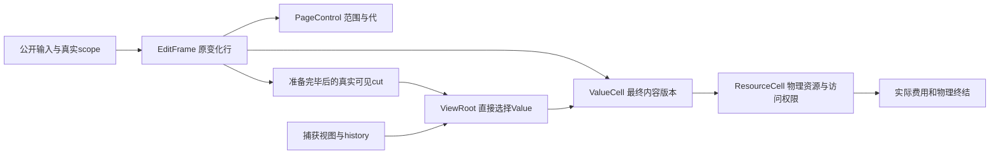

**2026-11-04 完整后端能力设计（105）：** 当前产品仍为0fd96，已完成CPU集成和价格保持。[完整设计](UNIFIED_BACKEND_DESIGN.md)覆盖provider能力、多副本、文档级root、GPU/UMA真实完成、布局/预算、切换恢复及全部消费者终结；原矩阵新增UB01–UB16并映射MW01–MW12，设计已给出，实施0/16、能力验收0/16，未发行新性能报价或GPU资格。设计采用同一结果协议，禁止桥接旧private/seal/publication；文档root的区间映射构造须经反例和真实服务验证。

**当前设计入口（2026-11-03）：** [原MW事实访问、完整路径价格与替代约束](WRITE_UNIT_RECONCILIATION.md#fact-access-102-results)。实装48c89保持。100的已识别局部迁移不满足当前§3.1全影响范围；新完整构造及数值上界未完成，不得把下文旧“整链方案/已计价”转作实施放行。

**当前设计入口（2026-11-02）：** [100 按关系寿命生成维护的整链方案](#relation-lifetime-100)。当前产品候选 `48c89b04f8`，实价见98；99规模审计接续为本方案。下文81–85、0c等版本状态均属于冻结检查点，不是当前产品身份。100不是正式性能放行，不重新使用85的pending/rebind方案。

<a id="whole-construction-reassessment"></a>

# 2026-11-02：完整低成本构造重新定向

**最新裁决优先于下文历史候选的实施许可。** [复核账单](WRITE_UNIT_RECONCILIATION.md)和[可复算结果](CONSTRUCTION_REVIEW.json)撤销84–85作为默认实现基础；完整81仅作研究对照。原JG/MW仍是同一整包，未提升完成率。生产0c、正式0473保持；没有产品回退需要执行，也不把81提升为生产。保留84–85证据，不在其pending/rebind协议上继续叠加。

## 主线目标与当前不能支持的判断

主线退出条件保持：**完整同义写操作及其生命周期的实际工作减少，完整替代实现、合同与净价同时成立。** 14.428243M是原工程目标，尚无完整构造上界支持。83的研究范围大于目标差额只表示“没有被零价筛选立即排除”；不证明原行、PendingResult、身份复用或任何既定构造路线能实现目标。普通样本23.408M也不能称为理论上界。

以下三个方案不得再作为主线替代物：①把原Value延迟建立/换成pending，却仍执行原接受和费用链；②以校验叶或索引helper的降幅预测整链；③用188条状态核加旧服务/未知整合拼成低价报价。没有新证据时，不继续为它们补结构或计价。

## 从真实观察点建立完整算法，而非沿旧服务列表包装

完整路径应先分清这些不可混淆的边界：

```text
公开输入及原范围准入
  → 取得被范围责任保护的原位置/源事实
  → 准入真实容量与费用，取得物理写权限
  → 执行内容工作，原结果持有完成事实
  → 真实sealed/adapter消费者需要时发行相应能力
  → 全D最终验证成功后安装可见结果
  → 原旧资源责任接管，最后消费者终结
```

在像素写入前取得物理权限与在可见安装前通过all-D验证是两个不同保证；不能为了“只接受一次”删掉其中一个。私有中间结果若被alias、adapter、checkpoint或公开proof消费，则必须支持真实可见/稳定身份；没有该consumer时不得凭旧服务边界额外生成公开能力。跨解锁窗口只消费仍受保护的事实，对真正会变化的读者/撤销/预算状态做必要重验，不用同时持有全部owner锁隐藏成本。

| 原责任索引 | 已有实现事实，不再领取收益 | 要构造并计价的实际工作差 | 保持的边界 |
|---|---|---|---|
| JG01 源事实 | 81已有原selection、location及native source | 将事实按不可变descriptor/provider、范围保护的源、物理占用、动态读者/撤销分开；取消下游为重新证明同一事实产生的表示与服务，不能只增加一个proof类型 | 外部输入真实性；真正解锁失效后的重验 |
| JG02 目标/费用/权限 | idle record已有原位handoff；费用已有专用optional路径 | 研究范围权威直接发行native目标：真实占用、metadata writer及费用变化各有唯一决策者；跨owner只交接必要结果，不重建完整handle再按通用交易解释。保留真实Fresh/拒绝/重试服务并同包报价 | 写前正费用/容量准入、独占物理权限、动态限额、原失败副作用 |
| JG03 私有结果 | private本来就是最终Value；84–85仅减少身份对象并未减少主要服务 | 身份数量不设为目标。比较直接保留原81 Value与真正紧凑结果；只有完整净价支持才选延迟身份/复用。禁止默认完整Cell嵌入另一个行再迁移 | 真正逸出的身份保持稳定；取消不泄漏 |
| JG04 sealed消费者 | 已有原行和同次分组复用 | 接受完成事实的真实consumer直接使用原权威；只对缺失事实执行provider政策、冻结与能力发行。把所有真实服务和调用/字段传输计入，不能以ready布尔替代 | custom provider、alias、公开proof、adapter、失败保留 |
| JG05 all-D接受 | 已有原行位置与有界单shard窗口，不能重领“原位/批量” | 将最终动态检查和唯一效果计划直接落在同一原行；分组、索引、版本链、费用分类和overlay交换作为一个实际算法设计。哪些索引必须每代更新、哪些只服务外部查询，由consumer证明；不强制复用导致更贵改键 | 所有D验证后安装；晚读者、版本/额度耗尽、真实跨shard边界 |
| JG06 旧值/资源终结 | 已有稳定retirement record和最终接管；85证明旧authority尾不能遗漏 | 保留一个终态责任，接管实际旧物理/费用事实；避免从已改写身份重新导出或重复分类，最后释放进入同一价格 | 历史/读者、撤销、idle续期、真实延迟物理释放 |
| JG07及相关MW外层 | 旧包外仍4.829M非复制叶余量，含内容循环 | 将输入、范围、写循环、适配、包外/尾部与上述候选一起对账。分开内容循环、PageStore附加工作和通用优化；不把包外全部固定或全部当可删管理 | 同义像素、公开读写/历史及全process结果 |

这些是待验证的**工作替代问题**，不是已经达标的方案。逐项重建既有服务后再换接口，仍属原算法；如果不能指出相应旧工作的真实消失，不能将其列为优化实施项。尤其“native事实直达”只省掉1.460M已识别校验叶时，仍不足以承担主线；必须证明同时减少了哪些维护和服务，才有资格继续。

## 有效的构造路径必须提供什么

1. **先做同一候选的完整效果表。** 每个真实状态写入、索引变化、持有/释放、权限和费用变化标注唯一owner、必要输入、失效边界及consumer；与81的实际栈对应。无必要consumer的中间状态及派生事务直接从算法删除，而不是先做新carrier转回旧协议。保持旧价/替代价/未知三列，禁止把11.158M未定价整合统称可删工作。
2. **以完整native写路径作为可执行见证。** 复用现有同义夹具和真实预算、provider、metadata、历史/读者、拒绝及尾部，不用无锁标量替身代替服务。可以在隔离候选内按责任迁移和做正确性检查，但不能只串原API、只接一个小helper或只实现状态核后发布完整低价。没有消费者的通用分支不进入native热路径；公共/自定义consumer的真实路径仍须接通，不能留下第二套生产协议。
3. **价格未知时的有限研究问题只有一个：完整组合是否比81实质减少工作？** 新建表示、字段移动和通用检查若已抵消删量，先否决构造而不是继续局部打磨。正式性能计价前列完已删除、保留及新工作的闭包；仅有部分闭包时不重复运行整套计价，除非某个有停止条件的判别确实能改变整包设计选择。
4. **上界必须显式限制变量。** 固定N变化页、B操作、实际G保护组、E真实逸出/保留、A容量增长、R重试及最终释放事件。正常H1可用N=1024/B=64观察，不能把每批16页假定为一个shard组；85实测G=512只适用于该阶段该输入。对每项给实际算法的遍历/探测/尝试上界及生成代码/外部服务的成本边界。不可控外部成本单列参数；没有闭合就不授数值完整上界。
5. **完整验收保持原目标。** 普通写价、全process、H0/H1、相关读者/历史/拒绝及最终释放均需符合适用门。性能对比的唯一控制是冻结81（完整source/build身份），生产资格仍另行判断。不能把新均值当最坏上界，不能把旧83预算当预测；若全价仍不支持目标，停止沿该构造迭代并保留否定证据。

## 当前放行状态

只放行上述有界整链研究；**没有一个新的性能实施方案获得放行，也没有证明比81更低的完整理论上界。** 这是撤销错误方向后的真实状态，不以“已有新蓝图”替代有效进展。下一主线交付应是有真实工作差和完整价格依据的候选，而不是再一轮次数减少报告。原JG/MW与成本学说同步采用此裁决。

# 写管理重写蓝图：资源、内容版本与可见视图分别成立

**2026-11-01 主线方向约束与整包筛选：** [83完整成本与方向门](write-unit-accounting/mainline-boundary-83/REPORT.md)。以完整原行管线为候选单位，局部通过不关闭JG/MW整包。81同trace联合包14.838093M，保留服务旧参考3.680336M，其余11.157757M若服务/包外不变须压到1.933759M（少82.67%）；这是预算，不是预测。目标准备整段全免费仍差0.963413M，必须连同最终接受/处置一起改变。已加入可重放范围/完整报价检查；允许完整构造，新价/上界/生产及正式门仍未获证，无新性能采样。 同轮继续完成原overlay引用交接审查：10源码锚点、256+3有限模型；不再把全量view/delta增宽设为默认前置，实际cut整合尚未实施。

**2026-10-31 实质工作约束：** [当前动作差异审计](WRITE_UNIT_RECONCILIATION.md#work-delta-audit)发现N01–N04的原位置、native免通用准备、原行安装及单shard免claim已在当前代码，不再领取下一轮收益。N01–N04降为待证研究；真正候选是取消独立逐页Value准备和无中间consumer的提前freeze阶段，必须连同真实费用/权限/失败/末次消费者取得完整替代价。未知新价不准由父桶或预算倒推；本次无生产改动/新性能过程，不增加完成率。

**2026-10-31 主写降本目的未达成：** [最新写单价对账与方案裁决](WRITE_UNIT_RECONCILIATION.md)确认当前0c H1写约25,019条/页，正式0473约24,200，普通CPU也多0.171ms。非内容约20.586M，对原9.402M报价多11.184M，管理/内容约4.10倍。目标取得与接受占非内容75.4%，入口收益被抵消；下一必须给完整替代的联合新价，修新增回退不算完成。总量解释约99.77%，差额仍有18.6%观察余额；无生产改动/基线提升，正式门保持。


<a id="current-convergence-review"></a>
## 当前实现校准与收口裁决（2026-10-31，0c6889e6fb；普通价55、诊断56/57）

**C01–C04的实现/删除/合同与资源结清证据保留，但正式写基线降本目的失败。** [唯一五包/17条件矩阵](MATRIX.md#current-convergence)仍14条完成、3条开放。55份回执不是工程完成率，原MW全维验收0/12及P1–P6仍开放。当前计价与原报价反证以[最新对账](WRITE_UNIT_RECONCILIATION.md)为准；以下各编号段落保留其冻结时点。产品0473/default-off保持。

| 包 | 实装 / 尚需完成 |
|---|---|
| C01 完成 | 原Store→L→全序R→E?/S最终cut；费用准备在R前，Resource列准备在L前。真实物理/IO/free/通知仍在R外，条件锁边原图保持。 |
| C02 完成并补反例 | Source/native/external/真实lease完整迁移；44复审发现缓存CPU副本可能是独立before，已修复其被错转为target binding的旧假设。43回执未覆盖该反例，44同版正反证据补入原C02.2。 |
| C03 完成实现 | 冷Data/17类即时输入/root位置/view与真实Lease实际依赖整段替换；旧Working*/覆盖桥/宽revision/冷初始cell分支已删，初始化归原registerPage。全部原费用/物理/Epoch和外部/异步责任保持；C04已核当前消费者与合同，原P最终裁决归C05。 |
| C04 已验收 | 入口/末次consumer、当前同版合同/删除、费用/终态及直接频数/寿命/布局观察资格均结清。44必查管理布局双架完整；普通价格仍交C05。 |
| C05 主目的失败 | 55普通价确认当前写25019条/页仍贵于正式24200；56/57将非内容定到约20.586M，原9.402M报价失效。差额精度、H0阶段资格与下一完整替代单价仍待；不得以修新增回退或代码迁移完成抵主目标。 |

### C03.1冻结迁移证据（08bd，44回执）

[44回执](DEVELOPMENT_COLD_EFFECT_44.json)列17个消费者锚点、完整源/库/原始失败及正反控制。原restore/default/private/recoverable与mixed generic准备共同迁移：


已有Value、幸存副本、read edge、lease和last-use链不复制到工作状态，再筛掉或重建。只有真正的新Value使用原预约，其单一目标副本直接借原输入写入最终存储；标准逻辑default不产生发布缓存，真实物理或必要非标准默认身份保留。共同`insertReserved`承接真实新记录，import继续共享真正新插入；覆盖既有Value的旧分支已在45删除。恢复删除旧authority并在确有必要时将原before移到inline位置，保护链头与内容保持；原native和冷恢复消费同一槽位编辑。10处实际定位消费者均在已索引Value下，直接使用原physical index并核对owner/完整预期身份，删除副本链扫描和匹配时的完整handle投影。

费用/外部消费者仍需冻结真实handle，至多2D个放入**同一Data尾部**，不另造费用vector申请/增长；一次排序回填原计划的位置。对多个真实新物理目标才做重复检测；最终还必须重验其他页可能改变的共享physical index，新增反例证明不能仅看本页revision。私有Data可选lease有真实operation/writer，外部权限、异步和独立oracle保留。原冷Entry中无消费者的descriptor字段已删除，需退出门释放的cache沿原releasedReadBinding/原行归还，不增加owner、队列或Frame字段。

纯cold的1–16行、同一shard且无混合原行时，保留一把S完成最终检查、编辑和预约收尾，省去临时claims与重复S窗口；多shard/更大/混合输入保留全D claim，所有页验证成功后才编辑。原活动预约和有界cleanup仍防止门内最后free。现有严格revision政策及纯view activity维护未被证明全局最小，继续列为C03 root职责审查内容。

### C03.1冻结布局与验证（非当前同版资格）

最终同版双架核心9220、manager55组1326、固定seed压力6全部通过；87 TU调用图2878 API/37584边及原21/26/16/19架构门通过。门限没有放宽：过时工作数组storage字面检查改为实际原Data growth借用；初始capture允许第一次目录定位，最终install仍禁止重定位，并新增冷Data旧工作状态禁止项。

相同新测试仅将MetadataCoordinator恢复8fbe时，正确加载派生库后两架均出现两项预期失败：①新目标拿到cached before的binding，②同样保护输入仍预约2个overflow槽。当前两项通过，before原保护不重建，overflow预约为0。首次新夹具缺默认revision/有效generation highwater和首次负控缺库别名的失败完整保留，未作产品/价格结论。跨页后来占用物理token及同批重复介绍均在任何安装前拒绝，原完整记录快照与oracle比较保持。

| 双架真实布局 / 请求模型 | 前→后 | 边界 |
|---|---:|---|
| Data / Entry / Publication | 256→240 / 128→112 / 1784→152B | 结构声明，非每操作指令。 |
| fee身份载体 | 160→152B，改同Data尾容量 | 最多2D，含两个准备阶段位置指针及introduced标志；不新增独立费用owner。 |
| 128行、4shard候选申请 | 247104→75056B | 后者含全部2D费用容量；前者还未计旧独立vector和工作数组spill。不是总峰值/RSS。 |
| 固定恢复保护 | overflow预约2→0 | 必要before pin/lease/last-use和最终像素/状态语义仍保留；不能等同CPU同比下降。 |

申请模型由实际`create()`与两架布局计算，arm64/x86_64的AllocationUnit分别实测8/16B，未假设两者对齐相同。新费用尾在逻辑-only输入也预留2D容量，多个真实新物理目标增加一次有界排序，最终index验真也有成本，均计回后续净账。本段主要是冷路径，native H1未必命中；共同索引匹配虽有变化，也不能据此领取H1、同义upstream或毫秒收益。

### C03.2 即时原位置计划：已实施并验证

08bd为本段冻结前态，当前b60e2709ce。[45回执](DEVELOPMENT_LOCAL_MUTATION_45.json)绑定同版源码/库/消费者和正反验证。即时owner入口统一为同步`MetadataLocalMutation`：借原Value/replica槽位，只记录改变的标量、实际新增身份和读保护编辑。多输入必须先全部判定，再在原接受窗口一次安装；单个释放仍消费原overflow槽，不克隆保护。写入/取消、detach/abort/discard、default materialize和authority handoff同迁，不留下生产工作状态机fallback。独立公开oracle保留，仅用于测试和诊断。

| 旧内容 | 最终归属与同批删除 | 真正边界 |
|---|---|---|
| applyWriteSequence + applyProjectedSequence及两套安装 | 同一原槽位同步计划；删除宽next/result、additions、inputVersions及accepted-batch安装 | 先验证所有输入，接受前保留原revision与实际physical冲突验真；只有真实引入项预约 |
| surviving Value/replica/lease/last-use投影与重装 | 原记录不动；变化的pin/validity/publication和真实读节点编辑直接消费 | 原异步ticket、公开exact身份、page-wide读lease唯一性及多副本保留 |
| putReserved覆盖幸存记录及assign保存/重建旧native/子链 | 唯一真实新插入；删除无合法consumer的覆盖分支，初始化只填新单元 | 原initial-root内存identity保留；现有Value不再经过该入口 |
| 完整活动header投影后再按identity找slot | 原activity image与计划内槽位，安装时直接交回原owner | native写/真实writer/authority handoff仍有各自权限，不能伪造或回放 |
| KisPageWorkingResult/State/Version/Replica及applyKnownValid | 从生产整体删除；oracle继续独立完整snapshot模型 | 借用allocator寿命测试改为验证实际allocator/嵌套数组，不保留废弃模型类型 |
| retirement前重新预约幸存记录/保护 | 仅实际新Value和新保护节点需要容量，原释放节点转pending继续复用 | 所有费用/retirement接受先准备；门外真实变化仍须重验，拒绝不改原记录 |

原输入的真实既有Value按实际cut去重，后续消费原位置；两格inline输入重复不会导致申请。新增身份只在真实序列变化中加入，不做全页投影。保持原输入/退休效果顺序；小型cut用线性位置表，不增加第二索引。较宽输入的位置比较成本仍须按实际D计入，未授全局最低复杂度。数量预测为幸存重建和复制归零，新增容量按实际生存输出计算，最终安装无key重新定位。小型净零read序列、原位handoff/abort/cancel在原容量足够时不应因复制幸存状态而需要额外headroom；超过inline的真实输入/效果仍计入付费容量。该构造不预测普通CPU/指令净价，真实lease唯一性扫描与实际退休输出规模仍需计价；generic冷入口不自动授H1命中。不得为延续旧夹具的临时申请拒绝而恢复已删除的工作数组。

当前同版双架核心9244、manager55组1326和固定压力6全部通过，原架构21/26/16/19门保持；调用图87 TU/2893 API/37621边/22 callback，物理预约生产/测试调用者1/12。相同最终测试程序仅恢复08bd Metadata与其工作状态/oracle桥时，两架各8项预期失败；7个有界服务均因旧复制存储无headroom而拒绝，实际宽输入收费控制仍通过。当前这些有界输入在0临时headroom成功；6组满overflow的还后重借不增长，跨页接受前物理占用仍在任何安装前整包拒绝。

| 本段成本/删量 | 实际结果 | 口径 |
|---|---|---|
| 幸存Value/replica/保护重建 | 0；旧put覆盖和Working*桥均删除 | 真新Value/新读节点、必要pin、真实退休输出仍有成本 |
| 声明载体聚合（双架） | 原write2448 / generic2240→统一1480B；计划本体1096B | 只含所列局部载体，非编译器函数栈/峰值或CPU |
| 标量/节点编辑载体 | Value56 / replica40 / protection48B | 实际cut两格inline，宽输入/输出真实spill另计；线性位置比较未授全局最低复杂度 |
| 生产/测试增删 | 828增/775删；测试148增/67删 | 净53行表达原子序列的直接编辑政策并替代旧双执行/临时模型；无新增持久字段/owner |
| 普通净价 / H1命中 | 未测 | 该段以generic冷路径为主，不能领取H1或upstream毫秒收益 |

首轮仅新detach夹具仍带operation被独立oracle拒绝，修正输入并重跑完整最终控制；清理中漏迁初始化调用及误删仍有终结consumer的identity overload造成的编译失败均保留。后者保留真实入口，不作为废弃重建路径删除。原17条件8完成/9待，不以这些控制关闭C04/P或C05。

### C03.3 冻结交付（b18，46回执）

以b60e为冻结前态，当前b18eba09d9；[46回执](DEVELOPMENT_ROOT_DELIVERY_46.json)绑定最终源码、实际库、原始日志与两组反测。本段不改变公开restore/rollback/rollforward ABI；仅三个原私有adapter回调链改为借用原差分版本与位置的`KisPageRestorationChanges`视图。原root差分只生成一次，跨元数据/目录重试仍由原候选保留；新增目录默认项只是原vector后缀。只有真实prepare hook绑定位置时，原workspace前缀才存每个root差分行的一个非拥有暖位置（8D）；仅解锁/通知的complete-only路径不建立该列。其余阶段继续重叠复用原工作区；稀有后缀增长需在同一workspace保留该前缀，会有一次真实old+new容量峰值，计回资源账。没有N页位置表、长期owner或第二费用账。

| 旧位置/责任 | 本段最终形态及删除 | 保留边界 |
|---|---|---|
| PublicationCoordinator restoreTargets每次重建，attempt clear清输入 | 原冻结root差分跨attempt存活；只重收真实default目录后缀 | 真实expectedHead、directory revision及完整费用/metadata动态校验保持 |
| 三层私有root-only prepare / raw-version complete回调 | 同一借用差分/位置view贯穿Store、memento、backend和manager，删除旧回调签名 | 不逃逸，manager原门保护位置直到最终delivery；公开无callback入口保持 |
| PreparedTileUpdates root prepare丢弃位置、最终再次按key找暖tile | root有序枚举与原D前缀归并，暖位置直接回原workspace；安装直接消费暖D，真冷候选一次installMissing | 全目标成员与反向adapter-only成员检查保留；无变更却缺wrapper也能修复 |
| 原workspace growth丢弃旧内容 | 同owner提供只保留真实trivial前缀的增长；普通无prefix行为不变 | 准备失败保留旧前缀、接受后不分配；额外瞬时峰值不隐藏 |
| 冷Data无lease/无addition的纯view行仍改revision、领写活动预约 | 只观察/重验原事实，实际新Value/writer才记页修订和活动预约；统计按真实观察/安装语义解释 | 费用身份、最后释放、default cache回收提示、真正epoch接受保持；不在本段把所有reader revision冲突默认删掉 |

已实装暖D最终key查找归零、重试不重复生成root差分、纯view revision/activity写入归零。实际内容、root接受数、必要费用/Resource gate和冷repair不变；指令/CPU净价未知。strict revision对读保护等无关变化仍可能保守，后续C03.4按真实输入失效事实继续审查，不能用本段删除量宣称全局最低管理成本。

最终同版双架核心9250、manager55组1326、固定seed压力6项通过，共10582；冻结b60 Metadata配相同新测试两架各2项失败（不必要activity、相同事实因纯view revision写入而失效），prefix丢弃消融两架各1项失败。真实late default目录增长使restore尝试2次，prepare/complete各1次，原版本与位置保持；workspace真实扩容失败保留原指针/内容/费用，成功增长和最终退款通过。独立oracle及像素/旧读者/默认/rollback-redo/refusal等断言保持。

两架原commit848B、workspace24B、Data240/Entry112/Publication152B均不增；借用view24B不拥有数据。semanticCount0的restore请求从168Dtotal变为`align_max(8Droot)+168Dtotal`，只对真实prepare hook增加前缀；complete-only增加0。物理容量舍入和稀有old+new增长峰值另计，不作为RSS/CPU实测。生产147增/60删；原门限未放宽：首次manager第五个direct include被拒，改由backend facade提供自己的完整回调协议，最终同版全控重跑。调用图87 TU/2899 API/37689边、22 callback及物理预约1/12；原21/26/16/19门通过。普通指令/CPU净价、H1命中未知。

本轮审核仍明确保留：全root membership与反向adapter-only检查承担真实修复；prepared activity不等于Value pin；严格page revision对无关读保护变化仍可能保守，须按实际事实失效审查。不能因测试通过就全局删除read revision，也不能把本段删量当全管线最低成本。

### C03.4 冻结view交付（7261，47回执）

本段替换同一冷候选四处宽失效规则，不改外部事务或取消边界。写准备确实依赖原pin/独立before及writer事实，继续使用严格页revision；纯view只切换根选择，不复制或结算read/pin链。其必要输入是原选择/目标的逻辑身份、历史状态、实际authority及原页无writer/mutable；物理新增去重、费用/Resource和最终Epoch接受仍各由原责任检验。

| 位置/真实consumer | 目标/删除 | 保留语义与代价 |
|---|---|---|
| Data::Publication的可选Lease；纯view未保存选择身份 | 原互斥依赖采用空/Selection/Lease同一sum type，view与Lease只存generation/default revision16B，页key归原Entry；原displacedDefault槽扩为原selected槽，不新增Data或页级长期字段 | 现有Lease真实base/pin/独立before等保持；初报布局不增，中间态152B通过后剔除重复key，二次事前预测136B并已核实。标准sum type分支和视图事实比较计回 |
| arena容量锁外重验、活动预约前重验、最终claim、genericInputsChanged | 四处共享原Data的实际输入有效性规则，删除各自宽revision判断；revision相同保留快捷判定，变化时view核验原槽/版本/authority与缺失身份，只有同义事实保持才复用原候选 | 写Lease遇revision变化仍拒绝；default真实重物化、authority替换、目标丢失/新增或writer/mutable出现不得沿用旧费用输入；跨页物理占用仍最终拒绝 |
| 原displaced-default回收hint | 同一selected槽仅在原选择为default且身份变化时触发，不扩展终结语义 | 不新增root事务或改变历史/读者内容，不依赖prepared activity为Value pin |
| 所有冷/混合/恢复消费者 | 同一Data政策覆盖restore/default及真实lease，常规native原D不重造候选 | 新反例必须证明无关读保护接受、真实依赖变化拒绝、完整快照/oracle保持；合法拒绝不得被放成成功 |

[47回执](DEVELOPMENT_VIEW_FACTS_47.json)绑定最终源/实际库和全部原始失败。数量预测已兑现：纯view仅因read acquire/release/last-use或无关历史变化导致的候选重建为0；真实事实变化仍触发原重备/拒绝，新增存储owner为0，发布行实测152→136B，Data240/Entry112/commit848保持。新增必要选择存16B、慢路径原缺失身份要exact index查询、比较及sum type分支均计入新成本。只有实际发生宽失效的冷路径命中；H1命中、普通CPU/指令净价未知。本段不关闭尚未覆盖的全部同构/异步/最后消费者。

最终双架核心9290、manager55组1326、固定压力6，共10622项通过。1/17行×十种实际变化的新反例中，读source/target、释放read、验证last-use和无关历史不重备，authority变化、目标消失、writer及source/target default实化仍拒绝，快照/oracle与预约归零保持。真写的满共享预算读者控制继续拒绝；纯view同预算无额外准备接受。

真实Store在释放retained token并出现晚读者的同一observer交错中，restore尝试2→1、metadata重备1→0，晚读者0x72与恢复后0x31保持。两派生库各架均10项预期失败：旧b18过度报告无关变化；忽略view依赖的消融漏报真实变化。负控在首个detector断言停止，不冒充独立执行过负控最终install；当前正控及原子拒绝夹具执行真实最终安装。11家族现行实现/合法独立边界已回填同矩阵，但完整家族/资源/P仍待C04。

生产70增/31删。最初两处新夹具API拼写/void错误和首轮每架13+1旧失效预期失败均保留：原子拒绝夹具改用真实writer或missing-target冲突，未删拒绝/旧内容/清理断言；Store读者场景更新为不重备。中间态完整10622通过后发现重复页key，剔除后整套重新冻结验证，旧过程不移授最终源码。原21/26/16/19架构上限保持；只将displacedDefault旧字面规则改为原selected槽加真实默认回收条件。普通CPU/指令/管理比和主H1命中未知。

上述为47冻结裁决。48已替换真实写Lease的宽失效规则，具体形态与资格边界见下段；完整全家族/资源/P由C04继续。

### C03.4 真实Lease原事实接受：已实施（955c6e4ded）

本段替换原写Lease的整页revision拒绝，不取消真实读保护。原base/replica槽、source/target冻结事实、generation、writer和费用owner已存在；不另存保护快照或第二候选。revision只是快速判定“页事实尚未变化”的缓存；变化后读取原事实，允许与本次写无关的变化。初次准备和最终/锁外重验共用同一动态谓词，避免维护两套初始/接受政策。

| consumer / 原规则 | 最小输入与替换 | 必须保留的拒绝 |
|---|---|---|
| capture里真实Lease动态检查、后续inputsValid直接拒绝任何revision变化 | 初次只定位原base/source/removed槽并验证静态身份；同一leaseInputsValid消费原槽的版本/权限/authority和当前pin增量 | writer/native冲突、外部/Prepared权限、base或source丢失/换身份、generation已消费、pin到max仍拒绝 |
| 正常新存储的before | 同一base authority、Valid来源与pin+1容量；当前读lease/last-use/独立pin原链留在原记录 | 不能把不相干读变化或pin精确值的变化等同来源失效；不能复制旧pin数覆盖当前状态 |
| recoverable旧目标＋独立before | base仍以原removed为authority；before仍独立且Valid，旧目标无pin/overflow/active operation、无handoff；layout/domain/incarnation仍匹配 | 旧目标出现读者/last-use/in-flight、authority变化/身份复用、物理排他或费用拒绝仍不能交接 |
| target物理占用的初始和最终重复实现 | 同一targetAvailable谓词只负责真实新增physical占用，初次准备和最终全D检查共用；同页version缺失归共同输入谓词/原revision缓存，初始化身份不归runtime冷候选 | 跨页物理占用不一定改变本页revision，最终检查必须始终运行；不能被revision快捷路径省略 |
| 四处冷输入有效性consumer | view及Lease同用inputsValid和原revision缓存；实际Lease变化时精确重验后更新缓存 | 原Store/Resource/费用/Epoch及公开异步lease生命周期保持，不以Metadata接受代替物理写权限 |

初始接受复审还发现：移除metadata Published头后，当前default与历史default在存储里都为Historical，原ReplaceDefaultPixel校验因此误把“当前同一身份”当成可替换历史；没有新增存储的输入还可能携带physical target进入费用输入。独立oracle拒绝对Published当前身份直接Replace，合法同身份自恢复走RestoreCommittedVersion。本段按原root selected身份恢复这一区分，准备阶段即拒绝同身份Replace；真正物化继续走原AttachHistoricalDefault/MaterializeDefault。它是责任迁移缺口修复，不计为性能收益。

登记边界复审：revision缓存只对已登记且在该core内不再退回初始化状态的原Page成立。旧capture允许未登记Page进入准备，后续canMutate却要求已登记，残留初始cell填充分支既不能完整接受，还留下锁外登记例外。本段在capture明确要求hasMetadata，同批删除冷Data的初始cell填充/重复需求判断；真正初始化仍由registerPage消费原initialIdentity。跨页physical占用始终最终检查，同页version缺失由共同输入谓词及原revision缓存保护。

数量预测：对来源读保护/独立历史的误重备为0，回收目标真实读保护仍拒绝；无新增owner/字段/容量，Data240/Entry112/Publication136B保持。新增慢路径事实比较、原缺失身份exact查询及共享谓词分支需要计回，主H1命中和普通CPU/指令净价未知。正常native原Frame路径不因本段改造而增加事务。

[48回执](DEVELOPMENT_LEASE_FACTS_48.json)固定最终源码/实际双架库及完整消费者、原始失败和两组派生控制。本段所有原入口已迁移：初次只定位原槽并由同一leaseInputsValid决定source/权限/authority/当前pin增量/generation；changed revision后同一规则重验。targetAvailable共同决定原shard物理占用，最终不因本页stamp未变而跳过。正常runtime只接管registered Page，初始root cell继续由原registerPage填入，不在冷Data中复制该职责。

最终同版双架核心9392、manager1326和固定压力6，共10724项通过。新51例/架覆盖normal/recovery、Published/Prepared、来源读/归还/last-use、独立历史、old-target保护、authority、writer、已消费generation、base丢失、pin耗尽、跨页占用、indexed/absent default及初始化边界；既有B1/4/8/16、H0/H128完整取消/发布/晚捕获检查保留。实际generic已完成读者在4种Bpp均从Fresh退路改为handoff，额外committed `4096×Bpp→0`，原地址/失效incarnation、内容、取消后旧视图、账目及close全部核对。这是固定交错机制兑现，不是普通H1频率或时间收益。

同一最终测试仅恢复旧726 Metadata，每架Reference26项及真实CpuMutation4项失败；仅省去Lease changed-input重验的消融每架20项失败。Reference负控在首个detector/构造断言停止，不冒充另跑过危险最终安装；当前正控/旧原子拒绝夹具运行最终cut，CPU负控执行到真实并发handoff数量断言，失败后未继续显式字节/close断言；完整后续断言由当前正控及冻结47正控覆盖。两架Data240/Entry112/Publication136、原commit848/workspace24保持，无新owner/持久字段/候选申请；生产98增/84删。新慢路径比较、缺失身份查询和显式登记条件计回，单价未知。

首轮每架18 Reference＋4 CPU失败中，有旧读/晚捕获/已完成读者的保守预期，以及新夹具的implicit枚举顺序和非法自Replace控制。现在按完整版本集合核对隐式诊断、更新合法handoff结果并保留读者/字节/拒绝/清理断言；未修改独立oracle。随后登记边界复审清掉冷初始分支，增加两实际初始化边界，再冻结全套。新登记夹具缺一个error参数的编译失败、所有中间过程和旧派生树均保留。

**实现收口：C03.4及C03包完成，17条件10完成/7开放。** 这不授予跨更改外部语义的全局最小性；原单页handoff排斥、真正物理/费用/异步和公开ABI仍有真实合同。下一不再滚动追加C03局部版本，按原C04全家族/资源/P验收及C05同义upstream/0473全生命周期计价推进。普通CPU/指令/管理比和主H1命中未知，正式门/default-off和生产0473保持。

### C04.3 冻结行为与删除核查（04f36f1870，49回执）

[同版完整回执](DEVELOPMENT_QUALIFICATION_49.json)补齐原55个选测方法之外的99个manager行为方法。当前154个行为方法共3574项，核心9392项，三组固定seed并发10项，合12976项双架通过；QTest合计包含init/cleanup，不是性能独立样本。未运行fixed-work性能方法或benchmark矩阵，普通净价仍未知。

本次补核发现并完成两项实际清理：

- **匹配读hint的宽失效。** adapter发布后仍选当前Value、校验原binding版本，再pin准确allocation incarnation；匹配时直接消费原缓存。原guard、旧view、default/冷失配、关闭与不可用路径保持。已有4种Bpp、每格10次raw写后读仍按原断言验证零新增capture和零generic read request，未将断言放宽。真实selector查询和binding检查仍有成本；没有普通H1净收益资格。
- **无consumer的旧presence重查。** 删除私有`resolveCurrentPagePresenceInto`声明及完整实现；原变化行直接携带最终presence。仍有实际调用者的可选changedPresence输出和公开Store查询ABI保留。生产12增/29删，无新字段、owner或队列。

其余失败属于已删除机制的验收未迁：extent观察改到实际payload前、copy改到实际source-page边界；alias核原三行实际安装，旧key数组refresh为零。导入同时测试**准备前真实容量不足拒绝**和**原容量已付费后成功**；最终像素、旧视图、extent、rollback/retry和资源退出断言保留。首次bundle路径中止、两架全部原始失败和首轮身份检查拒绝都保留在回执，不算成功样本。

当前AST为87 TU、2903 API、37869调用边、22 callback，物理reservation生产/测试caller仍1/12，原21/26/16/19架构门限保持；API少1、边少5。未改record布局或继承，原Clang结构布局保留冻结身份，当前双架Foundation布局控制重过；不把它冒充完整峰值或函数栈证明。

**收口约束：** 当前没有登记中的另一核心重写包；不得因尚未计价而重新造一版协议。只对具体反例修完整责任。剩余六条件仍在同一矩阵：C04.1入口与最后消费者、C04.2与C04.4联合资源账，随后C05.1–3一次普通整包价及裁决。P1–P4、P5资源与P6消费者/删除证据可先核；P5价格及P6净价只在C05取得，不能形成循环前置。

### C04.1/2 入口至末次消费者与财务终态：已核（04f36f1870，50回执）

[完整来源、资源义务和观测回执](DEVELOPMENT_ENTRY_TAIL_50.json)将13组owner/capability/provider/completion边界的302个实际AST overload归入原11家族，另追30个模块外函数consumer、raw虚调用和22个callback。包含getter/构造和合法独立边界；归组不意味着全部API都触发完整写流程。每家族给出入口、必要事实、实际接受、拒绝归属、最后consumer及52个源码锚点；原同版合同复用，没有再跑12976个PASS来替代新证明。

费用验证分开：独立flat模型覆盖六个共享内容类别、8个physical×3 alias、8 seeds及有/无父账；Idle按真实保留/到期/拒绝和最后释放验证，Metadata按实际管理容量寿命验证。8组资源义务关联28个现行合同方法，含全部8类×4域的slot复用/退款、跨Store父账拒绝、domain revision、范围/最后root、cancel/close、真实异步last-use及不可重放的一次消费。没有把六类flat测试冒充全部八类物理场景。

本轮代码/生产库不变；资源观察48过程（双架22初观测、22父账校正、4最终runtime停止控制），共1028条端点记录。额外snapshot、drain、预算observer引用及可选显式close/stop使其只具有资源/合同资格，CPU/指令不作普通净价。

| 当前完整manager H0/H1观察 | H0 | H1 |
|---|---:|---:|
| 4寿命暖写的generation / seal | 1024 / 1024 | 1024 / 1024 |
| 受控输入pin取得 / 归还 | 960 / 960 | 896 / 896 |
| 暖root commit / overlay接受 | 64 / 0 | 0 / 64 |
| 单寿命工作结束仍活内容类（固定观察） | Current256KiB＋Idle256KiB | Current256KiB＋ActivePending256KiB＋Idle256KiB |
| purge后 | 无history义务 | 可短暂保留真实retirement debt/provider operation/job，drain后才清零 |
| 显式close成功 | 七个非Metadata类及未结束capability均0 | 同左；不能省掉原退款与物理成功 |
| Store/manager析构并drain | 回process共同父账基数 | 同左，4寿命未累积 |

这里的pin计数不是全部物理Resource或系统分配次数，后者仍由C04.4直接测。H1的finish/undo/redo和purge是实际后续工作，不能在工作结束或函数返回处划为零；各类独立peak也不能相加成同一瞬间峰值。close后活着的metadata/adapter容量是内存owner寿命，不是尚未结束内容操作。

**父账口径已校正。** `kisPageProcessStorageBytes()`只含直接/未绑定本地账户的process存储，不能代替管理存储总量；process父`usage()`才含managed child。父账和本地账不能再相加。四寿命回同基数后，源码将共同保留定位到process-wide reclamation worker/monitor（各512KiB栈及实际native控制）、静态executor和观测预算owner。4个最终stop控制实测arm64/x86_64父账1150068/1084532→2948B，未绑定process子集→2564B；不是每Store欠账，不能用此内存差推断CPU代价。

**C04.1/2结清，17条件13完成/4开放。** 当前剩C04.4的actual allocation/Resource birth、保留时长、完整record布局及观察资格；再做C05.1–3一次普通同义upstream/0473完整净价和原目标裁决。不新增第二协议，不以这些资源数据预授指令/CPU收益或P1–P6整项通过。

### C04.4 实际服务频数、布局与观察资格：已结清（04f36f1870，51回执）

[51回执](DEVELOPMENT_MEASUREMENT_51.json)保留三批共194个有限资源/观察过程：初版66、缓存观察符号修正62、原始工作量66；四个未受驱动修正影响的压力过程只计一次。当前产品源码/普通库不变，49同版12976条QTest PASS复用，不重跑整组安全测试。

最终驱动取原公开工作量：4个manager寿命、每寿命16页、16次完整写并读回；保留原case末drain，不持额外父预算、不逐寿命加drain/snapshot、不显式停共享runtime。原资源观察中的close/父账/worker终态仍按50独立保留。

| 同一isolated完整过程 | H0 | H1 | 解释 |
|---|---:|---:|---|
| 实际PageStorage系统容量申请／销毁 | 3071／3071 | 2359／2359 | 双架各4控制块完全一致；不是所有process malloc，也不全是非内容字节 |
| provider-local binding初建／销毁 | 128／128 | 192／192 | 物理寿命对象，不是每页每代各建一个 |
| provider-local physical登记／销毁 | 128／128 | 192／192 | clone可能共享底层payload，不能称全局唯一物理页 |
| 暖1024页写中Fresh／复用 | 64／960 | 128／896 | setup另64 Fresh；不把setup与暖操作混成单价 |
| 历史prefix预热后目标PageStorage申请 | 3066 | 2354 | 前述整过程含5次共享启动服务；跨口径不比较收益 |

三kind重叠，不求和。全部birth/death配对错误为0；当前冷partial/default/copy/clone/import/raw/held-clone及发布容量/Idle压力保留原行为断言。高水位为事件观察容量，不是RSS，不能相加独立类别peak。

真实布局以当前31个模块TU＋3个tile/manager/extent owner TU、双架68条编译命令为准，44必查管理记录无缺项。当前`WriteInput216/Selection640B`、冷`Data240/Entry112/Publication136B`、`Frame72/Delivery16B`、binding304B/physical288B；41回执的旧“current”布局整体降为历史。`sizeof`、allocator实收和寿命峰值各有自己的证据，不能互代。

观察反测揭示两点，作为本轮成本学说的计价约束保留：

- 初版驱动在每个phase重新`dlsym`可选符号；普通库缺失符号，控制组承担额外失败查找。修正为计时前一次缓存，原数据留存，未记为PageStore收益。
- 资源驱动为看到财务终态额外保留父预算并逐寿命drain，会影响生命周期口径；最终minimal驱动去除这些干预，出生次数完全复现。此一致性只授机制计数，不能授普通时间。CLOCK_MONOTONIC实测分辨率1µs，零区间表示低于分辨率；带观察保留时长与分布不冒充未插桩精确尾延迟。

当前工程迁移、删除和资源验收已经有限收口；17条件14完成，仅C05.1–3待。原MW整项0/12表示尚未做整包计价裁决，不表示代码重写0%；51回执也不是完成百分比。没有依据新增另一套核心重写或继续局部测完即宣称落实。

### C05.1 候选、同义与观察资格：已结清（04f36f1870，52回执）

[52回执](DEVELOPMENT_PRICING_QUALIFICATION_52.json)冻结当前C、产品0473的B及upstream9a24的U。三方各自编译实际image头文件，45/44/30个versioned依赖分别与对应Git blob核对；公共依赖及实际库哈希冻结。六个双架公开过程覆盖三方各60格，共360份签名一致，原H0/H1读回和history断言保留。这里证明共同成功工作同义，不把upstream视为具备PageStore新增硬预算/能力合同，也不将C−U全部叫必要税。

144个观察过程按事前4块运行：12/12阶段指令控制通过±2%；阶段CPU仅4/12通过±5%，因此不能把观察阶段CPU移授为普通收益。独立正式CPU采用mode0无指令观察，普通case指令采用mode1边界计数，暖write/read阶段另取mode2并再次核对控制。全部产品库未插入源码探针。

首三个公开过程的upstream加载曾被运行器误判：库目录是symlink，dyld输出实际目标。保留原判定和全部原始数据，以canonical路径＋SHA核验后复用三过程，从固定job3继续，未重采样。系统Python缺numpy的分析错误保留，改用内置runtime重析同一150过程。

完整子进程CPU和RSS由父进程`wait4`记录；case指令覆盖四个manager寿命至末尾drain，包含worker活动但不含QApplication初始化/OS退出。两种范围各自报告，不再混称完整启动进程指令。x86_64为同机翻译执行，其硬件计数不称guest x86 opcode数。

**52冻结时C05.1结清，17条件15完成/2待。** 独立8块、双架、三方的960个整包价过程已在资格测量前固定；以下53取得该批结果，不追加样本。P5价格/P6净价和原MW最终验收不由资格过程代授。

### C05.2 普通整包价：主写回退已证，成本分账仍待（04f36f1870，53回执）

[53回执](DEVELOPMENT_ORDINARY_PRICE_53.json)对应960个独立普通库过程，8个成对块、双架、三方及9个工作负载；行为、实际加载及退出全部通过。暖阶段12/12指令控制在独立批再次合格。CPU用mode0，指令总价用mode1、阶段用合格mode2；区间为成对块pointwise95%，不预授M6。

| arm64暖1024页写／读 | H0 | H1 |
|---|---:|---:|
| C写指令／页 | 34118 | 27462 |
| 0473写指令／页 | 31318 | 24205 |
| upstream写指令／页 | 5238 | 5239 |
| C−0473暖写指令，M／95%CI | +2.868 [2.674,3.055] | +3.335 [3.309,3.360] |
| C读指令／页 | 6871 | 6748 |
| 0473读指令／页 | 6936 | 6676 |
| upstream读指令／页 | 5209 | 5209 |
| C−0473普通暖写CPU，ms／95%CI | +0.137 [−0.148,0.348] | +0.134 [0.075,0.205] |

**主写目标没有兑现，H1写指令和CPU均回退。** H1整个case指令−0.282M [−0.498,−0.015]、CPU−0.302ms [−0.575,−0.052]来自其它阶段/非主线程抵消：普通main总价反而+1.150M，nonmain/boundary−1.431M；setup/history部分降低。不能把这一总量小改善称为暖写改善。H0完整case指令+1.653M；x86_64暖写H0/H1也增加4.333M/4.937M，H0 caseCPU增加0.258ms [0.058,0.484]。

冷partial/default/copy/clone/import/raw多数case指令降低，held-clone在两架增加；多项冷CPU区间跨零。这些收益保留，但不能拿冷入口或分配数量改善替代暖写单价达标。

当前H1暖写总指令28.121M，原9.402M是**非复制**预测。内容核尚未重新计价，不能直接相减旧5.079M核价宣称当前管理价。若要在当前总量中兑现9.402M，内容核须占18.719M；这是后续判别阈值，不是测得的内容成本。C05.2仍开放，C05.3尚不作基线提升。

生成代码进一步找到一个具体实施偏差：`writeFinalRect`复制内层为取得rowStride调用`page->target().layout`。当前ordinary链接对象中`target()`确实未内联，每次生成完整128B handle；native非空Resource路径执行39条callee指令，实际`bl target`位于行循环中。按当前已核H0/H1暖reuse960/896页×64行，callee粗曝为2.396M/2.236M。动态调用数尚为条件推导，净收益还须扣直接layout访问及代码生成变化；不能据此填满整个3.335M或原预算缺口。

这里的膨胀生成率是**行数×宽表示重建**，不是新增物理寿命或系统分配。下一在原Value/Resource和同一借用窗口直接消费不变layout，完整筛查内部仅取layout却构造完整handle的调用者；真实外部导出/身份协议保留。不增加新owner、缓存或一版核心协议，不再重复证明这项表示重建的不必要性。然后对实际copy/Fresh/compare及剩余管理分价，解释原预测偏差。

已保存三方测得镜像及实际Store对象的字节相同副本，避免后续候选覆盖原路径而丢失本轮计价与反汇编身份。

### 下一收敛顺序

执行细则见[写单价双账与降本方案](#write-unit-accounting-plan)。这是原C05的细化，当前源仍为0c，未新增测试、价格或第二套协议。

1. **当前候选资格与净价：** 54的0c代码已完成下面列出的全部7处；只补本候选公开同义/观察资格，未变的驱动ABI/对照沿52/53核验复用。为修复后的代码固定新独立比较，对冻结04、0473及upstream报告实际变化；不是给旧960批次加样到通过。
2. **C05.2 其余分账：** 定价当前实际copy/Fresh/compare与剩余管理，解释暖写差额及原预测偏差。只有循环条件模型，仍不能填管理/内容比或必要服务单价。
3. **C05.3 原账裁决：** 回填MW/P、基线/门禁。旧53及原9.402M预算保留；通用编译/observer变化不算PageStore收益，不以case其它阶段抵消主写目标。

### 内部布局事实消费：7/7已实施，净价待（0c6889e6fb，54回执）

[54回执](DEVELOPMENT_LAYOUT_PROJECTION_54.json)同批替换controlled copy、raw源初始化、payload/default fill及返回stride/size的全部7处`target().layout`。原PrivateWrite借原Value/Resource的immutable layout，不建立完整身份；像素循环前固定目标stride及format事实，raw同一已pin页的size/stride共同消费。仍由原claim/pin保持字节权限，动态身份/撤销在原门下检查；真实外部完整handle导出保留。

生产2文件+17/−9，无新增持久字段、owner、缓存或恢复域。旧7处索引保留为retired positions，当前归并为两个布局取得窗口及一个primitive accessor，不把已删除旧行继续列为当前调用者。没有更改Copy工作量、source/destination stride或逻辑像素输入。

当前ordinary生成对象中`writeFinalRect`的完整target调用为0。arm64旧native循环每行20条caller＋39条callee，新循环15条；在既有暖reuse和相同copy路径条件下，预报H0/H1减少2.703360M/2.523136M，分摊2640/2464条每页。这是条件模型，CPU与最终净删量均未知；也没有解释整个原9.402M预算缺口。

双架9392 core＋3574 manager154＋10固定seed stress，共12976 QTest PASS。首次manager未配置资源前缀的两份中止日志保留，同源/同库按既有prefix完整复跑通过；未改测试期望。87TU生成2904 APIs、37864 edges、22 callbacks，架构21/26/16/19原门限不变；新方法非virtual且不改字段/继承，44记录布局沿51结构不变的证据继承，不冒充新一轮布局编译。三方计价驱动的全部头文件依赖仍逐字节相同，可核验复用。

新候选的C05.1只补本版资格，故当前14/17条件；这个计数不是工程完成率。旧04的实测归旧04，当前0c尚未获得普通收益，产品0473与正式门/default-off保持。

保留legacy的责任是raw/iterator/显式batch等公开ABI消费同一Session，及真实外部/异步能力；不是第二套内容/metadata/ledger权威。已开始或失败的native不重放。删除薄适配须先迁真实消费者，不能为“零legacy命中”牺牲功能。

<a id="write-unit-accounting-plan"></a>
### 写单价有效对账与降本方案（2026-10-30冻结执行前计划；55–57结果见最新裁决）

**目标是同时解释当前价格与新旧差额，并只实施有净预算的完整责任替代。** C01–C04的实现/资源证据保持；本节属于C05.1–3，不新增完成率、产品回执或一版核心设计。原9.4021547345M完整暖写非复制预测继续冻结，管理/内容≤1仍为工程追求，均不称理论下界。以下样本安排是执行方案，尚未运行；运行前生成含真实库、ABI、任务顺序和停止规则的协议并保存哈希。

#### 一、固定分母，建立总价账和差额账

四个角色固定为：C=当前0c6889e6fb；A=回退候选04f36f1870；B=正式0473f45831；U=upstream9a24ae0d8c。A/B/U复用53的冻结镜像，C使用54的冻结镜像。旧53价格只属于A，不作为C实价；每次运行记录实际加载的镜像与依赖SHA，驱动ABI不变才复用。

- 主端点：原DataManager::writeBytes调用起止，包含同步adapter/delivery及离开作用域的清理；H0/H1各4寿命×16次暖写×16页=**1024页写、64次公开写调用**。分母不含setup中的64页，整用例1088页不能用于暖写均价。
- 页面分层：Fresh、reuse成功、reuse拒绝后Fresh、已有目标续写、同内容no-op、partial/alias分别统计。Fresh128/192等整寿命数不直接充当暖路径次数；由同一次trace重取各层N，最终工作结果与逻辑字节保持同义。
- 辅端点：read、setup、finish/history、析构/drain及非主线程/边界差额分别列。成本移到write返回之后要计回完整业务生命周期，但不得按未知来源均摊到写页。whole-child CPU/RSS和case指令仍保持各自范围。
- U证明本格共同公开工作参照，不具备所有PageStore新增合同。C−U按共同内容、实际触发的扩展责任、未解释余额分开；新增保证的存在不能为其当前单价背书。通用kernel或编译优化不能单独作为PageStore收益。

总价账：`I_write(v) = Σ互斥单元I_i(v) + r(v)`。

差额账：`I_write(C)−I_write(A或B) = Σ[I_i(C)−I_i(参照)] + [r(C)−r(参照)]`。

每单元保留同条件`N、实际内部展开数、u=I/N`；有多条路径就分层，不用全服务均价乘一种路径。`ΔI_i=(N新−N旧)u旧+N新(u新−u旧)`用于拆次数与单价影响；零次、路径变更或不可比时直接比较该责任总价，单价填未知。父子inclusive值不得相加；计数亦不得把页数、下游调用数、分配数相加当成互斥工作。

#### 二、按实际执行切成六个互斥单元

| 单元／原责任 | 当前代码定位 | 必须单列的价格与生成因子 | 可达到的目标形态；尚未认领金额 |
|---|---|---|---|
| 入口与范围，MW01/04/06 | `kis_tiled_data_manager.cc::writeBytes`；Backend `writeBytes/runCpuMutationOperation`；Store `borrowExecution/claimRange` | 每公开调用的固定费、逐页绑定、范围/原行/临时数组准备；与逐页目标和adapter子段排他 | 一次范围准入、同窗口稳定行贯穿；不把每层局部O(K)当作已经只遍历一遍 |
| 基底选择与读取保护，MW01/02/04 | Store `writeFinalRect`；Publication `selectWriteBaseLocked`；metadata `selectMutationBase`；binding `acquireRead/releaseRead` | selection构造/清理、定位、源权限、比较外壳；成功/拒绝/no-op分价 | 原选择直接消费；内部标量/定位不导出完整handle；真实解锁失效与读保护保留 |
| 目标与资源服务，MW02/03/07 | Store `prepareTarget`；metadata `preparePrivateValue`；provider `allocate`；binding handoff；WriteCoordinator预算服务 | Fresh与reuse分开；物理claim、费用、管理storage、原Value准备；payload字节体移入内容单元 | Resource按物理寿命登记；当代局部变化在原记录接受；已有容量仍须核其每次checkout/初始化单价 |
| 字节处理，MW04/10 | Store copy/matches/default loops；provider Fresh payload；实际tile内容函数 | 实际copy、比较、初始化/填充分别计；行数、stride、调用数、请求字节、提前退出位置 | 页面不变事实在原保护窗口取得一次；只因真正内容工作进入行/像素循环；真实no-op语义不擅删 |
| seal与接受，MW05/06/07 | Session `seal/sealForAdapterDelivery`；Publication共同接受；metadata `prepareAcceptance`及Resource接受；adapter安装 | 原变化集合、树节点/边、实际角色/费用变化、R锁/复验、adapter；子费从父桶扣除 | 最终Value与原D接受；不重建第二份结果；按真实变化访问，动态撤销/全D原子性保持 |
| 写内终结与退出，MW08/11 | Execution/Frame退出、OperationDelivery、原cleanup/最后引用 | 写返回前实际释放/退款/通知；返回后责任独立登记到生命周期尾 | 原责任只终结一次；不能把释放延后到读/history/worker而称作净删除 |

跨单元共用的预算、storage、锁等是**同一trace的第二维标签**，不是另外加到六单元之上的费用。每条记录同时保存业务单元和服务标签，导出“单元×服务×路径”的交叉表。这样既能知道target贵，也能知道它贵在表示构造、真实物理服务还是预算，而不重复计价。

现有`KisPageStoreDiagnosticTimer`的嵌套范围包含子工作，不能直接相加成上述账。优先复用已验证的阶段边界；欠缺部分只在派生诊断构建中加入固定存储的嵌套exclusive计数，区间进入/退出成对，子区间从父自身扣除，失败/早退也闭合。产品普通库不带新探针。禁止在像素行循环内逐行读指令计数器、输出日志、重新查询诊断符号或为观察延长owner寿命。

#### 三、内容分母必须重新取得，且不能隐藏管理

保留原预测兼容口径：历史content对应WU70/71/72的copy、字节比较、Fresh payload体；当前用相同语义边界重测，不移用旧5.099M。同时另列**实际写入/初始化字节体、相等检查、重复内容处理、纯管理、未分类**，避免增加扫描或冗余复制反而让“管理/内容比”变好。

仅取stride却重建handle属于管理，即使执行在名为`MutationPayloadCopy`的桶里。Fresh allocator、注册和费用不因在provider内部就成为内容；memcmp请求256B不证明实际读取256B，本格早不等与全相等控制必须分开。实际内容价格优先来自真实调用区间及普通生成代码；相同布局/对齐/输入分布的批量重放只作条件交叉验证，不能单独替代生产内核价格。无法消除的观察误差保留为混合/未知，不用总差额强制补齐。

#### 四、有限测量顺序与证据门

1. **先测已完成修正的净价。** 当前C补双架各一次60格公开签名；只重做C的4块×双架×H0/H1×3模式=48个观察资格过程。旧A/B/U头文件、镜像及未变合同资格核验复用。独立暖写比较为8成对顺序块×双架×四版本×H0/H1×3模式=**384个过程**，含无指令观察CPU、case指令与阶段指令。顺序预先平衡，保留所有失败；真实产品/驱动缺陷修复另开身份与批次，不为过门追加样本。此批只授暖范围，不代授冷入口或正式M6。
2. **再做一次联合责任分账。** 先native arm64，C/A/B三版、H0/H1、4块、诊断开/关配对，共**48个过程的首轮预算**；全部探针及计数映射先完成再编译/运行，不逐函数改一次测一次。同步记录真实路径数；U先保留公开总价与内容参照，不能硬套PageStore责任标签。观察失败则停止移授相关单价，保留原数据并选择更粗边界或生成代码证据；不无条件扩大到每行采样。
3. **总价资格与差额资格分别检查。** 沿52保留阶段总量±2%的观察控制；它不自动授每个叶价精度。对一项预先声明收益S，差额账的未解释/观察不确定量应不超过S的10%，且各版总价账未解释量应不超过本版暖写的2%；两者取更严格要求，区间与残差都报告。这个10%是本方案的解释精度要求，不是已有M6门或统计事实；未满足就只能报告已解释部分。不能用正负大残差抵消或把residual记为0获得闭环。
4. **只扩展会改变排名的高价单元。** 第一轮后才选择1–2个有最大合法净预算的责任；未测金额填null。若未解释余额大于拟选项，优先解释余额；不得因某个helper易改就先领取优化。下一候选先完成它的全部consumer/旧分支替换，再做一次对应合同、机制和独立净价。冷partial/default/copy/clone/import/raw/held-clone及并发/压力沿受影响合同复验，生产切换仍需原C05.3完整裁决。

没有并行构建/另一基准/分析器竞争；任何编译、测试或callgraph进程存活时不编辑C++。CPU使用普通mode0，指令不按比例换算CPU。若指令减少但普通时间不改善，保留“指令改善、时间未证”的判断，不能靠空间收益替代时间目标。

#### 五、降本优先级与可预测金额

| 优先级 | 本轮动作／完整替换方向 | 当前能报价的范围 | 停止或升级条件 |
|---|---|---|---|
| 0，已有实现 | 54的7处layout-only清理，当前C对A直接反测 | arm64 H0/H1条件少2.703360M/2.523136M，均非实测；真实行/页/路径保持才能转用 | 不兑现先查实际命中、生成代码与其它段增价；禁止用新预测覆盖原预测 |
| 1，待当前分价选择 | 同原Value/Resource消费链上的宽句柄、selection初始化/复制、源身份反复转换 | 当前金额未知；源码仅证明审查入口，不证明所有转换冗余或当前榜首 | 从业务需要的最小字段出发，保留原保护窗口，不添持久cache/owner；有完整consumer删单和净预算才实施 |
| 2，待与优先级1竞价 | 目标取得→费用→seal→终结的按页服务展开 | 当前金额未知；旧target/finish大桶只作定位线索 | 对真实状态变化区分零变化、已有额度复用、新正峰值；同锁事实可复用，跨失效边界仍验真；不得用旧服务全曝光作可删额 |
| 条件升级 | 原切分本身产生重复range、D遍历、表示或可失败阶段，局部单价无论怎样降都预算不足 | 按当前联合账计算上限，不能沿旧136条/页模型承诺 | 在同一Frame/Value/Resource设计内改变完整责任边界，保留真实可见cut/no-op/预算/取消；先构造可运行替代再报价，不另造平行协议 |

同内容比较先检查是否有原调用已证明的事实可消费；不能因为本格总是不等就删除所有no-op检查，改变低额成功集合或公开行为。锁需要按真实获取/争用/等待分价；移除某把锁必须证明原保护足够，不以“零等待”推出锁没有指令成本。

目前只对优先级0有条件金额：旧A H1暖写28.121493M，扣2.523136M后约**25.598357M／24998条每页**；相对B仍条件多约**0.812M／793条每页**。这项修复主要回收新增回退，不能作为原重写主体成功。若此后要兑现9.402155M非复制预测，同口径当前内容核需达16.196202M；这是检验阈值，不能填成实际内容价格，更不能为达标扩大内容定义。

每项只填写一行可审阅账：`版本/业务端点/路径 → 语义必要事实 → 实际N及内部展开 → 旧总价 → 替代步骤与新价 → 同步/异步尾净增 → 事前净预测 → 普通实际及CI → 偏差与尚欠证明`。净预测为旧完整责任价减替代完整责任价，扣回真实尾和资源副作用；净差小于误差或无候选新价时不得报确定收益。

#### 六、收口交付

C05.2必须同时交付：当前H0/H1写/读单价；C−A修复账、C−B重写账和C−U共同工作差额；六单元×服务×路径的N/u/I；当前内容、管理及未分类余额；按同口径比较原9.402M预算及偏差。分别给**覆盖率、金额解释率、必要性证据、已测净可回收额**，不以总和对平声称必要性100%。全局最优仍未知时如实保留，但不阻止完成一个已有净证据的完整责任。

C05.3据此裁决修复、重写、剩余主线与生产基线，不能用冷/尾收益抵消写端点目标，也不能把本方案文字落成计作54之后的新实现或测试。执行状态继续唯一在MATRIX.json的C05.1–3。

### 时间成本审阅：保留为计价问题，不另开重写包

| 当前实现与理想方向 | 尚未证明的性能问题 | 本轮有限出口 |
|---|---|---|
| native选择携原base位置与Resource；真实外部Lease才投影宽transition | Selection640B的声明容量不证明每次触达640B，也不证明构造/复制便宜 | 对完整target/write阶段计价；不按sizeof或少了几个字段宣称收益 |
| binding/physical按128/192次真实寿命初建，暖代继续复用 | PageStorage仍3071/2359次；数量稳定不证明各服务必要，也不证明付费预算服务单价合理 | 先取整包剩余价，再以实际系统服务区间解释差额；不能把平均单价自动叫必要成本 |
| 普通adapter消费原changes位置；restore的`PreparedTileUpdates::prepare`仍枚举目标root并核对原table | restore/trim的membership与repair可随存量P增长，不是所有入口都仅随变化K增长 | 冷入口与暖H1分价，大P小K语义证据保留；不将restore全扫描成本或其潜在删量移授H1 |
| 原Resource列准备/排序在L外，最终动态验真与cut同窗，物理free/通知在外 | 排序、逐R门、费用接受和最后释放的当前单价仍可能昂贵，锁次数也不等于等待时间 | 普通前台与worker/close全价共同核对，不以锁序正确推出实现已最低成本 |

因此本次审阅支持方向继续收口，不支持“责任实现性能问题已经排除”。没有发现需要回退单一Frame/Value/Resource设计的新反例；剩余性能风险由同一C05定价验证，不能用尚未定价为理由再次局部搭新协议。

原条件预测保留供C05反测：[实施前算法账](PREIMPLEMENTATION_ACCOUNT.md)的0.139M是限定结构内核，7.881M／7696条每页是backend服务预算；计回外层后完整DataManager暖phase为9.402M／9182条每页。这些是冻结报价，置信中低，不是生产价或全链理论下界；观察频数一致也不能证明报价兑现。活动状态仍唯一记录在`MATRIX.json`和上级`PIPELINE_REVIEW_INDEX.json.pipeline_plan_v3.minimum_write_rewrite`，不重领WG/TF旧收益。

## 1. 不从当前函数出发的必要问题

外部一次写的结果只有：改变指定内容；在约定的cut让新值、surface状态和adapter一致可见；旧视图仍读旧值；失败遵守原事务/segment取消边界；资源最终释放且不越预算。它不要求建立若干套互相证明的内部对象。

| 必要事实 | 真实原因 | 不属于必要事实的当前表达 |
|---|---|---|
| 某一物理资源是什么、谁能访问、能否释放 | generic/native、swap、alias、retirement共享同一存储 | 把其当前PageVersion嵌入每一份物理登记、representative与交接请求 |
| 一个逻辑版本包含哪些字节 | exact/current/history读必须稳定，代高水位不复用 | 同一结果先后成为private write、proof、version/replica/facts多个主要权威表示 |
| 本次谁有修改权限 | 同页单writer、独立页可并行、旧读者不受破坏 | 每层重新从完整handle恢复权限、重新寻找已经锁定的位置 |
| 哪些版本共同可见 | 一次真实Published/Prepared cut；多页一致性来自共同视图 | root已是提交线性化点，仍逐页安装metadata Published头投影并保持两种表示一致 |
| 哪些资源仍被保留、该收多少费用 | 真实根/读者/别名/未完成工作、预算与最终退款 | 为每个服务边界额外复制一份生命周期和结算记录 |

采用五类目标记录，各自有真实消费者和不同寿命：**ResourceCell、ValueCell、PageControl、EditFrame、ViewRoot**。这些是目标概念名，不承诺增加五个新公开类，更不意味着将全部字段塞进一个巨型owner。现有同责结构必须被替换，而不是同时保留。跨入口同构规则及其明确例外见第10节；记录数量和单价的全局最小性尚未证明。



## 2. 目标表示：每个事实只有一个权威

### 2.1 ResourceCell：按真实物理寿命登记

provider持有的稳定资源记录负责物理slot、provider epoch、不可变layout/字节数、驻留状态、pin/写权限、撤销状态和实际物理释放。PageStore对其持有经过登记的内部引用；费用与终结嵌入同一物理寿命的记录，不再以每代ReplicaHandle作为物理账本主键。

```text
ResourceCell
  immutable: provider-domain, physical-slot, layout-ref, physical-byte-size
  under resource gate: content-incarnation, readers, writer/claim, revoked, residency
  accounting: original charge owner, actual class references, domain revision, pending fee
  terminal: last-use obligations, one intrusive retirement link, physical free receipt
```

物理gate与预算gate仍是不同责任；合并记录不授予任意线程修改预算。多Value共享一个physical时，费用按实际物理一次计收；共享角色计数/别名冷扩展仍必要。

**关键替换：** 写到可复用资源只推进真正变化的内容incarnation并交出独占能力；不重建物理登记身份、不修改以allocation-generation为主键的多份登记、不在physical representative中更新完整PageVersion。公开旧handle仍必须失效，但公开能力的incarnation不能一律等同于物理内容incarnation：alias/import可以新增逻辑绑定而不改字节，撤销一个能力也不能误撤销所有别名。边界适配按provider-domain、逻辑Value、物理内容incarnation和该能力自身的有效期校验；有真实export/replay消费者才建立能力记录。原公开接口的exact identity、重放防护与foreign拒绝保持。

ResourceCell唯一性的范围是受某provider/account管理的资源关系，不是宣称全进程所有Store只能有一份记录。现有clone会把同一KisTileData接入另一provider；底层物理存储继续由原TileDataStore拥有，不因上层逻辑代重复建立。目标必须允许共享底层存储但独立provider权限、逻辑版本和预算归属；单provider内部别名按同一物理身份去重。跨Store预算合并需要额外合同，不能用本次“同构”自动授权。

排他必须覆盖底层资源的全部合法alias，不能仅凭本provider的reader计数授写。相应地，某provider/account关系结束与底层字节最终free是两个事件：退款以该账户实际收费义务的结束为准，共享池的物理收费按其真实最后释放结束。既不能把provider解绑报告成全进程物理free，也不能因另一账户仍持字节而额外延迟已结束的本账户退款；这项作用域判定纳入P1/P3。

普通CPU内部使用不可复制的`WriteCapability(ResourceCell*, incarnation, pinned-span)`，返回时已持有真实物理权限；无第二pinResident定位/授权流程。可停放的generic guard仍允许unpin和真实NonResident恢复，不能让这个受控span变成跨checkpoint永久RAM pin。

#### 实施接续：共享成员登记只保护实际费用依赖（基点 5d33fba5a1）

外部压力已在 `getTile→prepareTarget→registerBacking` 捕获真实 class claim 拒绝：同一4096 B物理组有Current1与ActivePending2，domainClaim为零。该快照证明有组级排斥，未证明每个压力失败的持有者或原因相同。原类别准备锁定选择行及其已准入费用；不能直接放开会改变费用的成员，也不应拒绝保持准备前后收费类别的独立登记。

| 原责任／状态 | 唯一目标及删除 | 保持的边界与验证 |
|---|---|---|
| `registerBacking` 对全部 `classClaim` 的拒绝 | 删除无条件组级拒绝。读取原claim最后行的已准备收费类别；新增成员在当前和准备后两端都不能取得更高收费优先级，才允许同ledger门内安装 | 不修改claim行、delta、信用或原reservation；无第二费用账、等待、重试或持久字段 |
| 新成员与原选择行 | 新逻辑identity独立，原intrusive节点和选中成员不变；取消保留当前类别，提交仍消费原精确delta | 原选择行继续不能改写/释放，重复identity仍拒绝；单成员变共享、多行、取消、提交均验证 |
| 域、handoff、容量补充 | 真实domain claim和sole-owner handoff仍拒绝；compact→wide在原锁外准备后，回到同一门重新判断当前claim与收费事实 | 不跨锁外窗口保留claim指针；255→256边界、原retirement credit、满容量普通登记和最终退款分别覆盖 |
| 真正改变收费的并发 | 本子责任仍拒绝；完整Resource/Frame接受cut继续负责收敛这些变化 | 不把该依赖裁剪当成MW02/07/08完成；外部压力必须再验，时间/指令净价未知 |

可构造证明：当前分布为C，已选择行转换为T，已准入费用为 `fee(T(C))−fee(C)`。新增独立成员x仅在 `fee(C+x)=fee(C)` 且 `fee(T(C)+x)=fee(T(C))` 时接受。原行身份、类别和域不变，因此选择行的转换与增加x可交换；取消和提交分别保持原费用。判断使用原组的当前收费类别和原claim最终收费类别，不重放选择行或复制类别分布。冷登记增加一次原claim链末端读取与两个优先级比较；普通无claim路径无新增循环，生产布局/付费寿命不增加。该证明不授权独立类别变更或物理退休跨claim发生。

上下游接续：`prepareTarget` 在原Store门外调用provider与登记，允许它和已有发布准备重叠；之后返回Store门，再到费用准备与接受。普通发布的 `prepareFees→tryInstall→commitBackingChanges` 保持同一Store门，因此这两次普通发布不会借新登记绕开既有接受串行边界。该源码关系不等于已经识别旧压力现场的具体claim持有者；独立generic／退休消费者仍由其真实claim依赖处理，不能以普通发布锁序代替整包并发证明。

实施回填（`691829fe41`）：[开发回执](DEVELOPMENT_ALIAS_ADMISSION_16.json)保存固定反例的两架14通过／25失败及修正后的五套8880项通过。外部DataManager固定seed压力x86_64通过、arm64仍崩溃，未授外部资格。生产+23/−4，无字段/分配/等待/队列增加；费用端点冲突仍拒绝，中性登记在满metadata下接受，255→256真实wide分配80 B及终结退款通过。该实现不新增普通性能样本，不替代完整Resource/Frame接受重写。剩余压力拒绝已抓到原记录：49个History成员、一个选中行转Debt，当前和准备后收费都History且无credit，新登记为ActivePending；domainClaim为零。这表明两端均不变是充分但过强的条件，零费用变化仍保存固定chargedAfter的表示需继续删除。具体cookie与claim行未做地址比对，不冒充确认所有失败持有者。

#### 实施接续：零费用差额不保存固定收费投影（基点 691829fe41）

上项两端均不变是安全的充分条件，不是最小条件。实际错误分支抓到49个History成员中的1个转Debt，原组费用不变；新增Pending使准备前后都从History改为Pending，两次差额仍相同。把旧收费类别当作必须保持的事实，才造成此处拒绝。此次原位替换该表示，不添加更强缓存或第二费用账。

| 原表示／消费者 | 最终表示及同批删除 | 不变量／验证 |
|---|---|---|
| `projectPhysicalCharge` 的全量 `chargedAfter` | 原行改为 `changedCharge`：仅实际物理费用变化才写入，Count表示本行不更新费用；零delta不建固定收费投影 | selected成员及原claim依然存在；不取消真实class/domain/信用准备 |
| `acceptsNewMember` | 原claim最终行无费用更新时允许独立成员登记自行结算；有实际更新时继续要求两端费用不变 | 删除零费用claim对旧收费类别的冻结；no-fee允许条件是增加成员，不能外推到删除或独立角色变更 |
| `installBackingChange` | 每行仍执行真实角色引用变化，仅实际changedCharge行更新物理费；纯引用提交不覆盖后来登记已结算的类别 | 无在途重写准备行、第二delta、重试或新队列；取消和提交共享原责任 |
| 独立/borrowed准备与共享/sole排序 | 所有原读者迁移到同一changedCharge意义，删除旧chargedAfter符号 | sole的合法before≠after必有真实费变，仍能辨识已准备sole行；共享组最终无费行不冒充未准备sole |
| 现行登记反例 | 保留上项全部边界，增加实际49→48History＋Debt与新Pending，并测两准备载体和两终态 | 普通满metadata登记、真实wide扩展、credit、单物理收费及最终退款保持；新场景用已保存的实际错误分支为负证据 |

证明分两类：有真实fee delta的组继续保护原差额；没有fee delta的组，`fee(C)=fee(T(C))=q`，增加x后两端收费都等于`minPriority(q,x)`，仍为零差额。x登记支付自身造成的真实变化，原T只改变角色引用且不覆写收费。需保留的事实是“是否有实际物理费变化”，不是“纯引用操作准备时看到的类别”。这删除一个冗余写和相应保护，不改变结构尺寸；一般指令/时间净价仍未知，外部压力未重验前不授P2。

实施回填（`0263ff2b91`）：[开发回执](DEVELOPMENT_REFERENCE_FEE_17.json)保存实际错误分支和最终双架五套8888项；外部DataManager固定seed压力x86_64通过、arm64仍崩溃；拒绝来源未定位，不授外部资格。changedCharge只保留实际非零物理费用更新，原chargedAfter在libs/plugins全量检索为零；生产+16/−13、测试独立计入回执，无新增字段/分配/等待/队列，未测普通净价。原逻辑claim/行存储仍有真实消费者，未把纯引用无物理费用误报为整条责任无成本；本版arm64仍在空tile的lockForWrite崩溃；另一次reportFailure断点运行未命中并正常退出，不能覆盖原失败或指定剩余拒绝原因。现行stress未为全部void操作设置失败上下文，需在后续消费者闭环中把首错变成明确失败，不能将无崩溃直接等同于所有操作成功。完整Resource与Frame继续实施。

#### 实施接续：内部退休接受合并（基点 0263ff2b91）

首错上下文已在固定压力的 x86 historyClear 捕获 `registerBacking` 的共享物理转换拒绝；详细诊断批未复现，不能指定该次 claim 的具体费用/持有者。源码确认内部退休的 prepare/cookie → metadata 再取锁/安装 → commit 存在跨门窗口。本子责任将这条完整内部接受收敛，不能把单次压力通过当成完整 Resource 迁移。

| 当前入口/表示 | 目标与同批删除 | 退出条件 |
|---|---|---|
| metadata history 回收、generic owner sequence 的 prepare/commit/cancel 三段回调 | 单一退休接受接收者，在原 ledger 门内准入真实费用、同步执行已备妥 metadata 安装、结算；交付物理退休在两门退出后 | 两个实际生产入口、所有测试接收者迁移；删除旧 attach/三回调/cookie 外泄 |
| generic 安装时临时 reserve 与 activity 申请 | 在接受前备妥并保留原 capacity；最终重验 revision/physical identity 后只消费原预留 | 接受前资源失败、晚读者/版本变化取消、原负账/正峰/parent、公平与空工作保留 |
| 锁外临时分类 claim 对登记的拒绝 | 内部退休的 claim 不再逃逸同步接受；并发登记在原 ledger 互斥锁外自然串行 | 不加 sleep/retry/额外队列，不将独立外部类变更 reservation 的合法合同顺带放开 |
| 压力测试空 tile 崩溃/void 失败漏检 | 每原操作保留首错并在首次失败硬失败，冷拒绝诊断记录实际 claim 依赖 | 原负结果保留；诊断与性能样本分开，不反复加样到通过 |

窗口顺序为原 Store/adapter 上下文 → ledger → metadata；预算准入在 metadata 安装之前，provider、物理退休交付、最后引用析构均在窗口外。metadata 候选的真正容量与空 activity 保留提前准备；重验失败由原局部候选取消或按原 stale 规则重备，不重放像素。此边界消除内部退休的跨门中间态，不声称完整 A→R→V→B、native revoke 或 Published 头替换已完成。费用准备本身旧槽和 budget 服务仍由原 MW07 的完整 Resource 重写结清；禁止另添平行费用 owner。普通净价未知。本单元把原三次 ledger 进出合为一次，代价是该门覆盖实际 metadata 安装（已排除模型计算、输出容量增长和物理交付）；这一串行区间必须保留到整包竞争/时间账，不能仅按锁次数删量认领收益。

实施回填（`d92c3e77f5`）：[开发回执](DEVELOPMENT_RETIREMENT_ACCEPTANCE_18.json)保存首错负结果、未复现诊断和同步接受后的最终验证。双架五套8892项；首错必失败的固定seed外部压力两架通过（6项）。原history/generic两入口、14个测试接收者与独立退休API已迁移，旧三段符号全量为零。生产+303/−273；对象缩小8B未改变实际4608B收费。完整Resource/publication/Frame仍欠，普通时间与指令净价未知；一般类变化reservation仍有真实消费者，未以本单元隐瞒该剩余删除责任。

#### 实施接续：publication 费用原子接受（基点 d92c3e77f5）

提交、restore、overlay 的类别费用不再是可跨门保存的预约对象。原输入、root、descriptor 与 metadata 容量均已准备；在原 ledger 门内投影费用、准入、调用唯一有界安装器、结算，原门外交付 idle/退休和释放最后引用。回调只能消费原已准备输出，禁止 provider、用户回调或重新进入 ledger。root registry 仍按原队列推迟最后销毁；原 Store → ledger → epoch → metadata 顺序须核查所有真实消费者。

| 旧实现／入口 | 同步接受与删除目标 | 保留的责任／退出证据 |
|---|---|---|
| commit/restore.prepareFees → 外泄 backingReservation → tryInstall → commit/release | 原 workspace 直接读入同步接受；局部结果区分费用拒绝、安装拒绝、已接受；删除 candidate 的预约字段和二段终结 | late root/reader/metadata 变化不得重放像素；真实费用峰值、负账、credit、parent、空输入、公平保留 |
| overlay.prepareIdleCapacity → metadata → fee.commit | 原变化行在同一次接受中准备并安装；可选费用拒绝后只执行一次无 idle 的合法安装 | 安装拒绝不能当成可选费用拒绝重放；实际 idle/退休交付在 ledger 门外 |
| 通用 class reservation 类型、cookie/generation/free-slot、borrowed 活动计数 | 全部消费者改同步；原 generic 容量收敛为单个可复用 scratch，原门串行，无新增 owner | 测试迁移到接受内预算观察与真实并发边界；不用测试保存旧 ABI；handoff 的真实跨门物理 claim 保留 |
| 新 alias 与外泄类 claim 的端点兼容、selected 链 | 不再可观察该中间态；取消兼容分支和 selected 链 | 新登记在原互斥门后自然消费已接受事实；真实 domain/handoff 仍阻止冲突，不加 retry/sleep/队列 |
| 已无生产调用方的 class changes＋retirement effects 混合数组入口 | 删除整个混合服务；发布只消费原输入流，退休只消费实际 effects。退休在同一门内保存已定位行并去重，再复用原费用 scratch | 重复退休输入只改变一次角色；取消保持原角色和费用。测试用自身输入适配真实生产流，不在产品里保留测试专用 ABI |

费用必须先准入，任何安装拒绝均保持元数据与费用不变；接受后没有 fallible 安装。普通路径原两次 ledger 进出收敛为一次，但 R 覆盖 root/metadata 安装的串行成本仍须计入整包时间账。删除可逃逸 reservation 管理不等于预算 service、Published graph 或完整 Resource 已完成；不报告普通收益或整包通过。实际布局/收费/删除、全部真实接收者与负例在同一最终候选冻结后验证。

退休去重仍使用实际收费的临时已定位行，不能将删掉混合接口写成零临时存储。已是 Debt 的输入不创建该数组；真实非 Debt 输入才准备容量。测试自行持有的输入／scratch 不计作生产付费存储删量，真实发布 workspace 与退休 scratch 仍按原预算管理。

实施回填（`ffa885bed9`）：[完整开发回执](DEVELOPMENT_PUBLICATION_ACCEPTANCE_19.json)记录全部调用方迁移、旧符号删除和并发/预算/终态验证。双架五套8892项，固定seed首错压力两架6项通过。生产+184/−562；最终费用行72→56B、publication行336→320B、Page632→616B；ledger实际收费528→480B。原类变更相关的通知、兼容和逐行claim身份也删除，真实handoff/domain保留。R覆盖安装（含接受的空输入）的串行代价单列，普通净价未知；完整Resource/Published/Frame及原整包门不移授。

#### 稳定物理身份与紧凑交接的完整替换（基点5b8afd36bf）

归原MW02/05/06/08/09。binding是物理分配寿命的唯一原记录；provider/epoch/slot/domain/layout设为不可变，逻辑version与incarnation在原Resource门内同步推进。完整公开handle只在真实外部边界投影，不在交接token中保存source和target两份主表示。

| 原consumer／表示 | 替换与删除 | 保留条件／退出证据 |
|---|---|---|
| binding完整可变m_handle；provider intrusive slot索引 | 原不可变slot/layout/domain＋原门下version/incarnation；索引直接借不可变slot | 所有read/write/reserve/readiness/retire/revoke、provider exact查找迁移；公开全部字段精确匹配保持 |
| Handoff的source/target双handle及最终完整重复比较 | token只持原binding/provider、预期incarnation和目标version；完整source在prepare验证，claim按原对象incarnation及动态状态验真 | 单调incarnation不得回绕；版本只随incarnation推进；晚读者/写者/共享存储/revoke仍阻止领取；取消不改代次，已claim后revoke不撤销已授物理义务 |
| native/generic共同写接收及ledger测试消费commit后的target | 在外部ledger/metadata边界投影一次target，消费token后保留该局部输出；删除token的双handle和失效后投影能力 | 所有生产和测试caller迁移，move/reset/commit后无能力；provider仍保留到原门外reset，writer继续持binding，不另增保活引用 |
| publication最终Resource验真 | 原门内共用完整精确匹配；不因binding指针已存在而省略全部字段校验 | binding登记仍有不同入口，尚未证明所有入口能仅凭incarnation验收；因此最终handle投影保留，不虚报删除 |

预测只涉及表示与动作：token从两份128B handle改为8B incarnation＋32B目标版本，预计296→80B；原binding预计192B不变，以两架实际布局为准。prepare/移动/复位复制量减少；claim完整字段比较替换为一次代次比较，真实动态互斥/物理claim保持。生产共享接收只投影一次128B外部target；原公开校验及最终接受仍按原语义。无新增owner、付费数组、索引或队列；减少栈尺寸不等于减少paid次数/峰值或指令净价。完整typed Fresh/Value物理图/Resource接受重排、Frame/adapter/冷入口和整包验收仍在原矩阵内，禁止把本责任关闭当整行完成。

两架编译布局已确认binding实际为200B且前后不变，纠正上段未验证的192B估计；token296→80B符合预报。但生产接收边界仍需保留一次128B target，二者局部声明总量是296→208B（少88B），不是整条管线少216B；编译器最终stack frame/寄存器溢出及净指令仍待整包计价。稳定domain指handle的访问域；实际RAM/SSD驻留及ledger域费用继续按原真实变化维护。

实施回填（`c77adfef47`）：[完整开发回执](DEVELOPMENT_RESOURCE_IDENTITY_27.json)固定全部受影响read/write/reserve/readiness/retire/revoke、provider索引、handoff/native/generic及最终接受consumer。生产+79/−49，测试+40/−20；双架五套8990项、19组真实manager524项、固定首错压力6项通过，旧m_handle和双handle交接已删除。公开提供binding的直接入口仍逐字段拒绝伪造，最后claim保留incarnation/动态/物理排斥，取消不改代，move/reset/commit后token无目标输出；真实provider/guard寿命、swap及最后退款保持。两架binding200、Scope848、Page640、Store4200B均保持，token296→80B，接收端128B输出仍计入局部总量208B；无paid次数或净时间收益授权。完整typed Fresh/Resource图、接受排序与持锁窗、Frame/stable adapter/冷消费者和整包门继续开放。

#### Fresh 创建直接交付原 Resource（基点 c77adfef47）

归原 MW02/04/08/09。原生 Fresh/alias 已在 provider 建好唯一 binding，却仍通过完整 operation/ready completion 返回，再按 handle 查询同一个 binding。改为一个物理创建核心：真实 Tiles3 producer 直接交付原 binding；公开 request/copy/payload/source 接口仅在边界生成原 operation 结果。自定义 provider 的默认适配仍调用其原虚函数，完整结果由原 owner 验真，不能因它宣称 native capability 就绕过其拒绝、回调或身份/completion 检查。

| 真实 consumer／原上下文 | 目标与同批删除 | 必须保留／退出证据 |
|---|---|---|
| Store prepareTarget：释放 Store 门后 prepareFreshReplica → cpuResidentBinding → verifyTerminalProviderResult | 原生接收直接消费创建结果中的 binding；删除原生外部结果包装、返回后索引查找和虚构 ready completion 验证 | 外部 provider 结果仍精确验真；只退休本请求拥有的新目标；目标与前代不得是同一物理 slot |
| Tiles3 default/copy/payload/source-copy/alias 及原公开入口 | 共用原 allocate/adopt 物理核心；native 不消费公开 replay ID、不构造 operation 结果；公开调用保留原 ID 消费顺序 | copy 消费已有 source binding 时仍验 provider 所属、完整身份和真实 read pin；alias 不额外强制 swap-in；真实 retirement completion 保留 |
| 准备、登记、拒绝、接受及最终临时量析构 | 同一预备 backing/retirement record 承接所有拒绝；native result 与 binding 在原 Store 门外归还 | 没有新 orphan、cleanup owner 或终结队列；登记失败、坏 completion、错误 binding、取消、晚撤销均沿原责任处理 |
| 自定义 provider 默认桥及 generic/async lease | 真实外部协议仍使用旧公开虚函数和原 owner 验证，write mode、priority、source 与初始化语义不变 | 不绕过 TestProvider 等派生消费者；generic async 不被强制同步；新入口不是第二物理实现 |

数量预测限于每次实际 native Fresh/alias：返回后 provider 索引查询 1→0、外部 operation/result 构造与 ready completion 验证 1→0；复制源有现成 binding 时不再按 slot 查找。物理分配、真实退休票据、预算登记、内容工作及最终 Resource 验真不减少。栈上的结果联合体仍需容纳外部完整结果，接收端仍投影一次完整 target，不能声称整个栈或 paid 次数下降；实际布局与净指令未知。当前 acquire.operation 的原 metadata 输入要求尚未消除，必须如实保留在剩余 Frame/输入协议欠账中，不能声称 native 内部 operation ID 已完全归零。全部受影响消费者迁移后只作开发语义验证，整包普通计价仍须原 MW01–MW12 完成。

实施回填（`0807ed8a29`）：[开发回执](DEVELOPMENT_FRESH_RESOURCE_28.json)固定native写Fresh/alias接收、公开/原生共同物理创建、源binding和全部拒绝清理消费者。生产+272/−108，测试+109/−1；双架五套9080项、真实manager524项、固定seed压力6项通过。新增五种创建×四种像素×native/external、外来同ID binding/错版本/写占用/退休，以及custom override/写模式反例。两架结果联合体208B、借用输入72B，原operation200B；接收端仍需128B target，因此该组声明200→336B（+136B），不是栈缩小。binding200、Scope848、Page640、Store4200B保持，无新paid数组/owner/队列。native生成operation ID、完整Resource/Frame/adapter及冷消费者仍欠；普通净价未测，整包门未启动。

#### 创建来源与外部 operation 的责任边界（基点 0807ed8a29）

归原 MW02/04/09。直接结果必须证明由当前实际 provider 签发，不能仅凭 binding 的数值 provider/slot 相同便越过外部验真。0807 的私有 native 构造器限制了铸造者，但 virtual 调用者仍可转交另一 Tiles3 producer 的结果；这尚不足以证明当前 provider 的政策已经执行。本次以原结果中的借用 issuer 指针绑定实际 producer，不新增持久 owner；错误来源在登记、claim、退休之前拒绝，不取得或退款另一个 provider 的资源。

| 原消费者／事实 | 替换与删除 | 保留合同／退出证据 |
|---|---|---|
| prepareTarget 在每次 reuse/Fresh 前生成 operation，并经 metadata 非零检查 | 删除无外部服务的预先 ID/ledger 锁；metadata 根据原 Value、事务、代次、claim 和目标验真，不再把非零 operation 当权限 | 原生 Fresh/alias/reuse 的真实接受保持；generic lease 的 operation/writer 仍由原请求持有 |
| 自定义 provider 默认 Fresh 桥 | 输入仅私有借用原 owner 与原输入的 operation 槽；只有基类公开接口桥可按需签发，一次请求复用同一预期 ID | 原 owner 验证预期 ID 与返回结果一致；override 未进入桥不能自选预期 ID；公开 replay、completion、拒绝和 mode/priority 保持 |
| actual Tiles3 native factory 与 Store 接收 | 实际 producer 在原 native 结果标记自身；Store 对照当前 targetProvider，再接收 binding | 相同数值身份的另一 producer 不能越权；拒绝不注册、不 claim、不调用错误 provider 的 retire；外部结果仍不能借此跳过原验证 |
| 原 metadata/generic 共用写输入 | native operation 保持零，仅真实外部桥填原槽；不再预先分配无消费者 ID | 共用输入中的 generic 字段尚未整体拆出，不声称完整 Frame 表示已收敛；不引入 callback issuer、第二账本或运行期旧算法重放 |

预测为每次真实 native prepareTarget 少一次 ledger 加锁和全局 operation ID 分配；外部服务仍付原签发成本，整体锁窗/指令需整包实测。native 结果增加借用签发者事实（预计不超过既有外部结果联合体的最大尺寸），输入增加一个 owner 引用；不能把它们写为零表示成本。新增来源拒绝检查有常量成本，合法 native 路径也执行。整包最低管理成本、Resource/Frame/adapter/冷消费者及 P1–P6 继续开放。

实施回填（`17b74fb9d5`）：[开发回执](DEVELOPMENT_CREATION_AUTHORITY_29.json)固定native目标准备、外部适配、实际producer签发及Store接收全部消费者。生产+70/−38，测试+71/−8；双架五套9082项、真实manager524项及固定seed压力6项通过。native五类创建不生成operation，外部按需签发后保持原replay；完整数值身份相同的外来native结果在登记/claim/退休前拒绝。四处生产prepareTarget调用均用本次局部selection，当前无跨尝试复用已消费ID；真实generic请求保持原生命周期。输入72→80B，结果208B及binding200/Scope848/Page640/Store4200B均保持；来源门是修补新直接交付边界的保证，须计入新成本。首批新反例在两架把后台退休误当即刻物理失效，已保留失败源码/日志；修正测试等待原retirement-idle终点，生产退休政策不变。完整Resource/Frame/adapter与冷消费者仍欠，无普通计价及生产升格。

剩余实现计价点：`KisCpuResidentProviderState::consumeOperation` 对真实外部服务仍按全局ID间隔逐bit清理4096窗口，间隔达到窗口时整块reset。删除native空ID减少一种空洞来源，不证明跨provider流量下该服务已最优；需在真实外部消费者、乱序/replay合同和付费布局内比较分组清理或标记表示。该发现未新增H1单价、未解释整个指令差额，也不将外部协议整体删除。

#### Resource 接受集合与稳定锁序（基点 17b74fb9d5）

归原 MW02/05/07/09，不另立协议：binding 的 handoff 只允许同一逻辑 key 换代；key 与物理槽身份同寿命不变。把此不变量落入表示，最终接受按 `(surface,row,column,binding地址)` 取得 Resource 门。地址仅打破同 key 的不同实际对象平局，不能用数值 provider/slot 相同把两个真实门合并。原 native 发布行已按 key 排序，删除再次按随机物理地址重排；冷输入不能假设有序。

| 原消费者／额外工作 | 最终表达与同批删除 | 保持的边界 |
|---|---|---|
| binding 构造、handoff、readIdentity、handle 验证把整个 version 当可变事实 | 原32 B拆为不可变key与可变generation/default revision；删除整version覆盖 | 同key换代、incarnation、防伪、revoke及原物理释放不变；不新建身份缓存 |
| overlay/commit/restore 的原native行和冷Data，每次对含空项的完整列按地址排序 | 在原24 B借用列内紧凑捕获实际R，捕获时判序；仅真实乱序R排序，同一锁序合并两列 | 动态来源仍在最终Store窗口捕获；不缓存跨重试的权限，R=0直接进入原接受 |
| 最终验真、安装拒绝、候选被移入DeferredCleanup后的解锁 | 局部原列视图和实际R计数维持到回调结束，按逆序解同一组门 | 所有实际Resource仍验真；锁覆盖原费用/metadata/view cut；失败及重试不泄锁 |

算法账：D行捕获仍O(D)，有序R的判序/合并/验真/解锁O(R)，仅乱序输入为O(R log R)。无新owner、数组、持久计数或付费容量；过滤空项与判序是新增线性工作，不能把排序删量直接换成指令/CPU收益。完整Resource仍欠Value/实际副本共同表示、角色/域/费用/终结和冷消费者；本项不将整行或P2/P3改为完成。

实施回填（`78068d9dea`）：[开发回执](DEVELOPMENT_RESOURCE_ORDER_30.json)覆盖三处生产接受入口、原native/冷列、binding所有version读写及拒绝/移动/最后解锁消费者。生产+60/−29，测试+36/−12；双架相关Reference检查68项、完整ResidentRead/PhysicalClaim开发检查1748项通过，共1816项。新增反序输入、稀疏/无binding、混合两列和原候选拒绝后重试；真实晚撤销拒绝与安装期间排斥保持。调用图2808 API/36906边/22callback，原19处外部边界ratchet保持；双架binding200/Scope848/Page640/Store4200及输入80/结果208B保持。实现增加的是捕获时线性判序和局部计数，删除的是无条件全列排序及空项锁遍历；未新增持久owner/数组或延长寿命。仍捕获D行并持有所有实际Resource门到cut结束，不能将本项解释为这些成本消失。未跑整包矩阵或普通计价，完整Resource及原12行仍未验收。

#### Value 副本直接消费 Resource 不可变事实（基点 78068d9dea）

归原 MW02/03/06/08/09：当前副本每项重复保存allocation identity和layout，Value另外持有同一binding。目标保留原Value的唯一binding保活责任；副本的物理表示改为互斥的“尚无binding的外部事实”或“借原Resource＋预期incarnation”。不得在读投影中读binding的当前generation替代旧Value的版本，也不得给每个副本新增shared owner。公共handle仍在真实边界投影。

| 完整消费者组 | 原表示→目标；删除 | 寿命与失败规则 |
|---|---|---|
| native准备/替换、Store接受binding、真实handoff | 副本原位切换到Resource投影；binding更换经唯一exchange入口，删除可任意赋值的binding引用 | caller的旧binding沿原局部释放责任归还；无新pin/查找/Resource锁 |
| generic assign、缓存安装/替换、回收前独立副本 | 外部事实只在无可用Resource时存在；保留同一原cached replica位置 | 只有不可变物理事实相符才借用；不把不可信binding改写成被期待的身份 |
| exact读、快照、physical index、最终接受与before选择 | 从同一Resource派生slot/layout/domain；Value继续提供逻辑version | 不读取可变incarnation；动态权限仍在原最终Resource门校验，不增加V→R锁边 |
| 缓存移除/替换、detach后Frame仍持Value、Frame归还后独立Value仍存活 | 在原binding离开前，将仍有消费者的旧副本身份物化为独立外部事实；随后按原边界归还binding | 真实最后Value销毁不需为无人消费的身份复制；取消、晚读和旧target不悬空、不漂移 |
| arena删除、最后读/root/Frame释放 | 原Value及原terminal引用继续保活/释放，无第二对象/队列 | 没有新增physical lifetime；原费用和最后unpin/free不变 |

表示不以缩小union总占用为收益证明；必须核对两架布局。预期正常native不再常驻维护第二份88 B物理事实，实际外部或脱离Resource的身份仍付其真实存储与复制。创建、binding转换、cold assign和detach的新增分支/复制计入账本；无指令/CPU净额承诺。完整Resource角色/费用及Frame/cold迁移仍在原矩阵，不因本子责任关闭整行。

实施回填（`6a8d0fb8b3`）：[开发回执](DEVELOPMENT_RESOURCE_FACTS_31.json)覆盖全部平铺字段、native接受/替换、generic assign、缓存安装/替换/移除、before选择、Frame脱离及最后释放。Fresh把原binding与target共同交入Value，并把旧binding交回原caller；handoff仍保留真实claim/commit顺序，不能按表示迁移声称所有中间完整handle已消失。生产+137/−57，测试+45/−15；双架五套9134项、真实manager524项及固定首错压力6项通过。新增真实handoff后旧期望身份不漂移/最终拒绝，以及实际Resource销毁后旧Frame仍持精确target的反例；完整布局不增。最初slot比较运算符编译错误保留现场；r1语义已过，但构造核仍整块清零312/128 B，故继续补齐显式构造及仅有效成员复制后再冻结。

成本校准：native有效物理表示是16 B Resource引用/incarnation，实际external事实88 B，union容量仍88 B；Replica128/Value312 B均不缩小。两架按当前编译命令生成的独立构造核确认跳过闲置88 B区域；arm64 Value构造实际存储字节312→224，但存储指令仍11条。**这不是指令或CPU净收益。** 新增的tag判断、Resource间接读、关联时不可变事实比较、真实detach物化和外部宽副本都进入最终净账；无新增owner/锁/分配或寿命延长。完整Resource角色/费用/终结、Frame和cold消费者继续，原12行与P1–P6不据本子责任关闭。

### 2.2 ValueCell：写结果本身就是最终版本

#### 原终结记录消费稳定 Resource 事实（基点 e94642ddcd）

归原 MW02/03/07/08/09。Value 的物理事实已借原 Resource，但 ledger 原 BackingRecord 仍常驻完整 handle，handoff 预约又复制 target handle，提交再复制一次。目标保留原账户/分类/终结 owner，native 记录只保存本记录接受的 incarnation、逻辑 generation/default revision，immutable provider/slot/key/domain/layout 从已有 binding 消费；无 binding 的真实外部结果仍保存完整独立身份。不能读取 Resource 当前可变代替代本记录预期身份：物理 retag 与账本接受之间，旧账本身份必须保持。

| 原消费者 | 最终表达与同批删除 | 保留合同 |
|---|---|---|
| native Fresh 登记及拒绝后的原终结记录 | 原 binding 保活；登记/拒绝时只保存所需代信息，删除 native 常驻 handle 初始化/复制 | 未登记结果仍持原收费预约；provider/布局不匹配使用真实外部身份，不冒充内部授权 |
| ledger 分类、接受、取回、撤销 | 原记录直接比较已有事实，不先构造临时完整 handle | forged/foreign/旧 incarnation 拒绝；原账户权限和锁窗口不变 |
| handoff 预约/移动/提交/取消 | 预约只保目标逻辑代/default revision；源位置与 +1 incarnation 由原 claim 固定；提交原位更新实际变化字段 | 源/目标冲突、同一 slot、排他、费用正峰值与原取消保留；不能放宽 provider 资格 |
| Idle 检索、到期、预算排队 | 原 key/bytes/identity 直接取事实；真正 provider/公开边界才投影 | 物理账户与逻辑终结寿命分开；clear/close/alias 尾不新建 owner |
| retirement readiness 与最后释放 | 有原 binding 则直接消费；无 binding 才查询 provider；最后释放清除原保活 | 真实 async last-use、revoke 和动态物理检查保持，不以保活代替权限 |
| 测试及全源码消费者 | 全部旧可变 replica/nativeBinding 字段迁到同一原记录接口 | 物理已换代而 ledger 未提交时仍可导出旧预期身份；连续代/旧回调不能更改新账 |

该替换不增加目录、事务、缓存寿命或锁；所有比较/准备/终结沿原 owner。外部独立身份的 union 容量仍需布局实测，不能宣称冷字段空间已消失。普通 native 只写 3 个代字段；handoff 预约只保存 2 个目标字段是源码动作模型，不是指令/CPU净价。全 Resource 类别/域/费用的必要边界另按原矩阵验收，不能用本次身份收敛代替完整 P2/P3。

实施回填（`2e72428b1f`）：[开发回执](DEVELOPMENT_LEDGER_RESOURCE_34.json)记录全上述消费者迁移。生产+139/−43、测试+53/−19；双架五套9134、真实manager962和固定首错压力6项通过。连续2—17代及父账/拒绝用例补核：physical commit后ledger仍导出旧身份，ledger commit后才换代；实际generic→native首次接管、取消/移动、forged/stale和最终退款保持。两架BackingRecord216/BackingNode280/RetirementRecord896B保持，HandoffReservation192→80B；Scope848/行88/Page640/Store4200及Resource200/Value312、Frame72/delivery24均保持。union保留真实external容量但native不初始化/复制该快照；预约缩小是栈数据，不算减少分配或整管线峰值。账本identity比较直接用原事实；shutdown已知原记录不再投影handle回传；Idle key/排队bytes及native readiness也不投影，readiness不临时加共享引用。实际provider退还、metadata/外部边界仍投影所需handle，不能称所有native传参都已删除。首次布局脚本所选Store编译单元未输出预约类型，已保留错误并在实际OwnerLedger编译单元计量；另有x86_64旧noSignal夹具未观察到retry：隐藏后续查询不能消除Fresh已保留的通知能力。保留失败源码/日志，将夹具扩为真实无binding导入路径（原retry断言保持）与已有native能力路径（退休后provider重新选择必须为0），两架聚焦6项通过后再跑全组；未放宽预算或无新输入回收保证。外部侵入ratchet/编译库身份保持。原角色/域/费用、真实异步结果/completion及全部Frame/raw/冷入口仍须整包验收；普通指令/CPU净价未知，整项0/12、P1–P6开放。

#### 公开 provider 防重放窗口的操作粒度（基点 acb4f2640b）

归原MW09及已有“global ID间隔逐bit维护”欠项。`KisCpuResidentProviderState::consumeOperation` 在新ID推进不足4096时，逐个清除 `(highWater+offset)%4096`；这些中间ID不必属于本provider。真实消费者为Tiles3外部创建/alias、retire、共用transfer和独立CPU测试provider；native无operation的创建已经跳过此责任，不能把该旧循环重新算成所有native写的成本。

目标保留同一个4096位窗口、唯一highWater和原provider锁，按机器字清除实际过期区间，环绕拆为至多两段，边缘用掩码、中间整字清零。禁止增加第二replay owner、按session增长的集合或新的ID政策。`operationAvailable` 的零ID拒绝、窗口内乱序接受/已消费拒绝、窗口外fail-closed及provider真实拒绝时原消费时点均保持。

| 原consumer／字段 | 迁移／删除目标 | 必须核验 |
|---|---|---|
| operationAvailable / consumeOperation / 默认初值 | 同一固定word数组直接查位与分段清除，删逐ID循环和旧bitset字段实现 | 1/63/64/65、4095/4096、环绕、乱序与uint64尾端；独立集合oracle |
| Tiles3创建/alias/retire、共用transfer | 保留原接受点调用同一方法；不为native重新生成ID | 真公开重放被拒、失败原时点和无operation native路径保持 |
| 独立CPU provider与布局/费用 | 同迁共享基类，不留第二套旧算法 | 字段/完整provider尺寸、实际收费不增及真实退出 |

条件数量模型只针对 `0 < advance < 4096`：旧实现清 `advance` 个bit，目标处理 `O(ceil(advance/64)+2)` 个word；小间隔只命中边缘，跨整窗时旧实现本来已整块reset，不能虚领此分支收益。当前间隔分布/执行次数及指令时间净价未知，不能据此宣称它已解释历史大差额。与原输入/Resource/Frame整包剩余项共同推进，独立性能计价仍不提前开启。

实施回填（2026-10-30，`b702033fef`）：[开发回执](DEVELOPMENT_REPLAY_WINDOW_37.json)记录上述共享实现和全消费点。原bitset及逐ID清理删除，所有producer/transfer/retire仍使用同一窗口和原消费时点。40组绝对ID集合oracle覆盖整窗边界、部分word环绕、乱序、重放、零和uint64尾；两个真实provider另覆盖参数拒绝不消费、分配预算/过期转移拒绝已消费、被读者阻塞退休不消费及成功退休消费。native Fresh/alias原无operation和公开replay夹具保持。生产+36/−10、测试+120/−0；双架五套9226、真实manager962及固定压力6项通过。两架state696、Tiles3 Private912、CPU Private736、Resource200B不变，facade尺寸也保持。无新owner/锁窗口/分配/寿命延长，原外部侵入ratchet和编译配置不变。条件源码模型为0<advance<4096时advance次bit清理变为至多ceil(advance/64)+2个word，advance=1无需清理；新ID直接置位而不先清零。首个正确版本通过全部验证后，删除这一额外步骤再完整复验，旧patch/日志/manifest保留在开发目录。跨整窗原已bulk clear，不计收益。实际间隔分布和指令/CPU净价未知，不能按native每页计量或称其解释历史大差额。整项0/12与P1–P6保持开放。

第37批登记的原Frame source问题已由下节第38批结清限定消费者；完整Frame/Resource/冷输入及整包验收仍开放。

#### 隐式 default 的发布责任（基点 7eee795703）

归原 MW05/06/07/09/10。当前 root/surface 已唯一表达缺页与 default revision，但 commit 的 surface/default/remove、restore 仍将状态机临时合成的 default 安装成持久 Value，并为它另建逐页 descriptor。这不是实际内容、缓存或外部能力。目标是保留原状态机的边界验证与真实缓存/旧内容费用，删除仅为 view cut 建造的虚拟实体；默认字节继续由所选 root 的 surface 重建。真实 read/materialization、initial import、generic write 与多副本不按本规则删除。

| 完整消费者 | 替换与删除 | 保留合同 |
|---|---|---|
| metadata preparePublicationImpl 的新追加值 | 纯发布新合成、generation=1 的无副本 default 仅在策略计算中存在，不申请/安装 Value、exact index 或 layout | 真实现存 default cache 的身份/引用/域/最后释放；原 revision/claim、state-machine 拒绝 |
| commit 的 default-change/removal | 原工作区保留费用所需版本列表，删除完整 descriptor 数组、共享 descriptor 节点准备/重验/安装 | surface revision、格式校验、旧权威到历史费用与实际正峰值 |
| restore 的 default 目标 | 原 restoreTargets 同时供 metadata/费用/adapter；删除第二份默认 descriptor 准备 | retained root、expected head、directory 变化重备、旧默认读与拒绝原子性 |
| 物化和公开 exact 查询 | 从实际所选 surface 补内容 descriptor；既有真实 cache 仍有自己的 descriptor | 不把缺省值当不存在，不允许以最新 surface 解释旧 revision |

事前数量模型：每个仅为发布新增、可由 surface 表达的虚拟 default Value/索引/descriptor 建造归零；实际旧/新物理 cache 的操作不变。commit 费用输入从完整 descriptor+version 收敛为 version，restore 删除重复 descriptor 输入；原目录扫描、K 项策略和真实费用仍保留，不能声称整个 default-change 成为 O(1)。新指令/CPU/峰值未知。退出须覆盖 surface-only、remove/clear、restore、旧 captured default、真实缓存、generic 冷策略、拒绝/重备与最终退款；先完整迁移再运行开发验证，原 MW 整项和 P1–P6 不提前关闭。

边界反例：首轮夹具改成 surface 选择后，两架各12个既有 identity 对照失败。root 的隐式默认身份固定 generation=1；独立 metadata 合同还允许显式 generation=32/512 等默认身份，不能用 surface 偷换成1。现只省略 canonical generation=1 的新虚拟 Value；非标准代次的显式 Value、真实带副本默认值与原身份断言保留。首批48失败/架及第二批12失败/架的原始源/构建/日志均保留；前者包含旧计数假设和夹具初始化方式，后者暴露了过宽省略条件，不将全部失败称作测试过期。

raw 适配核查补充：未绑定 raw wrapper 的末次索引查询仍是 MW11 欠项。不能把此查询移到 tile barrier 内直接消除末端 fallback：旧哈希表的读锁会新增 tile→table 边，而 clear/delete 具有 table→tile 边。原始 tile 指针也不自动证明它是当前索引成员；该责任需连同实际成员身份一起解决，当前不领删量。

实施回填（2026-10-30，`a54edd9de0`）：[完整开发回执](DEVELOPMENT_IMPLICIT_DEFAULT_39.json)记录上表消费者迁移与旧符号删除。纯发布新虚拟generation1 Value/索引归零；commit/remove仅保留费用目标版本，restore复用原restoreTargets，旧descriptor准备/skip重验/安装及无consumer覆盖helper删除。真实cache、显式其他代次、旧读者、晚变更/拒绝和最终退款保持。生产+37/−76、测试+92/−128；双架五套9210、真实manager44组1138和固定seed压力6项通过，87TU调用图及原架构门通过。比前批少18个核心测试行，原因是删除无生产调用的旧coverage-helper10场景/架、新增真实default生命周期1场景/架；实际并发拒绝与identity检查保留。两架提交候选栈944→848B，commit原workspace默认输入200→32B/项，restore删除200B/目标的重复前缀；PublicationChange168B、费用行56B未变。此处是声明布局/请求量，不是实际malloc分档、整管线峰值或净CPU/指令。新增过滤只访问策略新追加的记录；原目录扫描、K项政策、实际cache/费用仍付费。公开统计descriptorRepreparations保持零值兼容，但生产已无该重验机制。限定隐式default责任已结清；冷通用Data/策略投影、完整Resource、Frame/raw及全消费者验收仍归原矩阵，整项0/12、P1–P6开放、生产0473不变。

#### source 责任整合（基点 b702033fef）

归原 MW03/04/05/07/11。发布费用与终结消费的是实际被替换的 current/Prepared Value，像素初始化 source 不是该事实的长期权威。删除 `KisPagePrivateWrite::source` 和 alias 重建输入中的旧 source 复制；原 publication row 借已有 root/overlay 所持的最终 Value，原独立外部快照只服务真实冷输入。不得新增源 Value/Resource 的共享保活、第二事务或每页 authority 数组。

| 原消费者 | 替换与删除 | 保持的窗口/寿命 |
|---|---|---|
| acceptPrivateTarget / alias writeInput | 校验真实 source 后不长期保存；alias 只消费原目标身份与初始化能力 | recovery 实际修改原基底的 authority；alias 不使用像素基底 source |
| canonical prepare / overlay prepare | 原 row 借实际旧 View 选择的 Value；inline authority 直接投影；无源用空事实，真正多副本/外部输入用已有冷存储 | canonical 的原 root 持内存；overlay 原选择持内存、接受时交换到原 row.acceptedValue，最后仍由原 candidate 归还 |
| metadata 验真 / ledger 分类 / Idle / capacity 消费 | 同一原 Value 的实际 authority 贯穿，不按新旧 writer source 是否相同建立第二快照 | 准备解锁后原代/slot/writer/保留重验；费用与安装在 Store admission 内，authority/placement 变化不得插入；真实外部独立快照仍精确比较 |
| records.remove / 最后 binding 归还 | 原 Value 若尚有 Frame/view 内存持有者，在既有 primary 空间中保留 detached identity，再清空资源引用 | 内存保活不成为内容/Resource 保活；最终 descriptor/binding 按原释放出口移交，取消和外线程尾不新增 owner |

关键反例：旧 Value 内存存活并不保证原 primary/binding 仍存活，不能仅删 source 后借一个会被 eraseChildren 清空的字段。目标保留的只是原单元内的终结身份，不延长 binding；非 inline 冷 authority 不冒充原 primary。费用前后的借用依赖原 Store 接受窗口，不能扩为可跨任意并发窗口的公开 capability。

事前数量模型：每个实际 private result 去掉 128B source 初始化/赋值，alias 不再复制其 source；publication row 增一个原 Value 借用指针，预计原 Page 净缩约120B（实际 ABI 待测）。已有 Frame-held detach 原本就保存 primary；新增成本是尚有 view 内存持有、无 Frame 的真实摘除在原 primary 中保存身份。真正多副本/外部 authority 的投影、费用消费所需短暂 handle 和原释放保持。完整净指令/CPU未知，不能把字段字节或快照数直接换算成收益。特别是已有物理缓存的隐式 default 不被稀疏 root 直接持有，不能借一个会在摘除时销毁的 Value；它改用原 acceptance 的冷 authority 存储，可能新增该次冷分配。相反，源 Prepared 与旧 current 不同时，旧 current 已有原 root 持有，原独立快照可删除。两项数量必须共同计账，不能宣称分配次数必然零增量。

退出要求：完整迁移 source 赋值/alias/两种准备/metadata/费用/Idle/终结消费者；验证原 Value 摘除后身份仍可用且 binding 不被延长，canonical 与 overlay 实际旧值不同、recovery/默认/外部输入及拒绝重试保持；布局/费用/完整开发检查后回填。限定退出验证见下方回执；不授原MW整项或计价资格。

实施回填（2026-10-30，`7eee795703`）：[完整开发回执](DEVELOPMENT_SOURCE_VALUE_38.json)记录上表全部消费者迁移。删除原Frame完整source和alias复制；canonical/overlay借实际旧Value，metadata原位置验真，费用/Idle/终结同迁。原view-only摘除在同一primary保存身份；两种Frame寿命的真实provider反例确认binding按原出口释放，读取权限不复活。生产+76/−45、测试+76/−2；双架五套9228、真实manager962和固定压力6项通过。两架private write256→128B、发布行344→352B、Page640→520B、PageSlot656→536B，Value312/Resource200/Scope848/Store4200/终结688/Frame72/delivery24B保持。同一未改allocator按前后布局请求实收/实退：2槽首块1536→1536B、14槽9216→7680B、16槽10752→8704B；独立冷输入16行5632→5632B、64行22016→22528B，退款均对齐。该探针不是旧二进制对照或全过程峰值。原锁序及权限合同保持；inline借用不增加Value/Resource保活，真实冷源沿用的acceptance存储、shard引用和有界准备锁次数可能增加，净数待计；view-only真实摘除新增保存身份动作，隐式default实缓存的冷分配与Prepared/current不同的冷分配删量同时待计。首轮编译旧字段fixture、槽位不支持!=以及新增夹具延长WriteSelection寿命的两架失败均保留；修正夹具按真实准备终点归还原选择，未删弱引用过期断言。普通净指令/CPU/峰值未知；限定source责任完成，原MW整项0/12与P1–P6保持开放。

#### 原 metadata 选择贯穿最终 Value 准备与接受（基点 ee8fc8b760）

归原MW01/02/03/04/09。当前全部生产 `preparePrivateValue/acceptPrivateTarget` 输入都来自一次 `selectMutationBase`（native Fresh/alias和物理reuse共用），但准备仍按key查page、按version查base；接受还保留错误locator的重查/换shard恢复。构造无locator或错误locator的输入仅在低层测试中存在，不构成真实外部ABI。此责任改为原选择携带唯一metadata位置及generational slot，准备/接受直接消费；位置不授权限，解锁后的真实代次/写者/保留/当前视图与物理身份检查仍保留。真实默认缓存可在两阶段间删除，必须以默认语义继续，而非因旧slot失效一律拒绝。

| 原位置／消费者 | 目标与同批删除 | 验收边界 |
|---|---|---|
| selectMutationBase → 共用WriteInput内native位置字段 | 原Selection单独携带metadata位置；generic语义输入不携带native定位字段 | 真实generic lease仍走原公开transition；不增加第二owner或权限缓存 |
| native preparePrivateValue | 直接消费选择的原page与base slot，最终Value仍由原edit分配／持有 | 容量增长解锁后重验同一位置和精确代；跨core/page/slot不授权限，不重新选择另一个base |
| native Fresh/alias与共同reuse接受 | 同一Selection贯穿准备、provider窗口及接受；删除接受时错误位置的重新hash/find/换shard恢复 | current/Prepared来源、晚读者、物理冲突、最终private版本与真实默认缓存回收保持 |
| 已有private alias替换 | 原writeInput只重述该原行的语义，不伪造metadata选择位置；继续原replacePrivateWrite | 不为同一private结果重新准备Value或新位置 |
| 低层fixture手工WriteInput/错误hint | 从真实metadata选择产生原位置，再覆盖测试所需语义输入；错误位置明确拒绝，真实代次／身份反例保留 | 不以重复调用selector掩盖跨窗口失效；不保留仅服务手工fixture的生产fallback |

数量边界：正常首次native准备可删除一次page目录查询，以及每次valid检查内的base版本索引查询（增长重试只重验原generational slot）；选择阶段的原查询、实际Value/索引容量和最终语义检查保持。接受原正常fast分支本来就无重查，不能给删除其冷fallback虚领正常收益。布局、实际数量与CPU/指令净价尚未知，整项仍未完成。

实施回填（2026-10-30，`acb4f2640b`）：[开发回执](DEVELOPMENT_ORIGINAL_SELECTION_36.json)覆盖上表生产和fixture全部消费者，原WriteInput-only prepare/accept签名及baseLocation/baseSlot字段消费已归零。生产+32/−54、测试+79/−47；双架五套9142、真实manager962及固定首错压力6项通过。两架WriteInput256→224B、Location24→32B，完整Selection592B不变；Resource200/Value312/PageControl168/Scope848/Page640/Store4200/Frame72/delivery24/终结688B均保持。没有新owner、持久状态、锁窗口或分配寿命。源码模型删除每次首次native准备的一次page查询及每次valid检查的base版本索引查询，换成原generational slot访问；默认无记录也做O(1) slot检查。接受正常路径此前已不重查，删除其冷fallback不计正常收益。原选择查询、Value与索引容量、外部generic transition及最终权限检查保留。错误位置用例分别在准备前和接受前拒绝，并确认原正确位置可继续；可选默认记录在准备后真实回收的用例仍成功，晚保护/碰撞/代次/编辑容量与最后寿命保持。首轮布局所选Metadata编译单元未输出WriteInput，改在实际Store编译单元计量；调用图编译另发现fixture局部变量重名，仅改名后通过，现场均保留。实际查询次数、CPU/指令净价及整管线峰值尚未测，原generic operation/writer/source投影、完整Resource/Frame/raw/冷消费者与P1–P6继续按原矩阵推进；整项0/12。

#### 退休结果一次接受，原 operation 节点负责观察（基点 2e72428b1f）

全量当前 consumers 已落到 `KisPageRetirementRecord::retirementResult`、Queue::attemptRetirement、OwnerLedger::observe/consume/watch/rollback 和一个错误 envelope 的测试清理。生产正常路径把 provider 返回的完整结果复制到 record 后，紧接着在 observe 中验真、提取原 operationNode.completion 并清空。改动前布局实测完整 `KisReplicaOperation` 为200 B，`KisCompletionTicket`32 B；该200 B成员常驻每个896 B原终结记录，却不承担正常跨调用结果保留。这里是表示/协议的待删量，最终记录大小/收费和CPU收益尚未测。

目标是原节点成为唯一 operation ID/ticket 权威：prepare 节点仍在 provider 调用前建立；provider 明确拒绝/抛错撤回原准备；有效返回在同一 ledger 接受函数校验一次并保存 ticket，后续只观察原 ticket。原 `retirementOperation` 不应再复制 `operationNode.first`；必须保留的独立事实是“provider 已接受，禁止重新发起”，可用原记录中的单一接受状态表达。错误 envelope 即使有终态 ticket，也不授退款；此状态不得因删结果而退成可重试。

| 原位置/消费者 | 原位替换与删除目标 | 验收边界 |
|---|---|---|
| Queue::attemptRetirement 的返回复制、observe首次消费 | 局部 result 在返回栈直接交给原ledger接受；删常驻200 B结果和复制/清空 | hard-full接受不申请；retire明确拒绝/异常与已接受结果区分 |
| record.retirementOperation与operationNode.first | 节点保存唯一ID，原记录只标已接受事实；后续观察/等待/消费用原节点 | 节点准备中重入不重复调用；moved/close不丢原ID；真async pending保留 |
| OwnerLedger::observe/watch/consume | 接受时验证一次envelope，观察只消费原ticket；终态失败仅结束本次尝试 | exact/foreign/错误ticket/旧回调不退款；成功只退款一次 |
| rollback、取消准备与最后deletion | 沿原节点及已接受事实判定，删已消失结果的检查和QString清理 | 已接受但mismatch禁止重放；原账和物理仍由原owner保留 |
| terminalConsumptionRejectsMismatchedAcceptance | 保留三次重试不重发、不退款等原断言；仅测试故意损坏的清理改用原节点 | 测试修复不是生产恢复API；不能借测试删除拒绝保证 |

此候选归原MW08/09，并服务MW02/07整体角色/费用/终结闭包；不另建队列、completion owner或重试政策。以下为本责任实施回填，不把字段大小当成已回收指令或整包收敛完成。

实施回填（`ee8fc8b760`）：[开发回执](DEVELOPMENT_TERMINAL_ACCEPTANCE_35.json)覆盖上表全部结果接受/观察/取消/消费/等待/rollback及原close消费者。生产+46/−27、测试+71/−12；双架五套9142、真实manager962及固定首错压力6项通过。原终结记录896→688B，原operation节点80B、真实外部result200B和ticket32B保持；其余已测Resource200/Value312/PageControl168/Scope848/Page640/Store4200/Frame72/delivery24均保持。没有新owner、分配寿命或队列。同步返回的接受与首次terminal观察在原ledger窗口内完成，不因拆分API新增锁获取；pending只消费原ticket。新增provider真实调用内重入（pending/拒绝/bad_alloc）确认准备节点阻止第二次调用；拒绝/异常撤回准备且不退款。三种错误envelope（逻辑代/operation/provider epoch）连续三次重试仍只调用provider一次，不能rollback或退款；测试清理仅在私有fixture填入原意图ticket，不新增生产恢复API。原failed/cancelled、无关ticket、满metadata接受、automatic/close和无新输入等待控制保持。生产增行用于分开不可重放接受与纯观察；第一观察直接使用返回栈ticket，删除常驻result和复制/清空循环。两架实际allocator收费/整管线峰值及CPU/指令净价本批未单独计量；不能把−208B或消失的赋值次数当时间收益。完整Resource角色/域、Frame/raw/冷消费者和P1–P6继续按原矩阵推进，整项0/12。

#### Resource 接受窗口与原行批量冻结的实施映射（基点 c8588aa316）

本接续归原 MW02/04/05/07/09。当前 provider 验真/封存后尚有分配、adapter 和候选重备窗口；准备时的一次真实检查不能代表最终 cut 时仍未撤销。目标是在原候选的 Resource 列保留借用位置，按 binding 地址排序去重，在最终 Store/adapter 准入下取得实际 binding 门，覆盖原费用接受、metadata 和 root/overlay 选择安装。所有 Resource 门退出后再交付 Idle、清理、通知或 adapter；门内只安装已准备状态，不调用 provider、物理 pin/I/O 或任意业务回调。

| 当前入口／责任 | 唯一目标表达 | 同批替换／删除 |
|---|---|---|
| native provider 逐行动态验真再逐行 seal | 准备确认 provider 来源、布局和自定义政策；原 Value 冻结按 shard 有界批量消费；最终实际 Resource 门验证 incarnation/revoke | 删除 validatePrivateWrites/sealPrivateValue 及其所有消费者；native Tiles3 准备不再重复获取 binding 门 |
| overlay、canonical/普通 commit 和 restore 接受 | 同一 PreparedPublication Resource 接受政策，原行／冷候选持借用列，无第二付费数组/owner | 所有最终接受入口迁移，不能只在某一路补最后验真 |
| 原费用接受紧接 Idle/终结交付 | Resource 窗口覆盖实际费用/metadata/view cut，随后退出全部 Resource 门，再执行原 finishInstallation/容量交付 | 删除 R 内的终结/Idle callback 接续；实际费用拒绝、重备及一-shot installer 保持 |

Resource 列需原 Value、实际 replica 和 binding 三个借用位置（24B/候选行）；这些内存由原 Frame/root/候选及延后释放引用保活，不能跨原 owner 的销毁使用。实际动态绑定、排序 O(D log D)、去重后的门及新增布局收费均入最终净账，不预报时间收益。无真实 CPU binding 的 generic/async 继续其 provider/票据/last-use 合同，不伪造一个 native Resource；公开 observation 验真与内部准备来源检查分别命名。重复冻结同一原行是原重试政策，不能产生新公开能力或放宽 foreign/issuer 身份。

实施回填（`d97fb12239`）：[开发回执](DEVELOPMENT_RESOURCE_ACCEPTANCE_22.json)记录上述三组消费者迁移、旧入口删除和最终窗口反例。双架五套8924项及固定首错外部压力6项通过，生产+269/−71；12组原生／冷候选、1／17页与晚撤销／安装期排斥均在完整suite内。冷Prepared夹具已补真实read edge，初次拒绝与编译／结构审核失败保留。Resource列24B使原发布行320→344、Page616→640、冷publication1760→1784；真实allocator样例中x86的64页单shard冷Data实收122880→126976B，其余所测整块档位保持。无新owner／task／付费数组；排序、合并、最终gate串行和新增字段必须进入整包净账。无binding通用／async继续原政策，完整typed Resource/Frame及P1–P6未授，普通净价和整包峰值未测。

#### 当前实施接续：当前选择不再属于 metadata 页头（基点 ffa885bed9）

目标仍是 ViewRoot 唯一选择当前 Value，所有接受、查询和初始登记一起迁移；不能把 `publishedVersion` 改名、移到第二目录或换成扫描 `Published` 标记后宣告完成。当前源码的该字段混合了初始 root 尚未登记的内存身份与已接受当前选择。二者必须分别表达，原 PageControl 的代高水位、writer/claim、revision 和真实 idle 引用保持原责任。

| 消费者／现有依赖 | 最终归属与删除 | 当前推进次序／验收边界 |
|---|---|---|
| exact `versionSnapshot` 附带查询当前头，初始化仅比较 `publishedGeneration` | exact 只投影指定 Value；初始化将 manifest 的完整身份与实际已登记 Value 比较，删除 VersionInfo 的当前代副本 | 先解除无关依赖；不因此宣称 Published 头已删除 |
| generic 本地写、read/last-use、transfer、abort 的 header 往返 | 本地活动只读写 writer、handoff、代高水位；不查询、不验真、不回写当前头 | 共享状态机中只有 commit/default/restore 使用 published header；这些视图变化不属于 localTransition，必须保持边界 |
| commit/restore/default/remove 的准备、接受、费用源选择 | 从原 current ViewRoot 取得旧选择，原变化行保存已解析位置；接受由原 epoch cut 验证，metadata 不再自行选择另一个当前头 | 所有热／冷入口同迁；真实 late reader、旧根保留、取消与无半安装必须保留 |
| public/reference snapshot 和目录枚举 | 观察时投影指定真实 ViewRoot 与对应 Value；测试中的独立语义模型保留在 fixture，不增加产品旧模式 | 必须区分观察接口和生产权威；不能为旧测试留下第二选择协议 |
| initial identity、Value role、history/瞬态计数、终结 | 初始身份仅用于登记前填充；真实 Prepared/异步状态与 root/read 保留分责；当前选择来自根 | 清除头之前同时迁移 role 分类和计数，不允许当前值被 history 回收或扩大保留范围 |

旧 Published 角色同时承担了拒绝过期写基底的责任，删除时不能丢掉。该责任归原 write/view owner：fresh native、物理复用／handoff、generic lease 在 provider 返回后的 Store 准入窗内共同验证。原输入只保留 `baseWasPrepared` 来源事实；native 在同一次 V 接受中检查其 Prepared／事务仍相符，generic 在真实边界检查。已提交来源在该窗口与 current root 的 exact identity 比较；不增加第二当前头或长期缓存。代替原 metadata Published 判断的 current-root 解析／锁属于真实新增成本，不能当免费删除；同事务 native Prepared 路径没有新增 root 或 exact 查询。既有 private target 的替换不重做已经接受的来源准入。

计数口径同步改为 `publicationCommittedValuesPrepared/Installed`，只统计实际内容阶段变化或新增，不能把“旧 Published 改 Historical”和“Prepared 变已提交”混成同一历史节点数。restore 在现存已提交 Value 之间换根只改变视图，不再安装两个角色；物理类别／费用及真实并发保护仍按原 owner 接受。测试独立给出实际 root，不能由 metadata 的内部角色反推其当前选择。

完整删除审查补出的 default 责任：隐式 default 可以没有缓存 Value，native/generic 的原输入、writer、提交和恢复不能以缓存存在作为合法性条件。generic writer 的无物化基底直接保存精确 default 代／revision，有实体来源则使用已经 pin 的原 replica owner；不保留指向可消失 default 缓存的旧 base slot。当前 default 缓存的复用属于原 View owner 的策略：仅实际 default 回收候选在 V 外询问当前根；非 default 路径不付 root 查询。旧 default 在真实视图切换后由原 candidate 的一次性输出重新交付回收，不伪造内容 phase 变化。该冷输出、查询、writer 表示及新增布局收费均须如实入账。新显式 committed Value 等待同一 cut 激活根，不提前进入 GC 再被筛回；末次 root edge 是其后续真实回收来源。

实施回填（`3052bd98b2`）：[开发回执](DEVELOPMENT_VIEW_SELECTION_20.json)记录本段全部消费者迁移和旧头／角色／writer缓存slot删除。两架五套8900项及外部压力6项通过。生产+453/−227；独立真实view测试夹具、默认cache实际回收后的native/generic成功／取消均已验证。PageControl160B、操作Page616B保持；generic冷payload72→80B、节点120→128B但实际收费均128B。冷publication1752→1760B；完整8页单shard块实际15872→16384B，其余已测布局没有跨档。栈activity96→104B，原104B上限保持。新增root准入查询、default候选partition／查询及实际冷输出如实计入净账；没有普通指令／CPU收益授权。本段仍归原MW03/05/06/10，完整Resource/Frame/adapter、generic默认初建与整包计价继续，整行0/12及P1–P6保持。

```text
ValueCell
  logical identity: PageKey/owner link, monotonic content generation, default revision
  exact bytes: ResourceRef + content-incarnation, or immutable virtual-default reference
  readiness: private writable / frozen ready / failed; async extension only if real async
  lifetime: owning view/explicit reader/external capability retention
  cold extension only when used: replica alternatives, external proof/last-use records
```

在目标准备阶段就取得最终ValueCell的容量。它在EditFrame内私有，写完后冻结；接受只是把这个**同一对象的引用**纳入目标ViewRoot。**不再把private结构投影/复制成另一套metadata version、replica和facts主记录。** CPU单authority的资源引用直接内联；真正多域、多副本才进入扩展结构，不能让CPU每页付完整异步/多副本框架费。

ValueCell冻结后内容身份和逻辑字节不可修改；物理placement/authority仍可在“新副本已验证包含同一exact内容、旧访问仍获保护”的条件下转移。CPU内联authority因此是受控引用，不是永远不可变的裸指针；跨域/多副本进入冷扩展。Published/Prepared是视图成员关系，不是给每层另存一个全量结果。需要永久记录的发布来源/epoch等保留为最小标量。公共metadata快照从同一Value和其视图/retention事实投影，按真实查询付费；它不能在普通写路径反向生成主记录。

ValueCell采用受控容量的稳定slot/arena；slot incarnation防ABA。不能为了少分配而改写仍被旧root、exact reader或导出capability引用的Value。旧Value只有真实引用结束后才回池。当前已做到的“暖handoff不malloc”不是本项新收益；新收益对象是**每代反复建立和消费不同表示的工作**。

#### 隔离实施接续：内部 Value 封存与公开 proof 分离（2026-10-29）

原同步路径先从 Owner 领取每页 validation stamp，在 Value 中登记，再把 stamp 复制到 overlay selection，接受、撤销和终结继续凭 stamp 找回同一结果。最终 Value 已在写前取得稳定 slot，这段内部签发不能提供 slot incarnation、原 writer 与事务以外的新身份事实。

替换规则是：provider 动态检查成功后，由不可复制的原行封存同一 Value 的 `sealedBy`；内部 selection 只携原版本、事务和有代际的 Value slot。整页接受、superseded 判定、commit、abort、取消、释放直接消费该事实。内部 identity 的 stamp 必须为0。只有真正的公开导出才从原 issuer 领取 stamp 并保存在同一 Value 的 `exportedStamp`；重复导出返回同一个已签发值，外部输入仍验证完整 authority、completion、事务、版本和 stamp。公开撤销或内部释放使封存许可与已导出能力一并失效。内部访问直接用slot取得Value并检查封存许可，不再按页重找活动writer；拆除后仍被Frame持有的内存没有封存许可，不能复活。这里保留一个8 B可选stamp字段，不为少量导出新增付费小对象。

| 旧实现／消费者 | 统一后的责任 | 同批删除／保留 |
|---|---|---|
| Owner.validatePrivateWrites 的 pending 计数和 stamp 区间领取 | 对原 Value 完成真实 provider 检查；原行封存 | 删除热 stamp 区间分配、递增和拒绝分支；provider 动态检查保留 |
| acceptPrivateValidation／Native.Proof | sealPrivateValue／Value.sealedBy | 删除按内部 stamp 建立 proof；保留原 shard、writer、事务、完成和 issuer 边界 |
| PublicationIdentity、Replacement、superseded 与 metadata 接受 | native slot incarnation＋版本＋事务 | 删除内部 validationStamp／expectedStamp；generic/公开能力仍携真实 stamp |
| abort 与独立 superseded authority 查询 | 原 Value 存在性／必要 authority 投影 | 删除为了内部查询而导出 proof 的调用 |
| commit/abort/取消/旧值拆除/内部释放 | 原 Value 许可的一次终结 | 删除 visitCpuProof；新共用 Value 访问不无条件投影128 B handle；外部完整能力比对仍投影 |
| preparedSnapshot／公开输入适配 | 按真实导出签发；验证后转换为内部 slot identity | 外部防伪、防重放、foreign issuer/完成票据和实际能力到期保持；外部commit必须匹配该selection原已签发的完整proof，不签发能力来验证输入 |

成本单位：每个native seal批次删除stamp区间申请与溢出分支，每个新结果删除stamp消费/保存，内部Value访问删除exact/page二次定位，内部释放/存在性检查不再投影handle。Owner批次锁、逐资源provider检查和逐行封存shard锁仍在，不能记成已经删除。公开export仍有原issuer锁及按真实请求发生的stamp领取，重复export消耗的候选号可以跳过，但已签发的能力值不改变。没有把这些动作数乘旧服务单价当净收益。

单独取消内部 stamp 不等于 provider、Resource 或 Frame 完成：provider 检查、逐行封存锁、完整 Resource handle 接口、Frame 分组终结和 ViewRoot 仍有后续迁移。新成本不新增分配/索引/worker；公开导出会有按实际请求发生的签发成本，不能漏账。开发验证覆盖未导出时猜stamp、错误slot代/位置/版本/事务/issuer、重复导出、同版本另一张真实能力不得替代、撤销与原 Value 接受/拆除后寿命；当前提交 `65aa1f3942` 的最终双架四套8716项开发语义检查通过，记录于 [封存协议开发收据](DEVELOPMENT_VALUE_SEAL_06.json)；普通净指令/时间仍未计价。生产净增74行来自公开能力的精确比对与Value/外部解析边界，测试净增57行；不引入另一份Value、索引或后台通道。

### 2.3 PageControl：只保存可变的页级并发事实

#### 实施接续：隐式默认只建立实际需要的责任（基点 3052bd98b2）

默认内容身份已由真实 ViewRoot/surface 提供；一次 discard-default 写并不需要先创建可查询的空 Value。目标为：首次坐标只登记原 PageControl 的代高水位；写入直接使用原默认身份和 surface layout；实际读需要像素时才建立 Value/replica/descriptor。已存在的实际默认缓存继续复用。未完成 initial manifest 的内存身份必须先由真实初始化登记，不能被该运行期入口接管。

| 原消费者／旧路径 | 最终形态／同批删除 | 保留责任 |
|---|---|---|
| selectWriteBase → ensureVirtualDefaultLocked → full snapshot/registerPage → 再次选择 | 原根给出的隐式身份＋typed PageControl 登记；selector允许没有缓存 Value 的合法 default；删除虚拟 Value/descriptor初建和旧 helper | 真实 writer 冲突、代高水位、Prepared来源、provider返回后的真实root准入 |
| 首次当前／历史／捕获默认读先建立“当前默认”记录再物化所读默认 | 只建立同一坐标控制；实际所读版本通过原 Attach/Materialize 原子路径安装 | 旧 revision、域、预算、竞争物化输家退休、reader pin和无锁外漏保留 |
| ensureDefaultPageLocked 未登记分支构造 Published snapshot | 同一实际 materialization 安装入口；删除运行期 full initial snapshot 分支 | 真正 initial manifest 的 registerPage 仍是冷初始化／oracle输入，不作普通default工厂 |

真实 default Value 的观察／保留仍使用上一节同一语义。纯写首次不再产生默认回收事件不是漏交接；从未创建就无释放责任。实际 default 读／物化的冷状态和终结保持，不能用少建对象取消其原费用或保活。该接续属于原MW01/03/06/10，不另建矩阵；所有消费者与上述旧构造删除完成后再做相关语义验证，普通净价仍等整包。

`registeredPages` 继续表示已初始化的 metadata 坐标控制：仅取得 claim 的空控制不算登记；已由真实默认身份初始化高水位的控制可以没有 Value。`pageVersions` 才是实际 Value 数。页控制和已留存容量仍如实收费，不将取消写视为节点退款。最终结果仍需 descriptor，旧默认 descriptor 可能本来由结果共享，故“默认 descriptor 不再提前建立”不能直接认领一次付费分配净删除；新结果的建立／复用计入同一最终账。

保存PageKey、nextGeneration高水位、write-range claim、可选idle资源位置及必要exact-version目录。它不再维护需要随root逐页安装的Published头投影。高水位不能因删除页、返回default或arena回收而倒退；稀疏default读不实例化PageControl，但实际写过的键的代分配责任必须保留或等价压缩。

一般current读由root直接给ValueRef；公共exact-version输入可通过PageControl的保留版本目录解析一次。不能把该慢入口的按key查找带回原scope已绑定的热写行。

#### 隔离实施接续：原 PageControl 的唯一写键 claim（2026-10-29）

准入不再建立独立 `KisMutationAdmissionTable<KisPageKey, ActiveClaim>`。原 metadata 页目录中的稳定节点保存实际 claim，原变化行只缓存这个位置；同一 write-set 绑定原 metadata core，不能把旧位置移交另一个 Store。现有 metadata 头/版本图尚待 MW05/06 删除，这次迁移不把它们宣告为最终 PageControl 已完成。

| 删除的责任／所有调用入口 | 唯一新归属 | 必须保持的反例与成本 |
|---|---|---|
| native单行、原execution范围、managed全范围、legacy、generic lease各自插入/删除claim表 | 原PageControl的token、origin、thread；原行缓存稳定位置 | native/generic token域隔离，same/other-thread与legacy分类保持 |
| 独立claim表扩容/复制/重哈希 | 真首次键创建原PageControl，已有键只改claim字段 | 真冷节点收费；解锁配置、竞争、close后必须在原gate重新检查全部范围 |
| 范围重新按复制key找表 | 原execution bindings直接借原行 | 全范围一次原子准入；拒绝不损失既有claim，也不遗留新占用 |
| 正常释放按原行再查表；orphan终结全表eraseIf | PageControl原记录链接属于该owner的claim链；终结仅消费该链 | 原行可先销毁，move owner不移动页记录；不扫描别人的claim、不提前解除delivery占用 |
| native/generic诊断计数扫描全部claim | 同一次实际attach/unlink/direct事件维护两项计数 | 计数不成为另一份权限目录；所有成功/拒绝/终结路径对照实际权限 |

**控制节点存在≠内容页已注册。** 取得claim可以先于default/base版本建立；控制节点只保留键与并发事实，没有伪造Published头/Value。register在同一稳定节点上初始化原metadata，不能覆盖其live claim。pageSnapshot/query/历史/heads/诊断内容页计数只观察已初始化内容；真实节点容量仍计入metadata空间。初次拒绝后已付费控制节点可以保留到原core结束，后续操作复用；这是真实空间尾，不能作为释放claim即退款。

锁责任：页目录定位/插入由原shard gate保护；claim载荷只由原Store gate保护。冷创建先退出Store，在所有管理gate外分配/收费，插入后返回原Store重新验证；普通缓存行无需逐页再取shard gate。最终释放仅修改原链/计数并保留真实waiter通知，不建立付费清理载体。

压力边界已按实际形态校准：旧admission内联表可为最初4个键免费换槽，新协议的真实首次键需要原PageControl节点224 B（双架实测）；已有节点复用不重收该费，释放claim也不退款仍live的节点。旧硬满fixture必须包含第一次键的真实费用，随后验证第二键拒绝、既有claim保持、已有键无新增收费重试，不能继续用旧“换inline key”假设要求新键零成本。只删除claim表并不证明这项空间尾最优；不得因此减小实际收费或恢复平行旧表。

开发计价还识别了分配档位：首版新scope请求856 B、加内联execution共1032 B，使实际收费从1008 B跳至1536 B。将原有bool与atomic状态相邻放置后，目标请求848＋176＝1024 B；最终实测收据固定真实容量。这里不是降低预算精度或修改allocator粒度，而是消除控制体自身的padding；首次跳档与最终差额都留账。

当前提交 `9302174945` 已通过双架四套8720项开发检查，[PageControl claim替换回执](DEVELOPMENT_PAGE_CLAIMS_08.json)固定全部入口、初次失败/修正及最终源码/日志。原行80→88 B、PageControl136→176 B；admission480→56 B，scope实际832→848 B、内联execution总费1008→1024 B，Store控制体实际5120→4608 B。每个新控制节点224 B，释放claim后仍计live容量。生产净增100行、测试净增110行，取代原表/增长/全表清扫而未保留平行实现；完整Frame/PageControl、View、Resource与净价继续按原MW欠账推进。

实施回填（`c8588aa316`）：[开发回执](DEVELOPMENT_IMPLICIT_CONTROL_21.json)记录所有运行期默认初始化消费者及旧helper/Published初始snapshot分支删除。双架五套8900项与外部压力6项通过，生产+94/−149。原实际首次写反例中Value2→1、default GC2→0；无新增持久状态／owner／task。未物化default也覆盖generation17、native/generic成功／取消、满预算已登记控制选择和初始登记拒绝。首次失败记录保留，旧批次假设已明确校准。普通分配／指令／CPU净价未知，冷surface/default/restore仍可产生虚拟默认Value，完整Resource/Frame/adapter与整包继续，不授完整MW10或最低成本证明。

### 2.4 EditFrame：一个公开操作/segment的一份实际变化

<a id="implementation-complexity-lifecycle-review"></a>
#### 当前补全的时间复杂度与生命周期复审（2026-10-29）

核查产品提交 `d35e854fc8` 及当前 raw 准入六文件未提交改动；精确工作树哈希在原 `MATRIX.json.active_implementation.progress_review.complexity_lifecycle_review`。本次只有源码/设计复审，没有新的产品修改、语义测试或性能过程；先前23份开发回执仅覆盖各自冻结源码。结论是最终 Value、直接 ViewRoot、原 Resource 终结及单 Frame 的主要方向保持，但尚不能说补全已经符合最低时间成本：继承的按容量重置、跨 borrow 搜索尚未替换，新活动链和最终 Resource 接受还引入了必须计回的规模项。

规模分别记为：K＝本次声明键，D＝实际变化页，L＝本次实际构造的管理对象，C＝保留容量槽数，B＝同 Frame 活跃 execution 数，A＝同 backend 活跃 managed Frame 数，R＝本次不同 CPU binding 数，N＝可见树规模，E＝真实增加/消失的语义边。容量64 KiB上限限制保留规模，不会把按C工作变成按L工作；对象数减少不能代替这些项的时间账。

| 原责任及源码位置 | 当前实际形态／来源 | 与目标的关系及完成条件 |
|---|---|---|
| MW01/04/08：`ColdPageSet::clearValues`、`KisMutationStorage::clearValues`、write-set `publicationRows/clearValues` | 前两者遍历全部保留槽、重建free链；原目录冻结前扫描全部桶，清理又按已有容量resize并清零。旧0473已有，重写仍继承；一次小操作的管理末端可依赖C而非L | **明确未达目标。** 保留物理容量，不重复初始化其空槽/空链；原live链只销毁L项并归还这些槽，原目录只处理本轮实际占用项。实际释放整块时的O(C)另计，不将其反复摊到每次逻辑使用；不能以丢掉可复用容量或少收费替代整改 |
| MW01/04：`borrowExecution` 的active×pages×`active->find` | 为每个新borrow的K键逐一检查B个旧execution，各自二分；上界写为`Σ_b K·log(1+K_b)`，B个同时活跃单页borrow逐个加入累计可为Θ(B²)。旧0473已有，原行绑定尚未替换该责任 | **明确未达目标。** 在原行表达当前borrow占用，基于已取得的行检查/归还实际K项；失败前缀仍由同一borrow返回，不能另建占用表、把有序范围比较当作像素授权，或丢失未pin但尚活跃的borrow排他 |
| MW11：`currentOperationLocked`／`OperationFrame` | 第23批为删除付费线程节点改为侵入活动Frame链，单次发现O(A)、unlink O(1)；并发A个独立线程进入时最坏累计Θ(A²)。A＝1的H1不暴露这一规模项 | **新增的时间取舍，尚未证明可接受。** managed已知原Frame的内部调用直接消费原位置；真正公开发现保留不按其他活动线程线性收费的索引/定位。不得为省分配将线程发现退化留作最终协议，也不能把链扫描直接换算成已测CPU回退 |
| MW02/05/07/09：`PreparedPublication::acceptCpuResources` 及同步费用/安装 | 第22批每次捕获并排序原资源列O(D log D)，合并/重验O(D)，取得R把不同binding锁并持至实际费用、metadata及view接受；真实shared费用输入还可能触发分组排序。原行全为removal或无CPU binding时，R＝0仍调用全D资源列排序 | **最终撤销检查与同窗接受有语义依据；排序/持锁的当前实现价格不是下界。** 无CPU Resource集合不排序；stable Resource/Frame应保留已准备顺序，Frozen重试仅在真实资源集合失效时重备；保留最后动态检查。整窗时间必须包含真实安装/根活边及串行竞争，不能只报锁调用减少或root指针O(1)。整包普通价格未知 |
| MW01/04/11：raw `acquireTile`、`ensureWritablePage` | 当前WIP standalone raw已先查看原PageControl并复用位置；但已有managed Frame的两入口仍先`promoteLegacy`再判该key，独立`ensureWritablePage`仍先`frame.begin`再准入 | **当前补全有漏口。** 已知key且无真实legacy client的入口应先在同一原Frame／原行准入，再为真正接受的旧ABI消费者建立扩展；独立writable-page复用原inert reservation激活。未知key的显式batch仍按公共合同固定事务，不能顺带延后；全部入口迁完才核销该子责任 |
| MW05/06/08：树`activate/deactivate`、`retireUnprotectedRoot`及history collector | 已live子树直接停止递归，普通改写按新增/消失路径处理；最后解除一个大旧视图仍可在epoch门下同步递归E条真实边。worker的32-Value量子不限制这段同步递归 | **未看到root×page重复扫描回流；仍有前台长尾风险。** E是实际责任，不能填零或宣称snapshot释放恒定时间；同步边传播与后续有界Value/物理回收分开计价。若要切片，必须另证接受前费用与权限判定不读到未传播保护，不能直接把语义解除推给worker |

生命周期方向核对：原private结果仍是最终Value；物理handoff保持原登记节点而非重新分配；真实class/domain/父账仍留在原收费责任。managed promotion移动同一Session，不创建第二scope；成功publish立即结束线程发现，原页claim延至最后delivery；取消/拒绝仍由原Frame及其原terminal链承接。空scope容量可在安全最后使用后复用，真实tombstone仍命名旧identity时只转移空数组，不复活旧权限。这些构成当前正向证据，不外推为全部raw/generic/async/close已完成。

另保留两项寿命风险：原PageControl中未初始化、已无claim的冷控制可以留到core结束，实际收费和代高水位不能漏；真实初始化控制与纯失败首触控制应分别审查，不能为删除空间尾破坏借用位置/ABA。adapter delivery目前仍持原scope及其空容量，claim保护是必要的，但所有表示是否都用到该末端尚须按真实最后consumer裁剪；不另建delivery owner来掩盖滞留。

本轮对账使用数量式而非旧单价：当前可额外含`C_slots + C_directory + Σ_b K·log(1+K_b) + A + D log D`，各项来自不同入口/阶段，不能无条件同时相加或乘成H1收益。目标是稳定容量只在真实增长/释放时付费，逻辑循环按本次L/K/D/E付费，公开身份发现不扫描无关活动者；必要的有序树路径、最后动态授权、真实费用/释放保留。原7.881M backend／9.402M完整暖阶段预测没有为这些当前实现新增项重新定价，继续只作事前条件报价，不作为当前候选预测或达标证据。上述欠项归原MW行，既不新增独立任务矩阵，也不增加开发交付数；先把完整责任实现收敛，再做联合净价。

#### 原行占用及线程发现的替换（基点097b6663b4）

归原MW01/04/08/11，替换的是实际借用集合和活动发现，不增加另一套写权限。原entry用状态后既有padding容纳executionBorrowed：同Frame结构门下，getOrCreate返回原行后直接检查；所有页claim接受后同一link标记全K行，最后execution引用归还才清除。首次预准入range激活也走同一link；失败候选只返回自己的新行前缀，不清除其他borrow标记。保留未pin但仍live的排他、foreign最后guard及取消后的原Scope寿命。删除active execution×新K键的交叉查找；原execution链只承担活动/最后归还，不再作为按key查重的索引。

活动Frame的原栈节点改为按线程有序的侵入索引，同backend门保护；正常入场一次insert同时查重，公开发现find，publish成功/拒绝析构沿原节点移除。禁止新TLS注册表、每操作付费节点和第二owner。无其他线程线性扫描；发现/入场为O(log(1+A))，移除最坏O(log(1+A))，空检查O(1)。原Frame栈和backend索引头固定大小可能增长，须实测布局及真实收费；不把“无分配”当作零成本。

原行占用判断/设置/归还为O(K)，目录定位/规范化/真实冷增长仍按原策略计价。拒绝若发生在后续键，前缀新行可已准备并按原回滚归还；不为提前排除这类拒绝增加成功路径第二遍key查找。必要测试覆盖晚重叠/未pin占用、真实跨线程借用/最后guard，以及多线程同时活动、各自嵌套拒绝、取消和发布后重入。以上是数量预测及实现范围，普通指令/CPU和原整包门仍未验收。

实施回填（`5b8afd36bf`）：[完整开发回执](DEVELOPMENT_FRAME_DISCOVERY_26.json)覆盖原范围激活、普通borrow、失败前缀、最后guard、managed入场/发现、raw/writable-page发现、clear/history barrier及成功/拒绝移除。生产+43/−27，测试+51/−0；五套双架8934项、真实manager524项、固定压力6项通过。新增12线程真实backend用例同时持有Frame，分别拒绝嵌套/clear，四路取消、八路publish后在delivery归还前重入，验证最终像素、claim/事务归零及close。原行88、Scope848、execution176、Page640B保持，backend288→304、栈64→72B；实际原allocator在两架按消费方max_align_t对齐收费/退款288→304，组合Scope+execution仍1024。

初次测试启动被过期审计文件哈希拒绝，未执行产品；最终无源码变化重建清单后通过。最初存储探针统一要求16字节对齐，arm64实际消费方为8，过对齐的前缀收费仅保留为诊断错误；修正由编译器确认的实际对齐后取得上述价格。两项负记录均保留。原intrusion ratchet与compile database保持。

本批数量收益不等于H1时间收益：每原行增加占用判断/两次标记写入和最后K项归还，索引维护及移除有真实成本，A=B=1时未证明净降。目录查找/规范化、真正claim和资源准备保持；完整Resource/Frame/stable adapter/冷消费者及普通同义整包净价继续，整项0/12、P1–P6开放。

#### 原容量清理的完整替换（基点 7ffd6791bc）

归原MW01/04/08，覆盖成功seal/checkpoint、取消、无facade终态、拒绝清理、容量转移和最终析构。稳定槽只沿原live链销毁实际对象，再将整条原链一次接回free链，不逐项摘链/重插；保留已空槽的既有链接和单调incarnation。Page归还同样复用原released链批量接回free，不为每个槽重新建立链接；ColdPageSet消费原Frame的write-set而非扫全部PageSlot，原cold结构的budget指针改借原Scope，不增加另一条live链或Scope字段。迁移空容量时保持目标Scope身份，物理丢弃必须先归还cold结果再销毁原行。这样避免Scope848＋内联execution176已经占满1024 B后再增加一个head指针触发收费跳档。

原目录冻结沿原live行写入同一指针数组；逻辑清理只清空本轮范围，物理容量与收费保持。重新hash只按当前所需键数取最小逻辑桶数，直接扩展原数组并由原行重建；复用既有capacity，不另建临时目录、按历史最大容量清零或释放后重买。目标工作为本轮L/K及实际增长/物理释放，不宣称消掉必要行析构、当前hash增长或最终free；原指令/CPU净价仍等待整包。原live/claim/公开handle保证与所有拒绝出口须共同验证，不能只验成功seal。

实施回填（`097b6663b4`）：[完整原始回执](DEVELOPMENT_LIVE_CAPACITY_25.json)记录原slot、ColdPage和目录的完整消费者迁移。原链整段归还、Page计数按批结算、原Frame行负责结果释放；Cold借Scope替换原budget指针，容量转移不拷贝源Scope身份，物理discard先释放cold结果再销毁原行。旧`clearPublishedRows`及`KisMutationWriteSet::prepareDirectory`删除；所有allocator仍消费原controller，无新增owner/字段/任务/付费数组。

双架五套8932项、19组真实manager524项和首错固定压力6项通过；生产+69/−67。Scope848／Cold168／Page640／write-set408B保持。新增既有测试覆盖大容量后反复单对象及满metadata的16→1→9→3→16普通/删除输入复用，旧handle无效、定位/输出正确、真实capacity/charge/backpressure保持。两版中间语义通过记录保留，最后版本删除逐对象链重建和多余计数RMW；不把中间测试当性能样本。结构核验的旧budget字面匹配和其后失效graph均保留负结果，最终仍以原账户收费及不变intrusion ratchet放行。

数量结论仅为slot按L、cold按原K与实际Page、D提取按K，及原链O(1)接回；当前规模hash初始化/重建、对象析构和真正物理free仍有成本，不宣称每个规模都更快。整包普通指令/CPU、upstream差和峰值仍未计价；borrow/活动发现/Resource/Frame/冷图、整项0/12及P1–P6继续开放。

#### trim 原变化与索引修复（基点 d355a42026）

归原 MW01/04/11，承接已迁的唯一 Session、原变化视图及 adapter 位置。trim 原 `TrimPage` 数组再次保存原 Frame 已准入的 key 与可由 key/rect 推导的 geometry；每个 partial page 又创建单页 Execution，结束后丢弃。这两层没有独立消费者或失败边界。目标由原 Session 准入全部变化后直接逐原行写入、统一 seal；不将完整集合修复误缩成内容变化集合。

| 原实现/真实消费者 | 唯一归属与替换 | 本批删除/保留与验证 |
|---|---|---|
| trim 的 TrimPage 数组、专用完成 callback | 原 Frame admitted 行用于写入，frozen 变化用于最终安装；几何按 key/rect 即时推导 | 删除数组/结构及回调签名；所有真实 trim 入口同迁，取消前不发布部分结果 |
| 每 partial 页 borrowExecution/finishPreparedWrites/finish | 原 Session 的实际 guard 与整操作 seal | 删除单页 Execution 寿命；每 partial 页仍一个真实 COW/guard，pin峰值1；失败取消原段 |
| trim 全集合 preparation 丢弃暖位置 | 未变化保留页与原变化行分别枚举，各目标成员只查一次；变化行绑定原位置 | 不添加暖页数组；N+K遍历而非K×N查找，原claim/manager门覆盖到交付 |
| root/trim missing wrapper 的再次查表及候选二分 | 直接消费原 PreparedTile 句柄并更新桥接/extent | 删每缺失候选的前置查表/候选二分；实际原子安装仍验证表身份/并发winner |
| adapter-only残留与backend-only成员 | 原稀疏候选承担缺失/删除；完整成员证明仍保留 | count相等不当集合相等；不新增永久目录。root仍从原restoreTargets消费变化，暖位置跨restore的共同协议未在本组关闭 |

数量预测：trim 删除一份 K×40B 的 TrimPage 元素存储（实际布局待测）、P个单页 Execution 构造/绑定/归还及临时单页输入（P为partial页）；原Execution工作区在同Session可复用，不能称P个付费容量寿命；K行原claim/写集保留。trim 安装暖partial页删除再次表选择；root/trim尾部每M个未被变化安装消费的缺失候选直接安装，删除M次前置查表/候选二分。保留原N个有序 allocatedPages 输入和完整索引修复成本；纯内容部分不改变。实际 guard 归还与全段 seal合并后的计数须按相同语义测试；不把Execution计数或空间减少当CPU净价。prepared候选、delivery仍在manager门外析构。普通计价、完整Frame/Resource、P1–P6和整包验收保持开放。

实施回填（2026-10-30，`070007f0cb`）：[完整开发回执](DEVELOPMENT_TRIM_ORIGINAL_41.json)固定全部trim入口与root/trim缺失候选尾。`TrimPage`类型/数组/专用回调和trim逐页`borrowExecution/finishPreparedWrites/finish`删除；原Session准入后逐原行写，冻结变化供安装。生产+70/−55、测试+57/−0，双架核心9210、55组真实manager1326与固定seed压力6项通过。新增混合缺失partial/缺失unchanged/warm partial/removal，8参数行双架验证原指针、两代两pin、旧读者及history；原拒绝、全成员数量相等但成员不同、并发/取消控制保持。两架TrimPage元素40B删除，backend264/body176/facade16/lease128/Frame72/delivery16B保持。无新第二owner或持久字段，生产净增来自两种不相交目标枚举与共同安装后处理；O(N+K)原集合访问，保留原条件反向成员扫描和稀疏排序。旧Execution容量在Session内可复用，删除P次对象/借还不冒充P次付费申请。原已有slot的Session beginWrite仍按key进入，不授最低单价；root restore暖位置未贯穿、完整Resource/Frame/冷消费者和P1–P6继续。manager标识符50→53仍在原60上限内，manifest/其余ratchet/compile_commands保持；首次回执误要求观察计数完全相同，修正回执并保留失败脚本/日志，未改产品或门禁。普通净价未测，0473不变。

#### 唯一操作发现与兼容寿命（基点 a54edd9de0）

归原 MW01/04/08/11。兼容接口保留真实指针、工作态可见性、取消和最后归还；不保留另一套操作登记或事务。当前 managed Frame 在侵入索引、兼容 body 在付费 weak map，promotion 同时保留两项发现记录。目标由原栈 Frame 或原兼容 body 自带同一索引节点；promotion 在同一 backend 门内原位替换节点，并移动同一 Session。匿名 raw 仍仅在原 lease 链登记，不能擅自扩大为线程级排他。

| 当前消费者／待删实现 | 目标与完整迁移 | 保持的合同／退出证据 |
|---|---|---|
| Frame begin/discovery/promotion/leave，独立 `cpuMutationBatches` | 同一 OperationIndex；promotion 原位置替换；直接沿原节点解除，删除 weak map、临时付费节点及双索引查询 | 同线程嵌套拒绝、独立线程/页并行、接受后可重入但页 claim 保留至 delivery |
| explicit/iterator/raw body、facade、lease、delivery 的 shared control | 原 body 自有引用计数；所有实际持有者共同保活；原索引非拥有引用；删除 shared/weak 控制块协议 | 最后 facade 消失不释放仍在使用的像素；取消后的原尾继续，原对象死亡后不可复活 |
| writable-page、acquireTile、iterator join、read visibility、preflight、clear/history barrier | 全部消费同一原发现位置；发现借用只在计数非零时取得，并在 backend 门外归还 | 计数归零至原节点移除仍是准入屏障；查询不得把末次析构放在 backend 门内；clear 不取消外线程/managed 操作 |
| tile read/write 最后 unlock、bridge/provider overrides | move-only 的原引用交接替换 `shared_ptr<void>`；真实 pin 在原点归还，原引用在 tile barrier 外释放 | read-last、外线程 unlock、abandoned scope、adapter 重入和真实最后取消；无新 owner/任务/队列 |

更直接的候选比较：仅合并索引而给 body 增加 `enable_shared_from_this` 会保留控制块并增加 self-weak 状态；让索引拥有 body 会造成尚无客户的未完成操作不能自然析构。采用原 body 引用替换两者；只有真实发现借用需非零 CAS，已有强持有者沿普通加减引用。原操作种类移至原索引节点，同时区分managed与真实兼容种类；不另加一份managed/adapter标签。indexed种类只在backend门下变更，raw曝光只改未登记对象，终结不改种类；原侵入hook和原子计数替换旧map节点/control；冷热布局和 allocator 实收需以两架编译及实际收费验证，不能以删分配推断时间。

事前数量预测：每个已登记兼容操作少一个付费 map 节点；promotion 发现记录 2→1，原 Session 数不变；匿名 raw 不减少 body 个数，真实 lease/client 仍按实际数量存在。发现/入场 O(log(1+A))，原位 promotion O(1)，节点解除至多 O(log(1+A))，clear 仍检查实际 A/L。原未绑定 raw 末端选择当前 table 成员的首次查询保留：带 owner 的 wrapper 可能已 detach 或为副本；将查找移入 tile barrier 会反转 table→tile 锁边，不为删一次合法查询新增常驻反向目录。完整指令/CPU、全过程峰值及 P1–P6仍未知；本子责任不关闭整个 MW。

实施回填（2026-10-30，`d355a42026`）：[完整开发回执](DEVELOPMENT_OPERATION_LIFETIME_40.json)覆盖上表全部消费者。`cpuMutationBatches`、`operationFrames`、`currentOperationLocked`及旧body shared/weak协议删除；同一活动索引原位promotion，匿名raw保持原lease链；最后unlock共同移交原引用。两架核心9210、52组实际manager1262、固定seed压力6项通过；新反例在外线程最后归还已开始而节点未移除时，检查查询/iterator/getTile/raw/packed/clear全部拒绝复活且不增Session，之后原取消及成功重试完成。原backend门内临时weak引用可能成为最后引用的死锁交错属源码风险，本轮未复现旧版本死锁，不声称已测消除。生产+130/−99、测试+54/−0；净增31行承接原body计数、非复活取得及原操作种类统一，替换原库shared/weak和付费map，不是新增第二owner。每登记兼容操作删1个付费节点，promotion发现2→1；body原144+40控制→176/实收192→176；backend304→264/实收304→272，facade24→16/实收32→16，lease136→128/实收144→128，delivery24→16，Frame72保持。原allocator按实际调用者对齐完成双架收费/退款，不是全流程峰值或净CPU。首轮新夹具在成功重试处省略finish而实际取消，修正夹具并保留原失败；布局旧源码夹具缺本地include目录的编译失败亦保留。87TU调用图及未放宽ratchet通过。完整Resource/Frame剩余表示、root/trim和冷/通用消费者、P1–P6及整包净价继续，生产0473不变。

#### 当前 raw／legacy 准入迁移（基点 d35e854fc8）

**legacy 的功能与保留边界（2026-10-29，按当前代码复审）：** 这个名称不是一份不可拆的旧协议。未建立可用 PageStore backend 时，DataManager 仍使用 Tiles3 原后端；当前构造会尝试建立 backend，失败后保留该回退，不应把它描述成一个已核验的默认关闭开关。backend 可用时，`getTile/lockForWrite/unlockForWrite`、可写 iterator 和显式 batch 则通过兼容入口消费同一个 PageStore Session，不应再维护第二套内容权威或写事务。

| 真实消费者／触发 | 必须保持的可观察责任 | 不因此获得必要性证明的现行机制 |
|---|---|---|
| `getTile` 后的裸指针、原 tile 的最后 unlock | 原目标在使用期间有效，真实 writer 排斥及最后归还；取消后的指针仍不能悬空或被 swap | 每次访问重新选基底、创建另一个事务／Session、重复登记与结算 |
| writable iterator、显式多页 batch、同一 iterator 内嵌套写入 | 原范围的工作态可见性、成功／取消及真正最后 client 的交接 | 将每页或每次普通 managed 操作都包装成共享 legacy 控制体 |
| 持有真实 tile／manager 门的兼容调用遇到其他 writer | 在像素工作前按原合同拒绝，避免等待需要该门才能完成的发布；合法 Borrowed 路径继续原 iterator | 将所有 native 入口都变成非阻塞拒绝，或将已开始／失败的 native 操作重新执行为 fallback |
| `clear` 与仍逃逸的 writable 指针相遇 | 取消原写入权限，同时保留物理存储到原最后 unlock；旧写不能复活已清除内容 | 在普通无逃逸路径预建第二 residency pin 或独立恢复 owner |

当前 `OperationFrame::legacyForPage` 先在原 Session 准入，再按真实需求创建扩展并 **移动同一个 Session**；普通 managed 路径直接持原 Frame。`writeBytes` 仅对工作尚未开始的 `Borrowed/Unavailable` 进入兼容 body，`Failed` 直接报失败。旧接口可以保持不变，由薄适配直接消费新版 Frame／Resource；删除内部旧协议不必等待上层改 API。只有删除整个接口适配层，才要求实际 raw／iterator／显式 batch 消费者迁移，并保持上述可见性与最终归还。改名或保留消费者不等于必须保留旧实现。这里只确定责任边界，尚未证明所有兼容分支和单价最小；其余重复定位、活动发现、派生索引及最后尾仍归原 MW01/04/08/11 的 Frame／stable adapter 闭包，不能据此关闭整项或计入性能收益。

归原 MW01/04/08/11。单页 raw ABI 已知 key，应在真实事务／scope／legacy control 建立前消费一次 PageControl 定位。已有 claim 立即非阻塞拒绝；可用原位置只是提示，容量准备释放 Store 门后仍在同一原 claim 上重验。缺失控制节点的首次键保持原顺序：先准备原 Frame 容量，再由原 admission 创建实际收费节点，避免仅为早检查新增失败后的控制容量尾。

| 原路径／消费者 | 目标归属与同批删除 | 保留责任与数量预报 |
|---|---|---|
| raw acquireTile → prepareMutationBatch → transaction/Session → reserveLegacyMutationPage 才拒绝 | 原 Store reserveLegacyPage：查看原位置 → 原 inert Frame／claim → 实际 legacy 控制与事务激活；删除 prepareMutationBatch 的混合建造协议 | 已存在冲突：新事务、已激活Session、legacy控制、像素准备均0；晚冲突仍允许付真实Frame准备成本但不建事务 |
| 已有 legacy scope 的 conflictLocked 查询，再由 claimEntryLocked 重新 locate | 同一 inspectLegacyClaimLocked 返回原 PageControl 位置，原行带位置进入最终claim；已有行直接按原claim/token验证 | 普通已有控制的新行只定位一次；创建／解锁后仍检查真实token和Store可用；无另建权限owner |
| public explicit batch、standalone raw 和 managed 内真实 legacy promotion | legacy共享控制只承接一个原 Session，不再隐式选择事务／创建另一个scope | 显式未知页scope仍在原时点固定事务；raw已知页先准入；iterator/raw逃逸、取消、外线程最后unlock保持 |

此处不加“每次都先查一遍但正常路径仍重新定位”的过滤器。原位置复用抵消早检查，cold创建在实际失效窗口重验；不新增持久字段、队列或任务。减少的是不应触发的准备责任，不能把成功服务旧单价乘失败次数当实际净收益。原whole Frame／typed Resource／stable adapter／generic及冷入口欠项和整包计价保持。

实施回填（`7ffd6791bc`）：[原始开发回执](DEVELOPMENT_RAW_ADMISSION_24.json)记录已知key的standalone raw、独立writable-page、managed真实legacy和既有公开scope消费者；`legacyForPage`在原Session准入后才建扩展，ReadCache只接受原iterator，旧`prepareMutationBatch/promoteLegacy`全量为零。双架五套8932项、19组真实DataManager524项及首错固定压力6项通过；原Scope848／Page640／Store4200／backend288／Frame栈64／delivery24B保持，同步inspection栈24B，无新持久字段/owner/task/付费数组。生产+137/−61，测试+109/−3。原post-publish raw反例现在连同拒绝尝试也只建一份Session；真实getTile/raw在三种上下文均不增Session或live metadata，原writer、外层成功和归还后重试保持。

夹具首批两架均在执行用例前因新方法不可发现退出：派生builder沿用了旧头文件生成的Qt元对象，负结果和原BUILD保留在上述回执。现统一builder支持`--test-root`，按当前头在隔离目录生成moc和原helper对象，不触碰普通baseline；原inline-QObject Foundation二进制哈希保持。修正中一次参数类型错误的构建日志仍保留于`/Users/apple/krita_gpu/build/br1-minimum-write-rewrite/raw-admission-24-tile-build-r1.log`，没有运行产品过程。本子责任关闭上方复审的raw漏口，不关闭容量全重建、borrow/线程搜索、Resource/Frame/冷消费者或整包验收；24份开发回执、整项0/12、P1–P6及普通净价仍开放。

#### 当前主干迁移：managed 操作直接持原 Frame（基点 d97fb12239）

本接续归原 MW01/04/08/11：managed 像素、fill/copy、remove/clear、trim 和独立 writable-page 直接持原 MutationSession，不再为每次操作建立 WriteBatch facade、共享 legacy 控制体和付费线程 map 节点。操作栈上的 adapter admission 只借原 Frame，用侵入链接表达真实嵌套／barrier 边界；最后 OperationDelivery 直接移交同一 Session。原 Frame 自己承接取消、owned transaction、孤儿尾及最后容量归还。

| 当前消费者／旧表达 | 目标表达／同批删除 | 不能丢失的边界 |
|---|---|---|
| runCpuMutationOperation、fill/copy、remove/clear、trim 的 begin/finishOperationBatch | 同一 OperationFrame 入口／结束，借原 Session；删除 managed WriteBatch 建立、线程节点和最后 facade 归还 | 同线程嵌套拒绝、legacy iterator Borrowed、显式 history scope、完整范围准入及像素前拒绝 |
| OperationDelivery unique_ptr<WriteBatch> | 直接保留已接受的原 Session，原 adapter 临时量销毁后再归还 | 末次归还仍是完整端点；不是 backend return 即释放 |
| trim 经 acquireTile/通用 lease 绕回 batch | 原 execution 的同页四个不相交 default band，原目标只准备一次 | 保留 kept 像素、第一次独立写及空／整页 removal；不重播像素 |
| managed 回调中真实 getTile／raw lease | 按实际需求建立原 legacy adapter extension，接管同一 Session，不创建第二写 scope；原共享 lease 仍保活 extension | 逃逸指针、取消拒绝、最后外线程 unlock、原 thread slot和最后 adapter rollback；无真实 legacy 消费则不付此扩展 |

公开 beginMutationBatch／iterator／raw ABI 是真实兼容入口，不能仅因 facade 名称相同删除其独立 client/lease 合同；它们与 managed 路径使用同一原 Session，冷扩展只承担实际 adapter 寿命。新增原 backend 的侵入 head 与操作栈 marker、扫描活跃操作及实际冷 promotion 都计账；不把三项对象数删量换算成既有服务价格，不宣称完整 Frame 或净收益已验收。

净增实现的直接方案复审：仅持 Session 而无活动发现，不能保持原嵌套／barrier 拒绝；保留线程 map 只换成 Session 指针，仍为每次操作付费建立节点。在原 Store scope 追加 adapter hook 又会改变所有 native scope 的布局：现848B＋内联execution176B恰好1024B，先前已实测其跨档代价。本实现只在真实 adapter 操作栈保留64B记录，backend增加8B且实际费仍288B，原scope/Page保持；已成功publish立即解除线程发现。真实 legacy 扩展保留的是原指针/client责任，不能用取消其合法逃逸来换取表面删量。活跃操作扫描、冷扩展及栈成本仍须进入整包时间账，不授全局最小性。

实际 adapter 完成反例补齐退出边界：成功 publish 立即结束线程级操作发现，之后完成回调可开启不相交操作；原页级 claim 仍随同一 Session 保留到最后 delivery。这两种寿命不能合并。初稿把 stack marker 留到函数返回，触发真实 DataManager 双架各16项独立操作拒绝；必须修正实现，不改该既有语义。原 raw ABI 在已持 delivery claim 上尝试写入，仍会先建立真实兼容 scope 再在原 gate 拒绝；这属于原 MW11 raw 迁移欠项，不得把它混入 managed 正常操作／promotion 的单 scope 计数。

实施回填（`d35e854fc8`）：[开发回执](DEVELOPMENT_DIRECT_FRAME_23.json)记录上述managed入口、冷legacy接管及最后delivery迁移。双架五套8930项、18组真实manager入口518项及固定首错压力6项通过，生产+238/−118。初稿真实下游16项／架的独立重入回退已修，原测试不变。原Session848B/Page640B不变；backend280→288B但实收288B保持，真实legacy body160→144B／含control申请200→184B／实收208→192B。普通原facade/shared/thread三对象条件收费合计304B，实际promotion只需256B两对象；均非整管线峰值／调用净数。新栈Frame64B、delivery8→24B及活操作扫描计入净账。源码普通旧入口全删，真实公开legacy facade及raw先建scope后claim拒绝有真实消费者，仍归原Frame/adapter全管线欠项；11/12项实施中、整项0/12、P1–P6及普通价格保持开放。

Frame保存原语义scope、输入边界、基底视图、写键claim以及一份row数组。每行只拥有本页old ValueRef、new ValueRef/semantic removal、实际费用与目标处分；不再经过WriteInput→native result→PublicationChange→MetadataAcceptance→另一份ledger输入的层层重述。Frame接受输入还可包含真实surface变化，或一次既有root选择；仅有这些变化时不生成CPU writer、pixel target或空逐页事务。共享的是接受规则，不强制分配相同完整载体。

范围中页的唯一化、顺序和路由在准入时一次确定；后续迭代使用稳定row位置。初始无序公共输入排序仍需真实成本；rectangle/native生产者已有规范顺序则直接消费。跨页稀疏变更只记录实际触碰；no-op不建立新Value、不产生发布变化。

Frame不是另一个长期事务。history仍由真实用户memento拥有，普通写不能为了复用Frame偷偷建立history或第三个head。不同worker的执行borrow只借权限；Frame保留至所有borrow/guard退出，取消不等待自身guard。

#### 原行保留 adapter 定位（基点 e318310a94）

归原 MW01/04/08/11。当前暖页准备查询后丢弃位置，接受后又按 key 查询。目标是原稳定行直接消费原 PageControl claim 中的非拥有 adapter 指针；原 claim 保护表中暖 wrapper 至交付，原冷候选仍承担未安装存储。不得另建暖页数组、共享引用或永久反向目录。一个指针的 PageControl 布局/块收费增量必须实测计回，不能把一次查询删量当作净收益。

| 旧消费者/表达 | 最终归属/同批删除 | 保留的边界 |
|---|---|---|
| cursor/packed 的矩形或 coverage 再枚举准备 | 原 execution 的已准入行向准备回调借出位置槽；history 只处理本次 execution | 像素前容量拒绝不取消更早 history；不扩大成全历史写集 |
| fill/copy 准备与实际 D 安装 | 原 Session 已准入行准备，冻结 D 交付同一位置；删除四条生产路径的暖页二次查找 | 原 may-remove 范围、稀疏默认、真实旧接口扩展页及冷安装竞争 |
| checkpoint/commit/显式 batch 的 overlay 变化投影 | seal 直接借原冻结行，安装消费同一槽；删仅转述 key/presence 的 publication visitor | 实际接受的 D 与原行 D 必须同一集合；保留晚拒绝和原 claim |
| known-key writable-page 准入后只返回 bool | 原准入直接返回原 entry；准备取回已有 tile，建立后将实际位置写回原行 | 准入不能被定位缓存替代；冷候选逆操作及外线程最后 unlock 保持 |
| raw 最后完成按所有 key 再定位 | 原行已有位置直接使用；实际从未绑定的外部/raw 入口只做其首次定位 | claim/manager 保护至最后消费，取消后不复活内容，不能在 tile barrier 内结束 Frame |
| 两种 tile table 的准备查找 | 原 prepareTileUpdate 可同时返回已有位置；不新增另一张表/prepare owner | 缺页/并发 winner/GC 及原表身份检查仍由原 PreparedTile 承担 |

时间模型：已绑定暖页安装 O(K) 直接消费，删除每页一次表查询及对应访问保护；冷页仍付原候选检索/原子安装。原 PageControl claim 增加一个非拥有指针；原行通过已知 claim 直接访问。release/unlink 清空该指针，下一 Frame 不继承旧位置。原执行/Scope/行不增字段。泛型公开输入未建立 adapter 事实时仍允许首次查找；这不是旧核心回退。整体 root/trim 重整还包含 adapter-only 残留，必须按其真实集合单列，不能用本次原行绑定冒充这些调用全部完成。

实施回填（`e94642ddcd`）：[开发回执](DEVELOPMENT_ADAPTER_LOCATIONS_33.json)覆盖上述准备/接受/终结及两种表。生产+135/−96、测试+23/−11；双架五套9134、真实manager962和固定首错压力6项通过。原128组changed-storage同时核对准入位置初始为空、只对原本次行准备及稀疏变化传递相同位置；两种表直接核对返回的真实暖tile。原拒绝/取消/逃逸/最后外线程unlock、history、packed/fill/copy和trim/clear控制保持。claim40→48B、PageControl160→168B；两架map节点208→216B/align8，真实allocator收费208→224B且等额退款，即每个控制节点寿命增16B。原entry88/Scope848/Page640/Store4200及Resource200、Frame72/delivery24不变；无新分配寿命，不把空间增量隐藏为每操作零成本。初次编译的旧160B断言/误改friend、静态检查旧尺寸及运行期两项旧容量预期均保留现场；按实测改为168B，不移除预算与语义检查。DataManager标识符出现49→50，原reviewed上限60及owner规则未放宽。原raw ABI不能直接信任调用者持有的旧wrapper作为当前表成员：detached/restore身份仍须证明，因此未绑定路径保留首次当前表选择。root/trim仍有adapter-only实际集合，完整Frame、Resource及全部兼容尾未闭合。普通指令/CPU净价与整管线峰值未知，不授整项完成。

#### Adapter 直接消费原变化集合（基点 6a8d0fb8b3）

归原 MW01/04/05/08/11。managed 的原执行行和 touched 位图已经拥有本次实际变化，普通 DataManager 只为同次同步安装又申请并导出 changed-key 数组；fill/copy 还并行保存 presence 数组。最终设计沿用原 `AdapterChanges` 借用视图：独立操作在成功 publish 后消费同一 Frame 留存的变化行，history 只消费本次 execution 的 touched 行，不把整个 history 写集混入本次变化。原 Session/执行负责寿命，不新增结果 owner、持久计数或第二容器。

| 原消费者／载体 | 目标与同批删除 | 保持的边界 |
|---|---|---|
| `AdapterCompletion`、OperationFrame finish、clear/remove/trim 接续 | 同一完成回调显式接收原变化视图；独立 Frame 仅成功 publish 后可遍历 | 原 manager 门包围 publish/install，成功 cut 后不能分配或拒绝；原 delivery 继续保留 admission |
| managed cursor／packed 的临时 changed 输出 | DataManager 不请求数组；history 借当前 execution，普通操作借原 sealed Frame | no-op不输出，准备未使用页取消，稀疏 touched、before 可读、嵌套／不同页并行不变 |
| fill/copy 的临时 key＋presence | 同一 Frame 原行的 removal/result 状态直接提供 presence | alias/default/no-op/partial 的语义保持；真实外部数组输出仍按公共请求在像素前准备，不能伪称已无 consumer |
| PreparedTileUpdates 的数组安装入口及四份publish/install/unlock处理 | 所有上述调用改为 `AdapterChanges`，共同消费原manager锁并完成发布/安装/解锁；删除数组＋presence安装重载、DataManager临时数组及四份重复处理 | 冷候选、真实移除及 restore/trim 的独立输入仍按原合同准备；stable wrapper定位仍待下一共同收敛 |

成本账：删除生产四条入口的临时 changed key 存储及 fill/copy presence 存储和导出。独立接受后复用原冻结目录中实际变化的前缀，访问O(K)，不重扫N个claims-only行；无变化直接O(1)。history按原touched位图逐word跳过零位，只访问置位行，O(ceil(N/64)+K)。不为少量变化重建第二个K集合，也不把删除数组转嫁成全范围N行回扫。安装阶段在同一遍历中累计真实安装项，不为诊断另加计数扫描。外部显式请求数组保留导出费用。该映射不证明 CPU/指令净收益，也不关闭完整 Frame/stable adapter 或 MW11；特别要核对真实 legacy promotion 生成的同 Frame 变化及原最后归还。

实施回填（`e318310a94`）：[开发回执](DEVELOPMENT_ADAPTER_CHANGES_32.json)覆盖全部完成回调及四条生产安装入口。生产+106/−86、测试+37/−4；双架五套9134、真实manager780和固定首错压力6项通过。原128组changed输出用例同时核对借用集合；第二次no-op history借用不泄漏前次写集，真实legacy接管在同Frame中保留实际变化。全量调用图编译发现一处未命名拒绝测试仍用旧callback签名，已迁移；首稿外部侵入符号63超过冻结60，随后将四份相同publish/install/unlock归并原PreparedTileUpdates，未放宽门禁。两次现场均保留。Scope848/Page640/Store4200、Resource200、OperationFrame72/delivery24 B双架均不变。四条生产路径不再申请临时key输出，fill/copy不再维护presence；外部显式输出保留，不宣称所有导出代码无consumer。安装实际数量在同一遍历累计，记录于MutationAdapterInstalled；此前MutationIndexRefresh/MutationAdapterInstall的起始计数改为未知0，不得沿用旧每项诊断分母比较单价。真实wrapper定位、冷候选及raw终结仍待共同收敛；原冻结目录只遍历实际K行、history按word跳零；callback间接访问及实际原行遍历保留到最终时间账，未授普通净价或整项完成。

#### 隔离实施接续：原操作的 Value 内存与批量终结（2026-10-29）

`KisPageEditValues` 是原操作 row storage 中的内存持有成员，不是另一个 operation/control，也不建立事务、内容保留或后台完成通道。每个实际触及的 metadata shard 只持有一次；原行保留裸定位并显式借用该成员。前4个shard在操作内联，更多真实shard按原MetadataArena账户准入可复用容量；这部分spill容量计入原操作可回收容量总账。

| 旧实现／位置 | 新归属与同批删除 | 仍必须保持 |
|---|---|---|
| PrivateWrite.location逐行shared_ptr | 原row storage按触及shard共用内存持有；原行只有借用位置 | facade结束后原Value内存仍live；不增加内容/history保护 |
| 无owner的PrivateWrite构造 | 生产Page和独立真实fixture均显式属于一个EditValues | 原行不可复制，活行不可跨owner移动 |
| PrivateWrite析构的独立锁与销毁逻辑 | 单页结束与批量结束共用release实现 | 原reservation取消、frameHeld解除、未索引Value末次销毁 |
| ColdPageSet.clearValues／ReleasedBlocks直接逐行reset | 至多16个原位置按shard分组释放，再在锁外销毁原行 | 不创建付费清理carrier，不重排原行/Value，不遗漏提前删除 |
| scope容量转移／归还 | 只转移已无活Value的原容量；spill如实入storageBytes | escaped facade、最后delivery、原预算和真实退款保持 |

共享持有不会在单行结束时立即释放该shard，而在本操作最后Value归还时一起释放；它只保留本操作曾触及的shard内存，不持所有配置shard，也不使已拆除Value获得权限。该粗化带来的尾部内存及操作级内联容量必须计入布局/峰值，不能只报告减少shared_ptr次数。

普通批量尾由每页一把shard锁变为每个至多16行批次内的实际shard组各一把锁。为此新增有界栈上位置排序，以及首次触及shard的持有目录查找；真正单行提前结束仍需该锁。provider/binding/descriptor末次析构在所有shard锁外，唯一原Value释放规则不分成新旧两套。当前提交 `e97c3e6bb0` 已通过双架四套8718项开发语义检查，[原操作Value寿命收据](DEVELOPMENT_EDIT_VALUES_07.json)固定源码、日志和布局。Value312 B、PrivateWrite256 B、Page624 B不变；操作控制体712→832 B，实际收费720→832 B；带内联单页execution时896→1008 B，均增加112 B。新增目录成员120 B。生产净增130行、测试净增99行，替换原持有/终结规则并接入批量和单行真实尾；没有平行终结队列。动作差仍不授整包净时间/指令价。

### 2.5 ViewRoot：唯一选择权威，捕获视图直接保留版本

Published root、真实transaction overlay、history/captured view共用一个不可变稀疏映射机制，叶子直接持`ValueRef`或精确default/removal表达，并持对应immutable surface状态（default/extent/format revision）。overlay的语义仍是base+实际delta，不复制整张页表。普通Published写每次真实cut都更新当前root；Prepared只更新该真实transaction的overlay；commit/undo/redo选择root，不能偷合并公开cut。restore产生新的提交epoch但复用旧内容代；surface-only修改不为未触碰的所有default页生成版本对象。

整视图capture持root；范围读在一致选择窗口取得K个Value及surface后，只保留这些Value，不能跨内容复制持全root扩大无关页保留。两者均沿所选Value→Resource直接进入物理pin。避免先取PageVersion，再跨metadata查replica、再跨provider按key找binding。当前代码的root本已承担提交线性化，新设计删除的是需要逐页同步安装的重复metadata投影，不能将现行设计误述为已有两个合法的提交权威。元数据查询从新权威导出，adapter仅是按同一cut安装的派生索引。

首个贯通候选采用有序persistent AVL的批量更新、共享子树跳过和有界游标；将节点中的完整PageVersion改为最终Value引用，不复用旧metadata投影。选它是因为当前真实键、surface边界查询、restore差分已有对应算法；不是证明AVL优于所有radix/HAMT。PageKey包含64位surface与两个32位坐标，不能把固定16-key数组或两层radix见证当作任意稀疏布局。节点必须保留真实surface/extent查询所需聚合、稳定存储寿命和语义活边；具体热布局须编译计价，拒绝另建整表manifest或按节点触发完整管理事务。

更新成本按实际新增/复制节点J、访问V及语义边E计；AVL每个新活节点至多建立左右孩子和Value三条边，E≤3J只约束节点激活部分，独立root/范围读边另计。root捕获可以O(1)持有根，最后释放却可能递归释放多个节点/Value，必须计入尾账。原radix4/16-key模型仍只证明其限定图，不直接授AVL旋转、稀疏布局和类别结论；O(1) capture和费用处理见第6节。


#### 隔离实施接续：root／delta 直接持最终 Value（2026-10-29）

当前候选 `5e94d56e6e` 已将AVL节点的完整PageVersion和事务delta的版本数组替换为最终Value引用。稀疏更新、dense merge、旋转、restore与冷导出使用同一表示。原native行直接传递冻结Value的位置，复制旧树节点直接复用原Value，不重新按key定位；独立输入才在原shard内定位一次。生产source缺失会拒绝，不能退到参考oracle的无内容身份。参考模型为维持独立性显式拥有identity-only cell，其每个48 B分配只属于oracle测试账。

初始化允许manifest早于backing。初始身份先占用原PageControl的`publishedVersion`位置，`publishedEpoch`无效明确表示尚无内容；实际登记填入同一个Value，再进入注册内容exact index。失败候选最后释放归还Value槽，裸PageControl容量仍可留到core结束。最初把这些身份放进内容索引的草稿触发descriptor查询空指针；已删除该做法，原`findVersion`保持只查已登记内容的合同。**登记用整页clear/replaceAll骨架也已删除，但它原来只有登记调用者，不计为普通写的热路径删除。** 通用状态赋值只替换可变state，不重写root已可见的身份或引用状态。

root/candidate的引用只保护内存。一个8 B状态同时容纳view内存计数和原indexed／Frame寿命位；只要原寿命仍在，末次view归还不进shard回收。真正末次内存归还先保存key/slot，再以代际slot在原shard核销，不能因地址复用复活许可。facade退出时禁止新来源，并按原删除政策分批拆除indexed payload、在gate外销毁descriptor/binding；逃逸root只能继续导出身份，不能因此保留所有payload。真实Frame的孤儿终结仍归原操作。

| 成本单位 | 9302174945 → 5e94d56e6e | 账本解释 |
|---|---:|---|
| AVL节点体／实际分配 | 128→104 B／128→112 B | 每个真实新增或复制节点少16 B收费；新增Value内存引用动作必须计价 |
| Value体／arena槽 | 312→320 B／328→336 B | 每块仍实际16 KiB，容量49→48项；按每shard真实峰值计算新增块，不能只看平均8 B |
| tree storage体／含shared control实际费 | 80→96 B／128→144 B | 每个原树存储owner增加16 B；不是每node再加owner |
| 事务delta体／每页项 | 104→120 B／32→8 B | 一份原Value owner；旧前缀复制、替换、失败和终结均有引用动作 |
| 纯页delta，D=1/16/64/1000 | 144→128／624→256／2560→640／32256→8192 B | 实际allocator收费，未含surface/removal；大于原32 KiB融合阈值仍按真实独立extent计费 |
| metadata core体／含control实际费 | 152→168 B／160→208 B | 同一分配改为可逃逸原owner，固定增加48 B，无每Value control分配 |
| metadata facade／Store控制体 | 56→72 B／4312→4328 B | Store实际收费仍4608 B；scope848、execution176、PrivateWrite256、PageControl176 B不变 |

新节点J各有一次Value内存引用建立和一次归还；已有Value的Frame/metadata寿命位避免无意义末次回调。新增引用动作、实际最后slot回收、早付初始容量、raw root延长的arena保留、逃逸owner下facade清理indexed内容，均列入最终净账。它们不能和旧被删的版本复制直接折成时间/指令收益，也不能把这些内存边当成P3尚未实现的语义保留边。候选root不获得像素权限，范围K保留的合同继续开放。

[直接Value开发回执](DEVELOPMENT_VIEW_VALUES_09.json)冻结双架四套8724项检查、首次索引混用崩溃及修正、过期容量假设修正、实际布局和收费档位。编译器输入采集同时补上当前引入头文件的传递闭包，避免新头单独修改时误用旧object。生产净增325行、测试净增134行。本接续只结清树／delta的最终身份表示和内存尾；**旧metadata头投影、语义角色/费用、K范围读与可达扫描仍必须整体迁移删除，MW05/06及P1–P6不授完成；无普通整包净价。**


#### 隔离实施接续：生产 overlay 与捕获读直接消费最终 Value（2026-10-29）

候选 `ccb3125502` 延续原 View 迁移，将生产可变overlay的版本／slot副本和捕获读的版本数组也删除。原selection只保存Value指针及真实外部stamp；事务身份在原delta保存一次，内部native以stamp=0区分。原Value的immutable header是版本和slot的唯一来源。公开能力仍按原完整边界核对，独立参考oracle不进入生产；组合测试显式与metadata绑定同一Value来源。借用delta构树还验证来源与事务归属，不能把别的arena引用交给本owner释放。

| 原消费者／边界 | 本次替换与终结 | 保留合同 |
|---|---|---|
| overlay准备、拒绝、取消 | 在接受前持有最终Value；native直接消费原Frame位置；原准备行承接持有／回滚 | 真实身份缺失在cut前拒绝；没有接受后重新定位或可失败申请 |
| 原selection替换／插入／移除 | 保持原预付容量和有序merge；incoming引用转到表，outgoing引用转回同一准备行，在原锁外finish归还 | sibling造成的位置移动仍按当前key复核；旧Value实际释放不能提前或遗漏 |
| commit、abort、公开proof导出、write-base和overlay查询 | 全部从原Value投影；构树直接保留原selection Value | 外部stamp／issuer／事务／slot代际及provider动态合同不省略；abort仍可从已接受部分继续 |
| 捕获读、范围选择、clone导出 | 捕获数组每项是Value指针；原slot传给范围保留；clone直接输出必要manifest | 原root token与nativeReaders语义仍在；部分保留失败、异步阻塞释放和facade逃逸由原record收尾 |
| 捕获容量与排序 | 借用原Store保活的storage source，不另加shared owner；原map/set已排序，不再重复排序 | surface数组仍按真实需要排序；扩容窗口后仍重新选择同一owner cut |

双架布局及真实allocator档位如下。它们是结构／容量证据，**不是运行时次数、指令或CPU净收益**。

| 成本单位 | `5e94d56e6e` → `ccb3125502` |
|---|---:|
| overlay selection／含key的map项 | 64→16 B／80→32 B |
| delta体／含shared control实际收费 | 136→160 B／176→208 B |
| captured体／空体实际收费 | 376→384 B／384→384 B |
| captured页项／独立release体 | 32→8 B／152→160 B |
| preparation行／原Page行 | 328→336 B／624→632 B |
| 单Page行实际收费 | 624→640 B；融合容量按真实布局另算 |
| 精确N项selection容量，N=1/16/64/1000 | 80→32／1536→512／5120→2048／81920→32256 B |
| 纯overlay捕获体＋N页＋N原read refs，同N | 432→416／1536→768／3584→2048／65536→24576 B |

每个overlay目标新增一次内存持有，转入表时不重复持有；每个被替换Value最终归还一次。每个捕获Value仍同时拥有内存引用和旧nativeReaders语义保护：后者尚未迁成P3目标活边，**不能把这两层保留声明为必要最低成本**。所有Page行（包括无overlay的canonical路径）增加8 B字段及初始化；H1不能凭overlay数组缩小领取收益。新固定容量、引用动作、真实slot回收和末次root／arena尾必须统一计入整包净账。Store4328、scope848、execution176、Value320、树节点104 B保持前一候选尺寸。

[开发回执](DEVELOPMENT_OVERLAY_VALUES_10.json)保存双架四套8724项零失败，新增对原Value地址一致性、撤销后的旧捕获视图、替换／插入／移除的混合merge、clone导出及真实最后退款的覆盖。首次组合fixture在异步root销毁前检查退款失败；末端补原回收队列drain后仍要求精确回到父预算基线，未放宽预算。保留首次失败及一次测试调用private clone接口的编译错误，clone检查移到已有授权测试边界，不增加产品公开API。

本次删除`ProofMap`旧类型、`originalProof`借用、生产overlay的完整identity驻留和捕获版本数组；外部proof与准备中的superseded identity仍按当前真实消费者保留。**旧metadata Published头、可达扫描、语义角色／费用、K范围活边、完整Resource及唯一Frame/adapter未完结；整包仍0/12，P1–P6开放，未开始普通计价。**


#### 隔离实施接续：原 Value 的根活边替换可达扫描（2026-10-29）

本接续将生产 history 回收从“每个候选页重新遍历保留根”改为消费最终 Value 上的根活边。它只计算语义保留，独立于树／candidate 的内存引用：构造候选、复制裸 snapshot 或保留尚未安装的初始化体，都不能延长像素权限。current、transaction base、正式 snapshot 对原根的准入仍由 Epoch 原锁和原 root record 负责；首次准入激活树，最后准入消失撤下树边。新根先激活，旧根后撤下，共享子树仍活时不访问其孩子。

AVL 节点的 `liveParents` 只在 0↔1 时传播左右孩子和 Value 活边；Value 的 `rootEdges` 由 metadata 在原 Store 准入窗口消费。重复 capture 已准入的同一根只改变原 root record，不给每页再加引用。初始安装遍历 N 个实际节点；稀疏更新按真实新增／失活节点及共享边界计数。复制路径中的未改 Value 也可能产生节点活边，**不能将边数直接记为实际变化页 D**。最后根释放仍有 O(消失节点／边) 的 Epoch 锁内工作；已有异步树内存析构继续独立记尾账。

History Work 仅保留原 key、版本游标及 repeat 责任。每片在原 Store 窗口完成最多 32 个历史版本判断；候选数组在本次调用栈绑定，删除跨片候选缓存、root cookie、mask、扫描槽池、变化失效／重启和对应旧统计。每轮 16 页／512 版本上界保持。Debt 拒绝不前移游标，不丢原 work；真实锁外 Debt 准备后再次检查原 Value 活边。该原子计数**不单独替代跨服务准入门**，生产 root 发布与收集仍由 Store gate 排序。该接续点当时仍保留根最后失保后的全已知 history key 重排；下文“末次根边直接交付受影响 Value”已删除这一旧分支。角色费用及普通发布通知的整体统一仍开放。

隐式 default 的内容由保留 surface revision 重建，不为每个未触碰的页制造 Value。旧 default 的可选 materialization 因而可以早于保留 root 退休；explicit default 树节点仍有正常活边。此变化暴露了真实旧输入窗口：restore 候选复制了 RetainedHistory authority，缓存随后已进入 RetirementDebt，费用准备会拒绝。commit／restore 现只在费用拒绝后，从原 generic 行检查 revision／可变权限是否已变化；确实变化才走原重备循环，并先于 detachment 预算回退分类。真正费用拒绝仍返回失败；native 原行合同不变。新增固定时序用例分别覆盖 prepare 前已回收和复制输入后回收，保持正确旧像素、真实重备次数和最后退款。

| 成本单位 | 前一候选 → 本候选 | 解释 |
|---|---:|---|
| history Work 体／实际收费 | 1208→104 B／1536→112 B | 删除持久的 32 项候选区及 root 扫描状态；单片新增栈上候选区 1024 B／绑定动作 |
| HistoryCollector／Store 控制体 | 312→280／4328→4296 B | Store 实际收费仍4608 B，不能按体积差直接记退款 |
| Epoch core／含 shared control 请求 | 1120→336／1160→376 B | 实际收费1536→384 B；删除固定16个root扫描槽及身份／游标维护 |
| Value／arena 槽 | 320→328／336→344 B | 新增独立 rootEdges；16 KiB 块容纳数 48→47，真实峰值跨块损失必须计回 |
| AVL 节点 | 104→112 B | liveParents 新增8 B，实际allocator仍112 B |
| 独立 oracle identity | 48→56 B | 实际收费48→64 B，仅参考模型；生产不借用oracle身份或扫描实现 |

[开发回执](DEVELOPMENT_ROOT_EDGES_11.json)保存最终双架行为、Clang 布局、实际存储收费及首轮失败。旧 bounded root 扫描测试迁成同义根准入／共享子树／raw candidate／default／Debt 窗口控制，独立 `reachablePageVersions` 仅作测试 oracle，没有生产调用。容量压力下新小 Work 可以进入原先拒绝的剩余空间，因此旧 pending=0 改为精确 pending=2；真实 Debt 拒绝、未退休、接续和最终退款继续断言。没有把容量变化当作失败豁免。第二轮完整检查发现默认缓存对象数断言依赖后台时序：原用例只有surface snapshot，不能保证两份可选实体常驻；现显式持该metadata物化对象的generic lease来建立两实体前置，精确对象数及旧／新内容断言保留。原先尝试native reader仍失败，因为native default走独立surface填充buffer而非此metadata缓存；失败证据保留。另一组无lease用例独立覆盖缓存回收与重建。

静态架构约束随原责任迁移到 Value／PageControl／selection，旧协议加入禁止回归项。用原 compile database 重建当前调用图；源文件内 Qt moc 在临时目录按原 CMake 参数重生，避免引用已删除的测试 slot，不写原构建输出。外部侵入 ratchet 与 compile database 身份保持，当前源码 checkpoint 刷新。这些检查只证明有限结构与行为，**不授普通净指令／时间、管理比例、P1–P6 或整项验收**。root 活边已接线，但范围 K／captured 的语义引用、Published 头投影、物理类别／费用、完整 Resource 和唯一 Frame／adapter 尚未统一，继续在原 MW01–MW12 内收口。 本次还确认native default共享填充buffer与generic metadata物化缓存是两条实际存储消费路径；两者按域／预算／异步合同的统一审计列入MW10，不能因本次保留测试通过便认定双表示已经最优。


#### 实施映射与回填：范围／捕获读的原 Value 活边（2026-10-29，基点63f639e059）

此收敛单元覆盖 Store 选择、overlay capture、范围 K、首批 binding、逐页 resolve、clone、部分失败、原记录异步归还与最后 cell 释放；不扩大范围读为全根保留。原 Store 窗口保证选择到保留之间 root／delta 不失效，Value 分片门管理读活边。读活边同时保留原 identity 内存，裸树引用仍只保内存。隐式 default 由 surface 表达；显式 default 的 identity 保活不阻止可选 physical cache 回收。

| 旧实现 | 目标归属 | 同批删除／保持 |
|---|---|---|
| overlay Value 指针＋独立16 B slot/shard/next 引用；range仅后者 | 原捕获体内一份 Value 指针＋4 B ordinal链接 | 删除 NativeReadRef、重复 slot/shard、valueStorage 与每项独立 memory retain/release |
| retain callback 再投影 identity/slot，再查 arena；binding/release 再查 slot | 选择窗口直接借最终 Value；保留成功后 readEdges 保活 | 删除 callback 选择层及 nativeReadVersion；公开 identity/issuer/slot 边界保留 |
| mutable Native.nativeReaders 被 generic snapshot 覆写 | 原 identity 的 readEdges；cold snapshot仅投影，初次导入可初始化 | 现存 Value 不再从旧副本回写读活边；完整迁移 GC、detachment、oracle、Frame/metadata 最后释放 |
| release 受 canMutate/claim/revision 阻挡 | 单调减少原 readEdges，不扩大写权限；末次记录 history 提醒 | 删除读边归还的业务拒绝和重复重试分支；root token真实拒绝仍由同一原记录接续 |

准入增加保护仍检查原 page claim、状态与上限并推进 revision；归还只减少保护，旧 prepared 输入至多偏保守，不能复活已经归还的边。未保留的尾指针仅丢弃，析构不得解引用；已保留前缀在原记录逐批消费并清空。default 可选实体撤下后若仍有 readEdges，identity 在末次读归还释放；Frame、indexed、raw memory 的原寿命共同使用原 cell 终结政策。facade quiescent 销毁没有真实逃逸读能力，可丢弃冷 oracle 导入计数。

实施细化：范围网格仍覆盖K，但保留／归还链只链接实际Value数A；隐式default不进入分片门或读活边。每16项binding窗口也只分组有实际内容的Value，保留原ordinal输出。空白范围A=0时不调用逐Value保留／归还服务。末次identity只使用一个32 B引用退出体，不在普通批次初始化16份退出引用；binding窗口新增64 B临时shard区，每个实际Value只计算一次分片。

事前数量：overlay 每项24→12 B，range16→12 B；overlay每项额外 memory 原子增/减各1→0，读取/归还的arena slot重定位→0。原 bounded radix 用不可变key计算分片，新增重算成本；最多16项分片批处理保持。header预计+8 B、Native预计−8 B，实际 cell/收费须验证；body预计−8 B。不预授指令或CPU收益。出口需同义root/range/default/历史保留/容量拒绝/部分前缀/claim窗口/最后退款检查以及旧符号全量删除；整项MW01–12及P1–P6不因此验收。


实施回填（候选 `e5bd3187e0`）：[开发回执](DEVELOPMENT_READ_EDGES_12.json)记录双架四套8728行通过、实际claim期间归还／安装不复活读数、实际count溢出后的前缀清理、default实体删除后identity保留及raw memory最后释放；原预算拒绝/恢复和异步原记录终结检查保持。首轮claim夹具误用旧代的失败、编译边界修正均保留。独立oracle的`nativeReaders`仅是冷DTO投影，持久Native计数已删除；仍保留的token-overflow兼容面单列待审计，不计为必要生产协议。

| 最终实际结构/收费 | 基点63f → 本候选 |
|---|---:|
| Value / 每16KiB块项数 | 328→328 B / 47→47 |
| identity header / Native状态 | 56→64 / 64→56 B |
| capture body / 实际空体收费 | 384→376 B / 384→384 B |
| release body / 实际空体收费 | 160→152 B / 160→160 B |
| overlay实际收费，N=1/16/64/1000 | 416→400 / 768→576 / 2048→1536 / 24576→12800 B |
| range实际收费，同N且1个surface | 592→592 / 832→768 / 2048→1536 / 16896→12800 B |

容量对比的旧请求来自冻结结构，使用当前未变allocator实收/实退，不能称作旧二进制性能样本。普通路径不初始化16份退出引用；32 B末次退出体、64 B binding窗口shard区、key hash重算、原history/role/费用/物理尾均已列入动作账。源码检索确认旧slot协议生产和测试消费者为零，静态约束防止回归；这不替代旧metadata图/token兼容面、完整Frame/Resource及P1–P6的剩余工作。没有普通指令/CPU价格或整包验收。


#### 实施映射与回填：删除旧逐 Value 捕获 token 协议（基点 e5bd3187e0）

真实 Store 捕获已走原 Value 的读活边；本轮全量检索确认旧 Retain/ReleaseCapturedVersion 仅剩 metadata/独立状态机的解释器和测试消费者，没有 Store 生产发送者。不能继续为这些夹具保留另一份生产协议。以下是动码前的有限迁移/删除清单，归原 MW05/06/09/10/12；不新增实施主线。

| 旧内容与消费者 | 唯一目标及迁移 | 删除出口与保留合同 |
|---|---|---|
| Value.capturedReadViews 溢出链、CapturedReadView 节点、demand/assign/project/footprint | 原 identity.readEdges；冷 snapshot/WorkingVersion 仅携带同名标量事实 | 删除 token 链、数组、分配/退款、重复状态；真实 replica lease/last-use 溢出保留 |
| metadata applyCapturedProtection、两种 transition、readView 输入 | 已有 retainReadValues/releaseReadValues；生产无新增 wrapper | 删除解释器、claim/revision 重试、token 查重和 token 身份维护；晚读者加入仍失效准备，纯归还保持单调 |
| 独立状态机及固定冷导入夹具 | oracle 独立消费 readEdges 外部保护事实；不能调用生产函数计算预期 | abort/discard/detach/invariant 判断独立保留；冷导入不得覆盖已有 Value 的活边 |
| Reference/Foundation/CPU 中实际 retain/release、并发和 late guard 夹具 | test-only move-only ReadEdge 直接调用最终 Value 服务；固定种子改标量 | 不构建 token→edge 兼容映射；真实持有期间保护、单次归还、移动后无双归还、失效身份及并发计数覆盖 |
| 原 token 容量耗尽/溢出退款用例 | 满 metadata 预算下 N 个实际边不建溢出存储；真实 export 分配仍拒绝且输出不变 | 取消已消失的失败来源；不能删除真实预算/父账/lease/异步/最后退款测试 |
| recoverable/acceptance 晚保护、释放、逃逸 reservation | 实际边加入拒绝旧准备；归还可接受保守计划且不复活计数；reservation 独立续存 | facade 销毁前归还测试边；公开 capture 的 Store/core 续存由现有真实 owner 测试覆盖 |

公开 root snapshot token、防伪/防重放及捕获次数统计是其他真实责任，不属于本次删除。开发检查覆盖所有改变的 Foundation/Reference/CPU 及关联 Resident/Physical 套件。预期 Value 可少一个8 B链头，arena密度和父级实收须编译核验；helper只在测试，新增查询/临时 raw pin 不进入生产价格。指令/CPU 净价未知，整包0/12与P1–P6开放保持。


实施回填（候选 `dd316cf9e2`）：[开发回执](DEVELOPMENT_CAPTURE_TOKENS_13.json)记录全部旧消费者迁移、双架五套8784行通过和静态删除约束。实际late reader仍拒绝不安全计划；实际读边归还不再失效保守计划，安装不复活读数。满metadata预算下1025个原Value边无溢出存储增长，真实export分配仍拒绝并在释放压力后恢复。四线程各200次实际边归还和move/empty防双归还通过；公开root token、真实lease/last-use保留。无token适配层或另一套生产状态机。

| 最终布局/实际收费 | e5bd → 本候选 |
|---|---:|
| Value / arena slot / 每16KiB块项数 | 328→320 B / 344→336 B / 47→48 |
| 冷snapshot / 临时WorkingVersion | 216→200 / 496→456 B |
| 内联WorkingState / prepared Publication | 1680→1600 / 1832→1752 B |
| transition输入 | 432→424 B（单独实收仍432 B） |
| 原PageControl / private row / Store | 176 / 256 / 4296 B，均保持 |

实际arena第48个Value仍只需一块16384 B，第49个需要32768 B；不能将8 B缩小直接换算成每次malloc或时间收益。初次父账探针另识别3072 B父控自身保留容量，最终单列cold→warm建立，子对象/metadata/控制器退出后各桶回到该基线，最后parent弱引用失效；没有把保留容量漏账或冒领为减少。Value/工作对象的单独allocator请求仅展示收费取整，生产内联/arena形式按真实父体计价。删除的token服务没有Store热调用者，故只认结构/旧协议清理，不认调用数或指令收益。整包0/12、P1–P6及普通净价继续开放。


#### 实施映射与回填：末次根边直接交付受影响 Value（基点 dd316cf9e2）

原 rootEdges 已是历史回收的保护权威，但 retained snapshot、旧 base 的 commit/abort 仍用 bool 触发整个 WorkIndex 重排，规模是全部已知历史页 H。此次完成 MW05/06 的这一删除项：仅在原 Value.rootEdges 的 1→0 边交出该 Value，原收集器按实际 key 接续已有游标。通知不是另一张可达图，不决定可释放性；实际 discard 继续核对 root/read/lease/last-use、费用与当前角色。

直接在 Epoch 锁内调用 history 会取得 Store/预算或触发分配，违反既有锁序；按 key 回查 PageControl 入队又在生产者增加 hash、目录定位和 V 锁。采用原 Value 的一个 intrusive 通知链接，core 的一个小通知门及头尾；每次语义根退出在原递归中用16个指针栈批次交付，无 key 投影/分配/V 锁。待消费期间仅持一个 identity memory 引用，不续 root/read/像素权限；重复通知合并。原 Store 收集 pass 最多接收16项，退出通知门后归还内存并请求原 Work。该队列只是跨 Epoch→Store 的通知交接，无独立 worker、费用状态或重试域。

| 旧实现／真实消费者 | 新归属和接受点 | 同批删除／保持 |
|---|---|---|
| root.deactivate 只减计数、调用者猜释放集合 | 同一递归中实际 Value 的1→0，批量交原 core 通知 | 删除根外全局释放集合推断；共享 subtree 非最后边不发通知 |
| collectUnreachableLocked(scanAll) 遍历全部 Work | 原 pass 消费有界实际通知，再按 key 排既有 Work | 删除 scanAll 及所有已知 key 重排；真实 Work 分配拒绝的 metadata census 保留 |
| releaseSnapshot / captured release / commit旧base / abort | 相同无参数 collectAfter/collectUnreachable 入口 | 删除 rescanHistory、releasedOldBase、只为重排而查询旧root；真实 root物理清理保持 |
| foreground / background / close | 原 hasSemanticWork、pass、stop、clear 共同消费 | 无新任务；剩余通知使原worker继续；清空先释放通知原内存，预算在最后实际释放结算 |
| 独立 Epoch oracle / facade detach / escaped raw树 | oracle通知为空；core detach拒绝后续通知并清空已交接项 | raw树只保内存；无历史内容因通知保留；不留悬空Value指针或core自环 |

数量预期：一次释放的无关 Work 重排 H→0，处理实际失保 Value Z（同key可多版本），收集每pass≤16通知/16页/512版本。新增每个实际入队 Value 原子 memory retain/release各1、链接8 B、每16项一个通知门；消费端每pass最多一个通知门，空队列只有原子head读。预计 Value320→328 B、16KiB密度48→47；PageControl不增字段。此布局代价与key调度/真实Value检查均须记录，CPU/指令净收益未知，不能拿H−Z当时间比。验证覆盖无关保护history不重访、共享根/多token/非当前base、cursor后真实失保、通知被消费前Value从metadata拆除、满预算通知及实际Work拒绝恢复、异步尾和facade销毁。整体0/12及P1–P6保持开放。

价格限制：普通 current-base commit 原来已经按改变 key 请求 history，不一定触发 H 扫描；新根通知在这些提交上属于新增工作，仍保留的 publication-key 请求也计入现状，不能把两者相加当删除收益。当前删除对象是旧 root/base 退出对无关 history 的重排。后续 Published/角色迁移应让真实变成history和末次保护退出共享同一原Value通知，届时再删除可以被它完全替代的 publication-key 入口；不能先删掉默认物化、冷generic和abort等仍真实产生无root历史的来源。H1实际命中和该合并的净价均未预授。


实施回填（候选 `abd899612a`）：[开发回执](DEVELOPMENT_ROOT_NOTIFICATIONS_14.json)记录原Value通知、所有root退出调用和前后台/clear/detach消费者。最终有效双架五套8808项通过；CPU首轮4个失败保留，归因为旧base提交同时首次触碰新坐标，现行 ensureVirtualDefaultLocked 产生额外 default history。修正后的夹具先证明新坐标出现2个metadata记录，再断言根退出1页＋default清理1页、合计3个版本输入；没有改生产实现来迎合测试。snapshot/abort/capture在2和33个history页下都只访问受影响1页/2版本，非末次token退出访问0页。

实际布局：Value320→328 B、arena slot336→344 B、16KiB密度48→47；metadata core168→192 B、shared控制体208→232 B、实际收费208→240 B。PageControl176 B、private row256 B、Store4296 B保持。第48个Value现在触发第二块16384 B，明确收回上一轮该密度收益。满预算1/33原Value的通知不请求业务存储；真实内容已经退休时通知只留identity内存，消费后最后归还。facade清除待通知、逃逸raw树最后退出和父账回到3072 B暖容量后最终销毁均通过。通知同步、原子memory引用、重复key请求和普通commit新增路径尚无净价；不得将本项的定向数量下降宣称H1或整包收益。


#### 实施映射与回填：原 Value 的完整历史回收责任（基点 abd899612a）

上轮末次root已能交出原Value，但仍转成key、分配Work、维护有序history链和游标、再投影Version并查回同一Value。此次按全管线替换这项责任，归MW03/05/06/08/09/10：历史角色生成和真实保护退出都只通知原Value；原worker直接接收最多32个Value并处理同key相邻组，Debt仍按组准备/最终检查/接受，真实拒绝将同一Value重新交回原通知队列。取消像素权限或收回内容与最后identity内存归还继续分离。Published头整体迁移仍属于原待办，不用本项冒充完成。

| 入口／旧状态 | 唯一目标及锁／寿命 | 同批删除／保留 |
|---|---|---|
| setPublication、putReserved、native install、cold import | 原record安装完成后对Historical且root/read无保护者通知；泛型同角色placement更新也检查当前事实 | 不再依靠上层proof/descriptor key名单发现历史；Published/Prepared角色与真实cold导入保持 |
| root 1→0、read count 1→0、lease归还／last-use确认 | 同一原Value通知；真实pending completion未完不能退休 | 删除revisit key输出、historyNeedsRevisit布尔和读调用者的key重排 |
| commit、restore、replacement/abort的上层回收请求 | 原角色/保护变化已交出完整结果，调用者只推进原worker | 删除各proof/descriptor/restoreTargets requestKey循环；不删真实metadata cleanup/provider退休 |
| History Work、WorkIndex、ready、after/repeat | 原通知队列就是需检查的Value；原对象一次memory hold，消费后释放 | 删除Work存储/索引/分配、per-key游标、版本slice及Work分配失败后的metadata census |
| 原record history有序链 | role加入/退出只维护必要historyCount；回收不按代排序扫描 | 删除Value前后history槽、Page首尾history槽和sorted link/unlink；保留真实全部版本/副本索引及通用诊断 |
| 历史退休 | 批次已持原Value内存；按同key原记录处理，真实原子root/read/replica状态再验 | 删除key→version投影→exact再定位和重复候选去重；每组Debt/页revision/claim、实际last-use及退款保持 |
| 存储/费用拒绝和worker backoff | 原Value仍持在队列；原timer/worker继续，清理从未完成义务开始 | 无新恢复域；不把无Work分配误报成旧Work失败；实际Debt容量拒绝继续反测 |
| facade detach／escaped Frame或reservation | 关闭core通知准入，逐shard在V门内断开借用通知源，清空原memory hold | 防止孤儿shard回调已销毁core；不增加共享owner环，晚清理不能重新入队 |
| diagnostic/readScope/sessionStats及全部fixture | 报实际pending Value检查、历史Value数量、消费批次/检查数；保护历史不等于待执行任务 | 删除旧活跃扫描、deferred Work页及slice统计；不能换名沿用旧分母或为旧测试保留链 |

新增表达限于原core队列的pending计数和每shard借用通知源；不新建队列/worker/控制块。借用通知源只在原facade存活的V保护下使用，detach在同一门置空；孤儿Frame/候选只保留原shard存储。生产者持Epoch或V→通知门；消费者持Store→通知门取原指针，离开通知门后才进V/预算。弹出时清除pending链接，若处理窗口收到另一次真实变化，它能独立排入，不能被当前批次的最后memory release吞掉。

事前数量/布局：每个历史页Work104 B及其112 B付费寿命→0；Value的有序history链接16 B→0（预计328→312 B），Page首尾16 B→0（176→160 B）；core pending计数预计+8 B，每shard通知源+8 B。普通发布不再同时送key和root通知；未失去保护的历史不被扫描，仅在真实变化时接续。原单pass≤16页/512版本改为≤32个实际通知，按邻接同key批量，吞吐/门次数变化必须入账；不同key可能各自取得V门和Debt准入，不假装免费。指令/CPU与整包净价仍未知。验证必须覆盖原内容/预算/晚读/claim窗口、无业务存储的通知、真实Debt拒绝重试、generic历史再变可收、cursor时代的长历史/乱序root释放、default/restore/capture/abort/close；迁移和删除全部结清后再做开发验证。


实施前末端复核补项：队列memory hold若逐Value调用通用release，会使退休后每项再次取得V门，并把slot真正空闲推迟到原takeEmptyBlocks之后。因此通知批次的末端必须按邻接shard归还原memory hold，V内直接消费原Value零引用事实，共用原单值清理责任，出V后销毁真实payload/arena；每批的实际移除/最终空闲完成后才一次takeEmptyBlocks。已退休但尚有raw树的identity继续等真实最后memory return，不假造像素保护。清空通知和正常收集使用同一终结管线，不保留逐项反查key的旧末端。该修正属于本责任完成条件，先处理再跑行为检查。

冷入口失败收口补项：stale-first-write的alias路径在ensureVirtualDefault建立Historical原Value后拒绝seal；旧取消终态只推进物理退休，通知已入队但没有调度。将原cancelLocked的最后retire guard扩为“claims/行存储归还完成→原history收集器→原物理退休”，不新增队列或worker，也不进入已Detached成功scope的早返路径。测试要求native/generic/alias三路在显式事务仍活着时，仅靠取消＋idle完成该通知，保留新旧默认语义；像素读取会真实物化缓存，零provider字节检查置于读取之前，close后再次归零。

#### 外部压力暴露的登记边界修正（实施前映射）

外部固定 seed `20261029` 的普通双架 DataManager stress 均在 `getTile` 空返回后崩溃。LLDB 捕获实际拒绝为 `physical backing registration is busy`，来自两个独立逻辑 alias 同时登记同一物理默认 backing。当前 `beginRegistration` 的同物理拒绝与正式 0473 基线源码相同（来源 `5771e65f819`）；不是推断历史测试已经通过或证明整条 stress 无其他问题。已有 `ledgerBackingRegistrationExcludesDomainMovement` 甚至把该拒绝写成预期，说明需要修正责任合同而非添加重试。

| 位置/consumer | 理想责任与修改 | 保留合同/证据 |
|---|---|---|
| `KisPageOwnerDomainAdmission::beginRegistration/endRegistration` | 每个原栈 marker 只阻止真实域迁移；允许不同逻辑成员的同物理并行登记，删除重复 physical 扫描及 busy 业务拒绝 | 原 ledger gate 串行安装/费用，marker 按指针返回，不丢另一登记；detach 拒绝保留 |
| `registerBacking` 的新物理/alias/宽类别再准备 | 原费用/identity/真实 class/domain claim 仍在 ledger gate 验证，锁外补容量后继续重验；不加等待锁、重试队列或第三 owner | 相同逻辑 identity 仍拒绝，真正迁移/费用约束仍拒绝，不允许重复收费 |
| 原 CPU registration fixture | 改为两条真实并发登记，并分别让先/后开始者先返回；两 marker 活着及仅剩一条时 swap 均拒绝，最后允许 swap | 同物理只收费一次、精确满 metadata 容量、原 alias/raw backing 与最终退款；先运行修改后的反例确认旧实现失败，再验修正 |
| DataManager stress | 保留原空返回失败事实，不把空值跳过当修复；重跑相同 seed/并发形态 | 遇后续失败继续定位，不能因本拒绝消失宣称外部全通过 |

该修正删除了把“阻止域变化”误作“阻止同物理增加成员”的过度保证，不需新的锁、分配、等待或持久字段。数量预测为删除登记前遍历未决 marker 的同物理拒绝扫描；结束 marker 搜索、真实 ledger 安装、预算和 provider 两次观察保持，时间净价不授。


外部复核后的双架回归又在 x86 generic stale-first-write 捕获 `pageVersions=2`（预期仅 current 的1），属于真正的通知未交接。把“default-change 已经 idle”固定为前置条件后，双架均稳定失败：原 `acquireWrite` 准备结束没有启动 collector，先前未完成的 worker 会偶然收走后来通知，掩盖缺口。

**据此收敛交接边界，不逐出口补自动启动：** 原队列的空→非空转换负责通知已有历史任务。metadata core 仅保存一个借用 callback/context（16 B），在 metadata configure 与初始接管全部成功后的原 Store finalize 连接并启用，在原 reclaim gate 下调用；callback 只取得原 history notification gate、复用原 prepared task 和 owner lifetime，不进入 Store/V/B、不执行业务、不分配。多个 producer 仍由同一 queue/job 去重；worker 正在运行时 completion 继续检查真实队列；实际 pressure requeue 不重建任务。collector 析构先在 reclaim gate 下断开 callback，再终结原 context，facade detach 的 attached=false 继续阻止晚生产者。

锁边为 Epoch/V→reclaim-notification→history-notification→原 executor；没有反向取得 Epoch/V/Store 的 callback。`scheduleLocked` 只原子观察 pending，不在持 history notification gate 时取得 reclaim gate。已有前台 `collectUnreachableLocked`/cancel/close/epoch入口保留，其职责包括禁用后台、真实 epoch/Idle 工作和主动清理；它们不再是自动交接完整性的唯一依赖。未添加 generic 每操作 pending 检查或第二恢复队列。成本增加是 core 16 B及每次真实空→非空事件的一次通知门/原任务准入；最终费用探针重测，不能沿用240 B的旧报价或认领净时间。

实施回填（候选 `5d33fba5a1`）：[开发回执](DEVELOPMENT_VALUE_RECLAIM_15.json)覆盖角色生成、末次root/read、generic lease/last-use、普通发布/restore、scope取消和facade关闭的全消费者。生产+306/−517（净-211），旧Work/Key索引/ready链/Version投影/有序history链/游标/存储失败补扫全量检索为零；仍存在的all-version/replica图和historyCount有真实现行消费者，列为整包后续职责。

最终双架五套8808项通过；外部DataManager固定seed压力仍未通过，失败及实际调用链另列，不授外部资格。首轮/修正过程的失败、原始patch和拒绝说明均保留：既有固定页尺寸和memory计数已按实测更正；删除Work后已释放的准备容量允许两项真实Debt转移，不再强求预算拒绝或异步provider尚未执行。明确找到并修复alias取消只推进物理退休的漏交接。现在三种stale-first-write在事务仍活着时，仅靠取消和idle收完历史通知，新旧默认像素都正确；读取会实际物化cache，读取前与close后的零bytes分别验证。

实际布局与费用：Value328→312 B，slot344→328 B，16KiB密度47→49（第50项才需第二块）；Page176→160、HistoryCollector280→192、Store4296→4208 B；Work104 B/实际112 B的分配寿命删除。core192→216/shared控制232→256 B，实际费240→256；shard1344→1328 B（删除24 B旧history指标、加入8 B借用通知源），实际控制体仍落在1536 B档。通知只留identity，批量返回时在V内完成原零引用清理，之后才检查真实空块；父账回到3072 B暖容量后最终销毁。单独Value/collector/Store分配探针不冒充生产独立分配。

时间账仍开放：不再做无变化的保护history扫描，但真实通知同步、memory原子操作、V门、Debt、payload退休仍付费。原每pass最多16页×32版本变成总计32 Value；稀疏多页可少dispatch，密集多页history可能多dispatch，epoch registry量子16→32也须记入最终普通净账。不能仅用Work收费/结构缩小推断CPU或H1收益。通知交接修正用双架固定空闲前置反例验证：旧实现两架generic均失败；现由queue空→非空直接通知已有task，finalize连接、collector析构在reclaim门下断开。callback/context增加16 B，无新task/owner/分配寿命，通知门/实际调度成本保留为未知价。外部新拒绝已抓到getTile的registerBacking现场：domainClaim=0，classClaim非空，4096 B CpuRam的共享物理组为Current1＋ActivePending2；具体claim持有者仍待进一步确定，跨alias冻结及准备费用的依赖必须一起改，不能仅删拒绝。外部双架stress仍失败，不授P2/MW11资格。此完整子责任结清后继续统一Published头、Resource角色与Frame；整包0/12及P1–P6不变。


## 3. 完整算法

```text
begin(intent, declaredKeys, destination):
  validate public bounds and policy once
  fix the selection; retain actual source Values / a whole snapshot only when its contract needs it
  obtain PageControl claims for the whole key set; do not turn a candidate-root memory hold into a content hold
  prepare reusable Frame rows and adapter output capacity

for each real changed page:
  old := resolve exact Value once through the retained view / original row
  compare content when the public no-op contract needs it
  if equal: keep old; no new Value or physical permission
  else:
    prepare final ValueCell capacity and actual fallible prerequisites
    take an unobserved compatible resource, else obtain Fresh
    admit actual fee with the existing hard-budget/fairness semantics
    obtain exclusive Resource capability; recheck only facts that could change
    copy/execute into private resource; fill that same ValueCell
    end writable access; freeze readiness in the original row

seal(frame):
  reject outstanding execution/guards without self-wait
  freeze rows; prepare sparse root changes and actual fee/adapter consequences
  hold original adapter consistency gate A once
  enter sorted, deduplicated Resource state gates R, then View V, then fixed-order accounts B
  revalidate identity/revoke/readiness, actual root conflict and retention/class plan under these gates
  if a prerequisite fails: leave all gates; retain Frozen or cancel according to its original contract
  accept all changed rows to Published or real Prepared view as one cut
  leave inner B/V/R gates; consume prepared adapter state under A without fallible work or reentry
  leave adapter gate; release superseded references and discharge actual retirement work
```

上述是首个隔离候选的明确顺序，仍待P2的真实caller、竞争和callback验证；不准套在旧服务骨架上混跑。内部Resource gate最终检查使用原记录，不再假设一个尚不存在的provider批量屏障能替代逐资源检查。真实transaction base/OperationStart/source需要的内容保护保留；只为定位/候选重备持有的root内存不升级为全部页的语义保留。

受控完整payload不需要每页global OperationId、provider completion注册和内部proof签发才能表示同步成功；这些身份只在真实异步、跨边界export或公共重放检查存在时生成。native provider需要新的内部typed入口，不能继续调用旧通用接口再把其结果包装成“快速capability”。Fresh、idle和recoverable source最终都给同一种Value/WriteCapability；alias/removal是语义输入种类，不得建立另一套接受/终结协议。

recoverable-before是同一内容的authority转移，不是修改旧Value字节：先确认独立before确切有效，再以Value authority gate切换其引用，并保留旧reader/last-use；旧Resource只有确实无访问和独立capability阻止时才可被新写取得。任一边界拒绝走同一Fresh/取消规则。不能靠“冻结Value永不换authority”的简化删掉合法swap/迁移，也不能为了复用资源暗中改掉旧值。

### 操作完成与checkpoint必须区别

同segment重复beginWrite复用尚私有的Value；没有真实cut就不逐操作强制freeze/新代。`writeFinalRect`生产者承诺本批每key最终结果，才能在该页完成后关闭其writer；普通可多次修改guard不套用该保证。checkpoint必须覆盖整个已完成segment，未完成兄弟borrow仍拒绝。H0/H1固定用例的1024暖页、64公开写cut保持；减少内部阶段不伪装成减少公开工作。

## 4. 不变量、线性化与锁域

**旧值稳定：** 任一可见/被保留Value的Resource内容不可写。只有没有任何可读Value/alias/last-use依赖的资源，或具备独立before而原权限已安全转移的资源，才能取得写capability。private目标独立于visible before，故pixel kernel期间读者继续读旧root。

**全体原子可见：** root是选择权威；candidate只持有冻结Value。所有可能拒绝的准备发生在可见cut前，最终root/transaction revision切换与adapter install在受保护的短窗口完成。不是把N个metadata头逐个写完再希望root追上，也不是用整段manager锁挡住读者。

**晚读者不导致新结果重建：** 新Value和其metadata容量在pixel前已经存在，最终接受不尝试借用旧Value的slot。cut前捕获旧root只改变旧Value的真实保留与最终费用处分；不会迫使new Value重建。若因此需要真实新预算/retention工作，仍可在cut前拒绝或重备费用，不能报“晚读者再也不会影响成本”。

**撤销不被稳定身份吞掉：** Resource的provider provenance/layout可按生命周期证明；revoked、residency、incarnation和实际permission仍动态。revoke后已有pinned pointer寿命保持，但新pin/重入失败。native最终接受必须线性化到一次真实有效性检查；若要按provider合并，必须由provider提供覆盖窗口的授权协议，不能仅缓存一个epoch/valid布尔值。没有该协议时保留逐Resource的最后动态检查，并计入模型。

**锁域不因重写而混成一把锁：**

| 锁/保护域 | 只决定什么 | 禁止在其中执行 |
|---|---|---|
| 页范围claim / PageControl gate | writer归属、代高水位、原行绑定 | provider调用、像素kernel、等待另一guard |
| Resource gate / physical capability | 排他、pin、撤销、驻留转换 | 任意上层callback、在持全局publication gate时做swap/materialize |
| Budget account gate | 真实额度、先到请求、公平、费用reservation/settlement | provider回调、像素、等待其他资源gate后再反向取得原gate |
| View acceptance gate及短adapter gate | 原子可见、真实冲突、准备完的标量/引用安装 | 分配、I/O、用户callback、最后引用递归析构 |

Resource claim可在gate外持有，但必须独立于持锁对象、且有原Frame/Resource唯一取消者。实际预算在claim保护的事实下准入；不能通过任意嵌套Resource→Budget→View锁形成倒序。全D范围保护后最终接受采用明确的预备claim及固定锁序；native provider撤销、预算reclaim和generic adapter的完整锁图是实施前必须完成的P2，不在设计阶段谎称已通过。

当前DataManager在completeAdapter内先取得manager gate再调用publish，tile barrier内也存在bridge/Store调用。故此前抽象provider→View→Budget→adapter序列不可直接插入原回调。首候选确定为A→按稳定身份排序去重的R→V→固定账户序B；无adapter的独立Store入口从R开始。R只做状态/权限检查，不调用physical pin、provider索引、I/O、reclaim或任意callback。争用不能变成新的业务失败，也不能持A/V/B等待自己：未取得所需保护时退出已取gates，沿原等待/拒绝合同继续。

最终检查与cut必须在同一R窗口，revoke取得同一R并使后续接受拒绝；既有pin的字节寿命保持。撤销/最后pin导致的真实free和通知在解除R后由原Resource义务继续。读先在V下选值/retain，退出V再取R pin，禁止V→R；adapter消费在B/V/R退出后、仍有A时进行，禁止V/R→tile barrier。raw最后guard归还继续在tile barrier外结束Frame；旧callbacks/allocator若仍能逆向进入这些gates，该候选不得接线。详见[实际锁边](FLOW_AUDIT.md)与[有限放行条件](DESIGN_REVIEW.md#rewrite-readiness)；当前生产死锁及新顺序已通过均不作结论。

短窗口仍可能需要O(D)的标量更新、角色变化和校验。只有root引用切换可以O(1)，**整个accept不是O(1)**。大D不得把pixel或全量通用验证塞进该窗口；是否可在原claim下分组准备，由实际可见查询规则证明，不能先假定无锁读能观察半更新的费用/metadata状态。

## 5. 成功、拒绝和终结只有一套状态

Frame状态：`Admitted → Producing → Frozen → Accepted`；任何可取消的未接受阶段进入`Cancelled`。可等待前提不增加第二事务；Frozen retry保留同一Value/row，不重放像素。已Accepted后的清理失败属于retirement责任，不能把已发布写报成未执行。

| 事件 | 已发生事实 | 唯一处理 |
|---|---|---|
| 范围/adapter/初始容量拒绝 | 尚未执行该operation内容 | 释放本次准入，保留更早history工作；不生成失败pending像素 |
| 第k页目标准备拒绝 | 前缀可能已有private结果 | 按原segment/operation合同取消或保留；不新增“自动回滚整个dab”的保证，不replay前缀 |
| callback失败/异常 | 可能已暴露可写指针 | 原Frame标失败；最后guard退出后清理同一记录，不释放仍被使用的span |
| root出现无关页并发提交 | new Values仍正确，旧候选root过期 | 只重备受影响root路径与最终费用，不重新写/签发整页结果；有界失败/重试合同保持 |
| late capture | old Value增加真实保留 | new Value不变；更新实际保留/费用计划；不能覆写旧slot |
| provider撤销/真实domain变化 | 静态layout仍在，动态权限已失效 | 最后动态边界拒绝；保留pinned寿命；原记录负责退款和释放 |
| cancel遇到borrow/guard | 活跃访问尚未返还 | 拒绝或由原Frame待最后引用结束；不等待自身、不创建平行orphan owner |
| accepted后last-use未完成/retire拒绝 | 可见结果已成功，资源仍真实存在 | 原Resource保持实际收费义务和waiter；原worker有界继续；本账户义务解除与底层物理最后free分别退款，不提前或重复退款 |

取消只丢弃当前private结果，不撤销已被独立捕获的早期sealed版本。alias可跨多Value引用同一资源，禁止把Value引用结束误当物理free。默认值不建真实pixel resource，materialization仍从精确default revision获得字节。

## 6. 预算、保留、读、history和GPU的完整影响

### 6.1 预算不靠少计费实现速度

物理实际占用、管理arena/root容量、reserved正峰值、父子non-payload限制、先到请求及取消退款全部进入新协议。当前optional→ActivePending的全正目的费用在source仍live时保留；不能用新表示偷偷提前释放source信用或跨D预扣改变prefix拒绝。借用原资源不等于费用为零。

新记录只携带实际变化类别/字节和原账户能力。原物理账本的allocation-generation重键与多份handle维护消失；**预算准入/结算仍保留，不能把已有TF约0.495M暖曝光再次算作全可删。** 若后续证明可原子消除某个中间费用阶段，那是单独说明观察语义的优化，非本蓝图默认条件。

### 6.2 root保留不能变成隐蔽的全图维护

目标选择persistent tree结构共享：captured root不逐页复制manifest；改写页沿实际路径取得ValueRef。旧Value是否仍被独立视图保留，由persistent路径的真实共享及明确root保留类型决定，不扫描所有root×所有页。内部candidate/base临时保护与外部snapshot/history保护必须可区分，不能让Frame自己的引用伪装成历史保留。

P3现已选择[语义活边构造与接受前判定](PREIMPLEMENTATION_ACCOUNT.md)：只有真实root/活父节点建立语义边，候选保持未激活；根接受/最后解除仅处理新增和消失的边。预算准入前沿原变化路径预判old Value是否仍受保护，拒绝不改变可见图。内部仅定位的内存保护不算历史保留，但仍要读取的源字节、OperationStart和未完成producer必须保留真实pin/last-use或语义root；候选基底revision变化则重备路径，不复活已失去资源义务的旧Value。图模型已检查，物理alias、完整类别/父子账户、并发实现仍待证明。仅看`shared_ptr::use_count()`或“没人pin”不够；不允许退回每次扫描全部版本/roots，也不把未证物理责任填零。

**类别转换是独立的真实责任。** 候选保留当前物理收费优先级：Current→ActivePending→InFlight→RetainedHistory→OptionalCache→IdleCapacity→MetadataArena→RetirementDebt。这里是多个合法别名/义务同时存在时的选择优先级，不是每个版本依次走过八个阶段。View成员变化只产生受影响Value的实际角色增减；Resource在同一账户内按各类别实际成员汇总并收费一次，跨账户不合并。所选最终类别是费用结果，不成为另一份current选择权威。

表示不继承旧宽账复制：普通单一成员Resource内联其类别/charge，真正多成员或多类别才启用原Resource的计数扩展和active-class mask；第一次真实别名准入时为可能类别预备容量，不能让后续late capture在cut中再申请。类别优先选择按active mask，原row只保存实际变化的源/目的项与所需正峰值，不复制整套class×domain数组。扩展容量、父账和domain变更仍收费；公共全账查询按请求投影。这个hot/cold选择须以真实布局、alias拒绝及单次成本验证，不能把“沿用8类语义”误写成“每页支付8类通用处理”。

capture当前root无需逐页增加“History角色”：捕获只增真实语义root边；后续替换D时，原路径证明old Value仍可达才决定其退为History。读范围增加K个明确Value保留；Prepared被捕获后abort，必须将仍存活的原结果从ActivePending转为真实剩余类别，而非直接free。root/Value仍存活也可能发生Current/Prepared类别变化，不能等最后引用归零才处理。restore对真实差分处理角色、物理alias和预算，不能把整root换指针当作免费收费变更。

接受前在原row保有实际角色/物理delta，按物理/account去重，仅变化类别及真实正目的峰值参加准入；拒绝不修改可见root或live账。接受后消费已批准的同一delta，退款/last-use/原队列承接未终结义务。旧ledger分类/费用实现只能作为同义oracle及未替代低层账户工具，不能与新Resource同时维护两份主账。完整多Prepared/alias/domain/父账及稀疏旋转的算法/实现验证仍是接线阻断项，不能据本段描述关闭P3。

### 6.3 读、exact查询和冷边界

热读：一致选择/复用视图 → 得到所需ValueRef → exact Resource incarnation检查与pin → 内容 → unpin。范围读保留K个Value并解除K个实际语义边；整视图snapshot才长期持root。禁止用整root隐藏范围保留成本，或用逐窗口重新选current破坏跨页一致性；所需K项容量/选择/保留计回读价。外部handle、proof、metadata snapshot按请求投影，拒绝伪造、跨owner、旧incarnation及重复消费。generic async operation/lease/completion依旧拥有真实异步记录；同步CPU不为未来GPU预交这些费用。

边界适配可保留旧公共函数名，**不能保留第二份旧metadata/ledger权威**。公共独立MetadataCoordinator测试应拆成“语义oracle断言”和“旧实现计数/arena形状断言”；后者随替代更新，前者逐条保留。不得为了原测试固定旧内部形态，也不得以重写为理由删掉late-reader/预算/撤销反例。

### 6.4 undo、close和后台

history保留真实base/after root，undo/redo只选择已有immutable Value，不构造新pixel代。Frame释放只归还其借用，真实memento寿命不被改变。close禁止新访问，等实际holder释放或沿原可见合同报告拒绝；所有最后free、Value回池、root节点销毁、费用退还计回完整CPU和指令，不把前台减少转成未计价worker工作。

GPU/异步provider仍使用同一Value/Resource/View语义，增加真实completion、跨域replica与last-use冷扩展；它们不决定本次CPU基线的热记录大小或每页操作数。GPU收益未预测，也不扩大为BR2实施。

## 7. 理论下界、可构造工作数与待定单价

理论必要的是字节处理、一次有效权限、一次真实版本结果、每次真实cut和实际保留/释放；理论并不要求当前一万多条，也不能从这些事实直接推出“每页几百条”。原子指令、锁、路径节点和缓存布局决定实际单价，必须编译可执行替代后定价。

令N为实际产生的逻辑版本（含必要alias目标身份，不含仅恢复旧版本）、S为真实scope/cut、F为Fresh资源、R为复用资源、J为根新增/复制路径节点、H为实际保留关系建立/解除事件、X为公开export/异步事件、D为真实费用变化、T为实际终结边、Q为真实拒绝/冲突。补入跨入口审查发现的L（同内容placement变化）、U（实际surface变化）、B（真实跨provider/import关系建立）。完整模型：

`I_noncontent = N·c_value + R·c_resource_claim + F·c_fresh + S·c_frame_cut + J·c_root_node + E_add·c_edge_add + E_drop·c_edge_drop + V·c_path_probe + D·c_fee + H·c_retention + X·c_export + T·c_terminal + Q·c_recovery + L·c_placement + U·c_surface + B·c_import`

E是实际语义孩子边的建立/撤销，V是共享前缀合并后的真实路径探测。它们从原J/retention桶拆出，不能再同时包含在节点、Value或终结价内。固定radix16才有每新节点最多16条孩子边的条件界。O(1)capture不免掉最后释放实际消失边的成本。

每个系数为排他责任价：placement若产生费用/尾，分别归D/T，不再藏在c_placement里重复相加；import建立新Value和真实Fresh的部分归N/F。不是所有入口都走所有项：restore保留真实cut但不产生像素新代，swap只改同内容placement且不触发view cut，capture/release主要是H/T；实际读解析/pin另计读端点。三项新增变量暴露原模型的覆盖欠项，不表示新增产品责任或已测新价格。

`c_value`包含单次原页绑定、代高水位、同一Value构造/冻结、必要动态事实；不能把这些重新分装为数个“已验证”服务后重复收费。lookup按实际节点访问数计价，bounded radix深度成立后才可并入固定条件的c_value。J、D、H、T都是真实工作变量，不藏在常数里；不会用`O(N)`替每页过大常数背书。存活量另记`V_live/Resource_live/RootNode_live`作峰值容量，不拿存量冒充事件次数；延迟释放同时影响峰值和T发生的位置，两者分别回账。

| 新版eligible CPU暖路径的工作 | 目标次数/性质 | 不是本轮可直接认领的指令收益 |
|---|---|---|
| 变更Value建立/冻结 | 每实际变更页各一次；1024暖页不减少 | Value需要自身成本和实际保留容量 |
| 成功物理复用权限 | 896次实际复用仍需；不改为0 | 省的是跨服务重建/认证协议，非896次排他责任 |
| 按代重建/重键物理登记 | **0**；仅真实F/import/free改变资源目录 | 当前代码部分已原位更新，不能冒领不存在的erase/insert |
| private结果转成第二套metadata主记录 | **0**；同一Value直接入视图 | root边和metadata公开查询仍有成本 |
| 内部native proof签发/查验、同步global operation id | **0**；仅真实export/异步边界生成 | 对外防伪、exact、completion合同保留，X不一定为0 |
| 同一已验证stable layout/provider事实逐代通用再验证 | **0**；创建/import时完整验证，新layout是真实新输入 | payload/rect边界、incarnation、revoke、residency和实际权限检查不为0 |
| 根/overlay真实cut | 64暖cut保持，setup/finish单列 | 未减少公开cut，不领旧hidden-history约9M收益 |
| late reader导致重建new Value metadata | **0**；new Value已独立具备容量 | old Value保留及相关费用/终结可增加 |
| per-CPU页async/generic map记录 | 无真实异步/export则**0** | 冷扩展存储与拒绝价格仍计入 |

当前WU暖非复制余量19.696M/1024页。10000、8000、5000条/页分别意味着新余量10.240/8.192/5.120M、所需净删9.456/11.504/14.576M。它们是条件预算；另有[事前条件预测7.881M](PREIMPLEMENTATION_ACCOUNT.md)，来源于可执行结构内核及保留真实服务报价，不由这些门槛倒推。通用跨入口的完整单价在[COST_MODEL.json](COST_MODEL.json)仍为null，限定H1的预测独立链接；不能以136条/页的结构子集冒充全页成本。目标是逼近必要动作，**不是把10000当可接受的最终理论成本**。

当前target+finish外还有5.026M；本重写覆盖入口、读与尾，允许它们同时降低，不再冻结这5.026M当不可动底座。新方案不能拿旧服务单价乘新调用数当最终预测，因为被替代的正是服务粒度和权威布局。

## 8. 与当前实现的根本差异及删除规则

| 当前主要表示/服务 | 最终替代 | 删除验收 |
|---|---|---|
| 完整ReplicaHandle沿binding/ledger representative/private多处换代 | 稳定ResourceRef + 当代Value/permission incarnation | native内部不再通过完整外部handle驱动一轮资源重登记；export边界有明确consumer |
| KisPagePrivateWrite → proof → metadata slot/facts安装 | 最终ValueCell在准备时建立，原对象入ViewRoot | 删除private到另一个主记录的变换；保留必要真实Value分配/旧值析构 |
| WriteSelection/transition/PublicationChange/MetadataAcceptance层层输入 | 一份EditFrame row贯穿，cold generic adapter只在边界投影 | 无同一结果两份可变主账；接受/取消读同一row |
| root解析版本后再次metadata/provider定位 | root直接持ValueRef并进入Resource | current read和写基底选择不得回落key→多个服务；公共exact输入允许一次解析 |
| root线性化之外仍需逐页安装metadata Published头投影 | ViewRoot直接选Value；metadata查询导出投影/必要并发目录 | 不保留为“兼容”而永远双重安装的current表示 |
| 多套handoff/fee/proof/retirement局部生命周期 | 原Frame事务、原Resource物理终结，各自唯一阶段 | 拒绝、取消、close、last-use全部迁入；不是多加一个统一外观 |

逐项旧符号在[SOURCE_INDEX](SOURCE_INDEX.json)和[MATRIX](MATRIX.md)登记。整个类型只在所有真实消费者迁完后删除；公共generic入口保留名字不代表允许继续运行旧权威。试验期可用独立构建比较旧/新实现，单个store的一次生命周期不能混用两套权威或失败后切回重放。

## 9. 证明义务与实施出口

本设计选定目标结构，尚有六项必须用具体实现/反例闭合的义务；它们不是再次无限加前置测试的清单。

| ID | 必须构造的证据 | 失败意味着什么 |
|---|---|---|
| P1 身份与外部能力 | stable resource + content incarnation覆盖旧handle、防ABA、generic/native共享、alias和跨provider | 若需要每代重建通用登记才能保持身份，核心结构须重设 |
| P2 接受锁图与动态撤销 | claims/Resource/Budget/View/adapter的确定顺序；最后动态验证与revoke的线性化；无像素长锁 | 不能用提前验证或provider永久保活跳过真实撤销 |
| P3 真实保留与费用 | persistent路径/Value引用区分内部临时与外部保护；无root×page全扫描；actual class/domain/父预算/最后free闭合 | 若成本被挪成保留扫描，理论模型不成立，不能报净收益 |
| P4 拒绝/重试与冷扩展 | 逐页prefix、旧history、Frozen retry、callback/late guard、default/remove/alias、swap、async/export | 只通H1快路径不算完整重写 |
| P5 可编译的新布局与单价 | 给出Resource/Value/row大小、hot/cold字段、真实S/N/J/D/T计数及不可内联边界 | 禁止从目标反推单价；新系数未知就不报预测达标 |
| P6 完整迁移与净账 | 整包替换矩阵、旧符号删除、公开H0/H1+upstream/读/尾/压力及CPU时间控制 | 局部低指令原型不能成为生产完成 |

下一可执行工作应是同一结构的贯通候选：原输入→新Resource/Value→真实View cut→读/取消/最后free，带真实预算/provider，不复用旧handoff和metadata安装核心来伪造重写。可分技术提交，但最终性能计价只在全受影响责任完成后；开发期编译/行为检查用于纠错，不每个小点开新完整性能批。

当前交付是设计、算法见证与条件预测，不是产品改动；六项完整证明、生产替代单价和净收益仍开放。候选的**必要语义动作集合**已有构造，其完备性、最小性和全局最优指令下界仍未证。后续若发现某个内部限制仅服务于旧表示，应删除它；真实业务保证则以更便宜的表达实现，不被现有调用链绑住。

<a id="semantic-unification"></a>
## 10. 跨入口语义统一：相同事实共用协议，动作由真实变化决定

2026-10-28，按当前0473代码补审。本轮发现初版只写“覆盖冷入口”仍不够：必须指定各入口使用哪些共同转换、哪些转换绝不能触发。以下11组归入原MW01–MW12，不新增平行实施主线。机器映射在MATRIX.json的semantic_families，当前代码/反例锚点在SOURCE_INDEX.json的semantic_anchors；它们只是设计调查，不是动态消费者闭包或新测试通过。

### 10.1 同构的对象和禁止统一的对象

需要统一四类事实转换：

| 转换 | 输入/输出与接受点 | 真实消费者 | 不随它自动发生的工作 |
|---|---|---|---|
| 内容产生 | private输入→同一最终Value，readiness由真实producer决定 | native payload、generic writer、实际内容copy、alias目标身份 | 不自动发布、不自动注册异步completion；同segment无cut不反复产生代 |
| 视图变化 | 已ready的Value、surface delta或既有root→一个目标view的原子cut | Published/Prepared、commit、restore、default/remove | 不重做像素、不因restore生成新内容代、不逐层建第二metadata主记录 |
| 位置/可访问性变化 | 同一exact Value的有效旧位置→已验证新位置或驻留状态 | swap、exact transfer、materialization、authority handoff | 不改变逻辑内容身份、不触发root发布；写代初始化则属于内容产生 |
| 保留和终结 | 真实root/reader/capability/last-use边增减→原记录完成最后义务 | capture、history/purge、cancel、Idle、retire、close | 不重新证明整张可达图，不把逻辑解除/入队/请求接受当物理free |

四者共享身份来源、接受前原owner负责、接受后唯一接手者、真实失败接续和末次释放规则。预算消费它们产生的实际变化，不另建一套同义业务状态。共同的“准备→最终检查→接受→退出”是证明顺序，不是要求每个入口实例化四个对象、执行四个阶段或经过一个万能事务解释器。

具体实现按真实输入选择类型/直接函数；native同步热路径不为异步、archive、surface-only预交动态分派、全字段初始化、空delta扫描或completion费用。可复用原容器和低层同步工具；生产政策只能有一份权威实现。不同scope、锁和外部取消合同仍可保留不同入口。

### 10.2 必须一起迁移的范围与例外

| 入口组 / 原MW | 当前关系与需要替换的内容 | 新协议共用部分 | 必须保留的区别 |
|---|---|---|---|
| native/generic写，MW01–04/09 | generic finishWrite与native seal均消费版本事实；不得让generic维护旧version/proof主账 | 同一Value生命周期、同一目的view接受、同一取消和资源尾 | 外部operation/lease防伪与真正异步completion；同步native不走这些手续 |
| commit/undo/redo/history，MW05/06/07 | restore当前重新prepareRestoration、逐页publication及费用；新Value不能再转回旧metadata恢复 | 同一ViewRoot/Value选择及费用/adapter cut；历史保留同一root | restore产生新提交epoch，选择旧内容代；expected head、真实history准入和拒绝保持 |
| default/extent/remove/trim，MW05/10/11 | surface-only当前借真实事务；remove已走semantic batch，不能重新另造一套 | 同一view中的surface状态、稀疏成员变化、同一接受和释放 | 无像素部分不分配physical；保留default revision、删除冲突和代高水位；partial trim仍是真写 |
| alias/clone/initial import，MW02/03/09/10 | clone经source capture→adoptInitialTile→adoptInitialPage；alias共享字节但产生目标绑定 | 最终Value、来源校验、稳定资源引用、同一retention/终结 | 跨Store/provider身份及预算不合并；目标逻辑版本不冒充源版本；initialization无旧root时不造旧值事务 |
| current/exact/captured/native/generic读，MW06/09 | 旧请求、native refs、捕获token及history扫描皆消费metadata | root直接选择Value，共同retention和Resource访问校验 | public请求/lease可有独立寿命；capture不等于pin，Prepared捕获可活过abort；零写不得触发EditFrame |
| swap/exact transfer/authority handoff，MW02/07/09 | transfer已区分ExactVersionMaterialization和WriteGenerationInitialization，不能抹掉区别 | 同内容位置转换、真实domain费用、最后使用者保护 | 物理copy/IO及多账户准入保留；同内容搬移不分配内容新代/可见cut |
| archive/export/异步通知，MW06/08/09 | archiveRead保留读保护并调用exact archive；接口明确storeExact成功不成为authority | 引用同一exact Value；completion只解除相应保护/接受真实结果 | 归档成功≠切换authority；取消与完成竞态保持，存储后端和completion registry不重写为写事务 |
| release/cancel/purge/Idle/retire/close，MW04/06/08 | 多入口最终汇合到原记录，旧可达性收集仍扫描候选和roots | 同一retention事件、原Resource终结与末次退款 | Value解除、provider接手与物理完成是不同事实；async last-use及有界worker保留。P3成立后替换旧探测扫描，不能先宣称已删 |
| budget/管理容量，MW07/08 | 页角色费用、domain移动与allocator容量都收费，但寿命不同 | 共享额度/溢出/公平和实际delta原则；同一物理/account关系唯一收费 | arena容量不能伪装Value代寿命；父子/跨Store预算不因同构合并；旧slot实现不成为语义约束 |
| adapter/DataManager/上层owner，MW11 | 原manager安装派生索引，transaction/scheduler拥有业务终点 | 新View cut产生一次准备好的adapter结果；原owner消费成功/拒绝 | 不把Frame/Resource放入painter/scheduler，不改legacy关闭路径，不另建调度状态机 |
| 状态机oracle/公共snapshot，MW09/12 | 当前state snapshot同时用于语义模型和generic投影 | 公共查询从新权威导出；所有生产修改走新责任 | 独立语义oracle保留独立实现；不能调用生产同一函数来自证，亦不为oracle固定旧热布局 |

因此，“其他相似设计也更换”按实际共享权威判断：上述生产消费者必须迁往同一底层事实；仅流程外形相似而owner/接受点不同的allocator、completion registry、存储backend、调度器和独立oracle，不整体改写成EditFrame。任何保留的旧公共函数只能作边界适配，不能暗留第二套版本/费用权威。

### 10.3 组合后仍必须成立的边界

| 交错 | 必须成立的共同语义 / 不能采用的简化 |
|---|---|
| Prepared capture→abort→读/释放 | 早已sealed的旧Value仍有效；cancel仅结束尚属Frame的工作，不能把transaction寿命当Value寿命 |
| restore与晚读者/新事务/头变化 | 保留来源root并校验真实当前前提；不能用“同一接受函数”取消restore原拒绝条件 |
| default变化与缺页读/旧default materialization | default字节来自被选view的revision；不按最新surface重新解释旧Value |
| alias/clone与原owner关闭/资源复用 | 底层字节持续受真实holder保护，目标仍有独立权限；单个provider撤销不撤销另一合法owner |
| swap/transfer与writer/last-use | content identity保持或按写代初始化明确变化；旧访问完成前不复用字节，不能只看CPU pin |
| archive完成与取消/关闭 | completion确证仅结束对应一次请求；旧/stale completion不能消耗新incarnation或修改view |
| 最后root释放与费用拒绝/物理终结 | 原义务不丢、不重复退款；若延后释放，保留容量/进程CPU全部计回 |
| disjoint页同时写与同一view提交 | 允许页级并行，最终cut重备受影响root路径，不能丢无关页提交或串行化整段像素 |

这些组合分别归原P1–P4/P6；已有语义反例只是迁移目标，未授新方案通过。P3的引用/分类算法和P2的撤销/接受锁图仍未完成，本次范围审核不以新增测试批替代它们。

### 10.4 共同删除出口和成本核验

本包完成时必须同时满足：所有真实生产入口引用新Value/Resource/View；generic写不回落旧metadata主账；restore不重建已存在内容版本；同内容移动不触发逻辑发布；surface-only不创建像素writer；读/close不再要求旧版本图恢复；adapter只装一次派生结果。移除的旧恢复分支必须对应消失的失败来源，真实拒绝和尾不得删除。

按11组分别记录N/S/F/R/J/D/H/X/T/Q/L/U/B及实际分配/同步次数，不能用总“事务数”一项代替；空变化入口也记录检查成本。H1主用例不触发某冷分支，只能说明该格净价不含它；语义迁移仍须覆盖真实消费者。完整性能收益按整包取一次，新增同构层若令native付通用冷成本，应调整实现而不是接受它作为统一税。

当前结论：需要且已开始这项语义统一审视；初版目标已按跨入口审查修正。11组完成有限调查与目标映射，12行实施/删除/计价仍为0/12，P1–P6开放，无新生产代码或性能过程。

<a id="joint-generation-74"></a>
## 74：下一主线——原native行贯穿版本、资源、费用与最终接受

2026-11-01。以已计价72隔离候选为研究基底，产品0c与正式0473保持；本节约束下一完整原型，不批准用原目标倒推出来的单价再次生产重写。[实际工作账](write-unit-accounting/joint-generation-74/RESULT.json)、[七组研究/删除索引](write-unit-accounting/joint-generation-74/TRACKING.json)、[源码锚点](write-unit-accounting/joint-generation-74/SOURCE_ANCHORS.json)。七组均映射回原MW01–12，不另造实施完成率。

### 原管线实际产生了什么

`scope/range准入 → 选择原Page/基底 → 预留最终Value与双索引 → 取得idle或Fresh → 物理观察与正费用准入 → 重验/物理claim/目标接受 → 写入 → provider准备＋freeze → adapter准备 → 资源费用与metadata all-D接受 → 旧值摘除/idle → 原row末次归还`。

H1暖1024页中，真实Fresh登记128、handoff896；最终Value准备/双索引预约/最终Value安装各1024，旧Value删除960。remove两个嵌套重载各960次，不能相加成1920个语义删除。双索引各1024次插入由源码和安装入口次数推导，非新增机制采样。

原backing节点在handoff中已原位推进generation，没有896次节点重建可领；private Value也是最后安装的同一cell；primary replica已经内嵌，没有每页另分配一个replica的优化。下一方案必须从剩余实际工作出发。

### 目标形态与责任边界

1. **原行取得输入事实。** 范围准入保留原页位置；selection产生源Value/目标代和受控不可变descriptor。仅真实外部输入全面验证。事实随现有row/owner寿命传递，不新增永久验证缓存或第二owner。
2. **原行准备目标并承担责任。** fallible存储必须在不可撤销结果前准备；原Resource记录承担物理身份，原Value承担目标内容代，row拥有未接受期间的取消责任。可以调整批粒度与索引表示，但没有被证明减少的Value或索引事件仍按原数计价。
3. **在真正失效边界决定权限。** Store解锁后，源代/读者/撤销/限额可能变化，必须在相应owner处判断；descriptor不因同一窗口内跨一个helper就失效。真实claim、正Active峰值、fairness及必要COW保留。不能提前抵扣仍可读旧值或长期占Active额度来省每次手续。
4. **完成事实服务实际消费者。** 原生结果在adapter准备前要可作为sealed能力消费，alias/external也有真实消费者；不能在未迁移他们时删freeze。静态provider出处/布局、完成事实和动态撤销分开。新设计可以将同一原行直接作为能力载体，但不能另造一套结果与恢复协议。
5. **一个最终接受责任，保留必要分阶段。** all-D身份/晚保留检查、资源费用计划、最终安装之间由原rows关联；同一受保护对象只定位一次。合法失败必须发生在可回退点；多shard claims和单shard同锁路径都服务这个cut，不强迫一把长锁覆盖内容写入、provider回调或reclaim。
6. **原记录走到最后consumer。** 成功安装后仅剩清理不能反报未执行；取消/重试使用已发生事实，资源账直到实际终结才退款。read/history/commit/drain不承担未报价的转移成本。

目标不是让所有动作变成一个巨型函数，而是减少同一事实的解释和没有消费者的中间生成。新增stable pointer必须给出原owner保活与失效证明，尤其旧Value→backing的跨owner链接；未经证明不添加裸指针或持久缓存。保留内部函数不代表仍要保留其独立协议，删除函数名也不证明工作下降。

### 第一轮竞争方案与退出条件

| 方案 | 当前裁决 |
|---|---|
| 只延后private Value创建 | 排除为主要降本依据：当前已经只建一个最终cell |
| 每代保留Active额度，跳过Idle→Active手续 | 未获合法性：会改变动态限额、其他申请和fairness；不能以暖夹具无人竞争放行 |
| 仅统一树/root/delta或改变接口名称 | 无新暖工作删量，不进入实施 |
| 原生事实贯穿checkout、claim、费用、sealed consumer和cut；并研究按真实观察边减少索引/阶段生成 | **当前联合主线**；必须同时给实际删量和完整替代价，未通过前仅做有界原型 |

[TRACKING](write-unit-accounting/joint-generation-74/TRACKING.json)逐项记录需要替换的责任、真实保留、文件索引、旧价格和待证明处。JG01的3072次descriptor检查只有0.513024M旧曝光，不能承担JG02–06全目标；它可以作为联合新表示的局部见证。若整个候选只兑现这个量级，则只领取局部收益，不宣告主线达标。

### 计价要求与成本上界

新算法按实际事件报价：`输入与范围 + D×必要目标事实 + F×Fresh + H×物理交接 + G×shard/cut固定手续 + E×真实额外保留/分叉 + 实际内容 + 最后清理`。N=1024、F=128、H=896及64公开调用是当前观察，不自动冻结新内部次数；公开可见语义与实际内容工作保持。

把“恒定代价事实”纳入原row，预期首先减少完整descriptor/handle投影、重复定位和通用变更单；更大的索引/阶段削减需要真实消费者与生命周期见证，当前不承诺其次数下降。各项替代价仍未知，不能把旧函数价格相加成可删额。

前三链当前14.097354M；若同过程外部9.815354M及边界余额0.407165M不变，原14.428243M总目标要求新前三链≤4.205724M，约4107条/页。这个70.17%降幅是**验收要求**，不是已构造算法的预测。若无法给出足够的事件减少或完整服务单价下降，应调整生成算法/干预边界，停止扩大纯形式重写。

第一次完整候选需先复用已有真实反例：nativeFinalValueSurvivesLateReaders、capacityDispositionLateProtection/BudgetPlan、nativeDetachmentIndependentOfBudgetClass、idlePurposeBudgetAndFairness、finalPayloadSealRetry，以及provider provenance、invalid selector、close/drain、公开能力/reader相应套件。此处仅选定既有见证，没有重跑，也不把过去通过算作新方案证明。随后冻结联合净价协议，比较72控制与整个候选，包含H0/H1、读/接受/清理、CPU和资源；正式门沿当前入口核对，不能为本候选放宽。

**启动状态：** 实际事件账和消费者初审已完成，源语义尾调用报价已校准；联合设计及删除索引已落地。算法事件削减、完整新价、跨owner保活/锁序和整个候选仍开放。尚未开始新生产重写，未增加实施/性能完成率。


<a id="protocol-trial-75"></a>

## 75：验证事实协议试验裁决

完成75原行descriptor验证事实隔离试验：H1校验净删2048次，暖写净少0.255279M（1.06%），完整case少0.354059M；相对0.342016M毛预算仍有0.086738M模型残差，CPU未证改善。旧0.4M用途预算未达；七组联合生成协议与约9.33M目标缺口仍开放，生产/正式门保持。

见[完整实现、预测与实际账](write-unit-accounting/protocol-trial-75/REPORT.md)。新增事实的失效边界包括descriptor交换；仅改为const getter不足，必须迁移交换consumer并更新事实。原行sizeof不变；没有新增owner或终结事务。新类型不等于生成事件被删除，本次未给七组整体报价。


<a id="identity-lifetime-bound-76"></a>

## 76：身份寿命与联合任务上界修正

76限定诊断确认H1的960个被删除Prepared旧值全部仍有1条身份内存引用，虽无root/read边；直接rebind违背原view/delta身份契约。修正模型768组通过，H1条件Value构造1024→64、推进960，但容量与页安装仍1024。五组Value旧服务并集仅2.178M，全免费仍21.790M，不能单独达到14.428M目标。须联合迁移身份表示、PendingResult及资源/费用/接受；完整新价与上界仍未证明。

[实际计数、算法边界、局部下限与六项原JG追踪](write-unit-accounting/identity-bound-76/REPORT.md)。本轮新增4过程含1个身份无效过程、768有限模型案例；无新生产优化/性能报价，不增加整包完成率。67的真实观察分叉模型必须补齐memory-only身份尾、pending逸出及slot稳定性后才可迁移；不把计数减少当指令上界。


<a id="joint-protocol-envelope-77"></a>

## 77：联合协议的调用方闭包与成本预算

77重放75的1576条栈：Value＋预算＋Resource＋ledger旧服务去重并集8.027472M，含真实子工作；其余执行不变时即使全部免费仍15.941008M，高于14.428243M目标。并集外目标准备4.029044M、选择1.015700M、seal准备1.906513M必须纳入联合上下文重构。联合旧包14.978729M，新包＋包外增量需≤5.438492M；这是预算非预测。七组JG/MW修改索引已回填，完整新价与上界仍未知，无产品或新性能过程。

[完整互斥账、原行PendingResult目标流程、资源/费用边界及七组修改索引](write-unit-accounting/joint-envelope-77/REPORT.md)。回填原JG01–JG07/MW01–MW12，不新增完成百分比。四组服务含metadata等子工作，独立inclusive相加会重复3.114152M；固定其余执行的全免费筛选不证明其它工作必要。下一候选须同时迁移原行事实、未发布结果、view/delta身份、最终all-D接受及终结，完整X/Y未报价前不放行主目标或生产替换。


<a id="service-action-price-78"></a>

## 78：8M动作细账与条件报价

78将8.027472M拆成394条互斥栈/45个子服务；身份构造、exact插删和旧身份末释仅0.594076M，按64/960模型毛删0.579700M；布局每页一次另毛删0.127232M。暂留旧工作及代理价7.320540M＋未知替代X；K=128敏感性为7.193308M＋X，非净收益区间或上界。旧归属100%，有数量代理模型的旧执行仅0.866716M，其余7.160756M未获替代价；无产品/新性能过程，整包门保持。

[完整服务细分、动作删量、盈亏条件与原JG追踪](write-unit-accounting/service-price-78/REPORT.md)。Budget原前缀桶0.954739M不是全部预算语义；8M内预算controller/reservation子集1.153751M，重分类不增加总账。不能按64/1024缩放Value2.178M：容量、物理索引、逐页安装与资源移交仍在；替代推进/身份/receipt和包外尾均需另计。


<a id="scalar-transition-bound-79"></a>

## 79：从局部删价转向直接协议构造

79解释0.707M仅来自占8M10.80%的已报价动作，非整协议空间。直接状态C++模型306例通过，冻结ARM64无环状态核≤188条/页（0.192512M），不含事实取得/锁/容器/引用等。旧服务保留参考3.526217M，研究式3.718729M＋U＋δR；达到5M要求未计价整合与服务漂移≤1.281271M，仅检验线非预测。完整上界及生产迁移仍未完成，无新性能过程。

[直接协议、生成代码上界、外部事实账与原JG缺口](write-unit-accounting/transition-bound-79/REPORT.md)。旧private/物理claim时序保持；188只适用于单次尝试的标量核，真实事件与整合U不可藏在ready字段。新研究式不再扣78的0.707M。8M包即使降到4M，其余不动仍19.941M，离原目标5.513M；77调用方范围必须联合迁移，未授新净收益或整包完成。


## 80–82：原事实直接消费的真实净价

[完整结果与账单](write-unit-accounting/authority-confirm-82/REPORT.md)。80–82完成真实旧authority费用解析替换：第一版通用借用source净收益未证；最终直接Resource/issued incarnation/version移除中间载体。独立75→81固定32过程，H1暖写净省0.163809M（0.69%），95%[0.122203,0.205414]M；完整case净省0.116362M，CPU收益未证。960命中页的解析器407,916→253,356，机制净少154,560；8M四族互斥账8.027472→7.886631M，变化及phase边界均保留。两候选各4696核心项/120公开格通过，三批共96计价＋14合同＋2跟踪过程。仅局部指令门通过，生产/正式门不变；距原暖写工程目标仍9.146681M，七组联合上界未证。

JG04仅旧authority同步解析子责任、JG07对应寿命/回滚边界按[局部追踪](write-unit-accounting/protocol-trial-81/TRACKING.json)完成；不将整个JG04/JG07或整包标为完成。下一回到77联合调用方与服务范围，新增替代价仍未知。


<a id="pending-construction-85"></a>
## 84–85 原行构造与实际净账

84–85已实装原行PendingResult、真实消费者物化、原overlay独占身份推进、整批容量及旧authority终态交接。85实测新Value1024→64、旧remove960→0、完整install1024→64；容量reserve实际1024→512，原64预测未考虑实际8组/次。H1暖写净省0.168372M（0.714%）、完整case省0.233420M；H0暖写反增0.323151M，CPU未证。普通新价23.407725M/22859条每页，距目标仍8.979482M。完整trace目标阶段少0.555719M，seal多0.365214M，其它多0.020584M，净少0.169921M；未把父桶迁移当成责任新增。两版各4696核心项/120公开格通过，共64计价＋14合同＋2跟踪。执行账可重放，七组联合低成本构造未完成，生产/14比17/正式门保持。

[完整实现/逐栈账/阶段抵消/剩余七组](write-unit-accounting/protocol-trial-85/REPORT.md)。64/960模型的条件数量已实装，但新容量准备、原行+344B、状态迁移和通用索引改键进入新价；不能重领原Value整桶曝光。原slice主体以已有MetadataCell承载PendingResult，仍不等于精简的完整联合协议。JG01源事实、JG02物理/费用、JG04sealed服务链没有被该身份构造替代；保持开放，不以本次合同通过关闭整包。

<a id="relation-lifetime-100"></a>
## 100：按关系寿命生成维护，替代逐版本登记管线

### 决策与有效性范围

基于98源码 `48c89b04f88ea98ffa315e62afa43dfa99244222`。完整干预单位为 **选择原页 → 准备实际写结果/权限/费用 → 完成事实 → all-D接受 → 旧关系终结**；原 MW01–12/JG01–07继续追踪，不新建第二套完成率。99的4.585277M只是metadata入口上下文，不能代表整条联合工作。

选择的构造是：**页内直接保存常态Prepared结果的位置，真正逸出该位置仍需保留内容的版本才进入通用索引；物理反查登记按物理成员寿命存在；一次原批准备和一次最终接受消费这些关系。** 不以少建Value为主要收益来源，不新增完整PendingResult状态副本，不在85候选上续补。

本节完成算法形态、失败策略、迁移索引与限定语义见证；**没有取得完整C++替代机器价，不授予达标重写/生产放行或“必省数M”承诺**。当前只允许一个覆盖下列完整责任的有界隔离构造；不能退回只实现索引helper就计价收工。若关键消费者或锁序不能成立，应先修订本节，不能把缺口填为零。

### 1. 旧耦合与新表示

旧：每一代native结果建立Value和exact/physical预约；安装时插入版本索引、物理索引、版本链/mutable链；下一次写时退出；物理资源并未新生也会经历metadata物理索引周转。ledger backing已经原位换代，不能再算作节点重建。

新表示保留原owner，明确四类关系：

| 原owner与事实 | 目标表示 | 更新事件与真正consumer |
|---|---|---|
| 原MetadataPage/页准入 | 一个 `preparedHead` generational位置及原事务归属 | 同页实际接受推进；根据请求version比较后直接得到当前Prepared Value。它不是替代ViewRoot的“全局当前版本”；root仍决定选择 |
| 原Value | 不可变版本身份＋实际descriptor/binding/保护边；仍可每结果建一个最终cell | 保留root/delta/Frame的身份稳定性。热接受/正式登记/纯终态是原生命周期的互斥状态；不能继续以`indexed`同时表达“有内容”和“进入hash” |
| 原metadata shard的物理反查 | 稳定物理成员位置，反查key不含逻辑版本；成员关联当前Value或Idle/无内容状态 | 实际物理成员进入/退出才插删。换代在原成员上更新关联与incarnation；其payload不再指向会随Value死亡的inline replica slot |
| 原exact索引及版本链 | 真正保留/正式发布/需要通用变更的版本集合 | head被替换且内容仍受保护、正式commit或真实generic操作时晋升；普通只读查询不为求结果强制物化 |

**物理成员不是第二Resource owner。** 用原metadata arena承载关联记录，V门唯一修改metadata关联；Resource R门仍唯一修改物理读写状态，ledger L门仍唯一收费。成员只存原Resource身份/位置与受控关联，不复制readers/writer/预算。多Store/owner不能共用一个binding上的全局metadata反指针；每个metadata owner的成员范围必须明确。

稳定成员增加了Idle期间的索引驻留，可能增加管理字节。必须计入真实metadata预算/缓存占用和销毁工作；不能把原已能回收的内存无限保留，也不能靠新强引用延长像素寿命。其销毁随原retirement责任通知完成，provider/Resource锁内不得回调V。若不能在现有终结链安排这一交接，不允许以裸指针或新后台清理服务掩盖。

### 2. 查询与保留语义：只换存储位置，不缩功能

`resolveExact(page, version)`按原native writer结果、preparedHead、通用exact索引的实际语义顺序解析；必须精确比较事务/版本/incarnation，head命中不是权限。已持Value slot的read/root消费者直接解析原cell，避免转回key。诊断snapshot枚举“head ∪ 已登记集合”，不漏记录、不重复计数。`versionCount/mutableCount/transientLimit`按语义集合计数，不能只数hash项。

旧head在接受切点三分：

- 无真实内容保护：解除其内容关联，保留仍被root/delta/Frame持有的**原身份内存**，无需执行exact/physical删除；最后memory release保持原终结语义。
- 有read/pin/root/额外replica/异步操作等实际保留需求：原Value晋升为登记项，保留原身份、Resource和保护边；新结果成为head。用当前的可分离判定及真实选择/root政策，而不是简单用引用计数是否非零。
- 真正generic、Published/restore、跨域等消费者要求通用形态：在其原准备阶段晋升并执行共同接受政策。只读versionSnapshot/descriptor查询直接读联合集合，不产生晋升事务。

一个页只有一个热head的前提是：被替换的其它仍需存活的Prepared版本已进入冷集合；多个事务/历史同时存活不能被覆盖。新的head只属于对应事务。对其他事务的选择仍按root和exact身份，不能误用最近head。

**不能把失败推迟到晚捕获之后。** 每个热head保留一份已付费的latent exact容量权，代表“随时可以无分配晋升”。原索引容量协议按shard组登记总额，原head位置携带归属，不发行第二套通用预算对象。晋升把潜在权转为实际槽占用；无保护退出归还潜在权。接受新head前已准备新cell与其潜在权；迟到读者只改变旧head去向，不要求在不可回退切点malloc。最坏情况容量按全部相关head可晋升计，不能按夹具E=0预留零。

### 3. 完整更新算法与失败归属

1. **按原操作收集有界页组。** 对已知范围使用原BoundEntry/claim位置，按真实shard分组；最多16行保护窗，H1实际每cut八组，不能用64次写当成64个shard组。动态raw/逐页入口调用同一准备规则的单行形式，不保留旧的独立native协议。
2. **一次V准备生成原事实。** 一次解析源Value、目标代、不可变布局与真实保留状态，准备最终cell、latent exact容量和新物理成员所需容量。页/操作claim保留原scope，不持V执行provider或回收。所有group的准备/取消归原D；不把整组高估收费强加给原逐项预算语义。
3. **取得真实目标。** Fresh只在实际新物理容量出现时建member；原Idle checkout直接给出稳定member位置。Resource的最终claim、incarnation递增、provider存储pin、ledger分类及正费用保留。已知native输入不再在metadata重建一份独立目标准备事务：最终binding写入已准备cell/关联，真正动态冲突仍在其所有者门下核验。
4. **内容完成只产生一个结果事实。** CPU creator保留真实provider出处和已经匹配的不可变布局；native完成事实从原执行行交付给adapter和最终接受。将freeze的分组/排序与接受准备归为同一次原批准备，不先独立生成sealed表示再被下游重新解释。`sealedBy`所表达的生产者权限仍存在；撤销/取消、公开stamp和foreign provider必须能拒绝。此迁移必须覆盖`visitCpuValue`及公开proof消费者，不能仅把freeze调用删掉。自定义provider策略、异步completion和外部输入仍在真实边界调用，不能假定所有provider静态。
5. **一次最终接受，保留真实多阶段原子性。** adapter接受前只准备，不发布；L费用准入、按原顺序的R资源门、V的all-D验证/安装继续遵守现有顺序。单有界shard保留同锁窗，多shard仍先全验证/claim后安装。最终重验late read、撤销、pin、writer/generation、限额及未被既有claim排除的冲突。head晋升/换位、stable member更新与原ViewRoot/overlay更新归同一次成功切点；消费者不能看见半批。
6. **原范围终结。** 成功后不重建通用旧版本退出单：依最终处置直接保留、转Idle或排退休。Idle↔Active类别与父级峰值/公平性没有被取消，使用原实际费用变化；只将重复输入准备合并。取消归还实际预留，失败后已有写内容的私有目标归原retirement端点；seal重试复用原cell和潜在权，不重写像素、不重复建member。Frame/identity末释仍计入尾部。

锁规则不是“全链持Store/V大锁”。provider、回收、存储转换及实际析构仍在原允许的锁外执行；R→provider锁外窗口的revoke必须复验。跨锁事实没有可用claim保护时仍重新观察，不能因用了稳定地址就跳过动态检查。

| 发生位置 | 必须保持的失败效果 | 预留/恢复归属 |
|---|---|---|
| cell、latent capacity、physical member容量准备失败 | 原可见结果、历史和物理代不变 | 原D取消已准备部分；不新增发布后分配失败 |
| provider/physical claim拒绝或revocation | 不安装head、不推进错误incarnation | 原Resource/ledger reservation取消；已实际分配的目标按原退休责任结束 |
| 准备后late read/pin/root变化 | 旧结果受保护，不能误转Idle | 用已预留潜在权晋升；若原合同要求重试，保留同D重试状态 |
| adapter或末页验证拒绝 | 无半批公开安装 | 原D保存或取消所有未接受结果，索引/成员变更尚未发生 |
| final commit/泛型变更 | 结果仍按原协议可被所有冷消费者找到 | 消费head潜在权，真需要时转登记项；计价到finish/cold端点 |
| close/撤销/最后引用 | 同一物理容量、member、费用只终结一次 | 遍历head及冷集合；无head遗漏；provider释放不在V/R内执行 |

### 4. 事件模型：与85的实质区别

设N为结果页事件，G为实际shard准备组，F为真正新物理成员，E为旧head需要继续保留/冷操作需要登记的晋升，C为正式commit登记，Q为成员真实退出。

| 操作 | 当前常态 | 目标算法 | 不可误报的成本 |
|---|---|---|---|
| 不可变最终Value/结果交付 | N | 仍可为N | 不领取1024→64的Value收益；原identity/frame尾不置零 |
| exact插入及对应退出 | 随每次Value安装/退出 | E+C及这些项真正终结 | head直接查询、latent权、晋升本身有成本 |
| physical索引插删 | 随逻辑Value安装/退出 | F/Q | 每次目标关联与incarnation仍更新；Idle驻留及member管理新增成本 |
| 逐页完整reservation包 | 每页Value＋两个索引包 | G级容量准备＋原行/原head潜在权 | 逐项真实预算峰值与拒绝顺序保留，不能粗暴全D预扣 |
| freeze及接受独立准备 | 独立分组、状态准备及再检查 | 原D一次准备/一次生产者完成事实 | 实际排序、adapter和最终动态重验不归零 |
| physical claim及费用变化 | 真实每次可写取得/类别变化 | 仍按实际事件 | 不预报896次handoff凭空消失；ledger原位更新不重复算收益 |

[有限模型](write-unit-accounting/lifetime-protocol-100/model.py)对3,602个有效四事件序列比较“所有结果索引化”参考与“直接head＋晋升”的查询、late read、不可变身份、真实保护、generic/commit和静默close结果。[MODEL.json](write-unit-accounting/lifetime-protocol-100/MODEL.json)不是并发、预算或生产测试证明；另494个带保留者close序列不在本模型适用范围；没有用空操作模拟拒绝来充数。真实拒绝/回滚及带保留者close均待C++见证。

在“每寿命保留初始历史、16次写后即时读且不额外长期捕获”的模型中：1024个结果仍1024个cell；暖写exact插入1024→0，finish再有64次；物理成员插入1024→128，成员退出移到真实退休。**这是事件条件构造，不是实测指令预测。** 压力导致Idle回收、实际晚读/导出/泛型访问会增加F/E/Q，最坏E可达N。H0正式发布若每次要求登记则C=N，不能移授H1删量，新增查询分支和容量成本必须单独验收。

### 5. 原MW修改/删除闭包（状态只在MATRIX.json回填）

| 原行 | 必改位置与最终归属 | 原分支/协议删除条件 |
|---|---|---|
| MW01/03 | `MetadataPage`、`selectMutationBase`、`preparePrivateValue/Target`、`KisPagePrivateWrite::Location`；原claim/BoundEntry批准备 | native每页exact+physical reservation包不再独立发行；通用cold容量规则保留真实消费者 |
| MW02/07/08 | `physicalSlots`及`physicalOwner`、Resource/member关联、ledger接受/退休及provider末次释放 | 逐逻辑Value物理索引插删/通用改键退出热路径；成员必须随真实退休闭环，不加第二清理队列 |
| MW03/05 | `installNativeValue/remove/installDetachment`、`firstVersion/firstMutable`、计数与transientLimit | 新head不进通用链/索引；旧head无保护退出不走通用remove；晋升共享冷登记规则 |
| MW04/09/11 | `preparePrivatePublication/freezePrivateValues`、`visitCpuValue`、provider出处/布局、adapter proof | native独立sealed表示和重复接受准备同迁后删除；外部stamp/custom/async消费者仍有明确边界 |
| MW05/06 | `version(slot)/findVersion`、`pin/retainReadValues`、`versionSnapshot`、descriptor、snapshot/enumeration、history GC | 所有把`indexed`等同内容存活的判断改为互斥生命周期语义；只改热写而保留这些旧假设不准计价 |
| MW08/10 | `releaseMemory`、`KisPageEditValues::release`、`detachLiveValues`、generic transitions、clone/alias/default/restore、末次retire | 枚举和终结覆盖head+冷集合+实际物理成员；不得遗留仅扫描firstVersion的close |
| MW12 | 现有late-reader、budget/fairness、seal-retry、generic/raw/restore、close/retire等反例及整体计价 | 不能以模型通过替代C++全消费者测试；不得测试一个索引helper后关闭整包 |

[ACCOUNT.json](write-unit-accounting/lifetime-protocol-100/ACCOUNT.json)冻结11个源码文件hash和全量关键词命中行号，含`indexed`、exact/physical索引、链、native/公开能力和尾部。它是修改位置索引，不是另一个任务状态表。实施前还要跟实际调用点扩展签名变更的编译闭包；已有约83处metadata索引/链相关文本命中不能当作83个独立必改责任或完成率。

### 6. 完整计价模型与放行门

当前98同一暖写树的互斥范围为：选择0.934036M、目标准备7.199481M、seal4.718554M，共 **12.852071M**；其中已识别复制叶0.475136M必须保留/另证，扣后12.376935M仍含其它必要内容与服务，不称为纯管理。包外8.575723M也必须计回变化。99 metadata范围、96handoff服务价均是这些桶的交叉视图，不能相加。

目标新价按完整动作写为：

`Wnew = Unew + Content + N×(直接页事实/原Value/关联更新/可见安装/终结) + G×批准备和锁域 + F×成员出生 + E×保留晋升 + C×正式登记 + Q×成员终结 + Physical + Fees + Provider/Adapter + Failure/Retry`。

所有项必须由完整新C++的互斥执行计价；Resource/Fees不因被保留就固定旧单价，新member/潜在权/查询分支/finish/close也不能漏价。净收益为同义整写对照减新价，完整case用于查转嫁。原工程目标14.428243M与98均值21.530257M的差额7.102014M保持；它不是算法预测。12.852M旧范围足够大仅表示未被全免费筛选立即排除，不证明该设计能回收7.102M。

**本次可确定的是关系事件的改变，不是数值指令上界。** 完整新机器单价、跨owner成员终结和并发晋升尚缺C++见证；因此净预测和严格上界均为null。禁止把0次exact插入乘整个metadata父价，或给该方案套“1M管理成本”的倒推价格。

在一次完整隔离构造计价前必须结清：①全部head/物理member消费者迁移；②latent容量在late capture、满额和公平性下保持真实峰值/拒绝政策；③无跨锁裸指针/新强引用延寿；④creator完成事实到公开proof/custom provider消费者闭环；⑤所有成功/取消/重试/finish/close旧分支删除；⑥旧包与新包均完整。否则只能记开发未完成，不能先做一个局部计价批次。

随后固定H0/H1同义全生命周期R/N、实际执行顺序各半的既定样本方案；合同先于计价，含时间、read、finish、teardown/whole-process及真实晚读/压力的资格检查。若次数模型兑现而净收益再次小，按互斥净账指出仍在执行的完整旧流程/新增替代并停止该构造晋升；不得用新的辅助类型或另一轮同义重写续命。正式0473/default-off/M6–M8保持，不为本候选降低门槛。

### 7. C++构造时的校正与计价边界

以下校正先于本候选的性能进程，不改写前述有限模型为机器价格：

- **物理成员直接借用原已付费的retirement record。** 不另在replica arena每物理容量新建成员；物理索引的native项指向该原记录，记录只保留当前replica位置和metadata shard存储，不复制Resource权限或持有新的像素引用。handoff复用同一原记录，进入Idle时位置清空；真实终结在原record deleter、释放binding之前消费成员。冷路径真正换登记owner时，旧终结按原记录身份比较，不能擦掉后来同key的新成员。每页head及latent right增加24B；每retirement record增加32B；物理索引payload由8B变16B。这些实际增量全部收费，不当作免费稳定地址。
- **已有分组不重复领取。** 98的`freezePrivateValues`已经在原`metadataAcceptance`行上排序，`prepareAcceptance(grouped=true)`复用该顺序，普通H1不再次排序。`sealedBy`是当前adapter、公开proof和native读取权限的真实消费者输入；最终all-D动态检查位于另一个锁窗。没有构造出删除这些权限工作的替代之前，保留其真实执行与全部价格，不能用“合并freeze”预报整个provider/freeze桶消失。
- **BoundEntry范围不等于已发生的写集合。** 当前`writeFinalRect`先读取、比较实际payload，发现不同后才准备目标；提前为整个范围准备最终cell/预约，会增加无修改页的费用和拒绝来源。因而原§3的G级目标准备不是当前调用链上已经得到证明的实现：本候选仍按实际发生的单页更新发行容量权，不能在H1报价中填写G=512已兑现，更不能填写64。若另行改变上层为“整组比较后准备”，其暂存、保护窗及额外遍历必须一起构造计价；此项保持原MW01/03未结，不用改名算完成。

本次可执行判别覆盖**head/latent right与原物理成员的完整读写、晋升、generic、commit、失败/取消、晚读者和最后释放**，其余选择、provider/freeze、费用和物理claim以同一真实管线保留并计入。测量的仍是完整H0/H1工作及全部尾部，不是索引微基准；但这是原§100整包内已闭合关系寿命子责任的完整替代价，**不是尚未构造的G级准备/完成事实边界重排的价格，也不能关闭MW01–12整包**。该判别解决“关系周转删掉后，新增查询、latent容量与终结是否抵消收益”这一明确未知；只有它的实际去重净账才可决定后续构造，不续做无净价支持的同义索引改写。

### 8. 实价裁决：子责任已报价，整份蓝图未完成

[100固定计价及完整报告](write-unit-accounting/lifetime-protocol-100/REPORT.md)：隔离候选`efa41b6a09`，4696核心合同及双方60公开case通过；64固定价格过程和1次恢复原样本的trace。H1暖写21.508663→21.230830M，净少0.277833M／1.292%，95%删量[0.262009,0.293658]M；新价20733条/页。完整case仅少0.083858M且区间跨零；finish/undo/redo增加，CPU改善/不劣均未证。H0暖写点估计增加0.070559M，区间跨零。

暖写跟踪树严格对账：selection0.934036→0.924532M、target7.199481→7.235046M、seal4.718554→4.409910M、包外8.575723→8.571589M；总树净少0.286717M。旧remove/install上下文并集0.656070→0.343912M，其余树净增0.025441M。主要删量确实发生，但实际改到的旧价小，不能用12.852M覆盖范围冒充这次主要干预的可删价；physical索引模板改名后的prepareCapacity自身仍18432条，不计为删除。

本结果撤销只凭关系寿命索引/链删量作为独立降本主线的资格，候选保留而不替换98。**G级准备、creator完成事实到全consumer的替代仍未实施，整份§100未完成计价，不能以本次结果授整包完成，也不能证明剩余现行成本必要。** 只有补出实际工作减少及保留/新增服务的完整替代构造，才可重新申请整包计价；不得继续按相同索引理由微调补测。原14.428243M工程目标与候选实价尚差6.802587M，不是算法上界。完整任务状态只回填原MATRIX.json。


### 9. 用户硬约束校正：完整原则替换才有整包计价资格

本节为100计价后的当前执行要求，优先于§7允许缩为关系寿命子责任的执行口径；原测量和失败事实保持冻结，不追溯修改为整包完成。仓库权威约束见[AGENTS §3.1](../../../../../AGENTS.md)。

当前影响范围仍为**选择原页 → 实际修改集合与目标/容量/身份准备 → 物理及费用交接 → 生产者完成事实 → 全消费者最终接受 → 旧关系与真实寿命终结**，包括受影响的read、generic、commit、失败/取消/重试及尾部。该范围要完整贯彻“维护随真实变化和真实寿命发生，原事实到真实消费者，删除多层重复准备”。不是只把head/member接入现有逐页准备与freeze管线，也不要求改写范围外已符合设计的基础能力。

BoundEntry不是已修改集合、公开proof仍有消费者，说明原设计需要继续修正，**不构成把这两项留在旧协议后结束本包的理由**。批准备的合法形态、完成事实贯穿原真实消费者、相关内部边界及旧协议清理必须统一设计；不得额外发行一套状态、预约、验证或转译把缺口接回旧流程。具体算法仍须成立，不能为声称彻底而删掉真实保证。

原MATRIX.json中的完整替代门当前**未通过**：全范围迁移未完成；旧协议删除/保留依据未结清；目标准备与生产者链仍依赖未替换边界；完整新算法动作边界和机器价格未齐。100仅是冻结局部证据，不晋升、不作为默认拼接底座、不授予原原则已实现。四项门在同一原矩阵追踪，不另建完成率或任务台账。

后续交付必须给出该范围在明确输入规模、保护/并发及失败/重试条件下，完整新算法的动作边界、实现成本与联合净价，包括保留服务变化及包外/尾部。数值上界缺依据就继续同一范围的设计与构造，不能用均值、置信上限或局部删量代替。允许开发阶段正确性检查及改变整包设计决策的有界诊断；不得提前将混合实现计价为方案效果，或测完局部就交付收工。


### 10. 100完整实施接续：实际变化集合与原结果完成

开发分支`codex/br1-relation-lifetime-100-complete`从隔离100开始，作为未交付开发状态，不集成98。原范围和四项门保持，不创建新主线或缩小计价对象。

实施顺序与删除索引：

1. `KisPageMutationExecution::writeFinalRect`及packed adapter：把原逐页选择/比较提取为至多16页的原输入批；先取得实际不同集合，再准备原结果。相同内容不建Value、不发索引权。单页、fill/blit等入口使用相同规则，raw预准备保留真实可变暴露语义。
2. `preparePrivateValue/Target`、metadata reservation：原实际不同集合按真实shard分组，共用验证、容量准备和原cell构造；原行分别消费被分出的已付费权。冷增长保持真实预算准入和失败责任，不把缺失容量假装免费；无目标的空输入不收费。单行必须降为同算法的长度1形式，删除第二套初始化/取消协议。
3. OwnerLedger、metadata完成、PublicationCoordinator：把provider出处/自定义认可与原Value完成交付合成同一准备责任，原批建立一次实际接受位置。公开proof仍从该原事实发行，custom/async在真实边界执行，最终动态重验不删；删除只为独立freeze表示/重复建立接受位置服务的入口及分支。
4. 与head/member、latent晋升、generic/commit/read/late capture及原record终结联合核验；原MW01–12全部保留在矩阵，旧索引/别名/预算/权限仅在满足实际消费者和目标设计时保留。最后编译和语义合同通过、删除表结清，再固定完整H0/H1及尾部计价。

已知旧执行范围为98选择0.934036M、目标7.199481M、seal4.718554M，包外8.575723M。100局部remove/install价0.656070M不能替代整包预算；批容量构造、生产者消费者迁移及保留服务变化尚无完整机器单价，净预测/严格上界仍未知。本接续只构造这一完整替代，不以未知授达标承诺，不允许中途局部价格交付。原目标14.428243M不改变；实际新价需由完整构造取得，时间控制及真实失败/保留条件一起裁决。

### 11. 完整100实施与价格裁决（2026-11-03）

[完整候选、审核与价格](write-unit-accounting/lifetime-protocol-100/complete/REPORT.md)补齐§10整条构造，产品37653dc861，非98集成。原矩阵四项完整替代门在性能过程前结清；4696核心及双方60公开case通过，64固定配对过程和1trace，无追加采样。旧100局部证据冻结。

实际cell准备0.854512→0.632944M，真实reserve1024→512，64是输入批而非shard组；producer完整0.584768→0.559616M、metadata接受准备0.266624→0.226624M。关系退出/安装净少0.312158M。包含新增批遍历/排序及其它执行后，完整暖树21.427794→20.667500M；普通H1写21.515139→20.765979M（净少0.749159M/3.482%），case少0.561224M。尾部增加与CPU区间跨零均计回。

本次关闭原100的实施/清理和完整替代实价欠项，**不关闭14.428243M目标和数值算法上界**。当前新价20279条/页，仍差6.337737M。五个主要干预责任旧并集2.361974M，新1.763096M，即使剩余全部免费也不足当前差额；不能再把12.852M所覆盖父范围当可删预算。保留服务仍可能改进，但需要不同实际工作替代，不允许同理由续做局部索引/入口试验。

严格上界仍未知；已证明更低同义实价可达，未证明必要成本下界或时间改善。候选完整隔离保存，产品工作树恢复48c89b04f8，正式0473/default-off/M6–M8保持。成本结论与原MATRIX、V3、成本学说同步，不新增任务编号。

### 12. 原则贯彻复审：已列修改完成不等于完整低维护构造（2026-11-03）

按37653dc861源码复审，上轮把四项完整替代门判通过的依据过宽。其证据支持已列批准备、完成边界和head/member迁移完成，不能证明原选定全范围已按最小真实变化粒度维护。冻结GATE/报告/价格是当时判断记录，当前裁决以原矩阵本次复审为准；不追改原数据，不新增产品/性能过程。

具体残留：`preparePrivateTargets`仍按每结果reserve exact/physical权并take(1)给每个cell；`installNativeValue`遇已有physical member仅更新关联，却取消刚发的physical预约。稳定物理关系的索引周转已消除，其准备权周转尚在。失败后Fresh、跨窗口变化和预算拒绝可能解释现行保守安排，尚不能证明必须每代先发再退；应核查在真实成员选择/权限边界发行实际所需权的完整替代，未取得净价不得直接删保证或报价。

每个结果仍建立完整Value、attachLifetime及edit记录、两类权；语义上需要新可见结果不等于每次必须重建全部管理表示。准备排序与完成排序仍分别存在（新准备0.058560M，完成0.115840M）；集合和失效窗并非总相同，不能直接认定二者均可删。provider完成服务从0.584768M到0.559616M说明入口合并后大部分真实工作还在，其正确最小实现粒度仍未证明。

当前结论：已删除具体冗余且联合净省0.749159M成立；不能认定原则完全贯彻，不能认定剩余20.766M合理或接近下界。原矩阵全范围原则和旧保留项审查重新开放；已列改动完成、候选隔离保存、98当前实装及所有冻结价格保持。后续审查仍是同一责任范围的准备—权利—消费—终结整体，不缩成单个cancel或helper优化。

### 13. 100原则接续：从结果换代改为实际关系变化发行权（实施中）

同原范围继续，起点37653dc861，开发分支codex/br1-relation-lifetime-100-principle；完整原则门未放行计价。已报价cell准备0.632944M、producer0.559616M、五项互斥1.763096M，不虚报承担6.338M工程差额。该接续必须处理已重开的物理权、exact潜在权、Value活动表示和producer事实责任，不以完成其中一项结包。

物理权的唯一产生点改为实际目标选择后、不可回退physical claim前：Warm已注册原retirement member不发行权；Fresh或真更换member才准备容量。失败仍由原row/retirement负责；不能在R持锁安装时新增可能分配/回收的工作，也不能以取消保障来省成本。cold/raw/alias/直接metadata入口使用相同实际成员规则，已有私有目标替换保留至多一个真实待安装权。

exact潜在权必须允许旧head被晚捕获与新结果同时存在，不能因通常无读者预先借走旧head的唯一保证。是否保留容量权而避免逐代发行/取消，要比较实际保护与付费边界，不先新增缓存owner。Value保持身份是否必须完整重建、producer认可是否依赖实际变化及哪个保护窗，将按真实consumer逐项结清；完成前不采性能样本。


### 100.14 原范围原则实现：权利归原索引容量，生产者消费原binding

详见[计价前全范围审查](write-unit-accounting/lifetime-protocol-100/principle/AUDIT.md)。§100.13逐页备用权利的开发形态已撤销：它增加目录大小并引入压力扫描。最终由原ShardRecordStore一份可分割空闲exact权利承接所有真实消费者；活跃head权利保持独立。physical只为实际新成员发行，Value出生不再atomic附着原始寿命，native producer直接消费原binding且删除旧重载。新增V锁与所有保留服务必须计价，不能把旧1.763096M上下文视为可删额。整条原100行为完成后只进行一次固定完整替代报价；6.337737M目标缺口、严格数值上界和CPU不得提前授予。


### 100.15 固定计价裁决：当前原则构造没有实质新增上界下降

100原范围原则续作1019d1d1b5完成actual-member物理预约、原shard空闲exact权利、原Value出生及原binding完成；删除逐页备用字段/目录扫描和旧重载。最终4696核心、双方60公开、固定64价格与1trace。H1写21.537100→20.772620M，较98少0.764480M；与上次完整100基本持平。376→1019暖树仅少18,698条：旧相关工作少88,048，新增成员准备66,048、清理+3,728、其余少426。当前20,285.8条/页，目标差6.344377M；CPU未证、H0全case区间跨零，不集成，管理基线98保持。原100已识别原则实施结清，不代表整管线最低价；严格上界及原MW目标仍未完成。

[完整增删账](write-unit-accounting/lifetime-protocol-100/principle/REPORT.md)：88,048 − 66,048 − 3,728 + 426 = 18,698。新增physical准备是完整服务价而非锁价；reserve价和producer内价嵌套，不得重复加。事前没有净数值预测，不能授命中率；同过程phase另有269,535.5条边界余额。全范围已识别冗余的迁移验证完成，当前构造效力不足；不再追加同一权利/表示理由的样本，下一新构造仍须在原MW账内给完整净机会。

<a id="service-boundary-reassessment"></a>
### 100.16 效力复核：重开服务边界，不能只改变关系表示

2026-11-03；只复算已有1019候选的完整64暖写trace并核查98/1019源码，无新增产品运行、候选或性能放行。继续原MW01–12；100已列迁移完成不等于全部昂贵维护已被替代。

**失败原因的证据强度。** 五个主要干预上下文旧并集2.361974M只占旧完整暖树11.02%，新1.675048M，局部降低29.08%；其余19.065820→18.973754M只降0.48%。因此可以确定“现构造主要改变了小部分实际工作”，不能推导“其余管理必要/已高效”。也不能反向推导“其余必有大量同类冗余，只是实施未彻底”：该主要瓶颈假说尚未获得支持。§100.1保留V/R/L原owner本来是避免双重权威的正确性约束，但实施同时沿用了独立prepare/validate/accept/finish手续；唯一事实所有者不要求每个所有者都重新发行一套交接协议。§100.7成本式中的Physical、Fees、Provider/Adapter、U没有取得低价替代，改关系寿命不能自动降低这些项。该缺陷发生在方案选择/构造阶段，不是增加样本可以补救。

**原结论校正（98→1019，非新的实验）。** 旧关系退出＋新关系安装0.656070→0.333992M，下降0.322078M（49.09%），旧价仅占原暖树3.06%；这两项包含保留的真实工作，不是纯索引价或全部可删额。与五项并集及普通H1暖写净省0.764480M（3.55%）、CPU未证合看，应判“已识别关系维护确有冗余且已有有效降低，但并非已证明的主导成本；尚未解释大部分差距”，撤回将整体现象主要归因为“新方案没有有效解决同类问题”的倾向性结论。不能用宽泛的“小对象维护”将所有剩余管理重新归为同一已证病因。

“稳定登记一次、结果直接更新、真实逸出保留、真实末次释放终结”保留为设计约束，撤回其可承担大部分差额的选题依据。真实事件为零不意味相关成本为零：事件检测、可变化事实重验、晚保留的容量保证仍须计价；延长保留也可能改变COW、压力和回收工作，不能只算字节占用。99对每代索引/链周转的描述对应98；1019已改动相应机制，不能继续描述为该候选尚未做的优化。产品实装仍98，候选未晋升，版本必须分开。upstream本已具有memento/COW/swap及H1撤销重做的事实不变；它既不能证明PageStore额外成本必要，也不能证明任意固定管理/内容比例可达。101构造否决仅否决外层包装，不构成新实测失败或剩余优化空间已耗尽的证据。

**实际工作规模，不能当净可删额。** 下表来自同一1019完整暖树，分项互斥；源数据为principle/trace-N/ANALYSIS-v2.json.gz，按reconcile.py的target/selection/seal/outside规则。普通配对写价20.772620M与trace树20.648802M不同，以下不跨两种口径合账。

| 互斥范围 | 指令M | 对下步设计的约束 |
|---|---:|---|
| 选择 | 0.924532 | root/精确源/写准入仍须正确；不接受现价格为底价 |
| 目标准备（含外置批cell） | 6.894911 | 同时覆盖复用、Fresh、容量及费用，不只优化索引 |
| seal | 4.315299 | provider、metadata、预算、可见安装、旧值终结联合闭包 |
| 其余执行 | 8.514060 | 已识别memmove自身3.332352M；其余含比较、前台循环、adapter等，不能全算管理 |
| 合计 | 20.648802 | 同过程phase另有0.269536M边界；完整case/尾部仍独立保留 |

目标准备中`tryAcquireReusedTargetLocked`完整2.764688M：直接子上下文费用prepare 0.726656M、metadata接受0.457744M、函数自身0.411008M、physical tryClaim/commit/prepare合计0.654976M、费用commit 0.129920M、其余0.384384M。这些子价只在该父范围内相加，不能再加父价，也不是纯锁或纯可删费用。ledger已经原位推进key，binding已连续保留Reserved写权限；不能将“去掉节点重建”或“新增连续写权token”再次列为新收益。

**基础设施须重审的具体限制。** 当前Tiles3 native handoff经binding状态门、provider单owner准入、TileData iterator/swap门，随后分别完成费用与metadata接受。provider门防其它Store导入、TileData门防交换/旧消费者、binding门防读者/撤销；这些冲突真实存在，不能直接删除或用一把长时间Store锁替代。要挑战的是原事实在各接口间重复投影、核验和权限转换，以及同一物理资源是否必须由两层独立访问协议衔接。CPU原生路径应研究一个明确的存储权限责任，由PageStore与Tiles3共同消费；若需要改变TileData/adapter内部接口才能成立，应纳入原MW02/09/11，而不以“基础设施不能改”退回包装旧调用。真实legacy、共享owner、swap、CPU/GPU及RAM/VRAM/SSD责任保留；裸RAM分配器替换不是同义证据。

**下一构造的研究形态（尚未放行重写）。**

1. 以原实际变化行、精确源、物理成员、费用record作为唯一事实，按字段列出真正消费者及失效者。不可变布局/来源事实只在真实发行边界取得；读者、撤销、域迁移、预算限额等可变事实在各自真正线性化点核验。不能声称一次早期验证覆盖解锁后的变化。
2. 原受控写从取得目标到完成内容只持有一份原权限，原结果直接成为接受输入；取消由同一责任释放。删除独立服务之间无新信息的反复协议，而不是新建大transaction再调用原prepare/accept/finish。现Reserved已经保留的权限不重复计收益；防交换pin不能无条件延长到可能很晚的seal。
3. 为准备、真实内容完成、all-D接受规定最少状态变化。物理换代、正预算准入、类别变化、旧值保护仍在原可见/失败边界完成；聚合费用不能用净额掩盖正峰值或改变逐项失败语义。原版本身份、late reader和外部proof消费者不丢失。
4. CPU同步完成直接提供原结果；异步完成、域迁移、新物理容量、实际保留才生成相应事件。统一的是事实与接受规则，不强迫CPU每页制造GPU/SSD通用调度手续。两种路径均进入共同可见性/终结责任，不能新增长期双协议。
5. 同时审查前台选择/比较/拷贝驱动和adapter：`writeFinalRects`自身1.548480M含实际循环及内联工作，不能先认定全可删。整页拷贝合并等通用收益单列，不能计作PageStore同语义额外管理被解释。新设计必须有逐阶段机器执行账，不能将8.514060M其余执行原样列为未知常数。

**收益容量与停止规则。** 普通H1离14.428243M目标仍差6.344377M（约6196条/页）。只改复用目标2.764688M加seal4.315299M，要覆盖该差额需约89.6%净下降；只改完整目标与seal11.210210M也需约56.6%。这是跨测量口径的粗略容量筛选，不是可删额或收益预测。它排除了“只微调handoff/索引即可达标”的承诺，也不证明整条目标不可达。

先补原MW内一份旧动作→新动作→真实服务闭包的对应，尤其覆盖物理协议、费用、metadata、前台/adapter及取消尾部。可以改变内部所有者分工与存储接口，但不得复制第二份权威状态。对仍在调用旧昂贵服务的部分，明确价格保留；缺价只允许覆盖所声明完整责任的有界判别构造。只有完整替代实价能给出可达上界；不得给未知服务分配倒推单价后再重写。若仍只是索引/载体变化且核心服务执行未变，或删量被替代准备抵消，停止该构造，不追加同理由局部计价。当前置信度：选题覆盖不足高；独立协议叠加是可优化来源有源码支持；能净省6.344M尚未证明。

<a id="construction-gate-101"></a>
### 100.17 构造阶段否决：共同owner/原行不自动形成低价路径

2026-11-03，按“真实底层服务、失败、终结完整覆盖；核心服务仍全部执行则构造阶段否决”执行。**否决§100.16中尚停留在共同owner/原行编排的实现解释，不放行据此重写。** 这不是否决所有服务内部重构，也不是宣布最低成本已达到。完整低价替代仍未构造，替代机器价不存在；不把本次否决称为原MW目标完成。

[离线可复算账](write-unit-accounting/construction-gate-101/ACCOUNT.json)及[audit.py](write-unit-accounting/construction-gate-101/audit.py)固定1019源码和原64暖写trace，以21类真实服务的最外层命中分配每条栈，父子不重复相加。服务去重并集10.282070M、并集外已识别memmove/memcpy自身3.332352M、其余执行7.034380M，严格恢复20.648802M暖树。前者含Fresh内容复制，后者含比较及前台循环；均不是纯管理价或必要底价。

| 原工作与真实效果 | 已核事实 | 对外层统一构造的裁决 |
|---|---|---|
| 选择/原结果建立，版本与同页活动约束 | 批prepare已经使用原location；最终接受还会消费真实原Value；不能把换一个输入类视为删除cell或准入 | 原工作保留；没有完整替代动作和价格 |
| 物理prepare/claim/commit | Reserved权限已连续；Tiles3 claim同时防其它Store注册及swap/旧引用冲突；claim后撤销仍有原清理责任 | 统一token不删除此服务；不允许以绕过provider/TileData换取报价 |
| 费用prepare/commit及Fresh登记 | 原Idle record已直接提供位置，backing key已原位换代；正准入、类别变化、真实退款仍需完成 | “稳定登记/原位更新”已存在，不能再次报价；改变锁域需同时迁移真实预算消费者 |
| private目标准入→完成→最终安装 | private接受登记writer、推进代与revision；完成既服务内部seal也服务实际proof/alias边界；all-D接受会重验晚保留 | 不能把所有早期状态简单推迟到seal；需具体规定提前暴露、拒绝与取消的替代效果 |
| producer认可 | 最新路径已直接消费原binding；具体provider来源/descriptor政策仍执行 | 少一次handle投影不等于取消认可；custom policy不是可删除的常量 |
| 最终接受→旧值去向→终结 | late reader改变旧值去向；接受前adapter准备可能拒绝并保留冻结段重试；Frame之后仍可能有身份消费者 | 不能用短命scratch替换全部Value，或删去独立尾部；新方案需实际完成这些效果 |

**真实删除表结论：** “多服务改由共同owner调度”“原事实放入同一行”“保持一份连续权限”三项都尚未给出上述服务内部的具体工作差，且相应事实已有部分实装。没有可核验的净删除清单，不能给10.282070M乘理想比例。将外层编排极端地视为免费也不是一个完整可执行方案；本次没有宣称新的上界或数值收益。

**下一放行所缺的是算法，不是样本。** 必须给出会改变状态操作本身的替代：哪些事实不再保存，哪些真实消费者改为直接计算或消费原位置，哪些权限转换合并，哪些锁域/收费记录合并且无第二权威；同时明确它们发生在现有哪个可见/失败边界。每项必须覆盖Fresh、复用、物理拒绝后fallback、预算拒绝、late read、adapter拒绝重试、cancel以及最后释放。不得用一次正向暖路径通过替代这个闭包。若只是把本表服务再次包起来，不启动产品重写，也不为其运行新性能样本。

本次交付是有依据的构造否决，**不是用户所求完整低成本路径和替代总价**。产品继续48c89，100隔离候选保留；没有新产品改动、构建、测试或性能进程。离线核验只证明旧执行归属及源码身份，不证明新协议、正确性或收益。

<a id="native-result-construction-104"></a>
### 104. 复用结果整链候选：当前选择直接安装，实际保留才发行关系

2026-11-03，继续原 MW01–12。**真实native服务原型bf4caf已测路径完成联合计价，但同日M1–M5复核重新打开失败/终结闭包**，见[完整报告](write-unit-accounting/native-result-construction-104/REPORT.md)：H1事前预测9.658593M，实际9.667539M（9441条/页），同批R20.749471M，净少11.081931M/53.41%。规划上沿9914条/页经留出验证，非严格最坏上界；原产品98不变，GPU/VRAM和生产公共入口迁移仍开放。以下算法及旧删除索引保留，当前状态以104.10复核修正及原矩阵为准。

#### 104.1 与前几版不同的实际工作替换

85主要减少Value数和安装入口，100主要减少索引关系周转；它们保留了私有目标准入、完成封存、通用发布准备及最终接受。此次候选不再以这些服务作为内部必经层：**普通同步写的待完成结果只存在于原操作行；完成以后直接替换当前页选择，不先安装一个独立private版本，再把它转成最终接受输入。** 真正请求private proof、alias源、异步结果或外部capability才发行对应可独立持有的结果关系。

必须保留两个不同的线性化点：①像素之前，正费用准入及真实物理排他；②所有结果完成后，全D验证成功，原子切换可见选择。像素期间当前源仍可读；禁止覆写晚读者可能捕获的源。两点之间无需因为内部层次较多而增加更多“已合法/已封存/可接受”的独立权威状态。

这项变化的价格尚不能从旧桶扣出：1019完整Reuse结果18,815.215条/页，包含driver、selection、target和seal；不是handoff子服务3063.884条/页。普通H1写phase20.772619625M，目标14.428243M，差6.344376625M；trace函数树20.648802M是另一端点，不与phase目标直接相减。原候选只删Value/权利的小集合没有容量承担此差额；本候选同时替换准备、生产者内部状态、接受、旧结果处置及前台事实搬运，仍须取得完整实价才能判断足不足。

#### 104.2 最少状态与唯一消费者

| 状态/关系 | 谁读取 | 何时变化 | 目标表示及删除内容 |
|---|---|---|---|
| 当前选择 | 当前读、下一写、默认/枚举、adapter | 实际可见切换 | 原PageSlot一份`Selection(resource, logicalGeneration, descriptor)`；不另建private/head/overlay三套权威 |
| 同页写入责任 | 冲突准入、remove/restore、关闭 | 真正写操作开始/结束 | 原PageSlot指向原WriteRow；取得源和设置writer在同一窗口；无后续private目标接受再登记writer |
| 待完成结果 | 写执行、实际private导出、最终接受 | 目标取得、内容完成、取消 | 原WriteRow保存目标及完成事实；普通同步写没有可独立查询的Value、完成证书、sealedValue |
| 物理身份与费用 | binding、真实储存/交换、预算、末次释放 | 物理建立、换代、域/类别变化、释放 | 原Resource稳定保存实际位置；不能重新发明1019已有的原位key推进和连续Reserved权限 |
| 历史选择 | captured view、undo/redo、精确历史读 | 某个旧选择实际被捕获视图需要 | 只为非空可见区间建立RetentionEdge；一条边可覆盖多个同区间快照，不逐快照复制结果 |
| 外部结果身份 | proof、alias、generic/provider、外部精确查询 | 实际导出/真实异步结果 | 显式capability；按真实持有延寿。不能以“普通写无Value”取消该身份或用旧private协议填补 |
| 有效布局/来源 | native写和接受 | 物理出生或真实descriptor/provider变化 | 原物理出生发行的native事实；同一绑定内部不再多次投影成handle再校验自己 |
| 动态有效性 | 物理排他与最终接受 | reader、revoke、incarnation、域或限额变化 | 在真正保护窗检查；早期观察不跨解锁窗冒充权限 |

`Resource`与`Selection`必须分开。undo会让同一个物理结果在不连续的可见区间再次成为当前值；alias会让一个physical payload被不同逻辑key选择。把`born/end`直接写回物理Resource，会破坏这两种情况。普通当前选择可以内嵌在PageSlot；只有真实历史关系和外部持有需要独立存储。

#### 104.3 快照区间算法及最少维护

每个可见切换取得递增epoch，每个当前页记录本次选择开始epoch。捕获登记当前epoch。替换旧当前值时，在保护窗内查找是否存在快照epoch落入`[old.begin, new.epoch)`；没有则不建立历史边，有则建立一条边并交给区间内最早快照持有。多个快照落入同一区间共享该边。释放负责快照时，将边交给区间内下一实际快照；区间已空才终结。不得因存在一个很早的快照就保留其后的所有中间结果。

当前读直接取PageSlot。历史读在该页的区间索引找覆盖epoch的选择，不能扫描全图；精确版本查询先比较当前选择，再查询实际历史/外部身份索引。没有真实保留的中间版本，不因“也许以后会按版本查询”无限保活；现行可公开查询的private完成结果则必须由原WriteRow服务，真实导出时才物化capability。

为避免把成本搬到capture/close，正式实现必须满足：capture登记为`O(log S)`，不扫描P；写时区间查询`O(log S)`；历史查询`O(log V_page)`；释放只遍历该snapshot实际拥有的边，不能每次扫描全部资源。快照相同epoch可合并登记引用。epoch溢出必须拒绝新写/换代或使用明确的重建边界，不能静默绕回造成ABA。

上述epoch登记针对整视图快照。**范围捕获不能升级成整图保留**：1019的`captureReadRange`本来就取得实际范围内的选择，候选继续为这些实际行持有Selection/capability，代价按实际范围K计；不能将范围外的旧结果加入区间保留。prepared/transaction-overlay捕获消费原Ready行，真实持有使下一次改写选择独立目标；不能因为它不是committed root就忽略寿命。此类真实导出计入X及保留费用，当前有限模型未覆盖它的全部公共接口。

undo/redo不是改Resource的出生时间：它是新的可见切换，选择原结果，必要时保留被替换选择。clone需要真实分支选择语义；不能用全局epoch冒充不同分支相同的视图。真实clone采用共享的不可变选定视图或显式建立分支页索引，其首次建立、后续查找及最后释放全部入账；**真实native clone/alias工厂、分支COW和最终释放已在bf4caf实现验证；生产clone入口迁移仍在原MW10，不得据此删除该项**。

当前模型的H1一寿命16页×16写：256次可见结果、224次物理复用、32次Fresh都保留；只建立16条实际历史边。四寿命对应1024/896/128/64。这证明一种比逐结果独立身份更小的语义关系构造在该输入上可行，**不是减少了960次有已知单价的机器服务，更不是省93.75%管理成本**。最终选择和动态Resource验证仍各1024。

#### 104.4 完整目标流程与真实服务边界

1. **输入与原事实。** 在原可见/同页准入窗口完成唯一key→PageSlot定位，验证输入rect/descriptor，取得当前Selection并登记原WriteRow。批内相同key合并或按真实顺序处理；无变化页退出，不取得目标。输入合法性及native布局证明直接传递，不能在每个内部服务重造640B selection。PageSlot位置必须稳定，回收/close与原操作寿命协同。
2. **目标与资金。** 从原per-page idle成员取已登记Resource；真实新容量走真实Tiles3或对应provider工厂，包含物理分配、预算和预付终结保障。按实际共同预算/锁域聚合正目的费用，保留源live至成功交接；父级与本地各自的限额、waiter、公平性和峰值不可用净RAM字节抵消。聚合预约只覆盖真实候选，未claim成功的份额在Fresh前退回，防双占峰值。需要保留逐项失败语义时在同一预算服务内按原顺序授予前缀，而非调用D个通用事务。
3. **物理排他。** 新native入口从出生事实和原idle位置开始，在B门下检查incarnation/readers/revoke/write-state，再执行真实Tiles3单owner、旧引用、swap排他。不能绕过`tryClaimStorageForHandoff`。成功后真实retag一次；当前Reserved已经连续保留，不再次计为新收益。只读advisory观察可与实际claim入口合并；真正解锁后的失效检查仍在claim内部。物理key不能跨页重用；alias需实际别名binding/physical成员协议。
4. **内容与完成。** 原WriteRow取得一份真实写权并写入独立目标。保留同字节、同行距复制核以区分管理收益；partial写先完成必要before复制；no-op不进入此段。同步native工厂的来源/布局在出生处认可，内容完成只改变原行Ready事实；CPU不为将来可能GPU执行制造每页completion对象。GPU/SSD异步入口持真实ticket，完成事件只填同一结果行；外部/custom producer实际政策在其边界运行。
5. **接受准备。** 完成结果直接成为all-D输入，不构造第二套publication entries/proofs。在原保护窗计算实际旧选择区间、真实类别变化及需保留边，准备真实容量。晚capture可能需要新增边，因此必须有原操作拥有的充分容量承诺；容量可按批预留且复用，不能先“假定无读者”再在不可失败的切换里分配。原raw/private导出已经发生时，其capability也进入真实保留集合。
6. **最终切换。** 资金/adapter可失败准备结束后，在共同保护窗复核真正变化的事实。实际native Resources按固定key/地址顺序锁定，检查当前incarnation/revoke/真实域；所有D成功后才安装。当前页直接消费原Row的Selection；必要历史边进入区间索引；实际类别在同次接受中结算。没有独立private接受、producer seal、Value重新查找、native→generic proof转换、metadata再安装这串内部事务。外部公开API适配必须留在真正外部边界，不能让backend内部为调用旧finalize而重新生成它们。
7. **终结。** 无真实保留的旧选择直接解除逻辑选择关系，物理容量进入已计费idle；历史、capability或真实pin仍持有者转正确类别。每个物理寿命最终执行真实provider退役/释放后再退款。未成功退役必须保持原费用和已准备的终结责任；不能通过把对象挂到后台丢掉尾部账。

共用的是结果与可见切换规则；不是将CPU、GPU、RAM、VRAM、SSD都强行走同一套宽事务。非CPU/共享physical的真实域、alias及多owner费用继续存在，**但必须迁入这条结果协议，不能先调用旧private/producer/seal后再转为新Selection**。

#### 104.5 失败与重试的具体结果

| 事件 | 目标路径；必须计价的工作 |
|---|---|
| no-op、输入拒绝、同页writer冲突 | 在目标前结束；没有private/物理/预算完整事务 |
| Idle物理claim失败 | 原身份/费用不变，释放未用预约；真实Fresh或返回拒绝；原源保持可读 |
| 若干目标后Fresh/producer失败 | 未发布目标逐一归原终结责任；已retag的incarnation及代号不回滚；真实回idle准入失败则有资退役 |
| 异步未完成/失败 | 未完成不可接受；失败沿同一取消/退役，不补建旧通用publication |
| 晚capture或域变化 | 重读实际受影响事实；registry revision只是提示。新增快照落在已有保留区间且费用/容量不变时不退款重发；真实变化才再准入。保留已完成像素，实际重试计入Q |
| adapter准备/预算拒绝 | 原Ready结果保持可重试或明确取消；不给一半页切换可见性；adapter只能消费新Selection，不桥接旧内部协议 |
| 第D页Resource验证失败 | 前D−1页也不安装；已有正预约退款；对所有真实Resources在整个no-fail cut持保护 |
| 取消时预算/idle接收失败 | 原目标费用持续存在，执行预先有资的真实退役；不能先释放live后排队等待free |
| 晚读者/导出最后释放 | 只更新实际持有及类别；必要时将区间边转给下一快照；最后物理free先于退款 |
| close、epoch/代号耗尽 | 停止新准入；保留实际外部尾部与charged owner；无静默溢出、强制回收外部持有或未结退款 |

#### 104.6 修改索引与原MW对应：必须整批替换，禁止旧服务补缺

| 原项 | 源码责任与待替换实现 | 真实保留/新消费者 | 当前完成情况 |
|---|---|---|---|
| MW01 | `KisPageStore::writeFinalRects`、`claimEntries`：Work/Selection层间转交与后置writer登记 | stable PageSlot +原Row；一次源定位、rect判断、同页writer claim | 真实PageSlot/Row/目标已实现；生产入口迁移开放；原生产整项未验收 |
| MW02 | binding advisory→claim、WriteCoordinator handoff前后metadata接入 | 真正Tiles3/foreign-owner/swap排他；一次native输入、同一实际权限 | 真实Binding/Fresh/物理身份已实现；原生产整项未验收 |
| MW03 | `preparePrivateTargets/acceptPrivateTargetValidated`、逐结果Value/两套索引准备 | 普通Row/当前Selection；实际capability/retention才发行独立关系 | Selection/实际区间/显式capability已实现；原生产整项未验收 |
| MW04 | `completePrivatePublication/preparePrivatePublication/sealImpl` | 同步Ready/真实异步ticket；private导出冷事件；Ready失败重试 | 原行Ready、raw及实际异步完成/取消已实现；原生产整项未验收 |
| MW05 | `preparePagePublicationLocked/prepareAcceptance/installAcceptance/installOverlay` | 单一all-D结果切换、动态B门及原预算责任 | 真实全D验证、预算和adapter同窗切换已实现；原生产整项未验收 |
| MW06 | 当前/精确/versionSnapshot/captured view/proof/历史读 | 当前直取、区间索引、真实外部capability；无全图capture扫描 | native当前/历史/范围/private读已实现；生产公共读迁移开放；原生产整项未验收 |
| MW07 | `prepare/commitBackingHandoff`、`acceptPreparedIdleCapacity`、domain admission | 原物理费用事实直接聚合；真实父级/本地正准入及domain callback | 真实父/本地预算、类别和SSD域交换已实现；GPU域接入开放；原生产整项未验收 |
| MW08 | idle、discard、cancel、retirement、close | 已有物理终结基础可复用；新逻辑选择/边末次释放，先free后refund | 真实取消、provider退役、退款及外部尾已实现；原生产整项未验收 |
| MW09 | `prepareCpuReplica/prepareCpuPublication`、generic/async/export | native出生事实；custom真实政策；所有producer输出同一结果行 | native/raw/CPU custom/async已实现；GPU/provider宽入口开放；原生产整项未验收 |
| MW10 | remove/default/alias/clone/restore | 同一Selection切换；alias/restore不修改Resource出生epoch | 真实clone/default/remove/alias/restore已实现；原生产整项未验收 |
| MW11 | `runCpuMutationOperation/writeBytes`、adapter完成及旧capability内部调用 | 前台直接把结果交最终消费者；真正公共边界才适配 | 真实Tiles3 adapter已接入；生产前端调用点迁移开放；原生产整项未验收 |
| MW12 | 同义签名、实际服务、整process及尾部、可复算报价 | 旧价、新完整价、误差、每页及剩余缺口；原顺序门 | 完整native报价、固定联合验证和真实失败单价已取得；生产/严格上界开放；原生产整项未验收 |

`SOURCE_INDEX.json`为冻结1019位置，不代表生产98与隔离诊断103当前文件行号一致。旧函数只有没有新native调用、真实外部调用已迁入同构结果协议后才能删除；不得为通过关键词检查重命名旧工作。


#### 104.7 可核验工作上界与机器报价要求

在限定输入、成功/失败次数和保留条件下，用以下实际参数而不是P×理想批大小计数：D真实改变页、W可见批、F真实Fresh、H实际handoff、G实际保护/预算组、R新保留边、X实际导出/alias/异步事件、Q失效重试、T真实末次物理终结、S活跃快照、V_page该页历史选择数。普通路径没有独立private接受/producer seal/通用发布准备；最终动态验证和选择安装各D仍保留。

```text
I_complete <= I_input_and_content(D, actual_rects)
            + I_current_slot_and_row(D, actual_page_index)
            + I_real_physical_handoff(H) + I_real_fresh(F)
            + I_positive_fees_and_settlement(G, actual_class_domain_rows)
            + I_final_resource_cut(D, actual_resource_groups)
            + I_retention_queries(D, S) + I_real_edges(R, V_page)
            + I_external_async_alias(X) + I_replan_and_refund(Q)
            + I_idle_and_terminal(T) + I_backend_and_process_tail
```

这是**完整报价的强制分解**。bf4caf已提供完整native实价、预测及有限失败费用；不把其中观测价冒充无限域最坏常数。模型的全局扫描和`check()`只是语义oracle，不能拿它们的运行时间报价，也不能从模型事件删量直接乘旧父服务。C++必须以原位置、实际区间索引、intrusive owner边列表和预付容量实现上述算法；不得把模型中的全资源扫描搬入热点。

严格机器上界必须声明争用、reclaim、重试与最大输入界限；无界并发变更/Q及OS服务没有一个固定“每页必少于N条”的保证。可以先取得固定同义域下的完整可达实价与预测区间，但不得把平均或置信上限改称算法上界。真实库调用必须包含于闭包：`tryClaimStorageForHandoff`、TileData pin/swap/owner、父子费用、metadata存储、provider Fresh/retire、adapter/实际导出及末次free一个都不能用计数器代替。

**当时固定的选题门（104.9已执行真实native构造）：** 将上面结果协议接上真实服务、失败和终结，取得完整替代价；不再追加现行路径样本，不转成某个descriptor/helper的局部优化。若普通native仍调用旧private接受、producer封存或publication核心，或cold消费者要求内部新→旧→新转译，构造即不合格。四项完整原则门全部满足之前不发行候选效果计价。若实际完整新价仍不能承担原目标，应按真实新旧工作差修改此整包，不把原目标改称“结构完成”。

#### 104.8 先前语义模型证据（冻结检查点）

[模型](write-unit-accounting/native-result-construction-104/model.py)、[独立图像oracle与边界检查](write-unit-accounting/native-result-construction-104/verify.py)、[原始结果](write-unit-accounting/native-result-construction-104/MODEL_RESULT.json)验证14组情景和深度5的3552个转换/2946个终态。覆盖晚捕获再规划、已有保留区间内的无费用重发、all-D第任意页拒绝、物理拒绝后Fresh、Ready预算/adapter拒绝后重试、部分producer失败、idle拒绝有资退役、pin推迟free但不提前退款、异步完成成功/失败、域变化、区间owner转移、undo后写/redo、alias及no-op。

**这不是实际provider、预算、GPU或SSD合同测试。** 模型将这些服务保留为明确事件和失败边界；其通过只支持可见性/关系算法，不验证真实锁序、公平性、allocator、域回调、ABI或机器价格。该检查点只有可执行算法模型，尚无真实C++及机器价；当前状态由104.9的真实服务与实测更新。生产全消费者迁移和严格机器上界仍未完成，原MW生产验收不因模型或native限定研究而关闭。


#### 104.9 真实构造与事前报价交付

原型源bf4caf，按当时已覆盖的native服务/显式终结测试冻结；同日104.10已发现完整性缺口。24校准过程、事前FORECAST、64均衡配对验证、1固定trace与1固定失败诊断；没有为通过追加样本。[完整报告](write-unit-accounting/native-result-construction-104/REPORT.md)、[原型源码补丁](write-unit-accounting/native-result-construction-104/SOURCE.patch)、[服务审核](write-unit-accounting/native-result-construction-104/REAL_SERVICE_GATE.json)。

H1写20.749471→9.667539M，单页20263→9441；事前预测误差+0.0926%。原14.428243M目标在本native构造下有4.760704M余量。完整用例进程计数59.203379→40.238916M；teardown增加0.111958M已计回。普通用例CPU4.7185→2.7660ms，配对净少1.9525ms[1.7968,2.1082]；启动到退出全子进程CPU未证改善。

实际工作预算由完整新算法校准：6012.732W+7183.275D+14777.150F−1358.642R+27.730Dlog2P；仅用于16页内、16次写、4寿命、既定idle及保留条件，不是服务因果单价。H1规划上沿9913.86条/页，目标观察最大9461.01。严格机器最坏上界仍未证明，不能把模型或置信限改称定理。

Ready末页拒绝再接受16页约0.136628M，正常0.122549M；取消重做0.230931M，真实async取消/完成0.091986M（未执行生产者最终像素写入，保留before准备）。最终释放单列约0.517M/48个物理寿命；不按1024结果重复收费。

原型不把普通结果送回旧private/producer seal/publication；真实旧产品入口/GPU迁移仍待。产品整包四门保持开放，原矩阵逐MW挂当前native证据；不能把此项限定研究的成功当作整个应用已替换。下一步如迁生产，必须保持这条唯一结果协议，并对新增真实消费者单独报价，禁止接回旧内部服务固化混合结构。

#### 104.10 M1–M5复核：完整性资格撤回，价格事实保留

[审查及实际反例](write-unit-accounting/native-result-construction-104/M1_M5_REVIEW.md)：同一bf4caf，1个固定正确性过程，未修改原型或新增性能采样。末次raw读者释放后标准drain仍留16384 B退休债务，手工native retry才清零；真实保留限额拒绝raw最终接受后，旧像素正确保留但failure context未获失败。此前合同测试只覆盖手工retry和部分显式拒绝，不能证明完整raw失败/终结。

原矩阵MW04/MW08/MW11/MW12重新打开相应原型闭包；MW07保留产品共享父预算/配置接线。M1–M4新表示、并发/布局/消费者、真实install分配探针及M5同源双架构/受保护Fresh控制未获资格。GPU启用不是CPU M1–M5前置。原24+64+trace+edge价格不改，9441条/页与53.41%只对已测成功路径成立；9914不是补齐合同后的上界保证。继续同一整包修复和迁移，不接回旧private/seal/publication，不用旧类型门禁通过替代新路径覆盖。

#### 104.11 M1–M5完整CPU合同落实与新价

**2026-11-03 完整104合同补齐并联合计价：** [M1–M5补齐报告](write-unit-accounting/native-result-construction-104/m1-m5-completion/REPORT.md)候选 `d10d8caf42` 结清原MW01–MW12适用CPU/公共消费者，raw真实失败报告、原Resource事件终结和产品共享预算均直达新协议，无旧核心桥接。双架10,984 Qt检查＋native/真实install/结构/TSAN覆盖通过；316固定性能过程。H1暖写20.752038→9.787006M，补合同较不完整104 +0.117135M，保留98.94%暖收益；完整process +2.052748M（主要冷建立），仍较R少28.30%，保留89.14%完整收益。CPU净省2.2089ms [1.9101,2.5716]；Fresh两桶替代控制通过。原型M1–M5映射包完成，产品48c89/default-off及M6–M8、GPU实执行、严格上界保持独立。下方旧104未完成判断属于bf4caf冻结检查点。

原Body最终失败进入实际JobFailureContext；原Resource readiness唤醒有界32项终结任务，删除manual retry扫描。实际公共DataManager/iterator/raw/history/pixel/default/clone/import直接消费原Selection/Body/Snapshot；公共history单独串行边界不进入页执行。产品配置/共享父预算及真实默认/通知/job容量计回；安装只消费预备表示，旧lease和默认对象从原行尾部释放。

原12项当前列及四项构造门已结清，不桥接旧private/seal/publication。新完整候选的均价与独立预测偏差成立，不以它授严格算法上界；原9914工程上沿不恢复为保证。旧bf4caf审查与全部价格保留。

<a id="native104-production-integration"></a>
#### 104.12 用户确认主线：正式集成、源码组织与基线切换

用户已确认主任务转向正式集成与基线切换。当前产品起点为 `48c89b04f88ea98ffa315e62afa43dfa99244222`；功能及性能参照为完整候选 `d10d8caf4268e19310900e6970c862375d1160c3`，不再使用缺合同的 bf4caf 作为新实施基线。原 MW01–MW12 增加 `native104_production_integration` 列追踪本次工作，上一列的合同补齐完成状态保持；正式集成尚未实施，不因本节方案落地而授予基线切换完成。

**目的为把已验证的新协议正式化并接入产品，保住完整净收益。文件重组不领取新增降本额度，也不重新设计一套事务层。** 严格最低价证明、GPU实际执行和M6–M8各自保留原资格，不作为CPU开发基线永远不切换的借口；这也不授予默认工具或GPU启用。

##### 104.12.1 当前源码事实与边界

完整候选的 `experimental/KisNativeResultProtocol.cpp` 为2816行，头文件191行。该翻译单元混合：唯一事实表示、写入与共同接受、资源与真实终结、视图/历史、实际Tiles3桥和业务入口、诊断/故障注入。主要类型不是六套服务：Page/Selection决定可见结果，Body保留一次原操作，Resource决定实际物理/费用寿命，View/Edge只表达真实保留，public history只编排原Snapshot。Impl共同拥有这些原事实和已有锁域。

相对实际产品头，候选包含37个image文件的变化；相对bf4caf只有17个image文件。差额包含前序100和原型初建。集成索引必须审阅完整37文件及构建/审计差集，明确哪些为新协议实际依赖、哪些仍有独立消费者、哪些失去消费者可删除；不能只cherry-pick最近四个补齐提交，也不能盲目晋升所有祖先的性能资格。

##### 104.12.2 目标源码组织

目标放在正式 `libs/image/pagestore/native/`。保留描述准确的 `KisNativeResultProtocol` 名称；不为改名再创建一层门面。下面是编译/阅读边界，不产生新owner、运行时服务对象、消息、锁或事务。具体函数归属以实际调用闭包及普通构建编译结果校正，不能按行数均分。

| 目标文件 | 完整责任与现有符号 | 约束 |
|---|---|---|
| `KisNativeResultProtocol.h` | 产品调用面、Prepared/Snapshot/ReadAccess/ProducerCompletion等真实能力 | 不公开Page/Resource/Body布局；诊断、故障和swap-for-test不混入正常产品调用面 |
| `KisNativeResultState_p.h` | 原Impl/原记录声明、状态所有者及锁规则 | 内部单一定义；不向native模块外泄露。保持一份状态、相同布局及寿命；不创建一份可随意改写的全局Context |
| `KisNativeResultProtocol.cpp` | 构造/产品配置、配置入口、close及共同owner寿命 | close继续消费原终结规则；不成为第二终结器 |
| `KisNativeResultWrite.cpp` | 原Body取得/归还，bindRows、prepareTargets、buildPlan/preparePlan/samePlan、acceptBody、producer成功/失败/取消、Prepared和普通write | 写热链及全D可见切换集中。权限、费用与安装不能拆成逐页对象转译和再次定位 |
| `KisNativeResultResource.cpp` | fresh/park/retire、DomainMove/Admission、实际费用分类、readiness订阅、terminal队列/job及末次释放 | 原Resource与原终结job继续唯一承担责任；不复制retirement状态、重试队列或引用 |
| `KisNativeResultView.cpp` | selection/retentionOwner、View/Edge、capture/range/prepared、read/current/readPage、restore及history begin/commit/abort/purge | 同一事实同时服务读与历史；public history锁不进入逐页执行。不复活旧metadata索引/overlay/root协议 |
| `KisNativeResultTiles3.cpp` | 实际adapter访问、read/write/default lease、acquireTile、iterator scope、writable/old/current tile及pixelOperation | 仅在真实外部类型边界适配；借用同一Body，末次client/borrow仍统一完成，不把raw终结变成另一条提交路径 |
| `KisNativeResultOperations.cpp` | alias/remove/default/clone/clear/mutate/fill/copyFrom/trim/purge等业务操作构造 | 直接产生原行和共同write/accept调用；不建立每种操作的独立事务 |
| 窄内部adapter/diagnostics头及测试支持 | 实际table/extent/default安装权限；Counts/Layout/State/Faults/swapIdleForTest | adapter访问不形成新运行时owner；测试访问只服务观测/故障，不充当产品消费者。普通构建不新增动态观测分派 |

内部类型放有名字的私有命名空间/类作用域，避免把匿名命名空间里的有身份类型复制到多个翻译单元造成ODR问题。provider身份计数、thread-local iteratorHead、owner/job及静态策略只有一份定义；分文件不产生每TU各自的计数器或队列。资源退出、视图释放和raw结束的互相调用保持原实际锁序，禁止为解决include循环另加锁、shared_ptr或通用回调。

内部状态头不意味着任意模块可以任意修改全部事实。按现有ownership清单标注每组字段的合法写者、保护窗口和失效事件：可见选择由共同接受/关闭负责，原writer绑定由准备/接受/取消负责，Resource引用与分类由实际接受/保留释放/域变化负责，通知队列只负责原终结的调度。这些合法写者可位于不同文件，仍直接消费同一权威记录；不能为了“一个字段只由一个文件写”引入逐页setter调用、重复验真或第二份状态。最终可见切换保持单一接受边界。

##### 104.12.3 先保护热链，再确定物理文件边界

当前收益包含同一翻译单元内的内联、常量传播与重复载入消除。即使算法动作完全相同，拆到多个cpp仍可能增加真实机器执行。为此：

1. bindRows→prepareTargets→费用事实准备→samePlan→acceptBody及原Body取消/结束首先作为同一热闭包维护；跨文件只传原Body/Resource/Selection位置，不再按key取得它们。
2. `Resource::desired`、小型选择/费用辅助等，仅在确实需要跨TU保留内联时进入窄私有inline定义。不把整个实现搬到头文件，不为本次组织变更切换LTO或另一套编译参数。
3. 生命周期级低频逻辑优先分离；如某个拆分使逐页内联退化，应合并回热闭包或直接保留小函数可见性，不用额外缓存补救人为制造的跨层成本。
4. 保持记录大小、allocator请求、引用增减、锁获取、真实服务调用和遍历基数。源码预期新增语义动作=0；机器净增价待冻结候选联合实测，不能填0或凭“只是挪文件”宣布性能等价。

##### 104.12.4 正式化清理范围

- 移除`experimental`构建路径和产品对`KRITA_NATIVE_RESULT_PROTOCOL=104`魔法值的依赖。统一正式选择入口；新路径开始工作后的失败不得切回旧协议。历史对照保留在冻结worktree/明确测试配置，不成为产品热路径fallback。
- 从正常产品接口隔离Faults、Counts/Layout/State与swapIdleForTest；保留真实故障验证能力和零分配探针，不通过删除失败测试来整理接口，也不为测试新增永久owner/状态。
- 将读取、写入、历史和close中现有one-line密集控制展开为可审查的锁域/接受点/失败归属；不靠压行或删说明达成净减行数。必要的错误信息、锁序和寿命注释随实现迁移。
- 重新审查DataManager保留的memento/table/default包装及前序100改动的真实消费者。仅因名称相同不能认作旧协议；仅因能编译也不能保留无人使用的第二权威。合法外部兼容表示列清费用与消费者，删除条件满足者同包清理。
- 源码引用、CMake、好友边界、架构检查器、反向调用图、ownership/census清单、合同fixture和运行脚本一起迁移。不得目录已移动而门禁仍检查旧位置。

##### 104.12.5 实施顺序与退出证据

在独立集成分支保留完整候选为参照：①按实际产品头核清整个差集和调用者；②完成上述源码/接口正式化与旧内容清理，允许编译及正确性增量检查；③接入正式默认CPU选择并完成所有受影响调用者；④冻结整包，联合运行适用同源双架构、安装/失败/终结、结构及业务检查和固定计价；⑤满足当前有效门后记录新开发/产品基线。分步提交不算分拆交付，文件拆分完成不提前关闭基线切换主任务。

联合价格保留三种身份：实际产品`48c89`→正式候选回答替换收益；完整原型`d10d8`→正式候选回答正式化成本；固定同义upstream只回答自身基础差额，未运行不借前两种收益授予资格。原M5/Fresh/history及selector匹配控制按各自真实分母和适用合同核清，R1019的两桶替代控制不能直接移授固定M5或新的selector-only资格。

已测H1参考：完整原型暖写9.787006M/9557.62条每页、完整process42.717402M；相对R1019暖净省10.965032M、完整CPU净省2.2089ms。它们是组织迁移的收益保护参考，不是对新二进制的提前授价。计回setup、读、历史、销毁、后台/标准drain，确保不因函数跨文件或调用栈迁移丢失工作。新包的固定样本量、顺序及停止条件在执行前登记，不追加到通过。


### 正式集成：扩展公共合同审查（2026-11-03，仍属 §104.12 整包）

已在 `codex/br1-native-production` 按六个职责拆分原事实，实现正式候选默认路由并删除旧 CPU backend。真实产品 `48c89b04f8` 与完整原型 `d10d8caf42` 均冻结。源码拆分不发行性能收益；旧白盒消费者清单有 152 个方法，另有 UI 测试 helper。逐项迁移后的断言与失败均回填原 MATRIX，不能以减少测试集合授予集成。

扩展实际公共合同暴露了原先原型选集未证明的内容。`d10` 的既有 M1–M5 映射结果不撤改，但不能解释为全部产品合同都通过。当前修复涵盖默认版本 sentinel、撤销消费原快照持有的 backing、跨线程末次释放注销原迭代器链、冷 writable intent 由原 Body 行持有至统一接受。导入不能在已持有 manager 写锁时另开 presence 发布；修复仍只有原行与同一 all-D 接受。

**下一必须补齐的原合同：**

- history 的成功像素 callback 可以累积，但普通精确读与 clone 必须仍选上一次 checkpoint；checkpoint/commit 对完成的变化集合做一个切点。失败后关闭继续准入，abort 清理尚未接受的原结果，再恢复真实 before。不能把旧测试中的 checkpoint 前旧像素断言删掉来接受原型提前可见。
- 同一 history 的 disjoint producer 保留并行性；同页写权限由原 Page/Row 事实决定。新方案应让历史拥有原待接受 Body 行，真实 job 仅借用其操作范围；不能恢复旧 mutation→private→seal→publication 桥。checkpoint 在真实 worker 归零后合并原行到同一接受范围，不重发行容量、身份或逐页事务。
- streaming import 与历史 callback 的 raw 指针只在实际使用窗口保留 RAM pin；结果身份/预算保留不应将此前所有页锁在 RAM。须保留失败、swap-in、末次释放测试，不能只测内存充足的小文件。
- live raw source 的公共 copy/alias 语义与固定不可变 snapshot 分开审查；现有公开测试仍有失败，不能冒充已经由 `capture()` 覆盖。若原型的不可变接受前提不足，必须调整真实 public boundary 的原能力寿命，不得用旧 backend 补洞。

这些是同一正式集成包的必需内容，原型报价不能直接授予它们。增加的准入、借用、pin/终结和 checkpoint 工作纳入完整动作账；关键价格在全包实现后与冻结 d10/实际产品三方联合测得。当前四项整包计价门均未放行，不做局部收益/上界结论。


实施检查点 `24ab18e7e4` 已补齐并通过定向双架构验证：原历史拥有待接受 Body 链，callback 的临时行指针范围仅负责本次并发准入；原 Row 的 producerBusy 在原 gate 下排他。新页组才建立 Body，重复 callback 复用原目标/预约并在使用后归还 RAM pin；checkpoint 在 worker=0 时移动原行到同一次 all-D 接受，拒绝保留原行重试，失败/abort/close 清理同一批原行。没有恢复 private/seal/publication 分层。J 次 callback、D 个不同声明页时，原 pending 行最多 D，新增非空 Body 组最多 min(J,D)；临时范围付费按真实各次声明页数计入，不能把这部分新工作记零。

真实公共 bitBlt 对 locked legacy raw source 通过私有边界消费原 tile，仍经同一 paid source/adoption/accept；固定 Snapshot 的公共入口不走此分支。该行为沿用原 raw ABI 的共享语义，不把仍暴露的 raw producer 冒充不可变输入；其范围、源定位及费用漂移须在完整计价中保留。

当前双架构已迁移子集各169/0/0，原普通 NativeResultContract 两架构仍通过；这是21个原方法与新增并发/重试见证等的增量验证，**不是全套测试，也不关闭四项整包门**。原152方法清单仍有111个manager方法、20个其他方法及UI helper待处理。streaming import 的逐页pin、其余压力/等待与旧内部注入点的真实替代尚未清理完；旧ownership/census/graph/checkpoint明确未通过。所有失败批保留于原 evidence，当前没有整包净收益计价或基线晋升。


续作设计（2026-11-04，同一正式集成包）：字节借用与结果寿命解耦。Tiles3 WriteLease 直接接收原 reservation 已取得的实际 RAM pin；归还字节时解除该 pin，原 Body/Row 仍拥有未接受目标及排他 reservation。复访同一目标重新取得实际 tile pin，多个真实借用各自保留 pin，最终接受仍由原 Body 的 clients/borrows 归零触发。归还不持有可能重分配的 Row 指针，也不扫描此前全部行，不新增注册表、事务或终结 owner。ordinary cursor 按实际当前位置持有 pin，切页/退出归还；same-thread live read 按目标原 tile 临时保活，不再借用已过期 row.pixels。异步 producer 的原预约指针寿命不变。新增直接 pin 转移和 live-read pin 的机器成本会计入最终 d10/产品联合比较，不能仅以成功换出发行收益。

导入独占准入复用原 surfaceWriter（原 defaultWriter 泛化为真实整面写权限），不增第二个管理服务。有效 history/活动结果禁止导入，失败不能取消他人的结果；旧内容先由原 clear 切点移除，解码由一个原 Body 持有，错误/异常自动取消，仍活跃的 raw lease 最后释放时终结。解码中不准入无关 pixelOperation/iterator，但原 decoder 的每页 tile 借用保持。final accept 的真实已准备边界加入原 diagnostics，用以在 adapter/费用已付之后施加实际 process 压力；不模拟已删除的 commit/private 流程。bindRows 的 moves 容量改为不足时几何增长，避免流式单页追加逐次精确 reserve 的分配寿命。

本续作仍为正确性迁移；范围内源/消费者删除及三方计价门未关闭。旧默认 undo/redo 因再次分配而拒绝的断言不再适用：新路径消费 before/after 已持有的真实 default backing，必须验证资源饱和下仍成功并保持精确读一致，而不是人为重建一个失败来源。


Production continuation: synchronous overlapping packed/pixel operations must wait for foreign writers, then select the before-image and compare input. Explicit Prepared and raw tile-barrier acquisition keep immediate conflict refusal. Admission reuses Page.writer and the original gate; a condition only represents actual waiters, with notifications at actual claim release. All new rows of a multi-rectangle job must be staged before joint admission, avoiding partial claims while waiting. A joined original iterator never waits while holding its prior claims. The uncontended path should still assign each original claim once; thread origin, wait/retry/cancel and notifications are included in final package pricing, not assumed free.

Copy geometry: when defaults match, derive affected bounds from the fixed source selection, actual live producer and current destination before creating result rows. Empty regions outside both selections need no rows. Different defaults still cover the whole request. The original source-change-after-selection and ExternalProtocol comparison cases remain; this is mandatory integration work, not a separately qualified optimization.

The 2026-11-04 continuation keeps raw pointer ownership at the public Tiles3 boundary: page results already owned by a same-thread raw producer are consumed in place; the pixel cursor keeps only its actual pin/borrow and releases it through the original terminal path. Other pages remain owned by the current native operation. Failure must cancel only that operation, without revoking an earlier caller-owned pointer. Nested iterators reuse the original result. A new per-entry producer check and conditional borrowed-row discovery are added work, to be included in the eventual full-source price; they are not assigned a zero cost. The initial expanded compatibility-failure run timed out after the packed/invalid cases; diagnosis and full qualification remain open.

Remaining public fill/copy migration: the complete prototype currently sends uniform full-page fills through mutable per-page producers, while the actual product uses its existing immutable uniform TileData cache. Preserve that real contract by sharing the existing manager cache, adopting one original Resource for the actual shared backing, updating original page selections, and comparing backing identity for repeated fills. Partial writes keep the same result protocol; COW from a shared Resource must consume the real source across logical page keys. No new cache, owner, generic transaction or bridge is introduced. This is an integration prerequisite (preserve no-op/shared-fill and source-copy capabilities), not a separately priced optimization: no old native per-page fill price is assigned, final joint setup/write/read/tail pricing must include this source change.


### §104.12 开发续作：公开合同迁移与真实失效边界（2026-11-04）

候选 `f55de59b859f`；原152项中manager **86/132**、CPU mutation **12/12**、Reference **7/7**、Queue **1/1**已迁移并有增量正确性证据，manager剩46。CPU完整目标2238/0、Reference完整目标1555/0；三组manager105/0、183/0、196/0。测试按各回执的源差集与库身份解释，不能累计成最终同源资格。失败批和修订依据保存在原production-integration。

实际修复：晚读者改变已准备计划时，原Ready行重算费用与接受，生产者不重放；取消触及的原Tile缓存直接清除ready位，避免下一读复活取消像素；已知竞争writer在raw lease分配前拒绝，不毒化原iterator。读遍历在原manager读保护窗内，一致旧像素/default；竞争写可准备，安装等待该窗结束。上述新增动作及关闭态诊断成本计入最终整包，不沿用原型价格。

迁移删除旧内部假设而保留真实效果：统一已付费接受在后置资源压力下必须成功；原重复allocatedPages/derived overlay测试转为真实当前selection、extent、旧读者和undo/redo；异步产品额度仍为原0，未为测试提高限额。真实producer失败、最后借用归还、cold/refusal/retry、克隆、purge、历史after-view另有行为验证。

四项整包资格仍未过：剩余manager/UI迁移和旧符号清理、全架构与所有权审计、同源完整能力与尾部/TSAN、产品/完整原型/候选三方固定联合计价。x86进程59393的OS U异常仍不授资格。正式基线未切换；当前净价未知。


### §104.12 开发续作：消费者迁移完成，整包验证仍开放（2026-11-04）

候选 `536af1d08232`：原152方法已全部源码迁移（manager132、CPU12、Reference7、Queue1），实际完整manager目标已编译；其全部test行为方法1842/0，CPU2238/0、Reference1555/0、native合同通过。该manager批排除benchmark和stress，原stress及UI、最终双架/安装/TSAN未结，不授四项整包资格。原失败日志、夹具修订和实际差集均保留于同一production-integration。

新增真实缺口与责任归属：整面恢复/trim/clear由原surfaceWriter保护census；私有Tile缓存按实际借用终结失效，已选择后的首次pin不再重复选择；公共external源的absence直接成为原row的remove；复制真实等待后重新检查扩大的目标范围；显式history owner在原checkout门内验证，只有原history job及abort restore携带该owner，无新增管理层。

删除已失去生产消费者的旧后端私有链：allocatedPages及captureAllocatedPageInputs、raw读身份、transactionDirtyExtent、自动derived extent模式及其surface准备阶段、clone overlay导出。通用PageStore仍由真实公共输入stageSurfaceMetadata决定surface；其snapshot直接导出原root，不再调用旧clone的overlay合并。核心通用metadata/provider/预算责任未删除，生产原型也未桥接回旧服务。源码门从旧PreparedTileUpdates改为检查native真实cut消费row.location/原adapter，旧侵入上限未放宽。

以上是完整正式集成的能力补齐与清理。新owner检查、cache选择、等待范围复核、外部复制和尾部都计入最终候选机器价；不能宣称拆文件或删除死代码产生独立收益。剩余工作是同源完整验证、原门适用性核查、固定三方联合计价及真实基线切换。正式产品仍48c89；未重用d10旧价当候选价。


### §104.12 开发续作82：真实并发/驻留合同与删除闭包

源码 `ebc44a3beb9b`：共享纯色backing跨操作再次采用直接消费原物理登记；busy/terminal才独立复制，修复重复Resource/headroom。新历史申请拒绝已有owner，原型返回旧owner的测试假设已撤销，真实笔刷准入失败现在阻止后续任务。接受仅维护选择，不以并发读pin/unpin的storageBusy拒绝身份/版本仍有效的结果；原域移动/身份检查保留。固定stress三组通过。新增1000页/1MiB驻留测试识别SSD换入先收费后腾物理RAM的顺序问题；原服务先取得真实RAM，再申请域预算，SSD源保留至提交，现全量读回及尾账通过。

原TileDataStore两夹具直接操作TileData，恢复显式ExternalProtocol边界；没有将其当成新协议能力证据，新增native压力用例单独覆盖。新协议两条回收线程的固定收费使总metadata仅1MiB配置不能构造；不抬高产品限额，保留为原型/产品冷成本差异与适用限制。

安装审计74启动方式错误：DYLD环境在系统arch前被过滤，原成功退出不能证明安装无分配；明确撤销。77已实际进入探针但被当时未修好的压力用例中止。最终必须正控制、实际加载库和窗口数齐全；TSAN74的独立启动方式和已加载instrumented库有效，但不覆盖后续改动。

调用图74发现旧CPU消费者迁移后仍有私有adapter封存、owned transaction和读取准备接口。原矩阵deletion_closure82列全量删除/保留与测试迁移，不另开性能候选。不能将死代码删除计作运行降价。范围完整结清、最终验收和三方计价仍待；产品48c89不变。

## Native104生产整包验收（2026-11-04）

**2026-11-04 正式CPU集成与基线切换完成：** 产品`0fd96f2fa3f2`，原152消费者与旧协议删除闭包结清；6责任单元、唯一原状态，无新管理层。双架13,636项检查＋原生/真实安装审计/扩展TSAN通过。固定316价格过程：H1暖写P21.526595→N10.447100M（−51.47%，10,202条/页），完整原型U9.774743M，保留94.28%暖收益；完整用例59.350473→40.415999M（−31.90%），CPU净省2.1528ms [1.9240,2.5400]。两桶Fresh替代控制通过；U→N CPU差异未证、H0含启动全子进程CPU未证。切换CPU实现与此用例基线，Vulkan默认off、正式M6–M8和同义upstream仍独立。见[完整交付与净账](write-unit-accounting/native-result-construction-104/production-integration/REPORT.md)。下方较早状态均按冻结检查点理解。

H1生产化新增0.672357M暖写、0.615609M完整用例；终结相对实际产品增加0.172117M已计回。各阶段、包外及全线程余额见联合JSON。全构造实测可核验，不授严格算法上界或各责任最低单价。


<a id="unified-backend-105"></a>
### 105. 新版完整后端能力与唯一结果协议

用户要求补齐新版未闭环及未来完整能力接口。[完整设计](UNIFIED_BACKEND_DESIGN.md)为本节唯一详细规范；原[MATRIX.json](MATRIX.json)的unified_backend_extension_105是唯一实施/源码/验收状态。UB01–UB16覆盖全部原MW，不增加第二进度台账。

采用按操作声明provider能力、原Resource内嵌首副本、真实多副本扩展、文档root与epoch区间页映射、同一原Row的真实异步完成和共同接受。全局provider同步布尔值及CpuRam-only native能力须改写。保留逻辑64×64，物理layout/容量/sparse与设备解耦；不恢复固定大image。跨Surface提交包含晚capture修订检查、可撤销预装入和单一root切换。

CPU正式集成完成不撤回；完整后端扩展实施与计价未开始。当前10.447100M暖写/40.415999M完整用例仅为CPU参照，不能发行GPU价或上界。先验证完整设计的关键并发反例与真实服务构造，再按原门联合计价；全部公共消费者和旧generic核心清理是同包条件。
