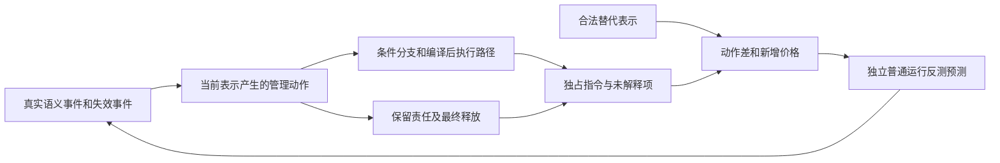
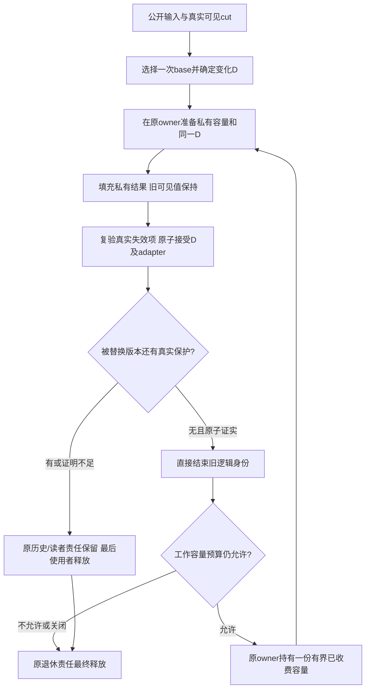
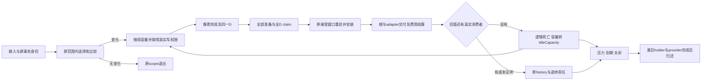

# 当前主线：形成能够解释、预测和反证的指令成本学说

**2026-11-03 完整104合同补齐并联合计价：** [M1–M5补齐报告](../br1_pagestore_equivalent_pipeline_20261010/v3-minimum-write-rewrite-r0/write-unit-accounting/native-result-construction-104/m1-m5-completion/REPORT.md)候选 `d10d8caf42` 结清原MW01–MW12适用CPU/公共消费者，raw真实失败报告、原Resource事件终结和产品共享预算均直达新协议，无旧核心桥接。双架10,984 Qt检查＋native/真实install/结构/TSAN覆盖通过；316固定性能过程。H1暖写20.752038→9.787006M，补合同较不完整104 +0.117135M，保留98.94%暖收益；完整process +2.052748M（主要冷建立），仍较R少28.30%，保留89.14%完整收益。CPU净省2.2089ms [1.9101,2.5716]；Fresh两桶替代控制通过。原型M1–M5映射包完成，产品48c89/default-off及M6–M8、GPU实执行、严格上界保持独立。下方旧104未完成判断属于bf4caf冻结检查点。

**本轮反测结论：** 真实合同补齐可以主要增加寿命级冷建立，而不恢复每结果通用事务。H1暖增约114条/页，但完整process增2.053M；用暖价证明全部合同“几乎免费”会再次漏账。原Body、原Selection和原Resource直接传递并消费事实，在真实失败/终结/公共入口下仍取得52.84%暖降价，支持这条完整构造，而非仅凭对象/次数下降。剩余setup增价只能定位到端点，未按服务因果分价，不能称必要底价；严格上界、最低管理比和upstream完整同能力资格仍须独立证明。

**2026-11-03 完整替代仍须审查真实收益容量：** [100完整构造](../br1_pagestore_equivalent_pipeline_20261010/v3-minimum-write-rewrite-r0/write-unit-accounting/lifetime-protocol-100/complete/REPORT.md)已补齐实际变化批准备和生产者事实边界，非旧100局部插入。旧/新原cell准备0.854512→0.632944M，reserve1024→512仅净少0.088576M；producer入口自身大降，但完整服务仅0.584768→0.559616M，新回调及权限/排序仍收费。原cell、旧退出、新安装、producer、metadata准备五项互斥2.361974→1.763096M，其余工作再净少0.161416M，总树净省0.760294M；普通整写净省0.749159M，尾部抵消0.215600M。实现完整性、执行归属、净收益容量、时间和严格上界须分别验收。完整实现取得更低实价，不证明此模型可承担约7M差额；五项剩余全免费仍不足6.338M缺口。停止相同次数假设的局部追加，保留服务不得据此宣布必要最低。未获数值上界及CPU证明，候选不集成。

**2026-11-02 同锁事实消费和终态原位实现兑现：** [91实测](../br1_pagestore_equivalent_pipeline_20261010/v3-minimum-write-rewrite-r0/write-unit-accounting/metadata-install-91/REPORT.md)将metadata安装1.508238→1.165830M，净省342408条／22.70%。旧退出610778→392390、新登记330356→263680；独立验证231488→147008，但外层/内联335616→362752已计回，不能按消失函数领毛收益。四次replica解析旧叶145920归零，真实pin/read/operation及终态消费者保留。普通H1写少0.366752M、整case少0.492952M，指令收益兑现而CPU仍未证；读阶段微增需保留。证明的是更低完整实现可达，不是1139条每页已成算法底价；链表/索引替代表达和完整最低管理上界仍开放。

**2026-11-02 同一责任内部的事实解析与终态表示：** [90安装审计](../br1_pagestore_equivalent_pipeline_20261010/v3-minimum-write-rewrite-r0/write-unit-accounting/metadata-install-audit-90/REPORT.md)把当前1.508238M按完整子树拆为旧退出610778、新登记330356、最终资格231488、外层及内联335616条。旧值单primary在同锁窗口解析4次，共145920条；后三次旧执行曝光109440条，尚非净收益。必要的是读取真实保护事实和完成索引/终态效果，不是重新走arena定位。反方向约束：安装后容量交接仍读旧primary，故终态身份必须保持；可替代的是复制—清空—恢复，而非删除真实consumer。exact hash164984条为现行算法价，内部hash不必复用稳定shard的逐字节实现，但替代还须计probe漂移。不能用父桶、hash全价或源码副本数直接报价；外围内联不是纯调度/锁成本。完整新价仍待真实闭包构造，无新产品及性能过程。

**2026-11-02／88–89 保留责任的完整降价，不授最低价：** [完整净账](../br1_pagestore_equivalent_pipeline_20261010/v3-minimum-write-rewrite-r0/write-unit-accounting/service-closure-89/REPORT.md)以当前87为对照，已验证布局和已claim目标直接消费、原Value在最终claim内传递。五项去重完整服务3.787038→3.492702M，普通H1净少0.344002M [0.303709,0.384295]；CPU未证。metadata安装只少1.86%，预算269条保持，不能把选定冗余删除完成改写成五项最小上界成立。

**2026-11-01／74机器栈不是完整源语义服务边界：** [尾调用校准](../br1_pagestore_equivalent_pipeline_20261010/v3-minimum-write-rewrite-r0/WRITE_UNIT_RECONCILIATION.md#joint-generation-74)确认72的provider准备在0x2eda0尾跳layout.matches；机器保留栈0.315392M之外，0.320512M记在其caller下面，完整源语义服务0.635904M。总账完整不授每服务inclusive完整性；跨版本报价先核对内联、尾调用和consumer，再按互斥叶/实际边计价。总量及原四集合不变；新增0个样本。原backing原位更新、private就是最终cell，均不得再次作为新删量。

**2026-11-01／73稳定语义不等于稳定生成算法：** [最新四集合与边际预算](../br1_pagestore_equivalent_pipeline_20261010/v3-minimum-write-rewrite-r0/WRITE_UNIT_RECONCILIATION.md#residual-design-73)重算72候选版本整链6.362M，其中基底选择本身1.016M。责任桶很大只确认全链昂贵，不授每项必要最低价。物理寿命、逻辑版本、真实保留和硬预算是不同事实，不要求分别生成独立对象、索引和事务。descriptor/layout/handle去重1.708M，特定3072次descriptor检查0.513M只能写成净省0.513M−X；X≤0.113M是净省0.4M的试验预算而非预测。四组选定helper2.711M全免费仍不能到总目标，因此主线必须继续验证跨层逐代生成关系，不能以局部异常清理完成冻结整体架构。无新测量/产品变化。

**2026-11-01／72机制删量与完整价格校准：** [三项联合证据](../br1_pagestore_equivalent_pipeline_20261010/v3-minimum-write-rewrite-r0/WRITE_UNIT_RECONCILIATION.md#remaining-72)证明同一稳定事实的再次解释能收费：8192次内部handle遍历、896次generic fit、64次重复排序消失，H1联合少1.174M。预算服务保留约202条/次（旧579），说明“合法责任”不必沿用通用表示的旧价。机器互斥区域少1.149M、其它执行净增0.070M；trace总差1.079M与普通配对净差分开，不因父函数/内联变化冒领收益。计数预测命中不等于净指令事前预测成立；后者本轮仍null。当前23.993M距目标差9.565M，CPU改善和RSS上涨原因未闭，不宣称最低管理成本或生产达标。

**2026-11-01 从旧服务价推进到保留动作后的净差：** [71／71b](../br1_pagestore_equivalent_pipeline_20261010/v3-minimum-write-rewrite-r0/WRITE_UNIT_RECONCILIATION.md#simplification-price-71)将native身份直接消费、同锁已验source传递编成完整库。初版trace中2816次结构匹配消失、版本hash少960次，但新的匹配/摘除判断仍付费；含父函数因内联增加的自身指令后，互斥M/S动作净省0.314496/0.192072M，合0.506568M，解释实际trace差0.531726M的95.27%，余0.025158M独列。原generic父价不作可删额。

修正版保持缺失slot的原拒绝行为，完整普通H1联合少0.519783M、全case少0.447692M；CPU与H0收益仍未确认。单项不能直接相加，修正前trace不移授修正后叶价；事后动作校准得到25.117773M条件报价，与25.104558M实价差0.013215M，不能称作独立事前预测。后续可冻结这一同事件/编译条件报价再验证外推。

上界分三层：完整可执行构造的经验均价已取得；其均值置信区间上端不是未来运行上限；理论`U(W)`仍需覆盖合法输入、竞争/重试、真实尾及所有新增工作。当前仍比原总预算多10.676315M，已闭所需降幅4.64%；不能将局部净价非空误写成整包达标。初版合同测试通过仍遗漏一个拒绝差异，1536组有限边界模型记录反例与修正；性能低价必须连同原失败语义成立。生产与正式门不变。

**2026-11-01 经验偏高应落到事实消费方式：** [70责任粒度审查](../br1_pagestore_equivalent_pipeline_20261010/v3-minimum-write-rewrite-r0/WRITE_UNIT_RECONCILIATION.md#representation-audit-70)确认native表示已经存在，不代表各consumer真正按native事实低价执行：同binding还展开完整结构匹配；同锁已验source又降回key；同一接受scratch填充排序后被清空重做。相应helper旧曝光可复算，但只能在实际移除动作并给替代实现计价后领取收益。指针同一性只能代替其不可变字段比较，不能替代发行incarnation、版本、当前读者/撤销/预算权限；22500组有限谓词模型及两个错误简化反例用于限定候选，不授并发或价格证明。

简化优先调整原责任的消费粒度：原位置传递、同次固定集合的一份准备、原预算gate内实际变化求值。不得新建第二owner、永久trusted标记或大锁，把所有阶段合成一个方法也不等于减少工作。排序旧价包含必要首次排序、预算fit包含真实全局约束；经验选项排名与净收益排名仍分开。

**2026-11-01 单价必须经过事件条件回放：** [69价格回放](../br1_pagestore_equivalent_pipeline_20261010/v3-minimum-write-rewrite-r0/WRITE_UNIT_RECONCILIATION.md#event-price-69)把Fresh首次、Fresh旧代退出、稳定复用分开；第一寿命预测后面48次写，总误差−0.251%，最大单次误差2.196%。一个均价的总误差相同，单次最大误差却25.132%，再次说明总账一致不授叶价准确。18服务调用数可回放，但Fresh子树单价低估4.396%、释放行高估1.500%；只取得同进程同代码条件下的历史回放证据，未取得新协议预测或硬上界。

方案动作差异须以当前代码为准：preparePrivateValue创建的就是installNativeValue安装的同一个最终cell，前者只预留索引容量，后者才入索引。延迟建立不等于少建立，合并接受不等于少完成权限/费用责任；未索引值仍可能通过nativeWrite被消费。新的低价构造必须显式改变这些真实工作量与价格，不能把已完成的同cell/原行设计再次列为未来收益。

**2026-10-31 生成链与实现价格必须分开：** [68量化判别](../br1_pagestore_equivalent_pipeline_20261010/v3-minimum-write-rewrite-r0/WRITE_UNIT_RECONCILIATION.md#causal-price-68)按真实调用来源而不是单函数大小，去重得到版本手续6.890M、容量循环剩余7.338M（含内容）和准入1.176M；同一callback不得在父费用服务和子metadata重复计价。只重编译31个PageStore TU的同源ThinLTO使H1暖写25.613→25.181M，但CPU改善未证实。这是完整可执行实现的小幅低价证据，不是协议理想价，也不能把其收益全称作管理。

成本原因必须落到实际生成事件：原选择→private预登记→像素完成→冻结→最终接受→旧身份终结，而不是把“root/delta两种格式”本身当大额原因。68暖写的epoch读服务并集仅0.181M，实际走delta接受；统一视图若引入逐写COW/语义保留维护，反而可能增费。优化主线是一个原行协议消除无真实consumer的中间状态，连同资源/费用/最终消费者取得联合价格。旧15.404M责任闭包给出的4.066M新价要求只是条件预算；真实新价未知时，不能以目标倒推或已删接口宣告有效上界。

**2026-10-31 成本学说的证明方向校正：** [67完整构造](../br1_pagestore_equivalent_pipeline_20261010/v3-minimum-write-rewrite-r0/WRITE_UNIT_RECONCILIATION.md#constructive-upper-bound-67)以 `Cmin(W) ≤ C合法构造(W) ≤ U(W)` 为有意义的达标证据。没有单个大额热点既不证明分散成本必要，也不限制上游重构的空间；“某组旧服务全免费”只限制其余执行冻结的局部改法。旧执行树用于计保留/取消工作，不能代替新算法。

U必须覆盖新核心、保留工作、边界余额及其它阶段正向转嫁；成本未知即U未知，不以目标倒推单价。模型必须明确工作负载、内容分母、竞争/重试r和失败范围，CPU统计上界与算法指令上界分开。67已验证有限的共享视图COW/最后释放与有序费用前缀：Idle→Active总峰为B+max(bᵢ)，直接预留全部positive则可能制造2B假峰。前缀代数没有自动解决并发公平/父账；可见性模型没有自动解决稀疏索引和真实消费者。完整新价仍未得到，8,524/4,250条每页是可复算的条件要求，绝不是报价。下一证据必须是完整合法构造的联合执行价格，不能再用低价模型加未计价集成宣告达标。

**2026-10-31 生成执行树校准：** [66普通机器码跟踪](../br1_pagestore_equivalent_pipeline_20261010/v3-minimum-write-rewrite-r0/WRITE_UNIT_RECONCILIATION.md#processor-trace-66)将同一H1的64次暖写展开为25.524M自身指令，保留与更宽phase的0.243M余额；一个有效跟踪不构成性能统计资格。服务inclusive价不能当本服务手续价：Resource接受自身0.119M、含实际callback子树1.967M。总账观察通过也不保证叶价：旧强制内联插桩的handle自身0.022M与普通生成函数0.294M不能互相移授。计数×单价须固定生成边界，并用普通执行树校准；不先接受昂贵旧价，也不先相信过低插桩叶价。

这次未见一个近10M的单函数自身热点；支持研究跨函数共同产生的协议工作，不证明分散成本必要或不可降。报价应从实际执行集合表达：`净下降 = 真实取消的互斥自身段/子树 − 替代执行 − 其它阶段净增`，一条栈只归一次，不能按父桶比例或循环次数乘整服务。四个可调用校验入口连子树约1.708M；连全部Value建立/终结/freeze的过宽并集3.422M，即使全免费仍约21.6k条/页，不支持它单独承担11M目标。

权利与驻留也要分开：unpin后writer reservation仍保留到seal，不能把释放pin误认为释放writer，继而报价删除并不存在的writer重建。跨阶段延长驻留还可能扩大峰值。必要能力、实现服务、机器执行区间与完整普通端点分别记账；本次只有定位能力和价格约束增强，没有新产品收益或完整低成本算法报价。

**2026-10-31 整寿命与生成价格校准：** [63实测](../br1_pagestore_equivalent_pipeline_20261010/v3-minimum-write-rewrite-r0/WRITE_UNIT_RECONCILIATION.md#validation-lifecycle-63)补齐稳定几何校验1.368M和旧记录终结0.546M；只计新Value构造会漏掉终结，但补全后条件曝光仍不足：寿命/freeze加全部校验约2.926M，零替代仍22.2k条/页、管理/内容3.51倍。当前有不必要重复，不等于它承担了主差额；合法来源不等于现行单价必要。静态事实按其真实寿命传递，动态权限按真实失效边界检查；批量收费必须保持逐页有效前缀的预算峰值，不能用整批预留改变拒绝语义。H1 aggregate观察通过而叶价仍有代码生成误差，H0未通过；完整替代X与跨阶段δ未知，不授达标报价或生产收益。

**2026-10-31 必要能力与昂贵实现分账：** [61–62实际反例与修正算法](../br1_pagestore_equivalent_pipeline_20261010/v3-minimum-write-rewrite-r0/WRITE_UNIT_RECONCILIATION.md#eligibility-boundary-61-62)在相同H1起始960次无root/read边的状态下，晚读仍取得旧字节。初始无人读不是跨接受窗口的独占许可；内存引用也不是像素保护边。upstream整次公开读写互斥，PageStore额外旧代可读保证必须单列，不能直接借用其原位写计数，也不能据此把20.58M现行管理价认作必要。物理内容隔离与逻辑身份存储复用是两个变量：保留shadow并研究接受时复用Value，最多只能先引用约0.778M旧准备曝光；真实handoff/费用仍在。所有新资格、身份更新、读侧和末次消费净差计回，完整价格未知时不承诺11M。新增20计数/语义过程不是新性能样本。

**2026-10-31 生成工作计价校准：** [58–60证据](../br1_pagestore_equivalent_pipeline_20261010/v3-minimum-write-rewrite-r0/WRITE_UNIT_RECONCILIATION.md#priced-work-60)说明不能用调用次数或源码表达式直接推指令：4736次存储退出仅0.096M；target表达式合并的完整实现没有净指令收益证据。按真实冷增长才构造载体，完整候选才实省0.105M（约103条/页），普通CPU未证。须分别计必要输出、生成的Value/交接/费用/动态cut/索引/冷增长事件、每事件完整实现及实际尾；已存在的合法服务价格不是理论下界。

下一责任选择应审查“当前Value需要保留吗、写字节后还能拒绝吗”，由此决定是否需要每次新Value及idle交接。只有原子拒绝、late reader、历史/快照和身份更新全部成立，才可取消整组事务。896次idle成功不是896次当前Value独占的证明。已价两组旧责任毛曝光约2.068M（条件E=896），完整新X/范围外变化未定，远不足直接兑现旧11.184M缺口；不得用整个目标桶免费或任取比例补足。没有大方案点价就是开放欠账，局部实测可独立给经验预测但不升格为整体达标。

**2026-10-31 新增反例：结构统一不构成执行删量。** [实质工作审计](../br1_pagestore_equivalent_pipeline_20261010/v3-minimum-write-rewrite-r0/WRITE_UNIT_RECONCILIATION.md#work-delta-audit)在当前代码确认，多项“下一优化”（原位置、native免通用候选、原行安装、单shard免claim）已经实现。旧类型/调用图收口与实际办理阶段的减少必须分账；不能把同样的预约、验真、freeze、接受搬到新类型后报价为消失。N01–N04当前仅为研究假设，原9.402M失效结论保持。

成本生成式增加可核对的中间层：`必要事件→实际动作向量→互斥编译区间价→普通端点＋真实尾`。动作次数来自具体输入/阶段/consumer，未知不填零；必要动作可通过降低实际单价优化，不强求语义事件数下降。新价必须覆盖完整生产条件的保留/新增/拒绝/退出，不能用标量toy加旧服务挑选报价。只有当前总量解释、差额解释、替代净可回收三本账分别成立，才能声称方案有预测依据；总量99.77%对账不授新方案置信度。原排序与原位置已经存在的删量不得再认领。

当前候选要改变的是阶段生成关系：原Frame先备实际容量，在目标最终接受的S窗口消费槽位/构造Value，消掉独立逐页准备；仅对无独立观察者的native Frame研究合并提前freeze与最终接受。两者都有硬额/失败前缀/consumer未证明项，完整单价未知。本次只有源码与代数复核，没有新性能证据或预测准确性验证；不再扩大生产重写。

**2026-10-31 成本理论反证：重写没有降低正式写基线。** [最新普通价与互斥账](../br1_pagestore_equivalent_pipeline_20261010/v3-minimum-write-rewrite-r0/WRITE_UNIT_RECONCILIATION.md)给出当前H1非内容约20.586M，而原完整报价9.402M，差11.184M/2.19倍；管理/字节体约4.10倍。目标8.834M与接受6.694M占非内容75.4%，入口省下约0.88M被两段及选择增价抵消。原136条/页限定模型与若干旧服务拼接，不能预测真实集成后Value预约、freeze、Resource接受、角色与最后交付的成本。旧表示删除也不证明其执行责任净消失。

今后必须分别验收：实现/合同、原高价基线降本目的、预测误差。54修回自身新增约2.5M，只属于修复账；当前普通H1仍比B贵0.839M/0.171ms，主目的失败，不得以结构完成或case尾下降替代。总量99.77%解释不授必要性；同批C−B差额仍欠约0.153M/18.6%解释。56外圈夹具开销0.767M从产品管理口径剔除，57重设边界并保留全部旧失败；排除observer后的叶价仍有生成代码敏感性。

新的预测规则是 **完整替代旧责任价−完整新责任价−真实同步/异步副作用**。当前保留其余实现时，原9.402M要求新目标+接受+其余净增≤4.344M，约需削掉两包72%；这是预算条件，不是收益预测。没有新完整实现单价，就填unknown，不以任意降幅、理想标量内核或“合法服务”现价冒充最优报价。原9.402M只保留为已失败的事前预测。

**2026-10-30 写单价双账方案（未执行）：** [原C05执行细则](../br1_pagestore_equivalent_pipeline_20261010/v3-minimum-write-rewrite-r0/BLUEPRINT.md#write-unit-accounting-plan)要求当前总价和版本差额同时闭合。按实际入口、选择/保护、目标/资源、字节处理、接受、写内终结六单元排他计价，服务类型和成功/拒绝/复用为交叉标签；inclusive父桶不得与子价相加。数量模型必须包含每页内的行级展开，不变事实的宽重建即使位于copy桶也归管理。保留原70/71/72内容口径复算9.402M，同时把字节比较、重复处理与实际内容写入分列，防止扩大内容分母改善比例。

新旧净差拆为`Σ[(N新−N旧)u旧+N新(u新−u旧)]`及真实尾/观察残差。零次或不同路径不硬算通用单价。整段观察±2%不能为叶价背书；计划另要求拟认领收益的未解释/观察不确定量≤事前S的10%，这只是解释精度要求，不改M6、不代表已经达到。先反测54条件2.523M，再从当前完整责任净预算排序；该金额若兑现，H1仍约24998条/页、对B多0.812M，不能把修新增回退当成原重写主体达标。本次无产品/测试/净价变更。

**2026-10-30 行级表示重建已完整清理，净价未授：** [54回执](../br1_pagestore_equivalent_pipeline_20261010/v3-minimum-write-rewrite-r0/DEVELOPMENT_LAYOUT_PROJECTION_54.json)对应新候选`0c6889e6fb`，同批清理全部7处内部layout-only宽投影，原Value/Resource在已有pin/claim窗口直接提供不变layout，真实外部身份仍完整导出。双架12976合同与架构通过，普通arm64复制函数的完整target调用已为0。旧行循环20条caller＋39条callee变为15条；同一native复用、行数及copy路径条件下预测H0/H1少2.703360M/2.523136M。这个数是生成代码的条件模型，普通CPU/净指令与当前内容/管理分价仍待；x86_64不移用该arm64模型。53旧04的实价及回退继续保留，不能改写成新0c结果，也不能以这项清理宣称整个9.402M预测已兑现。

**2026-10-30 普通实价反测与行级表示重建：** [53回执](../br1_pagestore_equivalent_pipeline_20261010/v3-minimum-write-rewrite-r0/DEVELOPMENT_ORDINARY_PRICE_53.json)完成960独立过程。arm64H1暖写27462条/页，0473为24205、upstream为5239；写指令+3.335M [3.309,3.360]，无指令观察的写CPU+0.134ms [0.075,0.205]。case总体小降来自setup/history/非主线程抵消，不能替代主写目标。频数和生命周期收口不证明合法责任单价便宜；当前内容核尚未知，原9.402M非复制预算不改，不能直接沿用旧核价凑出新管理比。

成本生成率还必须落到内层实现：当前copy每行仅取rowStride，却调用未内联`target()`生成128B完整handle。实际ordinary arm64非空Resource路径39条callee指令；按H1的896暖reuse×64行推导，callee粗曝约2.236M，尚不含caller且不是净可回收价。原本每页一次的不变布局事实，在实现上变成每行一次宽表示生成。这可以不增加分配/Resource/job次数，却放大指令；理论模型若只记逻辑操作数就会漏账。已保存实际对象/反汇编和镜像，下一直接清理同一内部layout-only责任、维持物理权限与外部导出，再给净价；不再从单一分配次数或函数名推定单价合理。

**2026-10-30 普通计价放行口径：** [52回执](../br1_pagestore_equivalent_pipeline_20261010/v3-minimum-write-rewrite-r0/DEVELOPMENT_PRICING_QUALIFICATION_52.json)三方分别核实际头文件ABI与库，双架各60格共同公开结果相同。阶段指令观察12/12通过±2%，阶段CPU仅4/12通过±5%；后一失败不能变成产品收益/回退，也不能靠加样抹去，正式CPU另用独立无指令观察样本。业务case指令从四个manager寿命到末尾drain，含worker活动；QApplication初始化和OS退出未在此指令区间，完整子进程CPU/RSS由wait4另记。范围必须写在数值旁边，不能把“业务全生命周期”换称“整个启动进程”。960个独立过程事前固定，原9.402M报价不改；尚无新净价或管理/内容比。

**2026-10-30 计价资格校正：** 当前重写候选`04f36f1870`的实现/删除与资源验收已按[51回执](../br1_pagestore_equivalent_pipeline_20261010/v3-minimum-write-rewrite-r0/DEVELOPMENT_MEASUREMENT_51.json)收口，尚无普通净价。原始isolated H0/H1四寿命实际PageStorage申请/销毁3071/2359，provider-local binding及physical登记各128/192，双架四块一致；历史prefix预热后的目标格各少5次启动服务。实际系统服务、对象初建、每代操作是不同生成指标，三类记录还存在包含关系，不能相加或跨范围用一个“每操作单价”解释。

观察机制也属于模型的边界条件：反复查询普通库中不存在的诊断符号会人为加重控制组；为读取父账而保留父owner、逐寿命drain会改变生命周期口径。本轮修正为计时前缓存符号，并以不增owner/额外drain的原始驱动验证计数完全复现。只授机制频数与带观察寿命，不将驱动修正算作PageStore收益。时钟实测分辨率1µs；声明布局、allocator实收、事件高水位、RSS各自取证。34当前TU双架44必查布局已补齐，旧布局明确历史。下一只做同义upstream/0473整包普通价，再将原9.402M条件预测与实际比较；不因尚未计价另造核心协议。

**2026-10-28 重写前成本约束：** [放行审核](../br1_pagestore_equivalent_pipeline_20261010/v3-minimum-write-rewrite-r0/DESIGN_REVIEW.md#rewrite-readiness)允许隔离贯通实现，不授达标。实际键为64位surface和两32位坐标，首候选选择有序persistent AVL并直接持Value，不能将16-key数组/两层radix的136条每页移授稀疏生产结构。逐Resource最终gates、K项范围保留、8类别/alias/账户变化、真实节点和Frame最后归还均须计回原互斥成本项；provider批量屏障收益不预授。角色变化不等于可达变化，账户退款不等于全局physical free，禁止将必要服务省略后补到未计价尾。原完整暖9.402M条件参照保持，新增单价/净预测仍未知；下一用同一完整候选取得这些证据，不重复旧热点计价。

**2026-10-28 上下游生成率校准：** [全流程责任审查](../br1_pagestore_equivalent_pipeline_20261010/v3-minimum-write-rewrite-r0/FLOW_AUDIT.md)新增一个不能藏进单价误差的机制：范围读从K个Value变成保留P页的整个root，会让无关页产生额外保留、Fresh和终结。新方案必须保留原语义范围；原H1的128 Fresh／896 reuse是条件数量，不能当不随协议改变的常数。O(1)仅是整root捕获，不代表范围选择/释放或角色收费为O(1)。图可达、收费类别、账户结束、物理free分开；删除旧扫描必须迁完消费者，不并行维护新旧权威。

原0.139M结构模型未包含实际adapter反向锁边、完整稀疏布局/角色或最后Frame归还。原7.881M仅backend，扩到完整暖DataManager阶段保留外层后约9.402M；不能沿用下面1.546倍作为完整阶段管理比，扩边界条件值为1.844倍，仍非生产价。新净收益必须包含setup/read/history/worker/drain变化；共同TileHash等工作须用同义upstream增量区分。该轮28源码锚点与冻结阶段复算无新产品过程，未得到更低点预测或全必要性证明。

**2026-10-28 实施前算法计价校准：** [新方案可执行对账](../br1_pagestore_equivalent_pipeline_20261010/v3-minimum-write-rewrite-r0/PREIMPLEMENTATION_ACCOUNT.md)第一次将“表示事实的内核”与“真实物理/预算服务”和“未优化外围余量”分价。H1结构内核0.139M不等于整个管理成本；保留真实服务和外围额度后条件预测7.881M／7696条每页，非复制/内容仍1.546倍，距≤1倍缺2.782M。旧逐页选择/完成协议不迁移则多1.769M，这是实施完整性偏差，不应当作算法已完全兑现的结果。预测置信中低，旧诊断价格转用和未编译完整语义造成的不确定性远大于模型8进程的微小波动。

成本事件补`E_add/E_drop/V`：节点创建、实际孩子边激活/撤销、接受前路径探测分开计数；O(1)capture不能隐藏最后drop的线性尾。图算法两项各4096次检查证明模型内可构造，不能证明跨账户物理收费。只定位的内存hold不同于真实源字节/OperationStart/producer保护，后者不可从必要账删除；费用必须在改变语义图和可见root前预判。总体公式现为16项，通用系数仍未知，H1条件账独立于生产净预测。以下13项/10项公式和“无新价格”属于此前设计版本。

**2026-10-28 跨入口语义校准：** [新版协议第10节](../br1_pagestore_equivalent_pipeline_20261010/v3-minimum-write-rewrite-r0/BLUEPRINT.md#semantic-unification)说明统一必须减少权威事实和重复转换，不能强制所有入口进入同一完整事务。restore是旧内容在新epoch可见，swap是同内容placement变化，surface-only不需pixel writer，读/capture不是写入；用同一个“操作数”计价会再次隐藏误触和单价膨胀。当前root本已是提交线性化点，可替换的是重复metadata投影，不能以错误的双权威归因虚领收益。

物理内容incarnation与公开能力有效期分离，跨Store clone共享字节不代表共享权限/预算。此前在原10项外增列`L*c_placement + U*c_surface + B*c_import`，费用、真实Fresh/Value和尾从其子责任中排他分出，避免跨范围重复相加。该轮11组调查/35锚点只补设计覆盖，没有新价格；当前模型与条件价格以本页顶部及新版蓝图为准。

**2026-10-28 重写设计校准：** [完整蓝图](../br1_pagestore_equivalent_pipeline_20261010/v3-minimum-write-rewrite-r0/BLUEPRINT.md)将下一模型的基本事件从“调用现有服务”改成“产生一个真实版本、取得一次物理权限、发生一次真实cut、保留/释放一个实际关系”。物理资源身份、逻辑内容身份、对外权限不应揉成每代跨多层交接的全量handle。最终Value在写前已存在，接受只纳入视图；private→proof→另一套metadata主记录没有独立业务结果，是本轮直接替换对象。

这不是把旧服务当前单价视为必要成本后减少调用数。新式为`N*c_value + R*c_resource_claim + F*c_fresh + S*c_frame_cut + J*c_root_node + D*c_fee + H*c_retention + X*c_export + T*c_terminal + Q*c_recovery`；变量是实际事件，所有系数待构造实现后定价。H是保留关系创建/解除次数，不是存活数量；峰值另记。J与最后递归释放不能藏在O(1) root切换里，完整CPU还须计回读、history、worker和终结。

可设计为零的是按代重登记物理身份、转成第二套版本主记录、同步内部proof/global operation id及不变事实的重复解释；真实排他、撤销、预算正峰值和全体原子可见不能因稳定指针而消失。当前保存物理节点/arena及直接handoff费用已做的删量不再认领。旧内部计数本身不是合同，真实可见/拒绝/硬资源反例才是设计约束。

新结构也暴露成本转嫁风险：O(1)捕获root不能自动同时证明准确保留分类和便宜退款。必须构造区分内部临时ref与外部旧视图的算法，禁止root×page扫描；还须证明最终接受与provider撤销的线性化。两项未证明前不填零成本、不报理论下界。[设计审查](../br1_pagestore_equivalent_pipeline_20261010/v3-minimum-write-rewrite-r0/DESIGN_REVIEW.md)列出6项开放证明和12类完整迁移责任；本轮是设计，无新生产/测试/价格，净预测保持null。

**当前可行性校准（2026-10-28，产品0473保持）：** [PageStore-only构建判别与完整预算](../br1_pagestore_equivalent_pipeline_20261010/v3-write-feasibility-r0/RESULT.md)只改变31个PageStore TU跨单元可见性，源码/其他image对象保持；64普通过程H1净少1.075M指令[0.986,1.163]，CPU收益未证且慢块完整保留，不升级生产。它证明一部分单价可由实现表达消去，但不把其余费用全部判为算法必要，也不把全部收益归给写页。

新增约束是**以剩余总账反推方案必须覆盖的范围**：WU暖余量19234条/页若要低于10000，需净删9.456M；目标取得或结束任一完全免费仍不够。两大范围外仍有5.026M；仅改目标/结束需联合回收64.46%才过线。该数是需求，不是预测。以后不得以一个父桶乘任意降幅承诺方案，也不能用1M局部成功宣告主差额收敛。

成本模型进一步区分：静态资源身份按物理寿命，权限/费用按真实代变化，可见性/旧值按真实cut；当前API服务次数不自动成为语义事件数。可消去代码生成、可替代协议动作及必须的动态状态分别定价。原对象已经复用不代表其每代完整handle传递/重新解释必须保留；动态读者/撤销/预算检查也不能凭静态对象复用删除。新整包净预测仍未知，CP01–05/SA未实施；实验的1.075M不与其潜在收益相加。

**当前校准（2026-10-28，产品0473）：** [写单价冷暖对账](../br1_pagestore_equivalent_pipeline_20261010/v3-write-unit-r0/RESULT.md)新增48固定诊断过程。H1相同base选择责任首次页约19315条、暖页约994条；1088次已绑定重定位约0.095M。**“一个责任的总量/总调用数”不能直接充当某条优化路径的单位价格。** 需要按真实状态与阶段分层，模型改写为 `Σ N(阶段,输入类别,命中/拒绝) × u(同条件责任)`，再合并真实读/尾净增。H1暖reuse尝试1024含896成功与128拒绝，不用其总量除896冒充成功单价。冷默认登记可昂贵，但不能拿其价格论证每次暖写重复登记。

新暖非复制余量19.696M中target/finish约74.5%；主候选回到同一原私有代从物理交接到全D接受的事实消费。合法动作的当前价格仍不是必要下界；inclusive曝光不是收益。观察等价未全部通过，以上用于定位而非精确叶价/CPU或新增收益。当前最新生产净价仍为TF的H1省1.134M；本批生产0、净预测null。以下原1776/281ad等叙述均属于各自冻结账期，完整WG/TF已结案，不能据旧“待迁”重开。

**2026-10-28 较早实施校准（281ad冻结）：** [V3 原事实验证/checkout](../br1_pagestore_equivalent_pipeline_20261010/v3-unified-acceptance-r0/implementation/README.md)已动产品。可以删除的不是验证责任本身，而是每页重复取得同一批 provider/签发上下文、已有 binding/record 被降级成 key 后再定位。原 D 的一遍检查、本地撤销/身份验证、真实 physical claim、费用准入和最终退休仍计成本。N→G 是动作模型，1.090M 旧父桶不是净删量；完整统一接受仍欠，当前未测新性能，原管理比/必要性未知不变。

**此前版本：2026-10-28（1776冻结），[V3 总方案](../br1_pagestore_equivalent_pipeline_20261010/PIPELINE_PLAN_V3.md)与[本轮计价/预测闭环](../br1_pagestore_equivalent_pipeline_20261010/v3-write-generation-r0/RESULT.md)。** 原型迁移完成，生产保持 `1776b4654028`。下方历史更新与早期“待迁/尚无净价”只属于各冻结账期，不构成新的实施欠项。

## 当前闭环：管理动作由表示边界和后续义务共同生成

本轮将“必要业务事件→管理表示→调用/寿命→当前价格→合法替代→完整净价→预测误差”接成一个有限、可证伪的循环。它已足够选下一完整责任，**没有证明全管线管理下界、所有合法单价或总体管理/内容比**。

1. 同义公开工作固定为 native arm64 K16/W16，4 个 manager 寿命；原前序用例后测 H0/H1。初写、暖写读、最后 commit、history、析构和即时 drain 均覆盖。通用比较/夹具工作单列，不能算 PageStore 优化。
2. 当前指令差额 H0 40.537M、H1 33.674M；暖写分别 29.754M/20.890M，非前台及边界 4.627M/4.288M。有符号模型残差 −0.108M/+0.055M，分别占差额 0.267%/0.163%。代数闭合不把责任桶全判为必要。
3. 源责任价改变排序：H0 canonical 接受 14.154M，根树 prepareCommit inclusive 仅 1.489M；发布自身、metadata 准备自身、ledger 准备自身合计 9.408M。当前通用值投影/重新准备边界比单纯树复制更值得作为完整干预单元。合法发布有必要，不代表每次重建通用发布输入、Entry/Publication 和费用表示都必要。
4. 受限 W 使用同一普通生产库，在 H0 保留内部 memento，选择已有工作态路径。公开写/页写/seal 均保持 68/1088/68，暖读页保持 1024；根提交 68→8，Fresh 128→192。完整计回额外 before-image、最终 commit/purge/析构/drain 后仍净省。隐藏 memento 会改变旧值 API，所以只证明边界价值；生产必须分离当前工作权威和 optional undo。

| 预测与检验 | 事前点预测 | 独立实际及 pointwise 95% 区间 | 实际−预测 |
|---|---:|---:|---:|
| 进程指令净省 | 8.075M | 9.066M [8.798,9.336] | +0.991M / +12.27% |
| 普通 CPU 净省 | 1.249ms | 1.589ms [1.331,1.814] | +0.341ms / +27.28% |

方向和完整净价值成立；点预测在实际区间之外，**不能宣称预测精度已达标**。既有预测式的事后拆解：前台预测 7.736M、实际 7.648M，误差 −0.088M；非前台预测 0.339M、实际 1.418M，误差 +1.079M，两者合成 +0.991M。未将超出预测的部分倒填为事前预算，未无证据分摊到某一回调。

## 对原成本模型的实质修正

原来仅按已有责任的 `Σ N·u` 计算，遗漏 **N 的生成关系**：一次上层根/版本发布会生成多层准备、登记、保留、销毁、回收及调度义务。各层函数的局部线性、容量复用、owner 唯一，都不能保证整条生成链的成本合理。应分两层：

`N动作/寿命/后续 = G(必要业务事件, 真实观察 cut, 当前表示边界, 共享保护, 资源/失败政策)`

`I完整 = I内容 + Σ互斥(N动作·u动作) + I生成的后台与最后尾 + I观察/公共项 + 有符号残差`

这里 G 必须由实际消费者和状态变化给出可构造关系，不以当前 API/工作次数当定理。包含子服务的 inclusive 责任不与其子价相加；生成的后台与最后尾也不能在已包含它们的完整进程价上再加。做上层替代时，先重算 G，再定价剩余合法动作；不能只把一个函数的次数减少乘原价，也不能把一次全流程当前昂贵单价当成算法必要性。

本轮有两条有价反例：**Fresh/空间增加而总时间降低**，说明分配次数不是主要成本的充分代理；**前台预测接近而总收益超出**，说明变化会沿对象/发布的后续义务继续传播，后台余额不能再默认不变。时间优先仍受硬预算/真实保留时长约束，生产不能用无界工作态或延迟到测量外换取收益。

必要成本、当前合法实现价、合法替代净可回收价仍分三层。H1 四类像素内核约 10.93M，剔除共同夹具后的其余前台为它的 3.21 倍；分母未覆盖默认填充/payload 申请等服务，因此这只是非内核指标，不是已验收总体管理比。H1 暖写约 26194 条/页，U 约 5794 条/页；还不能给这些额外指令贴上必要管理成本标签。

## 合同反测修正：先证明事件能否省，再使用频率价格

后续 arm64/Rosetta 四个真实合同过程进一步证明：隐藏 memento 虽让 Backend 当前读见新值，但默认 Store committed 读仍见旧值、epoch 不推进、阻塞真正的 history，且无外部 holder 时 close 拒绝。正常无 history 路径相应为新 committed 值、epoch 前进、零活动事务及 history/close 成功。[实际回执与修正设计](../br1_pagestore_equivalent_pipeline_20261010/v3-unified-acceptance-r0/DESIGN.md)。这不是性能观察或抽象模型替身。

因此 9.066M/1.589ms **证明边界有价，不证明同语义可以减少这些事件**。成本生成函数 G 的定义域必须先由真实 committed/overlay/before/关闭合同约束；不允许先用低价输入状态证明收益，再将其引入的业务变化隐含在新方案中。为了得到“唯一工作权威”而增加一个长期普通事务或第三个 head，会继承 base 保留及准入问题，没有必要先付这笔代价。

本次选定一个接受政策、两种真实目的地：保留现有当前 selector 和普通 Published /显式 Prepared cut，从输入实际寿命决定借用原 D、原 owned proof/slot 或真实 generic 输出。H0 68 根接受、H1 8 最终 root commit 保持；主要优化原 native 事实降级、候选重建与其生成的清理。新费用的 incoming/outgoing claim 同时活跃时必须同时入账，不能借“工作空间复用”覆盖仍活的票据。

这项修正使原型合法性与价格再次分离：原始反测/预测误差不重写，新生产净预测仍待完整替代实现、实际布局与资源价。不存在以新设计名字直接继承旧原型净预算的资格。

## 全管线覆盖修正：同一语义身份不应按每层重新收费

[既有数据的写读与互斥包络复算](../br1_pagestore_equivalent_pipeline_20261010/v3-unified-acceptance-r0/PIPELINE_COST_ACCOUNT.json)指出上一选择仍有偏窄风险。H1 的 1024 次暖页操作，当前写/读 26.823/7.413M，U 5.933/5.890M；写特有双差 19.368M。H0 相应 27.859M。读、写的实际内容核单位指令相近，不能用写的必要语义更多，直接解释现行数倍价格。

同一细分批中，H1 68 次 Backend 写调用的 29.381M 可互斥分为复制核 5.351M、seal 前其他页内工作 13.075M、批次结束 7.899M、外围 3.057M。目标准备扣 Fresh 复制占其中 9.629M。只统一 canonical 末端没有直接命中 H1 暖写；即使整个结束部分免费，仍余 21.483M。**成本榜首的范围必须用实际命中包络约束，不能用 H0 的根频率实验代替 H1 整条写责任的充分性审查。** 包络闭合不是全额可删，非复制核也不是已经认证的管理分母。

更深层假说是“业务版本变化”被扩展为多层事实重新接受：本已有 scope/原 record/binding/私有结果，却在取得目标、handoff 费用、完成验证、Prepared/Published 接受、后续退出重新定位和组织服务。已经复用物理容量和管理块，仍会支付这些对象的每代手续。必要的版本/ABA、全 D 原子性、真实预算及旧消费者保护可保留；**不变身份按资源寿命验证，完成按原 writer 产生，动态资格只在真实失效边界重验**。有 claim 的原位置与新传入裸指针必须严格区分。

当前结构证据：Idle checkout 取得原 record 却降为 replica/binding，ledger 再查；private 完成逐页重新取得 provider/验证；metadata 虽保留槽，换代仍 unlink/索引替换/link；每页费用 prepare/commit 与每段 outgoing 服务分开。它们是明确的审查/替代位置，**不是整个对应父桶都可删的证明**。handoff 预算单价昂贵支持改变粒度，但批量仍要覆盖中间正向峰值、waiter、alias、动态变更和失败恢复；不能用最终净零替代在途收费。

补充成本模型：`I写非内容 = O·u操作准入 + D·u必要页变化 + G·u全局准备波次 + A·u真实接受 + X·u独立输出/尾 + I表示转换`。G 由真实依赖/失效决定，不能预设为 D，也不能强制等于 1；warm 原表示转换的次数和单价应随统一协议下降。各项先建立互斥归属，物理申请/default fill 等内容相关费仍另查。现有证据能约束大头与改动范围，尚不能填入任意理想指令数或管理倍数。

新方案由同一 WG02/05/06/07/08/10 包贯通目标、完成、费用、双目的地接受和退出；read 保留原安装 facts/binding/cut，不新增另一份读缓存来换写收益。激进的原位不可失败窗口仍是独立条件性算法空间，当前 before-image 读合同阻止直接覆盖已可见内容，不能以无 pin 或持 Backend 锁作为充分证据。此次仅补解释与覆盖，无新性能过程、无生产收益授予。

## 资格、边界与下一责任

416 个固定计价/归属过程、2 个机制过程、2408 条用例完成。原始 exclusive 守恒；empty replay 后 aggregate 指令估计通过 ordinary 主线程 ±2% 控制。叶子保留代码生成/空回放误差，不授每叶 ±2%、CPU 观察等价或 Rosetta 资格。真实 actor ID 的普通计数确认大部分非前台来自 reclaimer；回调价没有独立普通移授资格，不能把余项全叫调度。失败采样与 D30/D70 启动模式错误均保留，未用扩样修门。

下一[原事实写入全寿命与统一接受设计](../br1_pagestore_equivalent_pipeline_20261010/v3-unified-acceptance-r0/DESIGN.md)覆盖目标取得/完成/费用、原范围/原 D、Prepared/canonical 的 metadata/ledger/epoch 与真实尾，保留原 Backend/Store 当前 selector，不新增长期普通 transaction。WG01–WG10/121 当前消费者/保护锚点及四个合同过程保持，另有 20 个成本审查源码锚点；实际布局、批量的合法波次、资源和完整实现/删除/新净价仍待。

**H0 的根频率收益不能移授 H1。** H1 已走工作态、只有 8 次根提交，其主差额仍需降低目标准备/费用/接受等合法服务的实际单价。H1 handoff 准备约 2.16M self，整个 synchronizeBackingDomains 仅约 0.215M；不能靠只删全 provider 同步领取整笔费用价。新生产净预测继续为 null，原型收益不能变为 H1 承诺。

本轮验收：原因的有限解释、同端点计价、事前预测、独立净反测与误差桥闭合；生产替换、paid<1M、全局最低实现/管理比及正式 M6/M7/M8 保持未证。原型迁移完成状态和旧 RF20/21 保持，不因总体目标未达而无限延长已验收责任。

V3之前的阶段更新

**2026-10-27 最后一组实现欠项收口：** [第29批](../br1_pagestore_equivalent_pipeline_20261010/refactor-implementation-closure-r0/IMPLEMENTATION.md)、[入口与保留边界](../br1_pagestore_equivalent_pipeline_20261010/refactor-implementation-closure-r0/CONSUMERS.md)。源`2d5d1aaf9f27`/库`ce1d02675511`；root最后保护解除统一原位置排队，删除受保护候选空查。双架8862/0/0、449检查；生产净−9行，无新增字段/owner/付费寿命。29批/19限定责任/11有限闭包；原实现未完结聚合组已核完，余资源/全包验收。净价和同义upstream尚未取得，正式门不变。

**2026-10-27 终态消费完整实施：** [第28批交付](../br1_pagestore_equivalent_pipeline_20261010/refactor-terminal-consumption-r0/IMPLEMENTATION.md)、[全入口/删除索引](../br1_pagestore_equivalent_pipeline_20261010/refactor-terminal-consumption-r0/CONSUMERS.md)。源`a8c66c6e730a`/库`e2a6be38b58b`；原record同窗准入准备、一次verified结算、writer封闭、原位置watch与接管撤销同迁，补共享orphan预约归零后的托管。双架8854/0/0、436检查；源码正常窗口7→3/查找4→0/验真2→1，非净性能。28批/18限定责任/8有限闭包、整项0/22；原资源/全图/净预算及正式门保持。

**2026-10-27 整包进度回填：** [V2 §10.101](../br1_pagestore_equivalent_pipeline_20261010/PIPELINE_PLAN_V2.md#progress-review-27-batches-20261027)、[原矩阵](../br1_pagestore_equivalent_pipeline_20261010/REFACTOR_TASK_MATRIX.md)。当前源`3ddd9814b896`/库`130a5d210b2b`保持；27批、17限定责任、8有限consumer闭包，另有§10.100设计完成未实施及2个开放汇总组，整项0/22。修正24批旧快照及已完Idle/费用欠项；8844/0/0和417检查是既有当前证据，本轮未重测。技术目标保持，净价/主要差额回收未证，防止结构扩展挤压资源/联合计价；原正式门保持。

**2026-10-27 类别转移与终态消费审查：** [V2 §10.100](../br1_pagestore_equivalent_pipeline_20261010/PIPELINE_PLAN_V2.md#class-terminal-protocol-closure-review)保持原record和Idle边界，补齐operation一次准入/一次验真/原位置终结及初始接管撤销的不同授权。正常有界路径ledger窗口7→3、operation查找4→0、终态验证2→1是可构造源码预算，非实测或全服务下界；完整writer/终结consumer及回滚同迁后才可采用。仅设计，无新生产/测试/价格；原27批、正式门保持。

**2026-10-27 Idle调度边界已实施：** [第27批完整交付](../br1_pagestore_equivalent_pipeline_20261010/refactor-idle-scheduling-r0/IMPLEMENTATION.md)、[入口/删除索引](../br1_pagestore_equivalent_pipeline_20261010/refactor-idle-scheduling-r0/CONSUMERS.md)。源`3ddd9814b896`/双架库`130a5d210b2b`；单目标/纯期限查询/仅通知timer/原task每批16/关闭恢复同迁，旧混合回调及重复状态删除，R政策保持。8844/0/0、417检查；27批/17限定责任/8有限闭包、整项全维0/22。声明Store+context减120B，实际root6304B保持；新增调度/通知门计回，无净性能认领。原资源/全图/净预算及RF20门保持。

**2026-10-26 原记录退休生产迁移：** [实现/成本账](../br1_pagestore_equivalent_pipeline_20261010/refactor-record-retirement-r0/IMPLEMENTATION.md)、[14类消费者](../br1_pagestore_equivalent_pipeline_20261010/refactor-record-retirement-r0/CONSUMERS.md)。源`3cfededd17b0`/普通双架库`1508bae792a0`；原record贯穿准入、等待、Idle替换/过期、shutdown及最终退款，旧重复查找删除。8836/0/0、399检查；26批/16限定责任/8有限闭包、整项全维0/22。record888/queue416/physical272B保持，无新持续字段/paid寿命；非Debt准入条件查找2→0，不折净价。条件Idle续期/统一发布处置、完整资源与整包净预算仍待，未认领80→72生产投影。时间优先；RF20关闭、正式0/3、calibration2/20、默认关闭。

**2026-10-25 原ledger物理节点收敛：** [完整责任、资源反例与删除账](../br1_pagestore_equivalent_pipeline_20261010/refactor-backing-storage-lifetime-r0/IMPLEMENTATION.md)。当前源`523057de5a5d`/双架库`fd683fc1993f`；原physical记录承担唯一identity/索引，删除逻辑24B key副本、临时map node准备/提取/重绑及最后按key定位。合并取块原型因1536B/额外尾1264B撤下，最终新取块仍2，共享alias物理申请仍0。两架完整布局分配1216→1168B、物理尾272保持；旧表示配未改付费服务，不是旧管线二进制或净指令价。双架固定**8600/0/0**、156有限检查；生产净+11。原矩阵13批、20/22启动、0整项验收，原Page/checkout/private接受全链和完整paid仍待；RF20关闭、正式0/3、calibration2/20、默认关闭。下方旧批按冻结身份理解。

**2026-10-25 原D准备寿命收敛：** [完整责任、删除与资源账](../br1_pagestore_equivalent_pipeline_20261010/refactor-mutation-capacity-repair-r0/IMPLEMENTATION.md)。当前源`2e3e7cae4ec7`/双架库`938e929df07d`；删除同次容量冲突的整份重备、重复retry状态和增长政策，原D保留顺序/位置/旧预约，只补真实新槽；初次有序跳过排序。双架固定**8592/0/0**、142有限检查；C1/R1实际准备2条，旧模型3不是旧库实测；纯外部同硬额整prepare拒绝而原repair零分配成功，真实新增拒绝无半安装、同segment可恢复。carrier80/row320/native344/prepared88保持，生产净+89行及新扫描/补块计回。原矩阵12批、20/22启动、0整项验收；继续上游Page/checkout/ledger与完整paid，净指令/管理比未计，RF20关闭、正式0/3、calibration2/20、默认关闭。下方旧批按冻结身份理解。

**2026-10-25 原D旧mutation协议替换：** [完整责任、删除与资源账](../br1_pagestore_equivalent_pipeline_20261010/refactor-original-d-closure-r0/IMPLEMENTATION.md)。当前源`5fdf7b6131b8`/实际双架库`13cd6fe92f3f`；Detachment通用分支、生产versions入口、逐页activity、独立失效清单和mutation Deferred job已删除，native/外部/remove/混合输入的准备、接受、取消、晚读者重备及锁外退出同迁。双架固定**8548/0/0**、125有限检查；324页同硬限额附加候选65536→96B，原D输入另计；row320/native344/prepared88保持，carrier头+32B及引用容量/重备重叠入账。生产6文件净减34行；11批、20/22启动、0/22整项验收。原D准备排序、checkout/ledger/完整单次paid等余项仍待，暖native原本不走旧external fallback，不认领13.107M或640条件预算。无普通/机制性能过程；RF20关闭、正式0/3、calibration2/20、默认关闭保持。下方旧批按冻结身份理解。

**2026-10-24账本/方向复核：** [十批交付、差额预算与纠偏顺序](../br1_pagestore_equivalent_pipeline_20261010/PIPELINE_PLAN_V2.md#implementation-progress-direction-review)，[原22项矩阵](../br1_pagestore_equivalent_pipeline_20261010/REFACTOR_TASK_MATRIX.md)。当前源`70dc36a5af5f`/双架库`0f3ca9ea6fef`不变；10批及22项摘要按当前源回填，20/22启动、0/22整项验收，17实施项迁移/删除均未整项关闭，不能报90.9%完成。当前固定双架8548/0/0、105有限检查；十批净指令/管理比/同语义upstream均未获新证据。四来源条件少640仅是旧申请差的50.8%来源预算；共同logical/physical删量不得抵主差额。第8/10批回到前台，但原Page/checkout/ledger/全D和完整单次paid收口仍滞后；补齐四类资源裁决，含最新idle尝试及history→原queue等待转移。此次无产品改动/新实施批/性能过程，RF20关闭、正式0/3、calibration2/20、默认关闭保持。下方各实施批仍按其冻结身份理解。

**2026-10-24撤下/费用/终结实施：** [完整交付、失败和成本边界](../br1_pagestore_equivalent_pipeline_20261010/refactor-disposition-ledger-r0/IMPLEMENTATION.md)，[V2 §10.75](../br1_pagestore_equivalent_pipeline_20261010/PIPELINE_PLAN_V2.md#metadata-disposition-and-ledger-acceptance)。当前源`70dc36a5af5f`/双架库`0f3ca9ea6fef`；删除逐页收费类别前置门和终结先查再take，原D按实际类别筛选，投影同锁消费原位置。内部输入144→24B、原row320/native344/ledger536保持；原funded record接受不枚举收费桶，effect必要Debt类别同锁取得。Debt满额保持原charge且不调用provider，释放后同record一次退休。生产8文件+139/−80；当前双架固定**8548/0/0**，十过程reap无超时；105检查/6352文件/32相关consumer。四个类别×capture交错及单一旧谓词反测有原身份；该反测旧private ABI未冒充最终库。原矩阵回填10项，累计10批、20/22启动、0/22整项验收；D/T删量须扣A/ΔI尝试及history→原queue等待转移，净价/管理比仍未知。原Page/checkout/ledger/全D及完整付费服务余项继续，原640和13.107M不核销；普通/机制性能0，RF20关闭、正式0/3、calibration2/20、默认关闭。下方按各批冻结身份理解。

**2026-10-24物理记录/登记实施：** [完整交付及成本边界](../br1_pagestore_equivalent_pipeline_20261010/refactor-physical-record-r0/IMPLEMENTATION.md)，[V2 §10.74](../br1_pagestore_equivalent_pipeline_20261010/PIPELINE_PLAN_V2.md#physical-record-registration-lifetime)。当前源`12d590e3fcf4`/实际双架库`3bdd1f22e8fb`；原physical记录同时承担global登记pin，删除Payload map node、第二候选及已得binding后的五类重定位。每同义成功新物理准备的provider metadata请求2→1，声明同时活280→288B；新纯global尾实际288B、最后pin准确退款，旧global声明104B，新增尾驻留仍待计回。生产3文件+166/−165、测试2文件+93/−7；当前双架固定**8540/0/0**、10过程reap无超时，81检查/6352文件/29相关consumer。原矩阵回填10项，累计9批，20/22启动、0/22整项验收；共同P/K删量不抵13.107M前台主差额或同义upstream，原Page/ledger/全D接受及完整付费服务仍待。普通/机制性能0、净价/管理比未知；RF20关闭、正式0/3、calibration2/20、默认关闭。下方按各批冻结身份理解。

**2026-10-24目标/布局协议实施：** [完整迁移、反例及成本边界](../br1_pagestore_equivalent_pipeline_20261010/refactor-target-protocol-r0/IMPLEMENTATION.md)，[V2 §10.73](../br1_pagestore_equivalent_pipeline_20261010/PIPELINE_PLAN_V2.md#single-target-acceptance-protocol)。当前源`6ca2d686317ef`/双架库`cbffdc0dbb10`；删除输入目标副本、整reuse候选/回写、旧plan契约及native alias通用descriptor手续，未接受本地布局不再使全局候选重备。输入384→256B、选择720→592B、原private344B保持；生产8文件+119/−116。当前双架固定**8534/0/0**、10过程reap无超时；恢复早失效的单一派生库恰好两条拒绝反例失败。原矩阵回填10项，累计8批、20/22启动、0/22整项验收；本批回到前台主线，完整physical/checkout及全D接受等原余项仍待。普通/机制性能0，净价/管理比未知，旧640条件申请及20.340M不核销；RF20关闭、正式0/3、calibration2/20、默认关闭保持。下方按各批冻结身份理解。

**2026-10-24 provider唯一binding记录实施：** [完整迁移、删除与成本边界](../br1_pagestore_equivalent_pipeline_20261010/refactor-provider-record-r0/IMPLEMENTATION.md)。源码`c5fafde1b3b7`、实际双架库`219f45995c22`；生产tiles3与测试线性provider同批迁移，binding直接承担slot索引、physical身份及原retirement ticket，独立AllocationMap及两个Allocation载体已删；handoff仅写version/generation以保持slot不可变。生产3文件+100/−72；当前双架固定五组各4264/0/0，合**8528/0/0**，全部reap无超时。成功N次逻辑准备条件申请2N→N；binding200→288B、独立record56→0B、provider/index736B不变，外部strong/weak尾多88B声明驻留入账。P/K共同来源下降不核销旧1260/20.340M；净价和相对同语义upstream资格未授。**原22项/33行、20项启动及联合计价关闭保持；本批回填12项。** 普通/机制性能0，正式0/3、calibration2/20及默认关闭。下方旧批按各自冻结身份理解。

**2026-10-20当前研究顺序：[完整管线统一方案，V2 §10.51](../br1_pagestore_equivalent_pipeline_20261010/PIPELINE_PLAN_V2.md#whole-pipeline-unification-research)。** 先由必要事实、真实消费者和失效/退出边界决定责任及表示，再推导同步、费用与容量。分配数量下降仅作为整体评估因素；组件paid<1M保留，当前不单独推进分配数量目标。见[§47.10](#whole-pipeline-design-before-metric)；下方旧主线按各自批次冻结。

**2026-10-20来源与必要性：** [§47.2](#remaining-origin-versus-necessity)把合法责任展开成过多申请的问题定量化：ColdPageSet816、新物理页配套1920。原总数复现但未证明最优；来源守恒、条件次数和机器价格分别验收。

**当前服务闭包（2026-10-18）：** [§47.1](#storage-service-price)补充同一必要服务内部的实现成本。bc643→44cbc，H1申请仅少12/0.26%，重复layout/native-size/process快照大幅删除，完整指令净少2.2394M/4.31%；CPU未分辨。清单已整体迁移/删除后再测，但六锁和独立事务最低价未证，不能排除余下合法路径实现问题。压力取消时序变化及资源局限与收益同时入账；以下为冻结批次。

**2026-10-18管理存储责任重设计：[§46](#storage-lifetime-cost-granularity)。** 从逻辑对象、实际容量和独立持有者三个寿命解释协议生成；完整设计与当前`8976d9dac6`对照在[V2 §10.42](../br1_pagestore_equivalent_pipeline_20261010/PIPELINE_PLAN_V2.md#management-storage-granularity)。当前已按实际容量收费，问题是可合并/复用的容量仍被切成短寿命请求。已有arena与metadata成组不得重复领收益；本轮只有设计，无新单价、管理比或性能资格。

**2026-10-17实施反测：[§38](#trigger-convergence-repricing)。** 已确认的重复准备可被完整删除，但其收益受命中与替代税约束：当前1f3d4fd25e的局部晚保护/已有通知目录变便宜，全保护+0.544%，H0/H1与等待复用净收益未分辨。数量预测正确不等于排名或整体收益预测完成。

**2026-10-17触发门已得到候选机制反测：** [实现账](../br1_pagestore_equivalent_pipeline_20261010/intermediate-baseline/full-flow-trigger-audit/IMPLEMENTATION.md)确认H1全归还数组60→0/排序120→0，但真实费用60保持，空/零费用门在主用例无命中；alias才有18次费用事务删除。初版新physical查找176→386，原成员链事实复用后回到176，说明门禁自身也须过工作量对照。`498c3cb741`仍有一次4KiB压力未清零失败、无当前净价，不晋升必要底价或M6。

**2026-10-17触发集合审查扩到14类管线，见[§34](#minimal-trigger-set)。** 已区分空工作启动、局部变化升级、有效事实重建和全D失效放大；静态入口/调用图门已落成，运行时零误触与当前净价仍未证明。H1借还保持首个实施闭包，不由新增审计项另造无限前置。

**2026-10-17正常工程基线已固定为 `ab1bf42e18`，理论必要费仍未闭合。** [H1容量寿命问题](../br1_pagestore_equivalent_pipeline_20261010/INTERMEDIATE_BASELINE.md#h1-capacity-operation-price)现已沿借还服务复算并追到当前代码，见[§33](#capacity-reuse-service-price)。旧同批暖回退3.725M中，轻准入升级约1.687M，归还已测子账1.596M，Idle取出0.326M；当前仍保留相关服务，8个函数体与C1相同，但预算等子实现已变，现价与可回收额不能沿用。正常集成还确认provider新副本计数不覆盖coordinator复用时的PreserveContents复制，不能以换入口后的计数下降领取删量。先完成既定中间基线整包对照，再一次补齐同身份服务价；本轮无新定价或管理比。下文价格保持原批身份。

**2026-10-17当前结论见[§30–31](#minimum-native-resource-existence)：先证明必要区别及承载构造，再量保留价格。** 同步固定区域核已接真实资源权威，最终48条合同轨迹及两个64操作寿命构造通过；容量数量预测兑现。完整PageStore消费者、并发/异常/资源进度和机器价格仍未闭合，不能以“使用真实权威”证明其现价必要，也不能将局部构造称全局最小。当前设计[V2 §10.25](../br1_pagestore_equivalent_pipeline_20261010/PIPELINE_PLAN_V2.md#minimum-native-resource-construction)、完整金额预算§10.19；以下批次价格保留各自冻结身份。

**2026-10-17学说新增[§24](#core-fact-target-theory)：** 语义换代不等于内部存储换代；核心接受原型已删除冗余，但H1只净省0.198M，暖仍6.0824倍。新首段合格价说明首次目标/provider非内容4.120M也必须进入完整预算。当前设计入口[V2 §10.18](../br1_pagestore_equivalent_pipeline_20261010/PIPELINE_PLAN_V2.md#core-fact-target-budget)；记录更新全部免费也不能达标，缺少完整替代单价的方案仍不得授预测资格。

**2026-10-17原语展开与父级扇出实证：** [§21](#budget-primitive-expansion)把费用黑箱细分到实际宽处理责任，并证明56次批归还产生112次底层事务。两组暖观察门通过，退出等4项失败保留；约2.035M责任曝光不是净删预测，机器基本块和完整外部库价仍未完全展开。当前行动见[V2 §10.15](../br1_pagestore_equivalent_pipeline_20261010/PIPELINE_PLAN_V2.md#budget-primitive-price)，产品/算法未改，完整方案及正向预测闭环未完成。

**2026-10-16内容分母和工作生成双向闭合了一部分，达标仍未证。** [同版完整账](canonical-content-price-r1/RESULT.md)纠正H0内容漏计：provider建容量时已在tiledata构造内拷贝，不经旧Pixels核；补计后完整非内容/内容仍H0 16.6704、H1 6.1518，H1暖5.4825。必须从实际字节consumer定义分母，不能从某个同名函数的零命中推内容为0。真实祖先域将H0 canonical30.014M、fresh-provider非内容13.888M与其他非内容35.062M分开，保留−2.386M残差；不得用H0−H1归给单条链，也不得重叠加inclusive/exclusive。暖管理申请15176/1800说明逻辑cut结束与物理登记寿命耦合仍生成大量工作，但次数不是净收益。两大链免费仍7.113倍，进一步反证只缓存容量或只改root足够。提交后才交回旧容量的双缓冲构造在此fixture条件Fresh1024→128；64需另证不产生新失败/读可见性变化的全D原地写，不能从可detach原root推出。1∶1诊断预算仍须净减H0 71.985M/H1 26.181M，达到后完整指令仍为upstream1.524/1.684倍，不能替代正式CPU门。首段样本少使细探针+26–29%失败，粗边界独立批才过；全端点扰动小不证明子阶段价可用。必要原语、联合替代净价与最终管理比预测继续开放，按[V2 §10.8](../br1_pagestore_equivalent_pipeline_20261010/PIPELINE_PLAN_V2.md#canonical-content-budget)推进。

**2026-10-16原范围owner与索引事实继续收敛：** [operation-owner-r0](operation-owner-r0/RESULT.md)把先独立reservation后转移改为原scope的inert→active阶段，实测两个线程证明等待后才选事务且局部写保留前者提交内容。索引只存32位原行槽号，key/incarnation留原行/存储；删除952次暖申请而全write只少H1 2.510M/H0 3.294M，证明重复owner/节点生命周期有净价，但不能按申请比例推时间或认定其解释了主差额。先复用通用flat表仍复制key/full handle且有扩容峰值，最终移除该扩展；成熟容器不自动是最少事实表示。steady不是peak：最终65页增长仍短暂多512B，但峰值低于父版；资源账必须同时给容量与真实最后释放。新C仍余30.316M/75.161M写差额，H0内容边界与canonical必要/替代价未闭；后继从该缺口和原result到核心接受共同构造，不以局部指令正向或净删行数宣告达标。

**2026-10-16原保活责任可替代中间候选：** [native-acceptance-r0](native-acceptance-r0/RESULT.md)在原writer活动和Sealing结果已经保活的窗口，直接借原D接受，暖metadata候选56→0、额外保活896→0、槽资格1792→896；晚reader仍使全D无修改冷重备。新引用交metadata，旧引用回原result既有字段，于原锁外退出释放。H1普通write净少2.041M、完整process少3.265M，八块同向，是“同一事实跨层另造身份和最后holder”存在可避免成本的干预证据；不是物理保护可删的证明。暖申请只少56且前台free不变，不能用分配次数估算收益或漏掉后台。原3.133M编排/5.920M存储桶不是全部可删，本次无净点预测，不能报预测准确率；同批剩余H1写差32.783M、H0差78.313M仍巨大。下一从实际operation拆分与canonical消费者继续完整构造，不能将局部成功或父版内部比例当整包闭环。公共batch finish失败为终态，与内部scope的容量重试不同；测试/蓝图必须使用真实入口的失败合同，不能为验证假设扩充恢复能力。

**2026-10-16同版共同责任复核：** [最新r1互斥账](accepted-pipeline-price-r1/RESULT.md)将外围、编排与存储分开，不能从“复用了物理容量/历史事务”推导控制协议复用。真实H1仍逐cut建立range/batch/session/execution；只有实际consumer命中证明走了哪个算法。外围与编排、存储全部假设免费仍1.448倍内容，再次否决原样继承核心即能达标。首批暖观察6.673%失败，收拢诊断树后独立批4.813%通过；失败不能混合或追认为价格。完整必要/替代成本仍未知，不能把现价或观察稳定性变成必要税/成功概率。

**2026-10-16真实consumer必须决定取事实的方式：** [同版定价](accepted-consumer-price-r0/RESULT.md)确认r0 H0每1024页发生4096次完整投影，四层互斥账4.025M；其中仅需version的两个consumer占1.701M，另两类真实能力consumer在原result仍活着时也重复查回。[r1](accepted-consumer-r1/RESULT.md)保留原行借用、version直读、完整值取原result再走原validate/revoke，投影4096→0；H0普通C/R净少3.231M写/3.604M进程指令，数量与净效应共同支持这一解释。4.025M毛价与3.231M净价相差0.794M仍含新增组装/比较及测量/重编差异，非已闭合必要费，也不是事前净预测命中率。H1暖投影从来为0，r1暖写实际不变；同版r0暖非内容28.821M/内容6.39753倍说明主要问题仍在共同协议。**不能将修复自己引入的回退当作原目标主差额已被解释，也不能对零命中责任继续领取暖优化收益。** 新选择回到原D/typed槽位/物理费用与metadata接受、生成存储及真实退出的同版价格。H1 finish观察失败、普通case0控制失败、CPU/资源及正式资格保留。

**2026-10-16紧凑表示不等于低成本消费：** [accepted-identity-r0](accepted-identity-r0/RESULT.md)将持久proof缩为内部身份，PageState304→216B；固定65过程却得到H1 write−3.144M/H0 write+3.284M，八块各自同向。提交路径继承的两个循环只读version，但原型用完整能力投影替代旧字段读取，新增ledger/metadata定位和核验；独占价尚未取得，不能把全部H0回退归给它们。**字段不再存储后，必须逐consumer重新推导所需事实与取得成本，而非维持原函数签名再“按需还原”全部值。** 真实外部能力需要不可变authority及原动态验证，仅版本消费者不应制造能力出口；历史/撤销的最后有效窗口必须一起审查。此反例补充动作生成模型中的`E真实能力出口`：E由真实消费者要求决定，不能由旧循环/接口自动扩大。H1 finish+0.252M和完整process收益小于write一并入账；局部收益与H0回退均保留，不授整包资格。新C内部比例未重测，旧7.029倍只能维持其联合A身份，不能跨版本宣称成本学说预测已验证。

**2026-10-16责任存在不等于当前实现必要：** [native-duty-price-r0](native-duty-price-r0/RESULT.md)在同一联合原型把真实physical claim/commit测为0.346M，proof交接为2.916M，计划/接受编排余项为8.309M；主H1观察合格，near-threshold扰动/其它10条失败及−0.477M残差保留。不能把所有锁都归于0.346M，也不能把其余费用全判为冗余。若保留当前base/native登记、槽资格/改写和页claim等动作，合计3.946M，1∶1诊断预算只余0.559M；此为有条件的旧实现保留账，非语义下界或新方案预测。全删proof/存储/显式费用的非法乐观账仍4.850倍内容，否决局部修补的充分性。最低构造必须同时审查原operation内事实传递及operation结束后overlay/metadata/ledger的持久事实归属，不得以延长整份operation寿命代替接受端设计。当前支出闭合、必要金额与合法替代净价仍未闭合，设计收紧见[V2 §10.2](../br1_pagestore_equivalent_pipeline_20261010/PIPELINE_PLAN_V2.md#native-duty-budget)。

**2026-10-16同一替代管线重新计价：** [unified-native-r0](unified-native-r0/RESULT.md)把此前分属不同身份的原result/ledger/D与紧凑activity真正组合，普通H1 write净少5.917M、process少8.452M；不能以旧两包价格之和代替本次组合价。新合格H1暖非内容31.669M、比例7.030（八块描述范围7.0245–7.0368，非置信区间）。互斥支出核心11.380M、外围13.722M、管理存储5.937M、显式费用0.989M、有符号残差−0.358M闭合。即使核心之外免费，核心仍为内容2.526倍；仅存储/收费优化不足，下一必须替代核心接受表达与外围事实传递本身。各桶是当前实现支出，必要金额/合法可删净额仍未知；当前1∶1诊断预算还需净减27.164M/85.775%，不能将25.102M核心＋外围暴露冒充承诺。普通读观察2项、内部观察4项失败和CPU跨零保持，不授产品或完整目标资格。

**2026-10-16表示生命周期的实际替代价：** [原页32B紧凑活动事实](native-activity-r0/RESULT.md)把native事实放回原页，generic payload保留稀疏；暖少896个144B节点申请，原页96→128B。完整H1 write净少1.983M、process少4.343M，八块同向；只有4.515%的写差额被回收，剩余41.940M未证明必要。这为“事实另立存储身份→每代建立→延期清理”的可避免成本提供直接干预证据；不能由它推论全部metadata或49个/cut短命对象的价格。常驻增量按N、退出删量按活动A计，条件节点请求差32N＋120G−144A，不代表RSS/峰值/byte-time。CPU范围跨零、case0读观察未过，当前只是派生构造；无整包比例预测或生产迁移。它与终结位置实验重叠，净价不能相加。下一仍以统一原operation/result/D与physical/metadata必要原语、替代和最终退出形成整包可执行净预算，未知不置零。

**2026-10-16终结位置净账反例：** [既有同步/后台清理派生对照](cleanup-policy-r0/RESULT.md)通过66过程/858格，H1暖56批由入队转同步；完整process少1.779M而全前台多1.606M、write多1.177M。process减前台计数窗口余量少3.385M，不能全领作删除，亦不能将前台新增判为全寿命回退。终结时机还改变后续activity状态，本批政策差不等于独占worker总价，也不能与原表示替代的预算无条件相加。只占同批进程差额约2.54%，不足解释写主差额；原operation/result/D与必要原语的完整替代仍是主线。普通CPU有同向探索结果但重编CPU控制变化仍大，不授正式时间收益。产品/候选未改，原33行、V2资格及正式门保持。

**2026-10-16双向重定价修正：** V2覆盖责任与条件毛预算不足以构成可用方案，当前目标仍未完成。[新合格H1计价与对象闭包](algorithm-reprice-r0/RESULT.md)证明每cut49个控制对象同cut出生/销毁，另16个activity及一个metadata候选走后台终结；既有physical plan/ledger/metadata/overlay本体单独14.948M，为内容3.318倍。理论必须解释“必要事实→表示构造→跨层操作→终结工作”的整个生成过程，不能把唯一owner、线性算法或容量复用当低成本充分条件。前台和后台是同一对象的两个端点：不能把后台终结当免费，也不能将移回前台的成本认作全寿命新增。原语最低价、具体替代价、资源与失败增量未测则方案资格未过；[V2 §10](../br1_pagestore_equivalent_pipeline_20261010/PIPELINE_PLAN_V2.md#bidirectional-requalification)继续唯一研究入口，原33行实施状态不晋升。

**2026-10-16方案整体校准：** 当前可执行设计与预估入口已收敛至[PIPELINE_PLAN_V2](../br1_pagestore_equivalent_pipeline_20261010/PIPELINE_PLAN_V2.md)，原33行仍为唯一实施追踪。本学说保留原理和各批反例；§13–14及旧计划中的分批“下一方案”由V2集中校准，不再构成并列路线。新增明确约束：activity结构保活不得冒充writer；借用费用合批须先形成同cut稳定变化/来源集合，计提前保活、峰值、复验与失败成本。r13同批费用合批和两类已定位存储外壳的条件毛预算合计3.257146M，其他固定且新增免费仍8.623∶1；只修回退不满足完整低成本目标。V2将剩余互斥支出、替代新增价、冷/暖/全寿命与同义upstream端点串入同一预测式，最终净价/比例区间仍未知，不沿用2.5k–5k作为预报。[可复算模型与当前源码绑定](pipeline-plan-v2-r0/README.md)无新性能样本或生产改动，正式资格保持。

**2026-10-15证明推进：** [canonical接受窗口证明](canonical-detach-proof-r0/RESULT.md)在真实原实现中确认H0主格64/64次write满足保守root资格；14个真实epoch场景、13格语义及1657项原保护测试通过。原epoch窗口＋protected链可证明接受后无旧root消费者，尚不能代表逐页reader/physical/预算条件全部通过。新约束是metadata脱离计划须与预付费用一致，晚资格失效在首修改前拒绝、最多新增一次保守重备，费用交接完成后才开放容量；有限模型有正确路径及删除保护的反例，C++新转移/容量仍未实现。详见[§12](#canonical-detach-acceptance-proof)及[唯一矩阵§19.49](../br1_pagestore_equivalent_pipeline_20261010/PIPELINE_PLAN.md#canonical-detach-acceptance-proof)。产品仍b756，无新性能净价或阶段晋升；下面§11的数量/敏感性保持条件性质。

**2026-10-15主线纠偏：先减少工作生成，再降低单次手续价格。** 用户要求从同语义最小算法形成整体方案。本轮源码复核及已有账本重算见[§11](#work-generation-design)：保留公开可见cut，分离物理容量、逻辑版本、操作权限三种寿命；接受时对已证明无人再读的旧版本直接脱离并交回原owner的有界工作容量，避免先产生Historical/Retiring再清除；原D、管理容量和事实按真实失效更新。H0条件Fresh数量1024→64，H1已有128/896物理复用不能重复领取；H1需要进一步减少每代事实加工。只沿用H1现行复用单价替换H0 Fresh的敏感性参考为17.771–21.021M，**不是合法替代净收益预测**。当前还缺canonical直接脱离的闭合证明及整包替代价格，不能宣布主要差额可收回。代码/删除索引回原矩阵[§19.48](../br1_pagestore_equivalent_pipeline_20261010/PIPELINE_PLAN.md#work-generation-design-index)，不另建完成表；本轮无产品改动或新性能运行。读慢态保留为迁移控制欠项，不代替40–80M写差额的主因研究。

**2026-10-15模型试行结果：** [原结果贯穿候选](result-pipeline-r0/RESULT.md)首次把这条事实链的删除量、可执行替代及完整普通净价接起来：H1 descriptor值复制表达3072→0、单页handoff集合896→0、owner通用proof查询3968→1920，同时保留2048次新proof精确复验和全D claim。H1实际净省4.193M write/4.423M process，落在事前3–7M；H0写省2.446M，落在1–4M。相对预测中点偏差−16.13%/−2.15%；区间是工程预测，四块范围不是置信区间。这个干预确认重复表示是可回收原因之一，只回收H1/H0差额9.55%/3.01%，不能认定已命中榜首或大部分原因。四项联合实测也不能反推每项独立边际价。

本批case2读控制+4.057%未过，另一组原定控制再见慢态；不将其归为噪声、不追加样本求通过。主格事件观察门通过；case0计数process失败保留。产品仍b756，候选未迁移/独立确认，39.737M/78.947M只是候选剩余写差额，必要费与理论最低路径仍未闭。本批原定下一为解释控制慢态；当前主线顺序由§11更新，控制仍须在迁移前关闭。此后不再把layout三次复制和已替代的新proof查询重复列为该候选的未优化预算。以下为前批冻结的模型依据。

本轮新增两条模型约束：价格条件除N/K/history/收费类外，还包括输入相同行前缀；必要工作与检查工作不能由“noop”名称归零。最外层阶段还可能包含fixture的计时函数，必须独立列出观察边界，不能因为同义对照使用相同时钟就把它归到产品或假定其费用严格相消。对应有限反证、未过的夹具预测及原result统一候选边界见[state-fact-price-r0](state-fact-price-r0/RESULT.md)。

2026-10-14，按用户明确要求设为下一主线。目标是从成本的产生原因解决PageStore相对upstream的性能差距。本文定义待验证的模型及收口条件，承接[管理账审计](MANAGEMENT_ACCOUNT_AUDIT.md)，替代“直接继续稳定槽/D重构”作为当前下一动作。原实现和完成状态仍只由[原矩阵§13及§19.42](../br1_pagestore_equivalent_pipeline_20261010/PIPELINE_PLAN.md#instruction-cost-causal-mainline)追踪；本文不是第二张实施状态表。

**当前结论：已从责任位置继续拆到部分状态加工动作，必要费与合法替代净价仍未闭合。** [本批](state-fact-price-r0/RESULT.md)给出H1 base选择2.129M、比较0.339M、operation/adapter外壳2.580M，留下3.898M函数体未解释；physical/activity9.737M与发布13.381M仍是主要责任。[事实图与候选边界](state-fact-price-r0/FACT_PIPELINE.md)逐项区分不可变layout、稳定物理/费用、原private result、内部proof与D接受的失效点，不以函数名或当前API次数当必要工作。noop比较变为10.292M，新增相同行前缀条件；最外层0.772M包含夹具时钟，空载0.726M的预测偏差−5.926%未过门，未全额核销或从差额扣减。33过程/429格语义通过，H0/H1观察门和校准通过，六格active失败保留。前批[新K9四项条件价预测](object-envelope-r0/RESULT.md)及[新K4对象数量预测](object-generation-r0/RESULT.md)保留原限定资格，不能代替全链净收益。产品仍b756，普通H1额外43.915M、H0为81.267M，无生产修改/阶段晋升。见[原矩阵§19.46](../br1_pagestore_equivalent_pipeline_20261010/PIPELINE_PLAN.md#state-fact-pipeline-price)。

## 1. 要形成什么样的解释

一个合格解释须把以下链条接通，并能在改产品前给出数量和净价预测：

解释单位从“哪个函数慢”改为“哪个事件要求哪个事实变化，为什么该变化产生这些动作”。函数仍是测量和代码定位坐标，不能充当根因。根因也不要求集中在一个函数：同一种表示规则可以在Target、Seal、metadata和退出中反复生成费用。

需要同时识别三类问题：

1. **工作生成过多。** 一个必要变化产生多份记录、反复登记或多次失效检查；这改变动作次数。
2. **单次实现过重。** 动作数量合理，但通用容器、宽费用向量、值物化、引用/锁包装等机器展开昂贵；这改变条件单价。
3. **观察或归属错误。** 函数包含子调用、尾部转移、重试或其他线程费用，计数与价格又来自不同状态；这改变账本可信度。

三者可以并存。不能再从“代码更简洁、锁更少、分配更少”直接跳到“主要回退已命中”。

## 2. 模型的可计算形态

### 2.1 从外部工作到内部动作

对每个真实操作记录状态`z`与事件`e`。事件至少包括可见cut、触页、逻辑版本变化、物理容量建立/复用、真实收费变化、容量增长、读者/pin变化、限额变化、拒绝/重试和最终退出。状态由实际条件定义，不能用“第几次写”代替。

当前实现用转换规则`A(e,z)`把事件展开为动作多重集；状态通过`z' = T(z,e)`更新。每个动作关联产生它的事件、真实consumer、保护窗口和最后责任。不存在实际消费者的记录不能因当前API需要而自动算必要工作。

`I_observed = Σ_e Σ_a A_a(e,z_e) × p_a(z_e, size, path) + I_unmapped + ε_observer`

其中`p_a`只能是**独占价格**。如果动作价格包括allocator子链，就不能再把同一allocator加一次；另一种合法方式是将动作自身与所有子动作拆开。采用哪种方式须在该行明确。共享子链以来源标签做横向查询，同一笔支出只能进一次总账。

**预测资格补充（2026-10-16）：** 这个加法模型目前主要用于支出归属，不能仅凭小残差宣布其系数可外推。`scope总价/调用数`是当前状态混合下的条件平均，非新增一次语义事件的边际价。预测新增/删除操作，须使用该事件实际生成的完整子树、状态变化及最后退出；或逐项列出这些互斥子动作。缺少来源/状态的父桶与平均价只授定位资格。此次具体反例与复算见§20。

`I_unmapped`是真实尚未归属的工作，非负；`ε_observer`是允许带符号的观察/估价误差。现有负残差不能解释成“负的必要工作”，正负误差互相抵消也不证明全部动作已解释。各个主要空价及误差界须另外保留，不能只看最后一个小残差。不能每轮调一组自由系数把它拟合成0，再宣称有了学说。现有13格不保证能辨识所有单价：若两个动作总是同时发生，仅靠总量回归无法区分它们，须合成责任或做能够分开它们的有界观察。

### 2.2 从动作到机器工作

对冻结编译产物的一个有条件路径：

`p_a = Σ_b executions(b | z) × instructions(b) + unexpanded_callees`

`b`为基本块。调用指令本身留在caller，callee只展开一次。循环、CAS失败、snapshot重读、容器探测深度、异常及库函数必须有实际次数或保留未知价。函数总反汇编长度不能当运行单价；没有走到的冷错误分支不收费。

这是架构指令模型，不是CPU时长模型。即使指令数相同，缓存、内存级并行、分支预测、原子串行和等待也会改变时间。CPU、wall、后台和drain各自保留端点；不以固定IPC折算ms，不以load/store条数推导访问字节或cache miss。

### 2.3 净收益和“必要成本”

比较两套合法表示，使用各自实际状态转换，计算：

`ΔI_lifecycle = I_current(同义完整寿命) − I_replacement(同义完整寿命)`

计算范围包含更早准备、正常写/读/接受、取消、重试、保留及最后free。两个优化若共同删除同一申请/holder，收益不能独立相加；应对同一事件图重算，交互量单列。

必要性分成两件事：某个事实/顺序必须存在，并不意味着当前产生它的指令数必要。本文只允许以下价格类型：

| 类型 | 可用于什么判断 |
|---|---|
| 语义工作下界 | 哪些输入字节、事实变化、可见点或授权关系不可省；不直接给固定机器指令下界 |
| 当前条件价格 | 当前二进制在明确状态下的实现费用；不自动可删除 |
| 可构造替代价格 | 真实owner和合同下可执行方案的价格；包含其新增与尾部费用 |
| 工程要求 | 希望追回多少差额反推出的预算；如4.28k/页，不是可达性证据 |

## 3. 四个需要验证的核心命题

**命题一：真实失效窗口决定复验需求，API层数不决定复验需求。** 同一事实在同一保护窗口内由同一权威验证后，继续消费通常不应重新定位和物化整份证明；跨unlock、版本变化、provider epoch变化、reader/pin变化则可能需要复验。须逐字段画出失效边，不能用一个“已经验证”标记合并不同权威。

**命题二：语义寿命和承载容量寿命分离，才能避免每代重复付建立费用。** generation改变不必等于管理容量重建；容量内复用不能消除真实写授权、限额准入或旧读者保活。收益须扣持续收费、高水位、压力trim和最后holder费用。稳定槽只是这个命题的一种实现，尚未被选为已定价答案。

**命题三：管理动作会派生管理动作，但放大链必须有限、可数。** 节点建立会派生父子预算、引用、退出；会free的表示又要求安装前保活和门外清理。源头删一个节点可能删多层手续，但同一链只算一次。计数必须区分成功、拒绝、null free、retained/plain/process路径，不能把所有入口乘一个常数。

**命题四：无业务变化并不等于零费用，但通用表示的整套开销也不是必需。** 零收费handoff仍可能要响应动态限额；零arena需求仍可能有真实reader失效。要找的是“在该状态下足以证明合法的最小判定”，再定价其实现，不能直接删判断或沿用通用路径全部价格。

这四项解释同样为O(KW)的实现为什么可能相差很多：每次必要页变化触发了多少套状态转换、每套转换展开多少机器工作。当前没有证据把主要回退归为O(N²)，也没有证据认定全部高常数都是合理保证。

对主导原因的竞争解释，必须先说明什么结果会让它失去优先级：

| 竞争解释 | 应出现的数量/价格关系 | 推翻其“主要原因”地位的观察 |
|---|---|---|
| 短寿命表示反复建立是主因 | 真实申请、构造、登记和最后free的次数随cut/代际增长；这条完整链的独占金额足以解释主要差额 | 大幅删除该链后，净收益远小于预测；已有单种activity节点95%删量只有1.481M写增量，已否定仅靠它解释全账 |
| 动作数合理、通用机器展开太重是主因 | 即使无申请，重复定位/证明/宽状态物化仍占大额；相同次数的紧凑表示应按路径差降低指令 | 编译后这些操作已经很短，或实际命中很少；它们的总价上界不足以影响排名 |
| 缓存失效、扫描或重试的隐藏次数是主因 | entry数基本不变，cache miss/探测步数/snapshot重读/慢锁路径次数上升，与剩余指令共同变化 | 高成本格中这些次数接近零，或展开后的费用太小；不得继续用入口数解释循环成本 |
| 上层拆分造成跨层重复是主因 | 固定同义语义事件后，内部operation/候选数量仍能减少，多层动作一起减少 | 对齐真实可见点后内部边界不能合法合并，或合并后完整净价很小；不能用不同入口语义取代反证 |
| 大部分是新增合同的必要费用 | 在真实预算/并发/失败合同下构造的紧凑实现仍付接近当前金额 | 存在同合同的合法替代明显更便宜；当前尚无支持“剩余主要必要”的完整价格 |

这些是竞争解释表，不是五条并行实施任务。允许组合解释，但组合后的动作和价格必须互斥、可加回原账。

## 4. 本轮首条可复算证据：一次管理存储申请

选择这条链，是因为它被多个主要责任共同调用，适合检验模型能否贯穿源码和机器路径；**不是宣称allocator已经是榜首瓶颈**。它仍需与非分配路径竞争定价。

源码索引如下；行号绑定本轮产品身份：

| 原责任与位置 | 已核实的生成关系 |
|---|---|
| `KisMutationStorage_p.h:103`，allocator及rebind；原T03.1/T05.2 | owner路径、直接budget路径、budget为空的process路径不同；retained对象还涉及owner引用 |
| `KisPageWriteCoordinator.cpp:2096`，`kisAllocateMutationStorage`；T05.2 | 有父预算的成功申请：父prepare→本地prepare→物理申请→本地settle→父settle |
| 同文件`:544`/`:580`/`:606` | cached/noncached fit不同；无waiter的公平检查早退；notify是条件动作，不是每次唤醒 |
| 同文件`:2019`/`:2031`/`:2051`；T07.2 | retained申请多一层owner gate及真实分配引用；释放在attached/detached状态走不同收费链 |
| 同文件`:2177`/`:1479`/`:1503`；T07.2 | null free早退；真实free后本地和父费用归还，不能在写阶段把最后free假定已发生 |

普通arm64库SHA256为`4639ff22330f2a504c552a03536d2667b807b3fb1d618fac352609e058e2da7f`，相关TU为`-O2 -g -DNDEBUG`。运行[审计脚本](instruction-causal-model-r0/audit_machine_paths.py)逐分支复算，见[完整路径及空价](instruction-causal-model-r0/conditional-paths.json)、[反汇编](instruction-causal-model-r0/selected-disassembly.txt)、[源码/编译身份及工具修正记录](instruction-causal-model-r0/manifest.json)。

路径前提为：非空local budget、独立共享parent，父为process根而local不是；child非零且查找恰好一次树迭代；申请成功；锁无争用；没有等待者；nonmetadata fit缓存有效且为true；process静态对象已初始化且snapshot第一次一致；预算有余量且无溢出。

| 独占展开 | 本路径指令数 |
|---|---:|
| allocate本体，含两次settle | 160 |
| 父prepare本体 | 102 |
| 本地prepare本体 | 60 |
| 父cached fit | 93 |
| 本地cached fit | 74 |
| 两次无waiter检查 | 2×4 |
| 成功时仍执行的scope guard | 23 |
| 已展开合计 | **520** |

合计包含9条调用指令；内部7次callee执行已按实际调用次数展开，容量换算与物理分配两个callee仍未知。还没计入caller容器构造、retained owner外壳、最后释放、锁慢路径及异步工作。因此520既不是完整分配价格，也不是任何协议的必要下界。

额外审计相同成功条件下的cache invalid分支：local fit为426条、parent fit为445条，分别比缓存有效路径多**352条**。这是真实6类扫描的编译展开差，不是给原整批新增352×某个猜测次数。现有物理Fresh/Reuse、128次收费过渡/768次零增量分层，**不能替代budget缓存有效性、树查找深度和snapshot重试这些实现状态**。

在以上已展开部分中，普通load 130、store 60、原子RMW 8、控制89、call 9、其余224。它支持“短源码含大量状态加工”的解释，但也说明不能将其说成几乎不访问内存；小管理数据访问和像素复制有不同形态。不能从这张静态分类表解释CPU收益为何大于指令收益。

这里已经得到第一个有条件单价关系：

`已展开申请价 = 520 + 352×(local缓存失效 + parent缓存失效)`

两项失效取0/1；其他前提保持。树深、snapshot重试、waiter、库内分配及free一旦变化，就须补对应路径，不能继续套该式。现有3694等allocator入口计数扰动超门且混合路径，**不拿它直接乘520核销暖页差额**。

本轮工具有三类修正记录：Mach-O地址范围参数没有限制输出，改为逐符号导出；符号参数改用独立参数；首版CFG解析误把TBZ的bit立即数当目标，触发错误后修正。最终所有分支前提必须被消费、未知指令必须解码、闭合callee展开次数必须等于调用次数，源码/库变化即停止。没有用这些静态结果冒充一次新性能实验。

## 5. 把原账接成同一因果账，而不是再建一套总账

主线设立时的冻结普通批H1额外write为43.9128745M；未迁移候选42.35365425M不作产品基线。旧`pipeline-segment-r0`同组的896暖页非像素36.769868M，分为Target 12.094957M、Seal 13.784848M及其他10.890063M。它们是不同冻结批次，本文不拼成新测量。

对每个主要动作，原账的证据记录需能提供：

`事件/状态谓词 → 原矩阵行/代码consumer → 保护窗口 → 独占动作 → 分支次数与尺寸 → 单价来源 → 最后责任 → 原阶段金额 → 未解释项`

定位账和原因账是同一费用的两种视图。Target下的分配预算、Seal下的分配预算可按源头汇总，但不能同时进入阶段总和与源头总和。对跨阶段存活者建立创建—最后释放的配对；同一allocation地址复用时加incarnation，不能按裸地址拼账。未完成尾部单列债务，不把write变少自动视为process净省。

PageStore与upstream首先对齐输入/输出、可见cut、历史结果和最终退出。内部采取不同算法的次数作为因变量。将工作分为双方共同结果、PageStore新增合同、当前表示辅助工作和未映射部分；**“新增合同”列不能填入其当前整段价格就称必要费**。共同像素或上层调度优化保留为另一个维度，不抵扣PageStore独有协议差额。

## 6. 接下来的有限验证顺序

第一交付是当前主要指令的因果价格，不是重构补丁。按以下依赖推进；诊断只在能改变解释或候选排序时增加：

1. **主要责任的动作普查。** 从Target/Seal向共同allocator、proof/identity、记录物化和退出归集；补齐直接find、真实分配/释放分支和调用间失效。计数依附原循环局部聚合，在cut末输出，不恢复逐helper时钟。普通、disabled、enabled先核观察扰动；不通过则该格未知，不能修正系数硬纳入。
2. **先补可区分的价格。** 已有520/352关系只解决一个小切面；下一为它补真实分支频率、两个未展开callee、owner/free，以及主要无分配路径。先判断哪个未知量能改变大额归因，禁止因某个helper容易编译就转向它。锁调用、锁慢路径、snapshot循环次数分别记录。
3. **复算当前完整状态。** H1按首次物理建立、收费过渡、稳定收费且原槽复用、实际失效/重试分层；每cut固定费、shard窗口、每页变化、容量增长和尾费分开。H0的Fresh/canonical/retirement也必须解释，不能仅核H1暖态。使用同一批观察组的互斥叶和有符号残差。
4. **验证模型能预测变化。** 先用K16/W16主格建立状态规则；冻结后在新批K1/W16、K16/W1及H0、held-reader/partial等对照预测次数和价格。已有13格都已看过，重放只能验一致性，不能叫独立验证。若需固定N改变cut数，先给出能区分固定费与每页费的有限新设计，并计入状态混合变化；不把两个规模点当复杂度证明。
5. **再给合法替代报价。** 仅对主要已解释生成规则构造同owner的最小替代，列动作删除/保留/新增和预算/保活/失败代价。全链候选能回收什么由重算给出，不对大桶套80%或90%。相互重叠的候选联合重算，不叠加局部试验收益。
6. **产品实施和独立反测。** 完整迁移与清理继续按原33项；先安全/资源，再数量，最后普通current/candidate/upstream固定配对。偏差归入事件未命中、次数错误、单价错误、新表示增费、尾部转移或测量误差，不能以“至少正收益”判预测成功。

实际性能批开始前，另行冻结该批源码/库、命令、样本数、顺序、观察容差和停止条件；本轮没有启动未定义的扩样。原安全、压力、控制、M6/M7/M8与默认关闭要求保持。

## 7. 什么才算主线闭环

需要同时满足以下条件，不能只满足第一项：

- **当前可复算：** 主要费用由事件数和有条件执行路径产生，误差与未展开费用显式保留；没有靠拟合残差为零。
- **解释可区分：** 能排除竞争解释，或明确它们暂时不可辨识；能区分工作过多与每次工作太贵。
- **变化可预测：** 冻结模型在新状态/规模及独立普通运行中预测次数、指令和寿命转移，而不仅解释已看过的主格。
- **选择有净价依据：** 未解释额与估价不确定性不足以吞掉候选净收益或改变其前列判断。未达这一条件只领取有限诊断，不再以小额δ让局部包晋升主线；无法区分排名就明确不确定。
- **根源干预兑现：** 实施确实减少模型指向的工作生成或单次展开，完整寿命收益与事前预测相符，相关控制通过；已知失败单列。

不会要求先证明所有场景的全局理论最优；要求当前关键同义工作量上的主要额外成本有解释、改动有可检验报价。若主要费用最后被证明来自许多可重复的小事务，模型也应能逐项合账并指出共同生成规则。若保留的必要合同已占主要费用，则必须拿出合法最小实现的实际价格，才能作该结论。

**主线设立批只完成显式化、可证伪模型定义和第一条编译路径审计。** 520/352是方法开始落地的证据，动态占比、必要指令额、替代整页价和根源优化收益当时仍未知。技能闭环要等一次前列选项的事前预测、完整实施及独立反测，不能随本文发布提前授予。

## 8. 第一次动态接账之后的解释约束

完整证据和所有资格限制见[instruction-causal-price-r0](instruction-causal-price-r0/RESULT.md)。现在能够把proof的语义交接接到代码次数，再接到条件平均价格：H1准备和接受各查新旧proof，2N＋2V；H0输入准备和canonical validate各查新proof，2N。四个规模/历史格的8个计数过程均与公式一致。H1最后768页为每页4次owns及1次seal，价格约4109条/页。K16单价转同批K1的事后误差H1约+0.95%、H0约−5.97%；不能据此宣称独立预测或统一常数成立。

共同存储链给出另一种约束：H1稳定收费后申请prepare两侧cache miss均0，仍约3168次申请；Target/Seal/Outside约28/4/34次每cut。缓存失效不能再作这层的主要解释；对象类型、构造/重定位/物化和最后释放尚未闭合。H0/H1存储支出28.436M/9.584M表明周转有大额代价，但不证明这些金额可省。各组仍有未覆盖工作和有符号观察残差，owner allocate外壳、后台及upstream内部差额映射未计；不把这两组直接相加宣称主要差额已解释。

这使下一动作从“再测某个小helper”收束为**管理对象的生成规则及完整承载费用**：先静态列真实类型/consumer/失效及最后责任，再验证类型数量和条件价格；原T03.1/T04.3/T05.2/T07.2/T08.2继续追踪。保持同义cut与历史合同，比较原owner稳定容量和事实传递的可执行表达；只有合法替代全寿命净价和可反证预测齐备才进入产品。每个构造后的对象若继续派生管理事务，也要按同一规则展开，不能止于allocator入口。

方法还修正一个可复现错误：细边界本体和父侧处理合约3253条，观察器必须先用预期次数预算其总开销，并审计改变内联的影响。严重扰动的密集批不可通过扣校准恢复资格。单次粗化成功仅证明该观察可用；技能前列选项选择、净收益预测与完整实施的正向闭环仍未授予。

## 9. 对象生成规则已有新规模反测，价格观察仍需正确预算

[object-generation-r0](object-generation-r0/RESULT.md)把原“稳态还有约3168次申请”的空类型账变成可计算规则。H1每cut的write-set块/目录/哈希索引21、cold块/目录12、activity16、其余operation对象13、publication4，合66。K4新输入在运行前按同一块大小、倍增目录及K>8索引阈值预测25笔；两镜像块的四个计数过程全类型一致。模型描述当前表示如何产生申请，不证明申请或表示必要，也不以计数比例推指令比例。

H0的K16后期另有每页10类Fresh登记，canonical/history再带来逐页与固定对象；物理容量重新建立会扩展为多方管理事务。H1则仍每cut重建管理表示，不能把payload复用等同全部管理寿命复用。metadata候选和activity的最后holder可能越过前台，units≤8同步清理与较大候选排队又改变尾部位置；原阈值和压力回退必须进入生命周期模型。

本轮价格失败暴露一个确定的方法错误：分层抽样的观察器成本必须按`Σ每层动作量/该层权重 × 每条边界费用`预算，包含所有嵌套scope；不能用平均抽样率3/64乘全体动作。Fresh密集早期被更高频率抽取，实际H1约854.75个边界、2.781M观察指令，超出5%预算；原预报1.9M不足。该组未修观察器/扩样，所有价格保持未授。下一用已知分层数量限定少量同级粗边界，覆盖对象创建、事实加工和退出；共同allocator与父责任不在一个密集嵌套组反复计时。校准只能去边界费用，不能恢复被扰动的机器执行。

数量模型的独立外推是主线的一个有效进展。剩余判据仍是：主要费用有互斥价格、能区分过多动作与昂贵单价、合法替代含尾费、收益排序对未知金额稳健，以及产品完整实施后的独立净价。不能拿本轮数量准确替代其中任何一项。

## 10. 同树责任价与首次新规模条件价格反测

[object-envelope-r0](object-envelope-r0/RESULT.md)删除allocator内层时钟后，主格每写阶段381个非根边界，低于408事前预算；H1指令扰动2.605%/1.943%，H0也通过。校准0子scope首层与1/16外推根相差9390条，原预定估计不删，事后线性敏感性另列；不从普通总量倒调系数。H1残差−1.544M/−0.030M、H0−2.483M/−0.969M，第二个数字较小不等于原因闭合或无偏。

同树H1责任价表明：operation管理存储及前台退出7.544–7.557M，仅免费掉这些区间也远不足以解决43.922M额外write；发布/metadata13.377–13.402M，physical/activity10.068–10.243M，caller/segment余项10.055–11.331M。分组是互斥当前责任，不是纯新增费、纯必要费或可回收金额。H0 FreshProvision35.333–35.533M及发布/metadata30.837–30.874M保留独立语义与像素混合限制。

晚暖PhysicalPlan已扣Activity与外部cold，仍约7956–8151条/页；同源码前批普查的Target申请全归cold/activity。源码的spare提取→物理观察→ledger身份/准入/候选→descriptor关系→physical claim→native登记→重键/收费/退出解释了“没有新申请仍付大量管理费”。当前最有根据的解释是每次页状态变化在多个权威间反复展开，不是单纯malloc多；但权威不同不自动等于冗余，必须按真实失效边判断哪些事实能直接传递。

在预测冻结后新建K9，沿同样晚暖/大于8清理状态，PhysicalPlan/Activity/ProofProduce/Pixels各432次分层加权调用均命中；按K16条件价预报，敏感性口径分别误差−0.997%/+0.450%/−0.631%/+0.0005%，合计−0.462%。原校准同样通过预设逐项/总计±5%门；K9观察门通过。该结果首次给这四项取得新规模条件价格验证，没有验证全write、后台或合法替代的普通净价；同观察器系统误差依旧可能共用。

下一将同一页状态变化作为解释单位，细化physical与发布中真实消费者需要的事实、重复定位/物化及caller余项；候选应能删除多处同源手续且保持动态准入、全D接受、晚reader和最后holder。不能因主要费用分散就判必要，也不能用一个4项成功掩盖其他价格、替代净费和实施验证缺口。

## 11. 从工作生成端回收差额：容量、版本与权限各按真实寿命付费

2026-10-15。以产品`b7565f0f6fc25e1f4a6c82d3a7aa201847bcd552`为当前实现；`result-pipeline-r0`只是未迁移候选。本节修订原模型和蓝图，**没有新产品/基准结果，没有授予理论最低或M6资格**。可复算数值和源码定位见[计算脚本](work-generation-r0/analyze.py)及[输出](work-generation-r0/model.json)。实现状态仍只在原33×6表，修改和删除索引见[§19.48](../br1_pagestore_equivalent_pipeline_20261010/PIPELINE_PLAN.md#work-generation-design-index)。

### 11.1 为什么上一包仍然小

成本学说的上游还缺一环：不仅问“同一事实是否反复表达”，还要问“该事实为什么必须进入一个可管理对象的完整生命周期”。一页新内容不自动要求一次新物理容量建立；一次公开可见cut不自动要求销毁准备存储；旧版本被替换不自动意味着需要让它成为可保留历史后再收集。

当前路径有源码及实际计数支撑：H0的64次公开写分别拥有current transaction，1024页全部FreshPayload；H1借同一history transaction，128页Fresh、896页复用，但仍新建64套range/batch/adopt。H0不是额外复制了1024份旧页：FreshPayload直接消费最终输入。成本主要来自容量/身份/收费/版本/回收关系的建立，而非可以删掉的16 MiB必要输入复制。

上轮删除layout值表达、单页集合和重复查询，H1净省4.193M、H0省2.446M；这是表示费用的有效因果证据。但容量/版本生命周期生成规则没有改变，因此不应期待它自动回收整段39.737M/78.947M候选余差。四项一起实施仍可能只是四个局部优化；**整体方案的判据是切断共同的工作生成原因，而非同时修改多少文件。**

当前最强的根因假说是：**把一次逻辑变化扩展成物理、预算、metadata、publication和collector各自要重建/验真/终结的一串事务，且其寿命部分跟随调用边界而非实际消费者。** 已验证重复表示能回收一部分；完整寿命过度生成能回收多少仍未验证。不能反过来把未知余差当作不可避免的管理成本。

### 11.2 同义最小工作图与可删工作的判定

本主格4个manager生命期，每生命期K16、W16，64次公开写后都有立即读；1024次页写、16 MiB输入。H1另外保持初始历史及undo/redo。以下“必要”是语义工作，不是当前实现指令价的下界。

| 工作 | 同义算法必须保留 | 当前表达中不自动必要的部分 |
|---|---|---|
| 输入与结果 | 最终输入写入目标；部分写保留未覆盖内容；准确判定default/presence | 仅为中转而复制旧整页或描述对象；本格FreshPayload已经没有旧整页复制，不能重领 |
| 可见性 | 64个操作结果各自原子接受，读到对应完成结果 | 每cut重建全部管理容量，或每cut都产生新的物理allocation |
| 精确旧值 | 所有真实snapshot、事务base、captured/native reader及pin所需旧值 | 没有可达消费者的旧逻辑版本先登记Historical，再由后台证明不可达 |
| 身份与权限 | 每次写的generation/nonce、实际physical claim、发布边界对变化事实复验 | 稳定物理容量每代重登记；仅因内部转换产生的新proof查表及撤销往返 |
| 失败 | 拒绝时保持本操作前可见结果，不能重放已执行producer；已发布成功不能被清理失败撤销 | 已前移且不再可能发生的失败点对应的恢复记录；不能仅改断言就宣称失败消失 |
| 预算 | 实际容量、类间转移、峰值、共享父预算、动态限额及退休债务 | 由临时对象拆分诱发的重复预算事务；零delta仍可能需要动态准入 |
| 最后释放 | 真正失去用途/压力裁剪/关闭的资源最终释放一次 | 每次调用结束强制销毁下一操作马上重建的管理容量；不能把缓存保留算免费 |

“没有意义”的严格判据是：**没有独立消费者要求该中间状态，或同一保护窗口内该事实不可能失效，且删掉该工作后的替代检查/存储/退出净费更低。** 不使用“fixture没有触发”作为删除公共保证的理由。

这里仍有逻辑发布和root更新。优化的是让**容量寿命由占用/压力决定、版本寿命由可见性/读者决定、权限寿命由本次操作决定**，不再把三者机械绑定。

### 11.3 上层替代的竞争与选择

| 方案 | 能减少什么 | 本主格是否合法及裁决 |
|---|---|---|
| 合并多次公开write后才发布 | 同时减少cut、版本、准备和接受 | 本格每次写后立即读，64cut不能合并。真实stroke只有明确无中间观察/独立回退点的span可合并；这是另一同义工作量，不能抵扣本格PageStore差额 |
| 直接借用现有historyMutation | 复用准备容量及pending | packed入口传空historyOwner；显式historyOwner分支安装pending adapter、不执行相同batch接受。直接改参数会改变可见/失败责任，不是等价实现 |
| 当前页原位写、取消私有结果 | 可能连第二份容量及部分版本工作也省掉 | 需M7的全claim、capture fence和首字节后不可失败证明。现限≤8页且≤256 KiB、hold P99≤100µs；K16不能拆两个fence冒充全操作原子。当前不领取本主格收益 |
| 有界私有容量循环＋接受时旧版本脱离＋原D贯穿 | 同时减少物理出生/死亡、无消费者历史、每cut管理存储及重复事实加工 | 保留64cut及私有回退边界，选择为下一完整构造；精确条件和新成本必须继续证明，不是已有可直接生产化实现 |
| 只继续小对象/查找优化 | 降低现有协议单价 | 可并入最终协议；不足以单独承接主要差额。已经删除的r0表达不再单独计价 |

这不是以H1替换H0。两种模式仍保留各自历史合同及canonical/overlay接受点，只统一它们消费的原私有结果、容量和D；不得为H0建立一个伪造的长期history transaction。upstream当前packed write在manager写锁内消费tile，未共享时可继续使用当前backing；PageStore还承担exact-view及失败原子接受等合同，必须单列其语义必要性和最低实现价格，不能把upstream原位循环照搬后称为同义证据。

### 11.4 目标协议：先剪掉对象出生，再压缩必须执行的接受

**第一步：从输入决定D，尚无变化不建立写协议。** 在原范围保护下选定base；已知最终整页输入可直接覆盖私有目标，部分写仅准备必要未覆盖字节。当前changed比较0.339M、noop比较10.292M表明比较有输入条件；不能删比较后让noop重新产生整个写协议。上层只有能提供可验证的“值未变”或“确定变化”语义能力才可替代字节比较，普通裸指针/缓存hash都不能冒充；若新检查不能给主格贡献，也不放进本包赚账。

**第二步：准备一次操作D，复用容量而不复用写权限。** 原operation/range保留每次准入、冲突和最后delivery责任。已知K的entry、cold、activity、publication准备存储按实际并发/保护高水位复用，由原Store/metadata/ledger的预算责任拥有；没有第二owner、全局无界cache或永久K指针表。每次借用重置incarnation和权限，前次最后holder未退出的槽不可复用。真实增长、reader保留、并发操作、压力缩减及关闭才改变容量；不能硬编码“每页永远一个activity”。

**第三步：私有容量填充。** H0的current A继续可读，写入不可见B；成功接受后B成为current。A若满足下一节的脱离证明，结束旧version，保留其physical容量为下一次私有目标。H1固定undo before另行保留，其两份工作容量按相同规则交替。provider、binding、retirement record和物理收费随真实allocation延续；retag仍递增exact allocation generation以拒绝ABA。ledger原physical record为唯一物理权威，不新建镜像登记表。

复用依旧需要真实claim和动态准入，且旧layout/provider epoch必须匹配。不能把上轮已经实现的“复用原map节点”再次称为删除登记；本次进一步目标是把不变的physical成员关系与变化的logical tag分离。若必须维护对外exact索引，就保留一个受claim保护的重键更新；删除的是反复从handle重建全部稳定事实，并非无条件删除该索引。

**第四步：同一D准备并接受。** D包含受保护的原result、base/目标版本、布局引用、physical/费用计划和必要root/adapter输入。CPU内部producer按其真实完成结果直接交付；generic/异步输入在实际边界验证后进入同一核心。准备和接受之间跨unlock真正会改变的root、reader、descriptor、budget/provider等条件按各自revision重验；同锁且受claim保护的不变事实不再投影、查表、重建。canonical与overlay是两种真实接受目标，不能消掉目标本身，但不应各自再制造一套同义D。

H0 sole-operation已经直接canonical，**不再列“删overlay后再commit”**。短transaction身份和base保护也先保留；只有证明原operation可承接同样的base/rebase/冲突/终结责任，且完整caller迁移与净价值得时，才能取消其独立registry记录。不能把“删transaction类型”作为本包成立条件或先记收益。

预算按一次D的真实峰值而非终态净delta准备。对每一受限维度使用`max_prefix(累计增减)`，共享父总额还要独立计算；旧值退费不能提前抵扣尚存活的容量。可在原budget owner持有一次有界reservation并由各页消费；限额变化、零增量准入及竞争公平性需等价证明。若只证明了存储容量复用，就只删对应allocate/free结算，不把未证明的逐页授权也合并。

**第五步：在接受处决定旧版本的终点。** 不为“立即证明无用”的旧版本先建立可收集历史和退休任务；可以直接脱离时，逻辑版本退出与容量选择同属本次接受。被真实保留的版本仍进入原历史责任。后台保留处理真实异步/受保护/压力退休，不新增另一套terminal队列，也不把全部collector删除。

### 11.5 canonical旧值直接脱离：最重要且尚未闭合的证明

当前commitInputLocked建立CommitTransaction输入和backing class变化，接受后逐key请求history；discardHistory随后才检查reachability、captured/native readers、replica pin/activeOperation，再准备retirement debt并删除。H1已经有旧Prepared脱离转spare分支；**H0 canonical复用必须在原metadata/epoch接受协议扩展这项责任，不能在返回后另开不受保护的“无读者检查”。**

一页可直接脱离必须同时满足：

1. 发布完成后所有仍可接纳的root、保留snapshot和其他transaction base均不选择该旧version；结束中的本操作base不能自相阻挡，但不能漏掉其他base。只检查上一root引用数不够：更早root可能仍选择相同页版本。
2. 该version没有独立captured/native reader、legacy/raw holder、replica pin、active operation、transfer或其他物理共享；逻辑不可达不等于物理可写。
3. 在同一原接受序列中锁定这项证明与metadata脱离，capture先到则保留旧值，接受先到则新capture选择新值；中间不能开放旧epoch重新保留。Epoch::admitsRoot已有“失去逻辑保护不能因物理树尚存而复活”的规则，需审计其所有真实capture消费者，不能把shared_ptr::use_count当保护权威。
4. 所有D的metadata安装、root/adapter及费用准备就绪，失败仍保持全部旧可见值。脱离回退只是该页改成保留旧值或重新准备，不能在一半页已发布后退回普通失败。
5. 交回容量继续按ActivePending及必要债务收费，retag前仍需physical claim；不再把逻辑旧版当作有效handle。不能复用时交回原退休记录，关闭能完成最后释放。

**低成本判定也必须有边界。** 第一构造只对现有epoch保护记录能在原gate证明“接受后除新current外无其他受保护root”的H0状态走直接脱离，随后再逐页核真实reader/pin。其他root存在时先保留通用路径；不为了省collector把全体历史root×D扫描搬到每次前台写。若扩展到“其他root存在但均不选择这页”，必须给现有reachability枚举的有限批量/失效成本，不能额外维护未经计价的每版本root反向引用表。

这是有条件构造，不是全局最优宣告。原epoch内部已经维护protected root链、transactionBases和retainedSnapshots；要利用现有权威做判定，不能新增第二套读者账。当前接口不直接提供上述原子脱离凭证，故本项仍是**设计关键缺口**，不是当前代码已经授予的权限。持有旧根的压力/clone控制应使分支保守失效，而不是“优化失败”后绕过保护。

### 11.6 由算法生成的数量与资源账

定义C为真实cut、N为实际变化页、A为新physical容量、H为被真实消费者保留的旧版本、G为管理容量增长、X为真实失效/重试、L为最后释放。目标模型是：

`I_new = I_input + C·p_accept_fixed + N·p_changed_fact + A·p_birth + H·p_preserve + G·p_grow + I_fee_peak + X·p_revalidate + L·p_release + I_unpriced`

p_changed_fact仍包括generation更新、原D处理及真实页claim，并非零。目标是让出生/死亡随A/L、历史随H、准备分配随G发生，不随N/C机械重复。不同价格若包含同一子链不可再相加；跨cut缓存的retained bytes和最后free都计入。

| 项目 | 当前数量 | 目标构造及条件 |
|---|---:|---|
| H0/H1公开接受 | 64 / 64 | 保持64 / 64；不能省掉真实读可见结果 |
| H0 FreshPayload | 1024 | 条件64，减少960（93.75%）：每生命期16页首写各一份额外private容量；后续旧current及时、原子、安全交回，预算许可且无保护阻碍 |
| H1 Fresh/复用 | 128 / 896 | 第一构造保持；固定before＋两份工作容量。H1收益必须来自协议/表示变化，不领取H0那960次 |
| H0旧值进入历史/物理退休 | 由现有canonical/collector路径发生 | 合格替换直接脱离；目标0个仅因替换且无人需要而产生的旧历史记录，实际精确事件数须新计数，不能用1024 Fresh次数冒充已测history数 |
| 管理存储申请 | H1晚暖每cut约66笔已有数量模型 | 固定K/无增长/无reader滞留的稳定借用状态，选中准备存储的容量分配/回收目标0；权限和事实仍按C/N更新。原生root等真实变化存储单列，不能承诺全operation零分配 |
| actual claims、逻辑tag、root变更 | 每实际页/接受点 | 保留；按shard/D组织，未证明前不承诺固定锁数或合并授权 |

本格一页16 KiB。H0私有双容量的payload构造上界为current 256 KiB＋optional 256 KiB＝**512 KiB/活跃manager**；H1若初始before全为独立实页，则before＋current＋optional为**768 KiB**。这是无额外holder/并发/退休尾时的目标payload驻留，不是相对当前峰值增量、不含metadata/root/allocator开销；4个manager生命期先后执行，不能直接乘4作峰值。真实压力下可降低/拒绝optional容量而退回Fresh，已持旧值可能要求更多容量或拒绝，不能承诺这两个数覆盖全部压力。

optional容量至少有总字节上限、原压力回收、空闲保留政策和Store关闭释放；不能仅“每页一份”而把全画布页数当免费上限。持有时长采用byte-time及最长闲置时间测量；首次准备更早、最后释放更晚都属于净成本。原spare的transaction退出退休点必须迁移到真实容量寿命终点，不能保留两套所有权。

容量归属先固定职责，再选择字段：原OwnerLedger physical/retirement record继续唯一拥有物理资源及退还责任；原metadata page记录只保存可借用容量的受代际校验引用，代替transaction PageState.spare；原Store operation持有本次借用及取消责任。接受成功将旧容量一次交回、失败将未消费借用一次归还/退休，不能两处同时持有可写权。稳定引用具体宽度、page头增长、失效/压力遍历与跨锁交接尚须类型及caller审计；在这些未冻结前，不声称已经有可生产化存储布局。新增第二张key→spare表或新的重试owner不符合本方案，若原page无法表达就应重新比较构造而非叠表。

### 11.7 有依据的预算，以及明确不能预报的收益

为避免跨批拼价，下面只用state-fact-price-r0同批互斥责任账做范围判别；普通H1写49.944742M、额外43.914972M；H0写87.295111M、额外81.267402M。最新result-pipeline-r0普通总差额及实际净省另列，不从旧责任桶臆造新的分摊。

| 判别 | 同批已知金额 | 能推出什么 |
|---|---:|---|
| H1只做operation存储/退出 | 当前7.624757M | 即使该桶全免费也只能抵17.36%差额，且实际不可能全免；不能作为追回大部分的主方案 |
| H1存储＋physical/activity＋publication | 当前30.743265M | 若其他费用不变，追回一半差额需要此组合净减71.42%；仅做轻度收敛没有预算依据 |
| H0 FreshProvision（含必要输入写入） | 38.150132M | 不能全删或直接当额外成本；需要扣掉替代的claim/retag、像素及费用 |
| H0 publication/metadata | 30.450266M | canonical是真实接受责任，但无消费者历史和重复D可研究；未测合法替代，不能全部领价 |
| H0/H1非前台及完整尾 | 其他冻结批已定位大额history/retirement | 可与工作出生共同解释，须同一完整净账反测；不能跨批与本表加成可回收总额 |

一个可复算的**条件价格敏感性**：H0现行Fresh含payload平均37,255.988条/页；H1已测复用physical/activity＋像素，在收费过渡/晚暖分别18,744.078／15,359.484条/页。如果960个H0 Fresh可以替换为这两种既有单价，写目标段差值为**17.771434–21.020644M**。该计算只说明容量寿命值得优先判别，且**只补容量仍不足以解释81M差额**。

这不是已验证收益区间：H0每cut canonical的收费转换不同；新脱离证明、旧root保护释放、spare保留/压力裁剪、管理表示、publication及尾费都可能改变价格。不能先把17.8–21.0M认作保底，再加上30.45M或某后台桶。它也不是统计置信区间，不折算为固定ms。

下一整包的事前净模型必须填成：

`ΔI_process = Δ出生/死亡 + Δ无消费者历史 + Δ管理容量周转 + Δ事实重复加工 − 新脱离判定 − 新保留/压力/重试 − 其他端点净增`

这些项按互斥动作一次归集；相互共删的申请/holder/fee不能重复入账。现阶段新脱离和接受的价格未知，因此**尚不能给可靠的最终M/ms收益承诺**。若要声称追回大部分，至少须把目标写成同批差额的比例并证明整包净预算覆盖；50%只是上表的算术压力测试，不是擅自新增或降低正式门。

### 11.8 用一次完整判别关掉假说，而非继续点状试验

下一有限工作包是**保留cut的容量及版本寿命统一原型**，不是再挑一个小helper。按以下顺序形成一次可判别的整体结果：

1. **先完成原子脱离证明和代码闭包。** 在现有epoch保护、metadata原接受、physical/fee原owner之间指定锁序、准备/安装点和最后holder；列出capture先到/接受先到、第三方旧root、单页直接reader、第二页拒绝及动态限额的结果。若不能以有界新增状态和既有gate证明，则拒绝H0直接脱离构造，记录失败原因，不能删保护继续试快慢。
2. **冻结完整候选的事件式和可定价预算。** H0数量目标64/960、H1不重复领物理复用；明确D/管理容量/旧逻辑结束同时迁移，及所有仍有真实consumer的通用分支。关键替代单价未知只授原型，不授生产优化。result-pipeline-r0可作为已有实现材料，但未过控制且非产品；完整候选相对b756一次报价，若报告对r0增量必须用同批独立一臂，禁止把旧4.193M叠上新总净省。
3. **先安全和资源，再机制，再普通完整净价。** 复用原13格及现有失败/并发测试；新增的实质反例是另一受保护root选择同一旧页、直接读者与接受竞态、压力裁剪/空闲结束、最后借用退出和多页失败。模型反测选择此前未定价的W/保留间隔：固定K增加W，Fresh和容量增长应趋于固定，逻辑接受仍线性；持有旧页应精确增加受保护部分，而非全部页回退。先冻结规模、镜像块数、失败和停止条件，再运行，不见结果后改样本。
4. **同一责任内核清预报偏差。** 数量未命中说明原资格/失效模型错误；数量命中但净指令少说明替代单价或尾账错误；指令命中但CPU不改善再检查机器条件/等待。全量保留失败与观察扰动，不靠加样或降低δ把主线变成局部成功。
5. **明确退出。** 一轮完整原型给出机制命中、整包净价及资源/控制结果后裁决：足够覆盖所声称差额才进入完整产品迁移和独立确认；否则撤销主解资格，留下精确剩余金额/阻断，不再以小正收益连续扩展同一假说。现存case2慢读及资源/close欠项必须在迁移前处理，但它们不解释主格40–80M写差额。

本轮把为什么产生工作、可以从哪里剪枝、保持什么、如何算净额、何时推翻方案连成了可执行判别蓝图。**理论结构比以前完整，成本学说的实证闭环仍未完成**：目前最缺的已不是另一个热点名，而是上述合法替代的原子证明和全寿命实际单价。

## 12. 无消费者canonical旧值：原子root证明与完整接受的边界

[本轮完整结果](canonical-detach-proof-r0/RESULT.md)使§11.5中的root组件从待证假说推进到原实现的源码不变量、真实交错测试和实际覆盖证据。原`installCommit`校验后持epoch锁调用metadata安装，再切current并终结本事务。若T.base=旧current E、原protected链只有E、E.transactionBases=1且retainedSnapshots=0，成功后就没有仍可准入的旧root。更早root的保护由同一链覆盖，不只看上一root；普通结构副本不能重新授予旧epoch准入。锁外准备snapshot/新事务的两条路径均会重锁再验，真实夹具验证接受先到时拒绝旧准入、保护先到时取消资格。一次有序表定位为O(log R)，链首尾和计数判断为O(1)，未声称零成本。

原H0主格64次write均合格并成功；H1的4次finish因保留undo根全部不合格。它只证明真实H0具有root剪枝机会，不证明1024页已具备全部脱离条件。native/captured读者、pin/active operation/transfer、physical共享及预算仍独立；尤其native read range可以没有retained root。现有metadata全D claim、reader revision和真实physical claim必须保留。原`CommitTransaction`仍产生Historical，新共同转移及独立oracle尚未实现，不能复用仅供Prepared的旧detach规则冒充canonical证明。

新增的关键约束是**接受选择与资源计划一致**。对独立等长pair，接受前Current=b、ActivePending=b；旧值保留时变为Current=b、History=b；旧值脱离、容量保留时仍为Current=b、ActivePending=b。总字节不变不代表分类和动态准入相同。原费用reservation按固定计划并持class claim，不能在metadata callback里静默换结果。目标是在原D准备精确掩码及对应备款，原epoch和metadata全D claim重验后安装；晚失效在第一页修改前拒绝，原输入/私有像素保持，同一操作最多新增一次关闭直接脱离的保守重备。原普通root/revision冲突继续归原循环，不另建重试owner。

费用接受在原root安装成功之后、仍持Store gate时进行。新optional容量必须等同一费用计划完成后才可出借，之后每次覆盖仍需真实physical claim与generation检查。逻辑死亡、容量所有权交接和覆盖许可是三个相连但不等同的时点。source审计还指出Store→epoch→metadata与Store保护下metadata→epoch选择并存，不能另加一个在metadata安装callback里递归锁epoch的getter；资格从已有epoch窗口传入。

进一步检查发现live类交换还不覆盖退休预留：现行接受在backing离开ActivePending时释放`retirementHeadroom`，之后handoff若缺这份额度又要重新reserve RetirementDebt。只把旧Current分类改为ActivePending不会自动建立headroom。下一构造必须同时研究原双容量/同域同大小、均受claim保护时移动新target原预付额度给旧容量，或明示重新备款；reservation的可移动owner/cookie表示支持候选，但跨record资金转移、失败归属、限额/共享和尾部退休仍待实证。256格live类模型不覆盖该组件，不能以“live净delta=0”漏记这笔准备和保留成本。它为工作生成端方案补出一条可能的release→reserve循环，而非已定价的独立新收益。

证明范围和结果：14个真实epoch场景通过；原13格语义/加载通过；Reference1038、PhysicalClaim398、ResidentRead221通过。有限root枚举2592组合，合格4组合无反例；两页模型正确协议分别39/41状态无违例，删窗口、root保护、reader重验或全D预claim均有反例。费用/出借构造枚举256组合无违例，删备款匹配、交接屏障或physical claim分别有反例。这些有限枚举不是统计置信度，也不代表尚未写出的C++新协议已通过测试。第一版phase observer签名错误整份计数作废并保留，修正后按同一计划重建重跑，未选择性能样本。

因此，下一实施范围收窄为可审查的完整构造：共同canonical转移＋原D的精确费用/降级接续＋原owner的有界容量存储/交接/退出；这些完成后才验证实际Fresh删量、资源和完整净价。不能因root64/64就先领960次物理复用或17.771–21.021M敏感性。尚无新增M/ms净收益、必要金额核销或M6/技能闭环晋升。修改及证明索引只接回[原矩阵§19.49](../br1_pagestore_equivalent_pipeline_20261010/PIPELINE_PLAN.md#canonical-detach-acceptance-proof)，不增加第二张完成表。

## 13. 全管线最低管理成本构造：明确边界、唯一责任和末端

2026-10-15。本节承接并收紧§11–12，覆盖初始化、输入、读写、接受、history/restore、压力和最后释放。[本批验证](pipeline-lower-envelope-r0/RESULT.md)包含真实预算反例及派生修复、全寿命有限模型和源码消费者索引。**已接通责任、抽象状态和失败出口，并验证若干条件事件数量；完整实现动作数量、C++整包实现、必要指令金额及净收益均未闭环。** “理论最低”是本节的设计目标，不是已获资格；责任覆盖和有限模型通过不能证明没有继承旧管理膨胀。具体缺口及验收约束见§13.11。

### 13.1 先固定成本问题，不能把已有接口当下界

沿用公共K16/W16：4个先后运行的manager，共64个立即可读的write cut、1024个变化页、16MiB输入；不能删cut、换成整笔才可读、把H0改成H1或改用不同upstream工作量。上层通用融合如果两边都能做，应分别计价，不作为PageStore本身效率证据。

下界是**真实事实和数据依赖**，不是当前每事实的函数、锁、容器、原子引用次数：

* 任意输入至少读取足够字节才能决定是否变化；改变的输出字节必须落到目标。无额外等价证明时，部分写还必须保存未覆盖的旧字节。noop也有输入与比较成本，不能以changed格的0.339M外推noop。
* 每个公开cut必须有一个线性化接受点；每个真正变化页有新逻辑身份及可追踪权限。单页也保留现行合同要求的transaction身份。内部无需为每层重新生成同一事实。
* 外部snapshot、native/captured/legacy reader、pin、LastUse和异步producer是真实消费者，必须活到最后使用。原始结构root副本要求不可变结构，但不因此取得像素读取准入。
* 每个物理容量至少有一次出生、登记、付费和最后归还。它们不必随每个逻辑generation重复。管理容量也只应随容量增长、失效或真正释放变化；存储复用不免除权限更新。
* 跨unlock的可变事实必须复验，实际竞争和失败必须有出口；同一锁/claim内已证明不变的成员关系不重新定位。锁可以合并到相同事实窗口，不能把整个像素kernel锁住以伪造少锁。

对外合同给的是这些必要事件，没有给它们必须消耗多少条机器指令。当前43.930M/81.393M写差额仍不能按“存在管理语义”全部核销为必要费。

### 13.2 一个状态转移内核，不再叠优化协议

图中H的精确选择在E/F锁定并与费用计划一起接受；G之后才开放出借，**不是先发布再检查旧值是否可删**。canonical/overlay/restore仍是不同真实目标，统一的是D、claim、费用及失败机制。所有入口通过同一内核，generic/外部producer只在其真实信任边界验证；不保留“旧快速协议”和“新快速协议”两套owner。

| 阶段 | 最小可实施形态、原owner和失效条件 | 必留成本与出口 |
|---|---|---|
| setup/范围 | Store、Publication、Metadata、Epoch各保留原身份；原scope存储借空闲capacity。首次真实变化才准备目标/发布行，范围权限与base选择仍在原入口 | provider/default/初始目录和元数据付费；申请失败按原构造合同退出，不能把setup搬进未计时区 |
| 读/比较 | 原capture一次选择，按shard输出exact ref；借用原read存储，到最后共享view释放才归还。访问像素期间真实pin/引用有效 | current、working、before、retained选择不同；不能拿缓存binding绕过generation/layout/权限校验，也不能让零copy等于零管理 |
| 写准备 | 原稀疏activity查得可借容量；原ledger持有唯一物理资源和retirement record；一次claim准备重键、分类、目标和失败归属 | layout/provider/domain/size不匹配走Fresh；源alias保护直到消费完；缺额度先退闲置容量再按原政策拒绝，不覆盖旧可见值 |
| 数据完成 | 原私有result携带稳定引用、layout、完成能力进入原D；内部有保护的完成无需再导出完整通用proof并查回 | generic capability仍验证；generation、真正跨unlock的reader/revision重验保留；K页不是K份独立同义容器 |
| 准备/接受 | D按实际key/shard只组织一次；无序外部输入仍排序/查重复。root、adapter、费用、全D metadata claim在首修改前就绪 | 晚失效原输入不丢；最多新增一次关闭直接脱离的保守重备，原一般冲突循环不另设owner；成功后清理不能改报未发布 |
| finish/undo/redo | history before/after确实被用户消费；原retained root和实际差量共同安装，不把before当每代中间版本的保护 | 空事务、真实default/extent、增删、restore alias、source clone均保留；恢复不重置版本首次可见事实 |
| 后台/close | 不建立马上可证无用的历史/退休工作；真正受保护者仍用原collector、原队列、原owner；最后holder交还控制容量 | close可因外部holder/provider未完成拒绝，责任仍归原owner并可重试；不得临时清零计数取得close成功 |

### 13.3 物理容量和管理表示：固定归属及资源上界

**物理资源继续由原`PhysicalBackingRecord`和其`retirement`唯一拥有。** 删除transaction `PageState.spare`的独立所有权，原稀疏`MetadataPageActivity`保存带incarnation检查的可借引用；不扩每个已登记page的96B头，也不加第二张key→spare表。activity在真实操作或闲置容量存在时保留，二者都无时回收。原retirement record的intrusive hook可在互斥状态中加入闲置索引或真正退休队列，闲置索引不拥有record；不能直接借用具有owning析构的`KisPageRetirementRecords`容器造成双重释放。

checkout在原Store/ledger窗口撤下闲置引用和链，原operation承担本次借用取消责任，ledger仍拥有资源；重键/分类/写权限合成原prepared backing行的一项转换，不串联两套claim。引用离开锁后由原claim保活；外部handle仍检查精确代际。接受成功一次交回旧容量；取消一次归还未消费目标或送原退休出口。所谓“稳定槽位”不允许旧逻辑handle在新incarnation重新有效。

**修正§11的闲置收费，并按r8明确预算用途：跨操作闲置payload用原预算owner的`IdleCapacity`，不能无限停在`ActivePending`。** 借出转ActivePending，接受新值转Current，合格旧值转IdleCapacity。IdleCapacity与原OptionalCache合计服从旧optionalCacheBytes及共享父MetadataArena额度；Q只限制前者的live＋reserved，原默认读仍由OptionalCache收费。区别用途必须在原预算准入、结算、等待和释放中成立，不能用私有spare计数避开它。MetadataArena自身的空闲arena容量继续收费，不因无活对象就退掉仍占用的内存。

资源政策固定为：每Store的闲置payload字节上限Q服从现有OptionalCache及共享父准入；Q=0合法并完全禁用此复用。采用原record非拥有FIFO按最近交回时刻排序；借出即摘除。闲置最长T是明确配置，有限T时只使用原reclamation唤醒机制为最早到期项安排一次唤醒，不开每页timer/新worker。pressure、预算拒绝、关闭主动裁剪；到期意为开始原退休，不承诺provider尚未完成就物理释放。主格构造要求Q≥K·pageBytes且连续cut间隔<T，模型的T=5逻辑tick只是验证参数，不是生产毫秒值。Q/T是运行环境的资源政策，产品启用前必须给出并测试实际配置，不能以无限缓存换最低指令。

原scope/D/claims/root/read的**空闲容量**放回各自现有收费storage owner，不保存已结束的权限/事务。新operation重新建立身份；没有增长且无尾holder时，selected control buffers的heap申请目标为0。晚read或延迟cleanup持有的部分不能借用，必须单独增加高水位或拒绝。尾部只保活还需要的记录，不让一个replica退休拖住整个D。空闲页/槽清理仍有实际CPU、容量和byte-time预算。

**部分写也进入容量循环的同一证明。** 令S为闲置容量的内容，C为本次exact base，P为上次接受证明的差异支持上界（P外S=C），W为本次保证完全覆盖的区域，R为producer覆盖前可能读取旧目标的区域。准备只需复制`P ∩ ((page−W) ∪ R)`，随后执行producer；未知P退化为全page，未知R也按全page，不能把普通读改写kernel当无读覆盖。单一矩形P配原activity中的exact base generation及idle incarnation，不建区域树；实际输入为矩形时P−W至多四带，用固定小数组表达，行拷贝仍按调用大小计价。一次完成后，新旧内容只可能在本次真实写入上界内不同，将这个上界随原D交给新闲置pair。

internal writeBytes/fill/copy可给经验证的W/R；任意raw pointer/cursor不能从函数名推断，未知写入支持回落全页。取消后目标内容未接受，原支持证据失效；restore、不同base/layout或新physical incarnation必须精确配对或保守失效。原activity参考增加generation8B＋QRect16B，valid位复用已有状态仅是布局目标，真实双架sizeof、峰值和保留仍须验证，不能冒称零状态费。全页主格不计算部分区域差；字段若常驻仍承担这24B参考开销，此项不领取其写收益。

[部分写模型](pipeline-lower-envelope-r0/partial-support.json)枚举4单元的所有二值S/C/输入、所有合法P上界和W/R，独立验证producer可读旧值及最终输出；旧pair证据跨restore误用有反例。它证明区域剪枝的字节正确性，不证明矩形常数或小memcpy的机器价格最优。过度稀疏P改用精细集合的收益必须大于表示维护成本，本版明确选择一个有界上界，剩余保守复制单列计价。

### 13.4 扩展root剪枝：首次可见代，而非“有旧根就全保留”

§12的sole-root条件是第一项已在真实C++窗口验证的充分条件。进一步构造不新增root反向引用表：令F(v)为版本v**首次进入本image canonical根**的epoch；未知来源为0。所有immutable根只能含当时已出现的版本，故任何选择v的根epoch均≥F(v)。在原epoch接受gate中，对提交后仍受保护的旧根求保守上界Emax，则：

`F(v) > Emax ⇒ 没有仍受保护的旧根选择v`。

现有protected链只在初始化和`installReservedRoot`追加；新安装epoch递增，restore也生成新epoch，旧失去准入的root不能重新加入。故保留原链可取最大旧保护epoch：若current还有别人的transaction/snapshot则包含current；若只被current和本次结束T保护，可用其前驱。另一个更旧、正在结束的T.base可以留在上界中造成保守拒绝，不必为省一次扫描改链。一次原map定位O(log R)，取前驱O(1)，逐D比较O(D)；不是遍历R×D。安装重验并传入metadata callback，不能递归锁epoch取getter。

选择的最小新增表示是把原`KisVersionRecord.preparedBy`的8B变为按publication解释的typed stage字段：Unpublished/Prepared为transaction，Published/Historical为first-visible epoch。从未canonical的Prepared→Historical写0；首次canonical写接受epoch；Published↔Historical/restore保存原F。公共`preparedBy`投影在非Prepared态返回0；generic import缺少可靠原F时写0，同identity更新保留原record事实。所有working/public snapshot/restore投影消费者都列入索引，**不能只改setPublication**。该布局是待实现目标，尚未取得双架实际sizeof/消费者迁移资格；若发现同时需要两值的合法状态，应回到此责任重新设计，不悄悄加第二张来源表。

已经枚举5根、2页、所有保留子集的53,760个候选判断，10,720个合格、0个错误释放；并有restore反例：E1保留V1，E2写V2，E3恢复V1，再替换V1时，最近发布3>保护根1会错误授予回收，而首次可见1不会。未知F=0不授权。**这仍是有限模型和源码构造，不是新增C++判据的实测命中率。** native/captured reader、pin、transfer和physical共享仍逐页独立否决。

这个条件并非必要条件：较新的保护根可能只涉及其他页，导致F≤Emax但v实际无人需要。此时仍走原有按页reachability的有界collector，不把全体精确扫描搬入前台、不把剩余保守成本叫必要费。任意稀疏历史下，精确反向索引的更新/存储与延迟查询存在成本交换，没有一个无状态且零成本的全知判据。这里选择现有权威内O(D)充分判定＋原精确收集，明确保留这项价格；若它成为新主因，再用同义受保护工作量比较表示。

### 13.5 根结构也不是免费或天然最优

当前root已经采用稀疏并集前沿，D≥ceil(U/4)时dense单次构造；不能再归因成每页复制整树。其二叉不可变节点仍按页携带shared ownership，K16全改会生成16个逻辑节点。不可变结构副本可能继续存在，即使像素已不再准入也不能原地覆写这些节点。

待计价的参考形态是原EpochTreeStorage中的**不可变分块树**：leaf最多16条有序page/version，内部最多16个child及bounds/count；非根半满约束，split/merge只触及更新前沿和相邻块。sorted D以union walk构造，稠密时线性重建；原storage在最后结构holder退出后复用块。K16全改可由一个leaf表示，旧结构仍在则至少另备一个leaf，不能先覆写旧leaf。保持root API、derived bounds、manifest导出及restore diff语义，叶级共享取代逐页shared_ptr。

这将**逻辑新结构**和**物理块申请**分开，避免把每cut的新root等同每页一次通用分配；但B=16只是待计价的参考候选。稀疏单页可能多复制至16条/leaf，树高、cache、引用和空槽成本必须计价；不能用节点16→1直接预报16倍速度。原二叉表示复用收费storage也是合法竞争方案；须比较相同dense/sparse/保留/最后holder合同的完整净价后选择，不把“必须换16项块”当作最低成本的资格条件。选择一种产品表示后统一迁移，其余候选不并存为第二套协议。

### 13.6 费用是一次有资金支持的转换，不是反复注销/注册

**r11 修正“一次”的含义：** 一次是一个已保护的同义转换集合的接受粒度，不是物理 allocation 一生只收费一次。长寿命容量仍可能反复经过用途分类、父费用、idle 索引与过期管理。共享 Idle 的资源政策不能靠把闲置长期伪装成 ActivePending 来省手续费；低成本实现应在原 D 合并必要转换、沿原 claim 消费已有定位事实。结构上只有一个 owner，并不证明执行工作量比旧专用路径少。

旧Current→Optional、新ActivePending→Current必须与相同D的recycle/retain掩码绑定；晚root/reader失效使原费用计划失效时，在首metadata修改前返回typed refusal，保留已写私有目标，然后一次保守降级准备。接受之后不能再因没有retirement额度失败，也不能先让spare可借再补费用。

| 资金组件 | 本版规则 | 本轮证据及限制 |
|---|---|---|
| 退休headroom | 同ledger/domain/size，原class/physical claim保护pair；新target的唯一已付credit移动到无credit的旧容量，不release再reserve | 原普通库16场景×1024次移动无新增准入，重复消费被拒，最终live/reserved归零；只证明reservation原语，未证明跨record产品接线 |
| 闲置借出 | OptionalCache→ActivePending是真实分类转换，释放其父共享非payload费用；取消反向转回需备款，失败直接走已付退休出口 | 普通库16KiB转换本地正确、父账应减16384却减0。派生单TU补负向父结算后17392→1008且完整析构通过；不是现行write差额的已测来源 |
| 聚合预算 | 对原子重分类先把**有符号child变化映射到父**，再取各受限维度正部；真正阶段重叠按max-prefix峰值准备，不能用最终净额抵扣还活着的容量 | 当前reserveChange先裁child正部再映父可能过度备款；本轮未改此路径，整包必须修，不把派生负向修复叫全部预算完成 |
| 安装/保留/取消 | 原reservation的commit/commitRetaining/retainOnly、headroom domain移动、cancel、末尾release共用同一费用计划；无正向父票据时负向退费必须直接结算原child账 | 不能为退费重新做可拒绝的正向准入；原shared child身份和父owner保持。派生修复只验证commit负向分支，其他消费点仍按索引迁移 |
| 动态准入 | 零增长也保持实际总量/竞争政策；D可以聚合真实阶段备款，页的physical claim仍逐成员存在 | configureLimits对活跃controller拒绝，属于setup配置；运行时变化来自usage/其他child/shared限制，不能虚构每页本地配置epoch来制造复验 |

原预算和三套原安全测试在派生修复下1038＋398＋221通过。它表明合法资金路径可构造，不表明新共享压力公平性或全部资源尾已经通过。对不同大小/域、physical共享、GPU/SSD transfer不能移用等长CPU credit；继续原真实计划，单独记价格。

### 13.7 全部入口和失败边界都进入同一账

| 输入/事件 | 同一内核中的分支，不建立旁路 | 最低成本约束及验证目标 |
|---|---|---|
| 全页、partial、noop、virtual default | 同一次选择比较；只为changed行准备。partial使用§13.3的exact pair/差异支持/读写覆盖，virtual无需物理payload | full不先复制旧页再全覆盖；只复制可能不同且仍需保持/预读的区域。未知支持或raw访问保守回落，保守字节与新增24B参考状态计价 |
| copy/alias/clone/import | 源exact保护到输入结束；clone共享仍有真实COW，import来源未知F=0 | clone不能授同一physical两份可写权，source retention、登记和最终释放计入 |
| clear/remove/default/extent | 用同一D标记实际删除和surface变化，adapter预备晚GC节点；default全目录语义不绕过 | 少了payload不等于无目录/root/旧reader责任；恢复真实增删/default/extent一致 |
| H1 checkpoint/finish/undo/redo | working接受仍可立即读；finish生成必要before/after；restore原版本F保持 | 不删除用户要的history；中间Prepared无消费者时交回容量，保留快照时精确保留相应版本 |
| 并发reader/同页writer/独立页writer | 原Store/epoch/metadata顺序，全D claim＋reader revision，独立页复验只涉及真实冲突 | capture先到保旧、accept先到新capture选新；不把全D锁持有扩大到像素kernel。有限模型不是弱内存证明 |
| 第1/第2页准备失败、晚失效、取消 | 准备阶段无可见改动；已完成输入和私有目标归原operation；接受后清理交原尾 | 首修改后不走普通拒绝；保证原published值、资源和资金都有唯一owner，重试不重复提交 |
| Q=0/不足、T到期、共享压力 | 原闲置索引裁剪、负向父退费、预付退休；真实holder不能裁剪 | 内存峰值=活跃+保留+闲置+在途+所有控制capacity；额度不足可拒绝，不能靠超预算维持目标数量 |
| 最后view、LastUse、provider失败、close | 原read/retirement owner保持责任；只在最后真实完成后free；同一唤醒合并ready工作 | 无工作不空转、无每页新worker；进度条件明确为holder释放且provider可终结，不承诺外部无限持有时有限close |

模型已覆盖24个K/W/H数量构造和25个边界场景，另有丢credit、忽略reader、旧handle复活3个反例。它将像素/快照oracle、逻辑身份、物理容量、额度、control借用和最终close接在一起；真实provider异步进度、弱内存竞态、GPU/SSD及生产scheduler时延不在该Python模型资格内。部分写的矩形支持精度和B常数是保留的表示竞争，不掩饰成已证明的全输入最小常数。

### 13.8 全生命周期预算图和可核销范围

下表完全复用`result-pipeline-r0/accounting.json`的ordinary plain−upstream同批平均值，**本轮没有新增性能样本**。非前台是process减前台的残差（含测量误差），不能把upstream小负值解释为负工作；process是下面各阶段之和，不能再叠加。

| 阶段 | H0额外M / ms CPU | H1额外M / ms CPU | 本版动作归属；不能遗漏的净成本 |
|---|---:|---:|---|
| setup | 7.174072 / 0.522505 | 7.334025 / 0.539984 | 初始provider/default/树/arena和登记；复用不能把第一次初始化消失 |
| write | 81.393485 / 5.164684 | 43.930000 / 2.671368 | 选择/比较、容量、数据、D、root/adapter、费用、同步退出；新判据及保留维护扣回 |
| read | 3.324913 / 0.532975 | 2.641373 / 0.282607 | capture、exact refs、binding、pin、最后view；原case2慢态仍未归因 |
| finish | −0.275610 / −0.012104 | 1.909992 / 0.154537 | H0已逐cut接受；H1真实before/after和最后working接受，不在write重复计 |
| undo / redo | 0 / 0 | 1.356467 / 0.169260；1.030281 / 0.110772 | immutable diff、真实root/metadata/adapter/费用；保留F，不能重新复制所有无变化页 |
| teardown | 0.908603 / 0.095527 | 1.584082 / 0.136912 | 闲置裁剪、最后manager/control owner、关闭拒绝与drain |
| 前台未分相 | 0.012849 / 0.029158 | 0.012599 / 0.038138 | 保留未分相，不按0销账 |
| 非前台残差 | 48.249727 / 3.472609 | 10.075115 / 1.015734 | 原history reachability、metadata/root destruction、retirement/provider、ready调度和观察残差；不是48M全可删 |
| **process** | **140.788039 / 9.805354** | **69.873934 / 5.119312** | **完整起点至最后释放的净比较出口** |

另一个冻结批`state-fact-price-r0`只用来分解write的**位置**，不与上表叠金额：H1 publication/metadata13.381M、physical/activity9.737M、operation storage/exit7.625M分别对应同一D、稳定容量/费用和控制容量寿命；fresh4.766M含必要像素，copy4.505M不能删除；base选择2.129M与比较0.339M属于选择/字节，外壳2.580M和target/descriptor0.403M属于入口/交付。函数体余项3.898M、fixture余项0.772M仍未细分，**“全管线纳入设计”没有把它们变成已解释单价**。H0相同责任中fresh38.150M、publication30.450M、storage8.823M仍是主要暴露，不能因一个名字覆盖大桶就全额领取。

完整预测式改为互斥事件账：

`I = I_setup + I_input/pixel + C·p_cut + N·p_page_fact + A·p_birth + G·p_capacity_growth + H·p_real_retention + J·p_changed_root_blocks + I_reads + I_fee/claim + I_conflict/pressure + I_finish/restore + I_last_release/schedule + I_unresolved`

H是确实需要保护的版本及其枚举动作，J是实际变化的不可变结构块；二者不可用新payload次数代替。重复费用/分配如果已包括在birth或page_fact中不得再次相加。锁次数、锁内CPU、等待CPU/wall、队列唤醒、峰值/byte-time分别列出，不用wall−CPU给锁归因。

在现有实页、无额外holder、预算容许且cut间隔<T的4寿命主格中：H0条件Fresh=64、reuse=960、接受仍64；H1原Fresh=128、reuse=896；保留一个初始root的H0也可在两轮后进入循环，Fresh=128、reuse=896。模型K=1/2/16、W=1/2/16/31检验首/暖/尾关系；这不是新产品事件计数。payload上界分别512/768KiB每活跃manager，不含root/control/allocator/其他消费者/在途退休。初值若是无实体virtual页、布局变化或Q不足，公式条件不成立，要按实际出生重新算。

§11的17.771–21.021M只保留为960次替换的旧单价敏感性，不能加上H0后台48.250M或publication30.450M。新实现的p_cut、p_page_fact、p_fee、根块和最终尾价格未知，**当前没有可信的M/ms净预测区间，更没有证明43.930M中的某个金额必要**。缺口同时包含完整实现动作的数量和合法替代单价；只数Fresh/reuse/credit，尚不能解释每页跨层定位、检查、收费及退出的指令膨胀，不能靠纸面单价补造实证。

### 13.9 本版方案的完成判据与一次整包落地

这版设计已给每个原矩阵责任指定原owner、成功/拒绝/最后退出及预期删除/保留对象；新增资源/预算/保护条件进入模型和源码索引，但不是全部实现动作及其金额已解释。最低路径仍是待验证的有条件候选；Q/T需固定真实配置，root表示需比较后选择，generic保守出口需计价。保留原owner不要求保留旧helper、准备层数或登记轮次，不再用零散新helper扩展同义协议。

实施按依赖顺序作为同一整包：①原费用完整signed-parent/credit计划与稀疏容量归属；②原D共同canonical/overlay脱离、首次可见事实及全部snapshot/restore消费者；③原scope/control/选定root存储和read/adapter最后holder；④删transaction spare及重复准备/投影/release-reserve循环，接原pressure/expiry/close。先按§13.11取得完整暖路径原型的关键单价，再冻结整包迁移预算；各步保持原fallback安全，最后完成才领取整包净价，不能仅交付①就说命中80M主因。

先验证原语/两页拒绝/晚root与reader/restore/额度/最后尾，再用同一原13格＋Q/T/保留间隔/并发/alias等必要控制证明真实事件数。之后固定同批ordinary upstream、b756和完整候选的完整process比较，单独报告setup/write/read/finish/undo/redo/teardown/非前台及资源峰值/byte-time。数量不命中先推翻资格模型；数量命中而净价不够则推翻替代单价，不再追小正收益；原读慢态、共享压力、公平/自主drain及间歇close必须随整包关闭。最终独立确认才有资格讨论产品迁移、M6和技能升级。

完整代码修改/删除消费者与33行映射只在[原矩阵§19.50](../br1_pagestore_equivalent_pipeline_20261010/PIPELINE_PLAN.md#whole-pipeline-lower-envelope)；机器指令底价和当前产品阶段仍保持未证明，避免把本轮有限方案证明再次误写成性能账已闭合。

### 13.10 管理与托管内容的比例审计：还没有证据说已回归合理

**2026-10-16 r13因果细化：** 当前候选的高比例不仅是抽象“维护费多”。[合格主格互斥计价](implementation-preconditions-r13/RESULT.md)中暖非内容42.105M，新增5.241M的主要项为显式费用1.923M、控制存储周转1.470M、idle索引/维护1.155M；nonMetadata重扫增0.526M已包含在控制存储，不能重复相加。内容只差91条，metadata核心仅增0.010M。普通当前比例与r12量级一致，本批8块只给描述性均值，r12条件95%区间仍按其冻结样本解释。完整process增3.879M而全write增5.560M，前台新增释放不等于全寿命新增工作；未给精确阶段转移或CPU归因。

本轮识别的生成模式是：**责任转移被表示成旧状态清空/节点删除，再在下层建立新状态；已知结果在各层重新变成集合和通用事务；管理对象出生又触发管理收费及预算事实失效。** 候选idle取出先清activity再erase，随后private write的try_emplace重建；对应896次索引内释放和896次plan申请。条件去896次再申请/释放需原activity真实责任连续交接，仍须逐对象配对、跨锁保活、失败恢复、Q/T和最后退出，不以简单保留空节点替代。两版共同每cut49次管理申请/46次普通释放指向更大的operation/result/D表示寿命问题。此机制有源码/计数支持，不自动证明所有共同成本同源，更不证明8.449M存储周转或14.400M未展开write均可删除。

**2026-10-16 r12当前评估（产品e238、候选7609）：** [218过程/2834格同批实测](implementation-preconditions-r12/RESULT.md)不再借旧Pixels价格。H1后14次写、896页的非内容∶内容，产品 **8.180∶1，条件95% [8.176,8.184]**，候选 **9.331∶1，[9.316,9.346]**；配对恶化14.08% [13.85%,14.31%]。非内容/页由41128增至46919，内容均约5028条/页；内容基本不变，增加来自管理/非内容。非内容仍含上层/夹具和未拆清责任，不是已证明必要或可删的PageStore税。这是12固定镜像块、固定机器/布局/无压力的近似统计区间，不包括观察系统误差、其他输入或未来代码。主格六项夹具/off/on控制通过，全部13格的case0三条控制失败保留；1-child/16-child校准主比值近乎不变。完整新方案仍不能给预测成功概率。

本批完整暖账为 `46.544171M = 内容4.505127M + PhysicalPlan/Overlay/单独MetadataPrepare三个子树22.015131M + 其外非内容20.023913M`。其外占非内容47.63%，包括未展开write根及−0.222058M有符号抽样残差；不能因索引已覆盖就当成已解释正常费用。该子树边界比旧publication/storage粗桶窄，不跨批换名相减。

**当前唯一可计的条件预测：** 896→56同向借用费用毛省2.445730M，新增聚合/claim/失败价未知，暖比例仅约 **8.788∶1**；即使三个子树22.015M全免费、范围外不变，仍约 **4.445∶1**。后者是范围反例，不是r11完整单元或33行整包方案的理论下界。要达到2∶1/1∶1，完整非内容须减少78.57%/89.28%；即便这三个子树免费，范围外仍须再删11.014M/15.519M。不得把消除5.5M新增回退误当作整管线低成本已得到证明。

新方案必须使用 `新暖管理 = (20.023913M − 范围外合法净删量) + 三个子树合法替代价 + 新跨边界价`，未知项不填0。物理容量、逻辑代、费用用途、索引资格、工作存储和最后退出的寿命分别计价；唯一owner不意味着每种状态都应经过全套通用手续。统一权威/终结规则，原claim内按有效事实选择最小动作，不能为统一形式增加工作，也不能恢复两套所有权协议。[方案复审和源码责任索引](implementation-preconditions-r12/ASSESSMENT.md)收紧完整实现及独立预测要求。

比例也不代替同义upstream：本批候选H1全write **55.439025M**、upstream **6.028543M**，差额 **49.410482M**。候选冷段8.894854M若不改，即使暖非内容全免费仍为upstream全write的2.223倍；暖1∶1时仍2.970倍。这是固定现价的算术限制，不是CPU门失败证明。当前CPU管理比例、全管线理论必要税和整包未来比例仍未知；M6/M7/M8 0/3、calibration2/20与默认关闭保持。

**以下为旧b756冻结复算，数值不覆盖上述当前同批评估。**

本次检视只复算已有同批数据，无新产品/性能过程；[可复算账](management-ratio-review-r0/budget.json)由同目录`analyze.py`生成并记录输入hash。§13的“方案闭环”只授责任与转移覆盖，**没有授“管理比例已正常”或“新方案预计能降至某个比例”**。当前产品仍b756，不能把尚未迁移的完整构造称为已经降低管理税。

采用`state-fact-price-r0`同一棵exclusive树的H1后14次写、896页、14MiB，排除首128页Fresh混合像素与管理的问题：Pixels=4.505115M，剩余暖写责任=37.033078M，合计41.538193M。即内容段约**5028条/页**，非像素约**41332条/页**，后者是前者**8.220倍**、占暖写责任89.15%。非像素包括manager/fixture、base比较及未拆清caller，不能全称可删PageStore税；即使把比较整段都算作内容，比例仍7.651倍；仅扣外层fixture根则8.070倍。这个失衡量级不由命名边界解释掉。此前7.711来自另一批较粗Pixels区间，不是本轮回退或本比值的置信区间。

“正常”没有脱离输入大小、读者、持久性和资源政策的统一比例。这里讨论的是固定16KiB反复写的暖格。相同批次upstream完整write均摊约5888条/页（包括内容、管理及夹具）；当前暖非像素单独就有41332条/页，具有明确的比较压力。但不能用当前Pixels价直接从upstream总价相减，把差值当作upstream已测纯管理费。Pixels本身也只是当前复制实现价，含逐行表达，不是托管内容的理论指令下界；改善内容实现会缩小分母，必须同时看绝对管理成本和完整upstream差额。

**为什么新结构不能自动授予好比例：**

1. H0 Fresh1024→64主要减少出生/死亡；H1本来已复用896次，仍呈8.22倍。仅照搬已有H1复用，物理/activity管理自身在收费过渡/晚暖就约13716/10331条/页，为对应像素段的2.728/2.055倍，尚未加publication、scope、caller。旧17.771–21.021M替换敏感性不证明管理回归合理。
2. 暖段scope存储/退出6.581305M、physical/activity9.690211M、publication/metadata11.883839M，三项合计28.155355M。**即使假设这三项全免费**，仍余8.877723M非像素，为像素1.971倍。它是范围反例，不是可能实现的收益预测；实际三项必然保留必要成本。
3. 因而完整方案必须同时兑现原result/D事实贯穿、base选择和调用编排简化、scope/容量真实寿命、根与费用及最终尾部，而非只证几类申请或历史事件消失。当前3.450658M暖caller未细化，不能因被列入修改索引便算已删除。

用同批Pixels价反推**设计预算**，不是性能门修改、预测区间或最优性证明：

| 暖非像素∶内容目标 | 非像素预算/页 | 相对当前非像素需下降 | 首两次及观察残差不变时，完整write / upstream |
|---|---:|---:|---:|
| 2∶1 | ≤10056条 | 75.67% | 21.921894M / 3.636倍 |
| 1∶1 | ≤5028条 | 87.83% | 17.416779M / 2.888倍 |
| 0.5∶1 | ≤2514条 | 93.92% | 15.164222M / 2.515倍 |

表末两列说明两层约束：要让本格管理不再明显压过内容，**完整暖协议的非像素预算需约2.5k–5k条/页，而非某个helper达到这个数**；加上本批Pixels，暖协议总量约7.54k–10.06k条/页。此前将前者写成“总预算”不准确，在§14.13实施前检查中修正。即使暖格达到1∶1，若首两次及有符号观察残差不动，完整write仍约upstream的2.89倍，setup/read/history/后台另计。因此新全寿命方案的首/暖/尾都要兑现，不能用暖比例替代M6端点。

这一预算对原生暖页的具体含义是：`逐页事实＋physical/费用权限＋选择/区域处理＋控制借还＋(每cut接受/根/adapter)/K＋真实保留/压力/退出均摊 ≤ 5028`，其中K=16。新增首次可见判据、共享父结算、闲置索引和最后holder费用都在左边，不是额外预算。若只能将当前非像素减半，比例仍4.11∶1；即使减少75%，仍2.06∶1。这正是小范围删量容易“变快但仍失衡”的定量原因。

**当前裁决：** 结构方案有减少不必要工作生成的依据，但新p_page/p_cut/fee/root/尾部尚未定价，不能给“预计已正常”的正面概率或CPU比例。对当前约8倍指令失衡的量级判断有同批测量和分母敏感性支持；对新方案能否进入1∶1及以下仍缺整包实证。下一候选须同时交付绝对非像素指令、内容指令、普通CPU和完整process/资源账；1∶1仅是本格诊断目标，不新增或替代正式M6门。

### 13.11 新方案的管理实现审计：责任覆盖不等于成本实现闭环

**r13对理想实现的新增约束：** 统一所有权必须同时统一事实的表示寿命，不能只把物理payload移入共同idle，再让activity、caller集合和费用在旧层级中销毁重建。预算应按“真正发生的责任变化＋新增控制对象＋快照失效传播＋最终退出”计数，不能按Fresh/copy减少量单独预测。原operation/result/D直接消费同一定位事实，activity由idle转为真实准备/写责任而不经过可删除空窗；兼容D费用一次处理，控制存储按最后consumer复用。所有删量须扣合法claim/取消/保留/Q/T的新价。[完整索引与反例](implementation-preconditions-r13/MECHANISM_REVIEW.md)接原33行，没有新增第二owner或状态表。当前临时存储收费已使用栈上直接路径，不重复领取既有优化。896节点和280caller数组只是条件数量，未有完整对象对应及净价；当前候选不达低成本目标，下一完整原型预测仍未过关。

**r12资格补充：** §13.10已用当前产品/候选重新取得管理代理比，当前8.18/9.33有条件统计支持；本节的完整新方案单价仍未成立。新增回退解释比例与完整管理覆盖比例必须分开：三个实测准备/接受子树占候选暖非内容52.37%，其外20.024M仍未有合法替代价。下一原型必须贯穿operation至交付/真实退出，不以只修费用合批或Idle回退替代本节整管线目标。完整模型缺价、非内容必要性与未来比例仍明确为未知；[具体评估](implementation-preconditions-r12/ASSESSMENT.md)优先，以下审计保留原冻结时点。

2026-10-15。本轮核对当前b756代码、上述设计和有限模型，未改产品、未新增性能样本。结论是：**容量/权限寿命分离、无消费者旧值剪枝、唯一资金转移能减少特定工作生成；但新方案还不能预测完整暖管理指令，亦未证明消除了旧方案的多层手续。** H0的条件Fresh1024→64有构造支持，H1已经Fresh128/reuse896，其改善必须主要来自复用后的协议简化，不能再领取相同容量复用收益。

#### 模型到底验证了什么

`pipeline-lower-envelope-r0/pipeline_model.py`的`write()`以`claim_pages += len(targets)`代表全D claim；`refs()`汇集当前/working/before和全部token，逐旧页用它判断保护；`collect()`遍历所有version和allocation。`protected_max`也直接扫描root token。这里包含独立正确性oracle和抽象状态操作，**不能把Python扫描当作C++产品回退，也不能把没有给扫描、claim或费用转换计价解释为这些动作免费**。实际方案意图用原保护链前驱和已有逐页保护事实代替全局查询，但该对应关系尚未完整落成真实内核。

现有24＋25场景、root/partial枚举支持其有限范围内的值、保护和数量关系；它们不包含真实锁窗口、map查找、引用操作、父子预算全部消费点及通用冲突循环。旧`drop_credit`变体需要成本计数断言才能拒绝安全但多做reserve的实现，也说明语义通过不等于成本正确。源码关键词覆盖33行同样只证明审查范围，不能替代动作计数或必要性证明。

#### 仍可能继承或新增的管理成本

| 原责任 / 源码落点 | 当前事实与新方案缺口 | 本版必须兑现的约束 |
|---|---|---|
| T02/03：Backend `runCpuMutationOperation`、Store范围和scope | 公共writeBytes的H1仍走range→batch→adopt，原实测64套、持久借用0；仅复用buffer仍可完整保留进入/登记/投影/退出手续 | 独立公开cut和身份保留；原operation统一承担范围至结束，列出具体消失的登记/查找/引用及仍需的边界。不能改借不同语义的history入口冒充收益 |
| T04/05：WriteCoordinator `prepareWritePlanLocked`、Ledger `prepareBackingHandoff/commitBackingHandoff` | 当前容量和ledger节点已可复用，仍需多个owner的准备与消费；新的稳定槽位并不自动消除完整句柄比较、定位、重键、proof和descriptor加工 | 每项事实列明首次解析、有效claim/锁窗口、真实失效事件和最后consumer；同窗传原结果，跨窗只重验受影响事实。逐页新逻辑身份不应强迫物理登记重生，内部稳定引用也不能越过权限失效 |
| T05/T07：Budget与所有reservation消费点 | Optional→Pending→Current/Optional为真实分类，但若逐页重新完整准入和父子结算，会把旧手续搬到新路径；既有原库实验已证负向父费漏退，其他消费点未修 | 按原预算owner/域和真实阶段聚合有符号变化，复用合法已付credit；计准入/提交次数和阶段峰值。取消反向资金、其他child竞争及压力公平不能靠最终净额掩盖 |
| T04/T06：D接受与原冲突循环 | 最多新增一次保守降级限制了新增重备轮次，没有限制每轮全D加工量，也没有定价原循环 | 记录失效依赖及受影响行；能安全保留的准备结果不重建，必须全D重做的部分给出依赖理由和价格。全D首修改前claim仍不可删 |
| T04/T07：首次可见代与原collector | F>Emax是充分条件；不相关的较新受保护root仍可能使其拒绝，继续生成保守history/collector工作 | 分开真实保留和判据未证明导致的保守保留，记录命中及最终扫描量；不能把后者全记为必要历史费 |
| T04/T06及partial活动状态 | B=16根块、参考24B差异字段、有限Q/T闲置策略都是新成本；节点少或copy字节少不保证指令/CPU少 | root方案先与原树容量复用比较后选择；full也计常驻字段，partial计小copy调用数；闲置计峰值、byte-time、唤醒、裁剪及最后释放 |
| T01/02/08：caller与完整过程 | 同批暖caller3.451M尚未细分，其他非像素含fixture；列入索引没有解释它们 | 非PageStore共同成本、替代管线成本和未解金额单列；未知不能填零。通用优化两边分别计价，不能充当PageStore本身效率证据 |

这些行区分已存在的昂贵结构、未落地的消除承诺及新增成本风险；不宣称每个当前检查都可删，也不将全部旧责任桶算成净收益。原owner只是权威与资源归属，不能成为保留每个旧中间对象和调用层的理由。

#### 从数量预测推进到可检验的指令预测

沿§13.8的互斥公式，新方案必须补到**实现动作**：scope准入/退出、各索引定位、事实重验、实际锁窗口/引用、D遍历、预算转换、根更新、尾部操作。每项给出`触发事件 → 数量函数 → 实现单价 → 失效/回退条件`；同一调用的inclusive价格不重复相加。物理容量出生A、管理容量增长G不应随暖写页数N重复；真实每页权限/新身份仍随N，接受随公开cut C，根工作随实际更新前沿，重备随真实失效，而非随helper层数。

对固定K、同状态且无增长/保留/冲突的暖路径，管理每页应能表达为`p_page + p_cut/K + 根/费用/最终尾的独立均摊`。这是建模形态，尚未给出其常数；不同索引规模、域/分片和状态须单独计数定价。约5028条/页只对应本格1∶1的反推预算，从41332条降到该值需87.83%删量，不能填为新方案预测。旧敏感性17.771–21.021M不作为新完整净预测。

下一可领取的是**原owner内贯通准备、写入、接受及结束的完整暖路径原型及定价**，先验证最主要的重复管理是否实际消失；不是孤立helper微基准，也不是在未知单价下先强制所有root表示重构。一次责任闭包与原33行追踪保持，原型不授产品迁移或其他入口完成。实现单价取得后冻结预测，再用未参与拟合的K/W、首暖状态、保留/压力输入反测；单价×真实次数的余差必须保留并解释，不能事后反推价格让账面恰好相等。

#### 管理正确性与成本正确性分别验收

1. **语义与资源守恒：** 同一value/snapshot oracle；全D接受前失败不改可见值；reader先到保旧、accept先到读新；cancel/restore/ABA/共享physical/最后provider尾均有唯一责任。父子live/reserved、唯一retirement credit、真实峰值及最终归还分别守恒。有限模型后仍需真实原owner集成和受影响并发验证。
2. **工作守恒：** 生产路径实际计数与上述事件函数对应，安全但重复reserve/登记/prepare的变体也应失败。固定K增加W应揭露每cut重建；固定N改变K区分逐页费与逐cut费；保留与间歇变化检验容量高水位、假拒绝及尾部。只数API或语义转换不足以排除函数内部指令膨胀。
3. **预测守恒：** 原完整互斥责任账覆盖新实现，重要余项不能标0。预测先于留出输入实测，误差界由既有校准/测量精度和决策预算事前确定；失败先查漏动作、状态混合、单价/交互及观察扰动，不以加样或换分母求通过。
4. **结果守恒：** 固定同义ordinary upstream/b756/候选完整process比较，并报告读写、setup/history、后台、close、CPU与资源峰值/保留；不能把前台省下的工作移到尾部或把共同优化算成PageStore优势。现行正式门、原读慢态和压力/close欠项不变。

这能建立有边界、可证伪的低成本实现合同，不能保证所有输入/硬件上的绝对最优。当前应标为“机制方向成立，完整成本预测未成立，管理膨胀消除待验证”；不提供无实验依据的成功概率。

## 14. 全管线收敛后的管理合同：事实、动作、失败及删除必须一致

2026-10-15。按§13.11重新审查b756的入口至最后释放，本节是§13构造的细化与修正；有冲突时以本节为准，不另立产品协议或完成状态。[可重跑源码审计](pipeline-contract-audit-r0/audit.py)、[实际消费者索引](pipeline-contract-audit-r0/source-index.json)及[覆盖结果](pipeline-contract-audit-r0/audit.json)扫描产品仓库全部tracked C/C++源头和测试，映射原33行；词法命中不是调用次数或完整可达性证明。本轮只有源码和方案审计，没有产品改动、性能新样本或C++安全资格。原矩阵§19.51承接删除和验收。

### 14.1 先固定什么才算工作，避免优化改变语义

保留公共可见cut、独立失败边界、并发读旧值、真实history/clone/capture、预算和最后holder合同。H0/H1是接受目的地和保留者不同，使用同一事实/费用/退出内核；不改成不同可见性的业务history入口，不新增“更快的H1协议”。GPU/外部producer仍走其真实能力边界，不能借CPU同步完成假设绕过LastUse。

**D是语义变化集，不只是像素不同的页集。** 相同像素可能仍需改变显式存在、default revision、extent、alias归属或用户请求的可写存在。仅在这些语义也相同时才是noop。现`writeFinalRect`只比较非default base，有其存在语义背景；新设计不能将“相等即不准备”泛化到virtual/default或可写tile准入。范围R、像素变化P、语义变化N分别计数；N可以大于P。输入比较次数/字节与真实输出字节分账，不因noop生成少就认定比较划算。比较策略只能在保持上述语义下比较净价，上层共有像素优化两边计价。

无序/外部输入在入口做一次溢出、布局、排序/重复和能力验证；可信row-major producer直接沿原ordinal进入。所有输入仍校验有效范围，不能用“内部”替代来源证明。copy固定source选择且保活到最后消费；跨Store不建立相反锁序，等待目标准入后重验依赖目标的判断。原始指针的读改写/alias合同未知时不推断纯覆盖。

### 14.2 最少的记录及事实寿命

调整原记录的职责，以下不是新增三套owner：原operation/session拥有本cut的权限和未接受结果，原page/result行贯穿D，原ledger拥有物理容量及终结保障。Epoch、Metadata、Budget、read和adapter继续拥有各自不可互相替代的权威。持久history保留真实before/after；普通operation不另建同义overlay镜像。

| 事实 | 权威与有效窗口 | 目标消费方式 / 不可省的失效 |
|---|---|---|
| 输入ordinal、已准入范围 | 原operation、原write admission，从准入至最后adapter交付 | 内部调用携原entry/ordinal，删除bound二分后再次按key查写集；外部随机key仍检索。增长或释放成员后旧借用不再有效 |
| base版本、不可变layout | 原selector/transaction及metadata槽，exact保留和descriptor holder有效期间 | 第一次选择输出版本、slot和layout引用；不重复构造descriptor值。surface/default选择变化、slot incarnation变化或跨失效窗口须重新解析 |
| 未接受target与完成 | 原private result，直到接受或取消完成 | 输入写入、完成、D直接消费同一行；内部不导出完整proof再按stamp找回。generic/export保留原能力验证；不同真实producer不共享完成许可 |
| 物理成员及分类 | 原ledger physical/backing记录，class/domain claim覆盖的窗口 | 同窗保留稳定节点/引用；一次准备共同表达checkout、retag和分类。外部完整identity、共享成员变化、provider epoch/domain及真实pin仍验证；不把所有map重键默认删除 |
| 无消费者资格 | 原epoch gate与metadata/physical保护事实 | root充分条件与逐页保护组合；F>Emax拒绝不证明有人消费。不能先释放旧值再等待补证明 |
| D接受、费用掩码、root/adapter结果 | 原publication preparation，冻结输入至一次接受 | 原行可有借用view及shard链接，不复制另一份权威写集。回退修改同一计划版本，不能沿用旧收费掩码 |
| 读视图 | 原capture及exact read ref，直到最后共享view/lease | 同cut逐shard取得ref并按请求读取；不能跨新capture语义复用旧选择。释放游标记已完成前缀，拒绝不重放已释放页 |
| 终结责任 | 原retirement/read cleanup/metadata cleanup记录 | 接受点移交一次，最后holder才归还；已成功发布与未结束清理分别表示，不由后台重放提交 |

**稳定引用必须真的稳定。** Metadata的typed slot有incarnation检查；直接地址只能在已证明不搬移且被claim/holder保活的窗口使用，不能只因vector保留capacity就保存跨增长指针。跨unlock时保留事实的owner，不自动保留此前的权限。`preparedBy`复用为首次可见epoch仍是布局候选：必须证明所有合法状态无需同时保存两值，迁完WorkingVersion/public/generic/restore投影及state machine；若出现反例，允许在原record准确表达两值，不能压字段破坏历史事实或增加旁表掩盖问题。

### 14.3 一次完整操作的执行顺序

| 顺序 / 边界 | 唯一工作与结果 | 消除的旧展开；锁与失败限制 |
|---|---|---|
| 0 配置与首次增长 | 在原Store/provider配置完成终结设施、默认描述、预算身份；按实际需求增长控制capacity | 不把setup移出计价区；不为每cut创建worker、完成源或相同配置。原全局worker与每Store记录分账 |
| 1 范围准入 | 原operation接受R个合法目标，一次冲突分类及容量需求准备，再全范围取得原claim；必要时等待后重新观察 | 将普通CPU的range→batch→adopt独立包装寿命合入原operation，保留legacy多客户端和同线程重入的真实语义。冲突预检与安装可需两遍，不能部分claim后暴露像素；增长解锁后才需重验 |
| 2 选择与判变 | 沿ordinal取得exact base/layout，持真实读pin比较；记录语义变化原因 | 无变化不生target/proof/D行；已有范围权限/存在语义仍计费。比较结束退出读pin后才申请写权限，不持Store/metadata/ledger门执行像素 |
| 3 目标准备 | 从原activity借合格idle或Fresh；原result取得实际physical权限、必要metadata位置和取消保障 | 稳定容量不重复出生/登记；内部分支只选择target来源，共用完成/取消/接受。Fresh、共享COW和recoverable before的真实条件不可混用 |
| 4 数据执行 | 按可信W/R初始化必要旧字节，执行producer并完成同一result | full覆盖不先复制旧页；partial保守字节单列。raw guard到最后unpin前不能seal；失败归原未接受结果，不重放像素 |
| 5 冻结D并准备输出 | 一次按原ordinal生成语义D，准备root/metadata/adapter和精确费用；按shard组织原行引用 | 只有generic无序输入排序；alias依赖先完成source再消费，不能盲目压成一遍。已冻结target不随root重备重新复制输入 |
| 6 接受前校验与claim | 按依赖复验，确定旧值留存/可回收及资金计划；全D metadata claim、实际physical/fee许可全部成功后进入安装 | 保留“全体claim→全体install”两个阶段，不能逐页claim并立即发布。原epoch安装callback内不能重入epoch getter；不新增整段像素期间的全局锁 |
| 7 安装与资金消费 | 原canonical/overlay/restore目标安装；消费精确分类和credit计划，固定接受结果 | 首可见修改后只有已经预备、不可普通拒绝的动作；原Store接受门未退出前费用交接完成。idle必须等metadata脱离、physical资格及费用全部完成才可借 |
| 8 adapter及结果交付 | 原manager/adapter保护覆盖预备至安装，消费同一D的最终presence/extent | provider、可重入callback及可能昂贵析构不在不允许的门内；不能先放范围claim再让adapter按旧结果安装。现两hash的必要定位保留计价，不重领已删临时SP收益 |
| 9 权限结束与尾部 | 原operation结束身份；将实际终结记录交原owner，未被占用的收费capacity可复用 | 权限可结束与存储可复用是不同条件。不得为方便缓存让整个D/Store被一个小尾部永久保活；失败记录从已完成阶段继续 |

同一cut可有多个必要锁窗口，目标是每个窗口有独立事实变化依据，而非机械压成一次锁。callback/raw、legacy、异步producer真实需要更长保护时保留分支，但不得各复制一套native准备/接受/恢复政策。

**原行的具体表达：** 原write-set entry保留key/ordinal、语义状态及原result槽；D只是changed行的有序view和必要的shard链接/索引，不再拥有另一份target/layout/proof。metadata preparation保留无法从冻结行推导的revision、typed slot、预付需求及claim结果，native路径不复制完整page snapshot。generic输入在边界归一化为同一行所需的合法能力；外部仍需完整proof时由原能力owner提供，不能让内部热路径往返导出。新增字段必须替换原字段/容器或承担独立事实，实际sizeof、初始化/析构和活跃前缀费用计入。

写前physical权限只针对私有target或已可独占的idle；**不能提前长时间锁住可见旧Current，以此消灭晚reader**。旧值脱离的physical/metadata/root条件在接受窗口共同确认。普通CPU层的batch façade可变为原operation的借用适配，真实legacy clients/leases/activity仍各有消费者，不能合成一个含义不明的计数。noop仍走同一准入/选择政策；显式transaction不删除，未证明收益前不另造一套“轻量noop事务”。

旧metadata记录删除前，原prepared行须已持有后续费用/物理交接需要的稳定引用和终结事实；删除后不再按旧version重新查回，也不重新解析新current来猜旧费用。物理节点或可变槽失去claim后旧借用失效。内部完成状态若由单一operation独占，可直接在原受保护行记录；共享原metadata activity供其他consumer观察的状态仍须在其真实锁域发布，不能用省一个函数调用换数据竞争。

### 14.4 预算与容量循环：可选缓存不能变成写入的新硬依赖

**2026-10-16 r11 的回退反证已纳入模型。** 同一 workload 的净变化应为 `−物理出生删量成本 + 费用转换净变化 + 闲置索引/时间管理净变化 + 发布存储净变化 + 共同路径/尾部变化`。物理、财务、管理表示、用途资格的寿命分别记账；不得以一个 reuse 数代表全部生命周期手续。H1 原本已有 896 页复用，新候选没有物理出生收益，却新增 1024 次 idle 取出尝试、960 次接纳、60 批归还分类与调度；借用只有 56 批，数量不能混用。

[r11 的同批互斥账](implementation-preconditions-r11/RESULT.md)中，H1 普通写回退中位数 5.494M；完整准备/发布责任解释约 95.533%（四块 88.126%–105.389%，不是置信概率）。均值账的借用费用净增 1.523M、借用 ledger 其他本体反而减少 0.180M、取出/接纳增加 1.799M、归还分类增加 1.198M、overlay 本体增加 0.665M；各范围互斥，尚有有符号余项。metadata 核心净变化约 0.010M，不能把这次回退笼统归给 metadata 或所有锁的正常成本。先前“只要物理复用＋费用合批就足够”的评估不成立。

真实 Controller 的 8 个同向借还/取消格证明：同 owner/domain、固定来源的 16 页聚合可保持所测类别和父费用峰值；另一个混向反例说明净零准入不能授权逐页超限的中间态。候选借用收费＋结算 2.608M，896→56 的条件毛削减约 2.445M，未扣原 D 聚合、claim 和部分失败成本；即使全额兑现、其余固定仍回退约 2.95M。**该数是条件毛预算，净收益仍未知**；完整 Store 原子性/公平性仍待证，不能据此跳过真实费用保护。后续必须把费用、原 record/activity 接纳、同步工作容量与过期/调度一起收敛，位置及删量约束见[同一实施单元](implementation-preconditions-r11/NEXT_DESIGN.md)。

费用分两层：逐logical member更新真实引用/类别；再对**distinct physical**按`chargedBackingClass`优先级计算实际费用。alias可能多行共用一个physical，不能把逐行delta直接当独立物理字节相加。逐物理claim仍存在；同原budget owner/域/阶段的控制器准入和结算合批，不能为了合批跨不兼容的owner或绕过共享公平性。

原预算按有符号child变化映射父，再计算每个受限维度的需求；跨阶段用实际峰值，包含失败/取消出口。零净变化不表示零临时占用。正向父票据和本地票据均在接受前取得；父先预备而本地拒绝时退回同一票据，提交无正向父票据的负变化仍须结算。维持现有锁序，不为所谓原子结算引入child持锁反调parent的环。外部观察/并发准入不能在交接间隙获得重复credit。

**r8用途裁决：** Q是IdleCapacity子限额，原OptionalCache与IdleCapacity合计仍受旧Optional总限，父级按MetadataArena＋OptionalCache＋IdleCapacity有符号合计收费。默认读不受新增Q拒绝，但仍受原总限和真实资源可用性约束；本裁决不承诺所有有限内存条件下读永不拒绝。Idle的准备跨域时也占实际正向reserved，旧源释放前不能只按净零逃过Q。原总限保留各类aggregate reservation语义；用途间没有默认像素转闲置payload的生产路径，通用跨用途转换的正向准备峰值仍是保守成本。配置在首次使用前固定，不再由Publication把不同Q参数一路传入预算锁。对应[冻结与反测](implementation-preconditions-r8/PROTOCOL.md)。

**缓存是尽力保留；终结有负责者不等于已获得Debt准入。** 若旧值已经证明无人需要，但OptionalCache/Q/共享父准入不足，则选择原退休记录接续，不能为了保存下一次可能复用的容量而令本次合法发布失败。准备时固定cache或终结的合法费用/记录计划；首修改后不临时尝试可失败的cache准入。已有Debt额度可直接消费；没有时保留原Current/Pending/Optional收费，由原RetirementQueue取得Debt准入后再退休。等待期间不得标成空闲可借、已归还或drained。取消回Optional被拒绝也走同一原记录，不能丢失责任。真实旧reader导致的RetainedHistory预算不足仍可在接受前拒绝，不能伪装成可选缓存。

**2026-10-15真实反例修正：** Fresh登记后的取消额度仍在调用方BackingPreparation，成功接纳后释放；不能默认有可供发布转移的credit。试将所有ActivePending的该额度留在原backing至发布，单页8格虽通过，却造成原CpuMutation的81格失败，因而撤回；见[实际记录](implementation-preconditions-r0/RESULT.md)。新协议不增加“所有pending同时保有退休额度”这一公共合同没有要求的保证。只有确实存在、同ledger/domain/size且受原claim保护的credit才允许转移；没有donor、共享、异域/异大小时按实际阶段费用和原记录接续，不补长期未来quota。原recoverable handoff仍保留其真实需要的现行保障；Optional checkout也不能为借用其helper而继承不必要的保证，需在同一prepared计划中准确表达取消出口。实际转移次数与价格尚未测得，不能仍按所有target扣除reserve/free成本。负父账全部出口已在产品33132de1ec修复，聚合及新分类接线未因此完成。

**共同接受窗口实证（0b116b04e8）：** 原epoch复验和metadata全D claim已接通旧Current直接脱离，原退休record保持原Current费用；不提交无效的Current→Current delta，只准入新target的真实增量。若Current峰值拒绝，则关闭本cut可选直达、重备原history计划，不能缩小原合法准入。晚snapshot/transaction/普通读租约、Debt满和小Current预算双架反例通过；完整暖内核/Optional/Q/T仍未实现。[同批净账](implementation-preconditions-r1/RESULT.md)显示H0全process省14.061M但write反增1.724M，未证明该交接实现已最低成本。

当前产品e238d170d3的`prepareBackingHandoff`仍只接受Current/ActivePending。[候选84a105a2f8的真实验证](implementation-preconditions-r4/RESULT.md)在原prepared行接入Optional并按已验证来源消费取消合同：借出只承担Optional→Pending实际费用，不新增长期未来Debt，写后取消以原Pending/record接续。仅放开来源的24格仍因Debt不足拒绝，完整候选24格各16代通过，说明不能把“接上原API”当完成。真实class/domain/alias/physical claim与代际保护全部保留，无skip开关或新owner；fixture无PageStore roots，精确idle incarnation与逻辑脱离、非owning索引、Q/T调度仍须在原接受窗口接通。候选双架7646通过，但case4普通写+2.386%未过观察线，冻结未迁产品；不授新暖管线或性能资格。同页affinity是有界检索的选择，不是全部输入的最优命中定理；跨页闲置复用若需额外索引/改provider retag合同，须在原ledger内比较净价，不为提高命中率另建资源池。

### 14.5 把失效影响限定到真实依赖

当前canonical的`commitInputLocked`在root/directory/descriptor/metadata变化时重建整个candidate；metadata晚reader会给所有native行设`freshMetadataRequired`。新内核保留原完成像素及不可变输入，把失效分类写入同一preparation，不建立第二重试owner。

| 失效原因 | 必须重做 | 原则上可保留；接受前仍须验证 |
|---|---|---|
| 无关页发布导致root基点变化 | root更新前沿、由root派生的旧值资格/extent及相应费用 | 输入、未接受像素、独立layout、仍有效physical结果；不能直接沿用旧root资格 |
| 某页晚reader、pin或metadata容量不可替换 | 该页保护/插槽/保留需求；受影响shard聚合需求及费用/root资格依赖 | 其他行数据和无依赖准备结果；全D仍重新claim，不能为了局部修补放松原子接受 |
| default/布局/目录语义变化 | 所有真正依赖该surface事实的行及输出；必要全目录转换 | 无关surface结果；已有generic layout不可变事实不能用新的default解释 |
| 预算或idle失效 | 对应物理/预算组及cache或retire选择 | 不重拷已完成target；cache失败转原收费/终结记录，真实Debt准入可稍后完成。真实保障额度不足保持原接受前拒绝 |
| 输入或source选择失效、provider epoch/domain改变 | 依赖它的完整准备，必要时原操作拒绝 | 不能凭旧裸指针继续；只复验身份不足以复用已改变的像素语义 |

最多新增一次关闭直接复用的保守降级仍保留；这不限制原一般冲突次数。一般冲突沿原API的等待/拒绝合同，记录原因、行数、root前沿、重新准入和等待，不任意新增硬重试上限改变合同。依赖无法证明局部化时允许安全整批重备，但必须作为**已知保守费用**列账，不能写成已达最低。逐行失效信息复用原D状态/序号；不再维护一张需要同步更新的依赖账本。

原生Prepared中可证明从未canonical的旧值，沿该阶段事实确认无root消费者；不能把它与generic/import的未知F=0混为同一种资格。直接删除metadata时，内部CPU proof及计数随原记录终结恰好一次；保留记录的路径才沿原owner撤销能力。现overlay已用`releasedUnusedCapacity`避免删除后再次revoke，统一canonical/overlay时必须保留这个事实区分，不能机械共用“结束时总是再查旧proof”。外部能力/reader/operation若仍授真实访问，必须先证明已消费或保留，不能仅凭root条件删除。

### 14.6 存储复用的四个约束，防止以缓存换复杂度

**2026-10-16原准备行实证：** [r10](implementation-preconditions-r10/RESULT.md)在原physical claim窗口复用backing/physical定位，替换临时Projection、完整handle副本和重复physical表，提交/取消不再按key重查。H1每1024写的申请5752→5584，恰好少56数组＋60投影＋52节点；相对r8整包写指令省1.405M，但同批upstream额外写仍49.439M，独立对产品仍多5.529M。不能把此次净价当168次申请的独占价，更不能称主要费用循环已闭合：896次费用准入和300次caller数组增长保持。新行32B、ledger槽280B及credit24B均计费；高水位保留、冷批输入共存和拒绝后容量保留需补全资源合同。本批证明原claim可承担稳定定位事实，未证明逐operation费用合批、全局最低成本或独立金额预测；原33行继续追踪，产品仍e238。

**r9真实计价反证（2026-10-16）：** r8物理复用使H0 write少17.498M，但H1多6.900M；相对同批upstream仍多65.885M/50.856M。H1原allocator申请5288→5752，新增464已拆为352费用数组＋60物理投影＋52handoff节点。批量分类占用原准备槽会销毁其handoff节点并替换单元素容量；原免重收费768次变0，reserveChange准入128→896。旧noFee896的事前预测也被首次借用需要建credit的128次差额推翻。必须在同一原operation/D内统一**存储与费用粒度**，而非把物理复用当整条管理协议复用。仅缓存checkpoint不命中普通每写新scope；仅给vector reserve条件删240次申请，仍不处理费用循环。同步result/原工作区与最后holder控制的root/D尾部严格分寿命；条件raw容量模型不能当可实现净收益。[完整同义账、分支反测和下一修改闭包](implementation-preconditions-r9/RESULT.md)回填原33行；产品仍e238，r8未迁，动作单价与完整实施前置未过。

1. **空闲控制capacity不持有已结束权限，也不反向保活所属Store。** 原`MutationStorageOwner`是收费寿命；operation借用时才持相应语义owner。若直接缓存持Store lifetime pin的旧scope/execution对象，会形成Store拥有缓存、缓存又保Store的环。复用原storage的空槽/原始capacity，按活动前缀构造并结束状态；不每次清空整个高水位数组。
2. **复用以最后真实借用结束为条件。** read view、checkpoint、metadata cleanup、root结构holder或callback仍持有的区域不能借；延迟清理后的capacity返还必须检查所属存储代际和Store关闭状态。尾部只携仍需终结的原记录；若当前Data形态确实无法拆开，则整块保留费用明确计入，不能宣布已缩尾。
3. **idle引用不是逻辑存在。** 原activity的empty判定、回收和最后erase须包含idle借用状态；page移除、default/layout变化、restore及unregister清除或准确重验差异支持。逻辑页不存在不能被idle变成present，activity擦除前先摘ledger非拥有索引。intrusive hook在idle/retiring中互斥；不把非拥有闲置链交给owning容器析构。
4. **空闲容量持续收费且有退出。** payload受Q/T及原pressure/close约束；control/root arena受实际收费和原回收政策约束，不假设永不缩容。压力下释放空闲块、持有中的不偷还；每次增长/回收、峰值与byte-time进入账。B=16与原树storage复用按同义输入计价后只选一种产品表示，旧结构最后holder规则不变。

partial的P是exact idle/base pair的差异支持上界；写前复制`P ∩ ((page−W) ∪ R)`，写后证据随原D交付。取消、restore或pair变化不能沿用旧P；未知退回全页。参考24B字段、full也承担的布局成本、固定带分解及小memcpy次数计价；字段压缩或更精细区域表示均不能先领收益。

### 14.7 读、history和adapter不另成一套协议

普通capture仍在原选择边界固定视图，分片取得exact ref，当前16B ref、首窗输出和最后释放的已实现收益不重复领取。控制capacity复用仅省存储周转，不省真实retain/release；跨capture复用版本须有真实相同观察点证明。provider miss沿同一个selected version解析，不能静默改读新head。最后view释放处理原已完成前缀，不能每次重扫全范围。

H1每个公开cut保持working可读，真实before/after由history持有；finish消费原差量，undo/redo消费固定retained root的差异。clone/import导出是实际消费者，不能因为内部CPU不用通用proof就删其能力。restore须保留首次可见事实、修正default/extent/adapter和费用，不能只换root。只含结构的root副本不自动授像素读取资格，但仍禁止复用其结构存储。

**checkpoint存在“已接受、输出capture失败”的真实阶段。** 当前`sealImpl`先接受，再`captureReadViewImpl`，后者可以失败；一律写成“返回false即未发布”会导致重放。新方案优先在接受前准备所需输出存储/票据，接受后只绑定已选结果；若公共合同仍允许输出阶段拒绝，必须在原scope记录接受已完成，重试只重建capture输出。普通write不为它额外创建读视图；不能为了统一状态机删除这项区分。

adapter只消费最终presence/extent，真实新tile/移除/两hash兼容均保留。温态借用需持对应manager保护，不把裸tile指针跨不受保护的hash变更使用；准备与安装期间GC/barrier依旧遵守原合同。`Unavailable/Borrowed`与执行后`Failed`不可合并，后者不得回放兼容像素路径。上述阶段可以共享终结政策，不能共享不相同的准入权限。

**接受计划实证（2026-10-15，候选73e1c45265）：** H0已有冻结mask，H1非slot-rebind旧路径却在安装时选择释放/Historical。原行为读者安全，但预付Optional不能假定观察集合就是实际集合。候选在原Entry/原D保存准备选择，全D claim复验后只消费原选择；晚保护或slot失效由原publication owner统一重备一次，禁用本次D释放/复用，native/generic/removal不复制重试。父版14个新合同区分场景、候选定向28与双架7532通过，真实费用构造支持接受/拒绝/取消守恒；原安装后扫描、重复结果位和Store独立native retry删除。正常native复用原资格检查；保守回退可增加最多D页Historical，必须计命中及尾部，不证明其价格最低。当前产品仍e238，候选未迁/未合并r2/r4；[完整结果](implementation-preconditions-r6/RESULT.md)。这只补准备/接受的费用集合条件，不补idle/Q/T/完整暖管线或新性能资格。

### 14.8 后台与close按实际剩余工作生成

**2026-10-16集成反测：** [候选d354304c84](implementation-preconditions-r7/RESULT.md)已组合r4/r6，在真实H0/H1接通原record非拥有idle索引、原history delay的到期/压力双deadline、原关闭出口；旧PageState.spare和专用尾删除。主格是每Store16页×16cut、4生命周期；父版/候选同夹具H0 Fresh1024→64，H1均128，条件数量预测兑现而单价未知。双架7794通过不构成完整管理管线或性能资格。

**r7反例及r8明确修订：** r7的“全Optional持续Q＋默认读不受新Q拒绝”不能同时成立：填满256KiB后合法原生默认读达到272KiB。r8将用途在原预算owner内显式分开；256KiB Idle与16KiB默认Optional分别收费，旧总限和父费不扩张。Q=0仍可默认读，排队Idle继续占Q；这是合同修正并有真实消费者验证，不是原全局Q命题被证明。原始反例和失败保留。产品仍e238、候选未迁；完整result/D、ordinary净价和全压力资源覆盖不因此完成。

当前canonical成功后逐proof调用`m_history.requestKeyLocked`；新方案从同一D的接受结果取得“实际新增历史/保护释放后需重查”的键，仅这些键进入原history索引。直接死亡且无历史者不先排队再发现无事可做。root结构回收、metadata payload析构和provider退休仍是不同剩余工作，不能因为历史为0而漏掉，也不能为一个已完成空任务各排一次队。

F>Emax只是一项充分判据，不相关的较新root造成的假拒绝继续单列。原collector对历史候选分slice、按root预算扫描；保护释放只唤醒原历史索引中的受影响工作，保留已有不扫全页的实现。缺失登记的分配失败可保留原rescan恢复，但该工作不能混成每次正常发布的默认路径。同步/后台/close复用同一记录与进度，任务入队前记录已有待办，空→非空才需要一次调度；持续可运行的剩余slice允许重入队，计实际工作和唤醒。

idle到期沿原reclamation时钟/owner推进，不开新worker或每页timer。expiry与原压力重试是不同唤醒原因：若复用同一个delay入口，应保留各自deadline/代际并取最早者，取消其中一个不能吞掉另一个；排队失败仍由原owner保留责任和进度入口。provider等待、budget等待和用户无限保留均不以忙轮询伪装完成。

候选政策由原limits的idleCapacityBytes配置Q，缺省256KiB/Store，Q=0合法；T=100ms单调时间。Q约束IdleCapacity live＋reserved，包括已不可借、仍以Idle收费的退休等待；移出idle索引不归还Q。T限制借用资格年龄，到期交原owner退出，不承诺provider/LastUse/预算受阻时在T内物理释放。r8真实Store的三页、Debt一页压力构造中，一页转Debt、两页到期后仍占Q且不可借；解除provider拒绝后自动释放。4BPP为96KiB物理峰值、32KiB等待至少150ms，byte-time下界4,915,200 byte·ms；这是该压力格的下界，不是全部工作负载资源账闭合。Pending/Current等待仍由原类约束，其他入口/外部无限holder及全寿命峰值仍需继续覆盖。

**唤醒与撤销的新增证据：** 持续拒绝不能在每次重新入队时把退避清为1ms；r8保持1→100ms退避，原collector约253ms内9次唤醒，修复前252ms内199次；expiry先到或pressure先解除均保留另一职责。原wait的storage寿命也不能充当准入权限寿命：原disarm显式reset budget waiter与subscription，已获grant直接交原record，删除中转字段。16个合法延迟callback引用反例验证取消不再残留waitingRequests。普通CPU/指令价未测；一次x86关闭pending现场未被40进程重现，不能将该现场追认为已精确归因。

close先停止新准入和自动复用，冻结/取消相应唤醒，再在锁外等待正在执行的任务；**idle不等于drained**。裁剪cache、退控制空闲、处理原orphan和read释放、先drain已付debt再按额度顺序退出live。拒绝关闭后按原状态恢复必要调度，已进入非operational的部分退出继续从pending记录推进，不能重新开放写入；facade消失后停止周期维护，外部最后holder仍由原责任完成。`pendingShutdownReplicas`、父child最后注销和计费存储最后释放必须进最终账，禁止清零计数取得假成功。

**实际接续修正（e238d170d3）：queued并不等于已付Debt。** 原公开有界回收可将已付Debt的provider拒绝者轮转到尚未准入者之后，36个同步反例证明单次关闭因此多留待办。原Queue现由同一尝试主体返回临时完成/准入拒绝/Pending结果；首轮实际释放后仅对准入拒绝者再试一次，≤2N次尝试且每record至多一次provider调用。成功记录锁外即时销毁，其余沿原费用/operation/pending继续，无持久影子状态或忙循环。Store旧终结循环及测试8次close补救同批删除。[反例及普通完整账](implementation-preconditions-r3/RESULT.md)支持这一有限进度保证，不支持所有外部受阻close必成；也不把原异步单次失败的缺失现场追认成已精确取证。

### 14.9 所有入口/边界的最终去向

| 入口族 | 同一内核的差异输入 | 必留或待验证的边界 |
|---|---|---|
| writeBytes、fill、受控copy | ordinal、可信W/R、固定source、语义变化原因 | changed/noop、stride、partial、source alias；copy不能合并两Store的锁 |
| raw/cursor/legacy、重复同页写 | 未知覆盖、真实exposure/guard、原lease及operation边界 | 最后unpin、跨线程unlock、clear barrier；同页可复用未接受target但不合并公开cut |
| remove/clear/default/extent/purge | 同一D中的存在/默认/表面变化 | 必要全目录转换、无physical donor、空extent和晚adapter安装 |
| H0 canonical、H1 overlay/finish | 目的地和真实before/after holder | 立即可读、独立失败；不是两套物理/费用owner |
| checkpoint、clone/import、undo/redo | 输出capture/导出或固定retained选择 | 已接受后输出失败、首次可见代、真实default/目录恢复、跨Store共享 |
| current/working/before/exact读 | 原selector与exact ref | 旧root/原生读/pin独立保护、provider miss、最后共享view |
| GPU/异步/generic provider | 原能力、完成/LastUse、真实域 | CPU快速结果不能替代外部proof；异域/异大小/共享不套等长credit转移 |
| 准备失败/晚失效/取消/close | 已完成阶段和原终结记录 | 未接受值不外泄，已接受不重放；缓存失败不阻断合法退休，外部holder未结束可拒绝close |

### 14.10 动作账必须覆盖函数内部，不能再只数Fresh

变量：C为公开cut，R为被选取/比较的输入页，N为语义变化行，A为真实物理出生，G为控制/索引容量增长，S为各阶段实际触及的分片批次，B为预算owner/域/阶段组，J为root更新前沿，H为真实历史保留工作，F为保守判据额外工作，E为真实失效重做，V为读引用及最终释放。当前K16主格C=64、R=N=1024；H1暖段N=896。下表是待兑现的动作合同，不是新的实测次数或常数下界。

| 动作 | 目标数量关系及真实消费者 | 必须一起计的细项 |
|---|---|---|
| 范围和operation | 一次cut准入/终结，R个成员；无变化也保留合法存在/并发边界 | 冲突分类、map probe、claim安装/释放、包装对象构造、引用、等待重验；不能只记一次API |
| base/result | 每输入页首次解析，实际失效另计E；N个语义结果 | index探测、descriptor共享引用、pin、比较字节、bound定位、内部proof/export往返 |
| 物理 | A次出生/登记/最后终结；N次真实权限变化；共享成员/域变化另计 | registry重键、完整identity比较、physical claim、binding、retirement记录；容量命中不等于这些为0 |
| 控制存储 | 真实高水位增长G和最后释放；暖无增长且无尾占用时选定buffer heap申请目标0 | 活动前缀构造/析构、allocator收费、池查找、shared引用、最后holder和池退出；零malloc不等于零管理 |
| 费用 | 逐成员/物理累加＋B组合法准入/消费；不是N个单元素集合各走完整控制器 | 正负父账、retained/cancel/零增长准入、公平唤醒、峰值；实际B受域和阶段约束 |
| 接受与重备 | N行全体claim后安装；按S访问分片，J个结构前沿，E项依赖重备 | D扫描/排序、map查找、锁/引用、root更新、adapter安装；不承诺不符合原子性的单遍 |
| 历史及尾部 | H＋F＋实际保护变化、实际销毁/等待；无剩余语义工作不登记空任务 | reachability roots/versions、metadata/root析构、schedule/wake、provider pending、close重试 |
| 读 | 请求视图的选择、V个真实retain/release、实际pin和miss | 分片组织、首窗/后续窗、拒绝前缀、output存储和最后view；跨视图缓存不得混掉观察边界 |

全量价格仍按§13.8互斥公式相加，细动作价格嵌入其所属桶，不能与父桶再叠加。未解释caller、fixture和观察残差继续显式保留。单价可以依赖输入前缀、索引规模、冷热、域和保留状态；不能拿同一个平均“每页价”覆盖这些分支。固定N变K区分逐cut费，固定K变W区分增长与重复手续，改变保留/间隔/压力检验H/F/尾部；同组留出输入检验预测后才谈外推。CPU、指令和等待分别计，不由指令减少比例推导毫秒。

### 14.11 有限删除合同与实施次序

原33行是唯一状态表。§19.51给每行接入本节的具体约束；词法索引保留旧符号的全部声明/调用/测试候选。删除必须按consumer语义进行：

* 普通受控CPU：消除独立range/batch/adopt包装周转、同ordinal重复key定位、同一base/layout多次投影、内部result→通用proof→原记录往返；真实legacy/generic公共边界不按关键词误删。
* 物理与费用：删transaction `PageState.spare`独立所有权、同physical生命周期重复登记、可移动credit的release→reserve、单元素费用集合；physical共享/域变化的真实登记和全D许可保留。
* 接受与后台：删无依赖的整批重新准备、无历史也登记collector、仅服务已消失中间状态的恢复分支；root变化的真实重建、晚reader保护及失败出口不删除。
* 存储和退出：删结束权限随缓存存活、同结果多份终结政策、已经完成后的重复取消/清理；每个暂留分支必须有实际输入、保留合同和删除条件。不能将公共名字仍在用当成内部重复手续仍需存在的理由。

实施仍是同一个责任包，先做原owner内**完整暖路径原型**：准入至最后同步交付贯通，连同真正尾部计价；不能只写spare或单helper。先验证事实/权限寿命、费用和两页拒绝，再核对动作数量及普通净价；B=16等竞争表示不强制提前重写。依据该结果冻结首/暖/尾完整预算，迁移其他入口、清除所有被替代consumer，并完成固定原控制与独立确认。原型安全通过不授产品整包完成，原型收益不足须从动作账修正设计，不重新把小局部正收益当主线成功。

验证接到现有测试入口，新增反例只覆盖本方案改变的假设，不另建镜像实现测试。下表是**待执行的集成验证**，本轮没有运行这些C++测试，原测试通过也不自动覆盖新字段/新费用路径。

| 责任 | 原测试入口（`libs/image/tests`） | 新方案必须补的区分能力 |
|---|---|---|
| 两页原子性、晚保护 | Reference `preparedMetadataClaimsDoNotLoseConcurrentReaders`、`preparedMutationPreservesLateProtection`；CpuMutation `commitPreparationClaimsAndLateCapture` | 第二页拒绝不能留下第一页安装；只有一页失效时数据/不相关准备不重做，全D claim仍完整 |
| 共享物理与资金 | PhysicalClaim `ledgerAliasMembershipAtCapacity`；Reference `sharedNonPayloadBudgetBoundsStoresAndReleases`、`concurrentRetirementDebtRefusalPreservesPage` | 同physical多行只付实际费用；正负父账/commitRetaining/取消；Optional被其他child挤满时可退休但不假成功或越限 |
| 精确读与控制存储 | ResidentRead `lazyBindingsFollowNativeReaders`、`concurrentPinAndRetire`；Reference `retainedStorageWeakTailAndCapacity` | 最后view之前不能借槽、facade后无自保活环、typed slot增长/回收/ABA、释放拒绝不重放前缀 |
| default/history/output | CpuMutation `capturedOverlayDefaultIdentitySurvivesAbortAndRestore`；Reference `surfaceDefaultAndExtentMutateAtomicallyWithEpoch`、`checkpointRoundTripPreservesWideFormatAndSparseDefaults` | 像素相同而presence不同、首次可见代不刷新、checkpoint发布后输出拒绝只补capture |
| 调度和关闭 | Reference `preparedDeadlineRejectsCancelledGeneration`、`pageStoreShutdownRetriesFailedReplicaRetirement`；CpuMutation `blockedRetirementDoesNotBlockPublication`、`lastUseCloseAndLifetime` | expiry/retry同时存在、无history不排空任务、close拒绝恢复与部分关闭接续、cache/control所有尾费归还 |
| 成本反证 | 原13格普通探针、原同批exclusive账及动作计数入口 | 安全但重复登记/reserve/重备变体应被数量合同拒绝；留出K/W/保留/间隔输入推翻错误单价，整过程检查工作是否转移到后台 |

### 14.12 本轮设计收口与仍需实证的项目

本轮已将以下原方案模糊处改成明确约束：语义D与像素差异分离；原operation吸收短包装周转；稳定事实按失效窗口消费；预算按distinct physical聚合；cache失败可走已付退休；重备按依赖扩展；控制缓存不得保Store成环；idle不制造逻辑存在；checkpoint已接受/输出失败分开；history/唤醒只按真实剩余工作生成。它们均有原代码责任位置及失败/最后释放去向，不能再作为未计价“后续清理”。

**仍未获资格的内容明确保留：** 完整动作次数和单价、typed引用跨锁/arena增长证明、首次可见字段布局、费用全部消费点与共享公平性、root表示净价、真实峰值/保留及所有入口的并发行为、原case2读慢态与间歇close、完整普通过程及独立确认。它们都有本节或原矩阵对应责任；本轮未新增另一个无限扩展的协议来假装解决。原M6/M7/M8 0/3、calibration2/20、默认关闭不变，不能宣称已经没有实现残余或已达机器理论最低。

### 14.13 实施前过关检查：设计有条件通过，完整成本与生产迁移未过关

**2026-10-16 r13补充裁决：** 新增回退已细分到费用、控制存储周转、idle索引及其失效传播，并发现idle→写准备的activity空窗销毁再建。此为可证伪的清理线索，不是合法删除或低比例预测资格。原operation/result/D贯穿、活动连续交接和批级费用必须作为完整单位反测，不能仅把5.241M暖回退修掉便保留旧约8.18∶1并称成功。存储周转现价8.449M、显式费用2.912M、write未展开14.400M分别列账，未知必要/可删金额不填0。三批342过程保存观察失败和混合链接失败，最终114过程只有H1暖价合格；链接对象闭包及实际目标路径计数成为诊断身份检查的一部分。无产品改动、没有新C++安全资格、未迁候选；原前置和正式门不变。[报告与机器账](implementation-preconditions-r13/RESULT.md)。

**2026-10-16 r12最新评估：当前比例可报告，完整新方案预测仍未通过。** 产品e238、候选7609未改未迁。固定12镜像块、218过程/2834格中，主格夹具与观察控制通过；H1暖非内容/内容为产品 **8.180 [8.176,8.184]**、候选 **9.331 [9.316,9.346]**，括号是固定环境下近似95%统计区间，不能解释为未来方案成功概率或全误差条。候选46919条非内容/页，占暖总量90.32%。同批费用合批条件毛预算仅能到8.788；三个准备/接受子树全部免费仍4.445，原33行的范围外20.024M和合法替代价仍须解释。撤销任何“新增回退已归因，因此新方案已能支撑低管理比例”的推论，有限语义构造资格保持。case0三条观察控制失败、19条产品指令观察越线保留，H0内容比例、CPU管理比例、全资源/压力及独立预测不授资格。[完整比例/边界/失败](implementation-preconditions-r12/RESULT.md)、[成本模型与方案修正](implementation-preconditions-r12/ASSESSMENT.md)；本次只更新原33行成本证据列，M6/M7/M8 0/3、calibration2/20、默认关闭不变。

**2026-10-16 r11冻结评估（产品 e238、候选 7609 未迁）：** r11 两个独立固定批共 116 过程/1508 格补齐 H1 新增回退的主要责任价格，主格观察门均通过；第一批只解释约 47.1%，扩到原计划/发布/idle 后约 95.5%，没有把残差归零。候选相对同批 upstream 仍多 H1 write 49.442M，故本轮只提升“新增回退的机制解释”，不授原基础差额必要性、全管线最低成本或新管理比例合格。两批 17/18 条产品指令观察失败与 CPU 慢态全部保留。新方案评估必须增加 **零物理删量 workload 的管理净成本反测**：H1 不能靠 H0 Fresh 收益抵销；唯一 owner/通用路径也不能免除其新增用途、查询、分类、存储及调度费用。2.445M 只是费用合批条件毛预算，完整新协议与独立预测仍未通过。

下一前置在原 33 行中收敛为：原 D 同向费用准备及部分成功取消、原 claim 保护的 record/activity 直接交接、稳定工作容量、遵守 Q/T 的批级过期/调度。拒绝高水位/父压力、全资源、原读慢态/间歇 close 和所有入口仍欠证。不得只实现一个费用小包再称完整管理协议达标；不得恢复旧 spare 与 Idle 双协议。[实测及失败](implementation-preconditions-r11/RESULT.md)、[理想路径/代码索引/剩余条件](implementation-preconditions-r11/NEXT_DESIGN.md)。M6/M7/M8 0/3、calibration 2/20、默认关闭保持。下面 2026-10-15 的表与数值按其冻结检查点理解。

2026-10-15。复核当前产品b756、普通arm64库、原33行、§13–14和已有证据；本次是实施准备检查，不新增正式性能门。[检查脚本](preimplementation-check-r0/check.py)及[机器结果](preimplementation-check-r0/result.json)从同批互斥原账重算，验证88个候选源码文件hash、普通库hash及原矩阵前五列。重新运行源码索引仍为6357文件扫描、88文件/2211词法候选、33行映射齐全。没有新C++测试或性能过程，有限模型结果仅校验已有记录，未重跑或升级其证明范围。

#### 指令/页的准确定义与前瞻

H1本批暖段是56个cut、896页、每页16KiB；分母不是1024全写页，也不是一次16页cut。非像素包含fixture和未拆清caller，是管理开销的观察代理，不能全部认定为PageStore可删税。下表只有第一行是旧同批实测，其余为**固定当前Pixels价格的反推预算**，不是新方案预测。

| 口径 | 非像素指令/页 | Pixels指令/页 | 两者合计/页 | 非像素∶Pixels | 所需非像素删量 |
|---|---:|---:|---:|---:|---:|
| 当前暖实现 | 41331.56 | 5028.03 | 46359.59 | 8.220∶1 | — |
| 2∶1诊断预算 | 10056.06 | 5028.03 | 15084.09 | 2∶1 | 75.67% |
| 1∶1诊断预算 | 5028.03 | 5028.03 | 10056.06 | 1∶1 | 87.83% |
| 0.5∶1诊断预算 | 2514.02 | 5028.03 | 7542.05 | 0.5∶1 | 93.92% |

**本次纠正一个实际口径错误：§13.10曾把2.5k–5k非像素预算称为“完整暖协议总预算”，现已原位修正。** 新方案的真实非像素/总指令、CPU比例和预测置信区间仍为未知；不能把表中的预算填成预计实测，也不能把有限安全检查次数变成成功概率。管理比例取决于每页有效内容、cut大小、保留及资源状态；1∶1不构成普适的“成熟算法”标准。内容复制若也变便宜，比例甚至可能变大，故同时报告绝对非像素、内容、完整同义差额。

同批完整write可复算为`49.944742M = 8.406549M + 896 × (5028.03 + 41331.56) / 1e6`。8.406549M是首两次写与有符号观察残差的合计，**不是已经精确定价的纯首写必要费**；upstream完整write为6.029770M。由此得到两个更强的范围反证：

* 如果只改暖非像素，连其全部免费、其余固定时仍是12.911664M，约upstream的2.141倍。只靠暖管理不能达到同义全写相当。
* 如果保留本批暖Pixels价格、暖非像素达到1∶1，连首两次及残差合计假设免费仍为9.010230M，约upstream的1.494倍。以“全写指令等于upstream”为诊断参照，且假设该合计免费，暖非像素最多约1701.62条/页、0.338∶1；实际首段/残差和内容变化必须重新入账。

这些是固定假设下的算术约束，**不是机器理论下界、可实现收益或新增正式门**，更不由指令比推出时间门失败。它们表明“比例看起来正常”仍不足以证明PageStore基础性能达标。通用像素/上层改动必须给upstream同样的策略后重新计价；本方案不能独领共有收益。

#### 覆盖与实现资格分别判定

下表是本次证据裁决，不是第二张实施状态矩阵；实际修改、删除及完成状态仍只在原33行及§19.51。

| 检查项 / 原责任 | 本次结果 | 可进入什么阶段；尚缺什么 |
|---|---|---|
| 同义输入、公开cut、D及生命周期；T01–T07 | **设计覆盖通过**：§14.1–9已说明正常、拒绝、取消、接受后输出、后台及最后holder | 可以据此实现；不证明新代码全部入口同义、任意并发或无隐藏consumer |
| 指令分母和预算算术；T08 | **修正后通过**：同批互斥账、每页与每cut、非像素与总量分开 | 仅确认旧量级和反推预算；没有新的预测单价 |
| 物理出生/复用数量；T05/T07 | **有条件支持**：H0 Fresh1024→64；H1既有128 Fresh/896 reuse不重领 | 需要同layout/provider、已存在实页、无额外holder、足够Q/预算及间隔<T；模型数量不能替代实际命中 |
| 函数内部动作及完整净价；T01–T08 | **未通过**：p_page/p_cut、root/fee/tail及3.450658M暖caller仍未定价 | 原型必须同时解释索引、比较、引用、锁、D遍历、收费和尾部；只数Fresh或allocator不能过关 |
| 分类费用/唯一credit；T05.2/T07 | **存在已确认前置缺口**：拟启用的Optional→Pending路径在原库父费漏退；派生仅修commit反例，非现行write回退归因 | 先验证实际distinct physical及全部commit/commitRetaining/retainOnly/cancel/final release、混合正负与共享child竞争，再接通新分类 |
| 稳定事实/权限/存储；T02–T06 | **真实集成未验证**：typed incarnation、增长/跨锁、F与preparedBy布局、尾部及Store环均是约束 | 原owner中证明；未经证实的字段合并、裸指针和无限缓存不能作为省成本前提 |
| 资源、进度和整个过程；T07/T08 | **未通过**：Q/T具体政策、峰值/byte-time、控制/root持有、唤醒、公平压力和close待执行 | 每种新缓存都有有限上限/退出；包含Q不足、过期、其他child占满和最后holder；payload界不冒充总驻留界 |
| consumer与旧协议清理；全部33行 | **索引覆盖通过，删除验收未通过**：33行已连接；2211是词法候选 | 新内核迁移后逐consumer说明保留或删除，并验证唯一owner/真实调用/行为；不能按关键词或文件数宣布彻底 |
| 原读慢态、受保护控制、独立确认及M6 | **未通过/保持原欠项**；本次没有新证据 | 旧候选case2读+4.057%不是新方案回退实测，也不能忽略；原正式CPU门、构建和资源资格另行满足 |

#### 允许实施的最小完整范围和停止条件

**可开始原owner内完整暖路径的验证原型；全入口生产替换或默认启用尚缺上述证据。** “完整”是原operation准入→原result→同一D接受→adapter交付→实际尾部，不是孤立spare/helper。原型必须同时覆盖H0 canonical和H1 overlay目的地，保持公开cut与失败合同，不能借H1入口改变H0语义。其他入口仍按原矩阵迁移，在它们未完成前不宣布唯一新协议已交付。

实施顺序及可证伪的退出条件如下，均回到已有责任，不创建新owner/队列：

1. **写代码前固定原型边界。** 在该批PROTOCOL记录产品/库/依赖身份、首/暖/尾端点、Q的真实收费范围与有限值、T的单位/时钟及有限值、压力/过期退出、原root表示与待比较项、实际新增字段/holder。Q≥K×pagebytes只是该命中构造的充分容量前提，不能固定随测试K扩张而称为普适政策；记录实际字节与未命中。B=16与字段union继续是候选，不列作必需收益。未知单价不能阻止构造原型，但不能填成0。
2. **先过实际内核安全和资金。** 新Optional分类接通前处理上表已确认漏退及所有消费出口；用§14.11原测试入口增加区分两页拒绝、晚reader/ABA、alias同physical、cache拒绝仍可退休、checkpoint接受后输出失败和最后holder的反例。若破坏原子性、守恒或进度，停止计价，修设计；不为跑出数字绕开检查。原型通过仅授该范围，真实GPU/通用provider不借CPU假设晋升。
3. **再兑现并计价完整动作。** 在原互斥树中记录数量×单位价格及未解残差，计内部操作，不只计API；用安全但重复reserve/登记/重备的变体验证成本断言。按原校准规则检查观察扰动，普通库比较b756/候选/upstream。未拆caller不得从净账消失，后台/退出转移必须抵扣。若仍主要保留每cut重建/逐页多层手续，先修共同内核，不继续扩迁移掩盖主线未兑现。
4. **预测先于留出验证和生产迁移。** 价格建立后冻结各状态指令预测、误差接受范围、最小值得净收益δ及固定样本/停止规则；δ依据可回收账和维护成本，不能沿用旧候选3–7M区间或事后降门。留出K/W、首暖、保留/间隔/压力输入；普通CPU、原控制、资源/最后退出及独立确认分别裁决。某项不达标即保留失败，不加样求通过；按动作漏项/命中/单价/交互/扰动修正同一模型，不凭一个小正收益宣布主线完成。**计价条件须记录实际消费者采用的seed；未消费的环境变量不构成固定随机性。小幅比较加入同库A/A，夹具变化加入O/A，按端点验证分辨率；同库也越线时先判机制不可辨，不把观察线直接等同代码回退/收益。确定布局只授条件价格，随机布局和正式控制继续保留。**

本次“过关检查已完成”与“新方案已过全部门”不是同一结论。设计责任和预算口径现在可用于有界实施；**新指令/页预测、管理比例改善、全管线实现正确性及生产净收益均未获资格**。原M6/M7/M8 0/3、calibration2/20、默认关闭及原读慢态/资源/压力/间歇close欠项保持。

**后续实际前置进展（2026-10-15，0b116b04e8）：** 33132de已修上表父费消费缺口，0f526已否决全Fresh长期Debt预占；本批再补原epoch/metadata/费用/退休的共同接受窗口和25个新增反例/架。最终双架7414通过，旧Current保持费用等待Debt、小Current预算降级及晚保护重备得到实际验证。该边界的H0全寿命净指令收益14.061M成立于固定24普通进程，但write增加1.724M，H1无指令收益；[完整账](implementation-preconditions-r1/RESULT.md)保留后台减少和前台增加，不跨桶累计。它只推进上述安全/资金中的共同窗口，**不能代替完整暖路径：稳定result/D/费用交接、Optional/Q/T/压力尾、内部动作价格和留出预测仍是实施前欠项**。已有原型的重复定位、无history仍登记及全D重备必须跟随统一内核一起收敛，再决定全入口替换；当前没有可信新指令/页或管理比例预测。

**接受结果消费实证（2026-10-15，候选63c07f0e5d）：** 在原owner内实现D安装后的真实history事实、原ledger/退休record最多16页批交接，删除detached旧version binding重查和三处无条件history登记。双架7462安全通过；原Entry144B不增、128B栈批且无新heap owner，生产+103/−42。条件动作模型为ledger门2K→Σceil(K_cut/16)、queue门K→Σceil(K_cut/16)、旧binding重查K→0、D内无history通知K_empty→0；真实history、费用/物理退休和D外root保护退出保留。门数来自控制流，尚无各动作独占单价，不把总差除以锁数。

[固定普通净账](implementation-preconditions-r2/RESULT.md)中，H0 write省2.290M、完整process省3.678M，四块同向；H1写反增0.0285M，完整process变化跨零。case0/4写+2.281%/+2.126%超原观察线，CPU未获收益资格；首块多阶段慢态和全部失败保留，不排除、不补样。候选冻结在本地独立分支，产品恢复0b116b04e8。它只回收同批H0额外write约2.75%，反对“接受后重复交接足以解释主要40–80M差额”的解释。完整暖内核仍须用原稳定result/physical身份/收费容量贯穿全寿命，联合检验零命中成本、Optional/Q/T及动作价格/留出预测；本批不晋升实施前总资格或技能闭环。修正压力用例的idle观察时点不等于产品close已被修复，原间歇close欠项保持。

**关闭前置实装（2026-10-15，e238d170d3）：** §14.8所述顺序接续已落实，原版36个确定性失败变通过，双架7486与结构门通过；生产+56/−30、测试+80/−6，无新持久字段/owner。固定24普通进程312格及39项指令观察控制通过；H0/H1 process指令变化+0.304M/+0.031M（父版减修复），四块范围均跨零，CPU亦跨零，不授净收益或正式非劣。同批仍额外write83.186M/43.901M，故只补关闭进度前置，不解释写主差额。原完整暖内核、Optional/Q/T、动作单价/留出预测和读慢态/资源/其它压力欠项继续开放；[完整证据](implementation-preconditions-r3/RESULT.md)。

**Optional借用前置验证（2026-10-15，候选84a105a2f8）：** §14.4的真实物理/费用循环已构造；原来源拒绝24格、只放开来源仍Debt拒绝24格，完整候选在可用Debt为0时各16代借用/写入/归还或取消通过。晚pin、共享父或Q拒绝归还、原记录等待及无新输入最终释放均以真实资源触发；新增56格Optional防护和双架7646通过。生产+15/−6、测试+163/−4，无新增字段/owner。删除量仅为每次Optional无原headroom借用的未来Debt预占pagebytes→0，真实分类reserve/retag/重键仍付，单价未知。固定普通24进程312格语义加载通过，case4写+2.386%超过原观察线，整进程/CPU四块跨零；候选冻结未迁产品，恢复e238后双架7486通过，不追加样本。原fixture没有roots、产品热consumer未借Optional，因此不能关闭完整暖内核/闲置索引/Q/T及动作价格/留出条件；[本批完整账](implementation-preconditions-r4/RESULT.md)保留所有失败和当前产品额外write83.318M/43.957M，原阶段资格保持。

**计价前置判别（2026-10-15，产品仍e238d170d3）：** [固定80过程/1040格](implementation-preconditions-r5/RESULT.md)全部语义加载通过；原KIS_BR1_SEED无当前夹具/223个PageStore与global源码消费者，四处管理索引读取Qt全局seed。random观察32个seed各异，zero32个均为0。同库同夹具A/A的random case0 read+2.916%、process−4.608%，zero case2 read−2.031%；说明未固定布局且仍有其它运行差异，不能把旧+2%观察线本身当代码因果。当前写端点A/A未越线，r4 case4写失败的确因仍未明，本批A/B通过不能覆盖它或自动迁移。H0/H1的A/A与O/A控制最大约0.60%，当前额外write仍约83M/44M，主要管理差额未被测量因素解释。无产品/C++安全/净收益新资格；下一完整暖内核按上面第4条计数量×单价与留出，原Optional闲置索引/Q/T/稳定result/D及资源/读慢态等欠项保持，不再给无热consumer的原语领取小额ordinary收益。

## 15. 实测反证：消除状态模拟后还必须消除其空表示

2026-10-16，[canonical-direct-r0](canonical-direct-r0/RESULT.md)直接借用权威语义行，共享原CommitTransaction规则并移除临时working图。H0写净少5.637M、process少7.584M，8块同向，证明这部分管理并非语义必要税；但只回收写差额7.511%，剩余69.416M不能因此被归为必要。H1暖零命中符合预测，写基本不变，不能借另一状态的收益补账。

成本学说必须同时检查**执行动作、承载表示及真实寿命**：direct canonical已不消费installRecords，原通用候选仍为其保留1032B/页；664B完整header的许多不变事实也在重复传递。内联delta减少896次请求，外部backing增长新增56次，净预测840次；本体1768→1888B而旧112B外部delta载荷移入，不能从少分配次数线性推字节或时间。另32次总申请差异尚未解释，保留为残差。

理想接受只拥有真正变化的字段及预付安装增量，不变事实继续由原权威保存；全D claim/revision/真实失效复验仍必需。要避免为了一个公共candidate类型，令所有提交都携带仅冷路径消费的对象图。generic输出按需存在的新增费用和失败必须一并计入。当前5.6M为整段合法替代净价，未拆成独立可相加的小收益；新表示、容量寿命、共同管线、后台和资源仍待完整构造/定价。[V2 §10.9](../br1_pagestore_equivalent_pipeline_20261010/PIPELINE_PLAN_V2.md#canonical-direct-net)为当前设计入口。

## 16. 空表示、执行工作与资源寿命必须分别计价

2026-10-16，[canonical-compact-r0](canonical-compact-r0/RESULT.md)删除direct canonical不消费的工作数组及完整header，1888→160B/页，K16单shard候选收费65536→6144B，父账同减59392B。计数header提取/安装归零，但管理申请不降，H0写净价约1M，相对重编范围跨零。这说明布局字节、真实读写字节、申请次数与指令工作并非同一物理量；空内联容量不执行同体积对象构造，分配器档位又可放大资源差。预算必须从真实consumer与动作推导，不能按sizeof比例预报CPU。

两次资源驱动失败还说明“局部对象销毁”不必等于父账归零：其子预算控制器仍拥有已收费的owner/槽容量。相同失败在父版复现。测试应在相同预热基线、相同最后owner终点对账，同时记录尚存容量，不能把未到寿命终点称泄漏，也不能跳过真正最后释放。本包混合144资源格在metadata和子控制器都销毁后回父基线，覆盖有界候选，不外推wholeStore峰值或byte-time。

原行状态模拟已有5.637M合法净回收，空表示本轮进一步删除；余下H0/H1写68.487M/30.316M既不是已证明必要税，也不是整块可删预算。更深的生成机制是逻辑事务寿命截断物理容量/paid record的可复用入口，以及同一页事实跨plan/seal/接受再次加工。最佳构造必须从原owner上的事实和资源寿命出发：必要逻辑代可以变化，物理身份、已付容量和未失效事实不应因此无条件重建。Q/T、晚reader、压力、原子发布与最后释放形成真实下限；具体替代价仍须全寿命实测。[V2 §10.10](../br1_pagestore_equivalent_pipeline_20261010/PIPELINE_PLAN_V2.md#canonical-compact-net)为当前行动。

## 17. 工作生成边界可产生大额净价，统一owner不等于低成本协议

2026-10-16，[capacity-lifetime-r0](capacity-lifetime-r0/RESULT.md)用原容量/原paid record接续，H0写少19.566M、完整过程少39.155M；同一联合构造却令H1写多3.948M、过程多4.070M，两个方向均8块一致。实际公开cut与私有写保护保持，证明H0每代重建物理生命周期不是算法必要税。其净价来自创建、登记、费用及后台终结的联合替代，不能全部归到单个provider桶；H0 teardown反多1.408M也必须记账。

反例同时约束“统一协议即最优”的推断：H1原有容量复用，新增Idle用途反复触发费用事务。暖显式reserve/settle952/952，原父固定计数128/148；额外56个caller载体是每cut重复物化，只有原费用槽有效行被复用。原owner唯一只能证明责任一致，不能证明事实只决策一次、原D只加工一次。必要物理权限不等于每次都必须重建完整费用事务；反过来，净额零也不自动允许绕过动态限额/峰值/失败保证。下一须从原D和事实失效域推导共同准备/结算并取得净价。

数量预测必须包含真实setup起点：原预报Fresh1024→128位于write；fixture已经setup64页，H0实际write64、总128，H1历史根占用另64。模型总构造正确不代表阶段预算正确，不以观测比预报更少就宣称超额优化。IdleCheckout计入口请求不是成功复用，单scope退费计数不覆盖异步最后holder。资源容量、费用事实、实际动作及过程净价分母均须明确。

当前8块描述范围与源码/计数支持强方向证据，不是成功概率或95%区间。H1明确回退、读控制失败和CPU区间限制足以否决迁移；H0收益不能相抵。最新剩余48.875M/34.276M写差额、新内部管理比、wholeStore资源、必要底价及完整预测继续开放。行动以[V2 §10.11](../br1_pagestore_equivalent_pipeline_20261010/PIPELINE_PLAN_V2.md#capacity-lifetime-net)为准。

## 18. 必要状态变化不意味着必须重复完整管理事务

2026-10-16，[capacity-pipeline-price-r1](capacity-pipeline-price-r1/RESULT.md)在同一A/C源上取得首/暖合格价格。H1暖+3.725M明确分解为费用+1.935M、Idle+0.839M、ledger+0.770M、存储+0.273M，其余及残差净−0.093M；物理权限和内容几乎不变。容量已稳定但用途每页循环，导致原768次不变准入/128次完整费用变为896次完整费用＋56次批归还。问题是将必要状态变迁实现为多层独立事务，不能继续解释成“复用容量已经尽力、剩下只是正常锁税”。

理论模型应为原作用域S＋真实变化D＋共享上下文F＋预算约束G＋真实旧消费者P＋最终退出E；每页必要claim仍在，共同F/G不应随层数和页数重复完整展开。一个owner、线性复杂度、连续物理容量都不足以保证低常数；同一事实被重新组装成plan/proof/fee/publication输入，会产生控制存储、定位、校验、费用和析构的联动成本。只有真实失效事件或新的外部consumer才支持重建，不能把既有API当作理论必要工作。

不过，责任账闭合不等于可删除账闭合。当前H1完整非内容/内容6.9331、暖6.3126；每页费用合批仅有2.456M条件毛曝光。将预算/handoff/管理存储都假设免费，暖仍3.8979倍，因此修新增回退和瘦存储都不能承担完整目标。共同operation/base/plan和权威接受必须一起重构并支付新D准备、持有、取消与最终释放。1∶1只是该格诊断预算，不是数学下界或M6门。

测量也有明确边界：r0空release细探针使观察门失败，不授分层价格；r1实际controller边界通过首/暖门，但H0 A、H1 C退出控制仍失败，不拼接两边得到退出净价。八块范围不是概率置信区间，普通process余量也不是worker独占归因。负残差继续保留。最新设计和未知价以[V2 §10.12](../br1_pagestore_equivalent_pipeline_20261010/PIPELINE_PLAN_V2.md#capacity-pipeline-budget)为准，尚无最终达标预测。

## 19. “核心原语”也是实现选择，不能作为未经审计的必要底价

2026-10-16，[operation-fact-price-r0](operation-fact-price-r0/RESULT.md)补共同路径细价。H1事务选择仅0.0036M，范围/batch相关合1.407M；handoff身份/行定位/域/slot1.499M；native全D验证0.834M、实际记录安装1.474M。数据同时排除了“只切持久scope”和“少一个typed检查”的充分性，但不排除原D统一带来的组合收益。普通入口逐cut发布与显式history working scope不同，不能用复用名义删除真实观察点。

实际安装1391指令/页包括三arena代际重绑、两exact索引重键、链解接和字段重置。字段含义必要不代表每代都必须用这些独立表示完成同一事实变更；原D之外，真实权威表示也属于最优实现审查范围。相反，不能因为重键昂贵就不证明slot ABA、旧generation、capture/alias和物理唯一性。应从真实consumer/P推导稳定current/working位置与必要历史表示，再实现/计价。

仅保留一组现physical/NativeReserve/record安装/比较/adapter/外围就需5.266M，超过本格4.504M内容；甚至把physical observation抹为零也几乎用尽1∶1诊断预算。这是“若保留现原语”的条件反证，不是严格下界或达标预报。不能用父桶减法、热点命名、字段必要性推定新完整管理比；完整构造的共享F/G、真实D/P/E、持有/失败/退出价格仍须实测。三组暖价合格而退出控制失败，控制范围与有符号残差继续单列；行动以[V2 §10.13](../br1_pagestore_equivalent_pipeline_20261010/PIPELINE_PLAN_V2.md#operation-fact-budget)为准。

## 20. 小的设计变动可以升级大量执行路径；计价也必须接受因果审查

2026-10-16，用户指出少量管理操作变化却带来约3M非内容增量，要求同时重审实现与计价。这一质疑成立：**源码修改小、增加一个状态或调用，不代表机器工作小；支出有桶可归，不代表已经解释为什么贵。** 本次只复算保存样本，无新性能运行。[复算与输入身份](operation-fact-price-r0/PRICE_AUDIT.json)、[可运行脚本](operation-fact-price-r0/audit_operation_prices.py)及[V2 §10.14](../br1_pagestore_equivalent_pipeline_20261010/PIPELINE_PLAN_V2.md#operation-price-audit)统一约束后续方案。

### 20.1 把数量、路径选择、实现价格分开

capacity-pipeline-price-r1的A/C拥有相同56个公开cut、896次暖页写入，实际内容不变。管理增量不是业务工作增加：768次727指令的不变准入被2924指令的显式费用对替代，参考价格差为1.687296M；原128对条件价变化−0.025068M、新增56次批归还费用+0.312698M、旧嵌套settle消失−0.039974M，共得费用+1.934952M。加Idle、ledger、存储及其它/有符号残差后闭合为普通暖写+3.724662M。

这说明路径选择和单次实现都要审查。不能只说“多了768次，所以正常”，也不能将3.725M除56后称“一次operation成本66512指令”。前者未解释2924为何昂贵，后者把多个并发变化的责任误归一个单位。该分解使用同批条件均价，是账面恒等式而非独立因果干预；未检验状态可交换性，不授其反事实预测资格。

对真实事件e与状态z，采用以下两个不同查询：

`现支出 = Σ互斥动作 N(a,z) × p_exclusive(a,z) + 未归属工作 + 观察误差`

`事件边际成本 = 该事件生成的完整动作/状态转换/最终退出之差`

`替代净收益 = 旧合法执行路径完整成本 − 新合法执行路径完整成本`

同一调用名的不同来源、容量、父控制器、保留者与通知状态必须拆开，无法辨识则合成完整责任。对同条件且已定价的动作，可用`ΔN × p_A + N_C × Δp`分离次数和单位价变化；出现新路径而旧单价不存在时，保留新路径整价，不填虚构的0或借用另一状态均价。跨层放大和摊还终点变化进入同一模型。

### 20.2 对昂贵“基本操作”的解释义务

C1费用表示有8类×4域；prepare、fits、activate、settle重复处理宽delta、聚合量、live/reserved/peak以及slot，某些状态还触发父账、容量准备和真实通知。这些源码动作可以解释“一个费用调用远非两个标量更新”，但尚不能定量断言2924中的多少来自扫描、复制、锁或库函数。metadata每页1391指令的三arena/两索引/链操作同理：是现表示生成的动作，不能作为算法底价。

原§2.2已经要求机器基本块解释，当前实践未完成这一层；此次补的是实际验收约束，不能把重新写一遍公式算学说闭环。选择高价原语后必须给命中状态、编译后循环/分支和真实子调用次数，标出尚未展开的部分。必要语义与机器动作逐项对应，比较更直接表示，再给替代价。静态指令总长、sizeof、申请次数和“O(1)”均不能替代动态工作。

算法目标同时包含动作生成量与单价：共享事实/约束按真实失效域处理，页相关必要事实按D更新，历史额外表示按真实P建立，最后责任按E释放。不能把所有锁合并成跨像素大锁，不能以删除原子发布、父额峰值或旧View保护获得低价；也不能因为这些保证必要就接受现有多层事务、密集向量和反复完整投影。

### 20.3 观察资格、支出闭合和预测资格是三件事

- 普通未插桩增量是独立锚点；分层观察门通过支持指定阶段的支出估计，不证明子路径条件单价或最后退出已经可预测。
- 日志聚合保留立即parent/scope/有限domain，仍缺完整producer身份和跨线程最后holder。不能将共享allocator/预算孙级任意分给一个祖先；完整祖先价与排他分桶是两种视图，不能加总。
- A的count-only暖额外settle为20次，而价格抽样加权得到8或32次、均值23。保存总价0.039974M除以加权次数得到1738指令；按20次复算为0.034760M、相差0.005214M，仅作敏感性，不覆盖旧结果。该差不足解释3.725M，但揭示“精确次数”和“抽样外推次数”不能混称。稀有增长、拒绝、通知及尾部事件尤其需要独立资格。
- 八块范围不是置信区间；同批事后恒等式不是预测验证；负残差不是可删收益。不同probe边界会改变同名父scope的包含工作，禁止跨批按同名桶作直接差。

本次复算脚本初稿将已在groups中的signed_residual又加一次，逐块断言立即拒绝；修复只让残差计一次，原数据和样本不变。[分析失败记录](operation-fact-price-r0/PRICE_AUDIT_ANALYSIS_FAILURE.json)保留。这个工具错误未改变旧基准结论，也不作为算法新收益。

### 20.4 对总方案的裁决

原D贯穿是当前选定的设计方向，不是充分成本证明；必须连同费用原语、实际记录表示及完整退出一起比较。现价表升级为“真实事件→状态/来源→动作展开→条件排他价与完整归属→合法替代净价”，缺价保留未知。先审已有原始块和冻结产物，只对影响选择的缺口补有界观测；完整替代冻结预测后用独立普通运行反测，不能持续细分旧桶代替构造。

当前H1最新暖非内容28.417545M/内容6.3091倍仍是支出现状；1∶1只是诊断预算，23.913353M不是已证可删额。2.456M合批毛曝光也不是新协议边际净收益。必要管理底价、完整替代价和最终管理比尚未成立，M6–M8不晋升。学说这轮完成的是对已有解释的限制和一次回退复核，正向预测闭环仍待验证。

## 21. 原语的宽展开与父级扇出已有条件实价

2026-10-17，[两个TU的固定诊断](budget-primitive-price-r0/RESULT.md)以66过程/858格取得H0/H1两组暖价格，四个其它退出观察失败保留。handoff准备的prepareDelta/fits/activate分别约257/791/427指令每次；提交的宽桶更新/retained处理约508/288。896次五项互斥责任合约2.035M，为同批分段费用对约74.58%。实际O2/DNDEBUG二进制仍含这些宽处理，不能归因于未优化编译，也不能再只说“多调用了几次”。

这个结果把模型的`p(a,z)`细化为通用表示展开的实际责任，并未证明这些责任全部冗余。fits包括真实全局约束，activate包括真实许可，retained含真实终结；要删除的是不必要的完整展开或重复维护，不是相应保证。8类×4域源码范围与已观测调用次数可约束候选，但动态分支、外部锁/库函数尚未完全展开，静态机器指令总长不能冒充退休数。

新的数量层证据是：56次批归还产生112次底层准备、fits、激活和结算，handoff的896次则为一对一。真实共享父约束导致一次高层操作有两套底层事务；只按显式reserve函数计次数会掩盖这一倍数。父级正向Optional/Idle需求与本地类别变化是不同约束，应共用来源事实、分别落实所需约束；不能删父保证，也不能把父级继承本地完整通用表示视为唯一算法。

计价按producer域区分四个准备/提交来源；同producer直接触发的PriorWaiters并不自动属于ReserveChange子树，模型已排除其独立支出。新细探针也改变关闭判断与编译布局，本批约2.728M费用对不能与旧2924×896作算法差；合格的是指定范围的条件价格，不是任意移植的常数。八块描述范围、有符号残差及校准敏感性继续保留。

下一构造必须同时减少事务生成和降低剩余事务单价：实际变化项＋合法约束摘要，父/本地从同一原D取事实，原许可直接到真实终点。需要追完全部状态写入和失效入口，并支付摘要维护、稀疏索引、聚合、持有、失败和最终退出成本。五个责任全免费也不足承担完整主差额；仍须与metadata/epoch稳定表示、原D及管理存储组合，而不能以这次定位成功替代完整达标方案。[当前行动V2 §10.15](../br1_pagestore_equivalent_pipeline_20261010/PIPELINE_PLAN_V2.md#budget-primitive-price)。

## 22. 降低某个原语的宽度，不等于降低它所有consumer的净成本

2026-10-17，[r0固定净价](budget-changes-r0/RESULT.md)给出具体反例：按变化类维护准入证明并融合提交/retained循环，H1暖write净少0.577M，但首段多0.146M，完整write仅少0.431M，H0反多0.375M。3997安全项和10869次准入oracle一致，只证明覆盖范围内的语义，不证明实现高效。旧2.035M是当前五项责任现价，既非可删预算，也不是任意替代必须兑现的收益。

模型必须进一步展开成 `Σ consumer,state N(consumer,state) × p(consumer,state) + 最后退出净增`。同一个预算方法服务逐页费用、管理存储、共享父和冷增长；修改其表示，会同时改变它们的单价。r0让原metadata准入已缓存的非metadata摘要变为每次7类扫描，这是明确的新增工作，尚不能将H0全部回退金额因果归给它。只在热点入口计算删量，遗漏高频服务的零变化路径，仍属于不闭合的计价。

可构造的低成本规则是：原余额仍唯一；真实状态修改使相关证明失效，查询消费尚有效的证明，变化类和动态跨类约束始终重新验证。类别可准入证明与SSD总和有效性不是同一事实，不能因部分检查成功而连带授予全局摘要有效性。process和metadata动态状态、optional总额、durable限额以及零净额跨域的正需求继续参与。r1按这个规则恢复原服务快路径，但它仍保留宽参数、筛选循环、逐页事务和父扇出，不能称理论最低实现。

[r1安全失败](budget-changes-r1/RESULT.md)还要求把真实退出作为资格边界：fill已等待退出后pending=2而等待者=0，尚未查明原因；不能仅凭pending可先于订阅，就忽略fill的drain语义。试验性屏障自身因阻止worker又等待drain而自锁，已保留为诊断错误，不作产品证据。本轮不放宽断言、不启动r1性能样本，也不从未经计价的新表示给管理比例。

这次反证升级的是评估约束：**完整consumer净价、零变化服务路径和真正最后退出共同进入预测**。它没有完成技能正向预测闭环，也没有形成整包可用方案。原D合批与metadata/epoch稳定表示仍是总构造，费用替代只是其中有界责任；原33行实施状态和M6门不因局部代码更少或oracle通过而晋升。

## 23. 操作价格是状态相关的执行路径，必须在完整consumer与寿命上闭合

2026-10-17。此次既有负例r0，也有[r1正向净价](budget-changes-r1/RESULT.md)及[同版内容账](budget-content-price-r0/RESULT.md)。它们支持修正模型，尚不支持“理论最低”或完整预测准确。§22中的r1安全欠项已由[真实到期/订阅时序](budget-exit-cause-r0/RESULT.md)解释，原失败和诊断错误保留。

### 23.1 不能把调用看作等价、廉价的计数单位

原3.724662M回退中，费用1.934952M、Idle0.839066M、ledger0.770378M、管理存储0.272986M，其余与残差抵消0.092720M。最明确的费用增长机制是768次从727指令轻路径升级到2924指令完整费用对，差额1.687296M；还有56次新增批归还0.312698M。不是所有操作同时涨价，也不是只有某一把锁已解释全部增量。上述同批恒等式解释支出，不证明原合同不必要或全部费用可删。

模型分两层：语义层描述S操作范围、D变化行、F共享事实、G约束组、P真实旧消费者、E最终退出；实现层描述这些事件展开的查找、检查、复制、登记、宽桶遍历、父级事务、分配、通知和清理。O(1)只能表示不随某个输入增长，不能证明257、791或2924条指令合理；8×4虽是常量，仍会被896页和多阶段反复放大。算法必要性只能归于语义义务，不能直接传给其全部实现动作。

完整成本可写为：
`I = I_content + Σ_(consumer,state,action) N × p + I_shared_once + I_last_exit + ε`。
同一互斥分账中动作不能重复归属；完整producer价作为另一个视图，不能再加到其子桶。优化同时改变N、状态选择和p，摘要/布局改变还影响没有语义变化的查询。必要成本下界、现价与合法替代价始终分开。

### 23.2 零变化路径与失效维护属于同一算法

r0缩小费用展开却让metadata准入每次重扫7类，H0完整写增加0.375M；r1恢复派生摘要并以真实变更失效后，H0/H1完整写分别减少0.858M/1.029M。不同固定批不能据差值确定摘要的独占贡献，但反证了只为一个热点consumer估价的做法。

因此共享约束的低成本实现需要同时计价：写入维护、真实失效、连续无变化查询、跨域正需求、动态process和父限、失败/取消。余额唯一，类别合法证明与SSD聚合有效性分别管理；部分检查成功不能授予全局证明。新缓存只有在维护净价与有效性都明确时才成立。锁内已有事实可复用，不代表跨锁/跨epoch可无条件缓存。

r1仍保留宽参数、筛选、逐页事务及父级扇出，所以是可改进实现，不是最佳实现证明。费用局部正价不能封住metadata/epoch与实际记录重绑的审查。

### 23.3 当前idle、资源期限与最后退出是不同端点

waitForIdle只等当前工作；默认Q的100ms Idle可能随后才进入retirement。pending计数先增加、provider返回后才建立订阅，是原流程的真实中间态。两版固定屏障取得相同事件，Q0仍要求fill返回时订阅成立。更改等待语义以使旧断言通过会同时改变资源保留与成本，不能静默处理。

成本模型中尚未到期的资源不能被记为已经释放；到期、压力或close真正产生的工作必须归到其生命周期。普通性能夹具在最终holder释放后执行实际reclamation drain再截取终点；仍需保留资源峰值和byte-time。前台减少、后台增加或释放延后都只构成阶段迁移，只有全寿命净差支持收益。

原屏障自锁与不匹配MOC漏77测试的错误也说明：通过数、覆盖注册表、实际运行函数及加载身份必须一致；完整2044项与其它组合成3997项才授本轮安全范围，不能用1967项冒充全组。

### 23.4 当前能证明什么，预测仍缺什么

r1普通主格H1写和process八块同向少1.029M/1.477M；CPU范围跨零，其它控制失败保留。同版暖非内容27.557573M、内容4.506326M、比例6.1153 [6.0910,6.1423]，证明失衡仍明显；范围只描述该八块，不是模型置信区间。该非内容代理包括共同上层/未知责任，不能全称必要或可删PageStore税。

目前可较有把握地认为：宽原语展开、轻路径升级与服务consumer遗漏是真实异常来源；它们不是已证明覆盖全部33.224M写差额的单一根因。尚未获得完整合法替代的价格与必要底价。下一必须把原D到稳定metadata/epoch、父/本地约束和最后退出一起构造并计价；即使局部预算都改善，也要证明组合没有生成新consumer、重定位、维护或尾部支出。

本次没有完整事前指令点预测，0.5M只是局部选择阈值。因此不能声称预测准确率、给整包成功百分比或宣布技能闭环。完整方案仍需在实现与动作价格齐备后冻结可反证预测，再用独立普通留出验证；没有价格的部分不能填零。

## 24. 必要语义、存储寿命与完整目标必须有不同的成本证明

本版范围与价格连接到[全管线覆盖图](../br1_pagestore_equivalent_pipeline_20261010/PIPELINE_COVERAGE.md)。原33项映射完整只证明索引未漏挂；冷暖约98.4%–99.1%的 `1−|残差|/普通总量` 只表示粗责任分账的算术吻合，不是因果解释率。最新同批H1写差额只占process余差61.442%，写外20.742M仍须计入完整方案；窗口余量保留有符号且不冒充worker独占价。历史局部收益不跨批累加，尚无完整必要/可删金额与累计净收益率。

2026-10-17。[共同接受原型](core-acceptance-r0/RESULT.md)提供一个有正向净价、但不足主目标的反例。H0旧Published已能按root/revision证明无consumer，仍每次建三record再删旧record；H1复用容量仍换代内部facts/replica身份并清零。统一无保留者的直接更新后，H0三record生命周期1024→0，H1暖子槽换代各896→0、整record清零2688→0；外部可留存version incarnation、物理唯一性、全D claim和晚保护保持。

这说明必要的是语义新代、真实权限与可见性，未必是全部内部存储的新身份。子记录若不独立逃逸且只经父权限访问，可以按物理寿命复用；若有旧读者/租约/并发操作则必须保留原保护。证明需逐字段和全部consumer，不可从“当前fixture无人读”推广。未全量清零也须给出每个保留字段的合法值来源。

源码动作与机器动作也要分开：三个整record赋零语句被删除，不证明原编译器执行过三个完整memset；后续覆盖可能已消去部分store。语义计数证明命中，只有冻结机器产物和普通净价能证明实际回收。

**数量解释成功不代表抓住主因。** 固定普通批H0写净少1.006M、H1仅0.198M；后者只回收同批写差额约0.596%。暖[新责任账](core-acceptance-price-r0/RESULT.md)仍有27.396M非内容。record更新现价1.162M全部免费仍5.824倍，说明它可改进却不能承担22.892M诊断缺口。不能因一个点机制明确就把它升成成本榜首；完整价格排名、合法可删排名、必要义务排名各自独立。

当前大额是operation/input4.894M、base/plan/handoff6.199M、storage3.933M、fees2.128M、native核心3.221M及接受4.061M等共同生成。它们是互斥责任，不意味着存在一个同额可删除操作。即便前四类免费仍不足缺口，故“保持旧核心，只在外围缓存”也被算术否决。原D、真实变化组、稳定locator、内部完成事实和最终consumer须共同构造，新表示产生的所有维护必须反向记回。

**暖段低比例不能替代完整业务达标。** [首段合格价](core-cold-price-r1/RESULT.md)给出H1冷非内容6.627M，Target与FreshProvider非内容合4.120M。真实fresh内容与容量必要，重复静态建立/登记/费用加工的价格仍要审查。旧方案将首两次当固定背景，会让即使暖非内容全免费也不能接近同义upstream的约束被漏掉。冷/暖/完整退出及共享上层应独立计价、同一完整替代验收。

**计价方法也需要反证。** 高频冷探针+27–31%失败，较粗仍+5.59/+6.11%失败；保留原样本，最终只计目标/发布祖先，+1.73/+2.46%才取得主格价格。少打点意味着某些子项回到父价，不能仍声称孙级价已知。两个固定冷位置误用暖相加规则造成重复权重，修正分析不改变普通观察失败。不要靠抵扣时钟成本跳过未插桩on/off门，也不要把失败粗化后的父价和旧子价相加。

本次支持的闭环仅为有界维护删除、真实命中和普通净价，以及当前冷暖责任覆盖。必要管理金额、合法整包替代净价、全资源与独立预测仍未闭合；没有事前指令预测或正式门通过，不升级为成本学说/技能整体有效的结论。

## 25. 完整预算否决局部最优；事实传递优化不等于省掉全部服务成本

2026-10-17。[同批完整写入计价](whole-fact-price-r0/RESULT.md)首次在本版一个固定批中闭合冷128＋暖896内容页：H0/H1非内容47.811518M/34.015868M，内容5.113027M/5.078404M，比例9.3509/6.6981。较此前暖段比例高不是算法回退，而是恢复了被排除的冷建立工作；跨范围的比例不能作为方案增量得失。

到1∶1诊断线仍需净减42.698491M/28.937465M。以冻结U与相同IPC作独立工程筛查，1.3×/1.5×总写预算扣本批内容只容许2.719993M/3.965767M非内容，即平均2,656/3,873指令每页。它没有把正式时间门改成指令门，更没有证明这些预算可以达到。新算法的p、内容路径和IPC未测时，预算上限不能写成预测区间。

一个更强的范围反证是：暖非内容即使免费，冷非内容加全部内容仍12.377327M/11.704304M。因此不能继续把冷启动、H0 canonical及资源首次登记当成固定背景。普通write中的真实冷阶段，与setup、最终关闭和后台尾也不可混为一个桶。

[事实传递细价](fact-transfer-price-r1/RESULT.md)又限制了“根因是重复查找”的解释。H1暖Base余项、BaseQuery、handoff身份/定位、域同步五项合3.001186M，包含必要选择和动态义务；即使全删，非内容仍约5.416倍内容。这个结果支持审查事实传递，但否定用整个prepare/accept父价替这些查找定价。handoff费用描述与commit分别约1.403M/1.790M，名字像一次操作，实际包含费用原语和结算；PhysicalPlan余项还含native准备、持有和cleanup。必须按实际展开计价，不能按函数名称推断单价。

可达算法仍需要三个原权威：未交付工作、逻辑版本/保护、物理容量/费用。优化要缩小它们之间必须交换的事实，并把共享约束按真实G处理；并非取消必要owner或把它们压成一个“可信”状态。原D直接传递要同时删除被替代的changes/proof/临时准备载体和其真实consumer，否则只是在旧服务链前添加缓存。对于每个新增字段，说明谁首次写、最后读、哪件事使其失效、最终何处释放；不能只记录“查找少了几次”。

模型因此采用完整操作预算：`4p_lifetime + Σcut p_shared(S,G) + 128p_cold + 896p_warm + I_delivery + I_exit + I_common`。共享部分可以摊销；逐页必须保留的选择、物理更新、版本可见性和真实读保护不能自动摊成O(1)。批量费用仍由真实正需求、前缀峰值、动态父限和零变化路径约束；公开cut和callback顺序不能被未经证明的合批改变。

这轮同时保留测量边界：全写粗账算术吻合约98.50%/98.42%，细价H1为95.95%且有−1.291M残差；它们都不是因果闭合率。两批共13条其他观察控制失败，主格价格资格不覆盖全family。新构造的必要底价、合法净可回收额、资源峰值/byte-time与达标概率仍未知，未出现算法优化的新增净收益。当前[完整构造与删除闭包](../br1_pagestore_equivalent_pipeline_20261010/PIPELINE_PLAN_V2.md#whole-fact-pipeline-budget)明确下一领取单位是共同责任原型，不再用小lookup试验或不断拆父桶代替它。

## 26. 必要义务不等于当前手续；费用按事件而非最终状态建模

2026-10-17。[必要性首包](cost-necessity-r0/RESULT.md)将证据分为源码不变量、直接反例、既有消费者测试、合法替代及其价格四层。前三层取得局部结果，第四层仍缺完整实现。297项定向测试和9个预算观察不是297份最低成本证明；33,856条有限模型路径也不是生产置信区间。

两个过宽说法已被推翻。其一，“动态本地限额要求每页重新建立全部校验”不符合当前configureLimits：原controller有live/reserved/child/waiter时不允许改配置，reservation slot存储也属于live。使用期不变的规则可随原owner有效窗口传播；父/process使用量、实际费用变化和waiter仍需真实判断。其二，“同组最终净额相同，所以提前预留相同”不成立：peer准入和失败前缀峰值会改变。改变是否可接受应查语义/资源合同，不能把现有调用顺序本身当永恒必要，也不能忽略差异。

对约束c，串行prepare/commit的需求为`max_k[Σ_(j<k) installed_j(c)+prepared_k(c)]`，跨步票据和外部使用量另计。准备尚未取得本步负变化的信用。Idle跨域实例已提交总量始终1，现Q政策准备占额却为2，证明只统计committed前缀仍漏事件；模型净额法3975次误放行。父映射、各域正部、aggregate、Optional+Idle和SSD规则不同，不能靠一个向量总和代替。

判别原则为：**必须观察事实，不等于必须重新生成整套事实；必须保留权限阶段，不等于每阶段必须出生一个新管理事务。** 旧reader/physical identity/parent压力/已付退出有真实消费者，当前delta宽表示、跨层重投影、准备对象寿命和全维循环仍需与更便宜实现比较。不能因批量化有边界就将逐页服务链全价改记必要费。

合法替代的实测保留成本只是“已知可以做到”的上界。语义反例或不变量不能给指令下界；没有下界也不能当必要费为零。当前H1非内容34.015868M及缺口28.937465M未变，合法可回收额/整包管理比预测/成功概率仍未知。方案据此先保持原准入时点消除表示和服务生命周期重复，有资格的组在同一原D协议中扩大粒度；见[V2 §10.20](../br1_pagestore_equivalent_pipeline_20261010/PIPELINE_PLAN_V2.md#cost-necessity-admission)。无本轮性能收益或产品迁移。

## 27. 可删表示与可删服务链必须分别证明

2026-10-17。[原D直接接受](original-input-r0/RESULT.md)构成一项实装证据：原行寿命覆盖metadata与adapter消费者，故中间detachment数组没有独立保活职责。删除后原能力校验、全D claim、晚保护、失败重备和费用集合保持；H1完整64次申请/释放与1024行复制消失，真metadata工作仍1024行。8010项匹配安全和独立计数支持有限语义/命中，不能证明整协议最低。

普通H1写仅点估计少0.097M（0.248%），块差跨零，退出控制失败。这个结果没有证明稳定收益；但明确否定了从“复制1024行”直接推导大额机器收益的计价方法。结构大小、管理请求数、动态执行指令、CPU和资源寿命分别计量。旧目标准备/费用/接受仍逐页发生，删表示不能自动领这些服务的全部价。原5文件差集净增29行包含共享头与原坐标空档处理，删一个容器也不等于所有复杂度必然下降。

必要性证明还须带上**失败前后和输入寿命**。当前writeFinalRect已同步消费payload，随后seal/root/metadata/费用仍可拒绝；冻结私有结果允许输入消失后重试，并避免失败破坏旧值。没有旧reader只去掉一种保留理由，不能去掉失败隔离。另一方面，这不证明当前执行顺序或每代全套private管理天然必要；更便宜的顺序必须把真实可失败准备前移，同时保持共享准入轨迹、原pending、source alias、旧读保护和最终退出。

“在原行传递事实”也不等于扩大信任：找到同version的native对象，不能把独立导出的proof当内部已验证能力；原完成事实只能在其原保护窗内消费。partial-copy的source view仍存活，也不证明已经离开作用域的临时read guard指针有效。下一方案的借用必须逐consumer证明，不用一个trusted标记跳过这些差异。

本轮只完成一项表示必要性的反证及实现，完整替代保留成本仍未知。父版34.016M非内容继续是现价，不是必要底价；未测新C内容分母，不更新管理比。下一证明与构造按[V2 §10.21](../br1_pagestore_equivalent_pipeline_20261010/PIPELINE_PLAN_V2.md#original-input-necessity)，覆盖从输入到真实退出的共同责任，不再用另一份小副本的局部删量承担整个目标。

## 28. 物理机会、逻辑覆盖资格与管理价格是三个不同命题

2026-10-17。[真实必要性续证](commit-window-necessity-r0/RESULT.md)把“没有旧reader就可省private”进一步拆开。24个合同数据行显示：已消费输入消失后，真实额度拒绝仍能靠原冻结结果重试；整次16页失败保留旧cut，而分成两个8页提交在第二半失败时已公开8页。因此必须保存失败隔离与足够表达已消费结果的信息，不能由此推出必须采用当前完整页表示、每代多层管理对象或其指令金额。

另一方面，附加物理探针在H0/H1主格1024次检查全部取得claim，两个case顺序一致；held clone/held tile分别有64/4次拒绝，no-op不发起计划。它证明当前源物理能力存在条件机会，未证明全D同窗、逻辑可达性、未来capture/旧reader、不可失败安装或低价。H1历史起点的物理可写尤其不能取代逻辑保留证明。不要把逐页局部成功率当作整操作合法命中率，更不能乘整个Target父桶领收益。

工程窗口限制与算法下界也须分账。92§4的8页/256KiB/P99≤100μs及M6前置当前有效，K16超页数；拆可见cut已被反例否决。上限可以在取得实际窗口分布等证据后重新评估，不是“16页理论上永远不可能原地写”的证明。反过来，没有这项资格也不证明可取消管线的现价必要。

新主线必须区分四种事件：**物理容量出生/释放、逻辑值换代、真实保护/费用角色变化、管理表示对象出生/释放**。前三种有各自义务，第四种常是实现选择。稳定容量、稳定record已存在时，仍按每代重建控制寿命的部分需完整替代和定价；也不能简单缓存以扩大驻留/峰值或把退出搬出write。保存旧值与新结果不要求把所有管理层再生成一次。

冷建立不能让路：同批冷非内容H0/H1为7.264300M/6.625901M，即使暖完全免费，为进入原同IPC工程预算，冷仍至少需降低62.56%/40.15%。这个反事实给出方案必须满足的约束，未证明对应金额可回收。合法替代实价给可达到上界，语义反例给义务，当前价格给支出；三者不互相代替。现价34.016M、必要金额未知、完整替代预测未知仍同时成立。主线见[V2 §10.22](../br1_pagestore_equivalent_pipeline_20261010/PIPELINE_PLAN_V2.md#cancellable-necessity-boundary)。

## 29. 失败义务不能反证制造失败点的手续必要

2026-10-17。[有限upstream构造](upstream-isolation-price-r0/RESULT.md)给出一项可达到价格：驻留packed操作先取得所有目标写能力，再复制输入，可避免第k目标边界拒绝造成的半次新像素。H0/H1全写额外0.238512M/0.235447M，约4%；80故障行及138成功检查通过。原PageStore C未改，同批较该构造仍多46.850M/32.659M写指令。主格价格8块同向，块范围非概率区间；case0读重编控制失败保留。

这只反驳“整次失败不半写必然昂贵到数千万”的过宽推论。它不反驳PageStore现有隔离义务，也不给全部能力的必要底价：有限P并未实现PageStore晚seal重试、预算/provider/异步退出、exact snapshot和真实全D fence。upstream COW内部异常安全亦未证明。同时write-pin峰值1→16，真实hold/资源峰值/byte-time未知。较弱合同的构造上界不得冒充较强合同的下界；C−P是观察差，不全是同能力多付的税。

机制补证表明：相同1024页次/16MiB输入下，R/P冷128次有64次物理指针变化，暖896次为0；PageStore当前仍按操作生产私有完成与接受事实。**物理容量、逻辑值、可逃逸身份、费用角色和管理表示必须作为不同事件。** 少COW不证明逻辑版本可省，多逻辑值也不证明必须反复生成全部服务对象。要追问哪些消费者让一次值变化扩展为多层管理事务，而非只调每个事务的局部写法。

当前链的部分义务来自 `生成管理存储→该存储在像素后可能拒绝→需要独立结果/冻结重试与额外退出`。只证明最后一项有反例，不能循环推出第一项的必要性。应分别记录外部可失败工作、政策引入的拒绝、实现可前移/复用的失败点，以及失效后仍必须动态验证的事实。取消当前对象只能在更便宜实现守住整个义务后计价，不能凭“实现引入”就删失败处理。

下一理论验证单位是原operation/D到所有consumer和退出的合法共同构造，见[V2 §10.23](../br1_pagestore_equivalent_pipeline_20261010/PIPELINE_PLAN_V2.md#isolation-price-and-service-generation)。可取消方案仍默认；前移准备须另取M7及资源资格。冷与write外成本不排除，旧34.016M非内容不减0.235M，新完整保留价/管理比/净可回收金额/达标概率仍未知。有限实验的成功是必要性判断推进，不是产品性能改善。

## 30. 最小必要的正向证明先于冗余清单

用户明确指出：很多旧操作不必要已是已知背景，主线必须回答最小必要是什么、如何存在。[正向协议](minimum-necessary-protocol-r0/MINIMUM_PROTOCOL.md)据此以观察语义定义六组不可彻底缺失的信息：变化/输入、各真实存活值、完成/权限、接受终态、持有关系、资源约束。必要性来自两个合法状态若不能区分会要求错误结果；不把信息义务映射成固定数量的对象、锁、事务或机器指令。

可行构造用原operation/D持有可取消结果，准备真实接收资源，在有效窗口一次接受并转移引用，按真实最后使用释放。晚拒绝保存已消费结果，旧reader保留旧值；故无需以覆盖current的不可撤销窗口作为存在前提。稳定容量记录和逻辑值换代分开：64个公共操作可产生1024页结果，容量及登记可以只在真实出生时建立。

可执行参考机的50条轨迹和两个64操作寿命实例支持同步固定成员核的存在性；最终容量归零。它没有真实PageStore预算/并发/异步实现，不证明全局最优或必要金额。最坏独立旧/新值的信息量下界与实际图案的最小内存也要分开，模型动作数不换算为机器指令。

后续验证因此改变顺序：**定义必要区别→给完整承载构造→接上所有真实consumer/约束→计量该构造保留的成本→与目标比较。** 旧实现仅用于接入和合同核对；删除清单是构造落地的副产物。未取得完整构造之前，不再用大量局部可删反例、父桶拆分或测试数量声称最低路径已经闭合。当前缺的是完整生产存在性与价格，见[V2 §10.24](../br1_pagestore_equivalent_pipeline_20261010/PIPELINE_PLAN_V2.md#minimum-necessary-positive-construction)。

## 31. 真实资源构造支持存在性，尚不支持最低价格

[真实C++资源接入](minimum-native-resource-r0/RESULT.md)把同步可取消核接上原provider、物理claim/retag、OwnerLedger、BackingBudget和RetirementQueue。最终48条固定合同轨迹通过；晚预算拒绝后仍使用同一pending，facade销毁后View仍读原值，最后真实holder和worker释放后root完整析构。两组四寿命/64次写中，Fresh含setup128/192、复用960/896与事前构造预测完全一致。它提高的是有限构造的现实可行性证据，不是性能置信度。

这个结果给出一个明确的正向关系：**必要逻辑值变化可以由稳定物理容量及其实际权限换代承载。** 多个真实存活值需要能被区分，但无需从“每代有新值”推出“每代重新出生容量或全套管理事务”。F1–F6是必须保留的信息区别，不是六套独立对象的严格下界；具体表示可以共享原作用域和控制流。

同时不能把“用了真实权威”写成“该权威现价必要”。本构造仍调用逐页handoff/费用服务并产生原预算变化表示，既没有证明它们最便宜，也没有证明它们都不可省。本地MetadataArena峰值54,432/77,152B只覆盖该controller的分类，不包含全部全局管理分配；类别峰值不能相加为同时总峰值。没有测机器价格，故数量预测误差0不支持管理比或指令降幅。

首版模型到原语接入失败还校正了一个层次：任意idle容量的语义模型选择，与当前要求同logical key的physical/ledger handoff不等价。按页绑定使现有权威可承接；这是一种构造，不证明该key限制在理想算法中必要。修改低层权限政策须证明身份、持有和收费，不能反向把旧API限制当语义最低工作。

固定区域的宽管理屏障也只能证明有限串行构造存在；读等待、稀疏root、adapter、分配失败恢复、异步外部能力及完整资源进度仍未闭合。完整证明必须由同一个核承载这些消费者，不能逐个外挂新协议后继续称最小。下一按[V2 §10.25](../br1_pagestore_equivalent_pipeline_20261010/PIPELINE_PLAN_V2.md#minimum-native-resource-construction)完成这条共同责任及其保留全价；当前产品无改动、普通性能过程0、必要底价/新管理比未知。

## 32. 已知重复基础应直接删除，金额以完整替代净价核销

用户进一步纠正：冗余存在和不必要已经反复得到证据，当前主线是找到并清理每代重新建立的基础。已有合同覆盖的删除不再另开必要性反证包。最小构造作为实施约束，真正产物应是原权威中的替换、旧分支清除与完整净价；新触碰的合同边界才补相应验证。

[本次真实PageStore清理](handoff-lifecycle-r0/RESULT.md)让原handoff句柄直接持一次物理claim和原预算许可，删除通用准备槽/目标索引；预算终结不重建空retained，native idle不建立未用publication准备。H1暖896次槽/索引/准备对象及1008次空retained消失，实际handoff896和预算结算1008保持。代码4文件净+46行，新增直接RAII、内联状态和一次map定位计入净价；不能以删除对象数或净行数推导速度。

固定同批普通账H0/H1写少0.673018M/0.717466M、进程少0.843521M/0.786764M，两对照八块同向；回收R−U写差额仅1.434%/2.179%。这确认重复基础存在可回收指令成本，但没有证明它们承担大部分异常，也没有证明剩余32.208M的H1写差额必要。旧责任桶的全价不能由删去其中一个生命周期而全部核销。事前数量预测成立、净价没有事前点预测，两者严格分开。

CPU点估计变慢且块差跨零，4个重编和6个候选端点越线，故没有CPU收益、产品迁移或整包最优性资格。指令减少与CPU收益必须独立裁决。新版内部管理比仍未知，不把跨批旧34.016M减去新0.717M。后续保留服务是下一次实施的对象，已经归零的槽/索引不重复领预算；准入粒度、实际状态变化及D接受的总次数继续纳入整个协议，不退回逐个证明旧操作不必要。

## 33. 容量寿命复用与管理服务复用是不同层次的成本

[H1借还服务复核](../br1_pagestore_equivalent_pipeline_20261010/intermediate-baseline/h1-operation-debt/RESULT.md)补齐了从旧责任桶到当前操作的连接。原H1已有容量复用，容量寿命统一却将大量ActivePending轻准入变成Idle→ActivePending完整费用，并在每个cut生成ActivePending→Idle的通用归还流程。少56/多56个“批操作”都不代表少量机器工作：旧合格批56次归还内部的ledger、费用、896行Idle接纳与cut到期检查合1.596446M，另有完整祖先不明的存储及后尾不能填入。768次轻路径升级的条件均价桥接为1.687296M；完整费用对均价本身反而由约3119.84降至2924。

因此“少分配且多几次调用”不能预测收益。正确的单元是一次真实用途变化所生成的服务：原D选择、事实定位、通用输入重组、物理alias分组、费用与父级映射、准备/接受/取消、索引接纳及最后退出。容量原record继续存在，并不自动让这些服务变成轻量状态更新。归还准备/投影和多个Idle方法至IB0仍保持C1函数体；后继删除handoff槽及空retained不能证明借还全服务已经便宜。

这次只提高了历史路径解释和当前工作存续的证据强度。逐块加法为0残差误差并不消除账内有符号残差，也不证明机器基本块或必要底价；源码相同不保证机器价格相同；条件均价分解不等于合法删除的因果干预。完整服务包含价、互斥子价、同身份后继价格和必要职责须分列。当前没有IB0必要金额或净可回收的数值置信度。

下一应在原准入时点以原D/原record共同表达实际变化，消除只为跨层传递而重建的输入、投影和定位；原预算规则、真实claim、父/process条件、公平、晚失败、Q/T和退出仍有唯一承担者。轻量内部表达与宽外部入口共用规则，不能各养一套协议。必须检验真实alias才能减少通用分组；不能用尚未发生的释放信用或更长持锁窗口换取表面低费。整组预留仍是需独立资源/合同证据的政策选择。按[V2 §10.30](../br1_pagestore_equivalent_pipeline_20261010/PIPELINE_PLAN_V2.md#h1-operation-service-debt)一次补齐当前借还服务价格后形成完整替换，不再用分散小改的总收益核销用户指出的操作欠账。

## 34. 最小触发集合比“完整流程单价”更接近算法原因

一个重流程昂贵，不推出每次进入它的入口都执行全部重工作；也不推出所有调用者必须承担其全价。应定义责任r的真实未满足义务与有效事实：`Start(r)=Need(r)&&!Satisfied(r)`。这是一项审查规则，不是要求新增布尔缓存或通用前置验证服务。原owner的有效claim、operation/record寿命、revision及完成事实能满足时，直接消费；真实失效只重建受影响依赖。未知需最小补查或有理由的安全回退，不得被当成false。

[当前源码审计](../br1_pagestore_equivalent_pipeline_20261010/intermediate-baseline/full-flow-trigger-audit/RESULT.md)发现过滤后空变更仍创建ledger与费用槽、reference-only变化进入费用事务，以及一行晚保护导致全D降级。三者分别是“无实体工作仍造事务”“局部责任升级成通用服务”“失效范围放大”。它们的机制可以从源码确认，但命中次数、当前价格及可回收净价仍须计量。H1借还有真实类变化，不能因为容量没变就将其896次准入全部判为空；引用更新、物理charge变化、正预留需求必须分别表达。

完整流程的触发资格来自真实资源缺失、权限/身份失效、未覆盖的约束需求、语义接受、最后持有者变化、未完成依赖或到期进展。它们要求的是相应责任的依赖闭包，不能证明当前对象、全宽数据投影、排序、重复定位、全组重备或第二owner必要。全D原子接受也不证明全D都需要新增容量。门禁应消费已经存在的事实；新增一次宽检查来决定是否免去宽检查，仍可能是在重造昂贵基础。

验收同时用正反两面：无理由时重工作为0；有理由时不漏真实保证；只有依赖失效时才重做。记录entered与实际full分支，区分reuse/narrow/refuse/retry及失效原因；入口计数不是工作计数。源码审计门只约束新增入口/调用者必须审查，不能代替运行时资格、命中率、门禁成本和完整净价。已存在的正需求、effects、journal及队列去重门禁应作为有效控制保留。当前14类审计都仍有未闭项，不能以索引覆盖授最低算法或性能门资格。

实施后的修正：误触门和真实服务的实现价格是两个轴。H1普通归还具有真实类/费用变化，零费用门实际命中0；数组和排序删除并不能证明留下的费用槽、准备槽和再次投影必要。alias才兑现18次零费用事务删除，不能跨用例归入H1预算。初版为识别共享先做N次physical查找，将原G次查找放大；原成员链在同锁内已含该事实，最终无新状态地保留G次。这个反例要求每项门禁同时列它消费的既有事实、自己新增的工作和未命中路径账，而不把“新增一个资格检查”默认当成免费或必要。候选当前只取得固定用例机制删量，完整安全/净价仍开放。

## 35. 收费终态与可复用条件必须贯穿最后持有者

[4KiB残留的记录级归因](../br1_pagestore_equivalent_pipeline_20261010/intermediate-baseline/full-flow-trigger-audit/drain-investigation/RESULT.md)表明：队列0、退休记录0不等于费用分类正确，也不等于物理资源已释放。同一physical的最后Debt别名退出后仍有64个Idle别名；旧优先次序把费用停在Debt，而最终释放却假定幸存用途已在此前准入暴露。两个局部规则的矛盾不能靠更多等待或更重的退出补偿解决。IB0和父候选的8格确定性反例均失败；原收费函数把终态Debt排在存活用途之后即可在原可拒绝点结算，修复双架11722通过，未新增字段、锁或队列。

成本下界还要求明确真实消费者的资格。`Idle`标签与收费成功不证明它能借出；handoff需要sole physical，而同一physical保有64个逐key候选会支付64份接纳/索引/期限维护。若其余引用逐步退出，最后一个有可能独占，不能一律声称64个永远无用。候选数应由未来可用物理资源和实际key消费者推导；拒收共享或按physical保留有限候选都须验证最后引用、晚alias/pin及原失败退休。该样本提供条件冗余数量，不提供总体命中率或旧4M的金额归因。

因此触发门至少区分：是否确有存活用途、其费用是否已合法覆盖、该表示是否能服务目标操作。必要收费须发生在仍可拒绝的阶段；已经不能拒绝的最后释放应消费此前保证。若晚阶段暴露新账，先检查前后算法不变量是否相容，不默认追加完整事务、补偿队列或延迟重试就是必要成本。管理费用是否正常仍需同义完整寿命净价，本次安全闭环不能替代性能闭环。

## 36. 内容义务、容量资格与可选保留政策必须分别推导并共同计价

[Idle完整寿命判别](../br1_pagestore_equivalent_pipeline_20261010/intermediate-baseline/full-flow-trigger-audit/shared-idle-investigation/RESULT.md)提供一个比入口计数更深的反例：原压力样本中上万候选被接纳并取出，却没有一次进入physical handoff。多数下一操作采用不可变alias，剩余在旧source域门提前退休；1909次确认是虚拟默认页的完整覆盖写，不需要旧像素。错误不是必然存在很多晚失败，而是为一种消费者保留资源、再用另一种内容依赖拒绝它。必须追踪同一记录的实际消费者和终态，不能从sole门与shared样本直接拼出未发生的调用链。

反方向也要验证：只放宽旧source前提的窄原型，1981次尝试中78成功，1901 shared拒绝及2最终claim拒绝。确定性无Fresh控制证明commit/cancel和输入寿命可实现，但每成功一次伴随24.40次失败，净价未知。正确识别可以省一项依赖，不等于可以无条件启动剩余昂贵流程；新候选需要同时计入成功避免的Fresh和失败展开的成本。

14个接纳时shared候选最终成功，2个sole候选最终因shared拒绝，说明资格取决于变化事件和有效窗口，而非永久标签。早期全拒shared可能丢失未来收益；把sole固化为可信事实则可能漏晚保护。最小实现应消费原owner当前事实，保留真实失效检查；若提前筛选必须增加锁、查询、状态或通知，新增成本也归入同一服务。接纳、费用、按key索引、期限与最后释放不是免费的容器动作。

本包H1主格960接纳/896成功/64退出完全保持，已观测寿命对账100%不等于金额对账或根因排名完成。压力候选冗余不能解释主格近4M回退。后续完整替代仍需原D归还、实际借用、失败/退出的当前包含价与互斥子价；不通过本包旁支重领旧预算，不以数万记录代替指令收益。生产未改、原型未迁、普通性能样本0，最低金额与管理比保持未知。

## 37. 触发门的作用域、真实工作与准备弃用（2026-10-17）

[全管线运行时证据](../br1_pagestore_equivalent_pipeline_20261010/intermediate-baseline/full-flow-trigger-audit/runtime-screen/RESULT.md)补充三个方法约束。完整流程筛查研究整体指令膨胀，H1 不是唯一目标；“不解释 H1 旧回归”只排除一条归因，不排除其它消费者的实际问题。

**触发次数要拆成入口、有效展开、保留成果、弃用与退出。** 全 62 入口命中后，H0/H1 域轮询各 1,156 次但日志提取为 0；H1 调度 152 次实际 enqueue 8 次。不能从高频入口直接推断整套重建。另一方面 CPU suite 等待状态 4,134 次准备仅 1,727 安装、通知候选 1,139 次准备中 828 次已有 winner，显示需要继续计价的准备弃用。弃用并非全部不必要：release-before-registration 的 Ready 分支仍需要安装一次来闭合竞态。

**失效范围不能扩大成责任范围。** 单页晚读者使整个两行 D 的 native 接受降级，属于确定性放大。原子接受要求全 D claim，并不证明全 D 都要重建存储。理想成本形态为全 D 必要验真/claim + 实际 k 行失效准备 + 原子安装/退出；不能把 k 自动替换为 D。任何混合接受新增扫描、锁和失败处理都进入净账。

**探针自身也是完整操作。** 同构空 probe 约 1,554 条指令，域轮询原始 4.223M 中约 3.672M 属于这部分，且 on/off 超门；不能按原始值立大额优化。分用例控制支持 H0 metadata/proof 的 8.526M/3.319M、H1 的 1.258M/0.387M 探索性暴露；必要成本、可删额、upstream 对账与严格置信区间均未闭合。独立与混合进程的 H1 端点也不同，首次初始化等来源尚未单独归因，禁止跨批相减。

下一不是继续证明全部旧手续“不必要”，而是把原事实的有效窗口与接受边界串联，逐层指出哪些真实依赖发生了变化。对无需变化的部分保留原表示；对实际失效部分准备最小增量。价格账和必要性账分列，始终同时覆盖 CPU 前台、公开/generic/async、worker、失败和最后退出。

## 38. 删除误触后要核对适用分布和替代税，不能只核对删量

[本次生产与普通库反测](../br1_pagestore_equivalent_pipeline_20261010/intermediate-baseline/full-flow-trigger-audit/convergence/RESULT.md)实现了§37提出的三项替代。D16单页晚保护少15份历史容量、复用15个原槽；相同7次退休尝试只准备1套而非6套等待能力；已有目录少1024个候选节点，真实订阅不变。机制预测均兑现，但普通H0/H1没有这些异常工作，端点指令变化跨0。它们不能被授予主差额或榜首身份。

可构造的最小容量集合不自动是每个输入下机器指令最低。识别k行真实失效需要扫描并保留结果；原首个失败便全D降级，在k=D时省掉识别剩余集合的工作。新方案局部保护32完整寿命省8.507M，但全保护增加0.892M。后者是真实净税，不应因容量数量保持而写为零。两个D16场景点估计要求局部保护占比约9.5%以上才抵消全保护税；未测分布不能推出全局收益。是否还能在原owner已知全保护事实下省此税，需要另有有效事实窗口和净预算，不能重新凭增加检查猜测。

复用准备的收益还要扣持有成本。wait从120到136B，六次准备删五次，但固定完整寿命的指令/CPU净效应未分辨；timer/原scope/最后释放均计入。缓存会让成功准备的能力活到原record结束，其task/callback/控制块仍真实收费；sizeof与终点live=0不足以证明全压力峰值和byte-time合格。数量删量不是价格，更不是必要底价。

已有通知目录属于相反的正例：消费owner已经保留的signal事实，只有实际缺失才创建候选，1024次完整订阅净省2.133M、CPU0.061ms；新目录路径没有可删除节点，控制的净价区间跨0。真实订阅不能删除，原payer/terminal/取消竞争和预算合同仍有唯一承担者。这个结果只为该条件提供净价格，不得以40.81%包装整个PageStore基础性能。

本包CPU采集还暴露字段单位错误：ri时间为Mach tick，分析按本机125/3转换并以getrusage校验，原32普通样本全部保留，无补样。价格的单位、端点及后台覆盖和算法数量同样属于账本正确性。后续继续公共接受事实及原借还服务的大额净账；严格必要金额、全管线管理比和同语义upstream整包仍未知。

## 39. 真正命中的重复手续，也不等于事务生成成本已被删除

[正常路径生产验证](../br1_pagestore_equivalent_pipeline_20261010/intermediate-baseline/full-flow-trigger-audit/accepted-transactions/RESULT.md)纠正了上一包只命中边界工作的范围偏差。原physical claim已保护记录、收费类和域，提交可直接消费准备结果；原预算slot可保存已接纳signed change，取消仅退正向预留、精确接受扣出仍保留的Debt。父级四域结果与原已接受Idle记录沿同一寿命交给消费者，无需重投影、重新按key找原记录。不同接受量的部分提交仍有真实变化，不能冒充精确接受跳过其费用决策。

当前H1计数命中1088行类别安装、896次handoff、964次精确父预算消费及960次Idle接纳/64次退休。对应重复投影或定位已删除，但原预算槽仍激活1514次、controller结算1706次。普通完整寿命净少0.6005M，约1.07%，四个ABBA块同向；CPU区间跨0。两架11734安全项通过，支持该有限替代，不支持“整个事务管线最低”。父版本费用桶不是全可删预算，旧约4M回退也未被此新价自动核销。

理论应区分三层：业务确有状态变化；当前实现为它生成预约/登记/接受/结算等服务；每项服务又重复展开事实。本包清除了第三层的一部分。它的净收益小不能推出第一层必要成本很高，也不能推出第二层已经必要或最优。下一需要减少或收回原业务记录外重复建立的通用事务载体与寿命，不能只继续寻找一条查找/一份数组，也不能未经准入/公平/取消证明跳过真实资金责任。

直接传递同样有价格：本包预算slot352→384B、选中行32→40B、原publication行344→352B，handoff184B不变。原allocator实际收费，冷/暖/退出进入净价；sizeof和指令收益不证明完整资源峰值或保留时长。缓存事实必须列唯一消费者、失效窗口和新增承载，禁止将“消掉重复计算”直接等同于全额回收父责任价格。正常触发资格与通用服务价格依然是两个独立问题。

## 40. 责任数量、数据表示和单次实现价格必须分别审查

[4506ea1e1b实现与净价](../br1_pagestore_equivalent_pipeline_20261010/intermediate-baseline/full-flow-trigger-audit/implementation-shape/RESULT.md)验证：现有责任内部确有多余工作，不能先接受其单价再只减少次数。原稳定entry已存在，却在绑定/准入/Target多次经key重找；原预算slot以全宽复制/检查表达少量变化；纯释放/取消会无理由作废预算符合事实；overlay同锁验证后又定位同一节点。本包分别以原entry、原slot非零类、单调性和同锁借用元素替代。业务责任和真实预约数量保持，H0/H1完整寿命普通净少1.8645M/1.6348M（1.97%/2.94%），CPU未分辨。

数据结构的“容量是否稳定”与“consumer是否直接消费原位置”是不同问题。稳定slot并不自动免除上层key/index往返；物理页复用也不免除短命执行/发布对象的申请、父子准入与退款。候选H1仍有1514次预算激活、1706次结算，完整含setup/读/退出的用例还有5028次管理存储申请。它们不全是暖写，也不能全算可删，必须按原责任寿命分解。

稀疏表示也不能仅凭“访问项少”宣称更快。新mask减少零类别访问，但引入判断和旧项清理；规则复制可能被编译器向量化。原预算slot仍384B，publication借用指针使行352→360B，只有扣入这些成本的普通联合净价成立。当前没有各改动独立净价；不要把5440次条件查找删除或外层循环压缩比例当指令收益分摊。

验证事实可由单调性复用：固定限额下仅减少live/reserved，不能让一个已满足的类别上限失效；改变限额、增加负担、独立process storage和跨类约束仍须检查。精确提交、部分安装、retained和取消仍共享原结算政策，不能为优化另建余额或分支协议。两阶段全D接受的失败原子性/晚保护职责仍在，当前逐页锁/再定位成本没有因安全测试通过就成为最低必要。

当前2.6k–3.9k非内容指令/页仍只是门槛按相同IPC换算的设计预算，不是已完成最低实现计价。当前完整寿命端点不能减去旧写段内容价构造管理比；本包没有相对upstream整包资格，也没有使短命存储/通用事务生成和最后退出的旧主账关闭。已确认的实现冗余可直接处理，剩余主线继续要求合法整体替代与净价。

## 41. 先确定变化的归属，再决定数据结构与服务生成

2026-10-18，依据当前4506ea1e1b源码，将数据结构与责任设计落实到[唯一蓝图§10.37](../br1_pagestore_equivalent_pipeline_20261010/PIPELINE_PLAN_V2.md#data-and-responsibility-design)。本轮只有设计，没有实现或新的性能价。

管理膨胀需要区分三个来源：必要事实数、同一事实被转换/维护的次数，以及每次实现的价格。物理容量不变只限制第一项中的物理创建；它不能限制每次cut新建的scope、执行绑定、发布输入、费用交接及退出服务。反过来，操作确实发生，也不证明需要独立的事务对象。原scope、原行及其受保护的生命周期足以承载时，应直接把准备结果交给原消费者。

最新源码提供了一个必须进入预测的入口事实：H1复用transaction，但`sharedIdleWarmQuantities`每次write都新建mutation和execution。只改善持久session的checkpoint存储，不会覆盖这个跨session开销；改写用例为持久session不能作为同语义原入口的性能收益。容量复用必须明确是物理容量、某owner内存储，还是跨owner寿命的缓存。第三种会带来新的收费、失效和晚holder政策，不能作为免费的优化基础。

正确结构不是“一页一个包办所有事的大对象”，也不是“每个owner各有一个小事务”。同一operation有唯一意图/私有结果，长期可见版本、物理/alias、预算和退休分别由真实owner保有；各层借用受保护的原位置和准备事实。热行、稀疏cold数据和发布附属数据可以分置，但不能各自成为第二权威。必要信息之间的区别不要求独立分配；生命周期真正不同的控制尾与全K行也不能只为少malloc强行共置。

稳定容器是定位和有效性两项条件中的前者。metadata页目录目前是稳定节点map，原activity/全D claim可建立消费窗口；这支持消除同窗回查，却不支持永远相信裸指针。reader/last-use、provider epoch、physical pin、domain和预算仍由各自owner决定。先删不必要的反复定位，再决定容器算法是否仍是大项；无证据的全量换map不能代替责任设计。

全D失败原子性证明必须存在共同接受点，并不证明必须产生另一份D数组、通用ledger槽或两套native/generic接受政策。原D可持这次交接的工作存储，ledger/budget继续掌握唯一权威；真实外部能力需要独立拥有输入时，在边界构造一次相同格式并进入同一核。按行决定新增容量、按physical决定实际收费、按原可见性边界发布，是三种粒度，不能一律压成“每cut一次”。此前整组预收费的失败反例仍成立。

因此目标工作量按K（接纳行）、D（真实变化）、G（physical）、V（新增可观察版本）、S（shard）、C（cut）分别描述。两种方案同为O(K)时，多层对象生成、宽表示、锁域往返和释放仍可相差很大；大O不能证明当前常数正常。把逐页管理对象改为阶段批存储可少申请/收费，却也可能提前占额、增大保留和引入索引成本，这些必须扣入净价。

本轮选定的是可实施的责任与数据组织，不是最低价格证明。当前H1完整寿命53.9253M不能减去旧写段内容价生成新管理比；1514激活/1706结算/5028管理申请也不全可删。预测仍须同身份的互斥责任价、合法删量与替代费用，并以相同入口的完整候选反测。必要事实、足以实现的构造、机器最低成本和达到upstream门槛仍是四个不同结论。

## 42. 共同结构已实施，小净收益必须反向限制学说

[de3f38b74e联合实现](../br1_pagestore_equivalent_pipeline_20261010/intermediate-baseline/full-flow-trigger-audit/operation-lifecycle/RESULT.md)已把CPU原result、D准备、逐行metadata接受及ledger正常归还贯通，清掉发布头堆寿命、重复结果编码、第二归还数组/槽登记、native整组协议和claim后回查，并成组准备已知范围热存储。双架11736安全通过；不再将它描述为尚未落地的纯蓝图。

反测没有支持大幅收益：H1同批完整寿命54.0378→53.5477M，净省0.4900M/0.91%，四块均正、探索t95[0.2350,0.7451]M；CPU区间跨零。H0未分辨，局部晚保护1.21%。这低于事前1%探索筛查量；结构覆盖和安全通过不能代替性能通过。不能以“以后还能优化”冲销本轮低命中，也不能把小收益解释为全管线本来就正常。

数量模型揭示了范围：H1管理分配只减204/5028（4.06%）；960行原D归还虽删60次槽生命周期，旧数组本就复用，不能等同60次malloc。1514次预算激活和1706次settle一项未减。管理分配走直接存储收费，删它们不等于删这些实际业务费用事务。剩余大额服务仍须分解，不能把原父桶全部映射为此次可删预算。

表达优化也会搬移成本。D360→496B、原调用头808B、类变更句柄64B；H1 metadata峰值+1456B，close后原Store持有余量+848B。合并工作存储少对象，却要保存排序、位置和真实claim；组合热块还必须按真实最后free退款。普通联合差额已经包含这些替代成本，但本批没有各项独立单价，不能事后把0.4900M任意分摊。

本轮尚未证明cold/控制存储、逐页provider/physical/权限、费用服务及canonical/proof/root的最低价格，也没有同批内容-only与U。因此完整53.5477M不能称“管理成本”，更不能减旧批5M算新比例。可以确认本次删量确实发生、部分指令收益存在；不能确认它是榜首、CPU获益或目标已近。旧H1近4M和根源指令膨胀问题继续保留在当前中间基线上。

## 43. 责任数、服务展开数与机器价格必须分别解释

2026-10-18，对de3f源码的[全链责任复核与R01–R07索引](../br1_pagestore_equivalent_pipeline_20261010/PIPELINE_PLAN_V2.md#responsibility-performance-review)没有新增实测。当前owner职责的必要性不构成当前调用图的必要性：原result、metadata、physical、预算和可见状态有不同权威，却不需要让每个消费者重新从key找到同一事实、独立封装一次交接。共同安装核已经实现，也没有使写前查询、登记、完成、封存、接受和退出成为一次服务。

因此成本模型至少要区分：必要事实F、某事实触发的服务展开L、各服务的实现价格p，以及替代带来的寿命/存储代价。可记为`I_noncontent = Σ(F_i × L_i × p_i) + I_scope/storage/output/exit`，只在各项互斥且路径分布相同时用于计价；它不是所有函数inclusive价格之和。现有代码的一个调用名不等于一个原语，保留相同算法大O也不限制L和p。进一步的来源可能是多项平摊叠加，不能在互斥价格缺失时宣称已有单一榜首。

两项计数边界必须修正。第一，1088次metadata首次定位是`installMutation`接受阶段探针，前面的`queryMutationBase/reservePrivateWrite/completePrivateWrite/sealCpuProof`仍各有锁和定位；阶段内闭环不能外推为整链一次定位。当前同锁仍有`queryMutationBase→hasWriter→activity`二次查页及取消后再次查页，这类明确冗余可列入统一删除闭包，但不以它的存在证明大额预算。第二，管理存储已走直接收费，实际分配不会因此每次激活通用slot；有parent的成功分配仍有父子prepare/settle四次预算锁进入及真实free后的退款。4824次分配、1514次slot激活、1706次settle不能当作同一事件或直接相加，也不能把slot计数当全部收费成本。

可删除的是没有新增事实或失效依据的服务展开，而非必要事实本身。动态reader、provider/domain变化、物理pin和真实跨owner寿命支持接受点复验；同锁原位置或已受保护的原事实应直接消费。完整覆盖仍做旧值比较属于另一个合同问题：精确noop确有consumer；能否由上游已知变化替代要沿真实调用者判定，不能在计价时把所有内容比较算必要像素写，也不能擅删已有no-op保证。

本次结构收益仅0.91%、分配下降4.06%、真实费用次数未减，支持“上轮只收敛了有限服务”这一判断；不支持“余款全部必要”“主要来自malloc/锁”或“新增字段抵消了大部分收益”等定量归因。下一预测须从同版互斥父账选择完整责任，并比较其当前额外价和合法替代净价；在此之前，管理比与最低指令/页继续未知。

## 44. 删除闭环与价格闭环分别成立，有限净收益必须约束后续预算

2026-10-18，[48211c6f0d原位置贯穿包](../br1_pagestore_equivalent_pipeline_20261010/intermediate-baseline/full-flow-trigger-audit/responsibility-closure/RESULT.md)已完整删除同锁重复查页及owned准备→接受→取消/延迟清理的重新定位。原迭代器、原shard owner和只增页目录足以承载；动态revision/reader/claim仍在原窗验证。生产净−19行，没有新增字段/锁/分配或保留寿命。这个构造证明了一类服务可以删除，不证明不同窗口所有验证都可删除。

全进程查页新分母为H1 13072→10320，净少2752（21.05%），而不是旧接受探针的1088。H0 28272→13264，但其中未修改history扫描比父侧多224；late-reader控制也有扫描/丢弃次数漂移。因而总次数差必须拆成修改路径变化与未修改路径变化，不能让异步扫描的偶然差额领走删除收益。计数运行的价格禁止使用；完整进程计数也不能不经对齐便与函数寿命端点相除生成单价。

普通固定4ABBA反测只支持H1 53.5609→53.3072M，净省0.2537M/0.47%，探索性t95[0.1017,0.4056]M；CPU未分辨，H0及其他控制的指令收益未分辨。查询数大幅下降与整包指令小幅下降同时成立。它不证明所有查询都便宜，但已经否定“这份同窗回查清单足以承接主指令差额”的预算归属；不得继续依据其结构显眼程度预报大额收益。也没有独立单价支持将净差任意分到每个helper。

责任闭包要求准备、接受、拒绝和尾部同迁移，并且旧实现确实删除；价格闭包要求同语义净差、替代存储/寿命代价和剩余账都能解释。前者本包已完成，后者只完成候选总体净差，未完成整条读写管线的互斥价格分解或相对U差额。双架11736安全通过、源码门反测拒绝两种实际回退，支持工程落实可靠，不授最低成本或性能目标通过。

剩余9个独立activity调用有当前真实边界，但“作用域内第一次定位”不等于“上层协议必须再次开一个作用域”。下一仍需把原operation可携带的事实、真正失效事件与provider/费用/管理容量等服务串成一个完整候选；先用同版互斥父账确定其可回收上界。当前管理比、最低指令/页及达标概率继续未知，不用旧内容价相减补出这些结论。

## 45. 责任内部清理的联合价格：删量成立，最低成本仍不能反推

2026-10-18，产品`8976d9dac6`。相对父版48211的[五类联合实施与原始净账](../br1_pagestore_equivalent_pipeline_20261010/intermediate-baseline/full-flow-trigger-audit/responsibility-pipeline/RESULT.md)覆盖预算表示/事实失效/登记传递、provider同步和CPU完成封存，原entry/page定位仅复核此前实现，不重领旧收益。

新的可证伪结论：正常H1热父登记查询约1.576万次、4824次宽allocator输入、1088次独立metadata完成以及1156次空应用门确实能删除。最初新seal存在但H1独立完成仍1088，说明出口合并不等于管线迁移；全consumer扫描与实际调用数暴露writeFinalRect和Fresh final两个提前完成入口，修复后正常H0/H1完成调用0、必要seal1088。以后协议收敛必须逐生产入口验证真正被删除的服务，不能只检查新增接口调用或wrapper消失。

普通4ABBA显示H1净少1.4684M/2.74%（探索t95[1.0441,1.8927]M），剩余52.1435M仍是完整寿命总指令，不是已证明必要的管理指令，也不是相对U差额。H0约1.61%，三种晚保护约2.80%～2.92%；全部CPU收益未分辨。没有事前金额模型、合法单项消融或同批U/content-only，因此不授金额预测准确率、当前管理比或大账闭合率。

必须同时保留三项限制：

1. 宽结构的字节写入变少不保证按相同比例少指令。小字段分支、mask投影和整块copy的实现代价不同；11720→3046个值单元不能乘一个假定“每写一值”单价，父段联合净价才是本包已测金额。
2. 原登记指针避免重复定位，但父/子准入、锁外malloc、结算及最后free仍形成6次预算锁进入。实际管理分配近乎未减。责任必要不证明这6次锁或现有对象寿命不可改，亦不证明用同一个更大锁替换会更好；必须用实际限额、公平、拒绝、weak尾消费者构造完整替代并计价。
3. 资源是联合净账的一部分。原controller/owner各+8B，H1峰值和close后均+16B；H0候选峰值出现523616B而同批父版351632B，存在未归因异动，资源非劣未证。旧并行负载下父版也出现高峰只说明后台尾可能影响峰值，不能当候选退化已被排除。完整保留积分和同轨迹尾部仍开放。

双架11738过/0失败与7项源码反测支持当前有限合同，不等于理论最低。恢复用例失败被保留并修正为“登记重试数＋每次实际root差量”联合断言，不用反复跑到通过替代原因审计。当前工程改进有效且有限；不得因为五类清理均有处置，就将它们之外的大额成本重新命名为正常必要税。正式门禁和默认关闭不变。

## 46. 管理存储成本的责任单位是容量寿命，不能由对象数量直接指定

本节保留设计时点；选定工作区已实施，其反测与对模型的约束见[§47](#storage-granularity-net-calibration)。

2026-10-18，当前产品`8976d9dac6`。[V2 §10.42](../br1_pagestore_equivalent_pipeline_20261010/PIPELINE_PLAN_V2.md#management-storage-granularity)给出本次理想算法、真实consumer对照、原33行修改映射及验证边界；本节只更新解释模型，不引入第二实施计划。

**先区分已经正确的计账与尚未合理的工作生成。** 当前已经按完整物理容量收费并在实际free后退款，metadata稳定槽位和准备Data也已有成组存储。因此问题不是简单“把对象字节改为容量字节”，而是同一可复用存活域为何产生多次实存申请、父子准入结算、owner引用和最终退款。独立对象有效性、可复用容量和最后holder是三个不同事实：对象结束不等于物理容量必须释放；容量未释放也不代表旧对象或旧权限仍有效。

由此得到以下成本约束：

1. `N`个逻辑对象不自动要求`N`次物理申请或预算事务。必要字段构造、析构、稳定身份和独立交接仍按实际消费者付费；容量准入/退款只跟随真实增长/释放。对象工作与容量服务数量必须分开计数。
2. 同时创建不是合并充分条件。收费归属、同步方式、最后消费者及驻留放大共同决定分组。独立晚读者、weak尾或异步析构不能默认与短命scratch共一大块；少一次分配的收益须扣除被拖住容量的峰值/byte-time。
3. 单一正常父预算路径若仍使用现行六锁冷协议，完整寿命从`A_p`次申请变成`G_p`个真实块，条件预算锁删量为`6(A_p−G_p)`。这是可构造实现的数量上界模型，不证明六锁必要，也不适用于无parent、失败增长、既有arena或未到实际释放的端点。同步/等待价格不能由锁次数直接推出。
4. 费用总账应表达为`必要对象工作 + 局部容量管理 + 真实块增长/释放 + 独立交接 + 清理/压力维护`。若机器成本仍按每个小对象展开跨层协议，必须解释真实边界；不能因每层局部合理就接受总乘数。相反，真实块已成组时不能继续按逐对象申请预报收益。
5. 原owner不是原全部容器/锁边界必须保留的理由；也不是可以删去真实并发生命周期的理由。现有borrowed allocator只免去其自身owner持有，实际allocation仍有引用；新设计须说明一次原容量保活如何覆盖子视图，跨controller寿命如何继续收费，以及detach与在途分配如何互斥。
6. 容量复用以持续收费和可兑现回收为前提。额外空闲总上界为`Σ W_i`，而非“每类一个”便视作常数。不能缓存旧session形成Store保活环，不能沿用像素Idle的Q/T冒充管理存储政策。没有父级压力进度/关闭/尾释放闭包的类，额外跨cut空闲上限为0；同寿命成组仍可成立。
7. `configureLimits`当前只允许无live/reserved/子登记/等待者时配置。不能用未发生的在线降额解释逐对象重验；真实process负担、跨类约束与独立准入仍核验。正确缓存事实必须列明真实失效来源，而不是笼统说并发。

当前5442次H1 allocator入口含无budget及准备/后台，不能直接当`A_p`。必须取得按实际存活域的申请—最终free账，才能从候选分组计算`G_p`与新增驻留；上一候选1.4684M仅是联合净价，不提供这两个数量或本方案动作单价。当前只支持结构性缺口与条件数量预测，不支持可省M、管理比、榜首或达标概率。

这次补充也限制“理想形态”的含义：可构造出减少无效手续的目标，不等于块大小、缓存上限、同锁/分锁、同步/延迟回收的全局最优已经确定。后者必须在相同公开cut、同语义upstream和完整资源约束下比较。原H0峰值异动及全寿命保留账继续作为本方案反例，不能被重新设计文档核销。

## 47. 共寿命成组的反测：数量可以闭合，金额和资源不能由此推出

2026-10-18，父`8976d9dac6`＋工作树候选，普通库bc643b366206。[V2 §10.43](../br1_pagestore_equivalent_pipeline_20261010/PIPELINE_PLAN_V2.md#management-storage-implementation-net)和[原始完整净账](../br1_pagestore_equivalent_pipeline_20261010/intermediate-baseline/full-flow-trigger-audit/storage-granularity/RESULT.md)记录session/execution内嵌引用、绑定/位图成组、同步commit单工作区与metadata每shard一次保活的实现，独立尾保持原所有权。新增跨cut空闲W=0。

预选数量模型在5个正常用例中成立：所选多页≤64、无default的删除请求数=`session + execution + 3×commit`，H0/H1为340/160，三种D16晚读者各352；metadata强pin删量恰等于原行数。原scope/cut与metadata行数未减少。这里的模型是保留真实语义的构造所推出，再用同批事件数实例化，不是拿机器结果反拟合一个每malloc单价。原execution已有allocate_shared，单页没有“对象/control再合一次”的分配收益。

这一成功也揭示了范围限制：H1付费申请4824→4664，只减3.32%，而不是把4824次整体换成少数几个arena块；大量独立或尚未审清的申请仍然存在。普通4ABBA给出H1完整52.2984→52.1051M，点省0.1932M、探索t95[−0.4122,0.7987]跨零；H0也未分辨，仅两个晚读者端点约0.4%指令探索收益，全部CPU/wall未分辨。没有单项合法消融，不能判断省下多少被新引用/layout/scan抵消；不能将小净价称为“当前管理税已正常”，也不能继续让这一小范围收敛承接主差额。

资源代价必须与删量并存。H1 metadata峰值区间约+3632B，close后余量相同；原24B栈＋976B堆的commit控制改为1000B栈。提前预备较大阶段容量和保留到调用结束，是成组构造中的实际权衡。类型大小不是调用栈高水位，close不是最后Store free；无全逐块轨迹时不能声称峰值每一字节已归因，更不能以W=0代替byte-time账。原H0高峰欠项仍开放，资源非劣未授。

工程反例还补充了此前模型容易漏掉的一项：**容器逻辑寿命一致，不代表allocator状态与物理buffer可以自由重绑定。** 初版descriptor small_vector默认构造后跨allocator赋值/清空使残余buffer无法回到原payer，完整最后预算检查失败。修复为按producer allocator构造并整体销毁carrier后闭合。容量分组必须跟踪容器移动后的真实buffer所有权，不能只数“对象已经析构”或“Store已经退出”。这一修复保证计费正确，不自动授予额外机器收益。

所以当前应分别报告四种完成度：所选consumer迁移/旧路径删除已完成；5个正常用例的结构删量已匹配；完整候选净差已测但H0/H1收益未分辨；全管线互斥金额、最低单价、资源全轨迹与同语义U差额仍未闭合。不能把前三者压成一个“对账率”。下一预算应落在仍然实际发生的服务及其合法替代上，不能继续重复旧冗余的存在性证明或以更大的缓存代替剩余必要性分析。

最终双架11738安全行通过；中途实现缺陷及fixture失败保留，观察器abort新增UE26774，正式环境仍未合格。无同批内容-only/U，当前52.1051M不是必要管理成本，不能与旧内容价相减生成新管理比。IB0、M6/M7/M8与默认关闭不变。

### 47.1 完成原服务闭包后，责任次数与责任单价必须分开

[服务闭包净账](../br1_pagestore_equivalent_pipeline_20261010/intermediate-baseline/full-flow-trigger-audit/storage-granularity/service-closure/RESULT.md)对应bc643→44cbc两侧冻结普通库。新测试前完成全部已识别原服务内残余和调用方迁移：容量layout/准入快照事实传递、同步工作区直接投影、计数级投影、通知门、单次清理、统一descriptor payer。没有先测一个点再将同责遗漏切到下一轮。

H1付费申请只少12/0.26%，但layout/native-size/process快照分别少8535/8269/4676，清理32→8、无waiter通知976→0、generic准备8→0，投影1088行不变。普通固定4ABBA H1完整51.9165→49.6771M，净少2.2394M/4.31%，探索t95[1.9599,2.5189]M；H0和D16亦有指令下降，全部CPU/wall仍未分辨。**这直接约束旧解释：服务次数接近目标，不足以接受该服务当前单价；同一必要事实被多层重新生成、宽表示和重复终结可独立造成可观成本。** 联合替代没有逐项消融，不能把2.2394M除12称每malloc单价，不能从各计数相加造金额对账率。事前没有M金额预估，仍不授金额预测能力已闭环。

H1峰值−3168B、close−1632B、commit控制1000→984B支持所测容量切点改善；没有全byte-time/整栈峰值。移除附带暖容量也改变硬压力下取消路径：部分改走已有orphan自动重试，解除压力后必须不依赖新操作或facade析构自动完成。正常更便宜不保证失败路径更快，这项副作用与旧断言失败原样入账；迁移测试的依据是已有压力合同，而不是为了抹掉回退。

现在可授清单迁移/删除和双架11738安全通过，不能授整条合法管线性能问题已排除。父子六锁、独立公开/退休事务、剩余容量生命周期及metadata/physical服务仍有当前消费者，但最低表示/单价未知；保留责任须有消费者，最优判断须有替代和价格，两者分开。无同批upstream/content-only，49.6771M不能变成必要管理税或新管理比。IB0及正式资格不变。

### 47.2 有实际消费者仍不足以证明次数，必须反查生成规模

2026-10-20，[H1来源核算](../br1_pagestore_equivalent_pipeline_20261010/intermediate-baseline/full-flow-trigger-audit/storage-granularity/service-closure/origins-20261020/RESULT.md)复现全部旧计数，不改生产或普通价格。4652paid中，816由68个ColdPageSet的8块＋4级目录生成，1920由192新物理页的4项退休准备＋6项provider管理生成，合58.81%。这把合法来源但展开昂贵落到数量模型，不能以接口合法性给现行单价背书。

ColdPageSet在完整冷需求已知并保持惰性、稳定位置、拒绝/保留期的条件下，现有成组构造可使816→136，少680；未实施或完整验证，不能宣布生产收益。1920涉及独立尾，尚无合理最低申请范围。其余paid936仍未逐项证明必要性，不能以栈全部可追踪声称必要性100%闭合。

layout5351与快照5500的大头由实际申请量推动；统计重算64和同锁激活快照114是表示残余，删尽仍5287/5386。native5533含5363free路径查询和170额外观察，真实free必要不等于native反查必需。投影1088是960归还＋128commit，和页写相等只是该参数组合的巧合。

process625含调用方构造page-id数组408；原表为全进程计数，不能全称PageStore内部管理。一次申请同时进入多行，不可加总为收费。来源守恒、当前算法次数预测、可构造最小次数、机器净价分别验收。已列清单删除后还须做来源规模反查，才能暴露没有列入清单的同责粒度问题。IB0及正式资格保持。

### 47.3 已知输入规模不等于实际存储需求，真实责任不等于独立分配

2026-10-20，[V2 §10.44](../br1_pagestore_equivalent_pipeline_20261010/PIPELINE_PLAN_V2.md#cold-and-backing-storage-design)研究ColdPageSet与新物理页十项管理配套；只有方案、检索和数量预测，无生产修改或新价。本节校正模型，不建立第二实施清单。

**容量预测要以实际触发集为自变量。** H1借用16页，但writeFinalRect会先比较内容，no-op没有冷Page。把借用范围作为完整冷需求，虽然能将8块＋4次目录变成1group＋1目录，却改变惰性、拒绝时点和保留期。因此前节816→136的算术不等于当前H1的可靠方案。新构造保留2槽按需增长，以热entry直接借用冷对象、原块管理局部空位，删除整套冷目录；H1条件816→544。它少272次并消除二次定位，但仍保留544个真实块，不能宣称冷存储最少。

**责任的个数不决定分配的个数，最后消费者决定可合并边界。** 退休record、logical backing和退休operation沿同一原记录转移，可以用原记录内嵌事实和挂钩；physical却能被多个logical别名共享，必须有独立所有权。这个构造将退休准备4→2次。residency登记的异步准备复制observer引用和集合revision，不持成员节点指针，因此成员可内嵌到原Payload；observer集合和completion interval有独立尾，仍分开。provider 6→5次。这些是对现行物理申请拆分的反证，未证明保留下来的7次/新物理页不可继续优化。

**共同创建不允许忽略尾部放大。** allocation节点与binding合并可再少1次/页，但会扩大retire后强引用、weak-only阶段仍收费的共享块。只在H1无晚尾时测得收益不能覆盖该代价；晚尾多保留`Σ ΔB×duration`必须入账，不能只检查内容已释放或最后归零。该项当前不进入推荐承诺，也不能在成本账上写成“合法所以已最优”。

推荐包条件删量为272＋384＋192=848，paid 4652→3804（−18.23%）；进一步binding合并的3612属于资源未过的替代。前者既不代表省18.23%指令，也不意味着同批非内容/内容比例下降18.23%。少一次真实物理块服务同时影响layout、snapshot、free等行，它们是传播关系，不能重复相加为金额。现行父预算六锁且完整释放的条件下可少6×848次锁获取，但实际parent覆盖、区间端点、失败和新增本地管理仍须复核。

本轮形成的预测能力是“从真实冷需求与最后消费者构造较少申请”，尚未形成“从申请删量可靠推导M指令”。净金额需要同版旧/新完整职责价格，扣除新链字段、真实size class、末段保留、回滚和压力维护。禁止用上轮联合净省2.2394M除12个申请、或按次数比例缩放49.6771M。资源和金额留空是明确缺价，不是证明剩余税费正常。

这两项的设计关闭条件是完整consumer迁移、旧表示删除、失败和最后持有者闭合；实现结束后一次联合计数/普通测试。当前仅设计，正式门、默认关闭、前批安全和价格身份保持。

### 47.4 大比例计数下降不能补足价格覆盖；一行也不是一次事务

2026-10-20，[固定H1单次工作诊断](../br1_pagestore_equivalent_pipeline_20261010/intermediate-baseline/full-flow-trigger-audit/storage-granularity/service-closure/unit-work-20261020/RESULT.md)再次精确复现原15项总数。没有产品改动或新机器价，新增的是控制器调用上下文与变化稀疏度。

1088投影行分成68批，全部sole；每批2个CPU费用分量，只触发128次父子预算激活。独立handoff896次，同样每次2个分量，却逐次激活/结算并归还父live。总激活1514中，handoff占59.18%、投影占8.45%；这是调用量比例，不是指令比例。未进入projection_rows的合法服务仍存在，不能用这个计数覆盖所有分类费用。

查询/快照/清理下降约半数而指令净省4.31%，说明已经删除的局部工作及替代成本没有承接主差额。它不能通过排除法证明余下指令只在两个未下降计数中：计数并非互斥责任桶，commit清理并非commit全部，责任内部单价也可同时变化。Amdahl分析需要原成本占比及该责任自身加速比，不能拿事件删量比例替代后者。

次数判定与单价判定分开：paid4652已有848次可构造合并，但3804不是必要下界；1088行有960归还＋128提交的真实变化，已经批量化，仍可通过稳定physical归属、sole推导和原三阶段行处理降低单价。7轮→3轮是访问模型，不是机器收益率；同样2/32非零分量不代表94%的指令都无用，当前代码已有空项跳过。

单价的分母必须是同一观测边界内、同一责任的事件数。49.6771M普通用例总指令不能除整个进程的4652或1088充当allocator/投影单价，即使端点相同也混入其它责任。剩余主要差额需要paid全寿命、行本体、批费用、独立handoff和其它的排他价，而非从少数大计数反推。当前有限方案可降低结构工作，最低管理比、当前每操作必要指令和榜首仍未被证明。

### 47.5 实现数量兑现后，按同暖排他现价校准下一责任

2026-10-20，[3804实施与完整净账](../br1_pagestore_equivalent_pipeline_20261010/intermediate-baseline/full-flow-trigger-audit/storage-granularity/service-closure/implementation-3804/RESULT.md)回填原[V2 §10.46](../br1_pagestore_equivalent_pipeline_20261010/PIPELINE_PLAN_V2.md#storage-3804-projection-net)。推荐包完成冷目录删除、原退休record承载logical/operation、Payload承载observer，以及sole投影的稳定归属/3阶段处理。H1申请4652→3804，少848/18.23%；普通指令49.8147→47.5173M，净省2.2974M/4.61%，探索t95[1.4507,3.1441]M，CPU未分辨。

数量预测兑现证明生成/生命周期模型命中了这些申请；不证明已预测机器金额。物理allocate/free同时少848，layout/snapshot/native查询也随之下降，是一份服务删除向多层传播，不能分别领收益。新链和热entry+8B也付费，H1实测峰值/close前live仍少3072B，close不变；全byte-time与资源矩阵未闭。联合净收益没有逐项消融，禁止将2.2974M÷848作为每次malloc的可复用价格。

**同寿命合并必须包含非正常最终销毁。** 初版正常终结正确，但provider持续拒绝且facade销毁时，队列先释放内嵌record，ledger仍借用，造成CPU安全失败；冻结旧库通过。修复是在原最终析构边界先detach借用索引，而非另加拥有者或每次操作保活。最终双架11738/0。正常last consumer关系不能替代C++成员析构次序、callback停止和未完成队列退出审查。

**冷热上下文属于端点身份。** H1先运行的诊断约56M不能直接与普通H0后H1约47M相减；符号解析、TLS关闭门及硬件计数边界也会增加指令。最终r2统一H0→H1，用24个固定过程与9个独立校准过程，保留P普通、Z关闭、G开启对照。过程关闭扰动0.846%、校正后2.524%，前台0.970%/2.228%，过2%/5%门；r1关闭过程2.052%超门及r0/r1数据保持，不通过继续加样抹去失败。

当前前台排他价为付费服务6.3329M、独立ledger handoff3.5030M、投影0.9474M。投影为685.4行本体＋185.4摊销费用≈870.8条/行；handoff为2141.4本体＋1768.2费用≈3909.6条/次。后台付费量不在6.3329M里，不能除整个进程3804；投影/handoff的本体已扣费用和嵌套，才可相加。其它前台34.7748M仍含内容、读取、其它管理和fixture，不是“已经证明多余”的剩余账。

三项排序以块差探索区间下界，另扣全部1.4211M观察残差及每边界±16指令敏感性，付费>handoff、handoff>投影仍分别余0.9176/0.9647M。可以据此提高三项排序的证据强度；不能将系统误差预算称作概率置信度，也不能将当前现价当净可删额或CPU时间。独立handoff较贵与逐次预算生命周期一致，但省掉它需要等价接纳/取消/父子限额方案；批量投影便宜不自动授权把每个独立handoff延后到批次结算。

**可行上界和必要下界仍分开。** 3804已可构造；冷544在指定惰性2槽形态下紧，不是所有算法下界；新物理页7次与其余1916的最小实现尚未证明。X01合并到3612有构造但带来strong/weak晚尾放大，资源条件未过，不因申请数下降而升格。下一优先责任是付费服务粒度/真实容量与父子事实消费，其次handoff逐次费用；投影现价0.9474M限制了继续深挖它的总收益可能，不能再让它承接其它数千万差额。

本次加强了“数量预测→完整实现→净收益”与三项现价排序，未完成“同义upstream额外成本→合法替代净预算→机器金额预测”的全闭环。原正式资格、管理/内容比例和全管线最低成本欠项保持；没有将普通tiles行为控制替代upstream性能控制。

### 47.6 整体理想成本必须同时约束事件数、存活域和单次展开

2026-10-20，[V2整体复核§0/§10.47](../br1_pagestore_equivalent_pipeline_20261010/PIPELINE_PLAN_V2.md#pipeline-three-axis-design)回到A–I全管线，以普通库3ccb的代码和已有实测为依据；无新实现/性能样本。数量/寿命/价格是三个相乘并相互影响的维度，不是先减少次数、再默认每次贵得合理的两个独立项目。

最少触发集合应从真实变化推导：输入产生原范围；语义变化产生D；实际物理容量增减才产生storage服务；用途/域变化产生分类费用；独立读/历史产生保护；真实失效产生重备；最后消费者产生退出。当前公开入口数只是外部约束之一，不自动要求每层建立一次事务；容量稳定也不自动证明每次用途切换免费。服务形式应消费原事实，不能用新的缓存/判定层补上一个本来就可删除的转译层。

H1的64个业务cut各有16页capture/读，外加4个setup cut；这使跨cut合并有真实观察障碍。同时，384/960等新物理管理请求、544冷块、剩余1916有不同最后消费者，不能从共同创建推出可共块。现行paid3804是可行上界；选择更大块/合并binding/暂留workspace时，必须一起计实际容量档位、最大并存、末个consumer拖尾和byte-time，不以归零或少malloc证明非劣。

单次服务的理想化不能破坏中间合同。父子六锁中的成功结算负责reserved/live可观察转换；取消它们可能需要改变快照、锁域或额外原子/在途协议，因此6→4不是已证删量。保留锁也不意味着必须保留宽父变化、无关约束重算或对已稳定owner的重复发现。retained owner锁保护detach与controller生存，不能因减少指令而换成悬空借用；若为去锁新增另一恢复/等待域，净价可能更差。

当前三项前台现价是paid6.3329M、ledger handoff3.5030M、projection0.9474M，排序有支持，但其它34.7748M仍混合输入/内容/读/其它管理/fixture。读、root、metadata和终结的旧价不能拼入新余额。最新分桶只证明三项排序，不证明全局第一或必要性对账完成；即使三项全免费也只是删除该范围的假设极限，不能解释其外成本。

理想方案应同时输出三份可证伪预测：实际工作生成数如何变、最后存活/收费如何变、同类服务最短动作如何变。净金额在同范围内按新旧各类`数量×条件单价`比较，保留新增字段/同步/失败与尾部费用；数量删除和同一批被删调用的单价下降不能重复领取。低频当前粗账与有限服务内部价用于选择，完整责任迁移后才测普通净价，继续保持upstream同义与通用收益对称要求。本次没有新管理比、最低指令/页或达标概率。

### 47.7 责任预算不能靠换桶兑现；已知超预算不必等待全局排名

2026-10-20，用户将固定业务调度下完整付费服务<1M指令确定为必做工程目标，详见[V2 §10.48](../br1_pagestore_equivalent_pipeline_20261010/PIPELINE_PLAN_V2.md#paid-service-budget-and-transfer)。这不是算法下界或已获成功预测。当前前台6.332865M本身要求按点估计削减超过5.332865M/84.2094%；后台尾尚未包含。不能把全过程3804作为该前台现价的精确单价分母。其它34.7748M尚未拆完不撤销此责任，有限子价用于选择替代形态，不再用于决定是否值得开始。

成本转嫁分三类：执行移到caller/parent/后台，资源驻留与父额竞争增加，权威/同步域变化导致其它路径更多维护或串行。它们均可发生，但没有“存储管理省一条，别处必增一条”的守恒律。重复解释、发现和宽表示是可以真正删除的工作；反过来，保留真实责任不证明当前责任实现的价格必要。付费当前已为窄CPU服务，不能重复领取旧generic槽的删除量。

本地metadata、父账/child与owner包含不同限额和寿命事实；深层审查应问这些事实是否必须独立同步维护，而非先接受六锁再抠函数。成功reserved/live转换是合同事实，六次锁和当前存放位置是实现选择。合并权威必须迁移全部修改者/快照/失败/等待/最后退出，不保留影子镜像，也不能把物理申请移进父全局临界区来缩小表面锁数。

责任成本按因果归属：直接服务＋迁出的同一责任＋新表示全部寿命，且只记一次；普通完整端点确认净省。先测同规模物理申请/free占用P，剩余协议预算为1M−P（还要包含基础与尾）。若当前物理实现P≥1M，应改变物理实现或在不改业务调度下减少合法申请，而不是从paid定义删除allocator或宣称证明目标不可能。

排序测量合格不等于绝对目标测量合格。当前为排序扣留的1.421118M整体前台控制残差大于目标，但它不是已归因到paid的误差，不能直接从paid减去。新绝对验收须按目标余量设计误差控制，不能沿用整个47M端点的百分比门判0.8M为通过。用户目标、可行候选、未测替代单价和已获收益分别标注；本次仅文档复核，无新性能/产品资格。

### 47.8 协议已变便宜，仍须查实际物理服务而非宣布达标

2026-10-20，[V2 §10.49原型试验](../br1_pagestore_equivalent_pipeline_20261010/PIPELINE_PLAN_V2.md#paid-service-prototype-price)回放真实3804个申请/free寿命。当前服务7.016M、单一权威原型5.435M、物理对照4.655M；服务减物理对照的增量由2.361降为0.780M。说明当前费用责任实现并非已无明显可删量；也说明“协议部分<1M”不能代替“整个服务<1M”。原型放松了其它class变化、真实waiter和完整controller寿命，差值不是已证明生产可兑现额。

第二批将原容量带到最后退款，仍在申请时计算layout，原型5.500→4.953M。预先给capacity、只做new/delete的有利对照仍3.764M（连空框架全扣也约3.639M），表明当前平台/规模/分配器下，单改预算、owner或显式容量查询不足以过完整1M。这个当前物理实现价不是算法下界，不能因此证明合理管理必须如此昂贵。下一须改变物理服务或实际系统分配寿命数，公开业务cut/调度仍可保持。

容量carrier和创建上下文也不是免费：若每块加一个size_t，543个并存块至少涉及4344B原始字段，实际档位/驻留还需计价；稳定account的建立/退出分别记录，不能通过8次回放摊销把冷生命周期藏掉。未实现的跨类/等待/并发政策成本不能填零。放松对照用于否定不充分方案、定位后续必要工作，不能充当完整可达上界。

当前微观回放7.016M与旧前台6.333M范围不同，不能跨桶减出新产品价；回放CPU收益也不能当完整H1收益。原固定两批76过程及原始记录完整保留，只有原型资格，正式门不变。通用allocator环境改变须对upstream对称应用，不能冒领PageStore收益。

### 47.9 逻辑对象数、物理增长数与桶外工作是三个变量

2026-10-20，[V2 §10.50](../br1_pagestore_equivalent_pipeline_20261010/PIPELINE_PLAN_V2.md#paid-count-and-other-work)补充3804来源及容量模型。3804个paid堆寿命有来源，不等于3804次不可避免的系统取块，更不等于内核syscall数。当前最多同时活跃543块，90.22%请求≤1KiB；在保留逻辑A/F的离线混合大小模型中，4KiB/8KiB成组分别需461/277次增长，空组立即释放。按大小隔离却要1161/1001次，说明物理服务粒度取决于真实可共享容量域，不能从C++类型个数直接派生一套池。

数百结果以额外驻留为代价：4KiB裸峰值238.34KiB对当前201.31KiB，事件加权驻留1.431倍；8KiB更高。模型没有真实owner代次、并发/拒绝和时间轴，也没有真实allocator档位。它证明该量级有数量依据，不证明原合同下资源非劣、生产可兑现数或1M通过概率。空组立即释放只能取消空组spare，不能取消被最后一个活槽拖住的容量成本。

费用模型必须保留两个独立变量：`G×增长/最终释放价＋L×局部槽管理价＋基础与尾部服务`。容量成组后G可减而L仍为3804；若每槽仍重复完整准入/owner/退款，或者新空闲结构很贵，少malloc并不等于完整服务变便宜。优先消除不必要对象、重复事实/表示，再组织其余容量；不能原样搬进池就将责任标记最优。

当前34.7748M是排除paid/handoff/projection后的其它前台，金额不重叠，但因果可重叠：同一个对象在paid触发取块/退款，在其它桶构造、填充、登记、查找和析构。纯容量复用不自动删除后者；删除对象/统一责任可能同时影响两边。其它桶还含内容、读取和fixture，当前未完成其必要性/可回收分解。必须联合定价，不能按分配数比例缩减该桶，也不能以新槽管理转入其它桶冒领paid降本。本轮无新产品价格或正式资格。

### 47.10 从完整责任推出指标，不由局部指标决定管线

2026-10-20，按用户要求将当前主线调整为[V2 §10.51完整统一方案研究](../br1_pagestore_equivalent_pipeline_20261010/PIPELINE_PLAN_V2.md#whole-pipeline-unification-research)。分配数量、锁数、helper数或局部协议价只能作为候选的观测结果，不能取代对必要事实、独立消费者和责任转换的设计。461/277等容量模型保留条件证据身份，未成为下一独立交付目标。

一个统一方案应先解释：原输入和私有结果如何形成最小变化；全D何时被接受；overlay、committed root、adapter与读者分别消费哪份事实；容量、费用和最后退出如何随真实事件变化。相同事实应减少重复解释/定位/验真/登记；独立不可变结果或独立尾确有不同事实时保留最小投影，不为“统一”强绑生命周期。同步、异步、失败/取消、retry和close要使用相容的权威与状态转换，而非继续叠加局部版本。

当前原行传递、共同安装、局部失效重备和原退出记录已经存在，不能重复领取结构收益。研究需要逐字段及逐consumer核验仍存的表示转换，区分编辑态、冻结结果、长期可见状态和退出进度，不能看到不同类型就宣判多余，也不能以类型职责不同直接证明现价必要。

完整收益为同义全生命周期各互斥责任的净变化；同时报告资源和关键路径。paid<1M保留为组件目标，34.7748M中的内容/读取/对象工作及其它桶一起进入方案预测；转移成本必须追回。设计与有限补价交替，只补能改变整体构造选择的缺证，不因所有微观单价未齐推迟研究，也不以一个局部指标改善宣告整包完成。本轮仅调整主线并完成首轮边界核对，无新产品或性能资格。

### 47.11 成本膨胀还要按“事实被重新取得多少次”解释

2026-10-20，[V2 §10.52](../br1_pagestore_equivalent_pipeline_20261010/PIPELINE_PLAN_V2.md#scoped-fact-pipeline-design)将当前81份源码审查落实到字段组与完整消费者。一个逻辑责任可以只有一次合法触发，却在层间先扩展成通用能力、再按key查回、重新验证、投影和注销。同一操作的多次权威访问是实现展开，不是新增语义事件。只统计“分配一次”“commit一次”无法解释单价；把责任合法性当成其所有子动作必要性同样错误。

当前具体证据是：range的overlay hit先走epoch/base查询再覆盖；native持久overlay提交一行在provider验证之前分别有4次metadata、4次ledger访问，最后撤销又经投影返回权威。H1源码可推导1024个命中前base查询、128个提交行，候选可将验证的每类访问512收敛为128，终结每类256收敛为不超过128。它们是带条件的结构量，不是动态新测或可回收金额；epoch入口与其base子查询嵌套，不得分别按整函数价格领收益。仅128行的放大可能仍是小项，不能据此宣称解释34.7748M。

最低实现应由**真实失效边界**决定重新发现次数。Store门或commit claim保护了哪些输入，需要逐项说明；它们不自动冻结provider、reader或physical别名。窗口内组合读取并消费原身份，跨窗口只重验会变化的依赖。外部能力仍经真实来源认证；独立root、overlay、reader和physical尾有不同消费者，不能为减少访问将其强绑为一个永久对象。

正向预测必须写出`真实事件规模 × 每事件的最少访问/状态变化 + 真实失效的额外工作 + 建立/尾成本`。当前展开与最短路径比较后，删除量再进入同版机器计价；不能反过来用当前昂贵的每操作均价给新路径定价。一个仅含4个查找的小责任可能便宜，一个合法函数也可能展开为多套登记/费用/锁；动态价格用于判断金额，来源模型用于判断什么应被删，两者缺一不可。

结构大小与指令量另外分开。当前变化行496B，borrowed分支并不填充其完整Owned载荷；临时proofDescriptors和后续阶段共享workspace。不能把少一个表示误记成少一次堆申请，或将496B乘行数预测大额指令收益。新receipt若保存descriptor/provider引用、延长root寿命或阻止slot rebind，其建立、失效与尾部必须入账。没有新增长期缓存或owner是设计方向，不是尚未实现代码的性能保证。

清理责任必须覆盖producer→所有内部/外部consumer→终结。只改commit验证却保留撤销、abort、替换清理的全proof往返，会让下一轮继续支付同一抽象转换费。当前方案已列完整迁移边界；最终机器金额、全管线管理比和必要性金额闭合仍未知。本轮不更新产品价格或最低成本资格。

### 47.12 工作生成图先于服务内部去重

2026-10-20，[V2 §10.53总算法](../br1_pagestore_equivalent_pipeline_20261010/PIPELINE_PLAN_V2.md#semantic-change-pipeline-design)进一步审查上层责任划分。§47.11的重复查询/验证可以明确存在，却仍不足以证明选中了主导损失；它可能只缩短一个大执行图中的小出口。算法审查应先画真实事件图，再比较每个事件被展开成多少准备、发现、权限、费用、接受和退出服务。

当前H1已有896/1088次页写复用物理容量，占82.35%；192次新物理容量与保留base、前次封存值、下一私有结果的三份完整页构造相符。物理复用已发生，后续问题是每次逻辑换代在管理表示和服务中的展开。current handoff已经保留原backing/retirement节点，不能重复领取分配收益；但原节点仍按新allocation generation重新进入有序索引，binding、metadata、账目与publication各更新自己的事实。权限代次必要，不证明索引必须以代次为定位键；多权威事实必要，也不证明各自需要重新解释完整输入。

应分别计六类真实变化：内容、可见值、访问权限/保护、物理容量、用途费用、异步进度。没有发生某类变化时，不应仅因经过模块而启动该类完整生命周期；发生时仍只保存该变化需要的原事实。比如复用容量没有新物理增长，但仍有权限轮换和类别准入；同步CPU没有新的未完成任务，但仍须保留失败原子性和独立读者。这比“合法调用次数少一些”更接近可执行的最短算法。

理想复杂度由`J操作/cut、D变化页、G增长/最终释放、R权限轮换、Q合法费用接受、V独立观察、X真实失效`驱动。管理应减少与层数、宽表示数和中间事务数相关的重复系数。现有各段多为线性，不能无证宣称二次复杂度；线性也不代表常数合理。只按总N做对比会混淆内容、物理增长、观察保留和重复换代，至少须区分这些自变量。

候选“稳定资源定位＋原变更驱动所有接受者”覆盖输入、资源、费用、接受、观察和退出；不是另建一个通用Change对象或更大的协调器。必须替代旧的重复决策/定位/恢复，保留每个真实外部consumer。若仅新增facade而原服务照常逐层执行，则算法未改变。若为省查找增加长期保活、影子账或并行native协议，则新增维护应先入预算。

当前paid/handoff/projection合计10.7833M，只占其排他前台总和45.5581M的23.67%；即使三项全部免费，34.7748M仍在。剩余含内容和fixture，不能全部列为冗余；但这足以否定“把三项修好就得到整体目标”的预测。下一价格必须覆盖原编辑到最终退出的完整责任，而非继续用这些易分桶项代表整个系统。128个commit行的小出口也不自动代表1088次页写主体。

稳态资源复用、结构事件删除、完整机器净价和管理/内容比例分别裁决。没有当前同义内容分母时不报新比例；资源容量稳定也不能授管理免费。工程目标不取消真实合同，真实合同也不能为任意昂贵实现背书。本轮更新总设计与来源模型，无新产品/性能资格。

### 47.13 贯通参照的价格与费用接受时刻

2026-10-21，[V2 §10.54](../br1_pagestore_equivalent_pipeline_20261010/PIPELINE_PLAN_V2.md#whole-core-qualified-trial)与[完整账单](../br1_pagestore_equivalent_pipeline_20261010/unification-research-r0/core-trial-r0/RESULT.md)补上“完整原事件链可以有多便宜”的一个可执行参照。它使用固定成员/布局、同步CPU及原真实provider、预算、物理claim、ledger、退休服务；保留独立seal/commit、base、全D失败、独立观察与最后释放。默认36条核心合同过，最终固定4ABBA H1全进程46.2205→21.2205M、CPU3.1223→1.2079ms。该数是受限能力参照距离，不是生产可回收金额，也不是严格下界。

同版前台paid6.3466→2.0677M、handoff3.5130→3.5584M、投影0.9476→0.8402M、其余33.7681→12.5279M。普通前台差25.0267M与排他差25.5812M仍有0.5545M／2.22%观察残差；不能把“有other桶且相加吻合”叫逐项归因闭合。大部分参照差出现在中间表示、选择/接受/观察以及被限定掉的能力共同所在区域，不能把21.2402M全写成已证冗余。该证据支持整条原行表达收敛的优先级，强于继续把小索引或128个commit行当主要原因。

**新的纠错原则：失去逻辑消费者、责任交接、费用类别变化和物理释放不是同一时刻。** r7参照在结束观察后整批准入Debt，再交退休，H1 Debt live峰值507904B对当前16384B；它把未来终结费用提前收费了。r8改用原`acceptDetachedBacking`连同原费用接受，只在真实尝试时准入Debt，H1投影1152→1088，Debt峰值回到16384B。物理工作量不变，错误来自管理事件的时机，而不是像素任务本身。当前产品已经有这一原费用接续，本轮是参照设计修正，不能冒领生产收益。

费用矩阵还需区分事务base与独立历史观察者：H1 base继续由Current负责；seal新值仍为ActivePending；最终commit才转Current。仅用“保留了旧值”把二者都写作History，会改变准入集合和资源账。复制语义状态机时，即使像素与Fresh/reuse数量都吻合，类别时序也可能错。早准入、晚退款、全D预充、异步enqueue和最后物理退出均须单列。

原型不接受未知输入模型时可以有很大性能优势。必须同时列出省略的sparse/default/冲突/外部能力、callback/并发与独立尾，保持这些价格未知；不能用一个“通用能力税”百分比把参考数包装成生产预测。固定目录也不等于应该将所有长期事实塞进一个大共享Version或新coordinator。生产目标依然是原owner消费同一变化，原接续政策统一，而非在其旁边放第二条协议。

本轮参考paid1712、前台2.068M仍未过1M；没有新的同义内容分母，不能报告管理/内容比例下降到合理值。普通一页Debt压力P/K过，但组合取消／旧观察者合同仍在stage拒绝；该成功集合欠项继续保留。统计区间、实际有限合同、资源采样和完整产品资格分别裁决，显著参照距离不抵消后面三项的缺口。

参考申请账现有条件性闭合：本普通轨迹`8×Fresh+capture+28×寿命`解释1712，另外2页/8cut与16页/8cut的H0/H1四项留出次数全部吻合。8对应5项provider配套、原退休/physical两节点和参考Record；28仍是冷初始化残差。它支持从物理寿命存储组织继续设计，不能把当前配套数称作必要数，也不能将次数解释率代替指令归因率。更一般必须将实际Record增长单列，早释放重用与alias不能套同一系数。

组合压力诊断又补出一个时序维度：Debt live=0不代表费用已经可用；2页/bpp4在旧观察退出后仍有16384B Debt reserved与16384B History live，下一Fresh再要一页预留因而拒绝。此为未结责任占额度的实证，尚非泄漏或相对产品回退的证明。理论最低管线必须包含准入与旧责任终结的原owner接续，逐项计入推进、等待、唤醒、重试与保留时长。只能在实际失效边界重验；不能为了热路径数字遗漏有界压力服务，也不能把等待藏到退出。计划已回接原H/C/B节点，组合成功集合仍未授。

### 47.14 参考实现的合同成本与生产基线资格

2026-10-21，[V2 §10.55](../br1_pagestore_equivalent_pipeline_20261010/PIPELINE_PLAN_V2.md#production-baseline-readiness)及[同输入反测](../br1_pagestore_equivalent_pipeline_20261010/unification-research-r0/production-readiness-r0/RESULT.md)新增12个行为过程，无新性能样本。当前生产能在provider验证回调中读旧cut，参考K因全核busy屏障自等待被watchdog终止；provider语义验证拒绝后，生产取消本段，K却允许原D再seal。两项证明参考实现不可直接替换，不能把36条内部自洽检查当生产同义资格；但未计价的合同差异也不能用来解释掉整个25M差额。

**必要并发边界不能由粗串行屏障替代，冻结D不等于冻结全店。** 最少保留的是原scope/claim对本次结果的稳定权利，provider与root准备离开Store门；回到接受点仅重验真实变化。现有合法检查有责任依据，不等于其实现单价已合理。重复定位/跨层复述仍可清理，不能把callback、兄弟工作、旧值保护一起省掉。

**必要失败效果不能统一为“全部重试”或“全部等待”。** 原容量准备拒绝保留冻结D，原语义拒绝取消本段，接受后清理未完继续原终结。上轮把Debt预留尚占用推向所有入口必须自动推进/等待过强：本轮产品同样出现即时预算拒绝。受控provider退休拒绝时，双方Debt live16KiB/物理容量81920B，下一Fresh均拒绝；解除拒绝并显式推进后Debt归零、容量65536B，新scope成功。只有已有入口承诺的自动恢复才是必须付的责任，不能为让实验无拒绝而新增全局等待税。

**验收预算与价格预测分开。** 46.2205M当前与21.2205M参照给出实现目标10%净收益时20.3780M的条件恢复空间，不是恢复成本已知，也不是生产收益置信界。paid最终目标可与合格工程中间基线分别裁决；不能把目标尚未全部达成当成永远不集成的理由，也不能越过实际合同反例更新基线。本轮只更新方案和判据，生产3ccb及正式门保持。

### 47.15 生产消费清理的收益按实际触发规模裁决

2026-10-21，[生产子包实测](../br1_pagestore_equivalent_pipeline_20261010/production-candidate-r0/RESULT.md)删除原生proof的登记绕行、重复验真和commit descriptor暂存，迁移普通/canonical commit、superseded及abort。最终双架11738/0，H0全进程指令80.6566→78.9137M；H1为46.2294→45.9892M，节省区间跨零，CPU未证改善。

H0/H1均1088写页，但commit页为1088/128。前台点差2.906/0.322M粗除约2671/2516条每commit页，符合本包主要命中该消费频率的解释；这是整包事后摊销，不能当独立必要单价或预测，更不能乘1088写页给H1扩大收益。全进程净差又小于前台差，后台及测量范围差异必须保留。结构重复确已删除，不意味着整体主线成本已命中；本包不关闭约25M参照差、paid目标或管理/内容比例。

对应旧门禁也必须区分语义与实现：被删descriptor数组的“provider验证前分配失败”不再是合同；容量满时真实root/工作区拒绝、原事务保留、无半提交和释放后续接仍是合同。更新这一断言不授权放宽资源或性能门。整体候选仍须完成原编辑/全D/观察/退出主体表示统一，不能把更多低频出口清理当作替代。

### 47.16 容量寿命统一必须同时计冷路径、保留与完整尾

2026-10-21，[贯通生产候选630c52219d](../br1_pagestore_equivalent_pipeline_20261010/production-candidate-r1/RESULT.md)将原选择、private位置、接受槽位、读选择与backing空编辑容量贯通。机制迁移覆盖整条链，不等于原型约25M差距已解释或消失。

第一版把每次seal销毁改成每backing复用，却把原成对冷分配拆成单页申请：暖H1省1.386M，冷H1反增0.397M。寿命改善不能替代首次增长粒度的设计。修正为共享真实付费容量、各编辑槽独立流转之后，H1增长544→96、paid3804→3356，符合事前模型；最后一个槽退出前不退款。模型只证明数量，不能把旧6.33M按申请比例缩放。

最终含最终回收H1净省1.4776M／3.22%，探索t95[1.0454,1.9099]M，CPU仍未证改善；Metadata峰值反增20.25KiB。容量复用减少申请，但checkout/return也有成本，保留空容量占用真实预算。不能把这些新增价忽略，也不能因真实hard-budget测试通过，就宣布资源不劣。单页H0不劣性仍未授。

原close+析构调用结束的rusage窗口可能越过异步管理析构；它是原业务端点，不是严格全部尾。本次另加业务结束后的显式reclamation drain端点，把尾纳入同一次净价。生产普通入口不能为了测试方便增加等待；两个独立批次的差也不能当作精确尾单价。

可成立的结论是候选机制计数和完整端点指令净减少；不可成立的是所有剩余责任已最低、剩余约23M参照距离都是生产必需、paid目标或整体管理比例达标。原33行仅记录本次明确迁移，不把测试总数、全链覆盖或局部收益换算成成本必要性完成率。

### 47.17 同一事实和共同寿命的删除量，不等于整体差距已解释

2026-10-21，[候选4b69f8b800](../br1_pagestore_equivalent_pipeline_20261010/production-candidate-r2/RESULT.md)将原backing索引的相邻换代、冻结source的全D消费、原捕获释放共同存储完成迁移后联合测量。H1删除896次索引erase+insert、960行完整source复制、128次付费申请；三种动作不是同一计量单位，不能相加成“1984个等价操作”或按旧paid均价直接估算。

相邻代次不改变有序关系，真正应该保存的是原稳定节点；同一Sealing窗口内source的最后消费者结束前，应该传事实引用而非再造完整值；捕获数组与释放头有相同最后付款者，应该一块准备而非每数组独立准入。三项分别从序关系不变量、借用寿命和共同物理寿命得到构造性删除依据，而不是从“现有调用合法”接受其单价。

联合普通库含最终回收H1净省0.5845M（1.31%，探索区间[0.1920,0.9770]M），CPU点省0.2849ms，探索区间[0.0412,0.5286]ms。次数预测兑现，但不能分摊该收益给三个动作中的任何单项，也不能把CPU降幅大于指令降幅归因于某种内存行为；本批没有相应硬件事件证据。

峰值与父候选相同，说明此次没有新增该观测端点的保留峰值；不意味着前轮20.25KiB代价消失，也不等于所有存储时长和独立尾都已最小。生产净增51行、测试及完整消费迁移过，仍只证明三项具体责任的实现变化，不能继续把“主链贯通”或每个节点都有改动当作整个参考协议等价落实。

全D准备表示、父子付费服务、通用目录与独立保护仍需从必要事实导出最低实现。参考核保留原付费/物理服务，故它们不是漏抄参考代码；但是保留服务的现价仍不是必要下界。原型约25M差额继续未闭，不允许用“通用能力税”统一销账。本次无新同义内容分母或paid独占价格，管理比例和组件最终目标保持开放。

### 47.18 先删除不合目标的责任表示，再按真正触发寿命归因

2026-10-21，[事务选择目录替换](../br1_pagestore_equivalent_pipeline_20261010/production-candidate-r3/RESULT.md)删除节点准备／转移／旧节点暂存，原事务直接保有连续选择。不是继续给旧节点协议添加复用缓存。容量准入仍覆盖同时存在的兄弟候选，metadata接受后无新增分配；独立capture和实际退役责任保持。

本批事后可构造数量账：16页目录的16节点、4次候选桶、1次原桶共21次申请，替代为1次连续增长，每目录实删20次。H0建立68次、H1建立8次，实际paid分别减少1360和160，全部吻合。H1另外960次值更新没有结构增长。本次金额主格H0净省3.4561M（4.50%）、H1净省0.3786M（0.86%），两个探索区间为正，但CPU与wall未证收益。

这里的区别是**触发目录寿命的次数**，不是认为所有合法写入都要重建目录。不能看到H1降幅小就反推节点准备是必要，也不能因H0降幅大就称已解释H1主循环。事后20次模型不能倒填事前价格预测；把净指令差除以删掉的申请得到的只是本整包平均，不能当paid服务独占单价。

继续清理的主体仍是容量同寿命稳定事实、唯一原D和真实scope/observer边界。当前Page清空后复用空容量、每scope/execution独立申请、seal再造变化数组均未迁成原型目标；原33行维持欠账。连续表稀疏插入的后缀搬移／真实增长也不是最低成本证明；测试覆盖功能边界不等于这些路径的时间不劣。没有新增完整upstream分母、管理比例、paid价格或正式门资格。

### 47.19 原事实传递必须限制决策次数，并把临时工作区寿命单独计价

2026-10-21，[原D替换81f65dfae9](../br1_pagestore_equivalent_pipeline_20261010/production-candidate-r4/RESULT.md)删除native seal重新建整行数组，但中间形态暴露两种新税：把全行放进每个权限入口，使64声明/2写的峰值增加55,952B；把实际D资格判断放入排序比较器，使每组完整native handle/layout判断从必要的一次/行膨胀到10472次，约1.14M指令回退。前者改为实际Page/纯删除批持有，后者一次partition后只比较key，判断降到1088。

这些反例说明：原owner唯一、没有新增容器、不重复分配，都不足以证明理想实现。要追踪一项事实被求值多少次、每次求值是否调用完整下层服务，以及临时工作区实际活到何时。排序比较应消费已分类的区间关系；不能为比较顺序反复执行完整布局有效性判断。次数9384的删量已实测；两批净价差支持它解释中间回退，但未独立获得每次判断的排他指令价格。

最终H1 paid3068→3000、指令43.5532→43.3764M，只省0.406%；CPU未证改善。68次数组删除只命中68个seal，并未改变896次handoff、1088写页或64观察cut。不能据此把剩余3000次付费或43.376M指令认定为必要底价，也不能据此关闭原型约25M参照距离。没有新增同义upstream/content分母或完整paid服务价。

更重要的剩余反例是**临时发布scratch随每块backing的空Page保留**：最终H0/H1 metadata峰值增加19/28.5KiB，关闭后余额相同也不能销去这项寿命成本。稳定物理事实应随真实容量存在，本次D的验收工作区应随实际并发变化存在；二者并非天然相同寿命。下一原B/C/H必须一起替换清空重建协议和这项过长保留，不能继续往旧空壳复用上附加缓存。

最终arm64有5,878项通过，x86启动失败未验，本轮新增4UE＋2U未回收；控制与资源不劣未授。因此只是工程候选，不是可提升的性能基线；原33行、管理比、paid<1M及正式门均保持开放。

### 47.20 稳定事实与临时工作区不能靠同一个空壳复用协议表达

2026-10-21，[完整替换a9daeb798d](../br1_pagestore_equivalent_pipeline_20261010/production-candidate-r5/RESULT.md)将稳定CPU binding留在原物理退休记录，实际可取消Page和发布scratch只随原D。旧取出/清空/归还全删，源选择和idle目标直接传递已有能力；通用入口的首次能力在原handoff费用commit接续。动态代次、读写者、物理与费用claim仍由原接受协议验证，能力保留不等于权限永久有效。

这是对“容量寿命复用”旧解释的修正：减少申请但每次重建稳定事实、反复查ledger归还，并把400B临时scratch长留到backing死亡，并非理想复用。物理事实、可取消本代结果、发布工作空间有三个不同失效/结束边界，必须分别计数和计价。最小设计应保留真正稳定的输入，在原边界改变动态结果；不能让空壳缓存成为重复手续的新理由。

事前预测H1旧pair96→0、新D块136，所以paid3000→3040；旧896次成功取出及1088次归还归零、896次binding直接传递，完整实测吻合。虽然付费申请增加，普通库含最终回收指令却43.4648→42.6144M，净省0.8504M/1.96%，探索区间[0.3505,1.3502]M；Metadata峰值−48KiB。**申请数量、生命周期和服务调用不是可互换的成本单位。** 不可用旧paid均价乘+40推导回退，亦不可将联合省额全摊给某一lookup/锁；本次没有排他服务单价。

空槽的语言实现同样需要审计：value-initialize整块optional会零填不存在的Page，再在实际写时重新构造；最终只默认初始化空槽标志与链接，并以nothrow构造约束保证分配后无失败缺口。此修正不改变机制次数，但未单独定价；不得用初始/最终不同批次的差直接给它报价。

能力传递还扩大了最后引用出口：三个unused-capacity分支必须在owner重锁前reset，新Fresh成功而binding异常必须仍持原funded退休记录到退款。这些合同在同一替换中处理后测量，不应作为下一轮遗漏。双架11764/0/0和故障注入证明具体行为，不证明管理成本达到最低。

CPU点值变慢且区间跨零，控制严格不劣性及完整byte-time资格仍未授；原10UE环境债未清，正式M6不升格。scope/execution、付费服务、每行消费、独立observer付款者依旧开放。有限参考核与当前约21.39M距离未完成同义对账，当前3040付费和42.6144M绝不是必要底价，也没有新的内容分母支持管理比例达标。

### 47.21 表示共用、协议替换与成本必要性是三种不同结论

2026-10-21，[V2 §10.62](../br1_pagestore_equivalent_pipeline_20261010/PIPELINE_PLAN_V2.md#prototype-whole-replacement-audit)对照原r8核与当前a9daeb源码，没有新增性能样本。原型以Record和选择关系直接更新；当前虽然共用原D和稳定binding，仍执行entry/private proof、publication preparation、metadata分类与全D接受、费用和selection等服务阶段。把准备字段移入同一行只证明存储/搬运变化，不证明阶段产生的工作已消失；多个真实接受/失效边界也不因原型行数短就允许合并。

真实回调自等待、拒绝重试不等价、固定目录和整核保活证明原型不能照搬，但未测出的生产合同净成本不能用来销掉25M。保留owner只是保留事实权威，不能默认为保留全部现行内部协议。反过来，原型仍调用原预算/handoff/退休服务，说明paid<1M的缺口不能全算作“原型未复制”；这是另一项仍须完成的最低实现设计。

原33行覆盖索引此前缺少终态删除条件，连续局部净价把完整任务的停止点缩小。统一替换账必须同时区分已删除、待替换、真实合同保留、表示设计未决，并以原型行为→生产事实/失效窗口→目标表示→全体consumer→旧用途删除为闭环。不能用“未证最低”掩盖尚未迁移，也不能把剩余合法调用按当前单价当必要下界。本次只是纠正流程和当前方案入口；不因此宣称新方案完整、可回收量已定或技能效果已经正向验证。

### 47.22 原协议删除必须消除它产生的准备与失败，但不能凭输入规模创建新责任

2026-10-21，[V2 §10.63](../br1_pagestore_equivalent_pipeline_20261010/PIPELINE_PLAN_V2.md#prototype-replacement-implementation)把原操作、原编辑、验证、接受、外部能力、commit、capture和终结作为同一删除范围。八项在原33行索引先登记旧契约与完成条件，再同步迁移消费者和退出，整包完成后才计价。完整实测和失败账见[r6结果](../br1_pagestore_equivalent_pipeline_20261010/production-candidate-r6/RESULT.md)，以其中最终产品／库／端点为准。

这次有两个可以解释旧手续不必要的具体反例。读者已经释放，仅修改过revision，不再构成native物理交接的实际阻塞；复用existing-before和原private结果的handoff也没有新的metadata容量需求，因此不能因为metadata预算满而自动失败。原generic preparation的revision和容量拒绝被删后，应继续核对像素、旧读者和退款，而不是为了保持旧失败次数重新造手续。

同样，native的真实cold/late-reader需要arena增量，并不需要通用逐页Entry、activity和cleanup job。把实际容量和原D接受保留后，能够删除这些表示及其清理路径。public proof完整验真与内部identity定位也必须分开：内部不再复制allocation/completion，不能把locator相等用作外部输入认证。

另一方向的反例来自最后消费者复核：虽然fill/copy知道整个range，它们并不消费一个整组初始execution。把scope和execution合并分配时若对所有range无条件准备，反而增加没有消费者的容量。最终只在实际取得整组execution的入口声明需求；范围已知、共同寿命和容量必需不是同一个条件。该修正随本次交付重跑回归，没有留作下一轮遗漏。

capture也不能套用泛化的“weak-tail所以必须独立control”：全量实际消费者没有该私有类型的weak引用，原记录可承担intrusive控制和真实异步保护尾；其他真正weak所有者保持原合同。必要性必须来自具体消费者及其失效边界。

本次旧契约删除率和回归闭包不等于总成本对账率。原型本身保留的付费/owner/physical服务仍有可优化单价，主格仍有大量管理余账；没有新机制计数就不应给新候选填旧3040，也不能把联合净省额分摊成单项“必要价”。后续继续在新协议上计量实际生成的工作；不恢复已经删除的同义准备来解释保守性，不以“未证最低”掩盖已发现但未迁移的旧内容。

### 47.23 旧契约删除不等于原型工作生成率等价（2026-10-21）

[同服务、同完整寿命P/K账](../br1_pagestore_equivalent_pipeline_20261010/prototype-current-reconciliation-r0/RESULT.md)在b0fb5acb04上发现：H1付费2976/1716差1260（逐栈全覆盖），前台指令差20.612M，主要stage/seal差13.107M，付费服务只差2.679M。原型和产品同192 Fresh、896 handoff、1088投影行。

据此修正验收：删除旧名字/中间协议、合并申请、复用物理容量，都不能证明跨段管理事实和控制基础停止重建。每多一个cut，在四寿命16页夹具中P多32paid，K多4；净多28来自每段7项管理申请。生命周期必须用工作生成函数验收，并与调用方/接受/退出一起核对。

当前P额外的入口、选择、metadata接纳、分组/claim/安装、独立退出具有真实语义来源，但其当前表示/查找/更新方式不自动成为必要成本。K的固定Record和目录给出减少工作生成的见证；K缺回调/拒绝/独立尾等合同，不能直接作为生产理论下界。两者同896次独立handoff且价格近同，说明昂贵公共服务和差额来源是不同问题：handoff可有共同优化空间，却不能用来解释本次20M差额。

完整桥：前台排他模型差21.130214M −观察偏差0.518070M −其它线程差0.271907M =普通全进程差20.340236M。数量来源100%核对不等于价格必要性100%证明；这0.518M不许归零或分摊冒充解释。H0还有+6.110M其它线程/尾，2页格还有8行投影差需另解释。P paid4.73M/K2.05M都未满足<1M；无新版同义upstream/content-only，不据此更新管理/内容必要比例。

### 47.24 容量复用要剪断无消费者的数据依赖，同时保留真正的终结事实

[原22项容量实施](../br1_pagestore_equivalent_pipeline_20261010/refactor-capacity-lifetime-r0/IMPLEMENTATION.md)把工作生成函数从按segment重新fund管理基础，改为按实际容量增长、独立活借用和压力重建付费。H1条件模型为484→36、少448次；值reset、新门、收费保留容量及最终物理尾必须计回，没有新指令价格，不能以次数降幅宣称已回收stage/seal全桶。

实施中的真实反例：sealed adapter已Detached，却仍持有admission直到交付/owned abort结束。只看到Page已销毁而清空键行，会让原ClaimSet无法最终release，压力取消漏claim。原有八个Tiled断言捕获该回归，不能将它解释为缓存资源断言变化。

必要事实并不是“必须保留完整旧写集”。原admission表本来持有key、token和origin；最后public引用退出并接受native取消后，只须原terminal ClaimSet留下token，事务仍由原scope/orphan承接。原owner冷终结时按token释放，明确排除generic token域；热执行拒绝terminal状态，正常release仍按行。这样保留排他与原事务，又删除依靠重复行终结的约束。没有新增影子key集、claim owner或恢复队列。

因此，验证必要事实与验证现有载体必要性必须分开。`Detached`不等于全部责任结束，保留真实责任也不等于所有关联数组都应继续驻留。将“原事实在哪里、哪个消费者尚存、能否只带最小身份继续”放进同一寿命账，比把失败尾整包保留更精确。

最终arm64848/0/0，普通性能0；本批仍未证明每个Page稳定字段或sealed facade空数组依赖均最小，也没有新管理/内容比例。合法压力/退出已检验的子责任与整个22项、paid<1M和同义upstream最低成本分别保持验收边界。

### 47.25 语义稀疏、机器复制和锁内已知事实必须分别定价

[原表继续实施](../br1_pagestore_equivalent_pipeline_20261010/refactor-sparse-facts-r0/IMPLEMENTATION.md)将delta改为真实变化类才构造值，空对象只写mask。生产参数编译的arm64空构造为1个strb，旧256B初始化为movi+8个stp；这是一个可核对的实现变化，不是对整个业务M指令的解释。

初稿逐类复制搬运32D字节，却增加每类位扫描、地址和mask维护。生成代码要求收敛为空/单/多类：空只传mask、单类32B、多类用固定宽向量复制。相同语义稀疏度并不规定机器必须逐项搬运；固定宽复制可比许多小操作拥有更低的指令开销。必须把构造、copy、访问、mask和输出遍历共同计价，不能以少搬字节直接写成低指令结论。实际copy分布、控制字段+8B及净收益仍未测。

同一条原则也适用于跨层事实：默认/semantic类别本身不使不可变布局失效，只有当前surface与原descriptor不同才重建；history请求事件本身不证明存在历史，新key应消费原metadata的非零historyCount。但已有Work的扫描/重复/终结责任不能凭事件省略。rescan callback已持shard锁，必须直接消费其已观察事实，再进查询会自重入；不能按同名入口忽略caller锁上下文。

本批初稿Reference1233通过，CPU失败并出现未reap UE。测试生命周期、不可回收资源边界和callback锁补审已修复/构建，当前源码尚未运行，旧PASS不迁用。因此这轮只推进实现与生成代码证据，不授性能/技能预测成功。H0尾6.110M、delta完整净价、管理比例与同义upstream仍待闭合。

### 47.26 必要枚举不等于必要物化；已有事实也不能跨真实失效窗口借用

[原22项历史管线实施](../br1_pagestore_equivalent_pipeline_20261010/refactor-history-pipeline-r0/IMPLEMENTATION.md)区分三层工作：必须从原metadata/epoch权威取得真实版本，是否必须建立第二个版本集合，以及如何将结果与原候选关联。前者保留语义，后两者是实现选择，不能因为扫描合法就承认全部载体/转抄/匹配开销必要。

现在metadata直接填原Work，epoch刚解析版本直接消费。没有新增第二owner或长期buffer；删除两个固定32版本结果数组、metadata第二count和两处转抄。有序历史链已保证同key按generation/defaultRevision排序，Work用lower_bound定位，再核对完整version；原R×V身份遍历可降为R×O(log(V+1))有序比较，但小V未必更快，callback间接调用须计回。源级少32个缺省值或少搬字节，均不能直接标为净指令下降，仍须检验编译和最终共同价格。

read的三处原metadata返回已经给出historyNeedsRevisit/revisit，且请求前未解Store门，重新锁shard/query同一事实无意义；发布finish有真实解锁窗口则保留查询。这样的消费者锁图比统一标成“已验证”更精确：已知事实只减少重复定位，不授退休、reader保护或新权限。

资源对账同样要分阶段。空scope缓存仍收费不等于泄漏，压力填充不能将可回收容量当不可回收占用；要真实dispose后填满，再核对硬拒绝。当前夹具活动阶段832B和终态原载体736B差96B属于已结束事务记录，不能与缓存生命周期混账。散洞按取消11目标、12alias内容及最终退款验证，取消责任结束不要求物理块立刻销毁。

最终当前源码/库arm64五组4189/0/0、全部reap；旧失败保留，普通/机制性能0。该证据解除前批“修复后运行未验”，不证明H0尾6.110M或20.340M差额已回收，也不更新管理/内容比例。原22项待整包完成，预测成功和技能闭环仍以独立净价验证。

### 47.27 事务性维护由真实解锁边界产生；终结应消费已持有的事实与锁

[原位置与接受终结实施](../br1_pagestore_equivalent_pipeline_20261010/refactor-acceptance-pipeline-r0/IMPLEMENTATION.md)进一步区分：必须动态确认当前base/writer/物理资格，不等于必须重新hash/find原页；必须先验证全D再安装，不等于全D本就处在一个有界锁窗口内时仍需造跨窗口claim；容量预留必须终结，不等于要在安装之后再获取同一shard锁。

原core寿命内稳定的目录节点可以作为暂态位置传递，但它不能授权限。接受仍确认代次slot、精确base、节点key和当前状态；缺失/失效/不同页/跨coordinator提示统一回到当前目录。这个替代把真实失效检查与重新定位拆开，没有另建登记权威。外部proof边界仍完整验证。

原D分组、全D验证/安装和容量终结使用同一原记录。成功native接受相关锁可表达为原2B+G、新2B-S：B是按shard和最多16页形成的批数，G是实际容量组数，S仅在整D同shard且不超过16页时为1。跨shard仍需claim，容量组则在本shard最后安装窗口消费原终结政策；拒绝候选由同一政策完成未消费后缀。锁次数少不直接证明锁等待或CPU净收益，合并窗口也延长单次持锁工作，须在最终保护格计价。

此次热entry104→80B、接受附属56→48B，删除的是重复身份；原私有结果344B保持。暂态WriteInput/Selection/BaseInfo各增加24B位置事实，必须同时计入初始化、复制和分支。表示缩小不能按比例换算指令下降，新增事实传递亦不能被省略。双架固定合同8458/0/0只是行为证据；原20.340M差额、paid<1M、管理/内容比和整包最优性均未因这批改动自动闭合。

### 47.28 容量准入应归原source；少申请不自动等于小账单

[completion容量与条件登记实施](../br1_pagestore_equivalent_pipeline_20261010/refactor-capacity-services-r0/IMPLEMENTATION.md)把ticket身份、状态存储、实际物理容量和注册责任分开：外部只消费ticket值，不持有interval地址，因此无需每个ticket独立拥有allocator/ref/free寿命；原source可以内嵌暖槽，超额用同预算的8槽容量块。失败/取消事实仍须保存，但不应长期占住暖槽，使以后单个串行任务一遍遍建立整块。首次需要新Pending时，历史区间在已经付费的overflow槽中原位替换，不复制第二份权威；后续串行成功复用inline。

每块全额收费，包括空槽和分配取整；真实空块锁外释放且先于通知。不保留空block，不额外维护available表：原一条块链按可用/满块排列即可。范围末端与空链链接属于互斥状态，管理表示无需为两者各留一份。其余状态/重验/独立尾不可借此自动删去。

条件次数公式只在条件内成立：一个没有既存历史碎片、连续准备N个区间的新批次，原N次物理请求，新ceil(max(N−1,0)/8)次。48→6不是H1实测；四个独立48页批次若满足此条件，192→24仅删168次completion申请，其他6个Fresh组成项不因此消失，原1344最多按这一假设降至1176。真实交错完成、失败区间、source数和块内散洞决定实际次数，不能从峰值或逻辑操作数单独推导。

容量字节必须同时报告。arm64 source120→208B、interval80→64B、8槽块568B；声明对象合计在N=48时3960→3616B，在N=2时280→776B。低并发多预备7槽是代价，不能把87.5%的请求删量说成87.5%的CPU或内存收益。实际物理取整、独立尾持有时长、压力进度、块碎片和新分支均待整包净账；没有因通过满额槽位合同而证明最优粒度。

物理登记同样应看消费者：retirement原record的终结责任必须先有资金；只在实际建立新physical组时才需要独立安装节点。Fresh与初始批量adoption仍在物理动作/首个登记前备齐节点；共享alias和纯未登记退休没有消费者的节点不再预建、随后再丢弃。首次alias若确需新组，原domain标记内锁外准备、复核后安装；失败归回原record/Debt，不能增加另一条补偿协议。真实外部footprint失败作为拒绝保留原结果和funded record，不能在清理时重做物理工作。

本批仍未改父子单次物理服务协议，不据次数下降授予paid<1M或管理/内容比。整包原22项/33行和联合计价门保持，固定合同只是行为与退款证据。

### 47.29 原binding就是逻辑allocation；索引所有权与弱尾不是同一寿命

[完整迁移回执](../br1_pagestore_equivalent_pipeline_20261010/refactor-provider-record-r0/IMPLEMENTATION.md)删除provider独立map记录。原binding已有稳定identity、gate和shared控制块，map仅再保存该binding引用、physical身份和原退休ticket。原binding可以承担树节点，provider唯一持有引用归回节点；只在原树接受后move进该引用，extract先解链再移出，索引销毁逐节点解除。准备candidate不持有自引用。没有第二控制块或第二owner；完整strong/weak尾测试是发现遗漏解除、形成永久环的实际反证。

索引key只需要slot，不需要重存完整handle，但要区分值不变和存储位置未被写。handoff虽语义只改version/generation，旧整handle赋值仍会写slot，不能直接让另一个锁域比较器无锁读它。新实现只写实际变化字段，slot在构造后不再写，树内排序不变；完整exact检查仍获取binding锁。这里是新表示的并发前提，不声称原map已有这个数据竞争。

结构删除与寿命代价同时存在：公共base184B不变，生产binding200→288B，独立allocation内容56→0B，state/index736B不变。旧map hook/key及malloc取整不在56B内，不能将sizeof差直接当净内存。成功N次逻辑准备的请求2N→N；失败准备次序和树访问局部性也变化，净CPU未知。

独立map在retire可释放；内嵌记录随外部binding strong/weak尾保留，多88B声明驻留须纳入byte-time。更少分配是明确的机制进展，不证明所有生命周期成本都下降。原硬限额与尾归零合同通过，不等于完整峰值、驻留和压力格已经达到最优。

P/K共同provider节点同时下降，不自动减少旧1260差额。通用服务或共同来源的改善必须与主相对差额分开，不能借其通过行为合同宣布pagestore相对同语义upstream已达标。paid<1M和管理/内容比仍待包含物理系统服务、父子手续、后台与尾的整包净价。

### 47.30 十批复核：交付闭包、差额回收和新增成本必须分账

[十批整体进度与方向复核](../br1_pagestore_equivalent_pipeline_20261010/PIPELINE_PLAN_V2.md#implementation-progress-direction-review)按当前源`70dc36a5af5f`/双架库`0f3ca9ea6fef`重整原22项交付与剩余，未新增产品实施或计价。十批有明确结构删除，但原整项0/22、17实施项的consumer/删除仍active。第八/十批已回到前台目标/失效和metadata/费用/终结，第六/七/九批主要改变共同来源；“结构同向”不代表“整链已经落实”或“主差额已经回收”。后续应收口原Page/checkout/ledger/全D协议及单次服务，不能再用小型载体融合的批数替代整项进度。

四个互斥旧P来源scope348→28、cold136→8、root256→128、descriptor128→64，合868→228、条件少640，是旧1260申请差的50.8%来源预算。前提包括串行最后引用退出、≤64KiB、无增长/压力重建、128次root构造和64次确可复用descriptor。1260−640=620不是当前残差/下界。logical和physical共同来源若P/K各192次成功准备，两侧分别受益，不能加到640。completion依赖真实并发/洞/失败时序，不由Fresh相等推出。最新D/T删除还须扣A/ΔI、journal准入及等待地点转移，未测单价不填零。

对账程度须标分母：冻结P/K成功申请来源100%对账；33行/9类映射完整；冻结前台模型仍差−0.518070M（约−2.51%）。这三项均不等于必要性证明或当前净收益对账。当前十批净指令/相对差额均未知，没有可给出的管理/内容比和指令回收率；不能说0收益，也不能以旧20.340236M或13.107M全部报价。K缺完整生产语义，不是upstream或理论最低实现。

四类资源裁决现同列原矩阵：completion低并发/散洞，binding strong/weak尾+88B声明，physical/global/snapshot尾+184B声明，以及新metadata撤下后的idle子集/尝试和history→原queue等待转移。端点准确退款不是峰值/byte-time证明；实际收费、重叠时长、共享硬预算成功集合与自动进度不成立时须调整原粒度/寿命，不能加限额或新池掩盖。生产净+887行既不证明回退，也不证明复杂度最优，新增管理机制要与删除一起结账。

H1冻结stage/seal排他差13.107M、paid差2.679M，H0 commit差9.538M、其它线程/尾差6.110M继续约束未迁责任的复核顺序，不能跨H0/H1相加或拿P-only inclusive细价补账。RF00–19设计/迁移/删除/行为及候选/预测/协议就绪前，RF20保持关闭。结构、行为、净成本、同语义upstream和正式M6分别裁决，有限8548合同和105检查不授予最低实现。

### 47.31 目标属于接受结果；未接受的局部准备不能充当全局变化

[目标/布局责任实施](../br1_pagestore_equivalent_pipeline_20261010/refactor-target-protocol-r0/IMPLEMENTATION.md)沿一次原选择传递base、source及当代身份，target只由原private Page或原Preparing lease请求保存。复用候选引用physical/before事实，拒绝不污染原输入，成功只更新真正改变的source；删除完整输入copy/回写和向caller泄漏的成功plan枚举。真实generic边界仍投影一次transition，native直接接受原事实，不将语义要求转化为另一份通用事务。

输入声明384→256B、选择720→592B，原private344B不增；删除A/S次整输入复制不等于删掉384(A+S)B实际流量，更不等于确定M指令。编译器可能已消除死写；physical、metadata动态检查、预算和保活仍付。native alias旧PreparedDescriptors有一个inline entry，删除其准备/安装/回查不能预领一次heap申请；首次成功alias可去掉四个metadata入口，但入口、锁、申请和指令是不同账目。

更深一层的误触来自“已经准备”与“已经改变可见事实”混同。preparePrivateLayout把布局放入尚未注册的原冷Page，后续可被provider拒绝；原来此时推进global descriptorRevision，会让另一个default/restore候选完整重备。现在局部准备不失效，真实private接受、原descriptor交换和原版本退出继续沿原修订权威通知，未新增状态或第二修订表。拒绝在本地结束，不能让未发生的变化触发远处整套流程。

扩展原default交错为普通native/alias×接受/拒绝四行：拒绝只需一次尝试、零重备，接受仍两次尝试、一次重备。一个固定派生库只恢复“准备即++revision”，恰好两条拒绝失败，两条接受通过；当前同源双架8534/0/0。该反事实证明早失效事件与误重备的因果关系，不证明其在普通全部接受H1有可观价格，也不证明现有全局修订的粒度已最优。没有并发候选时只能先计一次无意义写入，有并发候选时才有重备的条件账。

验证暴露的历史引用断言也体现阶段账：退休队列锁内发布idle、锁外归还root pin，前者不自动证明最后引用已归还。原测试现分别有界观察两个端点，保留最终引用必须为1的条件；不把瞬时2称作泄漏，也不把弱化断言伪装成生产修复。

本批生产净+3行且删除多层表示，仍不能由LOC或正确性反例授予净收益。原640申请条件来源预算不变，七批之后的整体净价继续未知；第八批已回到前台协议，但RF05完整physical/checkout、RF06/07全D接受、RF08真实失效范围和其它原包责任未关闭。普通/机制计价保持门后，paid<1M、管理/内容比和同语义upstream资格均不更新。

### 47.32 独立退出不必意味着独立申请；原位置也不应只传成key（2026-10-24）

[第九批实施与资源回执](../br1_pagestore_equivalent_pipeline_20261010/refactor-physical-record-r0/IMPLEMENTATION.md)补正此前“Payload与全局登记退出不同，因此暂不能合并”的保守判断。
必要的是两种退出事实和全局快照原pin，而非两次系统申请。原登记计数可保活完整物理记录，provider退出仅解自己的索引，global/另一个observer/快照结束才释放整块；没有另加owner或引用计数。
先解内嵌member再销毁派生记录，是这一生命周期的必要实现边界。

代价不能忽略：两架原map node176B+global104B=280B声明，新记录288B，增加8B；纯global尾从104B声明变288B，多留184B声明字节。
实际新尾两架均收费288B，端点准确退款；原104B的收费取整与真实并发尾时长未在此测，不给净内存收益。新引用计数索引pin和虚销毁计回；旧global本来已保活observer预算，本批没有另添其完整owner尾。
另一observer/在途swap使长尾增长，是最后资源门要裁决的真实新成本。

原binding此前把已知physical位置退化为slot值/再按tile定位。本批同8B借用原记录，在原provider锁和logical refs保护内，initialize、footprint、transition检查、releaseReference、untrack直接消费原位置。
真正未知tile导入、swap回调和journal仍按key。必要责任应约束事实/锁/失效边界，不能把现有查找包装视为必要单价；也不能为了删查找取消真实转换等待或公开exact身份验证。

有限数量：F次同义成功新物理准备，两个metadata请求变一个；有parent无reclaim时少F套原6预算门的成功服务。
失败到达点、原pin原子维护、侵入索引、物理allocate/free和尾驻留另账。P/K同F两侧共同降，不抵1260/20.340M，也不能作为同义upstream证据；原640差额来源预算不动，13.107M前台主账仍未重测核销。

首轮资源测试留下16B，实际是第一次通用lease unordered-map桶容量，非physical泄漏；温同一访问容量后新记录尾288B准确归零。
失败保留，说明精确端点必须比较同一生命周期/已建立容量；不能把未对齐的总live差值直接定成被测对象代价。双架8540合同及81源码检查只证有限行为/删除，不授予指令最低价、管理比例或RF20资格。

### 47.33 可见性、可选费用与唯一原记录：删类别门必须贯通终结（2026-10-24）

[第十批实施、原始失败及有限反测](../br1_pagestore_equivalent_pipeline_20261010/refactor-disposition-ledger-r0/IMPLEMENTATION.md)分清三种最小事实：metadata撤下靠真实消费者/版本/槽位；idle靠接受时实际费用/额度；终结靠精确funded原record。
收费桶名不是metadata reuse或终结的第二权限。显式class-change的before类别仍是该操作的必要输入，不能一并取消其验证。

本批先删除提前逐页backingClass，把已同锁解析的原位置传给投影；原内部144B输入收窄为24B，外部144B只在真实边界每流构造一次，不逐页重建。
publication行320B、prepared row72B、native344B和ledger536B两架保持，无新owner/字段/队列。一般显式费用查找仅移动位置，不认领删量。

新真实反例证明局部合法并不等于全程已合法：无读者RetainedHistory原版本可复用metadata，旧退休入口却因桶名枚举在metadata接受后fatal。
最终detached接受只消费精确funded原record，沿原queue等待Debt。已经提交Debt的effect仍有必要类别保证，随record在take的同锁窗口取得。
因此删掉了终结先backingClass再take的重复定位，没有制造Debt或增加恢复记录。原record存在已证明合法登记/收费；这一事实不必再通过收费桶名枚举重证。
内部接续集合扩大时必须计回等待责任：原history侧持有可转给原退休queue，物理字节仍按原类付费；后台/Work/唤醒/驻留是否更省仍未知。

有限模型：D为旧准备查询，E为旧idle投影，A为新接受检查，T为实际原record接受。提前D和终结T查询明确删除；A=E且idle准备调用数不增时，条件少D+T次门/查询。
A不是零；新增可撤下场景可增加idle尝试ΔI及其journal/预算工作，或者保留更多合法idle字节，必须计回。24B声明宽度也不是实测流量或指令价。
当前无新H0/H1价，不能用旧2271/费用责任单价、13.107M stage/seal或20.340M大账报价。原640条件来源仍不变，同义upstream资格未取得。

四个“原费用类别×真实capture”交错证明slot复用只随真实读者变；Debt实际满额时保持原类且provider退休次数不增，额度释放后同原record恰好一次退休。
原D在MetadataArena硬满额下仍只选择真实合格行，显式错before保持拒绝。最终双架8548/0/0、105有限检查，不等于全管线最低价或全部峰值/byte-time通过。
仅恢复旧类别谓词的一个派生库恰好无读者History行失败，其余控制通过；反测冻结在当时private ABI，最终take ABI改动后没有借它冒充当前可执行库。

另一组失败来自新夹具直接释放capture后漏发真实read owner的history事件。补原事件并保留最终精确退款断言；没有让生产全表扫描。
最小成本管线应保留真实消费/释放事件，删除重复定位与非必要权限判断。不能把少了真实事件造成的不收敛误判为必须保留昂贵的通用扫描或第二恢复域。

### 47.34 保活位置不等于重复登记事务；准备存储不等于实际增长（2026-10-25）

[第十一批完整回执](../br1_pagestore_equivalent_pipeline_20261010/refactor-original-d-closure-r0/IMPLEMENTATION.md)删除metadata变更的旧Detachment通用事务。原D已经表达同一语义时，外部输入独立寿命并不要求再次复制Entry、登记逐页activity、生成失效列表和另投清理job。目录节点在shard内只插入，保活实际shard即可保存位置；接受仍重验真正变化的reader/writer/identity，并保留全D原子性。

准备所需容量也应按责任分开：纯外部输入只留16B/shard引用；实际native增长才用616B容量组；锁外释放引用才占32B容量槽，同一carrier持有它们。首稿纯pin还套完整616B组，已在最终验证前移除，额外候选由688B进一步降至96B。最终324页/1shard/4MiB同硬额候选65536→96B，取消与接受最后退款均闭合；这只比较附加候选，原D输入另计。

正向证据是原协议完整删除、双架8548/0/0和125有限检查；反向约束是carrier头48→80B、R按请求撤下上界保留引用容量、真正晚重备可能重叠、原D每次prepare仍排序初始化。这些成本不能从账中消失。暖native本来不走旧external fallback，因此本批不证明H1前台13.107M或全进程20.340M主差额下降，也不证明当前管理/内容比。

旧protocol被删后的测试也必须迁移到真实责任：mutation不再期待3个Deferred回调，应检查零job、原子可见性和最终资源端点；真实root/lease的Deferred仍保留。不能为让旧计数继续相等而恢复无用事务，也不能删除历史/预算/最终退款断言。当前完整单次paid和稳定事实跨代传递仍按原矩阵推进。

### 47.35 容量失效不等于输入、顺序和已有预约失效（2026-10-25）

[第十二批回执](../br1_pagestore_equivalent_pipeline_20261010/refactor-mutation-capacity-repair-r0/IMPLEMENTATION.md)给出一个明确的维护放大源：某行失去旧槽复用许可，旧流程却重新建立完整D的排序、位置及已有预约。保留语义原子性的必要动作是释放此次claim、补真实新容量、重新全D接受；输入和成员没有改变，旧预约仍有效，不应一起重建。

现用既有Failure表达Capacity结果，原准备保留尚未接受的D，仅对freshMetadataRequired且未有预约的行补槽。初次和局部补槽共用同一增长/验真/预约政策，publication不再重复保存retry事实，也不再重新prepare整份D。原准备在错误owner/type、取消、协调器销毁及成功接受后都有同一退出归属；无新业务owner或后台恢复域。

令C为已有预约、R为真实新需求。旧同次重备会再次准备C+R，当前只补R。真实新页C1加另一旧页晚读者R1在8格只准备2条；旧模型3是源码推导，不是本次旧库实测。另8格实际预算满额使补容量拒绝且无半安装，释放压力后同segment恢复。纯外部R0在满额下零分配修复成功，完整重新prepare被同一预算实际拒绝。

原C与新R都有消费者，应同时保留；只删除重复C。追加块头80B、真实新组616B、初次有序性比较、修复扫描和全D再验必须入账。同shard的组数可能相同，少一条预约不等于少616B或同比例指令。通过可推导groups位置代替地址字段，carrier头仍80B，row320/native344/prepared88保持；生产净+89行是原准备接续与共享政策的执行代价，不能用布局不增掩盖。

本次还暴露了诊断夹具的三个必要前提：未验证的generic Prepared不具备可撤下资格；早读者不能直接代表已取得新槽；预算controller及其预约容量本身有独立寿命。应在实际资格成立、真实初次预约已建立、最后controller退出后检查精确预算基线，不能在错误分母上解释失败或放宽保护。最终双架8592/0/0、142有限检查；当前净指令、管理比和同语义upstream尚无联合价。

### 47.36 减少申请必须同时核对原始容量的独立退款寿命（2026-10-25）

[原ledger节点反例](../br1_pagestore_equivalent_pipeline_20261010/refactor-backing-storage-lifetime-r0/IMPLEMENTATION.md)补充一个不能由操作数单独定价的事实：两个对象独立析构，不等于合并raw块能独立退款。原型把terminal+physical两次取块合一，两端引用和控制器退出均可正确结束，但实际档位1536B；terminal先结束后仍有1536B留到物理末端。最终独立节点的physical尾为272B，合并会增加1264G字节及相应byte-time（G为此类同时存活组数）。两架旧表示配相同未改付费服务的完整资源为1216B，最终1168B、尾272保持。原型的硬额反例保留，没有改测试额度把它判通过。

据此撤回该2→1申请预测，不撤回从上层粒度/生命周期降低付费工作的目标。最终实际申请仍2，不是数学下界，也不证明现行服务单价必要。原physical记录持有唯一identity/索引，已删24B逻辑key副本、临时map准备/提取/重绑及最后key重找；这些是源级可删除工作，尚无当前指令价格。裸physical声明208→272包含从map移回的key/hook/allocator，不能与旧裸值直接对比；完整实际容量及退出才构成可加资源账。

本批同时纠正计价选择：优先比较完整同义寿命和真实分配档位，再决定是否实施减少申请；不能先接受次数下降，再把额外驻留、收费锁或后续优化限制交给别的桶。未改的父子准入/结算/退款、storage owner、provider/registration真实复验仍须证明和定价。156有限检查、双架8600和资源探针没有证明剩余数万指令必要，也没有证明pagestore相对同语义upstream收益；当前净管理比仍未知。

### 47.37 单一事实管线的删量与计价分母（2026-10-25）

[RF04来源选择收口](../br1_pagestore_equivalent_pipeline_20261010/refactor-write-selection-r0/IMPLEMENTATION.md)删除376B MutationBaseInfo及其Source、三拆散getter/helper和跨carrier转交/二次清零，原publication owner一次定位delta，metadata直接填唯一fresh selection。四个生产入口及直接硬额度consumer一起替换；原selection592/input256和其它D/private/physical表示未增，生产净减33行。所删376B是C++中间表示，不能自动换成机器栈、内存峰值或指令收益，编译器可能已消除部分旧初始化/投影。

可逐项核对的数量是同owner窗口publication delta定位 `1+!显式Removal+需要surface→1` 与缺省首次登记root surface2→1；独立epoch/root/metadata权威读取和真实解锁后的动态验证另计。旧metadata夹具同时查询不同base/sealed而统计3，新夹具按两个准确版本统计2；原生产已有sealed时base就等于sealed，实际一直只观察1个版本。因此这项测试3→2不是生产删量，更不能领取冻结write_base父桶2.378M。当前净指令和管理比仍未知。

本次还修正了验证链的事实缺口：测试编译失败后旧binary仍能加载新库并报通过，单独的源/库哈希不证明测试二进制对应新断言。focused-r0据此作废，真实完整构建成功后才计focused-r1与双架正式五组。`ninja -n`可能停在待CMake重生成，不能单独证明就绪；最终测试前执行实际增量构建并冻结实际binary。这个修正证明测试身份更可靠，不等于性能预测已经获得正向验证。

RF04有限消费者与删除闭包完成；跨操作canonical Page关系仍归RF01/03，真实checkout/费用/private/validation单价仍归RF05/09。它们保留必要事实不证明当前实现价格合理，也不证明整管线已达最低。双架8600和174有限源码检查仍不能替代同语义upstream及联合净价。

## 2026-10-25 原native目标协议：结构收敛与“基础重建”的证据边界

第15批源`57ce23d06d23`/库`3822db6cb68f`完成唯一native目标准备/接受/拒绝协议，[完整责任及成本账](../br1_pagestore_equivalent_pipeline_20261010/refactor-private-target-r0/IMPLEMENTATION.md)保留事前删量、实际代码和新增清理窗口。旧独立alias编排删除、真实首次alias两个metadata窗口并一，四种native业务模式同原owner；双架8600/0/0和192有限检查证明有限合同，不证明当前净指令或最低管理比。

需要修正的推断是：看到Page每代clear/reconstruct，不能直接认定稳定物理基础每代重建。应把原对象与承载其引用的当代结果分开：target/source快照、权限、proof、原D行及writable属于当代事实；descriptor/binding/locator引用的原对象已有更长寿命。引用维持是否必要、应该用拥有还是借用、是否重复定位，以及单次实现为什么昂贵，仍须按真实最后消费者和失效事件量价；不能用合法来源给当前单价背书，也不能因可复用就缓存旧权限。

本次结构数量和净价分开：编排2→1、首次alias metadata门2→1、source局部整值1→0为可核对源码机制；末尾funded准备的锁外释放可能增加Store窗口，真实physical/费用/reader工作保持。物理申请数量未因本批减少，128B表示或生产净减89行不折算指令。旧stage/seal13.107M和prepareTarget7.419M均不整体领取，paid<1M仍未证明。

下一责任应完整收口父子准入—结算—退款及storage owner，区分系统增长、逻辑寿命和费用变化，而不是继续重开已删除alias/helper。原22项/33行与联合计价门不变；同义upstream必须单独验证，受限原型和通用服务共同优化不构成该证据。

## 第16批：收费总额不变时，完成事实不应重走准入结算

实际存储的最小事实是占住的物理容量total及已成功分配的live；未完成reserved=total−live。准入和free改变quota，物理成功只改变分拆，所以它需要可信完成发布，不要求重新进入父/本地预算门或通知没有变化的额度。第16批[完整实施](../br1_pagestore_equivalent_pipeline_20261010/refactor-storage-service-r0/IMPLEMENTATION.md)沿同一权威实现该协议：正常parent预算门6→4，不合并真正并发权威，不在预算锁内调用OS。

设计中曾试图从generic净aggregate与正向domain reserved相减推导storage total。这在净0跨域移动仍正预约64B时不成立；预算事实的量纲/阶段相同才可相减。最终一个锁内total/一个atomic live分别回答准入和快照，child复用原charged字段，不另加child事实。不能为少一个标量引入错误等式、夹零或全表刷新。generic arena/default的原费用来源保持，generic负delta不能给仍真实存活的direct存储退款。

原slot数组也无需建立通用事务给自身收费，384B bootstrap基础和特殊cookie因此一起删除。controller两架1600→1240B，child16/owner72不变；当前actual尾224→144→0，physical1168/272保持。该基础删除有确切代码与布局证据，不能与“每代Page构造就一定重建物理基础”的错误推断混同。

门数并非单价：本次成功增加2次atomic发布，真实free有2次atomic减，usage每次多1次atomic读；保留原owner门/引用、申请次数、系统存储、跨类/进程验证、cold重叠与失败通知。最终双架8602/0/0和222检查证明有限合同与迁移，净退休指令/paid<1M/管理比仍待整包量价，旧4.730M不得直接核销。通用服务共同改进仍不构成pagestore相对同语义upstream的收益证据。

## 第17批：稳定控制身份不等于保留整套workspace

公开move-only facade在终态仍可被并发borrow准备访问，不能因为逻辑工作结束就清空其指针。直接消费d的初稿双架普通8610通过，却在真实满额reclaim回调cancel的场景−11；修正版同场景通过。有限普通通过不能外推未触发的重入/生命周期窗口，源码怀疑也应落成可复现反例。

最小必要是稳定、可拒绝旧调用的身份，以及真实活动/交付尚未结束的权利。空workspace不必随终态facade驻留。第17批原node/registry引用使资源模型为`Σ存活控制C + Σ实际活动W + 一份有界spare`，没有新owner或第二池；unique时整scope原址接回，旧facade仍存活时新操作有自己的控制而迁原W。当前C实费720B不代表720B全部必要，W14240B也不是内容成本；必须区分身份存在性、表示大小和服务单价。

执行终结必须在同一门内完成unlink与handback，避免“活动数归零、容量尚未归还”的半寿命事实；取消的未链接准备不再回填终态buffer。scalable execution不能嵌入inert控制，固定single可保持原冷合并。此设计消除N尺度容量随M个终态facade复制驻留，真实控制仍随M计费。实验先写16页再声明多个scope，不能按相同W乘M伪造旧实测删量。

收益也有新价：E次execution少E个结构门，T次offer多T个门；registry、迁移、冷control与execution第二取块都必须计回。两架冷16页物理费1536→1152，64/65/256页却多208，大范围多720，精确旧额的存储几何夹具真实拒绝。一次malloc并不保证收费更低，分开寿命也不保证任何冷硬额下都不回归；sizeof/申请数/实际取整/保留时长必须分别计价。这项资源回归仍待整包判定，不能用暖路径或8612通过抹掉。

全源码还确认public flat proof-vector仅由显式preparedPages导出，owned生产commit消费原delta。独立输出有其当前API必要遍历，不能沿用过期标签称为已证内部重复；同时保留改变上层API/外部benchmark的研究范围。17批无联合净价，最低管理比例及同义upstream仍未获资格。

## 第18批：冲突验证取决于权威是否变化

重新取得一个对象、重新遍历输入不自动增加正确性。若唯一prepare写入者已验证输入来自不可变base，commit同锁捕获的current仍为同一epoch，则两者不存在内容冲突。第18批删除此情况下的protected base定位/临时副本，以及2C次resolve、S次surface、2R次contains；保留每candidate一次标量比较。真实rebase原比较不减，原generation/before/removal输入义务与解锁后的current/revision/状态、安装保护重验也不减。

这项剪枝建立在唯一写入者、不可变对象、同一owner中的epoch身份及最终重验共同成立，不能泛化为解锁后“之前验过就永久有效”。structural root引用与transactionBases/retainedSnapshots逻辑保护分开；删除冗余结构副本不允许更早改变pixel权利。

3×3输入/rebase矩阵与原固定消费者在双架8630/0/0、249源码检查下通过。本责任没有新owner/队列/字段/申请；被删查询是条件机制量，不是已退休指令或整个commit最小成本。命中率、净CPU/指令、旧9.538M核销及相对同义upstream仍待完整候选联合计价。原scope冷布局+208/+720资源回归保持，不以冲突剪枝抵消。

## 第19批：只有真实跨窗口责任才需要持久cursor

原history可达性每片都先建立cursor，再扫描，最后另门清除；一次能完成也要三次epoch门、三次core快照取得、两次多余槽维护。最小必要是访问当前保护集合中的版本，只有预算不足跨窗口的frontier才需持久状态。第19批原visitReachableVersions在一窗消费，S窗epoch门由S+2降为S；一窗3→1、cursor建立清理1→0，current唯一时注册表定位1→0。

这不删除真实版本保护：原固定16槽/32根预算、next/last有限前沿、root移除、当前key值失效、default revision、迟到cancel和metadata拒绝同迁。完成/失效同门清槽，取消仍有明确责任入口；不能保留旧三段协议又另加常见路径wrapper。完整局部查询不依赖空槽，真实continuation缺槽前可能已访问预算内current，这项尝试必须计回。

双架8632/0/0和265源码检查支持本完整责任，未提供退休指令/CPU净价。Work分配/销毁本体、原H0后台6.109835M、完整管理比仍未闭合；不得把两次门删量等同整个父桶可回收。用户明确时间更敏感后，空间增量继续入账并保留真实硬预算要求，不能让未证违反生产合同的几百字节冷布局抢占时间主线；也不能把这项优先级写成资源问题已经消失。

## 第20批：消费最小事实，不先重建宽表示

dense root从原不可变树和已接受变更可顺序构造最终F个平衡节点，不必先申请N+C容量的manifest再复制F条值。原prepare查询已获得基线存在事实，可以在原delta保存新增摘要；但resolve成功包括语义default，不能据此推导显式成员。真实rebase中显式default被删除却回落成同一语义版本时，原冲突合法通过，成员数仍改变。最终方案一次查询返回Missing/Default/Explicit，true rebase复用原查询校准，既不加查树也不强化旧冲突政策。未测试初稿的错误假设已保留并否决。

同一责任还暴露实现粒度问题：只取defaultPixelRevision，却先构造、复制、销毁完整surface状态。不可变root已覆盖被借用记录寿命，直接读取字段即可；公开完整surfaceState输出仍必须复制。这个无用慢分支还使整个resolve入口承担大栈帧，即便某次显式树查找不进入fallback，也先付函数序言。实际双架库格式调用点4→0、448/384B大栈帧消失，静态函数行148→66/179→103。静态体积与路径退休指令不同，不能将函数删行比例等同读收益。

条件删量是每dense候选1个临时存储寿命与F次中间版本复制，持久F个节点不减少。原delta摘要+8B声明，C16实际完整输入672→688；cursor1048B栈和计数/顺序构造必须计回。真实旧库同2224B候选余量拒绝、当前通过，支持临时峰值机制，不授完整峰值/硬额成功集合或CPU收益。对数栈的直接算法可以以少量代码增长替代线性拥有表示；第20批生产净+91，未新增owner、缓存、队列或恢复域。

最终8696/0/0及282检查证明有限合同，未完成整包净价。immutable delta仍用控制+非空数组的多次付费、原root节点服务寿命、Work/独立读/费用等继续开放。不能因已有合法输入来源就接受当前服务粒度为最低，也不能把旧9.538M父桶全算可回收。

## 第21批：同寿命归一责任，物理合配受真实服务几何约束

值及其三个数组没有独立消费者或失效时刻，不必分别持有三份allocator/payer与shared控制。原value内嵌strong和一份原payer即可统一所有锁外准备、commit借用、事务记录及最后释放；没有weak需求，不复制weak控制协议。容量与值构造分开，只复制真实prefix，不为unused capacity默认构造对象；必要版本/surface/removal复制与原旧新值重叠仍保留。这种责任粒度减少的是同一个寿命反复购买服务，不意味着内容成本可删除。

但“一个语义寿命”不推出“一次任意大的物理分配”最优。真实native函数揭示无界合配把32KiB数组从总32944推到65536、64KiB从65712推到81920并新走VM，虽然申请数更少。最终32KiB内有界合配，大extent保留原精确请求，所有区段仍由同一value管理；最后先销毁值再统一原payer退款。mask/布局与部分释放分支计回。采用一个原owner，而非为每个区段另加层级/队列，解决的是唯一责任与物理几何的两个不同问题。

因此模型是旧1+非空数组数→新1+独立extent数；C16 2→1/真实688→624B，三small4→1，三large可仍4→4。实际单32/64KiB数组总费32880/65648。头部104B包含引用和mask，没有独立shared控制；编译布局不能直接充当实际收费。原read静态66/103保持，原dense/root/node费用保持。8754合同及298检查、28真实拒绝前缀证明有限责任/退款，不能用分配次数替代CPU或退休指令单价。

本反例校准后不再把所有合配都当默认收益，也不恢复旧多套allocator责任；同样不能把这份方案盲目移植到具有独立寿命的persistent root节点。后者的粒度、保留、释放及服务转移须另按原责任证明，不能仅以目前单价高就添加池/控制块。当前完整净预算/管理比与同义upstream仍未知，原9.538M/13.107M父桶不核销。

## 第22批：同一片的原事实与隐藏入口成本

原Work同时在map包装和内部key表达身份，每片处理后又按keyfind、结束按keyerase，scanAll遍历已知Work还重新request查找。Store gate未释放，原节点即可表达其存活/移除并直接轮转；用原Work唯一有序index/ready与dispose政策，删除重新定位，不增加缓存或第二owner。metadata首次验证已取得slot，真实解锁仍检查原page/revision后可以直接消费同一位置，最多少2V次selected版本重定位；定位事实不取代保护/接受权利。

短命效果数组也不必每次付费，但消掉malloc可能引入另一种入口手续。inline32中间版合同通过，真实两架编译却让栈帧从约1.5KiB升近7KiB并新增chkstk。最终8条1320B加32槽256B，局部栈0xc30/0xc18无新probe；>8原请求/payer spill。8是当前有编译证据的工程容量界，最佳退休指令/CPU价格尚未证明。合约/分配计数通过不排除编译器产生的新成本，要在相应入口检查并计回，不能先验认为栈内容量无代价。

Work raw申请1224→1208却实际仍1536，collector+16B必须记账；不能将16B raw差冒充物理节省。S片/T完成/A扫描/V selected只是条件工作数，Work独立寿命数量未下降。16真实容量/晚读者反例及8786合同、314检查证明有限责任，旧库同满额失败证明临时缓冲删除，均不授净CPU/管理比/同语义upstream。原6.109835M父桶与其它事件/等待解释仍开放。

测试新增合法read lease本身会建立overflow-arena容量，不能要求其后的总账回到未曾建立保护时的旧baseline而误报泄漏；相反也不能忽略这笔新增费用。应对齐真正相同状态和寿命，将实际新增保护账与被删除临时数组分开。最初私有capture不能用于Historical的夹具错误也已保留，生产语义没有为让测试通过而放宽。

## 第23批：失效应表达候选真正依赖的决策

[原事实责任与实证](../br1_pagestore_equivalent_pipeline_20261010/refactor-descriptor-facts-r0/IMPLEMENTATION.md)说明“实际发生了修改”不等于“本候选的准备已不足”。已有desired immutable节点已经覆盖目标，任意无关接受/取消/history删除没有理由令它重建。真正依赖的是准备时因当前值相等而跳过的S行；以原C/P事实表达，P=C含普通零descriptor路径直接跳过，partial才检查S个当前值。无新revision表或before保活。

同一公开Store夹具/实际旧新库双架：成功无关native/alias由两次整包准备降一次，拒绝仍一次；相关缺失/变化仍重备，改回原值可继续。原目录/根/metadata与读保护失效保留。它证明被删除的依赖过宽，不证明生产U命中率或净CPU。新增partial的C行对齐/S个同锁lookup和value比较必须计回，不能把通知归零等同于整个前台桶消失。

有限审查还区分immutable layout、独立binding与物理writer权限的责任。指向同一对象不意味着这些保护可在同一时刻解除；raw位置也不授版本/写权。必要事实可以由更直接的表达承接，但单价未知既不证明当前最低，也不自动证明全部合法服务必须重写。Store声明−16B、实际root控制仍6304B进一步说明声明与真实付费分母不同。固定8806合同/328检查只确认本候选语义/有限删除，当前管理比/同义upstream价与六类资源仍待。

## 第24批：空binding不是没有选中source

[独立读有限闭包](../br1_pagestore_equivalent_pipeline_20261010/refactor-read-selection-r0/IMPLEMENTATION.md)发现“已有exact slot但重新按version定位”和“已选cold replica但因binding为空而丢掉选择”是同一抽象问题：将内容能力尚未取得，误当成定位决策尚未完成。原carrier应携带选中source，provider只完成能力获取；真正跨provider窗口后再验exact replica。stale撤旧与重新选择也不需要三个独立metadata窗口。

直接量式为full cold三次选择锁→一次，overlay用原slot；range/window给出的cold source不再消费端重选，stale三次→一次。原logical cut、真实pixel pin、独立guard/view/lease/last-use和最后payer义务不减少。原capture376/guard104/window2304布局、付费寿命保持，但共同helper/branch/carrier仍有价格，不能把锁删量直接当退休指令或CPU。

初稿内部窗口重新校验完整handle，合同通过却新增了每次选中读的机器工作；最终只消费内部generation存在事实，key与物理pin的真实验证保持。actual codegen去掉新增完整handle调用，初稿源/实际库/日志保留。resident函数静态变小、nativeReadVersion/window反而变大，是cold工作迁移与共同continuation的结果，不是动态净价。8822合同/348检查及旧新库公开生命周期等价，只关闭有限迁移与语义；当前净管理比/同义upstream仍需完整候选的独立确认。

## 第25批：传递与接受应使用实际责任的粒度

[共享费用服务](../br1_pagestore_equivalent_pipeline_20261010/refactor-fee-facts-r0/IMPLEMENTATION.md)区分三个价格来源：事件是否必要、一次事实的表示是否过宽、同一事实是否重复提供。local八类别合同不能推导parent也需要八类别载体；parent仅接受一个四域共享事实。exact接受使用原slot保留的signed值，实际部分安装/retained才传变化；真实父子权威窗口与跨域正需求仍需保持。

当前两个optional完整delta的544B声明载体变为64B；k负域退款由k次完整parent门变一次，零变化不进门。单域标量原路不背四域循环。实际arm64帧912→128B、x86显式824→72B，但初始化/分支/模板机器体积有真实价格；新shared结算机器函数474/613静态行计回，完整函数480/602保留。同一源码政策不等于只有一个机器函数，更不等于动态最小成本。

中间稿语义通过却给无parent预约加了64B无条件初始化；已在既有责任边界提前分流。该反例说明优化载体时必须连无需求的消费者一起审查，不能只看目标热路径。最终双架8828合同、366静态检查和旧新库公开同义对照支持有限服务迁移完成；不支持当前H1指令回收率或管理比。旧多8投影行、A/ΔI与真实事件是另一层数量问题，保留在原账，不能拿本次栈删量核销它们。

## 费用触发补账：少行不等于同硬额最小工作

[两页投影差额](../br1_pagestore_equivalent_pipeline_20261010/refactor-fee-trigger-r0/RESULT.md)已在当前版本复现并逐行解释：8行来自最终commit将旧Current接纳为Idle，再逐出同key已有Idle。无晚读者、拒绝、过期的四寿命格共有56行overlay换代与16行Current发布；P另付8行，16页控制则没有这8行。

同32KiB resident Current硬额，P成功而K final commit被拒：旧Current未释放、又不改变类别时，新的Current需要额外32KiB。这个反例说明必须把“内容观察同义”与“资源成功集合相同”同时放进必要工作定义；受限原型少一次类别维护，不证明该维护在完整生产合同下可删。

当前类别转移不等于当前管理手续最低。可以竞争比较有Current余量时剪枝、原终结提前接受并合并类别转移，但不能在没有这两个事实时宣称8→0。检查已有Idle本身也有目录/锁/扫描成本，16页零删除路径同样会付费。应该按真实状态变化、接受窗口和最后释放联合计价；当前普通指令/CPU与管理比未知。该来源已闭合，未定的是条件替代的净价和资源成功集合，不再重复登记为“8行来源未知”。

## 统一处置的成本学说：内容、费用和终结不能互相代称

[V2 §10.91](../br1_pagestore_equivalent_pipeline_20261010/PIPELINE_PLAN_V2.md#unified-class-terminal-acceptance)把现有原型补成“原事实→处置选择→费用准备→语义接受→无失败原record交接→按需Debt→实际完成”的同一管线。没有新产品/时间/指令证据，原25批身份保持。

最小必要是：失去内容消费者后，物理资源仍有原owner和真实费用；新Current不能突破硬额；物理完成以前不能退款。必要性没有指定它必须立即成为Debt，也没有指定必须进入Idle。原型`Debt意图→change跳过`混合这两件事；Current32KiB反例否决无条件跳过，原r7早充Debt峰值又否决无条件提前改类。两反例共同约束目标形态：默认延迟终结，只为发布的真实预算缺口安排合法转出，原可成功方案保留到替代证明完成。

实现最低价还要求已保护的位置和原记录不再按key反复取得；worker在同一ledger窗口直接读原record的实际费、消费已有grant/headroom或按需准入。同步/worker/retry/close消费同一进度，已接受provider操作不重发。未改类别不等于没有终结输出；已交给queue不等于Debt已付；同key缓存不等于布局/pin/期限等价。

计价必须补上保留Idle的续期和原链调整，否则会用额外Fresh掩盖局部删行。两页80→72仅在Current余量及容量等价成立时为条件数量；紧Current直接Debt可能仍80行；16页本项费用行删量0。共同服务的窗口/查找减少须独立定价，不能把8行当主要指令差额。19792个切片只验证受限算术可行性，完整资源/未来成功集合与性能最低价仍未闭。

## 统一处置原型的实证校准：提交可行不等于管线可行

[V2 §10.92](../br1_pagestore_equivalent_pipeline_20261010/PIPELINE_PLAN_V2.md#unified-disposition-prototype-result)新增运行反例：Current/Idle/Debt均32KiB，直接Debt使commit成功，却挤掉下一次Fresh的取消额度；P原History退路可以继续。补齐History收费退路后同一轨迹Fresh7/7。此前算术模型只覆盖当下准入，未包含后续资源竞争，不能以19792个切片通过外推完整成功集合。

正确最小事实是内容用途、实际收费和原记录进度分别由原权威保存；History收费本身不等于内容仍需一份历史副本。允许无内容消费者的原记录暂留合法History费用，由同一queue按需转Debt。以实际序列验证数量、峰值和持有期，才知道某项手续是必要可行路径还是可删冗余。

本候选完整覆盖固定成员退出，正常两页H1 80→72、紧Current80→80、16页576→576。终结义务正常格没有减少；每次单ledger准入的局部删查找仍无动态单价。新增Record32B、处置行16B、root96B及续期/检查/History转移均入账；热路径不再读取环境配置。最终8828共同服务合同及15原型过程只支持对应范围，不给CPU/指令、管理比例、全资源最低成本或同语义upstream结论。原型没有证明生产完整迁移，原25批总账和正式门保持。

## 第26批：原记录事实必须贯穿到等待和最后退款

[生产退休责任](../br1_pagestore_equivalent_pipeline_20261010/refactor-record-retirement-r0/IMPLEMENTATION.md)区分两类成本：同一独占记录内的重复定位可以删除；解锁后物理引用、claim或预算变化仍须复验。将一次尝试的结果传给等待，避免再次查询类别，不需要新增持久状态；预算等待仍计算当前物理变化。把原位置留到最终退款，避免刚处理完record又用key找回它。

非Debt自动准入条件查找2→0/ledger门2→1，Debt重试1→0，预算等待2→0，已知Idle与最终释放各1→0。原物理投影/预算/provider没有随查找一起消失；不能把删查询数直接换算成大桶收益。新增私有入口、栈上结果分支与原身份验证仍有机器成本。原型小行的160/192B与生产退休record888B是不同表示，禁止混算布局。

两项实施审查反例：已Debt快路原本不需要class claim扫描，统一入口不应无条件增加；主退休方法完成也不代表最终release出口已删重定位。前者恢复原快路，后者同批贯穿原record，才结束有限责任。最终8836合同和399检查支持此范围迁移完成，不证明最小单价、管理比例或同义upstream收益。保留已有Idle/续期需要真实pin/layout与未来Fresh成功集合资格，仍单列，不用小型原型替代生产。

## 时间优先的策略净账：少投影未必少管理

[同一kernel策略实测](../br1_pagestore_equivalent_pipeline_20261010/refactor-idle-policy-decision-r0/RESULT.md)隔离替换Idle与保留/续期，资源服务共同使用第26批生产实现。两页H1少8投影但净指令基本不变、CPU未证收益；16页投影不变却多64续期，策略净多0.110M指令。此前仅按行数预报的方向不足，必须扣回取得可用事实、接受/续期和完整退出的费用。不能把跨规模摊分当helper单价。

已有容量的provider身份有效，并不证明独占复用可行；新独立pin反例使旧原型下一写失败，原替换可成功。真实binding观察能处理已存在的pin，但不能永久授权晚于观察的claim。为降低数量而增加检查仍可能抵销收益。当前有限结果选择不迁该分支，不宣称整套策略理论上不可能改善。

用户指定时间优先于空间：在正确性、硬预算和真实公开合同成立时，允许容量/驻留增量换净时间。空间峰值只是约束及时间风险输入，不是优化排序目标。六类资源账不能把一个正字节增量自动升级为必须整改，也不能为了节省空间增加热路径锁、扫描或对象重建。原第26批生产身份和整包净价未知保持，固定原型48个时间过程不是upstream证据。

## Idle责任复核：不要给未变化状态附加一套未来保证

[V2 §10.95](../br1_pagestore_equivalent_pipeline_20261010/PIPELINE_PLAN_V2.md#idle-responsibility-and-renewal-design)区分语义撤下、缓存候选/期限、真实费用、此次物理独占和最终释放五个事实。当前原record没有双重owner；上一拟议策略把发布时的缓存选择扩成未来write预检，并默认每次保留都续期，这个责任划分缺少必要性依据。

上轮16页R本来就因没有新Idle额度而保留旧候选，B仍多64次provider/binding观察与续期，投影没有减少。应先判断实际候选是否要变化，未变化路径不重新建立保证。去掉这些新增事件是条件设计数量，未新实测，不能直接核销0.110M；该数也不是链操作单价。

100ms是原记录接纳后的内部可借年龄，不是物理释放时限或下一写保证。没有取出再归还，不必因“仍存在”写期限；按最近真实写活动续期可以是一种命中策略，但要独立计净收益。真正claim仍在checkout，动态资格不能由旧观察代替。

还须校准证据层级：上轮pin反例直接调用binding，绕过生产guard保留root的协议；它证明底层观察/claim分离，不能直接认领公开PageStore成功集合回退。生产外部tile引用/physical共享确实需要实际claim，但不证明发布时必须多做完整预检。旧R/B时间结果保持，只约束那一组耦合策略；本轮只有源审查与理想设计，没有产品修改或新价格。

## Idle原年龄：删掉提前保证后，仍需付未来miss账

[修正参考管线](../br1_pagestore_equivalent_pipeline_20261010/refactor-idle-policy-decision-r0/admission-age/RESULT.md)已删除发布provider/binding预检、待续期指针与接受续期。原本满额不替换的路径不作新决策；仅在真实替换机会选择保留。2页H1少8投影，完整单元净少0.014327M指令/0.60%，六块同向；CPU未分辨。16页零删量格未再出现旧B有支持的指令上涨，不能将两个批次相减认领回收。

原记录年龄并非免费的缓存政策：受控1ms入库、90ms提交、120ms再次写，N已过期而R换入的新容量仍有效，完整轨迹Fresh4→5、过期1→2。费用责任合法、后续miss不同可以同时成立。成本模型应为`快速路径净节省 − 额外miss数×完整Fresh/终结增量 − 等待/调度增量`；后两项未取得时间价，不能按零。当前快路径CPU本身也未通过既定选择条件，因此停止本候选，不为估计所有未知项无限实验。

少行是机制证据；指令减少与CPU收益分别裁决；保持语义不等于保持缓存命中或资源受限时的成功集合。底层pin只说明物理阻碍可使候选无效，正常PageStore guard可达性必须另证。本次不迁生产，不授相对upstream、全管线最低成本或管理比例资格。时间优先仍允许在硬额内空间换时间，Current峰值增加不是本候选否决理由。

## 结构价值不能被性能收益门吞并

2026-10-26用户校准：设计本身更合理是独立优化价值。参照[V2 §10.97](../br1_pagestore_equivalent_pipeline_20261010/PIPELINE_PLAN_V2.md#idle-design-merit-and-adoption)，结构重构不要求正CPU收益或超过原策略试验的1%门。真实合同、结构净简化、运行影响分别裁决；未检出回退不等于已经非劣，明确可接受的代价也不等于结构失败。

本案例必须分清B→N与生产R→N：删除发布预检、待续期指针、接受续期使N优于旧实验B的责任表达，即使无时间收益也有意义；生产R原来就没有这些机制，不能把同一删量当成N对R的结构收益。R与N都只给新入库record设年龄，120ms反例源于保留旧容量或换入新容量的选择，不是R必须独立续期。少8投影表示少执行，不证明替换、预算退路或终结协议从生产消失。

结构评估同时观察需维护的概念/状态/依赖和实际状态扰动，并检查是否转移到失败或下游。能够删除重复权威、恢复政策、跨层预检或不必要交接，是具体采用依据；不应为此强行制造微小的正性能结果，也不以代码行数或统一枚举外观代替责任收敛。对于单页take承担跨页过期等边界，设计审查可以先于热点计价；只有明确的依赖、进度和失败闭包才支撑实现，未知价格限制性能承诺而非否认设计价值。

既有R/N实验原始数据、统计口径和停止结论全部保持。当前保留生产R的理由增加真实结构比较，而不是仅用CPU未获证作全局否决；结构价值不能冒领PageStore/upstream收益、成本目标或M6资格。

## 调度边界：调用位置改变不是工作量删除，观察也不能隐含执行

[V2 §10.98](../br1_pagestore_equivalent_pipeline_20261010/PIPELINE_PLAN_V2.md#idle-scheduling-boundary-review)确认了当前生产的具体结构问题：单页take与History schedule均能消费全部到期Idle前缀；timer callback在进程共用monitor上取得Store锁再执行schedule。页/root/版本批量预算不限制这一while。共用monitor因此可能被单Store业务锁或移交工作拖住其他通知；源码可达性确定，实际延迟与贡献未计价。

成本必须同时标记**执行次数、执行位置、责任完成阶段**。摘除候选、移交原queue、真实Debt准入与provider退款是四个可分事件；原全前缀清理只完成前两者，不保证Fresh前已释放空间。同页不适用/失败的`retireOrDefer`还会尝试真实类别准入，不得与单纯入队合并后丢掉资源顺序；background时也不保证同步物理释放。

理想边界是目标只验目标、原链头纯查询、timer只通知原task、原worker有界执行，History退避与Idle到期各自决定是否可运行。保留一份原record、一份任务准入权威、一个原timer和原终结queue。只把while搬进现有worker并不成立：Idle-only不在现有work集合内，History压力会阻挡它，当前worker又无条件清History退避。须连同通知准入、完成交错、关闭与恢复一起重构。

E条必要移交改为每批最多B条，删除的是前台和monitor的跨页业务责任，**不是E条移交本身**。`ceil(E/B)`仅描述孤立静态前缀所需处理批次，不等于实际新增job。总成本计回worker同量移交、合并/新增调度、锁与重判、收费尾及未来Fresh/压力重试；端点延迟和总CPU可以方向不同。不能拿转移工作重复核销，也不能把未知排队与退款时长按零计价。

这项收敛有独立结构依据，正CPU收益不是准入条件；运行影响仍须可接受。当前仅完成源审查与有限迁移/验收索引，没有新产品或测量，不证明历史指令差额已解释或最低路径已达成。冻结R/N候选不重开，原record终结服务已完成部分不重新拆建。

## 第27批：边界隔离已经落实，同量工作与新增调度仍须入账

[生产实施](../br1_pagestore_equivalent_pipeline_20261010/refactor-idle-scheduling-r0/IMPLEMENTATION.md)完成纯期限查询、目标页取得、通知准入、原worker有界执行及关闭恢复。共用monitor的有效timer回调Store锁1→0；已有task时的timer独立root保活1对→0。其他页移交从前台/schedule移出，但E条record退休仍执行；16条/pass是工程额度，不是最低CPU的已测最优点。

责任划分更清楚不代表每次调用都更便宜：schedule现在统一取得通知门，Idle-only需要原History task，已过时的期限也可能引起一次空pass，worker另查实际期限；这些需要与合并、前台端点变化、未来Fresh/压力重试和收费尾共同计价。CPU变化为移出工作取负、worker承接及其他变化取正；等待不直接加入CPU。未插桩整包计价前不把“monitor零业务移交”当作总指令下降。

声明Store＋独立wake合计少120B，实际root准备收费控制仍6304B，说明sizeof减少未必降低收费；Store包含History，不能重复相加。现有双架8844合同及417源检查支持完整有限迁移，不证明全部资源峰值/保留时长或全管线最低成本。原费用/record服务保持，时间优先与独立结构价值并存。

## 类别转移与终态消费：责任闭合之后仍要审查事实消费粒度

[V2 §10.100](../br1_pagestore_equivalent_pipeline_20261010/PIPELINE_PLAN_V2.md#class-terminal-protocol-closure-review)沿第27批源`3ddd9814b896`发现新的具体分裂：退休已持原record，但operation绑定、查询、释放仍使用通用id接口；先verify再release又verify一次，backing退款再进ledger门。第26批删除backing重新定位和第27批调度边界仍成立；完成这两项不证明operation尾已经最低。

正常已入queue、已登记、无拒绝/claim等待、provider立即Succeeded的尝试，当前ledger窗口为准入1+prepare1+返回后5=7；沿原node合并准入/prepare、绑定/观察、verified消费/成员退款，可构造3个窗口。返回后operation查找4→0，终态registry验证2→1。这是源码路径预算，**不是动态次数、全服务锁数或57%时间预测**；provider/queue/metadata/budget/allocator及真实physical等待仍另计。accepted Pending恢复跳过准入，前提是所有普通class/handoff writer不能复活已交出的logical成员，generic释放也不能成为退休operation的第二消费者。不能用未编码的所有权假设替代前置审查。

这次还发现一个计价和抽象边界：初始接管失败的`undoRegistration`也会take record并退登记费用，但物理容量仍属于外部，并未provider退休。因而“record已交出”“入queue”“改类”“provider完成”“费用返还”“管理存储free”是不同事件。目标让原record正常退休消费一次真实terminal证据；初始撤销消费原接管责任。二者共用成员结算原语，不混用触发权限，撤销数R与真实physical free数F分开。

统一协议不要求每条记录经历History/Idle/Debt。最少工作取决于真实用途、当前预算和幸存physical成员；同类不转移，logical转移也可能不改变physical charge。原型本身调用共同退休服务且主动process，不能作为该服务或生产异步端点的最小成本证据。原R政策及真实Current/History/Fresh退路保持，不恢复已否决的发布预检/续期。

数量模型按尚未接受attempt U、首次立即成功V、accepted Pending再观察P、首次终态T、接管撤销R分母；V包含T的一部分，不将两项完整单价重叠相加。净价减去原位置校验、证据传递、调度/等待/尾增量；第二次准入的已Debt快返不能按完整转类价格计算。指令、CPU、管理比和是否成本前列仍未知。本轮只有设计/源码凭据，原27批、8844合同及正式门不新增资格。

### 2026-10-27：一次终态证据与费用／托管分离

已实施的§10.100说明，原record可合并同窗准入与operation准备，原ticket一次验证后可同窗消费和结算；其源码预算兑现不等于整条管线净收益。门数减少必须扣回ownership、prepared及证据核验，且保留物理claim、各owner的门和最后实际free。当前净指令和管理比仍未知。

同一物理账已由其他成员支付时，orphan预约会合法归零；这不表示原record的accepted操作已结束。费用需求、reservation寿命、provider接受和record托管是不同事实。授权托管的事实应在原接受边界确定，不能从某张预约后来是否仍有效倒推；也不必因此增加持续phase。第28批以同步共享alias的真实Pending→完成反例校验了这条约束。

### 2026-10-27：准入事件必须表达最终失效，而非某个局部计数减少

root的base/token减少不等于root已无消费者；current也是保护。旧先排候选、后判保护协议会把合法但无作用的工作送到后台。第29批把三种真实保护的最终解除、cursor调整与原记录入队合在原窗口，删除这一类无效工作，仍保留独立transaction回收和tree值寿命。

这是一条有旧库反例支撑的算法清理，但不能把每次减少的队列工作直接定价，也不能宣布Work申请均为最低必要。一个连续history key寿命一个Work是当前可构造边界；其实际重建频率和驻留可能受上游事件影响。下一步用原完整端点计实际频率、后台时间和等待转移，避免再以价格未知把已核完实现重列为未完成。

## 2026-10-27：资源几何、合法尾与时间价格的证据边界

[计价前结清](../br1_pagestore_equivalent_pipeline_20261010/refactor-prepricing-settlement-r0/RESULT.md)给出新的实测区分：独立布局多208/720B且精确旧容量拒绝，不足以推出完整公开操作更易拒绝。真实完整入口可以少建别的对象、回收workspace或改变同时存活集合。本次168个固定冷操作同额过程均成功，但1页高额峰值仍多48/192B。因此几何变化、整个管线峰值、同限额成功集合必须分别测量；任何一个都不能代替其余两个，也不能推成时间收益。

成本账至少区分语义接受、provider终态、物理退款、管理存储最后free、父控制器最后销毁。实际binding尾480B跟随最后weak；physical/global尾288B跟随最后observer/snapshot。满额时这些合法尾确实会阻止新的申请，最后holder释放后同额恢复。这支持独立保活的责任边界，不证明该表示已是最小成本，更不能把480或288直接与旧结构sizeof相减。completion的576B块可能为了不再pending但仍需查询的失败历史保留，不能用pending=0推断所有状态可删。

稳定区间可用实际收费×时长计byte-time，普通checkpoint之间则可能发生未观察到的申请／释放。人工保持约6ms证明该区间的收费守恒，不是生产保留时长预测；C+R周围的parent peak混入接受、Idle、filler等工作，不能全部归给R。两架父控制器仍活时最终384/768B也不能写成全进程归零。完整寿命账要记录原payer和原对象事件，价格未知与成本必要性未知分别保留。

同理，历史回执与当前证据是两层身份。未改动的同源同库合同可复用其冻结回执；旧删除断言失效时，必须指出原保证由谁承接，再在当前源重审。修摘要格式和登记不产生性能收益，也不代替资源或联合价。本次17有限consumer闭包和493源检查提高了迁移证据完整性，实际管理/内容比、paid<1M以及同语义upstream差额仍待完整预测和固定联合实验。

## 2026-10-27：原事件账接上以后，数量下降与保留责任才能同时被证伪

[三组计价前结清](../br1_pagestore_equivalent_pipeline_20261010/refactor-prepricing-settlement-r0/finalization-r1/RESULT.md)把b0fb P与当前1776的物理分配、原record类别/接受/provider/退款和最后free接到同一观察过程。H1控制器申请2976→1701与旧2976冻结账接上；完整管理存储3683→2402，另外6次变化发生于process服务，没有用迁移分母隐藏。与此同时投影1088、Idle准备60、checkout896和退休/接受/退款各192均保持。因此不能用申请降幅42.84%预测全管线指令比例，也不能把前台移交当减少E。

H0 Work寿命P992/1088、C64，H1 P128、C64；差异来自实际连续Work的建立／释放，而非每页一个永恒必要次数。H0 P成功paid可写5580+W_P，本次C为3473+W_C（W_C=64）。调度能改变W，计价需保留它。反过来，编译器内联会让申请栈不含Work类型名；“未看到类名”不能推0，须回到requestKey中的实际allocator调用和大小/分配身份核对。

本次实际分配直到进程级析构全部配对，scene drain之后保留的约1.115MB属于原executor/clock/stack。它们的最后释放不是每个Store的终点，不能既全摊进每个操作又当泄漏。父控制尾上一报告P/C顺序误写：正确P768/C384；C的384为原预约槽，原始收费/子账和实际free可守恒。最终释放、峰值和保留时长仍是不同问题。

C/R归因不能仅以parent峰值或裸地址为主键。真实R1/R4追加704/2560B、C1+R1同时1408B由原capacity指针的**分配序号＋寿命窗口**识别；地址复用不表示同一对象。checkpoint之间的分配/释放已接上，观察器时长仍仅属于诊断过程，不能移授普通CPU或生产holder分布。

[RF18](../br1_pagestore_equivalent_pipeline_20261010/refactor-prepricing-settlement-r0/finalization-r1/RF18_ACCOUNT.json)把净量写为`Σ[(NP−NC)uP+NC(uP−uC)]+otherP−otherC`。未知单价和内容分母保留，完整paid<1M在2402个存储寿命不变时要求平均约416条/寿命，只是工程预算，不能反说已经可达。没有可靠净点预测可以阻止收益承诺，不能变成永远禁止取得联合价格的循环前置。

当前普通P从真实冻结依赖重建；P/C/U的60公开格在两架同义，受限K不参与U证明，core/公开API价格不相减。计价前身份、consumer、六资源、条件预算与固定统计/停止协议已验收，实际RF20启动器通过原严格门和输入校验。下一取得独立普通净价并裁决模型、实现、新增成本或测量精度；没有新结果前不授paid、管理比、最低实现或M6资格。

最终总额核对同时区分PageStorage物理块、SDK页对齐的原生pthread控制费与image固定数据。两线程控制费arm64为32768B、Rosetta为16384B，原join归还；模块固定356B在image加载期保留。冷夹具main仍持输入数组960B，不能归给parent或executor。stop后1940B=356+624+960可精确对上，随后原动态owner全部退出；不把固定数据追成泄漏，也不漏掉直接原生控制费用。

## 2026-10-27：完整迁移后，数量账与实际价格仍须分开裁决

[固定192过程](../br1_pagestore_equivalent_pipeline_20261010/refactor-prepricing-settlement-r0/finalization-r1/joint-pricing/RESULT.md)取得b0fb P→1776 C整包价及60格公开同义U价。arm64 H1开启态65.903→59.820M、净少6.083M/9.23%；普通CPU点少0.750ms，98.75%区间[−0.083,2.082]跨零。H0指令少9.833M/13.31%，CPU少1.329ms且区间正。完整迁移有执行量收益，但不足以声称高管理成本症结已解决。

预先native诊断paid2976→1701、完整存储3683→2402分别少42.84%/34.78%，不能与公开H1总指令9.23%直接形成单次服务价，更不能从比例小推paid或投影必然是大头。数量减少、单价变化、原有其它工作、新增工作及跨阶段转移共同决定净差。未知uP/uC和内容分母使事前净点预测为null；本次不能反填“预测准确”，也不拿受限原型旧价核销公开端点新差额。

当前arm64 H1相对U仍33.711M指令/2.795ms。CPU差额写入46.13%、setup19.56%、teardown11.82%、undo/redo12.22%、finish3.35%、读4.51%、余额2.40%。七个不重叠阶段加余额的100%代数闭合，只证明端点可分；约97.6%落入命名阶段，也不证明这些成本必要或可删。阶段内部仍混有后台工作，不能把阶段价再与leaf/其它线程价格重复相加。下一必要性审查优先写入/setup，不凭次数给机制排序。

观察资格必须按实际架构和API核对。12项on/off CPU区间均未证明±2%等价，开启态指令结论不得移授关闭态或exclusive价格；失败不等于证明固定观察开销。冻结helper在Rosetta中取得timebase1/1，按此处理rusage原时间后仅覆盖独立process CPU约2.4%，该派生内核时间失去计价资格。arm64同helper比值1.0001–1.0031正常，也不能外推Rosetta；原始计数/样本保留，普通CLOCK_PROCESS_CPUTIME_ID的独立覆盖不被该换算错误取代。单一“已校准helper”的标签不足以保证跨ABI所有时间字段的单位和覆盖。

20/22原项完成同候选实施/合同/整包价证据，不等于paid<1M、实际管理/内容比、最低实现或M6通过。它们继续未证，RF20观察和RF21目标证据保持开放；不为取得正结果重新列已迁完消费者，也不扩样到过门。

同日的[原型迁移阶段验收](../br1_pagestore_equivalent_pipeline_20261010/PIPELINE_PLAN_V2.md#prototype-migration-stage-acceptance)将退出层级明确分开：已定原型优化迁移已完成，无登记未实装项，可切换主线。生产必要能力的存在不证明其现行价格合理，但未知单价也不构成未完成的迁移。旧3ccb/r8 core54.09%与新b0fb/1776 public9.23%不是同一收益分母；共享服务也已变化，当前paid1701低于旧K1716不能单独证明主体等效。下一成本研究独立领取，不以总体成本目标未证无限延长已完成阶段。

## 2026-10-28：事实表示删除兑现后，仍须由服务单价解释主体

[完整WG替换与修复后128确认](../br1_pagestore_equivalent_pipeline_20261010/v3-unified-acceptance-r0/completion/RESULT.md)保留普通committed cut和显式history。H0原额外投影1088→0、native Data清理68→0；H1含真实恢复的投影448→256、清理16→8，原页工作1088保持。原输入直接构根、双目的地共同全D接受、原record费用与真实独立尾完成，不能再把余差归为这些已登记项漏装。

同一C1776/N a245/U端点，H0指令净省2.701M/4.21%（95%[2.439,2.930]）、普通CPU省0.676ms [0.139,1.329]；H1指令省0.668M/1.12% [0.522,0.847]、CPU点变慢0.204ms，收益区间跨零。数量预测兑现，完整净点预测事前null；9.408M暴露不是可回收额，不能事后以宽范围认证预测能力。探索普通路径128过程后揭露真实拒绝异常，修复后独立128，未合并或追加到过门。

H1新target扣Fresh复制仍约9.568M（旧9.629M）。多数原物理/预算/存储服务仍逐页执行；合法身份与正向峰值的必要性不证明当前逐页宽服务或单价必要。跨页波次尚无完整合法构造，也不能据此把现行896次全局手续写成下界。下一模型必须覆盖“何时应生成该服务、什么原能力允许批量、单次必要动作及替代净价”，而非继续将已删表按行数定价。当前32.948M相对U余差仍不是合理管理税证明。

## 2026-10-28：从跨轮大变化筛选生成事件，不能将相关次数当独立单价

[15组历史对照与当前原始数据复算](../br1_pagestore_equivalent_pipeline_20261010/count-instruction-audit-r0/RESULT.md)将大额变化与反例放在同表。资源寿命1088→192曾省约30M进程却增8.44M写；private base完整重装896→0省8.717M写；H0容量跨cut省19.566M写；root接受68→8受限原型省9.066M进程。大额收益来自生命周期和整套状态/协议工作生成的替代，不能由高频query数量排名代替。

反证同样成立：paid增加40而指令下降0.850M；Fresh192/handoff896/投影1088全相同的P/K仍相差20.340M，排他stage+seal差13.107M而paid仅差2.679M。计数必须区分**语义事件D、完整协议生成G、每种服务内部展开u及真实尾**。总页数或函数入口次数不表达G，单个malloc也不表达其所服务的整条事务。多个下游计数同降是同一因果链，不能分别相加领取收益；不同入口/架构/模式的历史价格不拟合成一份回归或累计收益。

最低次数须给条件：本格隔离目标与旧值可读、没有额外长holder、无压力驱逐时，H0两组/H1三组payload容量构造为128/192，当前已实现。它不证明系统申请次数最少，也不证明所有算法都必须如此。真实committed cut保留不等于每次都要重建通用状态；但hidden memento失败也不能充当删除cut的合法性证明。

当前H1诊断target扣Fresh复制9.567777M，其中handoff准备1.945822M，其余7.621955M；root全部8次子树1.774297M。H1 aggregate移授失败，以上保留诊断限制。即便理想化把准备896→56，直接暴露也仅1.824208M，尚未扣替代成本；要省10M/896需每次净省11161条，不能由当前2172条准备均价推出。**用暴露和次数先否决金额不可能成立的局部方案，再为覆盖主体的完整替代补缺价。** 不能再用“还有一块高频工作”绕过此预算检验。

下一应比较原record上的紧凑CPU类别转移和合法波次，使同一实际转移少生成通用预约/验真/结算实体，同时保留真实physical、父额峰值、waiter与取消/尾。当前代码已经按changedClasses处理，不重复领取旧8类×4域宽扫描；原表和旧base重装也已删除。历史筛选支持方向，不提供新全管线净点预测或统计置信百分比；无新产品/样本，原有限闭环与正式门保持。

四个写包络逐块代数覆盖100%，只说明给定入口可分；H1诊断移授±2%的上界约2.03%/2.20%未过，新叶子值仅诊断估计。普通总价独立有效，不能用总价校准把每个内部桶升级为精确因果价或CPU价。必要性对账率、内容完整分母和paid<1M仍未知。

责任粒度也包含真实不同的输入寿命。原D可借用，D已结束后的原Prepared proof仍需独立接受工作区；这种真实存储不能假装零费用，正常native也不应建立它。native像素源来自较早Prepared时，旧committed来源是第二个真实事实；原位记录换代必须先保留即将被覆写的旧身份。原pointer只免定位，不免真实claim或另一个owner的失效规则。

删除强制分配会改变压力实验：填满metadata并不必然使一个能复用/回收既有容量的操作失败。测试须命中实际剩余准入边界并核验失败接续；若真实准入允许成功，就应验证接受结果，不强制恢复旧分配。完整DataManager入口曾揭露独立工作区bad_alloc逸出，较窄原语全绿不能覆盖该交接。11756相关控制及基线对照保留了这些差异，旧缓存/stress限制不被新分支全绿冒领。

布局增量Page+16、原行+8、PreparedPublication+56及真实canonical引用288B计回；原root候选248B保持。实际H0/H1峰值下降，但history格有+2560B，既不从sizeof推出整体拒绝回退，也不授普遍资源非劣。最终process1148148B两边相同属于公共runtime尾，不能写成全进程零。有限实施、数量、净价可以结案；全局最优、H1效果和正式资格继续分别裁决。

## 2026-10-28：责任必要，不等于需要为它重建通用事务

[原handoff收费责任试验](../br1_pagestore_equivalent_pipeline_20261010/v3-target-service-r0/RESULT.md)把这个区分落成可执行例子：单一CPU optional物理claim已经保护source、class、bytes和一次性commit/cancel，budget cookie没有独立消费者。用原claim承担收费，真实896次转移/物理排斥保持，删除896次通用预算票据；准备保留目标全正预留，成功才释放source/父账，取消只退预留。

普通完整进程H1净省1.134M [0.847,1.400]，H0省1.263M [1.171,1.363]；双架11852控制通过，H1 CPU收益未证。收费子路径描述价1.380→0.529M，不将观察价约0.852M差额强行等同普通净价。事前只预测数量、责任曝光和0.5M工程效果线，净点预测未知，因此不能声称已能准确预测全部指令。

方法修正：同一责任的数量至少区分真实语义变化、完整服务实例、服务内动作三个层次；外层handoff次数不降，不代表其内部通用事务没有消除。反过来，全前台通用reserve/settle计数会因历史/回收整组16页的调度落窗而变化，不能拿它冒充原handoff子路径次数。普通全进程净账和所有原样本仍保留，不能通过改分母抹去后台成本。

本例证明一种低成本表示及约1M实效，不证明旧H1约4M回退全由此造成。当前收费只余0.529M，纯准备波次压缩曝光不足0.5M；更大目标应回到每代结果/接受及跨层入口的工作生成。新一轮必须从当前曝光和真实消费者推导，不能复用旧完整事务单价。

## 2026-10-28：全局叶价不能拼成某条管线的成本，便宜的索引不应主导选点

产品0473的[seal上下文计价](../br1_pagestore_equivalent_pipeline_20261010/v3-seal-service-r0/RESULT.md)把H1 seal拆成7.270M互斥阶段，接受占4.453M；上下文细分显示metadata安装2.311M、槽位换代1.056M、Idle准备0.626M，proof/removal索引仅0.082M。相同函数也在final commit等入口执行，之前全局prepareAcceptance价格不可全部归seal。第二观察版seal7.521M比第一版多0.252M而产品未改；aggregate ±2%资格不保证每叶同精度。

方法修正：先界定动态父责任，再用互斥阶段与嵌套子责任；将前后台窗口/重复调用计数与真正生成事件分开。H1 960次metadata槽换代与896次物理handoff不是64次误调用：前者从第二个history结果开始，后者在第三组物理容量已存在后开始；最终Idle可以合法存在却未在本fixture再次使用。

算法研究的新问题是**已知完整输入是否必须承担当前可失败的私有结果协议**，而不是默认每次操作都需要再取消/接受一份独立目标。首字节前准备、真实观察者、late reader、联合可见性与终结共同决定可行性。若需要阻塞旧值读、额外复制或另建owner补齐，必须按新账比较，不得用当前target+seal曝光相加作为净价。当前只是候选边界，最低必要性与净收益均未证明；生产未改，原TF收益不变。

## 2026-10-28：复用容量之后，重复表达输入仍昂贵；返回点不是责任终点

[新协议保留服务补价](../br1_pagestore_equivalent_pipeline_20261010/v3-minimum-write-rewrite-r0/REDUCTION_RESEARCH.md)在0473源码固定12过程，H1暖入口余量约2.691M。其中临时目标表示/入口0.739M、范围准入0.919M、batch激活0.428M；已复用session容量取得只有约0.0048M。范围内部write-set建立0.322M、claimAll0.422M。它支持进一步取消“矩形→snapshot页数组→write-set→claim表→execution绑定”的多层表达，不支持把责任高价继续解释为缺一个spare缓存。

必要语义是全范围冲突分类、原子claim、独立页并行和真实borrow/guard寿命；可构造替代是在原Frame一次绑定PageControl，后续直接标量消费。两遍必要的先验证后安装，不等于两遍按key查表及重新构造owner。原row能承担终结的前提还包括真实delivery跨返回存活；不能为少成本退回栈对象或复用仍被facade持有的控制身份。

Fresh128次非复制约1.765M，真实tile建立扣复制只约0.241M；reserveBacking0.507M、registerBacking0.392M、adoption准备/安装0.461M。单删operation/retirement-completion混合曝光约0.111M不足以解决主体。同步像素不消灭物理退休completion；后者应由原Resource终结事实承接，真实异步/公共ticket继续适配。目标是一次物理寿命的一次account/provider初建，而非取消全局驻留、正峰值/失败Debt或alias边界。

另有一次分母纠偏：原19.696M非复制及7.881M新预测属于backend函数，完整DataManager暖写phase另含约1.521M。在保留外层价格假设下，完整阶段原预测应为9.402M／9182条每页／内容1.844倍。子区间代数对平不能证明公开端点完整；把最后delivery/析构移到函数返回后不会产生整阶段收益。预测账必须同时保存嵌套函数、业务phase、线程与process边界，并显式记录外层差额，不能只保存一个含糊的“write”标签。

入口、Resource初建、seal输入/清理旧服务曝光合4.247M，仍含真实必要工作。新的F/R/S服务价及外层变化未知，不能把3.600M剩余报价叫作理论最低。约6000条/页的完整阶段要求F/R/S加集成及外层变化不超过约1.026M；约5000及≤内容还必须降低外层服务。目标允许预算与可实现预测是不同对象，本轮只完成前者和替代设计。

12过程/96格语义加载退出通过，但DOFF及校正DALL的±2%aggregate观察等价未全通过；小叶有负空回放校正值，不能钳零或授精确必要单价。源冗余的存在、量级排序、完整替代可行性、新价与普通CPU净收益仍分级裁决。原12项矩阵更新责任和16源码锚点，产品未改，实施/删除0/12及正式门保持。

## 2026-11-01：协议事实复用须扣建立价并覆盖交换失效

[75试验](../br1_pagestore_equivalent_pipeline_20261010/v3-minimum-write-rewrite-r0/write-unit-accounting/protocol-trial-75/REPORT.md)表明：3072次旧校验曝光0.513024M不等于净空间。为构造可信事实新增1024次校验，事前毛价先降到0.342016M；实测暖写净少0.255279M，CPU改善未证。建事实、消费事实、真实交换失效、最终清理必须一起定价；不可变指针不等于其承载字段不能被替换。

本例完成了一个有限协议的数量/实际净价闭包，未证明全管理最低上界或最佳选项。0.086738M毛价与普通净价差额不是直接测得的传递服务价。重复表示简化约1%的效果不能解释约9.33M缺口；整体生成事件未减少时，禁止将父责任桶作为重写可回收量。

## 2026-11-01：观察者分流必须区分身份内存与内容责任

[76实测与有限构造](../br1_pagestore_equivalent_pipeline_20261010/v3-minimum-write-rewrite-r0/write-unit-accounting/identity-bound-76/REPORT.md)：H1的960个旧Prepared值在移除时root/read边为0，身份内存引用却全为1。无像素持有者不意味着Value身份可以改写；持有裸Value指针的delta/root、pending候选及末次callback都属于修改closure。要省逐代生成，必须迁移这些表示或证明具体借用已结束，不能只换slot或加一个refcount判断。

当前五组Value旧服务去重并集2.177982M，即使归零仍21.790498M。这只否决其余工作固定时的局部达标路线，不证明剩余工作必要。新模型在指定H1形状给出64次实体化/960次rebind，但1024次pending/容量准备/安装仍要做；E、pending逸出及slot耗尽必须进入数量公式。事件减少与全任务机器码上界分开，未构造的新服务价格保持未知。

## 2026-11-01：服务内净价与调用方生成成本必须一起覆盖

[77完整执行重放](../br1_pagestore_equivalent_pipeline_20261010/v3-minimum-write-rewrite-r0/write-unit-accounting/joint-envelope-77/REPORT.md)对75暖写1576条栈逐条互斥归属。Value、预算、Resource、ledger独立inclusive共11.141624M，真实并集8.027472M，重叠3.114152M；即使这些服务含真实子工作全部免费、其它执行固定，仍15.941008M，不能支撑14.428243M目标。这个限定筛选不能外推成剩余成本必要，也不覆盖调用方因新实现而变化的代码。

被调服务变便宜，不等于调用方不再产生和串联工作。扣掉四组并集与复制叶后，目标准备4.029044M、源选择1.015700M、seal准备1.906513M仍执行；其中有真实metadata检查、Fresh工作、参数验证、表示搬运和清理，不能总称为可删胶水。新方案必须给出原行持有事实、失效窗口、真实consumer和终态的全链替代。原主体14.978729M对应新主体＋包外增量预算5.438492M，只是工程条件，不是预计新价；异阶段尾和共有upstream优化分别对账。

## 2026-11-01：服务归属闭环与替代报价覆盖率分开

[78动作细账](../br1_pagestore_equivalent_pipeline_20261010/v3-minimum-write-rewrite-r0/write-unit-accounting/service-price-78/REPORT.md)把8.027472M归属到45个互斥子服务，但具体身份/布局动作仅0.866716M获得条件数量模型，尚有7.160756M没有替代价。事件减少只能缩放实际随事件消失的动作，不能缩放包含准入、安装与物理移交的父服务。构造/exact插删/最后身份释放旧价0.594076M，按64实体/960推进旧均价代理毛删0.579700M；非整组Value2.178M的15/16。

布局1920次匹配按每变化页一次可条件毛删0.127232M，联合保留旧工作及代理价7.320540M＋X；K=128为未证的敏感性条件。X须包括新表示、推进、身份consumer、留存单价偏移；包外及异阶段变化另计。旧账算术精确不授新实现概率置信，也不授构造上界。父名匹配须注意模板返回类型和包装器：原Budget前缀0.954739M与8M内预算相关1.153751M是不同标签，重分类不得新增0.199012M成本。

## 2026-11-01：把事实取得、状态核和外部效果分别构造

[79构造](../br1_pagestore_equivalent_pipeline_20261010/v3-minimum-write-rewrite-r0/write-unit-accounting/transition-bound-79/REPORT.md)解释78毛删0.707M只来自0.867M已报价动作，其余7.161M原价不动，不能将局部删价称为理想全协议预测。有限直接状态核编译后单次成功尝试≤188ARM64指令/页，但容量、来源、物理占用、全批claim、引用与终结均为带账外部事实，不能藏入ready布尔。306模型例不授生产合同。

新研究账：原真实服务保留参考3.526217M＋模型核0.192512M＋未计价整合U＋保留服务漂移δR。3.718729M不是完整预测/上界/最低；5M要求U＋δR≤1.281271M，仅可行性检验。需要限制尝试数、实际保留/逸出和域变化事件后才谈完整上界。旧机器码价格、模型生成代码上界、整合预算和实际收益四者不可互换。

## 2026-11-01：借用事实的载体本身仍须付费

[80–82实际替换与独立确认](../br1_pagestore_equivalent_pipeline_20261010/v3-minimum-write-rewrite-r0/write-unit-accounting/authority-confirm-82/REPORT.md)给出正反实例。80消除了完整handle/geometry重验，但通用借用source仍收取60,480匹配＋7,680析构，以及解析器内构造/分派；只节约48,420条机制执行，普通净收益未证。不增加引用所有权不等于零表示成本。

81直接消费原Resource、已发行incarnation和version，精确相等复用登记阶段已验证事实；删除整个临时source。原解析器407,916→253,356（960实际命中页少161条/页）；独立75→81暖写净省163,808.5，95%[122,203.3,205,413.7]。新matcher实际37条/命中页，不授公共最坏上界或整页最低。CPU仍未证改善。

这是事后机制净差与独立净价相容，不是事前精确预测成功。旧解析器暴露407,916不是可删预算，新的253,356及包外增量必须记账。完整8M并集仍7,886,631，旧对象/物理/费用事务次数未变；便宜的局部字段判断不足以证明完整低成本管线。旧tracephase边界波动157,921单列，不能充当优化收益。下一报价继续覆盖事实形成、真实消费和终结，区分新载体价格与实际被消灭的事件。

## 83：理论预算必须约束完整实施单位

[完整81联合成本与可执行方向门](../br1_pagestore_equivalent_pipeline_20261010/v3-minimum-write-rewrite-r0/write-unit-accounting/mainline-boundary-83/REPORT.md)揭示：局部改动有显著净收益与全方案可达是不同命题。限定范围全部免费仍无法关闭目标差额，就不能独立承担主线；联动收益须把真实受影响执行纳入同一范围。新联合价不能用几个状态函数加未计价U代替。

同trace联合14.838093M中，完整服务参考3.680336M，整合11.157757M。若参考服务及包外不降价，整合要压至1.933759M，需少82.67%。这是候选可行性条件，非最低必要或达标预测；事实发行、容器、链接、引用和末次效果必须由真实代码兑现。未知新价允许完整构造试验，但不允许收益承诺；测试应在完整责任/消费者迁移后进行，避免以局部反复计价代替完整实现。

同轮源码审查还修正了从计数直接推导设计的错误：memory-only引用为1，不能单凭此数判断必须重写所有不可变身份表示。当前native overlay的这一类引用可由原可变选择持有、接受后移入行尾；应先识别其owner、最后消费者和可消费的cut，再决定保留旧cell或扩大表示。真实不可变观察者继续保持旧身份；原owner可消费性是待集成前提，不能凭零root/read计数直接rebind。

## 2026-11-01：84–85实装对成本学说的校准

[完整原行候选与净账](../br1_pagestore_equivalent_pipeline_20261010/v3-minimum-write-rewrite-r0/write-unit-accounting/protocol-trial-85/REPORT.md)把64次新身份/960次推进从模型变成实际机器码事件；85还删除960次完整remove/install。但H1净省仅0.168M、H0增加0.323M，不能据此维持原14.428M低价承诺。此前预算一直不是构造上界，现在有了否定本身份构造足以承担主目标的实测。

1. **必须按保护窗口定批量基数。** 1024页/16页每write并不等于64次容量服务；该输入每次8个实际shard组，实际512次。原64次预测错8倍。跨真实锁域不应凭空合成一个免费批次。
2. **消灭载体寿命不等于消灭责任执行。** 84虽已960次复用，仍960次remove和1024次install；85删除这些流程后仍须两种索引各960次改键，通用replaceExact会再次查找、删插。需要计入真实替代动作，而不是把父服务旧价全减。
3. **工作迁移须用阶段净账约束。** 81→85目标阶段−0.555719M、seal+0.365214M、其它+0.020584M，函数树净−0.169921M。按同一服务谓词重算，状态整合少0.419766M，选定服务多0.229261M；原Value/Resource父桶因内联位置变化，不是互不相关的因果账。
4. **容量保障不必一概在像素之前逐页完成。** 私有结果未最终可见，原seal已承担存储拒绝重试；85将容量推到最终切点前分组准备。新增128页预算耗尽后无最终安装、释放压力同原行重试通过；这只证明该边界，不能扩张为删除实际物理/正费用前缀的依据。
5. **原行也会收费。** PendingResult暂借完整Cell表示使Page520→864B；实际状态搬运、清理、分组及新校验都已计回。79的188条标量核没有覆盖这些工作，不能用该核估完整管线。

上述是可核验的当前成本解释，不是所有剩余成本必要性的证明。单独进一步压身份/改键不能承担8.979M缺口；七组联合生成关系仍未实装完整，新低价上界仍为空，生产与正式门不变。

## 2026-11-02：撤销由范围/次数直接推导构造有效的判断

[完整构造复核](../br1_pagestore_equivalent_pipeline_20261010/v3-minimum-write-rewrite-r0/WRITE_UNIT_RECONCILIATION.md)将84–85退回冻结证据，81仅作研究对照；生产未变。原四类入口及子调用去重1.237966M不是14.838093M联合包，更不是可删预算。旧栈减少1.114766M而其它栈净增0.944845M，全树只少0.169921M；调用栈搬迁和新增执行不能混为独立因果价。

此前83允许完整构造，不构成所选Pending/身份方案可达的证明；范围覆盖足够只是必要的零价筛选。校验叶1.460064M和四类旧栈的并集即使全部免费，仍20.954211M。用另一个便宜责任替换身份主线仍无效。包外4.829442M非复制叶余量含内容循环与管理，须重新按真实工作审查；3.680336M旧参考服务也不冻结为必要最低。

当前14.428243M是工程目标；指定机器/输入的普通价格不是理论上界。完整构造需明确N/B/实际保护组G/真实逸出E/增长A/重试R及尾部，证明有限动作次数并计入真实服务与外部成本；188条标量核与未知整合不能拼成报价。当前完整新价/上界均未知，不以重复局部试改绕过。算法候选只有在原工作明确消失、新工作及全生命周期价格闭合后，才可声称整体上界下降。

## 2026-11-02：88–89 合法服务单价的实装与残差

1. **复用的是可推出结论的事实，不是裸合法标记。** descriptor合法且逻辑字段相等，即推出layout静态几何合法；还必须检查独立的物理stride、byteSize和对齐。已claim handoff只能发行自身目标，其prepare/claim给出layout/version/incarnation事实；raw外部/Fresh输入继续完整验证。两处替代均保留动态接受边界，未增加owner、缓存或付费寿命。
2. **静态源码动作不一定有独立机器价格。** 原Value和physical identity直接表达没有带来可额外领取的安装收益；旧完整handle投影可能早已被编译器消掉。metadata旧remove身份包装少48000条，而调用者自身多19456，净28544；不能只拿消失函数乘次数。provider内联后的自身增长也计回。
3. **细账必须对齐当前源码。** 前后各1份普通代码跟踪表明87五项旧价恰等于81历史表；89新价为private0.589712M、provider/freeze0.584768M、metadata1.508238M、预算0.241024M、物理0.568960M。五项互斥净少294336，包外少6471，全树少300807；phase边界差116752单列。普通固定配对少344002不强行分摊到单次trace。
4. **下降证明与最小上界证明仍分开。** 最终metadata的exact hash、exact插删、physical查删、replica解析及record remove互斥叶仍0.752206M，其余0.756032M；现价有真实效果，不证明当前索引/维护实现最省。预算、首次分组以及物理观察/claim寿命也保持开放；不得把已有代价折成必要底价。
5. **固定候选、固定样本，不隐藏中间状态。** 88少0.247M但尚未消费private claimed事实，继续补齐89，再冻结另一独立64过程；最终H1少0.344M/H0少0.541M、4696核心项及双方60公开case通过。两批不混合，所有失败构建/导出回执保留；空间不足时只删除可再生XML并重导同一原始trace，未重录或追加性能样本。

最新候选ee16仍每页22289条，原14.428243M工程目标尚差8.395703M，CPU收益和严格上界没有通过。本次只关闭已明确冗余的实现/合同/净价；原MW整包与五项最小成本不作完成判定。

## 2026-11-02：92按当前入口闭合目标与seal，不把当前价认作底价

[92必要性与替代账](../br1_pagestore_equivalent_pipeline_20261010/v3-minimum-write-rewrite-r0/write-unit-accounting/target-seal-audit-92/REPORT.md)复算81/87/89/91相同完整函数边界。8.261/5.454M是81旧价，当前7.886/4.979M；与当前完整树22.370642M的桶外9.505294M严格闭合。单次trace归属不是普通重复样本均价，也不是CPU或输入空间上界。

1. 必要效果必须与重复发行区分：原descriptor在selection验证后进入private setter又完整验证，旧重复子树0.171008M；新的payload边界和descriptor交换仍要验证。
2. 稳定位置应随原事实消费：idle槽已有原page/shard，仍重新hash并查目录；1984次hash旧曝光0.132928M，锁与交换不能因此删掉，位置验证和所有冷入口应纳入替代净价。
3. 已排序不意味着最终资格已满足：本次freeze列次序可复用，旧二次邻居比较0.033600M；跨解锁窗口的writer、reader、撤销和源身份仍需重验。不同Resource与metadata排序对应不同锁域，不能一起删。
4. 父服务误价必须在选题前排除：idle费用父价1.993618M含Resource/安装1.330942M，费用自身闭包0.662676M；Resource接受1.385452M含安装回调1.237804M，其护栏/解锁仅0.147648M。两者还互相嵌套。
5. 暖路径辅助和最后holder是研究边界，而非可默认清零：Value准备0.852672M中原edit已去重shard共享持有；末次memory释放0.212160M含实际arena erase。按N、真实shard组G、增长A和真实逸出E构造替代，不能再用1024→64次数替换实价。

当前明确候选旧曝光0.356480M（空idle时钟0.018944M是路径模型），替代X与包外差未知，故不报净值。原4.567188M reuse/idle完整循环继续联合研究，未证明其全部或某固定比例可删。执行归属闭环、必要效果证明、机器替代上界和目标验收仍分开；正式基线与91已有收益不重领。

## 2026-11-02：93临时表示和同锁投影的责任界限

[93完整循环审计](../br1_pagestore_equivalent_pipeline_20261010/v3-minimum-write-rewrite-r0/write-unit-accounting/reuse-idle-audit-93/REPORT.md)将4.567188M互斥闭合：物理0.660352、private接受0.495712、ledger交接0.991872、编排1.071488、idle取得/归还0.685088、seal费用0.662676M。编排中0.411904M是搬运/临时析构/scope清理曝光，不能因没有系统分配而视作免费；也不能把真实失败清理一起算作可删。

- 原位发行应减少返回值搬运和空对象终结，同时让同一个cleanup继续承担退款、取消、before pin与锁外最后引用归还。三类move加已清空对象直接析构0.222208M是当前旧执行，并不证明原位初始化免费；其中0.023296M是原physical显式reset后的再次析构，单改直接初始化不能领取这部分。
- 物理prepare发行的是旧incarnation/完整旧version、新target和已准入静态布局事实。ledger仍需检查自身登记及当前claim状态，metadata仍需检查自己的当前源/代；能共享静态事实，不意味着可以共享各owner不同的动态结论。
- 同名classClaim需要按保护窗口判断：handoff跨解锁窗口必须保留；seal在同一ledger锁内主要用于重复/共享输入检测。在已证明唯一、独占CPU、固定类别的原批次上，可研究直接消费原记录而不构建通用投影；共享和generic不能未经证明继承该前提。
- 费用转移不是单纯的总字节守恒：ActivePending是payload，Idle是父级non-payload，反向转移需要父级正准入。忽略父预算、waiter、峰值或失败退款的“两个计数器”方案不成立。当前反向预算已按60批而非960页预约，不能重领批量化收益。
- 旧曝光与判别预算分开：本次0.460928M，联合92 idle项0.612800M。仅在旧工作全删时，循环新价才可条件写成3.954388M＋X；X包括新初始化、事实关联、真实分支、包外和尾部。没有完整机器实现时，这个表达式不是已验证上界。

本次完成的是责任实现设计和当前执行价格，未实施产品或新增性能样本；不从静态反汇编长度推动态价格，不从包装函数消失推工作删除，不改正式资格。

## 2026-11-02：94先降低完整成员处理，再决定是否另造预算协议

[94低工作量构造](../br1_pagestore_equivalent_pipeline_20261010/v3-minimum-write-rewrite-r0/write-unit-accounting/reuse-idle-design-94/REPORT.md)进一步把seal费用0.662676M分为解析0.253356M、完整预算0.194040M、逐记录投影/changeClass0.078240M和其余控制0.137040M。保留解析和预算时，0.447396M只是旧参考价，不能称必要下界；同时不能预报只改投影就降至0.4M。新父子预算协议应按0.194040M实际闭包立项，不能再借费用父价。

同锁接受中，预算先完整结清，再一遍直接改类别、写输出、释放真实headroom，可以将原类别安装和finish合并；外部类别读取被同一ledger锁阻挡，预算通知仅排队唤醒。此论证依赖noexcept终态、不重入ledger、唯一且独占CPU原输入；不是“少一遍就可以少1/3指令”。2720组抽象状态核验预算可见轨迹和失败终态，仅支持重排设计，不替代生产合同和机器计价。

域同步需区分收费安装与journal核验：原domain token已完成费用/域/版本安装，synchronizeBackingDomains还承担未准入迁移检测和ack。每页巡视可能重复，但移出热路必须补齐事件/核验屏障、注册、多owner及尾部；仅缓存空journal不成立。因此190848指令暂保留。Value身份寿命也不授予backing裸指针寿命，不能用未报价的反向索引换局部查找。

原位handoff、原idle位置和seal控制的联合旧受影响范围809136；完整替代、保留服务漂移及包外尾部仍需计价。若验证净少0.5M，新执行和所有净增预算最多309136；这只是判别预算，不能冒充预测。完整算法有更低工作量构造与完整机器上界已被证明是不同状态；正式门保持。

94余项复核：3.758052M是旧参考余额，不是新实测或必要下界；六组均没有接近下界的完整价格证明。94候选只覆盖17.72%旧执行，因此没有决定性删量不能反推剩余82.28%不可优化。native caller已检CPU来源/provider身份，callee仍重复静态检查；物理多层交接、idle时钟及预算基底校验也未获最小代价证明。必须区分责任真实、当前拆分必要、实现单价合理三层。94降为局部简化候选，下一研究以完整编排/ledger/private接受2.559072M为对象（原保留2.098144M），核查真实事实发行者、失效边界与终态，报价完整替代及外部漂移；不将这条父链总价认作可删额，也不再以有局部减少证明逼近下界。

## 2026-11-02：95从原准备责任降低整条接受链，而非逐helper重命名

[95整链设计](../br1_pagestore_equivalent_pipeline_20261010/v3-minimum-write-rewrite-r0/write-unit-accounting/joint-native-design-95/REPORT.md)纳入真实物理服务，旧handoff完整3.219424M＝物理0.660352M＋预算0.241024M＋metadata动态子服务0.166880M＋其余控制2.151168M；链外idle/seal1.347764M还原4.567188M。控制总价不是可删价，保留服务也不是下界。

session页claim、provider寿命和preparePrivateValue已经发行的最终位置，应直接交给内部native消费者；边界未知输入与原creator结果不能按同一种“未知关系”付费。runtime provider注册由Store非operational条件排除，可逐次观察原冻结集合并保留dirty完整sync，无需缓存空journal或每页重新造provider批次。不存在实际冷工作时，应研究消除通用准备及空终态的Store解锁/重锁；但必须证明无回收/无任意callback/无锁内末释，且实际读者等待可能变差，不能只凭指令授收益。

无回收预算尝试必须复用同一fit/预约核心，NeedsReclaim不能重复拒绝或预约；domain slow完成后不能因unknown hint无限重入。真实晚reader、revoke、source authority、physicalOwner、parent/peak及失败终结继续存在。初版不凭原位置删除动态接受检查，不以长期裸指针或另一套cache换未经计价的查找。

数值上界仍需完整C++构造及所有真实服务：旧1.068256M参考＋完整新控制＋保留服务/链外漂移只是研究分割，不能重复79的小核加未知整合报价。若检验净少1M，整个新控制及全部增量容许1.151168M，这是容量检查而非预测；没有新价格不得晋升生产或宣称整链趋近下界。原MW下一个有限完整候选须覆盖creator准备、所有成功/冷恢复/取消及后续seal/close，不以helper小收益结束。

## 96：整链替代第一次实数结算，范围总价仍不是可删价

[完整候选、责任表及机器账](../br1_pagestore_equivalent_pipeline_20261010/v3-minimum-write-rewrite-r0/write-unit-accounting/joint-native-96/REPORT.md)。产品256721214f，以db693为对照。H1暖写净少0.704433M，95%[0.683416,0.725451]M；H0少0.611023M。整条handoff3.219424→2.688864M，完整循环4.567188→4.036629M，循环外净少0.170302M，trace完整净少0.700861M。阶段与函数树净差3572条保留，执行归属100%闭合不等于最低证明。

- 95控制2.151168M是完整待重构执行，不是纯冗余。本候选新控制1.659136M；连同保留子服务/内联漂移−0.038528M、idle/seal+1条，新循环=2.416020+1.659136−0.038528+0.000001=4.036629M。不能把净少1M的容量检查改写为命中预测；本次事前没有净数值预测，取得的是有界完整C++候选价格。
- creator视图自身增加22,528条已计回。最终binding前移使private内部setHandle自身多43,008条，外部同叶少60,032条，联合净少17,024条；看单一服务会错判搬迁。base-version查询仍存在但被内联，旧33,152条符号价消失不构成删量；预算241,024条仍原额，未获必要最低证明。
- 真实边界：session保活支持prepared位置借用，运行期冻结支持原provider集逐次观察；不支持任意provider虚函数/回收搬到Store锁内。因此取消95全程持门/无回收预算分叉的默认实施，保留准备解锁及冷责任。不能为了宣布设计完成而把未知回调假设当真。
- 该完整候选的执行与实际替代价格已闭合；CPU收益、全管理理论最低和正式M6–M8未闭合。H1现价21.766850M（21256.69条/页），目标仍差7.338607M。新服务价只授已测适用域的可达到价格，不授任意竞争/输入的统一上界。

## 97：完整seal与费用闭包不能混价，必要关系不能用旧服务单价定底

[当前责任审计](../br1_pagestore_equivalent_pipeline_20261010/v3-minimum-write-rewrite-r0/write-unit-accounting/seal-bound-97/REPORT.md)重切96普通代码跟踪：完整seal4.965573M，费用闭包0.662676M，metadata最终安装1.165831M；12项互斥责任严格还原总价，无新性能过程。费用解析253,356、预算194,040、投影78,240、控制137,040。解析＋预算447,396只是保留旧实现时的参考余额，绝非必要最低成本。若费用目标0.3M而预算不动，新解析/控制/尾最多105,960，即110.375条/选中旧页；这只是判别预算，不是新预测。

同一责任有三种不同结论：每个独立页的最终关联、真实旧值处置/物理类别决策、各接受点的预算决定是必要效果；tree查找、generic class行和reservation slot、同锁临时claim是可替代实现；具体机器指令下界仍未证明。减少一遍不能缩放整个父桶。fresh分组后顺序重验33,600是直接曝光；freeze排序115,840不是第二次排序，取消它需支付真实分组替代。

寿命尾必须按对象辨认：旧Value最后引用释放212,160、新edit退出119,856、新Value pin50,177并非同一对象反复收钱。可以研究原位置批量终结，不能把三者全当重复手续。CPU动态身份/retire/domain与provider不可变来源/布局也须分别证明，descriptor已验证不代表binding provenance已验证。当前旧账完整，不授最小成本、完整新上界或正式门晋升。

## 98：必要费用责任不等于现行通用手续价格

[完整构造与所有样本](../br1_pagestore_equivalent_pipeline_20261010/v3-minimum-write-rewrite-r0/write-unit-accounting/seal-closure-98/REPORT.md)覆盖sole CPU idle原记录选择、完整父子准入、真实安装、拒绝退款及终态交接。本地generic slot和通用类别投影由原锁域标量费用替代，headroom/class终结合并；真实父级和alias/nonCPU责任保留。费用662676→412956，预算叶少89640，定位/投影/控制少160080；完整seal少247019、包外多5032，暖树净少241987。固定均衡确认阶段净少239894.69，95%[217704.93,262084.45]。树定位仍执行，不能把resolver内联消失算删除。

97的447396是保留旧解析与预算价格的条件残留，不是必要下界；完整新价412956已低于它，证明保留责任允许降低实现单价。此数仍仅是固定同义输入的可达执行价，不是全输入数值上界或理论最低。事前预测为null，本轮补得实价，不能授事前模型预测准确。整写仍21.530257M，工程差额7.102014M；其余大责任未被证明最优。

首次runner的两次奇偶重排抵消，实际总是N先；保留其H0 CPU +0.153ms区间排零结果。一份事前修订限定一次64过程均衡确认，实际每case/mode各4块N先/R先，全记录保留且不合并；不能断言首批回退仅由顺序造成。确认H1写CPU +0.386ms，区间[-0.480,+1.252]，没有时间改善或不劣证据。指令降本不替代时间门，正式基线保持。以后必须对生成后的jobs逐case/mode验证两种实际顺序数量，在首个目标过程前完成断言。

## 100：维护关系的寿命不能默认等于逻辑版本寿命

[当前算法方案与修改闭包](../br1_pagestore_equivalent_pipeline_20261010/v3-minimum-write-rewrite-r0/BLUEPRINT.md#relation-lifetime-100)把原页热结果、真实保留版本和物理成员分开：热结果直接位置可满足精确查询，保留事件才消费已付费潜在容量晋升；物理索引关联按容量成员寿命存在，换代仅更新关联。不可变Value身份仍可逐结果建立，避免85为了少建cell引入整份pending及索引改键。

事件减少的条件模型不等于机器上界。3,602有限序列验证查询/保护/身份与末态，不证明真实并发、预算或性能；H1模型exact暖1024→0、finish64必须一起计，成员出生128不能忽略Idle驻留和真实退休。Resource/ledger已原位换代的工作不能重领，真实排他/费用/incarnation仍按事件执行。用原N/G/F/E/C/Q逐项完整计价，而非把某对象次数乘父服务。

当前98选择、目标、seal互斥旧范围12.852071M，仅代表干预覆盖；扣已知复制后12.376935M仍不是可删管理额。整写均值21.530257M与目标14.428243M的7.102014M差额是目标，不是预测。完整新C++、跨owner末释及time控制未知，禁止据此发布数M收益承诺。下一次报价只接受整条替代和全部真实尾部，不能再以缩小的索引helper或标量状态核宣告本构造完成。

### 100实价修正：真实干预旧价、模板迁移与完整寿命必须分开

[关系寿命候选实价](../br1_pagestore_equivalent_pipeline_20261010/v3-minimum-write-rewrite-r0/write-unit-accounting/lifetime-protocol-100/REPORT.md)实现head/latent容量和原retirement record成员的完整消费者/终结。构造中确认：范围BoundEntry不等于实际修改集合，提前全组准备会给no-op加费用；98已复用freeze排序，不能再删第二次排序。因此在价格进程前明确缩为关系寿命完整子责任；**G准备和producer边界没有实施，整份100仍未报价完成。** 这项范围校正不能事后改写为整蓝图已实现。

64固定配对价格得H1暖写21.508663→21.230830M，少0.277833M（1.292%）；全case只少0.083858M且区间跨零。trace暖树21.427794→21.141077M，少0.286717M；互斥桶和100%闭合仅表示该树执行归属完整。remove/install旧上下文0.656070→0.343912M，余树+0.025441M，说明主要暖写收益小来自真正改到的原执行价小，不能把整个metadata父范围或目标/seal范围当已改变工作。它不证明其余关系维护已经必要或高效。

符号变化也需要同责任校正：physical findBucket旧模板115568条消失，但新payload模板97818条仍执行，净少17750；physical prepareCapacity旧模板18432条与新模板18432条相等，收益为零。head/latent权、查询分支、原记录末释新增成本计回；没有另建成员arena或像素强引用。小对象关系的寿命设计改善不自动等于大机器删量。

跨阶段方面，case内非暖写部分净增0.193975M，抵消约69.82%暖写删量；finish/undo/redo合计+0.068185M，其他余额有噪声，未做全进程叶级因果归属。不能用该余额硬称全部是晋升成本。CPU慢样本原样保留，改善/不劣均未证。候选不晋升、不继续同理由局部试改，当前产品仍98。数值必要下界、完整替代上界、剩余6.802587M目标差额和全蓝图仍开放；事前forecast=null没有预测命中率可领取。

### 当前硬约束：全影响范围的可构造上界，不能由局部接旧价格替代

“小对象反复维护”的方案必须覆盖已选影响范围中准备、事实交接、接受、消费者及最终终结，删除由旧内部拆分造成的重复工作。仅改变登记寿命、再接回旧逐页准备和生产者链，不是该原则完整落实。100数据继续有效，但其局部价格不是整包替代价；披露未完成不能代替完成原任务。

可构造上界须在给定输入规模、真实保留/并发以及失败/重试条件下，计入完整新算法的动作边界与实现成本、保留服务漂移和跨阶段尾部；平均实测及置信上限不能替代。缺价要继续同一完整构造，不用旧服务固定价或另一个局部实验补成“完整上界”。原矩阵的全范围迁移、旧协议清理、无旧流程补缺、完整动作与成本四项门通过后，才进行方案效果/上界降低计价。该要求收紧执行与验收，不宣称新理论上界或性能结果已经取得。

### 100原则续作：权利寿命正确仍必须计算替代准入的净价

[完整实现和旧/新增互斥账](../br1_pagestore_equivalent_pipeline_20261010/v3-minimum-write-rewrite-r0/write-unit-accounting/lifetime-protocol-100/principle/REPORT.md)。1019删除稳定物理成员的逐代预约/取消，exact未用权利回原shard容量，Value出生与原binding完成收敛。逐页备用字段和压力扫描因预算/时间风险撤销，没有放宽合同以通过。

376→1019：旧相关工作共少88,048条，新physical准入完整66,048条、edit清理多3,728，其余少426，净仅18,698条。新准入责任本身只有约64.5条/结果页，不是当前2万条/页的大额根源；也不能把它全算锁。provider核心policy仍0.194560M，换成原binding只删调用者表示；reserve入口仍512但完整价0.088576→0.050176M。当前工作真实减少，新增合法实现抵消大半，同时旧可干预价格本就不足，三种解释必须同时保留。

这不证明其余合法服务必要最低，也不授予整个写管理已最优。当前普通暖写20.772620M，距工程目标6.344377M；CPU未证，相对旧完整100无实质增益。只能结束本构造的同理由扩样；下一机会必须改变足够价格的真实工作，并把准备和接收两端的新同步/维护都计回。完整数值上界尚未成功构造，均值、树闭合和原则检查不得代替它。

## 102：规模、访问与单次全链价格的可识别模型

[事实矩阵、同义差额与留出验证](../br1_pagestore_equivalent_pipeline_20261010/v3-minimum-write-rewrite-r0/WRITE_UNIT_RECONCILIATION.md#fact-access-102-results)提供新实证：固定H1的16个空间页只同时保留48个Value，页内已安装版本最多2；无变化输入不生成目标事务。不能继续把1024结果事件解释为历史规模爆炸，也不能据此证明每结果创建表示必要。64页在16页idle限额下产生800次Fresh，是真实政策导致的实现工作放大，须与主格分开。

当前算法模型采用实际W/B/G/F/H，D=F+H，不增加冗余列。六配置定价后，两留出配置的PageStore价误差−0.17%/+0.32%、差额−1.14%/−1.23%；upstream强套同一驱动的物理解释因负系数与6.88%留出误差被拒绝。通过的是已知算法价格的预测性，不是新算法单价、可删因果价或最坏上界。

完整一次Reuse结果18,815条，单独复用尝试3064条，物理handoff只是后者子项。把某计数的完整路径价格写成某helper单价，会把其它共同执行错误转为可删预算。主格81.64%执行发生在Reuse结果全链，而其费用、物理、private接受三项全免费也只约1.969M；目标需要减少约6.33M，必须改变源选择、结果准备、producer、seal和调用者联合工作。与此同时，16.841M非复制余额含实际内容循环，不能全称管理。

匹配upstream余差15.475448M中，源/目标/seal联合至少留下10.293740M额外执行（已把upstream全部非复制价抵扣给该范围）。这给出足够大的具体干预范围，不证明其可删或必要。完整替代必须给出真实消费者、状态变化和机器执行的新闭包；本次没有取得该上界，原四门未通过，不能把诊断完成包装成方案达标。

## 104：逻辑结果数不等于独立管理关系数，语义构造仍需真实服务报价

[整链候选与有限算法模型](../br1_pagestore_equivalent_pipeline_20261010/v3-minimum-write-rewrite-r0/BLUEPRINT.md#native-result-construction-104)提出普通原Row完成后直接切换当前Selection；只有真实快照覆盖的旧选择区间、实际导出/异步才发行独立关系。H1一寿命256个最终结果只需要16条历史区间边，Fresh32及handoff224不变。这是语义关系规模的可行见证，不是960次昂贵服务已删除的机器证据，更不能按结果数比例缩放private/metadata父价。

模型审查修正了两个具体问题：物理Resource不能同时充当逻辑可见区间，undo/alias会让同一物理结果具有不同区间/逻辑身份；登记revision变化也不等于已准入费用失效，必须比较实际变化，原费用计划不变就不退款重发。范围捕获必须只保护实际范围，不能为省接口而增加全图保留。模型的全资源扫描只用于语义oracle，实际热点必须按直接位置及真实owned关系实现，否则重复“算法口号变了、执行总工作未变”。

14场景和3552转换只检验有限可见性/失败模型，不证明真实锁序、父子准入、公平性、物理访问、domain回调或末次free，更不提供机器上界。当前未放行任何新性能结论；下一证据必须来自该整链的真实服务构造，包含Fresh/拒绝/重试/取消/外部消费者及尾部，不能继续用一个标量核加现行服务价拼完整上界。

## 104真实构造：从旧工作解释走到可验证的完整替代报价

2026-11-03，[完整新路径及证据](../br1_pagestore_equivalent_pipeline_20261010/v3-minimum-write-rewrite-r0/write-unit-accounting/native-result-construction-104/REPORT.md)。同样H1结果数和F/H规模，源bf4caf用原Row直接完成当前Selection，只为真实历史/导出发行独立关系；实际正预算、物理claim、Tiles3 adapter、全D可见切换和末次退役都运行。普通native没有旧private接受/producer seal/publication桥接。

**完整暖写20.749471→9.667539M，少11.081931M/53.41%。** 用例窗口全process少18.964462M，终结增加0.111958M已计回；时间独立测量也支持用例改善。新实价9441条/页不是必要底价，但反证了旧约20263条/页属于功能必要成本的假设。该证据来自新真实服务执行，不来自入口/对象下降或旧父价缩放。

小规模完整构造校准后、目标运行前冻结H1预测9.658593M，未参与校准的目标实价偏差+0.0926%；H0−0.4287%。完整case预测偏差亦在1%内。模型包含实际工厂/预算/adapter/尾，不使用“局部核+未知=0”。相关特征的回归系数不具有独立可删价格含义；保留R的负系数就是不能作因果解释的提醒。

工程规划上沿9914条/页已在该有限域留出核验，不能当成任意并发、IO或无限重试的严格机器上界。Ready重试与取消重做分开：16页正常0.122549M，末页拒绝同Ready重试0.136628M，取消再准备0.230931M；物理终结按真实寿命而非按每结果付费。失败和尾部必须用这样的实际完整路径计回。

本轮突破在于取消了没有独立消费者的多层中间结果权威，直接迁移最终消费者及失败终结。并非因为减少一批小对象，就假设所有底层维护消失。真实底层服务价格仍在新价里，是否进一步可降需审查其真实工作。产品公共入口、GPU/VRAM和全平台迁移未完成；不因native成功而给原MW生产门放行，不以复制核的通用变化冒充PageStore收益。
