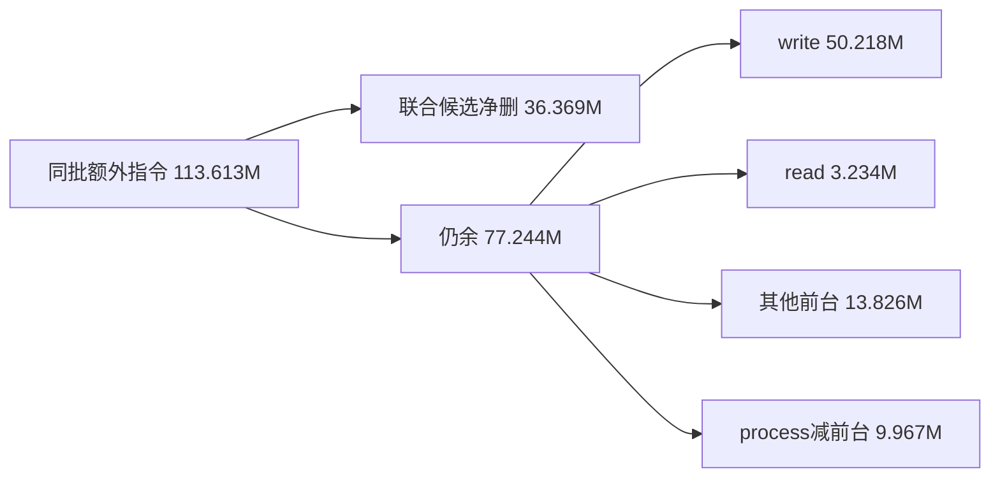

# 原结果接受与范围读：迁移、删量及净价

本包消费唯一蓝图 [§19.20](../br1_pagestore_equivalent_pipeline_20261010/PIPELINE_PLAN.md#read-write-converged-protocol)。生产候选提交 **bb62f28b7a**，主格收益独立确认，整体控制门未过。状态仍只回填原 §13 的 33×6 矩阵。本报告比较 PageStore 完整同义存储管线；没有改变双方工作量，也不将通用 merger/kernel 优化领作 PageStore 收益。

## 实施边界与成本归属

已知最终输入现在由原 operation 的稳定 entry 持有私有输出、generation reservation、physical 责任与完成 proof；接受前不安装 Unpublished version。原 metadata activity 仅借原 entry 指针，阻止冲突 writer/commit/abort。取消沿原 paid retirement/capacity 终点，generation 不倒退。H1 联合接受直接安装结果，并在无旧读者时重绑定原 version/facts/replica 三个槽；H0 仍走共同 canonical policy/root 接受。真实 recoverable handoff、外部 mutable guard 和异步 producer 保留其必要中间态。

packed full/partial 共用一次输入选择；full capture 和重复 base/descriptor 查询退出。内部 fill/copy 的 partial 像素写也接同一 final 入口；整页 alias、默认页删除保留其零复制语义。fill 借一行不可变输入，不为协议迁移制造整页 scratch。noop 仍不产生 generation，但此次选择发生在原 operation 准入后，**新增一次空 session 的成本必须由 noop 控制单独裁决**。

范围读使用原 captured-release 责任，按 shard 每批最多 16 项 retain/release，整个范围仍在同一个选择窗口取得能力。每项 16B，原 facts 64B，原 Page 冷记录不超过 512B。已知 producer binding 直接进入 facts；176B link、独立 binding map、once_flag 退出。范围只固定逻辑版本，访问时仍检查物理 identity/pin；generic fallback 消费同一个 exact 选择。原 full capture/clone、旧读者、最后 guard、abort/close 的消费者共同迁移。

**事前预算方案的一项保留。** 本包没有把 `prepareBackingHandoff` 的逐页 ledger/动态 domain/费用 admission 合成一次。实际 retag 在像素准备期间逐页发生，物理费用不能延迟至 D 接受；当前仍使用原 paid backing 与 rekey，并在原 publication 中合批实际 class changes。此前“合并周围逐页准备”尚未兑现，不把这部分算作已删成本或理论必要下界。收益门不因这项保留而降低；此次价格只归已实施的联合候选，不能称整个蓝图已经闭环。

## 事前数量预测与实际命中

固定主格：4 个 lifetime × 16 次操作 × 16 页，64 次 write 后立即 read，保留 history/undo/redo 和最终 drain。

| 项目 | 事前模型 | 当前隔离计数 |
|---|---:|---:|
| 逻辑结果/写 reservation | 保留 1,024 | 1,024 |
| 无保护旧 Prepared 槽代换 | 上限 960 | 960 |
| 晚 reader 补容量重试 | 依实际保护 | 主格 0；正反例另测 |
| 写内部 full capture | 64→0 | 0 |
| physical spare 复用 | 原 896 保留 | 896 |
| 非默认 backing 出生/最终退出 | 原 192/192 保留 | 192/192 |
| generic proof 节点 | CPU 内部应为 0 | 0 |
| 范围读 cut / 页次 | 64/1,024，另计 undo/redo | 全生命周期 72/1,152 |
| 累计新增 facts block 字节 | 不能等同 live/peak | 15,872 B |

四步 writer policy 被紧凑 reservation/最终 delta 替代；“最多少 2,688 步”是原 896 复用次数的事件模型，未冒充动态调用计数或独立时间。960 是 metadata 槽周转，896 是 physical 复用，两者不得相减或混用。实际数量见 `native-read-write-r1/quantity-run-final`，插桩库只用于事件，不用于净价格。

## 验证与资源

同一最终普通库的双架六组测试共 **10,834 passed / 0 failed / 0 skipped**。公共 69 格 parent/candidate 签名全部一致；upstream 原有导入失败尾 52–55 四格差异保留，因此只称 65 格跨 upstream 一致。计价 13 格均在同义集合内。新旧 ABI 分开编译 fixture，普通库与隔离计数库分别核验，不互用性能值。

新增反例覆盖：native protection projection/abort/history、full/partial/repeated-row、1/4/8/16 BPP、native/generic 比较、noop、晚 full/range reader、旧槽 ABA 及 65,533 次代换后拒绝 wrap。晚 reader 触发一次全 D 新容量准备，不重放 payload；旧 view 保持原字节。pressure 拒绝、回收后恢复、最后 guard 阻止 close 同时覆盖 full 与 native range。

arm64 的专门资源观察（每格一次，不是 P99）：范围 live 增量精确为 **736 + 16K B**，K=1/16/128/1024 分别 752/992/2,784/17,120 B；观测时 reserved=0。K=1024 实页范围创建 124.917 μs；最后 guard 归还加全 Store close 1.774750 ms，payload 最终为 0。它包含整个 close，不能称为范围 release 或锁持有时间。K=1024 写入建立后的 metadata peak 为 6,348,976 B，range 建立前 live 为 3,354,256 B；peak 包含前面的写准备，不能全归给 read。

原始失败全部保留，包括编译/runner 路径、缓存状态回退、exact view 过宽、冷投影漏保留 transaction、测试仍假设已删除 capture/guard、诊断 observer 只在 next 触发，以及资源测试误在初始化后设置限额。修正没有放宽像素、旧读者或原子性合同。已有旧业务价格、旧导入语义差异不被新通过总数覆盖。

## 冻结计价协议

原生产 d5f715 / 测试 HEAD e103b5，固定 upstream 9a24ae0d8c。原普通 dylib 在首次编辑前保全，SHA256 为 `209a3e9e1abe6d0ba346b6f4cab8a520973bebf9080db03f143754768c1a3bc3`。旧库沿用旧 ABI fixture；新库重新编译相同公共 workload。每过程核验实际加载库、退出、语义、指令/CPU 端点和末尾身份。

13 个价格格：0–7、64–68。探索 4 个镜像 block；确认独立 8 个 block，加入 11c689、02bcc 两个旧锚点，在同批轮换和镜像顺序运行。每边每 block 两个过程，奇数 block 逆序 case；不增样本直到过门。bootstrap 10,000 次、seed=12345，以 block 配对均值为单位；区间逐项有效，不是整体同时置信区间。

原门保持：主格 write 指令至少 5% 探索删量且 CPU 点估计为正；确认 write CPU/指令下界 >0，read CPU/指令相对收益下界 ≥−2%，整包 CPU 净收益单侧 95% 下界 ≥0.75ms，12 控制 CPU/指令下界 ≥−2%。资源、真实 GPU、业务 stroke、持锁 P99、晚 reader 在补容量时再次拒绝的完整压力资格分别判断；**M6/M7/M8 仍 0/3、calibration 2/20、默认关闭**。

## 独立确认结果

单位 CPU ms、指令 M。以下为主格，每边 16 个过程、8 个独立镜像 block；区间为收益的双侧 95% bootstrap 区间。

| 同一端点 | 原生产 | 新候选 | upstream | 原生产→新候选收益，95% 区间 |
|---|---:|---:|---:|---:|
| write CPU | 4.847139 | 3.332914 | 0.379925 | **1.514225 [1.443101, 1.580687]** |
| write 指令 | 79.145480 | 56.256215 | 6.038628 | **22.889265 [22.869316, 22.910653]** |
| read CPU | 1.527419 | 0.818383 | 0.397736 | **0.709037 [0.670124, 0.747423]** |
| read 指令 | 17.739732 | 9.223888 | 5.990227 | **8.515844 [8.463904, 8.567347]** |
| 完整 process CPU | 9.711000 | 7.167375 | 1.472063 | **2.543625 [2.328125, 2.759750]** |
| 完整 process 指令 | 140.194958 | 103.825908 | 26.581755 | **36.369050 [36.177616, 36.602083]** |

write 指令降 **28.92%**，read 降 **48.00%**；write CPU 降 **31.24%**，完整 process CPU 降 **26.19%**。完整 CPU 收益单侧 95% 下界 **2.361625ms**，超过事前 0.75ms；write 正收益、read 非劣门均过。这里的 31.24% 是 final-result 整包替换在本用例的 write 收益，**不是 M6 recoverable handoff 的 30% 资格**。

同批旧锚点也确认进步：相对 **11c689**，write 少 23.015751M 指令 / 1.457417ms，process 少 75.469655M / **5.497000ms [5.157920, 5.833144]**；相对 **02bcc**，write 少 31.659460M / 1.978972ms，process 少 44.913510M / **3.084812ms [2.808561, 3.315750]**。因此这次已经越过旧协议成本，不只是修复最近一次回退；这些同批净差不能再与旧批收益相加。

## 控制门与未通过项

| 控制 | CPU 收益点估计 / 双侧95%区间，ms | 裁决 |
|---|---:|---|
| case 4：K1/H1/W1 | +0.001313 [−0.052500, +0.049625] | 无法排除超过2%的回退 |
| case 5：K16/H1/W1 | **−0.132125 [−0.244750, −0.033880]** | 确认回退；进程减前台净增约0.1078ms |
| case 67：反复局部写 | +0.057813 [−0.611200, +0.447690] | 变异过大，未证明非劣 |
| case 68：noop | **−0.240250 [−0.386750, −0.080560]** | 确认回退；write增0.08525ms、read增0.13277ms |

四项未过原控制门，全部保留；不加样本、改阈值或只报指令下降来豁免。所有控制的指令门通过，也不能抵消 CPU 反例。主格改善已经成立，**候选不获整包性能验收**，正式 M6/M7/M8 和业务准入保持原资格。

## 新预算图与残差

以下四项互斥，来自同批完整端点；process减前台是差值，不直接命名为 reclaimer 独占成本。

| 新候选相对 upstream | 额外 CPU ms | 额外指令 M |
|---|---:|---:|
| write | **2.952988** | **50.217588** |
| read | 0.420647 | 3.233661 |
| 其他前台 | 1.228880 | 13.825725 |
| process减前台 | 1.092797 | 9.967179 |
| 合计 | **5.695313** | **77.244153** |

新 write 仍为 upstream **9.32倍指令 / 8.77倍CPU**，占剩余额外指令 **65.01%**。read 已降至约 **1.54倍指令 / 2.06倍CPU**。本次收回同批总额外指令约32.0%、write额外指令约31.3%、read额外指令约72.5%，并未解释余下50.22M写指令的子责任。其他前台 CPU 反增约0.07066ms，process减前台省约0.39102ms；这些已包含在2.543625ms净价，没有只报局部删除。

upstream 的 process-minus-foreground 指令为 −0.016626M，属于两个计数端点的小窗口偏差；保留在账中，不解释成负后台工作。当前区间只约束该机器、workload与批次，不授予GPU或全部业务置信度。

## 下一次实施的边界

1. 先处理控制中已证回退：**已有 immutable root 的零D/短history读取，与真实 overlay 的逐页保护需要不同粒度**。当前统一范围数组使没有新overlay的读也支付K项选择/计数；它是明确的重复保证候选，但尚无独立合法替代净价，不能提前填入回收预算。noop 的空 operation/session 费用也已实测存在，需要原准入/选择的一致方案，不能恢复两次base解析来换一个快路径。
2. write 仍为主要额外责任。下一预算拆分必须对原 ledger动态检查、实际物理claim、私有结果/proof验证、D/adapter/canonical存储及最终退出分账；已删除的通用writer中间态和旧槽周转不得再次计价。逐页hand-off admission尚未合批，不能称“全部剩余都是必要管理费”，也不能直接把50.22M全领为该项预算。
3. 真正补容量失败/重试的跨页压力、联合安装实际alloc/free观测、按K持锁P99、完整保留时长与业务stroke仍开放。本轮资源单次观察与通过总数不能替代这些门。停止扩展本候选样本，下一责任修改需新身份和新有限实验。

事前没有毫秒点预测，只有事件/布局上限，因此不能声称时间预测准确。探索整包2.640250ms、独立确认2.543625ms，差0.096625ms（约3.66%）；这验证效果可重现，不证明技能已经完成最优选项排名或单位成本预测闭环。

复算入口：[account.json](native-read-write-r1/account.json)、[源码/测试/身份索引](native-read-write-r1/source-index.json)、`analyze.py`、`finish_account.py`。完整原始文本、失败和构建命令保存在同目录证据归档；普通/隔离二进制只保留本地，哈希入索引。
