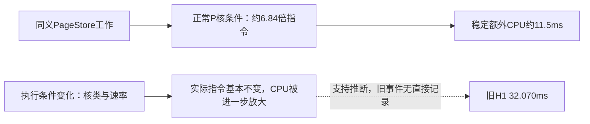

# 慢过程归因：执行条件放大，与稳定的PageStore额外工作分账

2026-10-12；产品仍`11c6895ddf`，同依赖upstream仍`9a24ae0d8c`；产品/产品测试改动0。

**已直接捕获一类自然慢态，并用H1干预验证了执行条件的放大作用。** 同一慢过程中，指令量几乎不变，P/E核执行份额、每指令周期和有效执行速率发生变化，CPU时间增加。它是旧32.070ms最有力的解释，但旧事件没有内核计数，本轮没有重现自然H1的>20ms状态，不能声称旧事件已被唯一证明。正常执行条件下的PageStore差距仍然存在。

## 1. 证据身份与方法

- 自然状态固定68过程：4能力＋8旋转镜像块×8过程。复用原64case输入、四manager寿命、七阶段和即时drain，原库不变；counter off/on仅相差每case边界的两次内核快照。
- 因果干预固定72过程：8能力＋4旋转镜像块×16过程。只取原八case正序，双方均设置自身主线程default或background QoS，分别counter off/on。它改变测试执行条件，不改变产品算法、系统设置或后台调度代码。
- 两批全部自身语义、退出、加载身份及计数端点核验通过；自然64格仍只有60同义，坏尾4格不授性能。原八case均通过原逐次像素、undo/redo断言。无超时、无丢弃、无追采到成功。
- `proc_pid_rusage(RUSAGE_INFO_V6)`提供进程总指令/周期和P核子集；E核为总量减P核。时间按实际Mach timebase换算。与CPU时钟最大边界差自然10.5µs、干预25.542µs；这些是边界核验，不是所有归因项的精度。

[Apple XNU recount说明](https://github.com/apple-oss-distributions/xnu/blob/main/doc/observability/recount.md)明确区分整体与P核计数；[fill_task_rusage实现](https://github.com/apple-oss-distributions/xnu/blob/main/osfmk/kern/bsd_kern.c)对应字段映射。本机SDK、能力实测及原始ticks是实际取数依据，下载的main源码仅作接口解释，不能当作本机内核逐字源码。`ri_runnable_time`只保留原值，本包不把它叫“就绪未运行时间”；不使用core编号推断核类。

## 2. 自然慢态：同一个过程内的直接证据

下表为counter模式；参考值为同侧同case其余15个正式过程的均值。三个case自身均通过本批±0.75ms观察粗门。分组属于探索，不把事后慢/快分组当随机处理。

| 同义入口 / 过程 | 参考CPU→慢态CPU | 指令倍率 | 慢态P核CPU占比 | CPI倍率 | 有效cycles/CPU倍率 |
|---|---:|---:|---:|---:|---:|
| current clear，case28/index52 | 3.083→5.145ms | 1.0104 | 48.64% | 1.3507 | 0.8177 |
| upstream copy，case38/index40 | 13.502→23.025ms | 1.0038 | 27.82% | 1.2590 | 0.7411 |
| upstream clone，case40/index40 | 3.547→7.877ms | 1.0029 | 2.14% | 1.4913 | 0.6734 |

参考组P核CPU均超过99.9%。三次慢态均没有page-in或磁盘读；同一次事件的CPU差分核对通过。实际指令只多0.3～1.0%，不能解释67～122%的CPU增长。有效执行速率下降与CPI增大共同解释时间倍率：

```text
CPU = instructions × cycles/instruction ÷ cycles/CPU
current clear：1.0104 × 1.3507 ÷ 0.8177 = 1.6691倍
upstream clone：1.0029 × 1.4913 ÷ 0.6734 = 2.2210倍
```

这是同端点的精确因子分解；CPI还受指令组合、缓存和竞争影响，不能把CPI变化全部单独归给核类型。这里取得的是“工作量基本稳定、执行条件变差”的直接证据，且**upstream也会发生**。等待可能另有wall影响，但不能把这些已增加的CPU时间全部称为锁等待或队列等待。

## 3. H1干预：执行条件能否造成相应规模的慢态

以counter off完整process CPU为主判据；四块配对中位、pointwise95% bootstrap：

| 侧 | default CPU | background CPU | 配对增量 [95%] | 配对倍率 [95%] |
|---|---:|---:|---:|---:|
| current | 13.256ms | 47.0585ms | +33.6643 [31.1125,35.4070]ms | 3.5174 [3.3125,3.7852] |
| upstream | 1.3405ms | 6.1140ms | +4.4543 [3.4350,4.9890]ms | 4.1299 [3.0718,4.6496] |

两列边际中位数相减不等于配对中位，表中分别保留。current前台CPU配对增加29.6063ms [27.9582,30.4619]，不是单纯等待变长。镜像次序中default恢复较快状态。

同批counter运行提供机制证据：current H1指令中位178.900M→179.560M（+0.37%），P核CPU占比中位100%→16.93%，有效cycles/CPU约4.32→2.18GHz，CPI约0.304→0.588；upstream指令26.103M→26.225M，P核CPU100%→0%。无page-in或磁盘读。这里的GHz是所测进程执行区间的有效速率，不是读取了整台机器的固定频率。进程仍有P核工作，未分线程的计数不能据此断言某个worker的核类。

**干预两种条件的完整观察门均未过**：current default on−off区间[−1.2705,−0.0550]ms，background[−0.3870,4.9410]ms。故off组证明QoS处理能造成大幅CPU变化，on组直接证明其自身的指令/核类变化；不把on的精确P/E比例移授给off组，也不将两组拼成精确机制毫秒账。QoS同时影响核分配和执行速率，并非纯核绑定实验。[Apple调度说明](https://developer.apple.com/documentation/xcode/addressing-cpu-bottlenecks)支持将二者共同看作执行条件。

事前工程预测current为1.5～3.5倍、指令变化<15%。指令预测成立；CPU点估计3.5174倍略高于上限，部分块达到3.7852倍，**范围预测未全部兑现**，不能事后扩大范围再报命中。人工background比旧32.070ms更慢，并非旧事件精确重放，更不是提QoS即可获得的合法产品净收益。

## 4. 对旧32.070ms的判断和置信边界

旧index11开头case1～9跨多种入口一同慢约1.9～2.7倍，case10后大体恢复；case0另受首次初始化与正反序影响，不用其4.4倍混合参考值放大结论。H1前台CPU23.690ms，常态约8.9ms。这更符合一段共同执行条件变化，不能由某个H1专有工作点独占解释。自然捕获与干预提供了能产生该形态/量级的机制。

| 判断 | 证据强度 | 边界 |
|---|---|---|
| 自然捕获的3个慢态主要是执行效率变化，而非成倍增加工作 | 高 | 同过程指令/周期/P-E/CPU直接证据；不拆出全部缓存或频率原因 |
| H1对QoS所改变的执行条件敏感，足以产生几十ms放大 | 高 | 双方对称、off/on、镜像控制；并非原始产品优化 |
| 旧32.070ms由同类执行条件变化造成 | 当前最有力、中等置信的推断 | 旧事件无直接计数；本轮自然H1未复现，仍可能有其他同时因素 |
| 该异常是PageStore稳定相对upstream差距的主因 | 不支持 | 正常P核下仍有稳定约11.5ms额外CPU |

这些强弱标签不是统计概率，不能编造“90%归因概率”。旧样本保留，旧均值/区间不改写；也不能先删除慢样再提高门禁资格。

## 5. 回到PageStore本体预算

自然批H1 counter off额外CPU配对中位**11.5975ms [11.112,11.808]**，均值11.4991ms。H1及H0观察门均通过；H1 current on−off区间[−0.1335,0.2275]ms、前台[−0.0589,0.0738]ms。两侧H1近乎全P核，current实际指令约178.686M，upstream26.118M，约**6.84倍**；总CPI约1.34倍，有效速率接近。

在本批counter数据中，以upstream每指令CPU为代数参考，同块可加账为：

```text
额外CPU均值11.5341ms = 指令数量项8.3409ms + 每指令成本项3.1932ms
数量项 = (Icurrent − Iupstream) × Tupstream / Iupstream
```

该分解依赖参考顺序和指令组合，只说明“执行了更多指令”和“每指令平均更贵”共同形成差额；**不是必要成本、具体管理机制价格或8.34ms可删除预算**。它与counter off均值11.4991ms分列，不替换原主图11.962375ms。



因此后续主线应分开：测量侧继续记录同过程核类/指令/执行速率，预先规定异常处理，保留自然状态端点；产品侧仍须沿原前台建立/读释放/后台回收责任定位额外指令的来源及合法替代，不靠统一提高优先级或删慢样抵扣PageStore本体成本。新增A机制价、全锁因果、C/D缺项及E合法净预算均未自动关闭，M6/M7/M8 0/3保持。

## 6. 复现与失败保留

[事前协议及预测](SLOW_PROCESS_PROTOCOL.md)、[能力程序](slow_counter_probe.cpp)、[边界计数](slow_process_counters.h)、[隔离fixture构建](build_slow_process.py)、[自然runner](run_slow_process.py)、[干预runner](run_slow_qos.py)、[自然分析](analyze_slow_process.py)、[干预分析](analyze_slow_qos.py)、[派生账本](slow-cause-ledger.json)、[独立复核](slow-process-audit.json)。原33项仍为唯一实施状态，本次只在§19追加诊断裁决。

r0探针二参数接口编译失败保留，r1三参数修正后通过；r1日志误标时间字段单位的原值保留，正式r2采用Mach ticks＋timebase并通过时钟核对。准备错误不计成运行成功或性能样本。140个业务过程全部完成；42760项身份、原始日志重解析、计数恒等和同义边界复核通过。原始包、逐成员哈希及重放说明见[原始证据](SLOW_PROCESS_RAW.md)；没有产品改动或正式性能资格提升。
