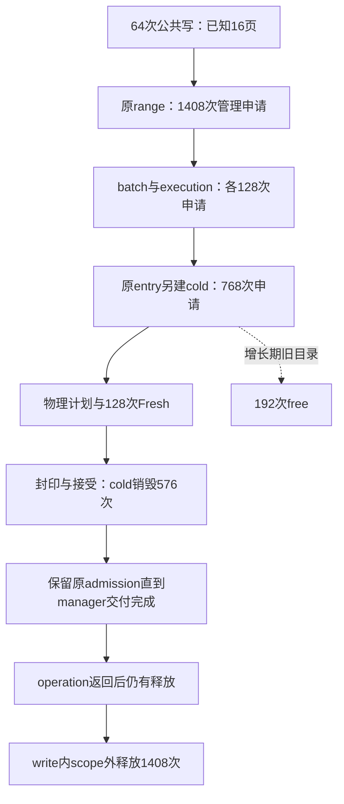

# 新版读写余项补账：分配粒度、预算放大与延后释放

产品仍为 **ed0f229821**，普通库SHA256 `aa92b11501215f7cadc838727712c2cf7f748f55d5d56ff80fec78b627854bf6`，产品和产品测试改动0。本批补查前次target余项8.936M、seal余项5.691M、write外围7.403M；不是优化收益验证。执行状态仍由[92](../../../92_br1_m6_m8_execution_baseline.md)及[原33×6矩阵§19.26](../../br1_pagestore_equivalent_pipeline_20261010/PIPELINE_PLAN.md#rw-residual-cost-audit)裁决。

**新增实证：已知范围仍采用小块/节点逐次存储准备，放大到多次预算准入与释放；交付保留又将部分费用推迟至内部operation返回之后。** 64次主格写在被计数的管理分配器内发生5,096次申请、20,384次本地/父预算prepare/settle锁入口。冷记录768次与范围记录1,408次均由正反顺序复现。不能再只用“metadata／正常管理成本”描述这部分；也不能将所有存储或其父责任费用都当可删除净价。

## 1. 同批总账与证据资格

主格K16/W16/H1、RGBA8，四寿命；写后立即读。write/read各16MiB、1,024页结果、64次可观察写截面不变。当前与同依赖upstream保持同一fixture合同。单位M为百万条指令；CPU是fixture线程CPU，未混入进程或后台差额。

| 同批普通库 | current | upstream | 额外 | 额外pointwise 95%区间 |
|---|---:|---:|---:|---|
| write指令M | 55.084 | 6.028 | 49.056 | [49.033,49.075] |
| read指令M | 9.345 | 5.987 | 3.358 | [3.329,3.381] |
| 读写指令M | 64.430 | 12.016 | **52.414** | **[52.404,52.424]** |
| write CPU ms | 3.196 | 0.356 | 2.839 | [2.803,2.886] |
| read CPU ms | 0.734 | 0.380 | 0.353 | [0.323,0.384] |
| 读写CPU ms | 3.929 | 0.736 | **3.193** | **[3.139,3.269]** |

前批52.407M/3.535ms及52.402M/3.263ms各守冻结身份。产品没有改变，不能将批间CPU下降称为收益。内部责任价格是**current执行量估计**，包含共同必要工作；不能直接作为current−upstream的互斥机制差额。

固定3个能力过程、312个价格过程、3个后置数量过程，共318过程/4,470条case记录。价格13格，能力/数量69格；不是4,470项产品测试。全部退出、reap、装载、各自语义和价格采样次数通过；518个身份文件重新核对。current与派生库签名一致；upstream坏尾52–55仍有像素/存在性不等价，不用于价格。其余价格格的签名/接受结果一致。

价格事前冻结36责任，4镜像块，每责任每case/phase最多16个分层窗口、同序256空窗口修正。主格36责任write指令均通过5%点扰动门；FreshBudget CPU扰动约+22.99%，该项CPU金额拒绝。其余主格write CPU点门通过**不等于细分总账通过**。各控制格及read端点的失败逐项保存在[overview.json](overview.json)，未以主格通过代替控制。区间是4块/10,000次bootstrap的探索性pointwise区间，不包含系统性观察偏差，不能翻译为算法结论的95%置信度。

## 2. 三块旧余项现在落在哪里

新同批写端上层代数账：`55.084 = target 21.200 + seal 17.746 + final其余7.946 + 外围8.192`。其中后两项是父子差，不能当成已识别机制。父子包含关系由[源码区间索引](scope-index.json)及[插桩脚本](instrument.py)确定；下表跨层条目不能相加。

| 责任 / 包含关系 | 本批指令M | 95%区间或解释 |
|---|---:|---|
| target全体 | 21.200 | [20.190,22.654]，含下面各项 |
| physical plan | 12.385 | [11.918,12.853]；继承需深挖的最大单项 |
| target前段 | 2.525 | [2.144,2.878]；含冷记录建立1.646M |
| Fresh分支 | 4.794 | [4.746,4.848]；**128次**，不是1,024次 |
| target后段 | 0.435 | [0.427,0.440]；原result/descriptor记录等 |
| 上述target子项未对齐 | **1.061** | **[−0.334,2.979]，不可分辨**；不能命名为析构或必要余费 |
| seal全体 | 17.746 | [17.689,17.803] |
| D准备 / metadata准备 / 接受 | 3.904 / 2.738 / 5.443 | 三项与下列7段互斥；accept包含安装，不另加 |
| seal前检 / private完成 / claims与alias | 0.492 / 0.335 / 0.562 | 按真实区间命名，不把循环名当单一操作价格 |
| proof发行 / writer归还 / D收集 | 1.744 / 0.338 / 0.350 | proof发行不等于前批3968次ownership查询总价 |
| seal接受后尾段 | 1.681 | [1.678,1.686]；含publication finish0.612M、cold销毁0.565M、finishSegment0.016M，其余0.488M |
| seal子项未对齐 | 0.158 | [0.037,0.273]；小空隙和观察器费用未单独识别 |
| backend范围准备 | 3.947 | [3.910,3.989]；内含原range准入2.973M、beginBatch0.447M、adopt0.416M、其余0.111M |
| backend adapter准备 | 0.297 | 兼容extent/tile准备是实际消费者，不能按包装名删除 |
| backend完成除seal | 0.523 | [0.457,0.589]；含finishPrepared0.086M、execution finish0.134M、其余0.303M |
| backend函数之外 | **2.882** | **[2.147,3.825]**；manager前段、packed范围建立及最后OperationDelivery销毁都在此 |

target的直接非physical子段合计7.753M [7.374,8.150]；seal直接7段合计5.503M [5.501,5.507]。它们解释旧余项中的具体责任，但**不同账期不能用旧8.936或5.691作精确闭环分母**。

Fresh内部进一步为预算/退出准备1.165M、provider2.223M、registerBacking0.469M、其他0.936M。provider含真正payload及物理资源建立，不能全归为管理冗余；128次Fresh也不是已证必要最低量。当前128写期Fresh加64setup主页面与前批192构造一致，但本补充管理分配器不计payload出生，不能伪装成重新完成的全资源出生/退出测量。

backend直接子项比父项多0.455M，差区间[−1.638,0.728]；body−final为0.950M [−0.123,2.022]，都不可分辨。外层直接拼接为8.647M，与代数余项8.192M的差由该未对齐项承担。保留带符号差，不归零、不缩放桶来凑总数。

## 3. 数量账：具体的管理存储放大链

后置[无时钟数量协议](allocation-census/PROTOCOL.md)只观察fixture主线程、预算感知的mutation-storage分配路线；最深责任独占记账。**不包含payload、无预算process allocator、后台线程和全部第三方分配，也未对upstream做对应分配普查。** 因而5,096不是完整全进程分配次数，更不能称为相对upstream多5,096次。

| 主格write最深责任 | 申请次数 | 累计请求B | 累计实际容量B | 对应层次 |
|---|---:|---:|---:|---|
| physical plan | 908 | 129,824 | 129,856 | 896次物理续用仍有管理申请；精确分配调用点未全拆 |
| Fresh分支本段 | 128 | 18,432 | 18,432 | 不含下面budget/provider子段 |
| cold page建立 | **768** | **571,904** | **809,984** | 已知K仍按2槽block逐次增长 |
| Fresh budget | 512 | 156,672 | 157,696 | 真实预算/退休预备记录 |
| Fresh provider | 768 | 88,064 | 90,112 | 这里只数管理记录，不含像素payload |
| D准备 | 284 | 525,824 | 526,464 | publication候选及实际增长 |
| metadata准备 | 64 | 495,616 | 524,288 | 操作级候选 |
| reserve range | **1,408** | **219,136** | **283,648** | 每操作22次，含逐页hash节点 |
| begin batch / adopt range | 128 / 128 | 76,288 / 35,328 | 102,400 / 35,840 | 原scope与execution存储 |
| **合计** | **5,096** | **2,317,088** | **2,678,720** | 累计周转量，**不是峰值或保留内存** |

每次成功申请在该分配器中实测local prepare、parent prepare、local settle、parent settle各一次，四类分别5,096，合计**20,384次预算锁入口**。不包含StorageOwner gate、free结算、页准入及所有其他锁；没有测锁等待。即使无竞争，数组准备、父子预算记账、容量检查和通知等路径仍会执行。保留父预算/公平/拒绝合同是必要的，按小对象重复执行当前整条路径不是已证算法下界。

冷记录数量可与源码增长规则逐项对上：`ColdPageSet`一页inline，15页放入2槽block，需要8个block；目录按1/2/4/8增长，4次目录申请。每operation `8+4=12`，64次为768。构建期间旧目录释放192次，seal时cold销毁576次，合计768；容量11,264+798,720=809,984 B。这里是该容器模型与阶段合计匹配，没有借此宣称全局地址级存储寿命闭合。

range的源码模型为每operation：reservation 1 + 两个8槽block 2 + 目录增长2 + hash桶1 + 16个hash节点，共22次，恰为1,408。`reserveKnownTargetCount(16)`已经知道完整大小，后续原entry还要另建cold记录。原准入冲突和稳定slot责任仍需存在，但逐页节点分配及目录几何增长属于可改变的表示选择。

申请→执行→释放必须连着看：

write共观察2,644次free/1,753,472 B，其中scope外**1,408次/359,424 B**。这是manager端点和内部函数端点不同的实际数量旁证：`finishSegmentLocked(retainAdmission=true)`仍保留原write set/claim，`OperationDelivery`在manager局部对象退出时才释放原batch。不能因finishSegment仅0.016M就认定收尾廉价。scope外金额2.882M尚不能全授给这1,408次free，里面仍有前段与几何工作。

正反序主格write所有事件的次数/请求/容量完全一致；全69格存在120条事件记录差异，涉及17格。主格redo的metadata准备、teardown的清理责任也有差异，全部保留在overview。主线程数量的分配与释放总数不同，不代表泄漏：跨phase寿命、后台释放和未计process allocator均未在本探针闭合。

## 4. 最低路径比较与可删除量边界

仍成立的必要事实是64次观察截面、1,024页结果、有效输入/输出字节、准确冲突/身份/动态保护、原预算责任及唯一最后释放。Ω(B+ΣK)是按页实现的工作量约束，**不是当前机器上的M指令或ms下界**。upstream本批12.016M读写费用也不等于PageStore全部合同的必要最低价。

1. **原operation存储按已知K一次准备**是新增的明确候选。若冷记录在原owner下使用一块可稳定寻址、已收费、保留同一取消/交付终点的K槽存储，冷申请可条件由768降至64，少704次申请及该分配器内2,816次prepare/settle锁入口；slot构造、真实字节清理和一次最后free仍收费。仅预留目录则只少192次申请，仍留下512个block。这是条件事件预测，未实现、未给净毫秒。
2. **原已排序range/ordinal与entry索引统一**，避免为一次已知目标集重建16个独立hash节点；不能取消全局admission，不能另建并行权限目录。1,408次的全部降量尚未证明；泛化到稀疏/动态新增、slot incarnation、cancel/late guard时，需要保持同一协议并计入索引替代开销。
3. **原付费物理对象继续交接、原结果只发行一次能力、同一D接受**仍是大责任主线。physical plan12.385M和seal17.746M不能被上述容器发现遮蔽。descriptor准备存在每页构造单元素vector的源码路径，908与128的分布支持进一步检查，但没有分配调用点标签，不能把其中896次直接认定全部descriptor冗余。
4. **持有与释放按同一生命周期核销**：cold可在seal退出，entry/claim须覆盖adapter交付；将二者塞入同一arena可能延长cold保留。任何合并都必须扣回真实容量、持锁、拒绝、取消和末端free的费用，不按累计申请量推峰值下降。

当前cold建立/销毁合计暴露约2.211M，range准入2.973M，是完整重写可比较的责任边界，**不是已获准净回收5.184M**。本轮没有合法完整替代，因此必要费、可删净指令、净CPU仍为null。已有具体表示放大证据，不支持把52.414M统称正常必要管理成本；也没有证据宣称该新候选是唯一性能榜首。

## 5. 尚未闭合什么，下一笔怎么填

本轮细分暴露了观察器新边界：seal CPU父减子为−0.0255ms，95%区间[−0.0422,−0.0121]；backend未对齐−0.0559ms，上界仍为负；body−final为−0.1020ms [−0.2009,−0.0133]。这些对应实际非负区间，不能解释成“额外负担抵消”。说明全局10%点门不足以保证局部CPU账可加，跨过程执行条件和局部观察偏差尚未消除。**本轮不授予精确CPU机制分账资格**，保留所有样本和空窗修正，不比例校准或扩样直到通过。

下一有限补账沿原矩阵：T01/T02/T07明确manager前段与最后delivery释放，T03/T05将physical内部908次申请落实到实际对象及重复收费事实，T04保留D/metadata/accept的必要与表达成本区分。target未对齐1.061M及body细分仍在误差范围；不能把它们当新热点。候选若准备实施，先给原operation存储与物理/接受管线的完整替代事件账，再用**普通库、无内部scope**比较全寿命净价。没有必要继续逐个测微小函数来制造“全额归因”。

置信分层：同批指令差额和重复的主格数量有强实测支持；具体容器增长与budget放大有源码和计数共同支持；父子微差、跨入口普适性、CPU机制精确价及完整替代净收益仍不足。不能给整体闭环率或一个代表全部结论的置信百分比。M6/M7/M8仍0/3、calibration2/20、默认关闭。

## 6. 复核入口

- [价格事前协议](PROTOCOL.md)、[固定运行器](run.py)、[分析器](analyze.py)、[完整机器账](account.json)。
- [汇总与未闭字段](overview.json)、[原始包](raw.tar.gz)、[逐文件SHA清单](raw-manifest.json)、[518身份/语义/数量复核](verification.log)、[复核脚本](finalize.py)。
- [分配器数量插桩差分](allocation-census/allocator.diff)、[数量观察器](allocation-census/observer.cpp)、[冻结命令](allocation-census/commands.json)。原始包保留318过程所有日志、签名、计数、实际加载库、结束状态及顺序差异。
- 派生库及对象未提交；可按源码身份、脚本和命令重建。已提交的派生差分仅用于诊断，未进入产品库。
