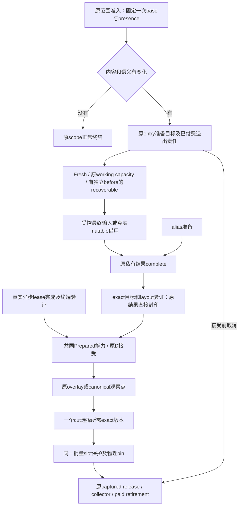

# 统一读写协议：版本迁移完成，性能门未通过

2026-10-12，产品 **ed0f229821a0c9953cd07685a886010ee52e8f62**，父版本 **bb62f28b7a**。本包完成用户要求的协议版本统一；后续优化只修改本协议，不再保留旧CPU分支作为优化路线。正式状态仍由[92](../../../92_br1_m6_m8_execution_baseline.md)维护，设计与唯一33×6矩阵在[蓝图§13、§19.24](../../br1_pagestore_equivalent_pipeline_20261010/PIPELINE_PLAN.md#unified-rw-implementation)。

结论分别成立：生产CPU入口迁移、旧路径清理及双架安全检查完成；**尚未证明协议实现足够快，更未证明剩余费用必要**。本轮主格读写净少1.065M指令，只收回同批额外指令约1.99%；CPU时间未确认改善。0.75ms工程门、read CPU非劣与整体控制未过，不晋升M6。

## 1. 最终唯一事实流

- **CPU原结果只有一个owner。** `KisPagePrivateWrite`是原冷Page的一部分，metadata activity只借用指针。final输入直接complete；mutable等所有guard归还后complete；alias替换同一结果。scope的完成状态和shard保护的reservation分别服务真实锁域，未强行合成无锁布尔。
- **recoverable先保住真实before。** 原状态机仍验证独立before、revision、pin和ABA。CPU候选只安装转换后的before并在同一shard接受原结果reservation，不安装合成writer/target版本；物理claim、预算与retag仍在首字节前完成。lease producer仍安装自己真实需要的writer。
- **取消不再假装需要writer元数据存储。** 原scope撤reservation，把已经付费的原记录交retirement。provider拒绝延续原债务；逻辑取消完成不等于物理释放完成。真实活动guard、execution和最后facade仍阻止过早终结。
- **CPU完成直接成为能力。** 删除私有结果→VersionInfo→私有结果的封印往返。固定successful Host票据在issuer绑定时验证，逐页匹配同一不可变票据；exact target/layout、provider动态验证、nonce、transaction、一次消费仍保留。generic lease仍验证真实completion并保留真实ledger记录。
- **读只有一个例外保护与释放实现。** full view保留不可变root和clone/export需要的稀疏delta；range仅保留所选K页的exact ref。两者都由`retainNativeReads/releaseNativeReads`和原captured release队列接续。range按ordinal直接访问，移除排序后每页二分。

本轮否决了“零D range直接保留完整root”的早期实现：它会保活范围外的历史页，降低前台保护次数却扩大保留责任。因此§19.22F的O(1) root候选**没有作为最终方案采用**；range仍是O(K)精确保护。直接ordinal排列只把相邻同shard元素合批，可能比旧排序增加锁批次。不能把“没有排序”误写成“读算法已最优”。

## 2. 旧协议清理账单及代码索引

[全量检索](full-source-keyword-census.json)覆盖6760个Git源码/头文件/CMake及实际编译的非生成源码；[可重跑脚本](finalize_evidence.py)、[全部消费者](protocol-consumers.json)、[逐文件改动/hunk/哈希](source-index.json)绑定最终源码。冻结证据与生成构建目录不作为活跃caller。初始172处关键词命中保留在[清理前](old-keywords-before.txt)，最终保留命中见[清理后](old-keywords-after.txt)。

活动文档另做[全量关键词处置核对](document-check.json)：更新状态机合同、handoff/API/代码索引、取消说明及当前92；旧LP蓝图和5173流程图明确冻结身份，保留词不再指导新版实施。没有搜索或依赖archive目录。原33行六列及新增文档链接已复核。

| 原矩阵及责任 | 本次实际删除/迁移 | 最终代码与保留理由 |
|---|---|---|
| T03.1 CPU目标 | final专用`KisPageNativeWrite`及reserve/complete/cancel旧名；mutable/source初始化/recoverable的通用writer fallback | Store `prepareTarget/sealImpl/cancelPageLocked` → Metadata `reservePrivateWrite/completePrivateWrite/cancelPrivateResult`；原entry终结全部CPU目标 |
| T03.1 alias | `AdoptPreparedWrite/ReplacePrivatePreparedBacking`枚举、policy body、dispatch、scope分支 | `replacePrivateWrite`只接受原reserved/completed/未封印结果；拒绝外国结果、同物理槽、已可见槽和错误generation；旧target交原退出责任 |
| T03.1 recoverable | CPU中间writer pin及target version | `prepare/installRecoverableWrite`借用原result；真正lease、before转换policy和原物理claim保留 |
| T04.2/T05.1 proof | `nativeWriteSnapshot`、`sealPreparedPageImpl`、`cpuDestination`、CPU arena fallback | `sealCpuPreparedPage(KisPagePrivateWrite&)`；generic `sealPreparedPage`有真实异步caller；诊断`versionSnapshot`能投影完成结果但不再用于CPU封印 |
| T01.1 选择/identity | noop比较前发行operation/writer身份；pending参数与alias重选base | 同一已准入base比较，变化才发行；alias借原结果；不新建第二查询/capture |
| T06/T07 capture | Store/ReadCoordinator每页token Retain/Release dispatch、captured cleanup字段、range排序后二分 | full/range例外共同exact-ref保护与原释放队列；root、surface/default/removal和clone输出仍按真实cut保留 |
| T08 测试专用壳 | `overwriteFinalPage/writeFinalPage`、单项`retainNativeRead/releaseNativeRead` | 测试改走真实`writeFinalRect`与批量ref API，生产不保留测试专用协议 |
| T03/T04 lease命名 | `prepare/install/publish/cancelPrivateWrite`含混接口 | 明确`acquire/prepare/install/publish/cancelLeaseWrite`；仅真实lease consumer使用，共同D不是CPU fallback |

**17个退役符号在全量源码检索中为零。** 未把每个包含native/legacy的词视为旧协议：`nativeRange`表达rootless范围与资源统计；`nativeWrite`等私有字段/helper表示原结果或最终安装，不是版本选择开关。`AcquireRecoverableWrite`仍提供真实before验证。`RetainCapturedVersion/ReleaseCapturedVersion`仍在通用状态机/metadata参考能力与oracle测试中，但PageStore/ReadCoordinator已无生产dispatch；不将参考模型覆盖误算为另一条活跃捕获管线。

生产13文件 **+274/−444，净−170行**；测试4文件+219/−266，净−47；审计工具净+9；重新生成的调用图/库存净+4010单列，不能算产品复杂度。没有新增owner、第二write-set、版本目录或重试队列。新recoverable candidate只增加一个非拥有指针。facts仍64B、冷Page仍受512B门约束。

## 3. 安全、资源及失败账

最终普通universal image库SHA256：`aa92b11501215f7cadc838727712c2cf7f748f55d5d56ff80fec78b627854bf6`。双架六组 **10816 passed / 0 failed / 0 skipped**，逐组加载身份见[verification.json](verification.json)、[ARM](safety-final-arm-2/results.json)、[x86](safety-final-x86/results.json)。每架Reference1037、ResidentRead221、CpuMutation1907、Foundation28、PhysicalClaim398、manager1817。

[最终提交绑定](final-identity.json)确认ed0f229821相对bb62的binary diff与计价前冻结source.diff逐字节相同。`net/identity.json`保留fixture链接时身份，随后alias异常修复仅重链接运行库；最终实际加载身份以双架安全及capability/confirm记录为准，不混用较早库。

较旧批测试总数少18不是少跑失败样本：每架删除已退休enum的6个历史×alias组合，并将旧Prepared替换的13格迁为原私有能力8格，新增alias binding拒绝2格，净−9。旧读者/pin/last-use保护由真实scope、physical claim、retained reader及generic测试继续覆盖。新增alias分配、binding异常均检查原结果可重试且无物理泄漏。

覆盖原guard/last-facade退出、真实recoverable、slot ABA、晚reader、source/alias/remove/default、partial/repeated-row/noop、父子预算和容量拒绝、物理退休拒绝后恢复、完整与范围capture、generic fallback、clone及manager出口。不是全并发穷举，TSAN及完整正式业务/压力资格没有新增。

完整安全日志因`-maxwarnings 20`抑制后半段QINFO，随后仅补跑资源函数以取得数值，未追加性能样本：[ARM资源](resource-arm/KisPageStoreCpuMutationTest::nativeRangeResources.log)、[x86资源](resource-x86/KisPageStoreCpuMutationTest::nativeRangeResources.log)。该补跑不累加进10816。K1/16/128/1024，默认与实际页两种状态，新增live metadata分别 **704/944/2736/17072 B＝688＋16K B**，比bb62的736＋16K少48B；reserved为0。最后guard保持范围存活，释放后close成功、provider committedBytes为0；range不保留完整root。

ARM实际页K1024 capture约115μs，释放并close约1.216ms，metadata总峰值6,348,976B包含前置建页；这些是单次资源探针，不是锁持有P99，也不是本协议独占峰值或普遍保留时长证明。full view增加exact-ref数组、同时减少原token节点，其跨规模峰值净价仍未单独闭合。

[最终结构门](architecture-final.log)通过：21 manifest、26 ownership、16 census、2310 API、31536反向调用边、19外部侵入文件；[6项工具自测](audit-tests.log)通过。布局/侵入上限没有上调。工作树首次工具门失败因旧审计仍要求已退役binding map，已按真实原facts修正并重建Clang图，旧失败保留。

所有开发失败保留在build-1…10、safety-dev-*、safety-final-arm日志：包括初次const编译错误、重链接未完误跑旧测试二进制、对已删除状态/存储拒绝的旧断言、最后新增alias binding bad_alloc反例。最后一项找到真实异常逃逸，已转为原存储拒绝并由原allocation RAII回收。没有丢弃性能失败样本、削弱像素/物理最终释放断言或换更好的旧库报最终结果。

## 4. 固定同批价格及upstream差额

三边为冻结bb62普通库、最终候选、同依赖upstream9a24ae0d8c。先3个能力过程，69格/边；candidate与parent语义相同，upstream导入52–55保留旧差异，不纳入价格主张。再固定8个镜像顺序block，每边每块2过程，共48过程、13价格格、624记录。全部语义、退出、源diff与加载库身份核对通过；[原始结果](confirm/results.json)、[统计](confirm/analysis.json)、[互斥账](account.json)。能力与计价共831格记录，不是831种独立能力。

使用普通库、内部phase关闭，fixture边界CPU/指令读数保持；不能称完全无观察开销。每块先平均同边两次，再配对bootstrap10000、seed12345。下表区间为双侧95%，门采用单侧95%下界；均是逐端点区间，未作同时家族覆盖。没有探索批、删样或追样。

主格为K16/H1/W16：

| 端点 | bb62 | 新协议 | upstream | 本轮节省（正为更好） | 新版额外成本 |
|---|---:|---:|---:|---:|---:|
| write 指令M | 56.262637 | 55.088893 | 6.028514 | **1.173744** [1.128867,1.232703] | **49.060378** |
| read 指令M | 9.225197 | 9.334326 | 5.987564 | **−0.109129** [−0.137437,−0.083332] | **3.346762** |
| 读写指令M | 65.487834 | 64.423219 | 12.016078 | **1.064615** [0.999957,1.136057] | **52.407141** |
| 完整process指令M | 103.706766 | 102.763065 | 26.568561 | **0.943701** [0.805706,1.097217] | **76.194504** |
| write CPU ms | 3.308447 | 3.493532 | 0.363602 | −0.185084 [−0.618468,0.125219] | **3.129930** |
| read CPU ms | 0.761363 | 0.791302 | 0.386636 | −0.029939 [−0.138049,0.056931] | **0.404667** |
| 读写CPU ms | 4.069811 | 4.284834 | 0.750237 | −0.215023 [−0.750141,0.180737] | **3.534596** |
| 完整process CPU ms | 6.939750 | 7.357875 | 1.421437 | **−0.418125** [−1.376591,0.299878] | **5.936438** |

读写已包含在process中，不相加领取。完整process减前台仅是其它线程费用，不能自动命名为reclaimer或锁。旧**53.451M／3.374ms**属于之前bb62批次；本批bb62读写extra约53.472M／3.320ms，新extra52.407M／3.535ms。不得跨批相减报净收益。

**门裁决：** write指令正收益成立，CPU正收益未成立；read指令仍在−2%非劣范围，但read CPU非劣未成立。整包0.75ms下界门未过。12控制中case0–6、65–67的CPU下界未过−2%，全部指令控制通过，case64/68 CPU通过；失败控制的绝对CPU区间均跨0，故称“非劣未证明”，不能称10格全部确认回退。未将不确定性解释为无损或归因外部噪声。保留原控制与业务欠项。

## 5. 理论兑现与下一轮边界

本轮先承诺可核验的表示删除，没有可靠净毫秒预测，保留原0.75ms工程目标。CPU mutable/source/alias/recoverable已不产生中间writer版本；封印往返、无变化页的两类ID发行、生产captured例外token链均删除，凭源路径、caller和安全反例核验。**本轮未插入新的内部事件计数器，不能把静态删除另报为本批1024/3968等实测数量。** 原主格在bb62已是final原结果路径，因此推广mutable的删量不会全部命中它；相邻一致性清理也不等于删掉physical-plan主费用。

实际只削减同批read/write额外指令约1.99%，write仍约upstream9.14倍指令，说明主要问题没有随版本统一消失。现有数据支持“若干冗余已删、最大费用尚在”，不支持“52.407M全部必要”或“已证明锁是主因”。A必要事实、B必要但昂贵表示、C算法可避免三类金额仍不能精确拆完。

后续限定在本协议的三个责任内，继续沿原33行计价：

1. **T03/T05：原付费backing→目标准备。** 延续真实record/reservation，以操作粒度准备stage peak；区分原768次零delta与128次实际补debt的旧诊断事实，保留动态父子预算、公平等待、ABA和物理claim。当前逐页admission/domain同步仍存在，未实施批量预算，不领0.752ms physical-plan全价。
2. **T04：原能力→D接受。** 复用scope/commit claim有效期，减少固定proof归属查询；接受点仍复验变化的head/reader/slot/provider。当前重复ownership查询、Retiring扫描未归零；可按原shard维护聚合，但新增写侧维护需扣净价。
3. **T06/T07：原exact ref批量锁组织。** 保持O(K)范围保留与ordinal访问，在原短寿命ref存储中比较有界分组索引/映射；同时计入多次shard锁、临时存储、full view与最后释放。不恢复旧token协议，也不靠保活整个root伪造K→1收益。

上述是待验证的新版实现优化，不是允许旧CPU协议继续存在的豁免。本轮版本迁移闭合；完整性能、保留时长/持锁P99/峰值压力、全部业务入口和M6正式资格仍未闭合。M6/M7/M8 **0/3**、calibration **2/20**、默认关闭。
